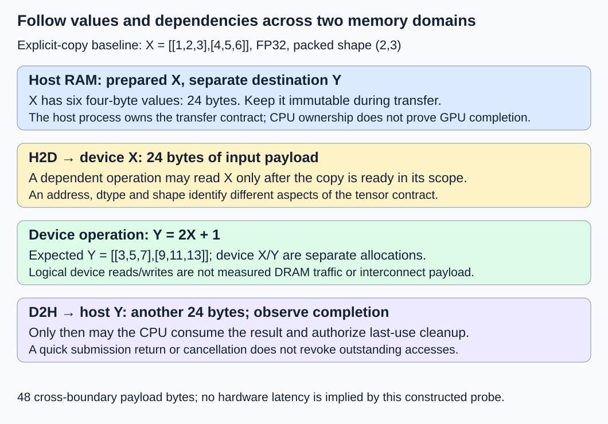
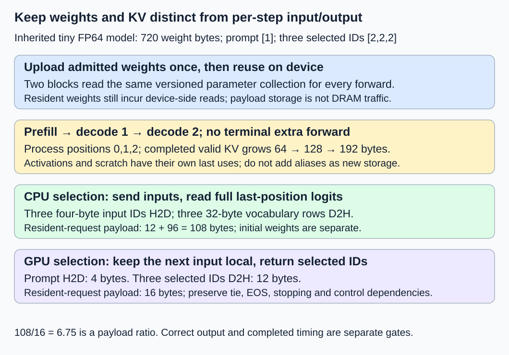

# M3-C01: Following a tensor from CPU to GPU

> **Status: Complete — detailed chapter authored and documentation validated; experimental procedures are proposed unless explicitly labelled observed**

**Module:** Learn GPU architecture through data movement

**Category:** [Hardware architecture and topology](index.md)

[Module 3 reading order](../module-3.md) · [Next: M3-C02](m3-c02-reading-gpu-specifications-and-capability-limits.md) · [Execution plan and progress](../chapter-execution-plan.md)

## Target concepts

Host versus device, CPU and GPU roles, host RAM and device memory, kernels, weights, activations, KV state, input and output movement.

## Concepts

### 1. Two places to execute work

The **CPU**, or central processing unit, runs the host application: preparing requests, arranging storage, submitting work and handling results. The **GPU**, or graphics processing unit, can execute many related numerical operations in parallel. In this chapter, the **host** is the CPU side and its memory; the **device** is one GPU and its associated memory. A **kernel** is a function invoked for execution on the GPU. It is unrelated to the operating-system kernel.

A Rust serving process can own a device buffer and submit a library operation while the numerical work runs elsewhere. “Rust owns the buffer” does not mean the tensor's elements are stored in ordinary host RAM or that dropping a host object proves device completion. [M2-C04](../state-memory-and-caching/m2-c04-memory-ownership-handles-and-lifetimes-from-first-principles.md) establishes ownership and external-reader obligations; [M1-C14](../model-computation-and-semantics/m1-c14-assembling-a-small-decoder-only-transformer.md) specifies the reference model, and [M1-C18](../runtime-and-concurrency/m1-c18-understanding-prefill-and-decode.md) distinguishes prefill from decode. No kernel, device binding or engine implementation is supplied here.

A GPU is not automatically faster for every job. A small tensor may spend more time on submission, transfer and waiting than on arithmetic. CPU control and GPU compute can overlap only when dependencies and resources allow it. The [CUDA 13.4.2 programming-model introduction](https://docs.nvidia.com/cuda/archive/13.4.2/cuda-programming-guide/01-introduction/programming-model.html) provides the language-independent host/device/kernel terminology used here. Later chapters examine execution units and hardware capabilities; this chapter starts with observable data movement.

### 2. A tensor needs a location as well as a shape

A **tensor** is an array with a shape and an element representation. Shape (2,3) means two rows and three columns. A **dtype** describes how an element is represented; FP32 is a four-byte, 32-bit floating-point value, while FP64 occupies eight bytes. **Strides** describe the byte steps between neighboring elements along each dimension. They distinguish an ordinary packed array from a view with gaps or transposed access.

Use the following exact transport probe. X has shape (2,3), row-major storage, FP32 and values [[1,2,3],[4,5,6]]. Row-major means each row's elements are consecutive. Its row/column strides are 12/4 bytes. For zero-based row i and column j, **byte offset = (3i + j) × 4**, yielding offsets 0, 4, 8, 12, 16 and 20. Its payload is:

**M = product of shape dimensions × bytes/element = 2 × 3 × 4 = 24 bytes.**

For the probe, a device operation must produce **Yᵢⱼ = 2 × Xᵢⱼ + 1**, giving [[3,5,7],[9,11,13]]. This is a mathematical result contract, not an implementation. These small integers and results are exactly representable in FP32. Compare every element: swapping two values preserves a checksum but violates the tensor contract.

| Object | Location and role | Validity condition |
|---|---|---|
| Host X | Prepared input in CPU-accessible RAM | Immutable while an outstanding transfer may read it |
| Device X | Destination of host-to-device transfer, later kernel input | Copy completed in the consumer's dependency scope |
| Device Y | Kernel output, later transfer source | Kernel completed before a dependent readback |
| Host Y | Destination of device-to-host transfer | Readback completed before CPU consumption |

The two X objects have equal contents after a successful copy, but remain separate allocations in this explicit-copy baseline. An address is meaningful only with its allocation identity, location, bounds and lifetime. A device pointer must not be treated as an ordinary CPU slice merely because its numeric value fits a host-sized integer.

### 3. Name the memory system before describing a copy

The baseline is one discrete GPU with explicitly allocated device memory and explicit copies. **Host RAM** is the CPU's main memory. **Device memory** is the GPU's bulk storage, commonly called VRAM. **H2D** means host-to-device and **D2H** means device-to-host. On a typical discrete system, these transfers cross an interconnect such as PCIe; local GPU reads use a different memory path. The installed topology must be recorded rather than assumed.

A device-to-device copy can move data between GPU allocations without a host readback. Reading weights from device memory during a kernel is also device-side movement, even if there is no copy API call. Tensor payload, interconnect transfer volume, logical device reads/writes, actual DRAM transactions and allocator backing are separate quantities.

For the probe, H2D carries 24 bytes and D2H carries 24 bytes: **48 bytes of explicit cross-boundary payload**. The operation logically reads 24 bytes of device X and writes 24 bytes of device Y. Those logical accesses do not establish 48 measured DRAM bytes; caching, transaction granularity and implementation can change traffic. Device X plus Device Y require at least 48 bytes of payload storage when both are live. Allocation rounding, runtime state, host staging and instrumentation are additional.

**Pageable** host memory can be moved between RAM and backing storage by the operating system. **Pinned**, or page-locked, host memory is kept resident under the relevant allocation/registration contract and is often required for predictable asynchronous transfer paths. This is different from a logical access pin that tracks a submitted operation's lifetime. Pinning alone does not prove overlap or correctness, and pinning large amounts consumes a limited host resource.

Integrated GPUs or systems with shared/coherent memory can have different placement paths. **Unified virtual addressing** provides an address-space arrangement; it does not make all storage equally local. **Managed/unified memory** can provide automatic placement or migration depending on device/system capabilities. Mapped host memory can also be accessed through a supported device path. The [CUDA unified/system-memory guide](https://docs.nvidia.com/cuda/cuda-programming-guide/02-basics/understanding-memory.html) distinguishes these mechanisms. None removes dependency, ownership or locality questions. Report a shared-memory/migration experiment separately from this explicit-copy baseline.

### 4. Submission is not completion

A **stream** is an ordered sequence of device work. For this baseline, submit the input copy, transformation and output copy to the same explicitly identified stream, then observe completion of the required chain before reading Host Y. If different streams are used, the producer/consumer dependency must be explicit. An **event** is a marker associated with stream progress; its useful guarantee depends on where it is recorded and which work it covers.

The [CUDA asynchronous-execution guide](https://docs.nvidia.com/cuda/cuda-programming-guide/02-basics/asynchronous-execution.html) explains streams, events and dependency tracking. The [CUDA Runtime 13.4.2 synchronization specification](https://docs.nvidia.com/cuda/archive/13.4.2/cuda-runtime-api/api-sync-behavior.html) cautions that copy-call behavior depends on arguments and memory type; an “Async” name is not a universal nonblocking promise. Kernel launches are asynchronous with respect to the host. A quick API return is neither a completed computation nor a guarantee of transfer overlap.

The following timeline is **constructed**, with time in microseconds (µs). One µs is 1,000 nanoseconds; 1,000 µs is one millisecond. Copy/kernel intervals are stipulated, not GPU measurements.

| Host-observed or stipulated event | Time | Meaning |
|---|---:|---|
| Input-copy submission begins | 0 µs | Start the completed-round-trip boundary |
| Submission returns; dependent work is queued | 1 µs | No output-read or buffer-reuse authority follows from return |
| Request cancellation is recorded | 3 µs | Result no longer wanted; submitted accesses remain live |
| Input copy completes | 4 µs | Host X becomes eligible for release once that completion is known |
| Transformation completes | 10 µs | Device Y is ready for its ordered output copy |
| Output copy completes | 13 µs | Host Y contents are ready; cancelled result must not be published |
| Host observes chain completion | 14 µs | Completion evidence covers all three operations |
| Authorized pool cleanup finishes | 15 µs | Buffers can be reused under their identity/lifetime contract |

In a matching noncancelled trace, caller-readable completion is 14 µs, while submission took only 1 µs. The stipulated device dependency chain lasts 4 + 6 + 3 = **13 µs**; host observation adds another 1 µs. Do not add overlapping host submission and device work as if they were serial phases. In the cancelled trace, no successful result latency exists; known cleanup occurs 12 µs after cancellation. Timeout or device loss without completion evidence needs explicit quarantine/worker retirement, not forced buffer return.

The host cannot reuse Host X at 1 µs or read Host Y merely because submission returned. An event covering only H2D does not prove the later kernel/readback completed. Keep device X/Y and the host output destination valid until their last access completes; retain request/attempt and allocation-generation identities so a late callback cannot affect a reused buffer.

### 5. Follow weights, activations and KV through a small model

**Weights** are fixed model parameter tensors. **Activations** are intermediate values created by forward computation. **KV state** is per-layer attention data retained for later positions. They have different lifetimes: resident weights can serve many requests, activations often die after their consumers finish, and KV grows with processed positions until safely released or retained by a cache.

Use M1-C14's unchanged FP64 model: 90 parameter values occupy **720 bytes** of dense payload. Upload the admitted parameter collection once, then keep it device-resident for the following request. Do not confuse that upload with the many device-side weight reads during computation.

Use M1-C19's R2 request: prompt [1], output cap three, EOS ID 3, greedy lowest-ID ties, no text stop. Its inherited expected selections are [2,2,2], ending by length. The model's context reservation P + G = 4 stays within its four-position bound. IDs use an explicitly specified unsigned 32-bit transport representation, four bytes/ID; this is not the FP64 representation of model activations.

| Forward | Newly processed input and absolute position | Completed KV length | Unique valid KV payload | Selection |
|---|---|---:|---:|---|
| Prefill | ID 1 at position 0 | 1 | 64 bytes | ID 2 |
| Decode 1 | Selected ID 2 at position 1 | 2 | 128 bytes | ID 2 |
| Decode 2 | Selected ID 2 at position 2 | 3 | 192 bytes | ID 2; length termination |

The cache stores K and V for two layers, one KV head/layer, two features/head and eight-byte values. Thus **k = 2 × 2 × 1 × 2 × 8 = 64 bytes/position**. Each forward adds 64 bytes of valid KV, rather than transferring the entire cache through the host. There is no extra forward for the final selected ID. A new hidden row of width two occupies 16 bytes; the last-position vocabulary row has four FP64 scores, or 32 bytes. These are named payloads, not a sum of simultaneously allocated activations; aliasing, scratch and layout need their own manifest.

Consider two result-placement policies with identical greedy/stop semantics:

| Per-request transport, resident weights excluded | CPU selects from full last-row logits | GPU selects; host receives each selected ID |
|---|---:|---:|
| Initial prompt H2D | 4 bytes | 4 bytes |
| Later decode-input IDs H2D | 2 × 4 = 8 bytes | 0; selected IDs remain available on device |
| Result D2H after each of three forwards | 3 × 32 = 96 bytes | 3 × 4 = 12 bytes |
| Total explicit payload | **108 bytes** | **16 bytes** |
| Including the one 720-byte weight upload | **828 bytes** | **736 bytes** |

The GPU-selection policy still reports each selected ID to the host and waits for the declared stop decision before dependent continuation; it does not automatically remove three host/device control exchanges. It requires the same tie/EOS rule and a device-held selected ID valid until its next consumer. Output ID 2 maps to the inherited visible fragment c, so both policies produce ccc. Text assembly on the host is separate from transporting a four-byte ID.

The 108/16 = **6.75 payload ratio** is not a speed ratio. Both paths still execute the same model, device reads and required dependencies. Full logit/KV diagnostics add transfers outside this minimal primary ledger and must be labelled. Likewise, retaining weights avoids repeated H2D uploads but does not eliminate device-memory bandwidth costs. Deliberately exporting KV after every forward would copy 64 + 128 + 192 = 384 bytes D2H; restoring it before the two later forwards adds 64 + 128 = 192 bytes H2D. That extra **576 bytes** is a separately named diagnostic/offload policy, not a requirement of cached generation.

## Experiments

### E1 — Verify a tensor round trip before timing it

- **Description:** Follow the six-value FP32 tensor from host input through an ordered device transformation and host readback.
- **Purpose/objective:** Establish shape, dtype, values, placement and copy-direction correctness independently of performance.
- **Target concepts:** Host/device roles; RAM/device memory; kernels; input/output movement.
- **Baseline and workload:** CPU mathematical Y = 2X + 1 reference for X = [[1,2,3],[4,5,6]], compared with the proposed explicit-copy single-GPU path.
- **Controls and prediction:** Fix shape (2,3), row-major strides, FP32 and separate X/Y allocations. Predict the six exact output values, 24 bytes per copy direction and no CPU access before output completion.
- **Procedure:** Record allocation and operation identities, copy direction and bounds. Observe the complete dependency chain, compare every returned value, then authorize cleanup. Add labelled wrong-stride, swapped-row and stale-output negative records; require the oracle to reject them.
- **Hardware/software:** CPU arithmetic for reference; a supported single GPU, compatible runtime/library and explicitly recorded memory type/stream for a future device run. No multi-GPU or network hardware is required.
- **Failure and HFT connection:** A correct address with stale or reordered content resembles a reused event buffer containing the wrong market event. The analogy motivates identity/value checks; it supplies no inference or trading result.
- **Exit criteria:** Exact element/shape/dtype/stride and lifetime checks pass; all negative records fail their designated gate. Payload counts reconcile without claiming observed DRAM traffic or elapsed GPU speed.

### E2 — Audit a resident-model prefill/decode trace

- **Description:** Compare the two output-placement policies for the unchanged R2 model request.
- **Purpose/objective:** Distinguish persistent weights, temporary activations, growing KV and necessary host/device boundaries.
- **Target concepts:** Weights; activations; KV state; CPU/GPU selection; input/output movement.
- **Baseline and workload:** M1-C14's 720-byte weight manifest and M1-C19 R2; three forwards, three selected IDs and final valid KV of 192 bytes. Reference model behavior is inherited; no new device result is claimed.
- **Controls and prediction:** Fix model/parameter identities, FP64, positions, masks, greedy/tie/EOS/length policy and full attention. Change only selection/result placement. Predict 108 versus 16 resident-request transport bytes and identical [2,2,2] output.
- **Procedure:** Trace each tensor's producer, location, consumer and last use. Validate complete logits against the CPU reference in diagnostic runs before using ID-only readback. Audit weight upload once, per-step input/result copies and KV growth; label any added debug/offload copies separately.
- **Hardware/software:** CPU reference reasoning; an eventual supported FP64 backend and compatible device-side selection capability for the GPU policy. Record unsupported capabilities rather than silently changing precision or model.
- **Failure and HFT connection:** Stale parameter versions or wrong cache positions invalidate a result even if few bytes move, just as stale state invalidates time-sensitive decisions. Numerical and market semantics remain different.
- **Exit criteria:** Model-specific mixed numerical gates, exact selections/stops and allocation lifetimes pass. Both transport ledgers and all three KV lengths match; no payload ratio is reported as speedup.

### E3 — Separate submission, cancellation and safe reuse

- **Description:** Audit the constructed microsecond timeline and its completion/lifetime faults.
- **Purpose/objective:** Prevent early reads, source mutation, premature return and stale completion effects at the host/device boundary.
- **Target concepts:** Kernels and asynchronous completion; host/device buffer ownership; failure recovery.
- **Baseline and workload:** One ordered H2D → transform → D2H chain, observed at 14 µs, with noncancelled and cancellation-at-3-µs variants.
- **Controls and prediction:** Fix operation/request/attempt/generation and stream scope. Predict a 14 µs completed noncancelled interval, not 1 µs; cancelled work produces no published output and cleanup occurs at 15 µs.
- **Procedure:** Identify which completion evidence covers each last use. Apply the fault matrix below as paper/model probes. A future runtime may delay or duplicate completion notifications only through a safe test interface; do not deliberately perform undefined early memory accesses on hardware.
- **Hardware/software:** CPU event-ledger audit; real asynchronous runtime/device and scoped completion instrumentation for empirical validation. The stipulated times require no particular GPU capability.
- **Failure and HFT connection:** Cancelling interest in a buffer does not stop its producer or consumer, a common concern in low-latency event processing. Retain uncertainty after device loss; no financial interpretation is implied.
- **Exit criteria:** Every unsafe access/return is rejected by the model; known completion drains once; old-generation callbacks do not discharge new work. Unknown completion remains protected and is not counted as a successful result or cleanup.

### E4 — Compare complete CPU and GPU paths across tensor sizes

- **Description:** Benchmark a CPU result path against completed explicit-copy GPU transformation, including required transfer and wait costs.
- **Purpose/objective:** Discover where setup/data movement matters and test whether a local kernel result improves caller-visible completion.
- **Target concepts:** CPU/GPU roles; movement/compute dependencies; completed timing; workload-dependent bottlenecks.
- **Baseline and workload:** Packed FP32 shape (1,N), N = 6, 256, 4,096 and 262,144. Set value xᵢ to (i modulo 16) − 8; reference yᵢ = 2xᵢ + 1. This uses the same transformation but a different value fixture from E1. Three sessions and twenty balanced CPU/GPU pairs per size yield 240 pairs/480 measured trials; five excluded warmups per path/size/session add 120 trials.
- **Controls and prediction:** Hold prepared input, numerical contract, buffer preparation, CPU thread/build policy and GPU stream fixed. Preallocate outside both timed paths. Predict exact outputs and 8N cross-boundary bytes per GPU trial; no crossover size or speed winner is asserted.
- **Procedure:** Time input-ready through complete caller-readable Y using a local monotonic host clock. Retain submission latency separately and use scoped device events only in diagnostic runs. Balance path order, randomize size order by session, validate outside primary timing and drain before reuse. Profile a separate subset to attribute copies, kernel, host gaps and observation overhead.
- **Hardware/software:** Actual CPU and one supported GPU, recorded specifications below, compatible FP32 backend and declared host-memory type. This untrained elementwise probe needs no model weights or KV and cannot establish serving throughput.
- **Failure and HFT connection:** Small jobs can lose to orchestration cost even when an accelerator executes arithmetic quickly. The transferable concern is completed response latency; no network/exchange latency or profitability claim follows.
- **Exit criteria:** All 480 attempted trials have outcomes, every completed value passes exact checks and all buffers remain valid. Report paired distributions, CPU/GPU conditions and observer effects. Accept an inconclusive result; this sample does not establish production p99.

## Verification

### V1 — Use elementwise identity, not only a checksum

Verify offsets 0–20 by four-byte steps, six initialized FP32 inputs and six returned outputs. X sums to 21 and Y to 48, which are useful audit checks but insufficient for row/column identity. A swapped-row result also sums to 48 and must fail. Reject wrong byte count, shape or unsupported stride before submission rather than interpreting arbitrary memory as the intended tensor.

Copy matching is exact for this finite integer probe. A successful copy of floating-point bytes must preserve their declared representation; a subsequent model computation may require justified numerical tolerance. Keep those contracts separate. Do not infer valid access, completed work or correct request identity from matching pointer values or an API success at submission.

### V2 — Reconcile model payloads with completed numerical behavior

At each of the three forwards, use the same logical input prefix for CPU and device comparison. Apply the inherited FP64 gate **abs(candidate − reference) ≤ 10⁻¹⁰ + 10⁻¹⁰ × abs(reference)** to finite last-row logits, with exact masks/positions and separate greedy-ID checks. If the supplied backend needs a different precision policy, this is a newly justified experiment rather than automatic inheritance of the toy gate. Debug comparisons must expose full logits; ID agreement alone can hide a wrong model row.

Verify two layers × K/V × width two × eight bytes = 64 bytes/new position, then valid KV lengths 1, 2 and 3. The three 16-byte new hidden rows at a named boundary are a logical volume across time, not necessarily 48 simultaneously allocated bytes. Parameter aliases, scratch, double-buffering and allocator reserve belong in M9-C15's disjoint manifest. Require each device consumer to use the admitted weight and request/cache identity.

CPU selection uploads one prompt ID and two later input IDs and reads three complete four-score rows. Device selection uploads only the prompt and reads three selected IDs, keeping next-input state local. A diagnostic logit readback, cache snapshot, reload or unified-memory migration is additional work, not silently included in the 16-byte policy. The optional full KV export/restore adds 576 bytes; a profile showing those transfers needs that policy labelled before interpretation.

### V3 — Reject insufficient completion evidence

| Fault/probe | Required outcome |
|---|---|
| CPU reads Host Y at submission return | Reject: output copy not complete |
| Host X mutated/reused before its copy completes | Reject: outstanding source access remains |
| Device X returned at cancellation | Reject: the queued transformation still needs it |
| Device Y returned after kernel but before D2H completes | Reject: output transfer still reads it |
| Event recorded only after H2D treated as full-chain completion | Reject: scope excludes transform/readback |
| Duplicate/late completion names an old generation | Reject without altering the current allocation |
| Device loss or watchdog expiry with unknown completion | Retain explicit quarantine/retirement; no forced pool return |

For known completion, cleanup is once per authorized allocation identity. In the constructed cancellation trace, 15 − 3 = 12 µs is cancellation-to-cleanup, while 14 − 0 = 14 µs describes the separate successful reference variant's result boundary. Do not record a cancelled operation as a successful 14 µs result. The source may logically finish its use at 4 µs, but a host that learns only at 14 µs must retain it until that evidence is available.

Cross-stream execution requires actual producer/consumer dependency evidence. The same-stream baseline simplifies ordering; it does not make an unobserved destination available to the CPU. Rust host ownership/borrowing checks do not by themselves prove the safety of foreign asynchronous device access. Completion/identity error handling remains part of the external interface contract.

### V4 — Keep timing and byte boundaries reproducible

For each E4 GPU trial, H2D carries 4N bytes and D2H carries 4N bytes. At the largest N, the round-trip payload is **2,097,152 bytes = 2 MiB**; minimum simultaneous device X/Y payload is also 2 MiB, a storage count with a different meaning. Host X/Y need another 8N bytes; keeping an independent host reference adds 4N bytes, excluding metadata/staging.

There are 60 measured GPU trials per size. The sum of N across sizes is 266,502, so the full completed campaign projects **60 × 8 × 266,502 = 127,920,960 bytes** of explicit copy payload. Count actual completed transfers when trials fail; do not fill missing observations with this projection.

Define **pipeline payload rate = 8N / T_complete bytes/second** for the completed round trip, including transformation/wait costs. It is not raw link bandwidth. A direction-specific copy measurement uses 4N over that copy's completed interval. Device-memory bandwidth and advertised interconnect bandwidth measure different paths and cannot be substituted. Small transfers expose fixed overheads, so extrapolating this probe to model execution or large transfers needs separate evidence.

Record host clock units/resolution and event timing scope; never subtract timestamps from different clocks. Report mean, median, dispersion, session-level paired differences and requested quantile conventions. Treat the twenty pairs per size/session as exploratory; repetitions within a session may be correlated. Retain failed, cancelled, timed-out and unresolved attempts separately from successful latency. Use a predeclared 120 s per-trial watchdog as a hang guard, not a latency objective, and revise it before collection if needed.

Warmup stabilizes runtime initialization, not necessarily all clocks or allocator behavior. Inspect drift and apply a common predeclared extension rule if five runs are inadequate, updating counts. Compare focused observation with minimal observation in separate diagnostic runs. The [Nsight Systems guide](https://docs.nvidia.com/nsight-systems/UserGuide/index.html) describes host/device timeline correlation and instrumentation overhead; a host range that launches work is not a device-completion timestamp. Document extra profiler storage, dropped records and any implicit waits. CPU preparation, allocation and model load are excluded from E4's resident boundary and need separate timing if investigated.

| Experiment / verification | Evidence needed | What remains outside its claim |
|---|---|---|
| E1 / V1 | Exact shape/strides/values and correctly scoped copy completion | GPU speed, physical DRAM transactions |
| E2 / V2 | Model reference, output identity and location/lifetime/byte ledger | A real model/backend run or transfer-speed ratio |
| E3 / V3 | Event scope, protected last use, cancellation and once-only cleanup | Safety of untested runtime schedules |
| E4 / V4 | Completed paired trials, actual bytes, hardware/clock and observer record | Production tail latency or serving capacity |

**Observed during authorship:** arithmetic, inherited reference consistency, required experiment fields, local links, diagrams and documentation build/rendering are checked. The values, byte ledgers and microsecond timeline are mathematical or constructed references. No device copy, kernel, model backend, cancellation test, GPU profiler or CPU/GPU performance experiment has been executed for this chapter.

## Engineering dimensions and principles

| Dimension | Application |
|---|---|
| Semantics and invariants | Preserve shape, dtype, strides, input/model identity, exact probe values and justified model logits. |
| Workload and variability | Sweep tensor size; distinguish tiny probes from prefill/decode, stable weights and request-dependent KV. Text is the curriculum scope. |
| Resources and bottlenecks | Separate host RAM, pinned staging, device backing, interconnect payload, logical reads/writes and CPU submission cost. |
| Time and distributions | Name dependency and observation boundaries; distinguish submission, device completion, caller result and cleanup. |
| Ownership and coordination | Every host/device source and destination survives its last asynchronous access; stream/event scope determines readiness. |
| Failure and adaptation | Cancellation suppresses publication without revoking pending access; stale completions and unknown device status need explicit handling. |

1. **Correctness defines the optimization boundary.** Fewer readback bytes are valid only if selection, stopping and reference behavior remain correct.
2. **Performance depends on workload and operating point.** A six-value GPU probe can be dominated by orchestration; larger tensors or reused weights change the balance.
3. **Data movement is part of the algorithm.** Input copies, weight uploads, repeated device reads and selected-output placement determine real work beyond arithmetic.
4. **State has ownership, lifetime, and recovery cost.** Resident weights, transient activations and retained KV require distinct release rules and failure recovery.
5. **Dependencies determine latency; bottlenecks determine capacity.** H2D precedes a dependent kernel, and readback precedes CPU consumption; async submission cannot remove those edges.
6. **Variability and synchronization shape the tail.** Runtime initialization, host contention and waits change observations; a short isolated test cannot establish service p99.
7. **Local improvements must be evaluated end to end.** A fast kernel or 6.75-fold payload reduction matters only through correctly completed caller-visible work.
8. **Claims require reproducible evidence.** Keep exact tensors, parameter/cache identities, memory types, event scopes, hardware and all raw outcomes.

## Specifications, articles, and hardware

The baseline specification is a single discrete GPU, explicit host/device allocations, an explicitly identified ordered stream, separate input/output buffers and completion evidence covering the full consumer chain. For the future E1/E3/E4 device baseline, choose page-locked host X/Y; hold that choice fixed for the CPU comparison in E4 as well. Prepare allocation/registration before timing and report its cost separately. Pageable-memory or managed-memory variants require their own labelled contract. Record tensor shape/dtype/byte strides, element count, allocated size, allocation/request/attempt generation, location, access permissions, producer, consumer and last use. Shared/coherent/managed memory is a different placement contract, not an automatic implementation detail of this baseline.

Primary readings are the [CUDA 13.4.2 language-independent programming model](https://docs.nvidia.com/cuda/archive/13.4.2/cuda-programming-guide/01-introduction/programming-model.html), [Runtime synchronization specification](https://docs.nvidia.com/cuda/archive/13.4.2/cuda-runtime-api/api-sync-behavior.html), [asynchronous execution guide](https://docs.nvidia.com/cuda/cuda-programming-guide/02-basics/asynchronous-execution.html), [unified/system-memory explanation](https://docs.nvidia.com/cuda/cuda-programming-guide/02-basics/understanding-memory.html) and [Nsight Systems profiling guide](https://docs.nvidia.com/nsight-systems/UserGuide/index.html). These NVIDIA-specific references define the selected platform contract; other accelerators require their own equivalent specification. Pin the installed documentation/tool/runtime versions in an actual result artifact.

No GPU, machine or backend has been supplied. CPU reference audits require only exact arithmetic. The eventual baseline hardware record must include CPU model/core counts/cache sizes, host RAM, OS, memory locality/NUMA placement, thread/affinity policy, GPU model/count/architecture and VRAM, interconnect type/generation/width, driver/runtime/toolkit, Rust/compiler/backend/build versions, stream/event configuration and host memory type. Record page-lock limits, allocation/reuse policy, power/frequency/thermal conditions, other users and clock resolution. Single-device experiments require no NVLink, NIC or multi-GPU purchase. FP64 availability/performance matters to E2; E1/E4 use FP32.

Use completed M9-C01/C02 for reference and event identities, M9-C07 for distributions, M9-C15 for disjoint memory accounting, M9-C17 for numerical budgets and M9-C19 for selected-ID/text/stop identity. Later Module 3 chapters expand hardware specifications and profiling; do not assume those outlines already contain a runnable implementation.

## Takeaways and next step

Follow a tensor by its values, representation, location, dependencies and last use. Keep reusable model state local when the declared algorithm allows it, measure completed work, and retain buffers until the correct completion evidence arrives.

Track progress in the clickable [execution plan](../chapter-execution-plan.md). The completed next Module 3 **reading** chapter is [M3-C02: Reading GPU specifications and capability limits](m3-c02-reading-gpu-specifications-and-capability-limits.md). M3-C03 is next for authoring. Module 9 continues to support Modules 1–7, and Module 8 remains excluded.
