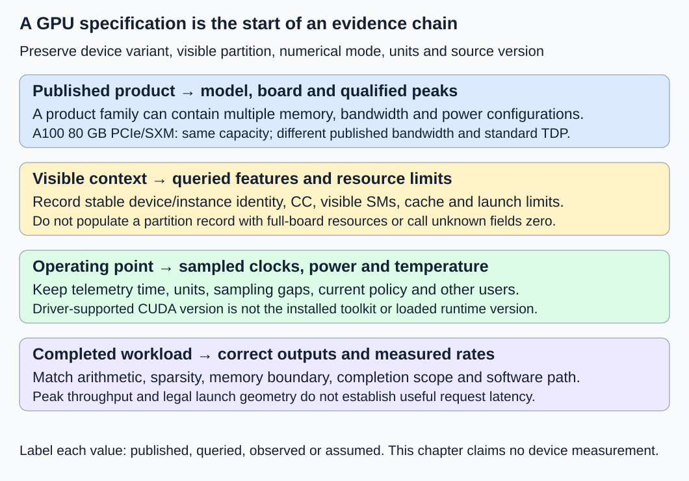
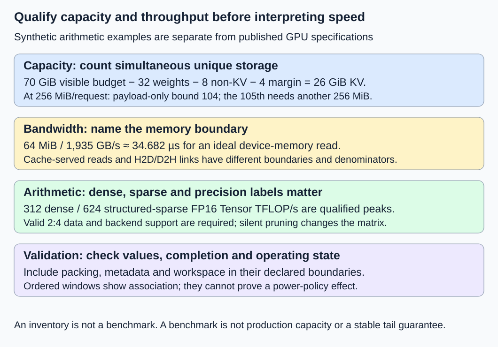

# M3-C02: Reading GPU specifications and capability limits

> **Status: Complete — detailed chapter authored and documentation validated; experimental procedures are proposed unless explicitly labelled observed**

**Module:** Learn GPU architecture through data movement

**Category:** [Hardware architecture and topology](index.md)

[Module 3 reading order](../module-3.md) · [Previous: M3-C01](m3-c01-following-a-tensor-from-cpu-to-gpu.md) · [Next: M3-C03](m3-c03-threads-warps-blocks-grids-and-streaming-multiprocessors.md) · [Execution plan and progress](../chapter-execution-plan.md)

## Target concepts

GPU model and compute capability, SM count, memory capacity and bandwidth, cache sizes, precision-specific dense versus sparse throughput, power and clock limits, software versions.

## Concepts

### 1. A product name is only the beginning of an experiment record

A specification sheet describes a product under stated conditions. A capability query describes what a software context can use. Telemetry reports operating conditions at particular times. A benchmark measures completed work. These are four different kinds of evidence; none substitutes for the others.

Read [M3-C01](m3-c01-following-a-tensor-from-cpu-to-gpu.md) for host/device placement and completion, [M1-C07](../numerics-and-correctness/m1-c07-floating-point-arithmetic-and-numerical-correctness.md) for finite-precision semantics, and [M1-C08](../measurement-experimentation-and-economics/m1-c08-operation-counts-and-actual-execution-cost.md) for operation/byte boundaries. Rust remains the host-engine context. No device-query implementation, kernel, configuration change or hardware benchmark is supplied.

Record the full GPU model, board form factor, memory variant, device identity, visible partition and software stack. A **form factor** is the physical board/module arrangement, such as PCIe add-in card or SXM server module. Two products sharing an architecture name can have different memory bandwidth, power envelopes and enabled resources. A process may see only a hardware partition or virtual device. **MIG**, Multi-Instance GPU, divides supported NVIDIA GPUs into isolated resource instances; record the visible instance rather than borrowing the full board's capacity and compute count.

A numeric device ordinal, such as the first device in a process, is not a durable identity. Preserve a stable device/instance identifier and the process-visible mapping; record the PCI bus identity where applicable. Missing telemetry or an inaccessible field means unknown/unsupported, not zero.

### 2. Compute capability describes features, not a speed multiplier

NVIDIA **compute capability**, or CC, is a major/minor hardware feature designation. It identifies supported instructions and architectural limits; it is different from the CUDA toolkit version, driver version and a numeric performance score. CC 8.0 does not mean eight times faster than another device. A backend also needs a compatible compiled target, supported data types and algorithms, and sufficient resources for a particular launch.

An **SM**, streaming multiprocessor, is a GPU execution unit that schedules and executes groups of work. SM count helps describe available parallel resources; it does not directly predict completed request latency. Instructions, clock rate, per-operation capability, memory access, work size and the fraction of usable execution resources all matter. Detailed thread/warp scheduling is developed in completed M3-C03.

The [NVIDIA Ampere architecture article](https://developer.nvidia.com/blog/nvidia-ampere-architecture-in-depth/) describes A100 with CC 8.0, 108 SMs and a 40 MB L2 cache. This is a published product/architecture reference, not a query of a machine in this workspace. An installed partition's visible resources must be queried in its actual context.

The [CUDA Runtime 13.4 device-property specification](https://docs.nvidia.com/cuda/cuda-runtime-api/cuda_runtime_api/structcudaDeviceProp.html) exposes identity, CC, multiprocessor count, total global memory, L2 size and launch limits. Fields such as asynchronous engine count, concurrent-kernel support and managed-memory support describe capabilities; they do not promise overlap for a particular workload. Data dependencies and memory types still constrain execution.

| Record group | Preserve in the experiment artifact | Why it matters |
|---|---|---|
| Identity | Model/variant, physical or virtual/partition scope, stable device/instance ID | Prevent comparing different visible resources as the same GPU |
| Execution | CC, visible SM count, compiled target, backend feature support | Hardware support and usable software path are separate gates |
| Launch limits | Max threads per block/dimension, shared-memory limits, relevant function limits | Reject unsupported work before launch; legal geometry does not imply high utilization |
| Memory | Visible total/free/backed bytes, L2 size and allocation policy | Capacity and cache are separate resources; counters need scope/time |
| Transfer/concurrency | Async engines, concurrent work and host-memory support | Capability enables a possible path, not guaranteed overlap |
| Operating conditions | Power policy/draw, clocks, temperature, throttling/event reasons, other users | The same device can operate at different effective rates |
| Software | OS, kernel/user driver, installed runtime/toolkit, library/backend/build targets | A product peak cannot reveal the selected algorithm or numerical mode |

For an illustrative queried maximum of 1,024 threads/block, a request for 2,048 must be rejected or revised before dispatch. This is a capability-check example, not a claim to have queried that limit here. Shared-memory or function-specific constraints can invalidate even a smaller block. Do not substitute a brochure's full-chip resource count for the context's effective limits.

### 3. Capacity, bandwidth and cache answer different questions

**HBM**, high-bandwidth memory, is a device-memory technology; DRAM means dynamic random-access memory. **Capacity** is how much storage can exist; **bandwidth** is how quickly bytes can cross a named memory boundary. A **cache** holds a subset of data closer to consumers for possible reuse. L2 is a device cache level shared across execution units, with architecture/partition-specific behavior. Having a 40 MB cache does not guarantee that a 4 MiB working set stays resident: competing work, access order, replacement and effective availability matter.

Use explicit units. GB and TB here are decimal, 10⁹ and 10¹² bytes; GiB and MiB are binary, 2³⁰ and 2²⁰ bytes. An advertised **80 GB = 80,000,000,000 bytes ≈ 74.506 GiB**, not 80 GiB. Query returned capacities in bytes and retain the source's unit labels rather than silently relabelling MB as MiB.

The [NVIDIA A100 80 GB datasheet](https://resources.nvidia.com/en-us-gpu-resources/nvidia-a100-datashee-1?xs=443994) gives the following variant-specific reference values. They are vendor specifications, not observed hardware results; preserve the linked document and its footnotes with a real comparison.

| Published characteristic | A100 80 GB PCIe | A100 80 GB SXM |
|---|---:|---:|
| Memory capacity | 80 GB | 80 GB |
| Device-memory bandwidth | 1,935 GB/s | 2,039 GB/s |
| Maximum TDP, standard configuration | 300 W | 400 W |
| Conventional FP64 peak | 9.7 TFLOP/s | 9.7 TFLOP/s |
| FP64 Tensor Core peak | 19.5 TFLOP/s | 19.5 TFLOP/s |
| Conventional FP32 peak | 19.5 TFLOP/s | 19.5 TFLOP/s |
| FP16 Tensor Core, dense / structured sparse | 312 / 624 TFLOP/s | 312 / 624 TFLOP/s |
| TF32 Tensor Core, dense / structured sparse | 156 / 312 TFLOP/s | 156 / 312 TFLOP/s |

A **Tensor Core** is a specialized matrix-arithmetic execution resource. Its peak is not the conventional scalar/vector FP32 peak. TDP, thermal design power, is a thermal design envelope, not a measurement of energy consumed by a request; the datasheet also identifies configuration-specific exceptions. Current power limits and operating clocks need their own records.

For a hypothetical complete 64 MiB read crossing device memory at the published PCIe-board peak, the optimistic payload-only time is:

**T_byte = B / β = 67,108,864 / 1,935,000,000,000 seconds ≈ 34.682 µs.**

B is bytes and β bytes/second. This is an assumption-bound estimate, not measured latency or a guaranteed lower bound for a cache-served read. It excludes launch, waiting, transaction inefficiency and other work. The SXM value gives approximately 32.913 µs. Device-memory bandwidth is not H2D/D2H link bandwidth; the board's PCIe label does not turn HBM bandwidth into host-transfer speed. Do not divide a one-direction payload by a bidirectional aggregate link rate without checking the specification's direction convention.

Capacity arithmetic needs an equally explicit boundary. A separate **synthetic** manifest stipulates 70 GiB available to the process after outside/system exclusions, 32 GiB of unique weights, an 8 GiB simultaneous non-KV budget and a 4 GiB policy margin. It leaves **26 GiB for KV**. This is not an A100 measurement or a supplied model checkpoint.

For a uniform cache with 32 layers, eight KV heads, width 128 and two-byte values, **k = 2 × 32 × 8 × 128 × 2 = 128 KiB/position**. A request retaining 2,048 positions needs 256 MiB of valid dense KV. The payload-only bound is **floor(26 GiB / 256 MiB) = 104 requests**. A 105th exceeds that budget by 256 MiB. Actual admission must additionally validate blocks/slack, sharing, metadata, pending accesses and shape-dependent workspace within the stipulated non-KV bound. “104” is not a demonstrated sustainable concurrency or useful throughput.

### 4. Read the precision and sparsity footnotes before dividing FLOPs by a peak

A **FLOP** is a conventionally counted floating-point operation; one multiply-add generally counts as two FLOPs. FLOP/s is a rate. A quoted peak needs the input format, multiplication mode, accumulator/output format, arithmetic resource, dense/sparse eligibility, operation-count convention and conditions. INT8 TOP/s counts integer operations and cannot be relabelled floating-point throughput.

FP16 and BF16 have different range/precision despite both using two bytes. **TF32** is a Tensor Core compute mode; it must not be treated as full-precision FP32 multiplication merely because a caller stores FP32 tensors. Backend defaults, allowed reduced precision and chosen algorithms belong in the manifest. Numerical equivalence is checked against an agreed reference under M1-C07/M9-C17, not inferred from a data type's name.

**Dense** matrix work counts every logical matrix entry. Structured sparsity permits a specialized representation/operation for a specified zero pattern. The [NVIDIA structured-sparsity article](https://developer.nvidia.com/blog/?p=67288) describes the 2:4 pattern: at least two zeros in each eligible group of four, with compressed values and index metadata. Appropriate grouping, layout and backend support must be verified. Arbitrary zeros do not automatically use a sparse Tensor Core path.

If the matrix already has the required zeros, dense and sparse representations can compute the same mathematical result. Pruning nonzero weights to force eligibility changes the model and needs quality validation; it is not a memory-layout optimization. Compression metadata, packing, conversion and inspection costs are additional. A 624 sparse versus 312 dense TFLOP/s label does not mean any dense model runs twice as fast.

For **10¹² conventional dense-equivalent FLOPs**, division by 312 × 10¹² FLOP/s gives **3.205 ms**. Division by 624 × 10¹² gives **1.603 ms** only under the eligible sparse counting convention and ideal peak assumption. Neither predicts a completed inference request. Count dense-equivalent work separately from instructions/nonzero arithmetic executed so a useful rate above a dense peak is not automatically described as impossible.

### 5. Clocks, power and software change the operating point

A **clock frequency** describes cycles/second, not completed tokens/second. Boost clocks can depend on power, temperature and workload. Power limiting, thermal constraints, idle periods and other users may change effective compute or memory behavior. A single instantaneous clock sample cannot characterize a run. Record time-stamped telemetry and its sampling interval alongside completed work; sampling can miss short changes.

Driver, runtime, toolkit, compiler and backend versions are different records. The toolkit/compiler used to build an artifact need not be installed inside the serving process's container, and a loaded runtime/library need not match an incidental compiler on the host. Record the actual versions/build targets used by the process.

The [NVIDIA System Management Interface documentation](https://docs.nvidia.com/deploy/nvidia-smi/index.html) distinguishes the installed driver from the latest CUDA version it supports. Newer documentation labels these kernel-mode driver and CUDA user-mode driver fields; older displays may use “Driver Version” and “CUDA Version.” The displayed driver-supported CUDA version is not proof of the installed toolkit or loaded application runtime. Preserve tool version and actual field labels. The same documentation exposes operating-state information; unavailable fields require explicit reporting.

A capability admission decision should distinguish: unsupported hardware feature; unsupported compiled/library path; insufficient visible storage; illegal launch resources; transient unavailable device; and a numerically disallowed mode. Either use a separately validated fallback or reject clearly. Never silently change FP64 to lower precision, use a full-device memory estimate for a partition, or reinterpret a failed query as a performance measurement.

## Experiments

### E1 — Reconcile a published product with a visible device manifest

- **Description:** Compare the published reference sheet, a future process-visible capability record and time-stamped operating/software fields.
- **Purpose/objective:** Identify which specification claims apply to the actual visible execution context.
- **Target concepts:** Model/variant; CC; SM count; cache; launch limits; software versions.
- **Baseline and workload:** The two published A100 variants above plus a supplied device when available. The paper audit requires no hardware and must not invent a runtime record.
- **Controls and prediction:** Preserve exact source/date, units, board/partition identity and tool version. Predict equal named architecture features do not imply equal bandwidth or power; partition resources need independent evidence.
- **Procedure:** Create the manifest groups above; mark each value published, queried, observed or unknown. Reconcile disagreements by scope/version. Apply negative records for a partition labelled as full board, mixed software versions and a 2,048-thread request against a 1,024-thread maximum.
- **Hardware/software:** CPU document audit first; a compatible NVIDIA runtime and read-only device/telemetry interfaces for empirical queries. No multi-GPU link or network adapter is required.
- **Failure and HFT connection:** A stale device or software identity resembles a stale configuration used by a low-latency event processor. The transferable lesson is configuration validity; no market-performance claim follows.
- **Exit criteria:** Every claimed property has source, units, scope and version; missing fields remain explicit; each invalid admission record is rejected before work submission. No queried inventory is claimed until actually collected.

### E2 — Test capacity and bandwidth estimates against their byte boundaries

- **Description:** Audit the 70 GiB synthetic manifest and the payload-only 64 MiB bandwidth estimates; design scoped working-set checks.
- **Purpose/objective:** Separate fitting in memory, possible cache reuse and moving bytes quickly.
- **Target concepts:** Capacity; memory bandwidth; cache sizes; visible memory; bottleneck estimates.
- **Baseline and workload:** Exact capacity fixture above; device-resident input arrays of 4 MiB and 64 MiB in a future completed integer-sum diagnostic. Store unsigned 32-bit words with value (word index modulo 16), and return an unsigned 64-bit sum. Compare those sizes with queried cache availability, not a guaranteed hit-rate assumption.
- **Controls and prediction:** Keep logical contents, memory domain, unique allocations and completion boundary fixed. Predict 26 GiB KV budget/104 payload-only requests and the calculated peak-rate times; predict no measured bandwidth in advance.
- **Procedure:** Enumerate disjoint simultaneous storage, validate 104 versus 105 admission, then record actual assigned/slack/reserved bytes. For a supplied runtime, use this device-local read-and-sum operation and the two input sizes in three sessions, with ten completed trials per size/session and five excluded warmups per size/session: 60 measured and 30 warmup trials. Prepare and validate contents outside primary timing, observe completion before reuse, and inspect whether repeated accesses and larger working sets alter cache/DRAM traffic. Count the actual read/write boundary before deriving an effective rate.
- **Hardware/software:** Exact CPU arithmetic for reference; one real device, scoped counters/timing and a compatible pre-existing diagnostic for measured cache/bandwidth behavior. Do not substitute H2D results for local device-memory results.
- **Failure and HFT connection:** Capacity exhaustion and reuse-dependent latency also affect bounded event-buffer systems. A fitting buffer does not establish deadline success; inference and exchange semantics remain separate.
- **Exit criteria:** Units and unique-byte sums reconcile; the 105th request fails the synthetic predicate; any measured rate states its traffic/completion scope. Unavailable cache counters or unexplained allocation residuals remain limitations, not zero-cost assumptions.

### E3 — Validate dense and eligible sparse arithmetic before reading throughput

- **Description:** Compare dense and structured-sparse representations of the same already eligible matrices, retaining input/accumulator/output semantics.
- **Purpose/objective:** Test a peak-rate footnote without changing the mathematical workload or silently pruning a model.
- **Target concepts:** Precision-specific dense/sparse throughput; Tensor Core eligibility; numerical validation; software selection.
- **Baseline and workload:** M = K = N = 256. W has repeated column groups [1,0,2,0] on even rows and [0,3,0,4] on odd rows. A is separately identity, all ones, or alternating +1/−1 across columns. Inputs FP16; accumulation/output FP32; C = A × W with no old-output term. Three inputs × three sessions × ten paired dense/sparse trials give 90 pairs/180 measured trials; five excluded warmups per path/input/session add 90 trials.
- **Controls and prediction:** Preserve all values/layout interpretation, arithmetic policy and output shape. Verify the backend's required grouping, packing/alignment and support. Predict exact references below, conventional F = 33,554,432 FLOPs/trial and no speed ratio before measurement.
- **Procedure:** Check eligibility, compare both outputs with the independent reference, and retain the selected backend/algorithm and numerical mode. Separate already-packed operation timing from packing-inclusive caller timing. Inspect the sparse path evidence rather than inferring it from zeros or a function name.
- **Hardware/software:** CPU mathematical audit; an eventual GPU/library supporting the exact FP16/FP32 structured-sparse path. An unsupported sparse backend is a labelled unsupported case, not an excuse to alter values or precision.
- **Failure and HFT connection:** A faster specialized path must preserve declared semantics, like a specialized event handler. Inject an extra nonzero into a 2:4 group and require rejection or an explicit validated dense fallback; do not remove it silently.
- **Exit criteria:** Both paths produce every exact reference coordinate, eligibility and backend evidence are recorded, and timing populations are complete. Report dense-equivalent rate and packing cost separately. These fixtures do not validate arbitrary sparse-model quality or production speedup.

### E4 — Observe performance alongside clocks, power and software state

- **Description:** Compare initial and later time windows of the same workload under unchanged configured device policy.
- **Purpose/objective:** Establish whether a static specification describes the operating conditions of a measured run.
- **Target concepts:** Power/clock limits; temperature; software versions; completed rates; state variability.
- **Baseline and workload:** Dense FP16 inputs/FP32 accumulation and output at M = K = N = 1,024, using the all-ones A and the same W pattern as E3. Three sessions, two windows/session and twenty one-second target-duration trials/window give 120 measured trials. Five excluded one-second warmups before each window add 30 trials; between windows run a separately logged 60-second conditioning interval per session.
- **Controls and prediction:** Keep actual software/artifacts, numerical policy, allocation, streams, power policy and other-user conditions recorded and unchanged. Record elapsed time rather than assume each trial lasts exactly one second. No direction or size of drift is predicted.
- **Procedure:** Within a trial submit/complete repeated products through the declared scope until the target duration is reached, then drain. Correlate completed counts with nominal 10 Hz time-stamped telemetry and resource/event reasons; record actual sampling gaps. Compare initial versus later distributions and session variation. Conditioning operations are not measured-trial work.
- **Hardware/software:** One compatible GPU, read-only operating-state telemetry, CPU monotonic clock and supported general matrix multiplication (GEMM) backend. This design requests no clock/power-policy changes. Pin versions and record unsupported telemetry.
- **Failure and HFT connection:** Temperature, shared resources and changing clocks can affect timing in any latency-sensitive system. Observed association is not proof of a power-policy benefit or trading result.
- **Exit criteria:** All 120 trial outcomes, completed counts, versions and telemetry scopes reconcile; outputs remain correct. Report observer overhead and state/order confounding. A rate shift without explanatory evidence remains inconclusive; no production p99 or useful-serving capacity is established.

## Verification

### V1 — Keep four evidence labels throughout

A published 108-SM product reference cannot populate a queried field in an unobserved partition. Preserve the raw future query and its context/time, and distinguish physical board IDs from process ordinals. Check CC, visible memory, cache bytes and relevant launch/function limits before dispatch. Feature presence plus a compatible software path is necessary; actual completion and numerical correctness remain additional gates.

For software, retain driver-supported CUDA label, loaded runtime/library revisions, build compiler/toolkit/targets and OS separately. A version disagreement can be legitimate, but its compatibility needs the applicable vendor contract. On query failure, keep the error/unknown outcome and reject unsupported requirements; do not produce a synthetic “successful” capability record.

### V2 — Recalculate units and optimistic estimates

Verify 80 × 10⁹ / 2³⁰ ≈ 74.505806 GiB and 70 − 32 − 8 − 4 = 26 GiB. Unique KV for one 2,048-position request is 2,048 × 128 KiB = 256 MiB. For 104 requests, this is exactly 26 GiB; 105 require 26.25 GiB. M9-C15's live/retained/Retiring, block slack, outer allocation/reservation and peak rules still apply. The synthetic 8 GiB non-KV cap must be validated under actual shape/concurrency before treating the bound as an admission guarantee.

For the 64 MiB read, use 2²⁶ bytes, not 64 × 10⁶, and keep device-memory β in decimal bytes/second. A cache-served effective payload rate can exceed an HBM specification without violating physics because it measures a different path. Likewise, a copy that reads and writes local device memory has two logical traffic directions; reporting only payload size or actual read-plus-write bytes requires different labels. For the two device-local sum inputs, exact sums are 7,864,320 and 125,829,120. Validate every prepared input word outside primary timing and the returned sum after completion. Logical input traffic is B bytes plus an eight-byte output; internal reduction/workspace traffic is additional and backend-specific. The repeated pattern may be compressible and is a diagnostic, not representative model data. Cache-hit counters and timing need matching scopes and a correct result reference.

### V3 — Check complete values and denominator semantics

For E3, identity A produces C = W. All-ones A produces repeating columns **[128,384,256,512]** on every output row. Alternating signs with +1 on even columns and −1 on odd columns produce **[128,−384,256,−512]**. Each is exactly representable under the declared small-integer FP16-input/FP32-output contract. Compare every coordinate, not just a checksum; analytical references here do not establish general floating-point accuracy. Add application-specific noninteger cases and justified tolerances before extrapolating to a model.

Conventional work is **F = 2MKN = 2 × 256³ = 33,554,432 FLOPs**. Over 180 fully completed trials this projects **6,039,797,760 dense-equivalent FLOPs**. Count actual completed work if anything fails. Dense input A/W storage is 2 × 256² × 2 bytes and FP32 C is 256² × 4 bytes: **512 KiB** total payload. Sparse metadata, compressed storage, dense copies retained for checking and workspace are additional; compression does not halve the whole process footprint.

Use **reported rate = conventional F / completed operation seconds** when comparing dense-equivalent rates. For sparse results, say explicitly that F includes the logically dense zero entries. Report packing-inclusive host completion separately from prepacked operation completion. A conventional count is not a measured hardware instruction count. Preserve exact input matrices and reject an invalid 2:4 group before interpreting its rate.

### V4 — Account for timing, observations and drift

E4's all-ones reference has repeated output groups **[512,1536,1024,2048]**. Each completed 1,024³ product counts **2,147,483,648 conventional FLOPs**. Its FP16 A/W plus FP32 C require **8 MiB** of dense payload, excluding workspace/backing. Trial work is the actual completed product count times this F; do not infer it from a one-second target or a peak rate.

Use a single monotonic host clock for caller intervals; scoped device-event timing belongs to separately labelled diagnostic records. Submission is not completion. Preserve actual trial boundaries, drain duration, errors and last-use protection. A 120-second watchdog per trial is a hang guard, not a speed target; unknown completion remains protected after timeout. Allocation, preparation and model load are outside these resident matrix timings; packing costs are explicitly separate in E3.

Report medians, dispersion, chronological curves, independent-session variation and the actual quantile convention. Do not average p99 values or infer stable tails from twenty trials/window. Compare minimally observed work with a separate telemetry/profile-enabled diagnostic, disclosing memory/CPU/traffic overhead and missing samples. Initial/later windows are ordered, not randomized treatments: conditioning, time and environment are confounded, so the result supports observation rather than a causal clock/power claim. Five warmups do not guarantee stability; preregister a common extension rule and revise counts if needed.

| Gate | Evidence required | Limit |
|---|---|---|
| E1 / V1 | Published/query/state/software scopes and valid admission | Inventory is not performance |
| E2 / V2 | Exact unit/capacity arithmetic and correctly scoped traffic/completion | Peak-rate estimates are conditional |
| E3 / V3 | Eligible unchanged inputs, exact outputs, backend and count semantics | No automatic pruning-quality or 2× speed claim |
| E4 / V4 | Completed trial counts and time-correlated operating-state record | Ordered observation is not causal policy evidence |

**Observed during authorship:** primary-source review, arithmetic/reference patterns, experiment fields, local links, diagram validity and documentation build/rendering are checked. Specification values are attributed vendor references; capacity budgets, operation counts and peak-time estimates are calculated examples. No device query, matrix backend, telemetry, configuration change, sparse conversion or performance benchmark has been executed for this chapter.

## Engineering dimensions and principles

| Dimension | Application |
|---|---|
| Semantics and invariants | Match visible identity, precision, eligible sparsity and every output before dividing work by time. |
| Workload and variability | Matrix shape, working-set size, reuse and sustained demand determine which advertised resource matters; text serving is the later application. |
| Resources and bottlenecks | Distinguish capacity, cache, HBM traffic, link traffic, arithmetic path and software/workspace limits. |
| Time and distributions | Correlate completed work with sampled state, drift and observation gaps; keep peak-rate estimates separate from latency. |
| Ownership and coordination | Keep tensors, sparse metadata and workspace alive through their consumers; a partition's scope governs resource admission. |
| Failure and adaptation | Reject unsupported modes, missing capability evidence, oversized requests and invalid sparse groups; preserve unknown completion. |

1. **Correctness defines the optimization boundary.** An eligible sparse representation preserves the matrix; pruning nonzero weights changes the task and requires separate quality evidence.
2. **Performance depends on workload and operating point.** The same GPU has different effective behavior across shapes, cache reuse and thermal/power states.
3. **Data movement is part of the algorithm.** Device-memory bytes, host copies, compressed metadata and packing have different costs and boundaries.
4. **State has ownership, lifetime, and recovery cost.** Capability records can become stale after a device/partition change; pending buffers cannot be freed on timeout alone.
5. **Dependencies determine latency; bottlenecks determine capacity.** A compute peak cannot remove transfer/wait dependencies or make an oversized KV allocation fit.
6. **Variability and synchronization shape the tail.** Boost/thermal changes and host/device waits require distributions and matched state, not one clock reading.
7. **Local improvements must be evaluated end to end.** Dense-equivalent TFLOP/s or reduced memory does not establish a useful request benefit.
8. **Claims require reproducible evidence.** Preserve sources, raw device/partition queries, versions, numerical modes, timelines and all trial outcomes.

## Specifications, articles, and hardware

The reproducibility manifest combines the published document and footnotes, a raw process-visible hardware record, the complete software/build stack, tensor/memory/workspace requirements, arithmetic/sparsity contracts, completion boundaries and time-stamped operating conditions. Mark values as published, queried, observed or assumed. Record source retrieval date; the published references above were consulted on 26 October 2026. A later document revision may describe a different board configuration.

Primary readings are the [A100 80 GB datasheet](https://resources.nvidia.com/en-us-gpu-resources/nvidia-a100-datashee-1?xs=443994), [Ampere architecture explanation](https://developer.nvidia.com/blog/nvidia-ampere-architecture-in-depth/), [CUDA Runtime 13.4 device properties](https://docs.nvidia.com/cuda/cuda-runtime-api/cuda_runtime_api/structcudaDeviceProp.html), [structured-sparsity article](https://developer.nvidia.com/blog/?p=67288) and [NVIDIA System Management Interface reference](https://docs.nvidia.com/deploy/nvidia-smi/index.html). Published peaks are illustrative specifications, not a device recommendation or proof that this hardware is available.

No machine has been supplied. CPU audits need exact arithmetic and reference patterns. Hardware tests require one compatible GPU with enough visible memory for input/output, workspace, compressed metadata, raw diagnostic copies and headroom; E3 additionally requires the exact supported sparse arithmetic path. Record CPU/core/cache/RAM, OS, locality/NUMA, affinity, GPU/partition IDs and scope, interconnect, ECC if supported, driver/runtime/toolkit/compiler/backend, actual clocks/power/temperature and other users. Record telemetry tool/version, sample units/intervals and observation overhead. Baseline experiments require neither a multi-GPU interconnect nor network hardware, and introduce no clock/power setting changes.

Completed M9-C01/C02/C07/C15/C17 support reference identities, completion, distributions, memory and numerical gates. M9-C16 will later expand hardware-condition recording; this chapter supplies the basic contract locally. Non-text modalities and Module 8 remain excluded.

## Takeaways and next step

Read every GPU number with its device scope, operation/precision mode, units, version and operating conditions. Use specifications to form testable expectations, capability records to admit legal work and completed measurements to assess actual behavior.

Track progress in the clickable [execution plan](../chapter-execution-plan.md). The completed next Module 3 **reading** chapter is [M3-C03: Threads, warps, blocks, grids, and streaming multiprocessors](m3-c03-threads-warps-blocks-grids-and-streaming-multiprocessors.md). M3-C05 is next for authoring.
