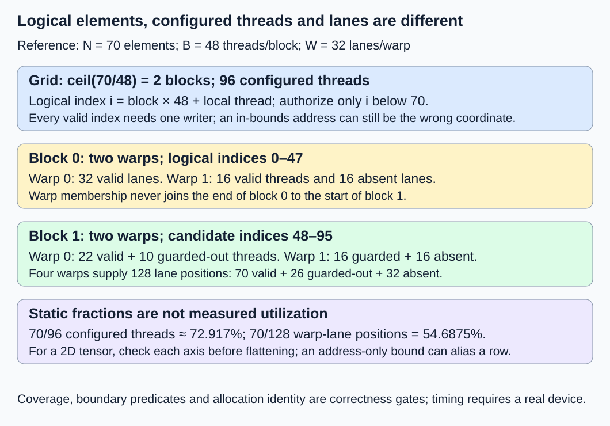
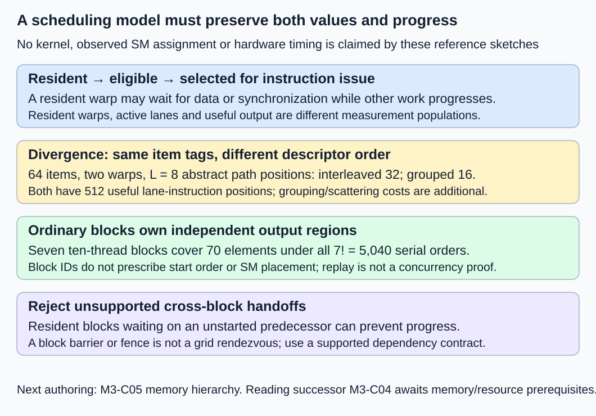

# M3-C03: Threads, warps, blocks, grids, and streaming multiprocessors

> **Status: Complete — detailed chapter authored and documentation validated; experimental procedures are proposed unless explicitly labelled observed**

**Module:** Learn GPU architecture through data movement

**Category:** [Hardware architecture and topology](index.md)

[Module 3 reading order](../module-3.md) · [Previous: M3-C02](m3-c02-reading-gpu-specifications-and-capability-limits.md) · [Next: M3-C04](m3-c04-occupancy-latency-hiding-and-hardware-utilization.md) · [Execution plan and progress](../chapter-execution-plan.md)

## Target concepts

SIMT execution, thread indexing, warps, thread blocks, grids, SM assignment, warp scheduling, divergence, block independence.

## Concepts

### 1. Separate logical work from the hardware executing it

A **GPU thread** is a logical execution instance of a kernel, with its own index and per-thread state. A **thread block** groups threads that can cooperate under block-scoped rules. A **grid** is the collection of blocks in one launch. A **warp** groups threads from the same block for SIMT execution. An **SM**, streaming multiprocessor, is the hardware unit on which blocks and their warps execute. A GPU thread is not an operating-system CPU thread, and there is no promise that each launched thread owns a separate arithmetic core.

**SIMT** means single instruction, multiple threads. Threads express individual work while hardware issues instructions for participating lanes of a warp. A **lane** is a thread's position within that warp. This chapter uses the CUDA/NVIDIA warp width W = 32, checked against the actual device contract before any future run; do not apply this number automatically to other accelerators.

Read [M3-C02](m3-c02-reading-gpu-specifications-and-capability-limits.md) for visible hardware and launch limits. Rust is the host-engine context for submitting compatible device work, not a reason to equate a Rust host thread with a GPU thread. The [CUDA 13.4.2 programming model](https://docs.nvidia.com/cuda/archive/13.4.2/cuda-programming-guide/01-introduction/programming-model.html) defines the hierarchy and block scheduling contract. No kernel, pseudocode, launch implementation or measured GPU result is provided here.

For LLM systems, logical work might identify tensor coordinates, attention rows or cache entries. Mapping these coordinates to threads is an execution choice; the logical meaning and request/cache identity must survive that choice. Some operations assign many elements to a thread or many threads to an element. The one-thread-per-element examples below are deliberately bounded teaching contracts, not universal attention designs.

### 2. Derive the index and its validity predicate together

For a one-dimensional grid, let B be threads/block, b the zero-based block index, and t the local thread index, 0 ≤ t < B. The candidate logical element index is:

**i = bB + t; grid block count G = ceil(N/B).**

N is the number of valid elements; ceil rounds upward. The element is authorized only for **0 ≤ i < N**. A configured thread outside the logical range must not read input or write output. N = 0 is an explicit no-work case: skip dispatch under this specification rather than treat a zero-block launch as ordinary work.

Take N = 70, B = 48 and a packed FP32 array X with Xᵢ = i. The required mathematical result is **Yᵢ = 2Xᵢ + 1**, for i = 0 through 69: odd values 1 through 139. FP32 values occupy four bytes and these integers/results are exactly representable. There are two blocks and 96 configured threads, of which 70 perform valid element work and 26 are outside the range. Every valid element must have exactly one writer; an in-bounds but duplicated index is still wrong.

Within a block, define **warp index w = floor(t/32)** and **lane ℓ = t modulo 32**. Here floor rounds downward, and modulo gives the division remainder. Warps never combine the end of one block with the beginning of another. B = 48 therefore creates two warps per block, with only 16 configured threads in the second warp.

| Block / local warp | Configured local threads | Candidate logical indices | Valid element lanes | Out-of-range configured threads | Absent lanes |
|---|---|---|---:|---:|---:|
| 0 / 0 | 0–31 | 0–31 | 32 | 0 | 0 |
| 0 / 1 | 32–47 | 32–47 | 16 | 0 | 16 |
| 1 / 0 | 0–31 | 48–79 | 22 | 10 | 0 |
| 1 / 1 | 32–47 | 80–95 | 0 | 16 | 16 |

An absent lane has no configured thread in this block; an out-of-range thread exists but is not authorized for an element access. These are different reasons for inactivity. Four warps provide 128 lane positions, so **70 + 26 + 32 = 128** reconciles valid work, guarded-out threads and absent lanes.

Two useful arithmetic ratios are **valid elements/configured threads = 70/96 ≈ 72.917%**, and **valid elements/allocated warp-lane positions = 70/128 = 54.6875%**. They describe this static mapping. Neither is measured execution efficiency, occupancy or SM utilization. Instruction paths, guards and resources still matter.

| B for the same N = 70 | Blocks | Configured threads | Warps total | Warp-lane positions | Guarded-out / absent |
|---|---:|---:|---:|---:|---|
| 32 | 3 | 96 | 3 | 96 | 26 / 0 |
| 48 | 2 | 96 | 4 | 128 | 26 / 32 |
| 64 | 2 | 128 | 4 | 128 | 58 / 0 |

This explains why matching a block size to warp width can avoid permanently absent lanes, while still not proving a faster kernel. Fewer blocks can also reduce available scheduling choices.

### 3. Multidimensional indexing does not remove boundary work

For block dimensions Dₓ, Dᵧ and D_z with local coordinates x,y,z, CUDA's x-fast local flattening is **t = x + Dₓ(y + Dᵧz)**. Warp grouping follows that flattened local order. It does not follow whichever tensor axis happens to be contiguous in a particular view.

Use a separate row-major tensor of five rows and seven columns. A block spans four columns and two rows, giving eight threads. A grid of two blocks across columns and three across rows has six blocks, 48 configured threads and 35 valid coordinates. For block coordinates bₓ,bᵧ and local coordinates tₓ,tᵧ:

**column = 4bₓ + tₓ; row = 2bᵧ + tᵧ; element index = 7 × row + column.**

Require **row < 5 and column < 7** before using the element index. Checking only that the flattened result is below 35 is insufficient: row 0, column 7 flattens to 7, which is an in-range address for the wrong coordinate. A coordinate can be semantically invalid before flattening even when the resulting address is in bounds.

With X at valid coordinate (row,column) equal to 7 × row + column, the same Y = 2X + 1 contract yields odd values 1 through 69. The valid output sum is 35² = 1,225, but compare each coordinate, not just that sum. Each eight-thread block uses one partial warp in this example; its low lane packing is chosen for transparent indexing, not as a performance recommendation. The [CUDA 13.4.2 thread-hierarchy treatment](https://docs.nvidia.com/cuda/archive/13.4.2/cuda-programming-guide/02-basics/writing-cuda-kernels.html) describes multidimensional thread/block coordinates and their mapping.

### 4. A resident warp is not necessarily ready to issue

In the baseline, a block is assigned to an SM subject to resource availability; several blocks can reside on an SM, and a grid can contain more blocks than can reside simultaneously. Do not assume block b executes on SM b, that a block gets an entire SM, or that adjacent blocks start or finish together. The hardware chooses scheduling order; the program must satisfy its supported execution model rather than infer a deterministic placement from IDs.

A **resident warp** has execution state allocated on an SM. An **eligible warp** can issue its next instruction because its dependencies and required resources permit it. An **issued warp** is selected by a scheduler to execute an instruction. A resident warp might wait for data or synchronization while another eligible warp progresses. That possibility is latency hiding, not removal of a dependency or proof that all waits are hidden.

The [Nsight Compute scheduler-statistics guide](https://docs.nvidia.com/nsight-compute/ProfilingGuide/index.html) distinguishes allocated/active, eligible and issued warp populations. Metric names, sampling and normalization need their actual tool/device definition. “Active warp” in a profiler can mean resident; **active lanes** describe participating threads for a particular instruction. Those are not interchangeable counts. This chapter introduces the terms; resource-limited occupancy is developed after M3-C05/C06 in M3-C04.

A block containing 48 configured threads still has two warps even when some threads are outside the tensor range. How guards, compiler decisions and exits affect dynamic instructions requires evidence. Static lane arithmetic cannot establish scheduler eligibility, issue rate or the fraction of time an SM is doing useful work.

### 5. Divergence is about paths within a warp

**Divergence** occurs when threads from a warp need different control-flow paths. Hardware executes instructions for the participating lanes of each path; lanes not participating in an instruction are inactive. Different warps taking different paths do not create the same within-warp masking pattern. Compiler predication, meaning conditional execution through masks rather than an explicit branch, can change the issued instruction pattern.

Modern NVIDIA independent thread scheduling does not authorize synchronization-free sharing merely because threads belong to a warp. The [archived CUDA 12.8.1 SIMT discussion](https://docs.nvidia.com/cuda/archive/12.8.1/cuda-c-programming-guide/index.html#simt-architecture) explains per-thread execution state and why assumed warp-synchronous communication can be incorrect. Use the required synchronization and declared participants for the actual collective; warp width is not a completion or memory-visibility barrier.

For a **constructed instruction-mask model**, take 64 logical items, B = 64 and two warps. Every even original item ID has tag A and requires output i + 8; every odd ID has tag B and requires i − 8. Compare two execution orders of the same (original ID, tag) pairs:

- Interleaved: IDs 0–63 in order, so each warp has 16 A and 16 B items.
- Grouped: even original IDs first, then odd IDs, so one warp has only A and the other only B.

Always write the result to its original logical ID. Changing a tag to match its new lane would change the task. Grouping may require sorting/compaction, which means rearranging work descriptors and later scattering results to original locations. Include that movement and coordination in a caller-level comparison.

Assume, only for this mask model, that each path occupies L = 8 instruction positions. Interleaving issues two paths per warp: **2 warps × 2 paths × 8 = 32 warp-instruction positions**. Grouping issues **2 × 1 × 8 = 16**. Both perform **64 × 8 = 512 useful lane-instruction positions**. Idealized useful mask fractions are 512/(32 × 32) = **50%** and 512/(16 × 32) = **100%**.

These are abstract counts, not measured instructions or cycles. The simple output formulas could compile to fewer instructions, a predicated sequence or another transformation. Confirm the actual compiled paths before applying an instruction-length hypothesis. A 2:1 mask-model ratio is not a promised 2× speedup; changed memory access, regrouping cost, occupancy and other dependencies can dominate. HFT systems face a related workload-classification tradeoff, but grouping work also adds delay; an inference warp model does not establish a trading result.

### 6. Block independence is a correctness requirement for the ordinary grid

In the ordinary noncooperative grid used here, each block's result must remain correct when blocks execute in any permitted order, including sequentially. A block-scoped barrier coordinates the required participants within one block; it is not a grid-wide rendezvous. A memory fence addresses ordering/visibility obligations under its contract, not a guarantee that another block has run.

Consider seven blocks, ten threads/block and the same 70-element transform. Each block owns a different ten-element output range and reads immutable input. All **7! = 5,040 complete block orders** produce the same result. They are reference serial orders, not an enumeration of every real concurrent interleaving. No inter-block communication is needed, so correct values do not depend on SM assignment. For two explicit symbolic assignments, A places blocks 0,2,4,6 on SM α and 1,3,5 on SM β; B swaps those sets. These labels specify neither start order nor simultaneous residency and are not observed hardware mappings.

A bad design instead waits inside each block for an earlier-numbered block to signal progress. A legal scheduler can fill available resident slots with waiting blocks while the needed predecessor is not resident. Progress can then stall indefinitely. Do not rely on increasing block IDs, SM counts or a host launch order to prove a grid-wide handoff. A separate ordered kernel stage can supply a supported completion boundary between producer and consumer stages. Explicit cooperative/cluster features have different requirements and admission limits; they are outside this ordinary-grid baseline.

Block-local collectives also require the participants promised by their synchronization contract. A subset of still-live threads taking an unrelated path while others wait at an incompatible barrier is not repaired by adding a global-memory flag. Tail handling must preserve any needed collective participation. The elementwise examples use no barriers or cross-thread communication, keeping their boundary rules independent of collective algorithms.

## Experiments

### E1 — Prove index coverage and boundary masks

- **Description:** Audit one- and two-dimensional logical mappings before treating threads as useful work.
- **Purpose/objective:** Detect missing, duplicate, out-of-range and semantically wrong-coordinate writes.
- **Target concepts:** Thread indexing; warps; blocks; grids; partial warps; tensor bounds.
- **Baseline and workload:** N = 0, 1, 31, 32, 33 and 70 crossed with B = 32, 48 and 64: 18 exact cases, including three no-dispatch cases. Add the five-by-seven tensor/four-by-two block case for 19 total cases. Use the declared exact FP32 transformation.
- **Controls and prediction:** Keep logical inputs/output positions fixed. Change only launch geometry. Predict every valid element is written once, no invalid element is accessed, and the 70-element tables reconcile.
- **Procedure:** Enumerate block/local coordinates, warp/lane membership and the validity predicate. Compare every value and writer count. Add paper negative controls for wrong block stride, omitted bound and flattened-only 2D bound; a future safe diagnostic checks declared guard storage without deliberately executing an invalid access.
- **Hardware/software:** CPU exact reference audit suffices. A future GPU diagnostic needs queried warp/launch limits, compatible FP32 support and explicit completion/last-use protection. One exact comparison per case is a correctness plan, not a latency sample; warmup has no role in its paper arithmetic.
- **Failure and HFT connection:** Misassigned tensor coordinates resemble correctly addressed buffers labelled with the wrong event. Validate identity before interpreting speed; market semantics are outside scope.
- **Exit criteria:** All 19 cases have explicit outcomes; zero-length cases skip dispatch; negative records fail; every valid coordinate and writer count matches the oracle. Static mask fractions are not reported as occupancy measurements.

### E2 — Separate useful branch work from mask and grouping cost

- **Description:** Compare interleaved and grouped execution order for the 64 tagged logical items.
- **Purpose/objective:** Test divergence reasoning without changing per-item tags/results or hiding rearrangement overhead.
- **Target concepts:** SIMT execution; active lanes; warp scheduling; divergence; logical identity.
- **Baseline and workload:** The two execution orders and L = 8 abstract path model above. For a future compatible diagnostic, three sessions of twenty paired interleaved/grouped trials give 60 pairs/120 measured trials and 7,680 logical item results. Five excluded warmups per order/session add 30 trials.
- **Controls and prediction:** Keep original IDs/tags, output mapping, arithmetic, B = 64 and W = 32 fixed. Change descriptor order. Predict 32 versus 16 abstract warp-instruction positions and equal logical outputs; predict no measured speed ratio.
- **Procedure:** Compare the item-level oracle, confirm actual compiled control flow and profile participating-lane/instruction evidence in separate runs. Measure pregrouped device operation and grouping-inclusive host-to-completed-result boundaries separately; retain scatter and conversion costs. If the compiler removes the hypothesized divergence, report that instead of forcing the prediction.
- **Hardware/software:** CPU mask/reference reasoning; actual GPU/backend diagnostic, declared grouping representation and a compatible profiler for dynamic evidence. No implementation is supplied here.
- **Failure and HFT connection:** Regrouping work can improve local regularity while delaying a complete response. Preserve each event/item identity and count classification overhead; no financial-performance claim follows.
- **Exit criteria:** Every original ID gets its correct result, invalid tag reassignment is detected, and dynamic evidence states its actual instruction/metric meaning. Useful instruction-mask ratios remain theoretical unless observed under matching compiled paths.

### E3 — Check block-order independence and reject unsafe handoffs

- **Description:** Replay complete block orders for disjoint output ranges and inspect a cross-block waiting counterexample.
- **Purpose/objective:** Establish which results may depend on other blocks and which scheduling assumptions are unsupported.
- **Target concepts:** Block independence; SM assignment; synchronization scope; progress and failure.
- **Baseline and workload:** Seven ten-thread blocks cover N = 70 exactly. Audit all 5,040 serial block permutations against the same immutable-input/output reference, plus two illustrative assignments to hypothetical SM labels.
- **Controls and prediction:** Preserve each block's ten-element ownership, input and transformation. Change completion order/placement labels. Predict identical 70 outputs under every serial permutation; the cross-block predecessor-wait design fails the ordinary-grid progress contract.
- **Procedure:** Compare results after every complete replay; record ownership collisions or uninitialized reads as failures. Draw the resident-waiting/not-yet-resident predecessor case. Use a separately declared ordered-stage boundary for any producer/consumer extension; do not run a deliberately hanging grid to demonstrate the paper counterexample.
- **Hardware/software:** CPU permutation/identity audit; actual device tests would additionally need supported synchronization, real resources and scoped completion. Hypothetical SM labels are not observed placements.
- **Failure and HFT connection:** Work that waits for an unavailable predecessor can stall bounded worker systems as well as GPU grids. The transferable point is progress and ownership; the domains' scheduling/latency guarantees differ.
- **Exit criteria:** All complete serial replays match and all 70 elements have unique owners; unsupported handoff/barrier assumptions are rejected. State explicitly that this bounded replay is not a concurrency proof for a different communicating kernel.

### E4 — Measure legal geometry changes with scheduler evidence

- **Description:** Sweep block size while preserving a device-resident elementwise workload and completed operation boundary.
- **Purpose/objective:** Test whether static packing differences explain actual latency, resource and scheduler behavior.
- **Target concepts:** Grid/block size; SM assignment; resident/eligible/issued warps; reproducible profiling.
- **Baseline and workload:** N = 70, 4,096 and 262,144; B = 32, 48, 64, 128 and 256. Input Xᵢ = i modulo 256, output Yᵢ = 2Xᵢ + 1, FP32, private output. Fifteen configurations × three sessions × twenty trials give 900 planned measured trials; five excluded warmups per configuration/session add 225 trials.
- **Controls and prediction:** Keep actual logical contents, compiled operation, memory type, device/partition, stream and observation mode fixed. Change B and the resulting grid only; query function/device limits first. Predict exact coverage and no universal fastest block size.
- **Procedure:** Prepare resident buffers outside timing, randomize cell order and observe completion before reuse. Record minimally observed host submission-to-device-completion intervals. Read back/validate outside that primary interval, and label a separate full host-input-to-host-output diagnostic if tested. In focused profiles inspect launch resources and scheduler/participating-lane evidence, then compare minimally observed runs again.
- **Hardware/software:** One supplied supported GPU/backend, visible resource/clock record, declared launch limits and versioned compatible profiler. B values above an actual function/device limit are unsupported outcomes, not silently replaced cells.
- **Failure and HFT connection:** More parallel work or better packing may leave a critical dependency unchanged, like adding workers to a latency-sensitive pipeline. An isolated GPU operation does not establish end-to-end trading or serving latency.
- **Exit criteria:** All planned trial outcomes reconcile, completed values pass exact comparison and last-use gates hold. Report distributions, uncertainty and observer effects alongside resource evidence. No occupancy or speed claim follows from static lane arithmetic alone.

## Verification

### V1 — Distinguish configured threads, authorized work and warp capacity

For N = 70, B = 48, verify G = 2, G × B = 96 configured threads and **G × ceil(B/32) = 4 warps**. In general the allocated warp-lane count is **32G × ceil(B/32)**; it is not necessarily G × B. Enumerate the valid-writer multiset and require exactly one occurrence of every index 0–69 and no others. The output sum is 70² = 4,900, but every coordinate still needs checking.

For the 2D case, require 35 unique valid coordinates, 48 configured threads and 13 guarded-out threads. Six partial warps supply 192 lane positions, including 144 absent lanes: **35 + 13 + 144 = 192**. The invalid coordinate (0,7) must reject even though its flattened address 7 is in bounds. Index arithmetic must also reject overflow in any eventual larger shape rather than wrap into a seemingly valid allocation.

Logical input/output payload for the 70-element example is 280 bytes each, or 560 bytes total; the 35-element example uses 140 bytes each. Guard regions, descriptors, allocator rounding and diagnostic writer records are additional. These are payload/storage counts, not measured memory transactions. A guard pattern can reveal some bad writes but cannot replace bounds/identity reasoning or certify all possible accesses.

### V2 — Preserve the original logical item under reordering

The interleaved case has even IDs tagged A and odd IDs tagged B. In the grouped case the first warp carries original even IDs 0,2,…,62, and the second carries odd IDs 1,3,…,63. Check results by original ID: for example 0 → 8, 1 → −7, 62 → 70 and 63 → 55. Both complete result vectors sum to 0 + 1 + … + 63 = **2,016**, which is insufficient alone to detect a permutation.

The L = 8 path model gives 512 useful lane-instruction positions in either ordering. Interleaved lane capacity is 32 × 32 = 1,024 positions; grouped capacity is 16 × 32 = 512. These fractions describe the stipulated paths, not profiler metrics. Predication, folded arithmetic, instruction selection and memory differences must be checked before applying them to a measured kernel. Prepacked comparisons exclude grouping by definition; a caller-level comparison must include constructing/reordering descriptors and restoring logical output order.

### V3 — Verify ownership before interpreting SM placement

Each of seven blocks owns a ten-element interval. Across 5,040 serial permutations, **5,040 × 70 = 352,800 logical output checks** are projected. The absence of shared mutable state and inter-block reads explains why the reference is invariant; testing order alone would not establish safety if those assumptions changed. Two symbolic SM assignments merely illustrate placement freedom and supply no timing or residency observation.

For the bad handoff, imagine two hypothetical resident slots occupied by blocks 1 and 2 while block 0 has not started. Block 1 waits for 0; block 2 waits for 1. The ordinary-grid contract provides no progress argument for this design. A block barrier cannot release them by synchronizing a third block, and a memory fence cannot cause block 0 to be scheduled. Supported cooperative mechanisms require their own launch/resource contract and are not implicit exceptions available to ordinary kernels.

Cancellation of the host request also does not establish that its blocks stopped. Retain input, output and any communication state through known completion; after device loss or unknown completion, keep explicit protected recovery state. A timeout must not permit another request to reuse an allocation still potentially accessed by old work.

### V4 — Separate dynamic measurements from static predictions

For every legal E4 configuration, the logical workload is N outputs and N reads/writes, independent of how many threads are guarded out. Across all fully completed planned trials, there are **300 trials per N**, giving **300 × (70 + 4,096 + 262,144) = 79,893,000 logical element results**. At four bytes/input plus four bytes/output this is **639,144,000 logical payload-access bytes**. Actual device transactions, instruction count, H2D/D2H diagnostics and profiler replays are separate populations.

Timing begins with resident inputs ready and submission starting; it ends when the host has valid evidence that the device output is complete. Output still resides on device. This is not M3-C01's caller-readable host round trip or a text-serving response. Preserve device event scope and host clock units/resolution; never subtract timestamps from different clocks. Report per-configuration counts, medians, dispersion, nearest-rank quantile convention and session variation. Twenty trials/session are exploratory, not evidence of stable p99.

Inspect actual launch/function resources, compiled control flow and the profiler's defined active/eligible/issued statistics. The [Nsight Compute profiling guide](https://docs.nvidia.com/nsight-compute/ProfilingGuide/index.html) explains metric collection/replay and overhead; collecting more counters can alter execution and require additional passes. Keep focused profiles outside primary timings, record replay/cache/clock settings and dropped/unsupported evidence, and remeasure minimally observed work. Do not attribute a latency difference to divergence solely because a static mask count changed.

Warmup excludes initialization from steady resident timing but does not prove stable clocks or cache state. Predeclare a common rule for extending warmups if drift remains and update trial totals. Use a 120-second per-trial hang watchdog for E2/E4, preserving failures, unsupported configurations, timeouts and unresolved completion rather than assigning zero latency. Paper E1/E3 reference audits have no hardware timing or warmup claim. After any unknown completion, recovery follows the protected lifetime contract rather than forced reclamation.

| Evidence gate | Required result | Limit |
|---|---|---|
| E1 / V1 | Exact coordinate coverage, unique writers and separate lane/thread counts | Static mapping is not occupancy |
| E2 / V2 | Original-ID output equality, declared path model and dynamic path evidence | Mask-model ratios are not guaranteed speedups |
| E3 / V3 | Disjoint ownership, all serial orders and rejected unsupported handoff | No proof for communicating concurrent kernels |
| E4 / V4 | Completed legal trials, scoped scheduler evidence and observer control | Isolated operation, not serving capacity/tail certification |

**Observed during authorship:** source review, exact indexing/mask/output/permutation arithmetic, experiment fields, links, diagrams and documentation build/rendering are checked. Thread/lane counts, instruction masks and symbolic SM cases are reference constructions. No kernel, launch, profiler, GPU schedule, cancellation or latency benchmark has been executed for this chapter.

## Engineering dimensions and principles

| Dimension | Application |
|---|---|
| Semantics and invariants | Every valid tensor coordinate has exactly one authorized writer; reordering preserves original ID/tag and values. |
| Workload and variability | Boundary lengths, partial warps, tag locality and grid size change work distribution; text serving is the application scope. |
| Resources and bottlenecks | Separate configured threads, warp slots, SM/resource availability, metadata movement and actual memory traffic. |
| Time and distributions | Distinguish resident/eligible/issued states, dependency waits, operation completion and actual distributions. |
| Ownership and coordination | Ordinary blocks own disjoint output ranges; synchronization scope and outstanding device use govern safe cooperation/release. |
| Failure and adaptation | Reject invalid coordinates, unsupported launches, stale identity and unsupported cross-block progress; protect unknown completion. |

1. **Correctness defines the optimization boundary.** Regroup descriptors or change B only while preserving tensor coordinates, ownership and exact results.
2. **Performance depends on workload and operating point.** A better static lane fraction can lose to fewer blocks, resource pressure or rearrangement overhead.
3. **Data movement is part of the algorithm.** Grouping/scattering descriptors and altered memory access can cost more than saved masked instructions.
4. **State has ownership, lifetime, and recovery cost.** Output ranges, input descriptors and pending blocks remain protected until completed access ends.
5. **Dependencies determine latency; bottlenecks determine capacity.** Eligible work can hide a wait, but cannot make a waiting block's missing predecessor run by assumption.
6. **Variability and synchronization shape the tail.** Different block orders, contention and waits require real completion/state evidence rather than a single schedule sketch.
7. **Local improvements must be evaluated end to end.** A lower abstract instruction count matters only through correctly completed useful work including rearrangement.
8. **Claims require reproducible evidence.** Retain geometry, exact inputs/IDs, capabilities, compilation, timing scope, profiler settings and all outcomes.

## Specifications, articles, and hardware

The baseline is a single NVIDIA GPU context with declared W = 32, ordinary noncooperative grids and no inter-block communication. Record dimensions, coordinate-to-element mapping, bounds, per-block ownership, arithmetic contract, synchronization participants, actual launch/function limits, tensor/descriptor storage and completion/last-use evidence. Device/partition identity and resource claims follow M3-C02. Specialized cooperative/cluster algorithms need separate validated specifications.

Primary sources are the [CUDA 13.4.2 programming model](https://docs.nvidia.com/cuda/archive/13.4.2/cuda-programming-guide/01-introduction/programming-model.html), [CUDA 13.4.2 thread/SIMT hierarchy](https://docs.nvidia.com/cuda/archive/13.4.2/cuda-programming-guide/02-basics/writing-cuda-kernels.html), [CUDA 12.8.1 SIMT/independent scheduling discussion](https://docs.nvidia.com/cuda/archive/12.8.1/cuda-c-programming-guide/index.html#simt-architecture) and [Nsight Compute metric/replay guide](https://docs.nvidia.com/nsight-compute/ProfilingGuide/index.html). The archived scheduling discussion supplies the historical distinction; use the actual installed target's current synchronization contract. No single named profiler metric is assumed portable across architectures/tool versions.

No GPU or kernel implementation has been supplied. Exact CPU audits need only arithmetic and finite coordinate/order enumeration. Hardware tests need a compatible device/backend, enough input/output/descriptor/workspace storage and validated launch limits. Record CPU/core/cache/RAM, OS, memory locality/NUMA and affinity, GPU/partition identity/CC/SMs, warp width, memory, runtime/driver/toolkit/compiler/backend targets, stream configuration, function resources, clocks/power/temperature, other users, profiler version and observation overhead. One GPU suffices; no multi-GPU or network hardware is required.

Completed M9-C01/C02/C07/C15/C17 support reference identity, asynchronous boundaries, distributions, memory scope and numerical evidence. Later Module 3 chapters expand memory resources, occupancy and profiling. Non-text modalities and Module 8 remain excluded.

## Takeaways and next step

Map logical items to threads, then reason separately about block-local warp grouping, dynamic eligibility and legal synchronization. Prove coverage and ownership before using lane fractions or instruction-mask models to explain performance.

Track progress in the clickable [execution plan](../chapter-execution-plan.md). [M3-C05: Device memory, HBM, and the cache hierarchy](m3-c05-device-memory-hbm-and-the-cache-hierarchy.md) is now complete. The next **authoring** chapter is [M3-C06](m3-c06-registers-shared-memory-and-local-resource-pressure.md). [M3-C04](m3-c04-occupancy-latency-hiding-and-hardware-utilization.md) remains the next Module 3 **reading** chapter and awaits the scheduled memory/resource prerequisites.
