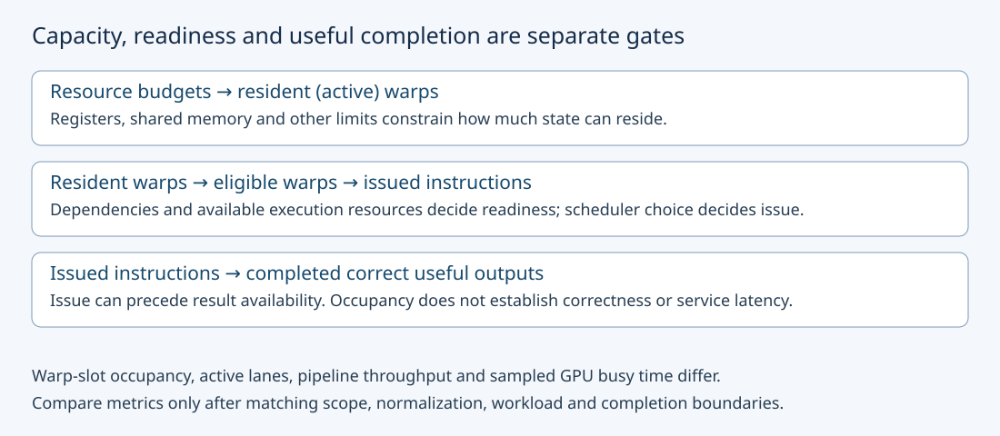
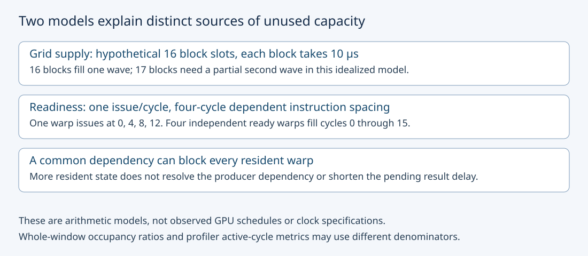

# M3-C04: Occupancy, latency hiding, and hardware utilization

> **Status: Complete — detailed chapter authored and documentation validated; experimental procedures are proposed unless explicitly labelled observed**

**Module:** Learn GPU architecture through data movement

**Category:** [Hardware architecture and topology](index.md)

[Module 3 reading order](../module-3.md) · [Previous: M3-C03](m3-c03-threads-warps-blocks-grids-and-streaming-multiprocessors.md) · [Next: M3-C05](m3-c05-device-memory-hbm-and-the-cache-hierarchy.md) · [Execution plan and progress](../chapter-execution-plan.md)

## Target concepts

Resident versus active and eligible warps, occupancy limits, registers and shared-memory budgets, available parallel work, latency hiding, utilization versus occupancy.

## Concepts

### 1. Having work resident is different from executing useful instructions

A **resident warp** has execution state assigned to an SM, a streaming multiprocessor. In NVIDIA scheduler reports, **active warp** commonly means resident, not necessarily issuing an instruction on the current cycle. An **eligible warp** is ready to issue its next instruction under the scheduler's requirements. An **issued warp** is selected for instruction issue. **Issue** means sending an instruction into the relevant execution machinery; its result can become available later.

A resident warp may wait for a previous result, a memory access, an instruction or a synchronization condition. Even an eligible warp may wait while another eligible warp is chosen. These counts have different units and scopes: resident warps per SM, eligible warps per scheduler per cycle, and issue activity cannot be compared as if they were the same percentage. [Nsight Compute's scheduler definitions](https://docs.nvidia.com/nsight-compute/ProfilingGuide/index.html) explain the states and report scopes. A warp scheduler serves a subset of an SM's resident warps; an SM-wide total does not guarantee equal readiness at each scheduler.

**Occupancy** describes resident warps relative to a supported maximum. It does not directly count active lanes within each instruction, arithmetic operations completed, memory bandwidth or successful requests. A warp with only some lanes doing useful element work still consumes a warp slot. The valid-lane ratios in [M3-C03](m3-c03-threads-warps-blocks-grids-and-streaming-multiprocessors.md) are therefore different from occupancy.

This chapter builds on the register/shared-memory accounting in completed [M3-C06](m3-c06-registers-shared-memory-and-local-resource-pressure.md) and the memory-level distinctions in [M3-C05](m3-c05-device-memory-hbm-and-the-cache-hierarchy.md). Rust remains the host-engine context for identity, timing and ownership. No kernel, pseudocode or implementation is provided, and no measured GPU result is asserted.

### 2. Theoretical occupancy is a resource-bound estimate

Let B be threads/block and W the warp width. **Warps/block = ceil(B/W)**, where ceil rounds upward. Warps belong to individual blocks; partial warps do not merge across blocks. For this NVIDIA teaching model W = 32. Let A be the number of blocks that can simultaneously reside on one SM for the compiled function and launch configuration, and M the architecture's maximum resident warps/SM:

**theoretical occupancy = A × ceil(B/32) / M.**

**Achieved occupancy** summarizes measured resident warps relative to the supported maximum over the profiler's stated observation scope. It can differ from theoretical occupancy because the launch supplies fewer blocks, blocks finish at different times, or other execution conditions limit residency. It still describes resident state, not how many of those warps are eligible. Preserve the tool's cycle normalization and SM aggregation when interpreting its value.

A is constrained by per-SM block, thread, warp, register, shared-memory and any other applicable limits. Each block must also be individually legal. Actual register/shared allocation includes target-specific granularity and configuration; raw source-variable counts do not establish A. A target-aware occupancy calculator estimates resource feasibility, not the actual scheduling timeline. The [Nsight Compute occupancy calculator](https://docs.nvidia.com/nsight-compute/NsightCompute/index.html#occupancy-calculator) is one official tool for this purpose.

Use an explicitly **hypothetical** SM: 65,536 32-bit register units, 64 KiB shared storage, at most eight resident blocks, 2,048 threads and 64 warps. KiB means 1,024 bytes. Assume no allocation rounding/overhead, 64 registers/thread, and individually legal blocks. If S is shared bytes/block:

**A = min(8, floor(2,048/B), floor(64/ceil(B/32)), floor(65,536/(64B)), floor(65,536/S)).**

Floor rounds downward. This deliberately simple equation is not a universal device calculator. Zero shared use would remove the shared-memory constraint, not divide by zero.

| B | Warps/block | Register block bound | 16 KiB: A / occupancy | 32 KiB: A / occupancy |
|---|---:|---:|---:|---:|
| 128 | 4 | 8 | 4 / 25% | 2 / 12.5% |
| 256 | 8 | 4 | 4 / 50% | 2 / 25% |
| 512 | 16 | 2 | 2 / 50% | 2 / 50% |

With B = 256 and S = 16 KiB, increasing register demand from 64 to 65 units/thread changes the register bound from four to three blocks; modeled occupancy becomes **3 × 8 / 64 = 37.5%**. At S = 32 KiB the shared bound is still two blocks and modeled occupancy stays 25%. A resource change need not change the limiting constraint.

The table cannot identify a fastest configuration. More blocks may improve available instruction choices, while a changed block size or register limit may introduce other costs. The [CUDA Best Practices Guide](https://docs.nvidia.com/cuda/cuda-c-best-practices-guide/index.html#occupancy) discusses why increasing occupancy can stop helping and can interact with spills and instruction-level parallelism. **Instruction-level parallelism** means independent instructions within a thread's work; it is another source of overlap, distinct from adding more warps.

### 3. The grid must supply enough work to use available slots

A **grid** is all the blocks in a launch. A theoretical four blocks/SM does not ensure four arrive at every SM or remain there throughout execution. There may be too few blocks, uneven block durations or an almost-empty final portion of work. A **wave** here is a teaching grouping of blocks filling the device's modeled block slots once; it is not a promise that hardware dispatches synchronized waves.

Take a hypothetical four-SM device and the table's B = 256, S = 16 KiB case: four blocks/SM gives **16 block slots/device**. Suppose every block occupies its slot for exactly D = 10 μs and ideal scheduling fills each wave evenly. For G blocks:

**modeled wave count = ceil(G/16); makespan = D × ceil(G/16).**

Makespan is elapsed time from the first start until all blocks finish. Define two different whole-window ratios:

**block-slot fill = G / (16 × wave count).**

**whole-window resident-warp ratio = G × 8 / (4 × 64 × wave count).**

| G | Modeled waves | Makespan | Block-slot fill | Whole-window resident-warp ratio |
|---|---:|---:|---:|---:|
| 8 | 1 | 10 μs | 50% | 25% |
| 16 | 1 | 10 μs | 100% | 50% |
| 17 | 2 | 20 μs | 53.125% | 26.5625% |
| 32 | 2 | 20 μs | 100% | 50% |
| 33 | 3 | 30 μs | 68.75% | 34.375% |

These ratios average over all four SMs and the entire modeled elapsed interval, including idle time. They are **not a formula for a profiler's achieved occupancy**. A tool may normalize by active cycles, aggregate SM instances differently or use a specific sampling scope. Preserve those definitions before comparing results. The fixed theoretical occupancy remains 50% in every row; adding one block near a modeled wave boundary changes the tail without changing that resource estimate.

Real blocks can start as slots become available rather than wait for every other block to finish. Uneven work can leave one long block at the end; caches, contention and resource placement can also change durations. In inference, a small decode operation can expose insufficient parallel work even on a GPU that handles a large prefill efficiently. Do not combine independent requests just to inflate a metric without checking their identities, arrival delays and latency contract.

### 4. Latency hiding requires ready independent work

**Latency hiding** means using otherwise idle issue opportunities for independent work while another result is pending. It does not make that pending result arrive earlier. If every resident warp waits on the same unavailable dependency, more residency does not supply readiness. Shared barriers can similarly make an entire block wait. A queue of admitted host requests is not automatically a set of independent device instructions.

Consider a **constructed scheduler model**, not a GPU simulation: one scheduler issues at most one instruction/cycle; each warp has four instructions forming one dependent chain; the next instruction becomes eligible four cycles after the preceding issue. All warps are initially ready. Visit ready warps in round-robin order, skipping finished or not-ready warps. Ignore memory, instruction fetch, functional-unit variation and resource limits.

| Resident model warps | Total instructions | Cycles from first issue through last issue, inclusive | Idle issue cycles | Issue-slot fill |
|---|---:|---:|---:|---:|
| 1 | 4 | 13 | 9 | 4/13 ≈ 30.769% |
| 2 | 8 | 14 | 6 | 8/14 ≈ 57.143% |
| 4 | 16 | 16 | 0 | 100% |
| 8 | 32 | 32 | 0 | 100% |

For one warp, issue cycles are 0,4,8,12. Two warps issue at 0,1,4,5,8,9,12,13. Four warps cover cycles 0 through 15. Eight cover 0 through 31, but cannot exceed this model's one-issue/cycle capacity. Increasing warps also increases total work here, so these rows are not an equal-work latency comparison or an optimization speedup.

The window ends after the last issue, not after the final result completes. If every instruction result takes the assumed four cycles, final results arrive at cycle 16,17,19 and 35 respectively, relative to first issue at zero. A real benchmark must time the defined completed work, not stop at issue. Nor does four warps in this toy establish how many warps a real SM needs: real schedulers, dependencies and instruction throughput differ.

### 5. Utilization needs a named numerator and denominator

**Utilization** can mean several measurements. Arithmetic-pipeline throughput relative to its sustained peak, memory bandwidth relative to a memory-level peak, occupied warp slots, and a sampled “GPU busy” interval answer different questions. A resource's high reported utilization may indicate a bottleneck, but not that its work is useful. Repeatedly computing discarded outputs can keep hardware busy while useful successful throughput falls.

The [NVIDIA System Management Interface documentation](https://docs.nvidia.com/deploy/nvidia-smi/index.html) defines its GPU utilization as the portion of a sampling interval during which kernels execute. That is not resident-warp occupancy or arithmetic efficiency. A one-second constructed monitoring interval containing 900 ms with some kernel executing reports a 90% busy fraction under this definition; it does not establish that all SMs were busy or that 90% of peak FLOPs were delivered. Short kernels can also be obscured by coarse sampling.

**Useful throughput = correct completed useful units / elapsed time at a declared boundary.** For a fixed tensor transform, the unit may be validated elements. For serving, use the completed request/token and outcome definitions from Module 9. Keep dispatch/completion overhead, copies and queueing visible as separate or inclusive boundaries.

A higher theoretical occupancy with unchanged issue activity and elapsed time can be a neutral outcome. More resident warps with fewer eligible warps, higher local traffic and slower completion can indicate a tradeoff worth investigating. A single stall category or busy percentage cannot establish causation; require a controlled workload and corroborating resource/timing evidence.

### 6. Preserve ownership and failure behavior while exposing parallelism

Work is independently executable only when required state is valid and dependencies permit it. Distinct tensor slices can still share output state or a mutable KV allocation. Maintain unique writers, input/epoch identity, completed producer publication and safe allocation lifetimes. Reordering independent blocks cannot violate the block-independence contract from M3-C03. A block barrier is not a global progress mechanism.

Overload, cancellation and a lost device completion record do not authorize premature output reuse. An impossible launch should be rejected rather than silently reduce the logical workload. Changing admission or batching changes queueing and must be evaluated at a serving boundary, not presented as an isolated occupancy improvement.

The HFT lens is readiness on a critical path: more queued market events do not make a dependent decision ready, and high CPU busy time does not establish timely useful processing. This transfers the discipline of preserving state and measuring useful completion. It does not equate CPU scheduling, exchange event semantics or trading deadlines with CUDA warp scheduling.

## Experiments

All experiments are proposed. Apply completed [M9-C01](../numerics-and-correctness/m9-c01-defining-reference-behavior-and-evidence-before-optimizing.md) reference contracts, [M9-C02](../measurement-experimentation-and-economics/m9-c02-request-events-clocks-and-measurement-boundaries.md) clock/completion boundaries, [M9-C07](../measurement-experimentation-and-economics/m9-c07-latency-distributions-and-statistical-uncertainty.md) distributions, [M9-C15](../state-memory-and-caching/m9-c15-accounting-for-weights-kv-state-workspace-and-fragmentation.md) byte scopes and [M9-C17](../numerics-and-correctness/m9-c17-comparing-logits-with-justified-numerical-tolerances.md) numerical gates. Advanced GPU profiling chapters remain outlines; necessary introductory controls are local here.

### E1 — Reconcile resource limits and theoretical occupancy

- **Description:** Evaluate the six block/shared configurations and the 65-register probe in the hypothetical SM model.
- **Purpose/objective:** Identify resource limits without confusing feasibility with readiness or speed.
- **Target concepts:** Occupancy limits, registers/shared budgets, partial warp rounding.
- **Baseline and workload:** B in {128,256,512}, S in {16,32} KiB, r = 64 and the exact stated hypothetical caps; add B = 256, S = 16 KiB, r = 65 as a separate threshold probe.
- **Controls and prediction:** Keep model caps and no-rounding assumptions fixed. Predict the table's six occupancy values and 37.5% for the probe. This is arithmetic, not an actual GPU launch.
- **Procedure:** Enumerate each limiting block count, the minimum A and resident warps. Reject an impossible S = 65 KiB candidate under this model. For an optional actual-device extension, create a separate ledger from compiled-function and device/partition limits using a supported calculator; preserve allocation granularity and other constraints.
- **Hardware/software:** Model checks need no GPU. Optional GPU extension requires supported tooling, target identity and final resource reports; no architecture's capacities are implied by this hypothetical table.
- **Failure and HFT connection:** Reject over-cap configurations before timing. HFT admission also needs explicit budgets, but a warp-residency estimate is not a host queue-capacity formula.
- **Exit criteria:** All seven legal modeled results and the rejection reconcile; every actual-device estimate identifies its limits and assumptions. No theoretical percentage is reported as measured occupancy.

### E2 — Account for available work and the final wave

- **Description:** Audit the five grid sizes on the four-SM, 16-slot idealized device.
- **Purpose/objective:** Separate theoretical capacity from the amount and distribution of available work.
- **Target concepts:** Grid size, resident warps, available parallel work, tail effects.
- **Baseline and workload:** G in {8,16,17,32,33}; eight warps/block, D = 10 μs/block, equal durations and ideal synchronous-wave filling. Every distinct block must complete once.
- **Controls and prediction:** Fix per-block resources and duration. Predict wave count, makespan, slot fill and whole-window resident-warp ratio as shown; theoretical occupancy stays 50%.
- **Procedure:** Draw the occupied slots for every wave, verify every block ID appears exactly once and count idle slot-time. Then construct an imbalance example with 16 blocks: 15 occupy slots for 10 μs and one for 30 μs, all starting together. Recompute the whole-window ratios; label this explicitly different work-duration distribution.
- **Hardware/software:** Paper/arithmetic baseline. A future device trace requires actual block timings/placement evidence; do not infer synchronized waves from IDs or claim that this model reproduces a device scheduler.
- **Failure and HFT connection:** A missing block cannot improve the denominator by being omitted. HFT burst and straggler reasoning motivates retaining slow work, but this block model contains no arrival queue or network delay.
- **Exit criteria:** All five schedules reconcile and the imbalance example retains all 16 blocks. Distinguish elapsed-window ratios from profiler normalization; no predicted tail is labelled observed.

### E3 — Explain ready work with a bounded scheduler model

- **Description:** Enumerate issue/readiness histories for one, two, four and eight warps in the single-issue model.
- **Purpose/objective:** Explain how independence hides waiting and why added residency eventually stops helping.
- **Target concepts:** Resident/eligible/issued states, dependencies, latency hiding and issue capacity.
- **Baseline and workload:** Four dependent instructions/warp, next issue eligible after four cycles, all initially ready, round-robin eligible selection and one issue/cycle. This model does not implement or benchmark a GPU.
- **Controls and prediction:** Fix delay and issue rule while changing warp count; total instruction work changes accordingly. Predict issue-window lengths 13,14,16,32 and final-result timestamps 16,17,19,35.
- **Procedure:** Record each cycle's eligible set, selected warp and next-ready cycle, stopping only after the last result for completion accounting. Add a paper counterexample in which all four resident warps are initially blocked by a common producer until cycle 10; none may issue earlier. Keep this initial dependency separate from steady instruction latency.
- **Hardware/software:** Reference reasoning needs no device. Optional real scheduler counters require target-specific definitions and cannot be assumed to reproduce this toy's one-issue/four-cycle machine.
- **Failure and HFT connection:** Reject issuing a dependent instruction before readiness or stopping completion at last issue. More queued HFT tasks likewise cannot resolve a common dependency, but these cycles have no trading-time interpretation.
- **Exit criteria:** Histories reproduce instruction counts, idle slots and result completion; the common-dependency fixture rejects premature issue. No cross-row speedup is claimed because instruction populations differ.

### E4 — Sweep block size at fixed useful tensor work

- **Description:** Compare completed transform cost across small and large grids while preserving exact outputs.
- **Purpose/objective:** Relate resource feasibility, achieved scheduler behavior and useful completion without maximizing occupancy as the objective.
- **Target concepts:** Available parallel work, occupancy/utilization distinction, register budgets and latency hiding.
- **Baseline and workload:** Xᵢ = i modulo 256, Yᵢ = 2Xᵢ + 1 in packed FP32; N in {70,4,096,1,048,576} and B in {128,256,512}. Each valid element has one writer, one input read and one output write. Grid size is ceil(N/B); N = 70 always has one block.
- **Controls and prediction:** Nine cells hold precision, semantic values, compiled candidate, numerical options, device residency and zero requested dynamic shared memory fixed. Only N/B change; record actual static shared and register allocation rather than borrowing the model's 64-register/16-KiB values. Small grids may lack parallel work, but no speed ranking is guaranteed.
- **Procedure:** Check legality and every output before comparison. Use 3 independent sessions × 20 measured trials/cell = 540 scheduled trials and 10 warmups/cell/session = 270 warmups. Randomize the nine-cell order within sessions with a recorded seed and pair block-size comparisons within each N. Collect representative resource/scheduler profiles separately from unprofiled timing.
- **Hardware/software:** One supported discrete GPU with sufficient block limits and at least 8 MiB input/output payload for the largest cell plus runtime overhead/reserve; final compiler target/options, visible SM count and resource/counter support recorded.
- **Failure and HFT connection:** Record invalid configurations, missing completion and wrong outputs, preserving in-flight allocation lifetime. HFT useful-work timing motivates the boundary, but this resident transform omits service arrivals, KV dependencies and response delivery.
- **Exit criteria:** All 540 trial outcomes reconcile, valid completed outputs match and claimed performance includes unprofiled completed intervals plus correctly scoped resource evidence. No gain or a regression is a valid outcome; service improvements require a later end-to-end gate.

## Verification

### Model references and counterexamples

E1's six occupancies are **25%, 50%, 50%** for B = 128,256,512 with 16 KiB, and **12.5%, 25%, 50%** with 32 KiB. The r = 65 probe yields three resident blocks and 24 warps, or 37.5%. A 65 KiB shared request exceeds the modeled 64 KiB pool. These calculations intentionally exclude real allocation rounding and additional limits.

E2's wave counts are 1,1,2,2,3; total device slot-time capacities are 160,160,320,320,480 slot-μs. Useful occupied slot-times are 80,160,170,320,330 slot-μs. For the imbalance fixture, occupied slot-time is **15 × 10 + 30 = 180 slot-μs** out of **16 × 30 = 480**, so slot fill is **37.5%**. Whole-window resident-warp ratio is **180 × 8 / (4 × 64 × 30) = 18.75%**. This deliberately longer distribution gives a different result from 16 equal 10-μs blocks; do not call it a measurement of a slower configuration.

For E3, total instruction counts are 4,8,16,32. Count idle slots in the issue window as 9,6,0,0. The completion timestamp equals last issue cycle plus four; the first issue begins at cycle zero, so do not add an extra “inclusive cycle” to a result timestamp. The common-dependency fixture shifts the four-warp issue interval to cycles 10 through 25 and final result to cycle 29. Residency alone cannot fill cycles 0–9 under this fixture.

For E4, expected output values are exact FP32 integers up to 511. N = 70 produces odd integers 1 through 139 with sum **4,900**. N = 4,096 has sum **1,048,576**; N = 1,048,576 has sum **268,435,456**. Compare every coordinate; checksums cannot detect all permutations or compensating errors. Inputs remain unchanged between trials.

At N = 70, B = 128,256,512 creates respectively 58,186,442 guarded-out threads, with 4,8,16 configured warps. These are mapping counts, not achieved occupancy. For N = 4,096 the grid sizes are 32,16,8; for N = 1,048,576 they are 8,192,4,096,2,048. Across all successful planned trials, 180 trials/N produce **189,493,560 validated element results**, requesting **1,515,948,480 logical input/output bytes** at eight bytes/element. Initialization, readback diagnostics, spills, physical memory transactions and profiler replay traffic are separate populations.

### Measurements, benchmarking and profiling

The primary E4 host boundary begins with resident inputs ready, immediately before submission, and ends when valid device completion is observed on the host. Output remains on device; initialization, warmup, compilation and post-completion validation readback are excluded and reported separately. Also retain device-event intervals with their own scope. Do not subtract timestamps across clock domains, or report submission return time as completed execution.

Use a predeclared 120-second observation watchdog for future trials. It is not a performance target or permission to reuse uncertain buffers. Track successful completion, wrong output, launch/runtime failure, unsupported configuration and timeout/unknown completion separately. Preserve missing timing records and reconcile every scheduled attempt. Recover or quarantine allocations when completion is unknown.

Report raw values and counts per cell/session, median and spread, explicitly defined nearest-rank quantiles and paired block-size differences at the same N. Twenty trials/session do not establish stable p99. Do not average percentiles or pool N values into one latency claim. Preserve clock/power/thermal observations and co-tenancy, since randomized order does not eliminate drift.

For representative diagnostic runs collect final registers/thread, actual shared bytes/block, device/partition limits, theoretical and achieved occupancy definitions, eligible/issued warp evidence and skipped issue activity where available. Include local-memory traffic and relevant compute/memory throughput so an apparent occupancy change is interpreted alongside its costs. Record exact metric names, units, active-versus-elapsed normalization, SM/scheduler aggregation and collection scope. A lower achieved value can reflect limited work or imbalance; counters alone do not identify a unique cause.

Profile separately from uninstrumented performance trials: replay, sampling and cache policy can change execution. Missing counters mean unavailable evidence rather than zero activity. Do not divide an SM-wide active-warp total by a scheduler-local maximum, or equate a monitoring busy percentage with achieved occupancy. The source calculator/report estimates are useful corroboration, not evidence of timing until work actually executes.

A later service gate must preserve model/token/cache identity, request population and arrivals while measuring useful completion, TTFT and delivered response distributions including queueing. Increasing batch size to fill the GPU can add waiting time; count that cost. None of the isolated experiments certifies a production service or HFT deadline.

## Engineering dimensions and principles

### Six dimensions applied

| Dimension | Chapter-specific reasoning and evidence |
|---|---|
| Semantics and invariants | Unique output writers and exact reference values remain mandatory regardless of occupancy or issue activity. |
| Workload and variability | Grid size, partial blocks, uneven block durations and phase shape change available parallel work. |
| Resources and bottlenecks | Registers/shared memory bound residency; dependencies and execution ports determine whether resident work can issue. |
| Time and distributions | Separate issue windows from result completion, final-wave tails from queueing, and per-cell distributions from averages. |
| Ownership and coordination | Ready work must own valid inputs and outputs; publication, last use and recovery survive block-size changes. |
| Failure and adaptation | Reject infeasible launches, retain failures and unknown completions, and evaluate batching with its arrival-to-completion cost. |

### Eight principles applied

1. **Correctness defines the optimization boundary.** More issued instructions cannot compensate for missing tensor outputs or stale state.
2. **Performance depends on workload and operating point.** One partial block and thousands of full blocks have different readiness and tail behavior.
3. **Data movement is part of the algorithm.** Higher residency can change register allocation or cache traffic; count those costs at the correct memory level.
4. **State has ownership, lifetime, and recovery cost.** Pending device outputs remain protected even when a host request is cancelled.
5. **Dependencies determine latency; bottlenecks determine capacity.** A theoretical slot is useful only if supplied work is ready and the relevant execution resource permits progress.
6. **Variability and synchronization shape the tail.** A slow final block or a common dependency can leave resources idle without changing theoretical occupancy.
7. **Local improvements must be evaluated end to end.** A busier GPU or fuller warp pool matters through useful completed service, including batching delay.
8. **Claims require reproducible evidence.** Preserve function identity, limits, metric scope, reference outputs, raw outcomes and completed timing boundaries.

## Specifications, articles, and hardware

Primary sources checked 26 October 2026:

- [CUDA Best Practices Guide 13.4](https://docs.nvidia.com/cuda/cuda-c-best-practices-guide/index.html): occupancy and execution-configuration guidance, including register/shared-memory tradeoffs.
- [Nsight Compute Profiling Guide](https://docs.nvidia.com/nsight-compute/ProfilingGuide/index.html): active/eligible/issued warp definitions, occupancy and throughput scopes, metric collection and replay limitations.
- [Nsight Compute occupancy calculator](https://docs.nvidia.com/nsight-compute/NsightCompute/index.html#occupancy-calculator): supported resource-estimate workflow; an estimate does not execute the kernel.
- [CUDA Pro Tip: Occupancy API Simplifies Launch Configuration](https://developer.nvidia.com/blog/?p=3366): NVIDIA's explanatory article on occupancy-based configuration. Historical API examples are context rather than a current compiler contract or implementation instruction.
- [NVIDIA System Management Interface](https://docs.nvidia.com/deploy/nvidia-smi/index.html): sampled kernel-busy utilization and availability limits; it is a different observation from occupancy.

| Required specification | What a future experiment must record |
|---|---|
| Visible hardware | Exact GPU and partition, visible SM count, warp width, maximum resident warps/threads/blocks, CPU host and co-tenancy |
| Resource limits and function | Registers and shared capacity/SM, per-block/thread limits, allocation granularity, compiled registers/static shared bytes and configured dynamic shared bytes |
| Work definition | N, B, grid dimensions, dtype, strides, input/output identity and allocation footprint |
| Software and observation | Driver/runtime/compiler/target/options, binary identity, profiler/calculator versions, supported counters, replay and normalization |
| Operating conditions | Available device-memory budget/reserve, clocks, power/temperature, warmup, randomization seed and trial order |

One supported GPU suffices for E4. The largest cell requires 8 MiB input/output payload plus runtime overhead/reserve; every B must pass the actual function and device launch limits. The arithmetic/scheduler references require no GPU and do not specify an actual NVIDIA product. Multi-GPU interconnects and network hardware are unnecessary. No test machine, observed occupancy, device trace or benchmark result has been supplied.

## Completion and next chapter

Use the clickable [execution plan](../chapter-execution-plan.md) to track acceptance. [M3-C07: Memory coalescing, alignment, and tensor layouts](../kernels-compilers-and-execution/m3-c07-memory-coalescing-alignment-and-tensor-layouts.md) is now complete. The next **authoring** chapter is [M3-C08](../kernels-compilers-and-execution/m3-c08-tiling-and-reuse-through-the-memory-hierarchy.md). The Module 3 **reading** successor remains completed [M3-C05](m3-c05-device-memory-hbm-and-the-cache-hierarchy.md). Module 9 supports Modules 1–7; Module 8 is excluded.
