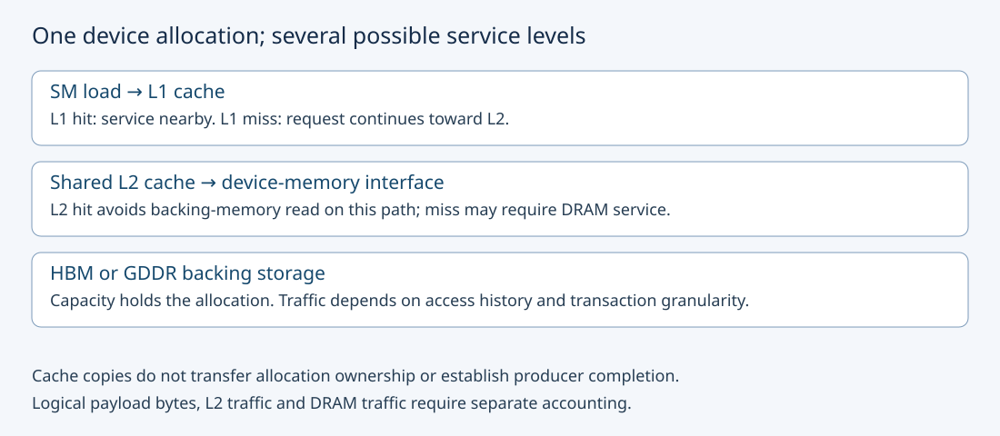
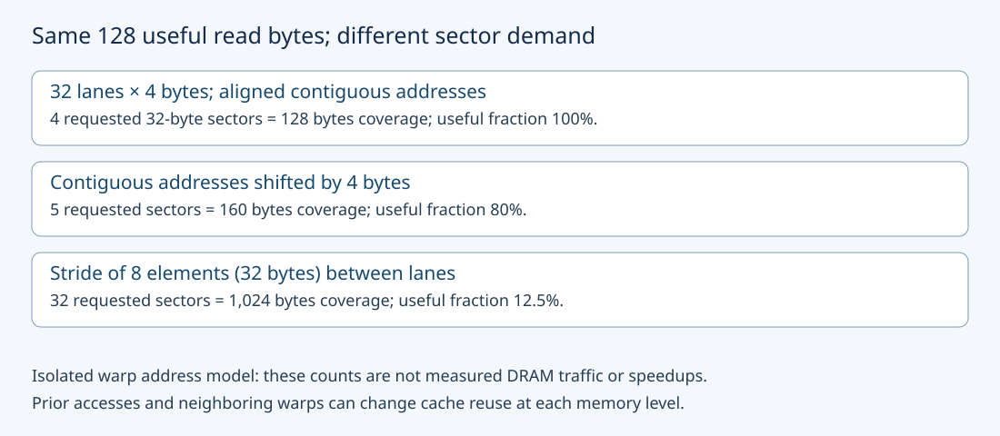

# M3-C05: Device memory, HBM, and the cache hierarchy

> **Status: Complete — detailed chapter authored and documentation validated; experimental procedures are proposed unless explicitly labelled observed**

**Module:** Learn GPU architecture through data movement

**Category:** [Hardware architecture and topology](index.md)

[Module 3 reading order](../module-3.md) · [Previous: M3-C04](m3-c04-occupancy-latency-hiding-and-hardware-utilization.md) · [Next: M3-C06](m3-c06-registers-shared-memory-and-local-resource-pressure.md) · [Execution plan and progress](../chapter-execution-plan.md)

## Target concepts

Global memory, HBM versus GDDR, L2 and L1 caches, cache lines and transactions, bandwidth versus access latency, capacity, working sets, cache hits and misses.

## Concepts

### 1. An address, its physical backing, and a cached copy are different things

A tensor is a logical collection of values; its storage occupies bytes. **Global memory** names a device-visible address space, rather than a promise that every access travels to a particular memory chip. **Device memory** here means memory physically attached to the executing discrete GPU. This chapter's baseline uses explicit device allocations, with inputs resident before timing. Unified, host-mapped and peer allocations can have different physical paths; the [CUDA memory guide](https://docs.nvidia.com/cuda/cuda-programming-guide/02-basics/understanding-memory.html) describes those distinctions. Do not infer residency from the fact that an address is accessible to a kernel.

**DRAM**, dynamic random-access memory, stores the large backing allocation. **HBM**, high-bandwidth memory, uses stacked memory and a wide interface near the processor package. **GDDR**, graphics double data rate memory, uses a different package/interface arrangement common in graphics cards. The [Micron HBM technical explanation](https://www.micron.com/products/memory/hbm) describes stacked dies and their wide interface. Both provide device-memory capacity and bandwidth; neither label supplies a universal load latency or application speed. Physical packaging, channels, clocks and the precise GPU variant matter. The same tensor contract can be implemented on either type.

A **cache** retains copies of recently accessed data closer to the execution units. **L1**, the first-level cache, is associated with an SM in the NVIDIA model used here. **L2**, the next level, is shared across SMs on the device. An access satisfied at a level is a **hit**; one requiring service farther down is a **miss**. A hit at L1 avoids a request reaching L2 on that path. A miss at L1 can still hit L2 and avoid device DRAM. These are level-specific events, not interchangeable hit percentages.

Read [M3-C01](m3-c01-following-a-tensor-from-cpu-to-gpu.md) for host/device completion and [M1-C05](../state-memory-and-caching/m1-c05-how-tensors-occupy-memory.md) for tensor storage. Rust is the host-engine context; the memory hierarchy belongs to the device and supported execution interface, not to a Rust collection type. This chapter supplies specifications and proposed experiments without implementation code.

### 2. Capacity asks whether state fits; a working set asks what is reused

**Capacity** is the amount of storage available. A **working set** is the distinct data touched during a stated interval of useful work. A 2 GiB allocation can contain an 8 MiB repeatedly accessed region; its allocation size and active working set are different. MiB means 2²⁰ bytes and GiB means 2³⁰ bytes; vendor GB values must not silently be substituted for GiB.

A cache can only help reuse if the relevant data remains available when accessed again. **Temporal locality** is reuse over time; **spatial locality** is useful access to nearby addresses. A working set below the advertised cache capacity is not a guaranteed hit: other tensors, cache organization, replacement, scheduling and competing work also affect retention. A huge one-pass tensor may have little temporal reuse but excellent spatial locality.

For a packed FP32 input and separate FP32 output, four bytes/value:

**input storage = 4N; output storage = 4N; live payload = 8N bytes.**

At N = 2²⁰ this is 4 MiB input plus 4 MiB output, or 8 MiB live payload. Reading the whole input and writing the output once also gives 8 MiB of logical payload accesses. Equal numerical totals do not make storage and traffic the same quantity. Repeating that operation ten times leaves the same allocations live but requests 80 MiB of logical payload accesses. Actual DRAM bytes may differ due to cache hits, transaction granularity, write behavior and other traffic.

A capacity admission rule is **weights + KV state + workspace + other live allocations + safety reserve ≤ usable device budget**. Usable budget is observed for the actual device/partition, not the product's nameplate capacity. A hardware cache is automatically managed; an application KV cache is explicitly owned semantic state. Eviction of a hardware copy must preserve program semantics; discarding application KV state can require reconstruction. Never treat a high hardware hit rate as authorization to reuse a stale KV handle.

### 3. Count transactions at an explicit boundary

A **cache line** is a cache's storage/tag granule; a **sector** can be a smaller portion transferred or accounted within a line. A **transaction** is a service unit at a particular interface. One thread load, one warp instruction, one cache line and one DRAM transfer are not the same count. In NVIDIA's documented compute-capability-6.0-and-later teaching model, warp accesses are serviced in aligned 32-byte units. The [CUDA Best Practices Guide](https://docs.nvidia.com/cuda/cuda-c-best-practices-guide/index.html#coalesced-access-to-global-memory) explains this coalescing rule; verify the target architecture and instruction before applying it.

For one warp of 32 participating lanes, each reading four bytes, define lane j's byte address as **aⱼ = base + offset + 4sj**, where s is stride in elements. Assume base is aligned to 32 bytes, the accesses are valid and aligned to four bytes, and each four-byte word fits within its sector. The number of distinct requested sectors is:

**S = count of distinct floor(aⱼ / 32), for j = 0,…,31.**

Floor rounds downward. The useful read payload is 128 bytes in all three cases below; requested sector coverage is 32S bytes.

| Address pattern | S | Sector coverage | Useful payload / coverage |
|---|---:|---:|---:|
| s = 1, offset = 0 | 4 | 128 B | 100% |
| s = 1, offset = 4 B | 5 | 160 B | 80% |
| s = 8, offset = 0 | 32 | 1,024 B | 12.5% |

These are exact address-model counts for a single isolated warp instruction, not measured DRAM traffic or predicted speedups. Adjacent warps may reuse over-fetched sectors, L2 can satisfy requests, and the compiler can change instruction width or eliminate redundant accesses. Detailed layout/coalescing tuning belongs to later chapters; here the goal is to avoid calling every logical byte a DRAM byte.

NVIDIA's [Nsight Compute memory tables](https://docs.nvidia.com/nsight-compute/ProfilingGuide/index.html#memory-tables) describe level-specific sectors, requests and hit rates. Record the actual metric definitions, client and read/write scope, not just a screenshot labelled bandwidth. Missing counters on a device are unavailable evidence, not zero misses.

### 4. Bandwidth and latency answer different questions

**Access latency** is the delay between a particular request and its usable result, under specified conditions. **Bandwidth** is bytes served per unit time at a named boundary. A broad road can carry many vehicles while an individual trip still takes time. A GPU needs enough independent work to keep memory requests in flight; one dependent chain cannot manufacture independence by being stored in HBM.

**Logical effective bandwidth = logical bytes read and written / completed elapsed time.**

A hypothetical completed 8 MiB payload operation in 20 μs gives **419.4304 GB/s**, using decimal GB/s. This is an illustrative arithmetic result, not a measurement. The same time with 2 MiB of measured DRAM traffic would imply **104.8576 GB/s** at that DRAM boundary. Effective bandwidth can exceed nameplate DRAM bandwidth for cache-resident work without violating physics, because the numerator counts logical reuse rather than physical DRAM transfers.

For a dependency chain of K loads whose next address depends on the preceding loaded value, a simple model is **chain time ≈ K × dependent-step delay + fixed overhead**. Step delay includes address/instruction and measurement effects, so chain time/K is not automatically pure DRAM latency. Conversely, **transfer-time floor = bytes / sustainable bandwidth** assumes sufficient independent work and that the named transfer path is limiting. Neither equation substitutes for the other.

An illustrative concurrency model gives **bytes in flight ≈ bandwidth × service delay**. At an assumed 1 TB/s and 400 ns, this is 400,000 bytes. This is a dimensional estimate under steady conditions, not a hardware queue-depth specification. M3-C04 will develop latency hiding after the resource prerequisites are available.

### 5. Cache state changes the operating point

A **warm** measurement follows a defined access history intended to retain useful data. A **cold-intended** measurement follows a defined history intended to reduce reuse. Neither word is a hardware guarantee. An intervening sweep larger than L2 is a perturbation protocol, not proof of complete eviction; there is no universal portable cache flush implied here. Verify changes with available counters, and describe uncertainty when retention cannot be established.

For a deliberately simplified illustration, assume 1,000 L1 sector requests, 600 L1 misses, 450 of those hitting L2 and 150 missing there. The L1 hit rate is **400/1,000 = 40%**; the L2 hit rate for this population is **450/600 = 75%**. It is wrong to add these percentages. With 32-byte sectors and one downstream read per miss under this model, requested coverages are 32,000 bytes at L1, 19,200 bytes at L2 and 4,800 bytes downstream. This is a synthetic read-only ledger, not a prediction including writes, prefetch or compression.

Repeated weights, selected KV regions and streaming workspace compete differently. A prefill and a decode phase can have different working sets even on the same model. Uniform random addresses, contiguous scans and skew toward a hot region are separate workloads. Pin identities, seeds, active region and reuse distance—the amount of intervening access—before attributing a timing change to cache size.

### 6. Correct ownership survives every cache outcome

A cache hit is not a synchronization primitive. The supported memory-ordering/completion contract must establish that a producer finished before a consumer uses the value. An input must remain immutable while pending readers require it; output must have an authorized writer and remain allocated until its last device use ends. Cancellation of a host request does not cancel already submitted device accesses or justify recycling their allocation.

Under allocation failure, reject or reduce the admitted workload explicitly rather than silently omit elements. Under an unknown device completion state, quarantine affected buffers until recovery establishes safe reuse. A slower cold-intended trial, a timeout and an incorrect result are distinct outcomes. In HFT systems, retained order-book state and burst arrivals motivate attention to freshness, ownership and tail behavior. The analogy transfers the discipline of preserving identity and measuring the critical path; it does not equate market-data semantics, CPU cache coherence or trading deadlines with GPU inference.

## Experiments

All experiments are proposed. No GPU benchmark, profiler run or production-serving result is asserted. Use completed [M9-C01](../numerics-and-correctness/m9-c01-defining-reference-behavior-and-evidence-before-optimizing.md), [M9-C02](../measurement-experimentation-and-economics/m9-c02-request-events-clocks-and-measurement-boundaries.md), [M9-C07](../measurement-experimentation-and-economics/m9-c07-latency-distributions-and-statistical-uncertainty.md), [M9-C15](../state-memory-and-caching/m9-c15-accounting-for-weights-kv-state-workspace-and-fragmentation.md) and [M9-C17](../numerics-and-correctness/m9-c17-comparing-logits-with-justified-numerical-tolerances.md) for reference, timing, distributions, storage and numerical gates. Later profiling/hardware-condition chapters remain outlines; the required introductory controls are specified here.

### E1 — Reconcile a tensor's storage and access ledger

- **Description:** Audit resident input/output storage and logical traffic before making a bandwidth claim.
- **Purpose/objective:** Distinguish allocation capacity, active working set and repeated access bytes.
- **Target concepts:** Global/device memory, capacity, working sets, traffic boundaries.
- **Baseline and workload:** N = 2²⁰ FP32 elements, input Xᵢ = i modulo 256; independent output Yᵢ = 2Xᵢ + 1. Compare one pass with ten completed passes over the same unchanged input and output allocation.
- **Controls and prediction:** Keep placement, precision, shape and reference values fixed. Live payload stays 8 MiB; logical accesses grow from 8 to 80 MiB. No DRAM prediction follows from this alone.
- **Procedure:** Produce the byte ledger, establish device residency, then compare every output against the exact integer reference. Record allocator totals and separately labelled device-memory counters if a runtime is later available. Include a deliberately omitted-output-allocation ledger as a rejection probe.
- **Hardware/software:** Arithmetic needs no GPU; runtime extension needs one supported discrete GPU, explicit device allocations and recorded runtime/driver/compiler versions.
- **Failure and HFT connection:** Capacity rejection and stale allocation identity must be explicit. HFT's retained-state budgeting is a useful analogy, but these byte counts describe inference tensors, not exchange state.
- **Exit criteria:** Each ledger reconciles storage and access scopes, every output is correct, and the omitted-allocation probe is rejected. No cache hit or DRAM result may be inferred without observation.

### E2 — Hold useful reads fixed while changing sector demand

- **Description:** Compare the three 32-lane read patterns from the sector table, preserving logical values.
- **Purpose/objective:** Explain how identical useful payload can have different requested sector coverage.
- **Target concepts:** Lines, sectors, transactions, spatial locality and cache hits.
- **Baseline and workload:** Separate address layouts contain the same logical Xⱼ = j for j = 0,…,31 at the specified addresses. Output Yⱼ = 2j + 1 is contiguous in every case. Input allocations cover all addressed bytes; strided maximum address starts at byte 992 and ends at 995 relative to aligned base, requiring at least 996 bytes.
- **Controls and prediction:** Keep output, arithmetic and participating lanes fixed; change only input address layout. Predicted read-sector counts are 4, 5 and 32 per isolated instruction. Count output traffic separately. Do not compare different logical element values accidentally.
- **Procedure:** Enumerate all addresses and sector IDs on paper; verify the exact outputs. A future device extension must inspect actual generated load width and retained work, then collect matching read-scope counters separately from timing. Use 3 independent sessions × 20 trials per layout: 180 measured trials, plus 10 warmups/layout/session, or 90 warmups. Randomize layout order with a recorded seed within each session.
- **Hardware/software:** Baseline CUDA/NVIDIA warp width 32 and applicable 32-byte access-unit model; compiler/target and profiler metrics recorded. A tiny runtime test may be dominated by launch overhead and cannot establish peak bandwidth.
- **Failure and HFT connection:** Reject misaligned/out-of-range descriptors and mismatched IDs. HFT locality reasoning transfers; neither reduced sector demand nor a tiny benchmark proves lower trading or serving latency.
- **Exit criteria:** Address references and outputs pass; any measured transaction claim identifies its level, instruction and cache history. Explain discrepancies instead of forcing runtime counters to equal the isolated model.

### E3 — Sweep working set and access history

- **Description:** Compare a repeated device-resident transform after warm and cold-intended histories.
- **Purpose/objective:** Test whether reuse sensitivity is consistent with cache behavior rather than assume every repeated read hits.
- **Target concepts:** L1/L2, hits/misses, working sets, bandwidth, cache capacity.
- **Baseline and workload:** FP32 transform from E1 with input sizes 1, 8 and 64 MiB; separate output of equal size. Each size has a warm condition following one completed same-input transform and a cold-intended condition following a completed 256 MiB read sweep over a separate buffer with a retained checked result. The sweep contains 67,108,864 unsigned 32-bit values, entry i equal to i modulo 256; its retained unsigned 64-bit sum must be 8,556,380,160. Include its small result allocation in the capacity ledger.
- **Controls and prediction:** Six cells share correctness and timing boundaries; preparation is outside the isolated transform timing but also reported as inclusive cost. Record actual L2 size. If 256 MiB is not larger than visible L2, label the perturbation insufficient and report that limitation; do not silently change the protocol or call it cold. Retention and speed differences remain hypotheses.
- **Procedure:** Preflight capacity for all simultaneous buffers and reserve; allocate once. Use 3 sessions × 20 trials/cell = 360 measured transforms; 10 warmups/cell/session = 180 warmups. Restore the prescribed history before every measured transform, alternate matched conditions in randomized order, and validate every output after completion. Profile representative deterministic trials separately with declared replay/cache controls.
- **Hardware/software:** One supported GPU with at least 512 MiB observed free capacity plus runtime overhead/reserve for the largest baseline cell: 128 MiB input/output and 256 MiB perturbation buffer. Record actual usable capacity, L2 size, cache configuration and profiler permission; sufficient memory alone does not guarantee success.
- **Failure and HFT connection:** Track preparation failures, timeouts and output failures; keep pending buffers alive. Bursty hot/cold data resembles reuse variation in market processing, but this isolated transform omits queues, networking and model dependencies.
- **Exit criteria:** All 360 planned outcomes reconcile; completed outputs pass and preparation costs are visible. Report level-specific cache/byte evidence and distributions, or state that cache causation remains unproven. A missing speedup is a valid outcome.

### E4 — Separate dependent latency from independent traffic

- **Description:** Compare a serial dependent address chain with many independent contiguous reads as different operating points.
- **Purpose/objective:** Prevent throughput from being reported as per-access latency.
- **Target concepts:** Access latency, bandwidth, dependencies, working sets and capacity.
- **Baseline and workload:** A 4,096-entry unsigned 32-bit next-index table forms one cycle visiting every index exactly once. Define a reproducible permutation with a recorded generator/version/seed, connect each entry to its successor and the last to the first, and start at index 0. A 4,096-step chain returns to 0. The independent condition reads the same 4,096 table entries into a separate checked output without address dependencies; it is a bandwidth-oriented comparison, not equivalent execution work.
- **Controls and prediction:** Both perform 16,384 logical input-read bytes/trial, but concurrency, instructions and outputs differ. Table size is 16 KiB, so this baseline does not establish DRAM latency; record its access history. Do not interpret a speed ratio as an optimization preserving the same dependency graph.
- **Procedure:** Validate the single-cycle structure, then measure both conditions in 3 sessions × 20 trials = 120 measured trials; 10 warmups/condition/session = 60 warmups. Retain the dependent result and independent vector to prevent dead-work removal. Profile dependency and traffic scopes separately; subtract only independently characterized timer overhead with uncertainty.
- **Hardware/software:** Device-side timing capable of resolving the sequence, recorded clock domain and supported counters; host timing supplies completed-call cost separately. Arithmetic-only cycle checks are possible without GPU timing.
- **Failure and HFT connection:** Reject a table containing several short cycles even if 4,096 steps happens to return to 0. HFT critical paths also contain serial dependencies, but this synthetic GPU chain cannot predict order-processing delay.
- **Exit criteria:** Every edge and visited index is validated; chain terminal index and every independent output pass. Report dependent-step delay and independent logical throughput with distinct labels; no universal DRAM latency or speedup is asserted.

## Verification

### Reference behavior and deliberate faults

E1 has 4,096 repetitions of each input value 0,…,255. Its exact output values are odd integers 1,…,511, with mean 256 and sum **268,435,456**. All are exactly representable in FP32. Check every element: a sum alone would miss permutations. Ten passes overwrite the same output, rather than apply the transform recursively. E2's expected output is 1,3,…,63, with sum **1,024**; the strided input is a different physical layout of the same values. Verify the 128 useful input bytes in each layout and distinguish read transactions from output writes.

For E3, each input MiB supplies 262,144 elements. The three N values are **262,144; 2,097,152; 16,777,216**. Generate Xᵢ = i modulo 256 independently of placement. Across 120 measured transforms per size, logical read/write traffic is **120 × (2 + 16 + 128) MiB = 17,520 MiB**. This excludes warmups, history preparation, validation transfers and profiler replays. Every cold-intended trial sweeps 256 MiB; 180 such measured-trial preparations request **46,080 MiB** of additional logical reads. Keep the two populations separate rather than assigning preparation bytes to the transform's device-memory bandwidth.

For E4, confirm the successor function is a bijection and the orbit from 0 contains all 4,096 indices before returning. Those conditions reject disjoint short cycles. Each independent result must equal the pinned next-index entry. An intentionally split-cycle fixture must fail the reference gate. Never run an unbounded chain to discover whether it terminates; the prescribed step count is fixed.

### Measurement, benchmarking and profiling contract

For E2–E4, the primary host interval starts with resident inputs and prescribed preparation complete, immediately before submission, and ends when valid device completion is observed on the host. This includes dispatch and completion observation, with output resident on device; it excludes initialization, history preparation and post-completion readback validation. Also record a device event interval around the prescribed work and an inclusive host interval containing history preparation when applicable. Do not subtract a device timestamp from a host timestamp. Tiny E2 intervals may require separately specified repetition batches; do not silently relabel batch time as a single access.

All trials have a predeclared 120-second observation watchdog, not a latency target or permission to reclaim pending allocations. Record successful completion, incorrect output, asynchronous error, timeout/unknown completion and preparation failure separately. Account for every scheduled trial, preserving missing timings; do not replace failures with zero or omit them from claims of success. Unknown device state requires recovery before buffers are reused.

Report per-cell session counts, median, minimum, spread, and explicitly defined nearest-rank quantiles, plus within-session paired differences for E3. Twenty samples/session are exploratory; they cannot establish stable p99. Retain raw values and session identities; do not average percentiles. Randomized ordering limits drift but does not eliminate thermal, clock or co-tenant effects.

Collect level-specific read/write sectors, L1/L2 hit/miss scope, device-memory bytes and relevant memory-pipeline utilization where supported. Use unprofiled timing for performance claims. Profiler replay can change cache state, perform extra work and alter timing; [Nsight Compute's profiling guide](https://docs.nvidia.com/nsight-compute/ProfilingGuide/index.html) explains replay and cache-control behavior. Record tool version, metric definitions, replay count and cache policy. An apparent gain without correctness, consistent workload and byte/timing boundaries fails acceptance.

The end-to-end follow-up is a fixed inference request cohort with unchanged token/model/cache identity, arrival pattern and output contract. Measure preparation, queueing, generation and delivery alongside useful successful throughput. It is outside these four isolated experiments; improved cache counters alone cannot establish better TTFT or response tails.

## Engineering dimensions and principles

### Six dimensions applied

| Dimension | Chapter-specific learning and evidence |
|---|---|
| Semantics and invariants | Every logical output matches the reference, regardless of physical layout or cache state; sector counts do not define correctness. |
| Workload and variability | Pin active region, stride, reuse history, request phase and skew; warm scans and serial chains are different workloads. |
| Resources and bottlenecks | Separate capacity, cache ports, transaction coverage and device-memory traffic; high hit rate can coexist with an instruction bottleneck. |
| Time and distributions | Separate dependent-step delay, completed operation cost and throughput; retain session variation and failed outcomes. |
| Ownership and coordination | Protect allocation identity and last use; cache presence establishes neither producer completion nor permission to recycle. |
| Failure and adaptation | Reject over-budget admission; retain unknown-completion state; expose cache perturbation limits instead of claiming a guaranteed flush. |

### Eight principles applied

1. **Correctness defines the optimization boundary.** Physical layout may change, but values, IDs and completion contracts must survive; stale state is not a permissible approximation.
2. **Performance depends on workload and operating point.** A warm 16 KiB chain and a streaming 64 MiB transform answer different questions.
3. **Data movement is part of the algorithm.** Count useful bytes, sector coverage and observed DRAM bytes at their own boundaries.
4. **State has ownership, lifetime, and recovery cost.** Hardware retention cannot replace allocation accounting, explicit KV ownership or recovery after device loss.
5. **Dependencies determine latency; bottlenecks determine capacity.** A chain serializes requests even when aggregate memory bandwidth is high.
6. **Variability and synchronization shape the tail.** Changing cache histories, competing work and completion observation affect distributions; average bandwidth cannot certify p99.
7. **Local improvements must be evaluated end to end.** Include preparation and service critical paths before promoting a cache-level gain.
8. **Claims require reproducible evidence.** Preserve input/layout identity, actual device configuration, access history, raw timings, correct outputs and profiler definitions.

## Specifications, articles, and hardware

Primary references checked 26 October 2026:

- [CUDA memory guide](https://docs.nvidia.com/cuda/cuda-programming-guide/02-basics/understanding-memory.html): device, unified and system memory context; allocation accessibility does not alone identify the physical path.
- [CUDA Best Practices Guide 13.4](https://docs.nvidia.com/cuda/cuda-c-best-practices-guide/index.html): the coalescing tutorial and effective-bandwidth methodology. Its measured examples concern their stated devices and do not constitute results for this chapter.
- [Nsight Compute Profiling Guide](https://docs.nvidia.com/nsight-compute/ProfilingGuide/index.html): memory-level counter meanings, replay, cache control and observation effects.
- [NVIDIA H100 SXM reference specifications](https://docs.nvidia.com/enterprise-reference-architectures/hgx-ai-factory-h100-h200-b200/latest/components.html) and [RTX 4090 specifications](https://www.nvidia.com/en-us/geforce/graphics-cards/40-series/rtx-4090/): examples of distinct memory configurations, not a purchase recommendation or controlled comparison.

| Example hardware distinction | What to record before a future run |
|---|---|
| H100 SXM reference: 80 GB HBM3, rated 3.35 TB/s; other variants differ | Exact SXM/PCIe/NVL model, visible partition, capacity units and rated bandwidth from that variant's specification |
| RTX 4090 specifies 24 GB GDDR6X and a 384-bit memory interface | Exact board/configuration and observed usable memory; do not assume its cache or access delay matches H100 |
| NVIDIA cache hierarchy and metrics depend on architecture | Compute capability, visible L2 bytes, L1 configuration where exposed, access instruction and counter support |

For every device experiment record GPU/CPU model, device identity/partition, memory type and capacity, observed free budget, reserve, runtime/driver/compiler/tool versions, compiled target/options, clocks/power/temperature telemetry and co-tenancy. Record allocation kind, shape, dtype, strides, alignment, active region, output storage, reuse history and randomization seed. Baseline requires one GPU; multi-device links, NICs and network hardware are unnecessary for these experiments. No test machine has been supplied and no hardware measurement is reported.

## Completion and next chapter

This chapter provides the memory-level vocabulary, exact byte/sector examples and proposed verification needed before resource and occupancy reasoning. Track acceptance in the clickable [execution plan](../chapter-execution-plan.md). [M3-C06: Registers, shared memory, and local resource pressure](m3-c06-registers-shared-memory-and-local-resource-pressure.md) is now complete. The next authoring chapter is [M3-C04](m3-c04-occupancy-latency-hiding-and-hardware-utilization.md). Module 3 reading order remains unchanged; Module 9 supports Modules 1–7, and Module 8 is excluded.
