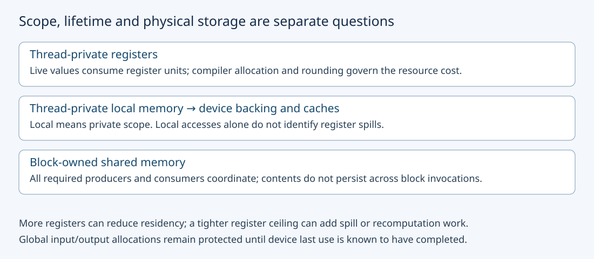
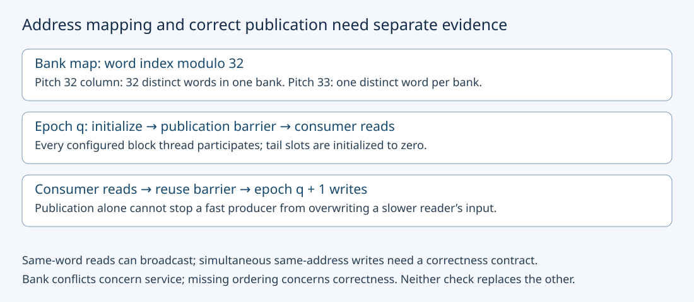

# M3-C06: Registers, shared memory, and local resource pressure

> **Status: Complete — detailed chapter authored and documentation validated; experimental procedures are proposed unless explicitly labelled observed**

**Module:** Learn GPU architecture through data movement

**Category:** [Hardware architecture and topology](index.md)

[Module 3 reading order](../module-3.md) · [Previous: M3-C05](m3-c05-device-memory-hbm-and-the-cache-hierarchy.md) · [Next: M3-C07](../kernels-compilers-and-execution/m3-c07-memory-coalescing-alignment-and-tensor-layouts.md) · [Execution plan and progress](../chapter-execution-plan.md)

## Target concepts

Per-thread registers, per-block shared memory, storage scope and lifetime, register spills and local memory, bank conflicts, synchronization, architecture-specific resource limits.

## Concepts

### 1. Storage has a scope, a lifetime and a physical cost

A **register** holds a thread's working values close to execution units. In the NVIDIA model used here, register budgets are usually expressed in units of 32-bit registers. A 64-bit value can require more than one such unit, and a source variable does not necessarily correspond to one register. A compiler may remove values, reuse a register after a value's last use, or keep several intermediate values live simultaneously. **Live** means that a value will still be needed along a future execution path.

**Shared memory** is a programmer-managed, on-chip storage region accessible to threads within a block. Each ordinary block has its own region. Two blocks using the same shared-memory offset do not thereby communicate. Its contents belong to that block's execution and must not be treated as initialized or persistent across later launches. **Static shared memory** has a size established in the compiled kernel; **dynamic shared memory** adds a launch-time size. Their combined allocated footprint, including alignment and applicable implementation overhead, matters for admission.

**Local memory** means thread-private addressable storage. The name describes visibility, not physical proximity. On the baseline discrete CUDA device it is backed by device memory and can use caches. It is not another name for a register. Large automatic arrays, variable indexing or compiler resource decisions can place thread-private state there. A **register spill** stores a value outside registers because the register allocation cannot retain it there. Local-memory use can have other causes, so a local-memory byte count alone does not prove spilling.

The [CUDA Best Practices Guide's local-memory and register discussion](https://docs.nvidia.com/cuda/cuda-c-best-practices-guide/index.html#local-memory) provides the compiler context. Inspect final target-specific resource reports and generated instructions in a future experiment: early intermediate representation alone may miss later allocation changes. Rust is the host-engine context for submission and ownership; a Rust local variable on the CPU says nothing about a GPU kernel's register placement.

Read [M3-C03](m3-c03-threads-warps-blocks-grids-and-streaming-multiprocessors.md) for threads/warps/blocks and [M3-C05](m3-c05-device-memory-hbm-and-the-cache-hierarchy.md) for backing memory and cache traffic. This chapter contains no implementation code or measured GPU result.

| Storage | Who can use the state in this baseline? | Lifetime and validation concern |
|---|---|---|
| Per-thread registers | The owning logical thread | Compiler-managed working state; register count is a resource cost, not a correctness allowance |
| Thread-private local memory | The owning thread through its local address space | Backing allocation/access costs and cache effects; do not interpret “local” as on-chip |
| Per-block shared memory | Participating threads of that block | Initialize before read, order publication, and finish readers before overwrite |
| Explicit global input/output | Threads authorized by the operation contract | Protect host/device allocation identity until all pending uses complete |

### 2. Register pressure is about simultaneous demand

**Register pressure** is demand for live thread working state relative to available registers and competing resident threads. A large fused operation may save global intermediate traffic while needing more live accumulators. A compiler-imposed register limit can reduce reported registers but introduce spills, recomputation or extra instructions. A smaller register count is therefore an observation to explain, not a performance objective by itself.

For a teaching model with B threads/block and r 32-bit registers/thread:

**unrounded registers/block = B × r.**

If an SM has R registers, a resource-only bound is **register-limited blocks ≤ floor(R / allocated registers per block)**. Floor rounds down. Real allocation may round at warp or block granularity, so B × r is not a universal allocation formula. Query the final compiled function and use the target's supported occupancy/resource tool before a launch claim.

Take a hypothetical SM with R = 65,536 register units, 65,536 bytes of shared memory, at most eight resident blocks and 2,048 resident threads. For B = 256, the thread bound is eight blocks. Assume, solely for this arithmetic model, no register/shared allocation rounding or additional overhead and that each candidate is individually legal. Let S be shared bytes/block:

**modeled resident-block bound = min(8, floor(2,048/256), floor(65,536/(256r)), floor(65,536/S)).**

| Registers/thread r | Registers/block | Register bound | Combined bound with S = 16 KiB | Combined bound with S = 32 KiB |
|---|---:|---:|---:|---:|
| 32 | 8,192 | 8 | 4 | 2 |
| 64 | 16,384 | 4 | 4 | 2 |
| 65 | 16,640 | 3 | 3 | 2 |

KiB means 1,024 bytes. The shared-memory bounds are four and two blocks respectively. Crossing from 64 to 65 registers/thread changes the unrounded register bound from four blocks to three, but with 32 KiB/block shared memory the combined bound remains two. This is a resource threshold, not an observed scheduling trace. Actual architecture limits, rounding and configured capacity can change the answer. Having room for more blocks also does not prove they are ready to issue or that the operation gets faster. [M3-C04](m3-c04-occupancy-latency-hiding-and-hardware-utilization.md) develops those distinctions next in authoring order.

### 3. Shared memory trades explicit movement and coordination for reuse

An LLM operation might stage a tensor tile once, then reuse it across several threads. A **tile** is a bounded portion of a larger tensor. Staging can reduce repeated global reads but adds shared-memory writes, reads, address work and synchronization. Larger tiles may improve reuse while consuming more per-block storage and reducing the number of blocks that fit.

For a row-major tile of h rows, physical row pitch p elements and e bytes/element, **shared allocation = h × p × e**. Pitch is the physical distance between row starts; logical columns need not use every allocated element. A 32 × 32 FP32 tile with p = 32 occupies **4,096 bytes**. Padding to p = 33 occupies **4,224 bytes**, an increase of **128 bytes, or 3.125%**. Those extra bytes can matter near a resource threshold even when they improve an access pattern.

The validity predicate remains tied to logical tensor coordinates. Padding storage does not authorize extra global reads or change tensor shape. Later tiling chapters develop reuse algorithms; here the goal is to account for the storage and ordering costs before claiming savings.

### 4. Bank conflicts concern simultaneous addresses, not data races

Shared memory is divided into **banks** that can service appropriate accesses in parallel. For the scoped NVIDIA teaching model of 32 banks with successive aligned 32-bit words in successive banks:

**bank index = word index modulo 32.**

Modulo is the division remainder. Consider one warp of 32 active lanes, lane j reading row j at the same fixed column c of a shared FP32 tile. Its word index is **jp + c**. With p = 32, all addresses map to bank c modulo 32, but the words are distinct. The request needs serialized bank service. With p = 33, the bank indices are (j + c) modulo 32, so every bank is used once. These single-word scalar access patterns are a model; vector instructions, width, active masks and architecture can change transaction splitting.

| Single-warp read pattern | Distinct words | Distinct banks | Interpretation in the scoped model |
|---|---:|---:|---|
| Column access, pitch 32 | 32 | 1 | 32 distinct words contend for one bank |
| Same column, pitch 33 | 32 | 32 | One distinct word per bank |
| Every lane reads the same aligned word | 1 | 1 | Broadcast exception; not a 32-way distinct-word conflict |

A **broadcast** serves the same read word to several lanes. Do not confuse it with simultaneous writes by several threads to one shared location: without an appropriate defined coordination contract, such writes are a correctness hazard. A bank conflict can occur in an otherwise correct program; a data race is an ordering/ownership defect. Removing one does not establish the absence of the other. [Nsight Compute's shared-memory description](https://docs.nvidia.com/nsight-compute/ProfilingGuide/index.html#memory) distinguishes the same-word read case and access serialization.

### 5. Publication and reuse are two different ordering obligations

A **barrier** is a collective coordination point with a defined participating group and memory-ordering effect. For this chapter's ordinary block-wide protocol, all configured threads participate in the same barrier instances in the same order. Do not infer safety from warp-synchronous execution or from testing a small input once. The [CUDA SIMT guide](https://docs.nvidia.com/cuda/cuda-programming-guide/02-basics/writing-cuda-kernels.html) describes block synchronization and shared-memory publication.

The first obligation is **producer writes complete and become visible before consumer reads**. The second is **consumer reads complete before the storage is overwritten for its next use**. A publication barrier alone does not protect against a fast producer overwriting a tile while a slower consumer still reads it. A memory fence orders specified memory operations; it does not automatically cause all consumer threads to finish. A block barrier does not provide a grid-wide rendezvous or make other blocks' ordinary shared memory accessible. Cluster-specific mechanisms have separate contracts and are outside the baseline.

Use N = 70 values, blocks of 64 threads and two blocks. For epoch q = 0 or 1, define valid input **Xᵢ(q) = i + 1,000q**. Each block has 64 shared FP32 slots. Its valid slots receive the corresponding input value; its invalid tail slots receive zero. Every thread reaches publication, including threads without valid global elements. Valid output thread t reads shared slot **(t + 1) modulo 64** of its own block; only valid outputs are written. Every thread then reaches the reuse barrier before the next epoch overwrites shared storage.

The two epochs therefore prescribe four barrier instances per block: publication and reuse for epoch 0, then publication and reuse for epoch 1. The final reuse barrier is retained for a uniform teaching protocol, although there is no subsequent tile overwrite in this bounded example. Guard the memory access and output, rather than placing the collective only inside the valid-element branch. In the last block, six valid threads and 58 tail threads still participate in both obligations.

For q = 0, block 0's outputs are 1,…,63,0. Block 1's six outputs are 65,…,69,0; the final zero comes from initialized padding. These are intentional operation semantics, not an accidental loss of input 64. Padding must be initialized every epoch; stale data from a prior tile is not an acceptable tail value.

### 6. Architecture limits constrain feasible experiments

An architecture's **compute capability** identifies a feature/limit family; it is different from the toolkit version. Per-thread, per-block and per-SM limits are distinct. A function may be rejected even when total device DRAM is plentiful because its per-block shared-memory request or register demand is impossible. Configuration can also change the shared-memory/L1 balance on applicable architectures. A documented architectural maximum does not mean the current function has opted into it or the current device partition exposes that configuration.

The [CUDA compute-capability appendix](https://docs.nvidia.com/cuda/cuda-programming-guide/05-appendices/compute-capabilities.html) specifies 65,536 32-bit registers/SM and 32 shared-memory banks for the listed baseline NVIDIA families, with architecture-dependent shared-memory maxima. It documents additional configuration requirements for allocations exceeding 48 KB/block. Record the source's units and obtain exact byte-valued limits from the runtime/function configuration; do not use a table's “KB” label as an undocumented conversion rule. The hypothetical 64 KiB SM in the worked bound is not a claim about an H100 or RTX 4090.

## Experiments

All procedures are proposed. No GPU, compiler variant, sanitizer or performance benchmark has been executed. Use [M9-C01](../numerics-and-correctness/m9-c01-defining-reference-behavior-and-evidence-before-optimizing.md) for reference contracts, [M9-C02](../measurement-experimentation-and-economics/m9-c02-request-events-clocks-and-measurement-boundaries.md) for completed timing, [M9-C07](../measurement-experimentation-and-economics/m9-c07-latency-distributions-and-statistical-uncertainty.md) for populations, [M9-C15](../state-memory-and-caching/m9-c15-accounting-for-weights-kv-state-workspace-and-fragmentation.md) for byte scopes and [M9-C17](../numerics-and-correctness/m9-c17-comparing-logits-with-justified-numerical-tolerances.md) for numerical gates. Advanced GPU profiling chapters remain outlines; the necessary controls are local here.

### E1 — Build a resource-feasibility ledger

- **Description:** Reconcile the six combinations of three register counts and two shared-memory footprints in the hypothetical SM model.
- **Purpose/objective:** Identify which resource limits a candidate before calling more blocks an improvement.
- **Target concepts:** Registers, shared memory, allocation granularity and architecture-specific limits.
- **Baseline and workload:** B = 256, r in {32,64,65}, S in {16,32} KiB, with the exact hypothetical caps and no-rounding assumption above. This is arithmetic, not a kernel performance comparison.
- **Controls and prediction:** Keep caps/block size fixed. Predict combined bounds {4,4,3} for 16 KiB and {2,2,2} for 32 KiB. Real compiled r cannot be prescribed by declaring that many source variables.
- **Procedure:** Enumerate per-block costs and all four bounds, retaining the minimum. Include one deliberately over-cap shared-memory candidate, S = 65 KiB, which must fail the model's per-SM feasibility check. If hardware is later available, make a separate ledger using actual compiled-function allocation, rounding and function/device limits; do not silently relabel the teaching table as hardware output.
- **Hardware/software:** No GPU needed for the model; optional supported GPU and target-aware resource calculator/compiler reports for the separate real ledger.
- **Failure and HFT connection:** Reject impossible configurations before submission; explicit resource admission resembles bounded worker budgeting in HFT, but GPU register allocation is not CPU thread admission.
- **Exit criteria:** All six bounds and the over-cap rejection reconcile. Any actual-device estimate records all limits and allocation assumptions; no occupancy or speed result is inferred from arithmetic alone.

### E2 — Separate bank mapping from transpose correctness

- **Description:** Compare shared pitches 32 and 33 for the same logical 32 × 32 transpose.
- **Purpose/objective:** Test whether padding changes shared access service without changing tensor meaning.
- **Target concepts:** Shared-memory footprint, banks, broadcasts and synchronization.
- **Baseline and workload:** Input A[r,c] = 32r + c, r,c in 0,…,31, stored packed FP32; output T[c,r] must equal A[r,c]. Both layouts use a fixed 256-thread block (eight 32-lane warps), stage all 1,024 values with unique writers, publish before reads, and use scalar column reads with lane j selecting row j for fixed c. Each warp handles four distinct columns in successive read steps, covering all 32 columns across the block. A separate same-word read fixture uses value 37 for all 32 lanes; it is not a transpose candidate.
- **Controls and prediction:** Keep input, output, global layout, precision, block shape and shared publication protocol fixed; change only physical shared pitch. Predict 4,096 versus 4,224 shared bytes and the scoped 1-bank versus 32-bank read pattern. Actual instructions must preserve the intended lane mapping before a conflict claim is made.
- **Procedure:** Enumerate bank IDs and verify every transpose coordinate. A future runtime comparison uses 3 independent sessions × 20 trials/layout = 120 measured trials, plus 10 warmups/layout/session = 60 warmups, with randomized matched layout order. Inspect generated shared-read instructions and collect available conflict/wavefront evidence separately from timing. Verify the broadcast fixture independently, without folding it into the 120-trial transpose population.
- **Hardware/software:** One supported NVIDIA GPU with warp width 32, applicable 32-bank 32-bit mapping and sufficient per-block shared memory; final compiler/target and metric definitions recorded.
- **Failure and HFT connection:** Reject reading before publication, duplicate writers and padded global accesses. HFT cache-line layout reasoning motivates address accounting, but CPU false sharing and GPU bank conflicts have different mechanisms.
- **Exit criteria:** All transpose coordinates agree, padding stays outside logical shape, and the broadcast result is 32 copies of 37. A runtime improvement requires unprofiled completed timings plus matching instruction/counter evidence; lower modeled conflict is not a guaranteed speedup.

### E3 — Validate publication, tail participation and safe overwrite

- **Description:** Audit the two-epoch, block-local neighbor-read protocol above.
- **Purpose/objective:** Make both publication and last-reader obligations explicit at partial blocks.
- **Target concepts:** Scope, lifetime, synchronization and shared-memory reuse.
- **Baseline and workload:** N = 70, B = 64, two blocks, two epochs, one 64-slot shared region/block; preserve separate output vectors for q = 0 and q = 1. Xᵢ(q) = i + 1,000q, with zero-initialized tail slots each epoch.
- **Controls and prediction:** Hold logical mapping and participating block threads fixed. There are 70 valid outputs/epoch and 58 initialized tail slots/epoch across the grid. All 64 threads/block participate in each of the four prescribed barrier instances.
- **Procedure:** Build a happens-before ledger: writes precede publication, consumer reads follow it, all reads precede reuse, then the next epoch's writes may begin. Enumerate every output. Construct paper-only negative schedules for a missing publication barrier, a missing reuse barrier and a barrier guarded by valid global index. Do not launch a known-invalid collective to see whether it hangs. A future correct runtime candidate is repeated 60 times across 3 sessions, 20/session, after 10 warmups/session, giving 30 warmups. Run correctness tooling separately.
- **Hardware/software:** Reference reasoning needs no GPU. Runtime extension needs a supported block synchronization contract, sufficient shared memory and compatible Compute Sanitizer tools.
- **Failure and HFT connection:** A cancelled host request cannot release still-used global outputs, and a tail thread cannot skip a required collective. HFT publication and buffer reuse require similar last-reader reasoning, but CUDA ordering guarantees must be used directly.
- **Exit criteria:** All 140 output coordinates and barrier participation obligations pass; all three invalid paper protocols are rejected with a concrete counterexample. Tool success supports the tested candidate but is not a proof for all schedules or inputs.

### E4 — Study register limits without rewarding spills

- **Description:** Compare compiler resource policies for one unchanged tensor transform.
- **Purpose/objective:** Relate register allocation, local-memory traffic and completed latency rather than optimize register count in isolation.
- **Target concepts:** Register pressure, spills/local memory, architecture limits and resource tradeoffs.
- **Baseline and workload:** N = 2²⁰ FP32 values Xᵢ = i modulo 256; required Yᵢ = 3Xᵢ + 2. B = 256. Compare the compiler-default policy with requested per-thread register ceilings 32 and 64 for the same pinned candidate and compiler/target. The candidate must retain useful work; a simple transform may use fewer than either ceiling and produce identical binaries.
- **Controls and prediction:** Hold semantic inputs, block size, algorithm, optimization and numerical options fixed; change only resource policy. No spill or latency change is guaranteed. If the chosen toolchain cannot express a policy, record it as unsupported instead of inventing a result.
- **Procedure:** Record final register count, static/dynamic shared memory, local allocation and spill diagnostics for each build. Inspect relevant generated accesses to distinguish local arrays from spills. Compare every output before timing. Use 3 sessions × 20 trials/policy = 180 scheduled measured trials and 10 warmups/policy/session = 90 warmups. Report identical-build cases explicitly; instrumented traffic runs are a separate population.
- **Hardware/software:** One supported GPU and compatible compiler/resource-report tooling, recorded target, versions, flags and executable identity. Rust host code is context only; no implementation is supplied here.
- **Failure and HFT connection:** Build rejection, unsupported ceilings and unknown completion are explicit outcomes. HFT systems also trade retained working state against extra memory work; a reduced GPU register count does not establish a faster event-processing path.
- **Exit criteria:** Correctness and outcome counts reconcile, and each claim distinguishes requested limits, actual allocation and observed traffic. No change and a slowdown are valid results; promotion requires a useful end-to-end benefit beyond this microbenchmark.

## Verification

### Exact references and negative schedules

E1's register products are 8,192, 16,384 and 16,640; integer division by them yields 8,4,3. Shared bounds are 4 and 2, so the six combined bounds follow. The 65 KiB shared candidate needs 66,560 bytes, exceeding the hypothetical 65,536-byte pool. Actual rounding can reduce feasibility further; this audit does not validate a real device launch.

E2 has 1,024 FP32 input values, 4,096 input bytes and 4,096 output bytes. The logical global input/output payload is 8,192 bytes per transpose, regardless of padding. Values 0 through 1,023 are exactly represented; their sum is **523,776**, but coordinate comparison is required because the original and transposed arrays have the same sum. The broadcast vector sums to **1,184**. For every c in 0,…,31, enumerate all 32 lane addresses for each pitch: the unpadded case uses one bank for distinct words, while padding uses 32 banks. Do not call these predicted service groups measured clock cycles.

E3 produces 128 initialized shared slots/epoch: 70 input values and 58 zeros. Each block's shared region is 256 bytes; the two epoch output vectors occupy 560 bytes in total. Across the two epochs there are **256 shared-slot initialization writes**, **140 valid neighbor reads** and **140 output writes** in the logical protocol. There are eight block barrier instances across the two blocks; counting 64 participants each gives 512 thread/barrier arrivals, not 512 distinct barriers.

Epoch 0's output sum is **2,351**. Epoch 1's block-0 outputs are 1,001,…,1,063,1,000 and block-1 outputs are 1,065,…,1,069,0, yielding sum **71,351**. Exactly 69 outputs gain 1,000; the final tail output remains zero. Check every output and input/epoch identity independently, not only these checksums. Across all 60 measured correct-candidate trials, expect **8,400 output values**, excluding warmups and diagnostic reruns.

A missing publication counterexample allows block 0 thread 31 to read slot 32 before thread 32 publishes value 32; an initially zero slot would yield 0 instead of 32. A missing reuse counterexample lets thread 32 overwrite that slot with epoch 1 value 1,032 while thread 31 still expects epoch 0 value 32. A valid-index-only barrier excludes 58 configured tail threads in block 1 and violates the prescribed collective participation. These paper schedules demonstrate why the protocol is insufficient; they do not assert that a particular faulty run will always show the defect.

E4's maximum output is 767, all exact FP32 integers. Every input value occurs 4,096 times; output mean is 384.5 and sum **403,177,472**. Input/output live payload is 8 MiB, while 180 successful measured trials request **1,440 MiB** of logical input/output accesses. Spills, cache traffic, validation transfers and profiler replays are separate byte populations. A register ceiling is not an allocation measurement and local allocation bytes are not dynamic spill bytes.

### Timing, profiling and acceptance

E2–E4 start the primary host interval with inputs resident and preparation complete, immediately before submission; stop when valid device completion is observed on the host. Outputs remain on device. Initialization, compilation and later readback comparison lie outside this isolated completed-call interval and are reported separately. Device event intervals describe their own device scope; never subtract device timestamps from host timestamps. E3's timed work includes both epochs and their prescribed synchronization, rather than reporting one epoch's time as the whole operation.

All future trials use a predeclared 120-second observation watchdog. It is not a performance target or permission to reclaim pending buffers. Record build rejection, unsupported configuration, launch/runtime error, incorrect output, success and timeout/unknown completion separately. Preserve failed/missing timings and reconcile every scheduled case. Quarantine uncertain allocations until recovery establishes safe reuse.

Report counts and raw timings per cell/session, medians, spread and paired differences where appropriate. Specify nearest-rank quantiles and their population. Twenty samples/session do not certify stable p99. Keep clock/power/thermal and co-tenant observations with trial order. A tiny transpose may be launch dominated; report that operating point instead of attributing every difference to shared banks.

Collect final compiled registers/thread, allocated shared bytes/block, local-memory diagnostics, relevant local read/write traffic and shared-memory service/conflict metrics where supported. Record metric scope, instruction width, replay mode and tool version. Use unprofiled timing for speed claims because profilers and sanitizers alter execution. [Nsight Compute](https://docs.nvidia.com/nsight-compute/ProfilingGuide/index.html) explains metric collection and replay limitations. Missing metrics mean unavailable evidence, not zero conflicts or zero spills.

For future correct runtime candidates, use the applicable [Compute Sanitizer](https://docs.nvidia.com/compute-sanitizer/ComputeSanitizer/index.html) memory checks, shared-memory hazard checks and synchronization checks in separate diagnostic runs. Their coverage differs; do not assume an uninitialized-global-memory checker certifies every shared slot. Retain tool outputs, tested inputs and limitations. Reference agreement, ownership review and checked collective participation are still required.

The later end-to-end gate is unchanged model/token/cache identity, request cohort, arrivals and output policy, with useful completed throughput, TTFT and response distributions measured. Resource savings or fewer conflict metrics alone do not establish that serving improves. No inference service, GPU or HFT benchmark result is claimed here.

## Engineering dimensions and principles

### Six dimensions applied

| Dimension | Chapter-specific learning and evidence |
|---|---|
| Semantics and invariants | Preserve coordinates, epoch identity, initialized tails and unique writers; register count never licenses wrong results. |
| Workload and variability | Sweep resource policies and shared pitch at fixed semantics; include partial blocks and both epochs. |
| Resources and bottlenecks | Distinguish registers, shared bytes, local backing traffic and bank service; identify the minimum feasibility bound. |
| Time and distributions | Include publication/reuse dependencies in completed timing; do not infer cycles from bank counts or p99 from a small sample. |
| Ownership and coordination | Define per-thread/per-block state and last readers; host cancellation cannot release in-flight buffers. |
| Failure and adaptation | Reject impossible or unsupported launches; retain errors/unknown completion and recover before reuse. |

### Eight principles applied

1. **Correctness defines the optimization boundary.** A padded layout or compiler policy must preserve every reference coordinate and synchronization obligation.
2. **Performance depends on workload and operating point.** Tile dimensions, partial blocks, live values and compiled target determine whether a resource policy matters.
3. **Data movement is part of the algorithm.** Staging and spills add traffic; saving global reads can require extra shared operations and barriers.
4. **State has ownership, lifetime, and recovery cost.** Shared contents belong to a block invocation, while global outputs survive under explicit allocation ownership.
5. **Dependencies determine latency; bottlenecks determine capacity.** Publication/reuse edges constrain progress; the tightest resource budget constrains modeled residency.
6. **Variability and synchronization shape the tail.** Uneven producer/consumer progress and competing work affect completion; small averages cannot establish tail behavior.
7. **Local improvements must be evaluated end to end.** Fewer registers or bank conflicts matter through useful correct service, including synchronization and preparation.
8. **Claims require reproducible evidence.** Preserve compiled-function identity, limits, layouts, references, metrics, outcomes and timing boundaries.

## Specifications, articles, and hardware

Primary references checked 26 October 2026:

- [CUDA Best Practices Guide 13.4](https://docs.nvidia.com/cuda/cuda-c-best-practices-guide/index.html): local-memory/register allocation explanation and shared-memory bank tutorial. Its published examples are source material, not measurements reproduced here.
- [CUDA SIMT kernel guide](https://docs.nvidia.com/cuda/cuda-programming-guide/02-basics/writing-cuda-kernels.html): shared-memory cooperation and block synchronization contract.
- [CUDA compute-capability limits](https://docs.nvidia.com/cuda/cuda-programming-guide/05-appendices/compute-capabilities.html) and [GPU capability mapping](https://developer.nvidia.com/cuda/gpus): architecture-specific limits and device identification. Read the applicable column and footnotes.
- [Nsight Compute Profiling Guide](https://docs.nvidia.com/nsight-compute/ProfilingGuide/index.html): final launch/resource interpretation, shared/local metrics and profiling effects.
- [Compute Sanitizer guide](https://docs.nvidia.com/compute-sanitizer/ComputeSanitizer/index.html): scope and limitations of memory, race and synchronization diagnostics.

| Hardware/software specification | Required record before a future run |
|---|---|
| Execution device | Exact GPU/partition, compute capability, CPU host model and co-tenancy |
| Resource limits | Registers/SM and block/thread limits; shared capacity/SM and per-block/default/opt-in limits; actual byte units and granularity |
| Function configuration | Final registers/thread, static plus dynamic shared allocation, local/spill report, block/grid dimensions and cache/shared configuration |
| Build and observation | Driver/runtime/compiler versions, target/options, executable identity, profiler/sanitizer versions, replay settings and counter support |
| Operating conditions | Usable device-memory budget/reserve, clocks, power/thermal conditions, input/epoch/layout identity and trial order |

One supported GPU suffices for the proposed device extensions; arithmetic reference checks need no GPU. E2 requires at least 4,224 bytes of available shared allocation for the padded tile plus any actual overhead; E3 requires 256 bytes/block; E4 requires 8 MiB of input/output payload plus runtime overhead and reserve. These are workload minima, not guarantees that a particular function is launchable. Multi-GPU links, networking and storage devices are unnecessary. No actual test machine or hardware measurements have been supplied.

## Completion and next chapter

This chapter establishes local resource and synchronization contracts before occupancy reasoning. Track acceptance through the clickable [execution plan](../chapter-execution-plan.md). [M3-C04: Occupancy, latency hiding, and hardware utilization](m3-c04-occupancy-latency-hiding-and-hardware-utilization.md) is now complete. The next **authoring** chapter is [M3-C07](../kernels-compilers-and-execution/m3-c07-memory-coalescing-alignment-and-tensor-layouts.md). The next Module 3 **reading** chapter remains [M3-C07](../kernels-compilers-and-execution/m3-c07-memory-coalescing-alignment-and-tensor-layouts.md). Module 9 supports Modules 1–7; Module 8 is excluded.
