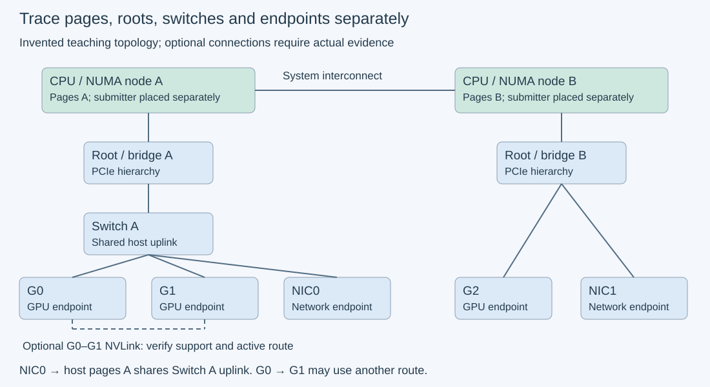

# M3-C13: PCIe, NVLink, NUMA, and device topology

> **Status: Complete — detailed chapter authored and documentation validated; experimental procedures are proposed unless explicitly labelled observed**

**Module:** Learn GPU architecture through data movement

**Category:** [Hardware architecture and topology](index.md)

[Module 3 reading order](../module-3.md) · [Previous: M3-C12](../runtime-and-concurrency/m3-c12-asynchronous-copies-and-useful-overlap.md) · [Next: M3-C14](../networking-and-communication/m3-c14-moving-tensors-between-devices-and-hosts.md) · [Execution plan and progress](../chapter-execution-plan.md)

## Target concepts

Link bandwidth and latency, PCIe generation and width, NVLink availability, peer-access support, CPU socket and NUMA placement, switch paths, NIC placement, topology inspection.

## Concepts

### 1. Follow the path that carries the bytes

**Topology** is the arrangement of devices and connections. A GPU's local memory bandwidth does not describe how quickly host data reaches it. A transfer may cross a GPU port, a PCI Express (PCIe) switch, a CPU's host bridge and a memory controller. A **switch** forwards traffic among links. A **host bridge** connects the CPU/memory system with PCIe. A **root complex** is the CPU/platform side of a PCIe hierarchy. Multiple devices can share part of a path even when each has its own connector.

A CPU **socket** is a physical processor package. A **NUMA node** is a locality domain in which memory access costs depend on which processors or devices access which memory. NUMA means non-uniform memory access. Socket and node are not synonyms: a socket may expose multiple nodes, and heterogeneous systems may expose other memory domains. The CPU thread submitting a transfer and the memory pages backing its host buffer are separate placement decisions.

Draw devices as vertices and connections as edges. Annotate each relevant edge with technology, direction, negotiated link parameters and the evidence used to identify it. A **NIC**, or network interface controller, attaches the host to a network. Its traffic can share a PCIe uplink or memory controller with GPU traffic. A fast NIC specification cannot establish GPU-to-network throughput without the complete path and supported software route.

*This is an invented teaching machine, not an inventory of a real system. The optional NVLink line represents a capability to verify; it is not inferred from adjacency.*

### 2. PCIe generation, lane width and payload rate are different quantities

A PCIe **lane** carries traffic in both directions using separate signaling paths. Width, such as x8 or x16, is the number of active lanes. Generation identifies a signaling specification. A physically x16 slot can negotiate fewer lanes or a lower generation because of platform wiring, endpoints or configuration. Record maximum supported and current negotiated values, including observations under the benchmark load; an idle snapshot can be misleading.

For the familiar Gen3–Gen5 128b/130b encoding case, 128 data bits are represented by 130 transmitted bits. For signaling rate r GT/s per lane and width w, an encoding-adjusted one-direction ceiling is:

**B_encoding = r × 10⁹ × w × (128/130) / 8 bytes/second.**

GT/s means billions of transfers per second; GB/s here means decimal billions of bytes per second. This ceiling has not yet deducted transaction, link-control or other overheads. The [PCI-SIG Gen4 rate description](https://pcisig.com/what-bit-rate-pcie-40-specification-and-how-does-it-compare-prior-generations-pcie) identifies 16 GT/s; the [Intel PCIe architecture specification](https://edc.intel.com/content/www/us/en/design/products/platforms/details/raptor-lake-s/13th-generation-core-processors-datasheet-volume-1-of-2/002/pci-express-architecture/) documents Gen4/Gen5 rates and encoding for that platform. Newer signaling/encoding schemes require their own formula; do not extend this expression indiscriminately to every generation.

| Illustrative negotiated link | Encoding-adjusted ceiling, one direction | Interpretation |
| --- | --- | --- |
| Gen4 x16, 16 GT/s/lane | ≈31.508 GB/s | Before packet/control overhead; not measured useful throughput |
| Gen4 x8, 16 GT/s/lane | ≈15.754 GB/s | Half the lane capacity of the x16 example |
| Gen3 x16, 8 GT/s/lane | ≈15.754 GB/s | Same encoding-adjusted ceiling as this Gen4 x8 example |

Full-duplex means both directions can carry traffic; adding them produces a bidirectional aggregate, not the rate available to a single one-direction copy. Likewise, compare GPU memory bandwidth, PCIe rate and network rate only after identifying their byte boundaries and units. MiB means 2²⁰ bytes; 16 MiB is 16,777,216 bytes, not 16 million.

### 3. Latency and bandwidth dominate at different sizes

**Latency** is elapsed time to finish a defined operation; **bandwidth** is bytes completed per unit time. A small transfer can be dominated by submission and completion overhead even on a wide link. An illustrative model is:

**T(n) = α + n/β**, where n is payload bytes, α is fixed elapsed overhead and β is an effective sustained payload rate for the modeled route.

With invented α=5 µs and β=16 GB/s, a 4,096-byte copy takes 5.256 µs, a 1 MiB copy 70.536 µs and a 16 MiB copy 1,053.576 µs. The payload term equals fixed overhead at n=αβ=80,000 bytes. These are arithmetic examples, not fitted results or promises for PCIe/NVLink. Actual queueing, NUMA traffic, power state and transfer direction can change both terms; some workloads do not fit this simple model.

For a particular path, **path capacity ≤ minimum relevant edge capacity** when each payload byte traverses those edges in that direction. Shared traffic further limits each flow. A GPU copy routed entirely within a switch need not traverse its CPU uplink; a transfer to host memory normally does. A topology matrix suggests a class of path, not a byte-perfect trace or a universal performance ranking.

### 4. NUMA locality includes both CPU affinity and actual pages

**CPU affinity** restricts which processors may run a thread. **Memory policy** influences where backing pages are allocated. Under common demand allocation, first access that allocates a page helps determine placement subject to policy and allowed nodes. Moving a thread later does not automatically relocate existing pages. Read the [Linux NUMA policy documentation](https://docs.kernel.org/admin-guide/mm/numa_memory_policy.html): process/range policies and administrative node restrictions interact, and a policy change does not itself move already allocated pages.

For a GPU near node A, compare CPU submitter A/B independently from host pages A/B. A local submitting thread with remote host pages still transfers from remote memory. A remote submitting thread with local pages separates submission locality from data locality. Treat “local” as a relation to a recorded endpoint/path, not a synonym for CPU number zero.

For controlled host buffers, choose a supported OS memory policy, allocate and initialize pages, verify actual page placement, then register/pin them for the CUDA transfer contract. Recheck placement after registration and the run. Requested policy alone is insufficient evidence. If a driver allocation or environment cannot provide inspectable/controlled placement, label the comparison unavailable rather than guessing. Registration must succeed before transfers begin; bounded pools, completion and lifetime rules remain those of [M3-C10](../state-memory-and-caching/m3-c10-host-and-device-buffer-placement-and-lifetime.md).

On hardware-coherent CPU/GPU platforms, exposed memory domains and management differ. The primary article [Understanding Memory Management on Hardware-Coherent Platforms](https://developer.nvidia.com/blog/understanding-memory-management-on-hardware-coherent-platforms/) explains such configurations. Do not impose a discrete PCIe GPU's placement assumptions on every machine. Rust's Pin type is not OS page placement or GPU registration; the eventual engine binding must preserve all three contracts separately.

### 5. NVLink connectivity, peer capability and the actual route need separate evidence

**NVLink** is an NVIDIA interconnect family whose availability, version, active connections and bandwidth depend on the product and system configuration. It can provide GPU connections directly or through a fabric; some CPU/GPU systems use distinct chip-to-chip variants. Do not infer it from the GPU brand, device index or a host PCIe slot. A product's aggregate bidirectional per-GPU figure is not automatically the rate of one directed GPU pair. The [H100 specification page](https://www.nvidia.com/en-us/data-center/h100/) illustrates why product variant and bandwidth scope belong in a manifest; this chapter imports no benchmark rate from it.

**Peer access** means one device can access another device's allocations under the runtime's supported contract. The [CUDA peer-access specification](https://docs.nvidia.com/cuda/cuda-runtime-api/cuda_runtime_api/group__CUDART__PEER.html) defines a directional capability query and directional enablement. Query both directions and record which device accesses which owner's memory. A supported pair and successful enablement do not prove NVLink traffic: PCIe peer routes may also be possible. Physical connectivity does not override runtime/platform restrictions.

For a data copy S → D, record source and destination identities, the actual copy operation's support and configuration, completion ownership and route evidence. Do not confuse a capability row “D may access S's memory” with a statement about copy direction. A staged fallback copies S → pinned host storage, waits for completion, then host → D; it changes transfer work and lifetime even when destination bytes are identical. A failed or unsupported peer route must be reported explicitly. Do not silently rename a staged fallback as a successful direct NVLink transfer.

### 6. Inspect topology without turning labels into measurements

Use read-only inventory capabilities from the [NVIDIA System Management Interface documentation](https://docs.nvidia.com/deploy/nvidia-smi/index.html), OS CPU/node and PCIe hierarchy inspection, and supported CUDA device/peer queries. Match GPU UUIDs and PCI bus addresses, not just enumeration indices. A UUID is a persistent device identity within the relevant environment; a PCI address locates a function in the current hierarchy. Record virtualization or partitioning that changes visible identities/capabilities.

Topology legends distinguish classes: PIX involves at most one PCIe bridge; PXB multiple PCIe bridges without the host bridge; PHB includes the host bridge; NODE crosses host bridges within a NUMA node; SYS includes an inter-node system interconnect; NV# denotes a bonded set of NVLinks. Use the legend from the installed tool version, preserve unknown/unavailable fields, and avoid treating these symbols as measured hop latency. CPU affinity columns are not a measurement of buffer-page placement.

Record NIC PCI identity, CPU/node affinity, associated network interface, switch ancestry and link conditions separately. GPU-NIC proximity is a hypothesis for a later network test. It does not establish RDMA or GPUDirect support, registration, permissions or network completion semantics. Those transfer contracts belong to [M3-C14](../networking-and-communication/m3-c14-moving-tensors-between-devices-and-hosts.md). Never change platform isolation settings merely to make an inspection result match a desired path.

HFT systems make locality, queueing and shared-link interference easy to reason about: a fast device can still miss a useful response window because its data takes a congested route. This is an engineering analogy, not trading advice. A short topology path alone neither establishes p99 latency nor creates a hard real-time guarantee.

## Experiments

These are **proposed procedures without implementation code**. E1 and E4 are paper/inventory exercises; E2 is a future single-GPU test; E3 is optional and requires two supported GPUs. No machine inventory, GPU transfer or network benchmark has been executed here. Use completed [M9-C01 references](../numerics-and-correctness/m9-c01-defining-reference-behavior-and-evidence-before-optimizing.md), [M9-C02 completed timing](../measurement-experimentation-and-economics/m9-c02-request-events-clocks-and-measurement-boundaries.md), [M9-C07 distributions](../measurement-experimentation-and-economics/m9-c07-latency-distributions-and-statistical-uncertainty.md), [M9-C15 byte scopes](../state-memory-and-caching/m9-c15-accounting-for-weights-kv-state-workspace-and-fragmentation.md) and [M9-C17 correctness gates](../numerics-and-correctness/m9-c17-comparing-logits-with-justified-numerical-tolerances.md). Transfers use exact byte equality, not floating-point tolerance. M9-C16 remains an outline; the required environment controls are supplied locally.

### E1 — Build an evidence-labelled path inventory

- **Description:** Draw the illustrative topology and then, if hardware is available, replace each invented component with read-only observed identity/path evidence.
- **Purpose/objective:** Separate advertised capabilities, negotiated state, runtime support and measured performance before benchmarking.
- **Target concepts:** PCIe generation/width, NVLink availability, switch paths, CPU sockets/nodes, NIC placement and topology inspection.
- **Baseline and workload:** Teaching graph: node A/root A reaches a switch carrying G0, G1 and NIC0; node B/root B reaches G2 and NIC1; A and B have a system interconnect. An optional G0–G1 NVLink edge is unknown until evidenced. Trace host-page A → G0, host-page B → G0, G0 → G1 and NIC0 → host-page A. Link arithmetic uses Gen4 x16/x8 and Gen3 x16 only.
- **Controls and prediction:** Label every graph value as constructed, advertised, observed or unknown. Predict the three encoding ceilings in the concept table and the α/β example times. No topology label predicts an exact transfer rate. Single-node/single-GPU machines retain unavailable branches explicitly.
- **Procedure:** Match UUID/bus identities, CPU/node maps, PCIe endpoint and upstream link state, switch ancestry, current NVLink state and directional runtime peer support. Timestamp observations and record idle versus load condition. Compare maximum/current link state without changing it. Record tool versions, visibility restrictions and contradictory observations for resolution.
- **Hardware/software:** Paper baseline requires no hardware. Optional real inspection needs read-only OS/vendor capabilities; a GPU, NIC or additional node absent from the machine remains absent rather than simulated as observed.
- **Failure and HFT connection:** A stale device index can send work to a different path after reboot. Match identities and revalidate affected paths after a configuration change, much as a latency-sensitive service rechecks an endpoint's identity.
- **Exit criteria:** All four teaching paths, encoding ceilings and timing examples reconcile; an optional real manifest distinguishes source/evidence/time for every claim. Unknown connectivity, page location or peer support is not converted into a successful test result.

### E2 — Separate CPU submission locality from host-page locality

- **Description:** Copy exact byte buffers to and from one GPU while independently varying submitting CPU node and actual host-page node.
- **Purpose/objective:** Determine whether placement affects completed transfers at small and large sizes, without conflating CPU affinity with memory residency.
- **Target concepts:** Link latency/bandwidth, CPU/socket/node placement, pinned pages and path bottlenecks.
- **Baseline and workload:** Sizes n ∈ {4,096; 1,048,576; 16,777,216} bytes; directions H2D and D2H. On a suitable two-node system, CPU affinity A/B × page placement A/B gives four placements and 24 cells total. A is the recorded node nearest the tested GPU's host path; B is another allowed node. A single-node baseline has one placement and six cells. Trial epoch e ∈ {0,…,59}; byte i is Xᵢ(e)=(i+17e) mod 256.
- **Controls and prediction:** Allocate, establish/verify page placement, register both host buffers and create device/stream/event state outside timing. Keep one transfer in flight, one explicit stream and fixed completion mechanism. Hold GPU, link state and input bytes constant across placements. Predict exact bytes and a possible size-dependent placement effect; do not assume a mandatory A/B speed ratio. If pages cannot be controlled and inspected, mark that placement unavailable.
- **Procedure:** Use three independent sessions, each with 10 excluded warmups and 20 measured trials per cell, rotating cells. Assign epochs 0–59 per cell. For H2D, time submission through successful transfer completion, then copy device bytes to a separate verification buffer outside timing. For D2H, initialize device bytes and complete setup outside timing, then time D2H through completion. Before warmups, run the separate labelled-block validation fixture defined below once per supported cell, outside benchmark counts. Verify every measured destination byte; prefill each host-visible destination with Xᵢ(e) XOR 255 and complete device-destination sentinel initialization outside timing. Retain buffers until transfer and CPU verification users finish. Recheck page and link state after each cell.
- **Hardware/software:** One supported discrete GPU, inspectable pinned host allocations, and optionally two allowed NUMA nodes with CPU and memory-policy control. Two host buffers plus one device buffer use at most 32 MiB host and 16 MiB device raw payload, plus registration/runtime overhead. A coherent platform needs a separately documented adaptation rather than silently using this discrete-GPU experiment unchanged.
- **Failure and HFT connection:** Local CPU affinity with remote pages is a distinct configuration, not a failed “local” benchmark. Misplacement, migration, invalid completion or byte corruption is an explicit outcome. A 120-second watchdog marks unknown completion and retains safety; it is not a reuse signal.
- **Exit criteria:** Full two-node design reconciles 1,440 measured trials and 720 warmups; single-placement baseline 360 and 180. All successful destination buffers equal their epoch reference exactly. Report latency and useful bytes/second per size/direction/verified placement, with actual supported/attempted cell counts and no invented unavailable measurements.

### E3 — Compare a supported peer copy with an explicit staged route

- **Description:** On an optional two-GPU system, compare one copy between the same endpoints with a deliberately host-staged two-leg copy.
- **Purpose/objective:** Separate equivalent final bytes from route-dependent work, completion and host storage.
- **Target concepts:** NVLink availability, peer-access support, directional paths, switch ancestry and transfer scope.
- **Baseline and workload:** Choose two stable GPU identities S and D. Test both copy directions at E2's three sizes. For each, compare the documented supported peer-copy configuration and explicit source D2H → pinned host → destination H2D route: 12 cells if both peer directions are available. Use the same byte fixture and 60 measured epochs/cell. Unsupported peer cells are reported; staged cells remain a separately labelled baseline.
- **Controls and prediction:** Check the runtime operation's requirements, both directional capability/enablement states where required, and actual completion-device ownership. Keep endpoints, sizes and submitter/page placement fixed. Predict exact destination bytes; do not predict that a supported peer operation necessarily uses NVLink or is faster at every size. No cross-device timestamp subtraction is used.
- **Procedure:** Three sessions/cell, 10 warmups and 20 measured trials/session. Complete source initialization outside timing. Start one host monotonic interval before the first copy submission; end after the destination result is complete. In the staged route, observe first-leg completion before submitting the second; hold staging bytes through the second leg. Before warmups, run the separate labelled-block validation fixture once per supported cell, outside benchmark counts. Read back/validate every measured destination byte outside timing. Keep dedicated profile captures separate from timing cohorts. Change neither isolation settings nor platform firmware to force support.
- **Hardware/software:** Two GPUs with a documented peer-copy path for the peer comparison; NVLink is optional and must be evidenced if claimed. Two device buffers use up to 16 MiB each; staging plus initialization/verification host buffers use up to 48 MiB host, for 80 MiB raw total plus overhead. Stage placement is fixed and verified; unavailable peer support does not make the staged test a direct peer test.
- **Failure and HFT connection:** A fallback changes cost and retained resources even if the answer is equivalent. Report unsupported routes, fallback identity and completion failures rather than hiding them behind a successful final checksum.
- **Exit criteria:** Up to 720 measured trials and 360 warmups reconcile, with exact bytes and correct source/destination/generation identity. Direct logical payload is n; staged two-leg payload is 2n across host-device boundaries. Route claims require topology plus supporting runtime/profile/counter evidence; an unknown physical route remains unknown.

### E4 — Check shared-uplink contention and stale topology on paper

- **Description:** Add a GPU-to-host flow and NIC-to-host flow sharing one upstream resource, then invalidate an endpoint or link-state observation.
- **Purpose/objective:** Show why isolated link specifications and cached topology cannot establish concurrent capacity or recovery behavior.
- **Target concepts:** Shared switch paths, NIC placement, bandwidth bounds, variability and topology inspection.
- **Baseline and workload:** Invent a switch uplink with 16 GB/s usable one-direction capacity. One GPU D2H payload and one NIC ingress payload each contain 16 MiB and both traverse that uplink toward host memory. This is a chosen route assumption, not a GPUDirect test. Ignore fixed overhead for this payload-only bound.
- **Controls and prediction:** Alone each payload needs at least 1.048576 ms; together their 32 MiB needs at least 2.097152 ms on the shared edge. Two demanded sustained flows of 12 GB/s each require 24 GB/s and cannot both be maintained on this 16 GB/s resource. Do not apply this bound to opposite-direction traffic or a route bypassing the edge.
- **Procedure:** Trace bytes on each edge and reconcile capacity before proposing placement changes. Then treat a link-width change, GPU re-enumeration, unavailable peer path or unknown NUMA report as invalidating the relevant cached claim. Re-identify endpoints, recheck support/state and rebaseline before comparing rates. Pending operations retain their original identities and ownership; do not relabel them onto a replacement device. Keep any fallback explicitly staged or unsupported.
- **Hardware/software:** Paper only; no live NIC traffic, endpoint loss, link reconfiguration or privileged platform changes. A real contention test would require a controlled network peer, verified direction/path, fault-free data reference and bounded load.
- **Failure and HFT connection:** Shared maintenance/network traffic can delay a critical transfer. Stale path information can turn a placement decision into a wrong-device error. Capacity arithmetic does not establish an observed p99.
- **Exit criteria:** Both time bounds, 24>16 overload inequality and common-edge assumptions agree. All four invalidation cases trigger renewed evidence and preserve in-flight ownership. No bandwidth, path support or safe-reuse claim survives solely because an old inventory said it was true.

## Verification

### Exact transfer references and traffic accounting

The byte fixture requires no numerical approximation. At the chosen sizes, each complete group of 256 bytes contains every byte value once. Therefore **sum(X)=n×127.5** using a wide integer accumulator, independently of epoch. For 4,096 bytes the sum is 522,240; for 1 MiB it is 133,693,440; for 16 MiB it is 2,139,095,040. The checksum intentionally cannot prove epoch identity or order. Compare every byte at its recorded index and epoch; a one-byte perturbation, offset shift or stale epoch must fail. The period-256 fixture cannot distinguish whole 256-byte-block permutations. Keep an exact transfer-range/offset ledger and add one untimed preflight per supported E2/E3 cell using unique eight-byte labels. For block j=0,…,n/8−1 and epoch e=59, define the unsigned 64-bit value **Vⱼ = e×2³²+j**. Store it little-endian: its byte k=0,…,7 is **floor(Vⱼ/256ᵏ) mod 256**, least significant first. Check every block, including its upper epoch bytes, after the same completed route. A block permutation, stale epoch or wrong offset must fail. These preflights are separate validation work, excluded from measured/warmup counts and primary payload totals. The timed fixture remains a contiguous transfer, not a segmented kernel.

For E2 count only the one timed transfer's n bytes as primary useful payload. Initialization and verification readback have separate bytes/timing, even if they use the same link. Across a fully successful 24-cell/60-trial two-node design, primary payload is **480 × (4,096+1,048,576+16,777,216) bytes**; the one-placement baseline is one quarter of that. For E3 the peer and staged routes transfer the same n useful destination bytes, but staged legs move 2n across host-device boundaries. Neither count is a measured DRAM or link-protocol byte count. Do not count the verification copy as useful application work or report a bidirectional aggregate as one-way rate.

| Experiment | Correctness and evidence gate | Measurement / validation | Limit |
| --- | --- | --- | --- |
| E1 | Stable identities, evidence-labelled paths, unknown fields preserved | Encoding arithmetic; α/β times; recorded source/version/time for observations | A topology legend is not a bandwidth result |
| E2 | Actual CPU/pages, exact destination bytes, valid completed transfer | Host completion interval, n/T, per-cell page/link checks, separate profile | Requested affinity alone does not establish memory locality |
| E3 | Supported operation and direction, exact peer/staged outputs, leases | Common host completion interval; leg-level evidence; route/counter scope | Peer capability does not establish NVLink use |
| E4 | Shared-edge/direction assumptions and invalidation identities | Payload lower bounds and refreshed-evidence requirements | No real contention, failure recovery or p99 is measured |

### Timing, benchmarking and profiling

Primary transfer latency **T** starts immediately before submission and ends after a successful completion observation covering the intended destination writes. It includes submission, queueing and the chosen host wait. It excludes allocation, registration, source initialization and destination verification. Report setup-inclusive and checked-cycle timings separately to expose moved costs. In E3 the staged primary interval includes both copies and their required intervening wait. Device-event times may describe a leg, but unrelated devices' event clocks are not a common elapsed-time reference.

For each supported cell retain three sessions' 20 measured timings, all failures and warmup outcomes. Rotate cell order, keep one transfer in flight and record other GPU/CPU/network work. Report median, spread, session variation and raw samples; nearest-rank percentile p uses sorted rank ceil(pN). Twenty samples do not establish a stable p99, and percentile averages do not produce a pooled percentile. Do not discard slow correct observations because link state or host scheduling was inconvenient; classify environmental changes and rerun a separately labelled cohort if needed.

Profile a small separate cohort using [Nsight Systems](https://docs.nvidia.com/nsight-systems/UserGuide/index.html) for host calls, copy intervals, synchronization and device identities. Correlate with read-only topology and any available scoped PCIe/NVLink traffic counters. A counter delta needs its direction, sampling window, reset/overflow behavior and unrelated traffic accounted for. A transfer timeline alone may not expose the physical route. If evidence cannot distinguish PCIe, NVLink or a fallback, report the physical route as unknown. Profiler overhead and counter availability accompany claims; traced and untraced timings remain separate.

Before trusting an improvement, require exact outputs, unchanged payload/direction, verified placement, compatible completion boundaries and a stable configuration manifest. Local copy speed matters to inference only through a later complete request's useful tokens, latency, admission outcomes and retained memory. This chapter does not execute serving, RDMA, GPUDirect or multi-GPU model work.

## Engineering dimensions and principles

| Dimension | Chapter application |
| --- | --- |
| Semantics and invariants | Exact destination bytes, stable endpoint identity, supported directional access and completion before reuse. |
| Workload and variability | Three payload sizes, both directions, independent CPU/page placement and shared-edge demand; preserve environmental variation. |
| Resources and bottlenecks | Distinguish GPU memory, endpoint lanes, switch uplinks, socket interconnects, host memory and NIC traffic. |
| Time and distributions | Separate fixed overhead from sustained payload time; measure completed copies and preserve tails without unsupported p99 claims. |
| Ownership and coordination | Retain source, staging and destination storage through their actual users; map bus/UUID identity and recording generation. |
| Failure and adaptation | Revalidate changed link state, peer availability and endpoint identity; label fallbacks and quarantine uncertain completion. |

1. **Correctness defines the optimization boundary.** A faster transfer to the wrong device or stale destination is failure. A staged route is equivalent only after exact data and lifetime checks.
2. **Performance depends on workload and operating point.** Small messages expose fixed overhead; large messages expose payload capacity, NUMA routes and concurrent load.
3. **Data movement is part of the algorithm.** Trace every route and distinguish n useful bytes, 2n staged-leg bytes and hardware protocol traffic.
4. **State has ownership, lifetime and recovery cost.** Registered host pages, peer configuration, topology observations and staging buffers each have validity/lifetime obligations.
5. **Dependencies determine latency; bottlenecks determine capacity.** A staged copy depends on first-leg completion; shared uplinks constrain aggregate one-direction demand regardless of endpoint ratings.
6. **Variability and synchronization shape the tail.** Link state, host scheduling and shared NIC/memory traffic can change completion distributions. A short path is insufficient evidence of low p99.
7. **Local improvements must be evaluated end to end.** Compare complete transfer and checked-cycle boundaries, then verify service impact in a later serving experiment.
8. **Claims require reproducible evidence.** Preserve actual pages, affinity, endpoint identities, negotiated state, support matrices, exact bytes, raw trials and route-evidence limits.

## Specifications, articles, and hardware

| Primary source | Role and limits |
| --- | --- |
| [PCI-SIG Gen4 rate description](https://pcisig.com/what-bit-rate-pcie-40-specification-and-how-does-it-compare-prior-generations-pcie) | 16 GT/s generation reference, not an application throughput claim. |
| [Intel PCIe architecture, datasheet ID 743844, revision 002](https://edc.intel.com/content/www/us/en/design/products/platforms/details/raptor-lake-s/13th-generation-core-processors-datasheet-volume-1-of-2/002/pci-express-architecture/) | Platform documentation of Gen4/Gen5 signaling/encoding used by the arithmetic example; actual system support must be inventoried. |
| [NVIDIA System Management Interface](https://docs.nvidia.com/deploy/nvidia-smi/index.html) | Identity, topology legends and link-state inspection; use the installed tool's supported read-only views and retain unavailable fields. |
| [Linux NUMA memory policy](https://docs.kernel.org/admin-guide/mm/numa_memory_policy.html) | Policy scope, allocation and restrictions; requested policy is not a measurement of existing pages. |
| [CUDA Runtime 13.4 peer access](https://docs.nvidia.com/cuda/cuda-runtime-api/cuda_runtime_api/group__CUDART__PEER.html) | Directional support and enablement; neither is a guarantee of physical NVLink use. |
| [CUDA Runtime memory management](https://docs.nvidia.com/cuda/cuda-runtime-api/cuda_runtime_api/group__CUDART__MEMORY.html) | Exact copy/registration operation contracts for the chosen runtime and route. |
| [H100 product specifications](https://www.nvidia.com/en-us/data-center/h100/) | Example of variant-specific interconnect specifications; no hardware or published performance result is adopted as this chapter's observation. |
| [Understanding Memory Management on Hardware-Coherent Platforms](https://developer.nvidia.com/blog/understanding-memory-management-on-hardware-coherent-platforms/) | Primary 2025 article showing why platform memory modes require explicit assumptions. No article code is reproduced. |
| [Nsight Systems user guide](https://docs.nvidia.com/nsight-systems/UserGuide/index.html) | Separate timeline evidence and profiling overhead; route visibility may be incomplete. |

A future manifest must record host CPU sockets/nodes and allowed CPUs/memory nodes, OS/kernel, actual buffer-page distribution, affinity and allocation policy; GPU model/variant/UUID/PCI address, device memory and partitioning; endpoint/upstream negotiated generation/width under relevant conditions; switch/root ancestry, NVLink endpoints/state, directional peer support and enablement; NIC identity/location where present; driver/toolkit/compiler/Rust binding and inspection/profiler versions; power/clocks/thermal conditions and concurrent load. No model/weights are needed for exact byte-copy fixtures. The eventual Rust engine must use a binding exposing the documented operation and ownership contract; this chapter provides no implementation.

The single-GPU baseline requires 32 MiB pinned host plus 16 MiB device raw payload and additional runtime overhead. Full placement comparisons additionally require two inspectable allowed NUMA nodes. Optional E3 requires two GPUs with the tested operation's support and up to 48 MiB host plus 16 MiB on each GPU. NVLink, a NIC and a remote network machine are unnecessary for baseline correctness. No test machine, topology snapshot, measured bandwidth or hardware run is supplied.

## Completion and next chapter

Track acceptance in the clickable [execution plan](../chapter-execution-plan.md). [M3-C14: Moving tensors between devices and hosts](../networking-and-communication/m3-c14-moving-tensors-between-devices-and-hosts.md) is now complete and remains the next Module 3 reading chapter. The next authoring chapter is [M9-C16](m9-c16-recording-hardware-conditions-that-change-measurements.md). Module 9 supports Modules 1–7; Module 8 is excluded.
