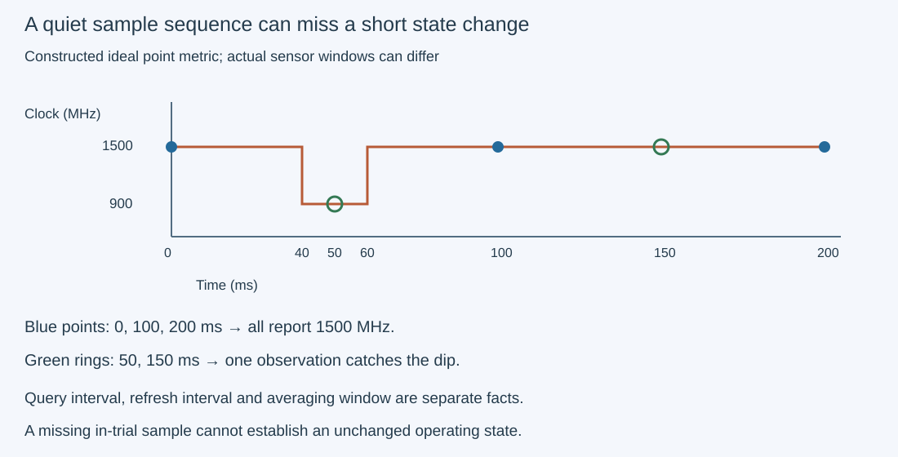
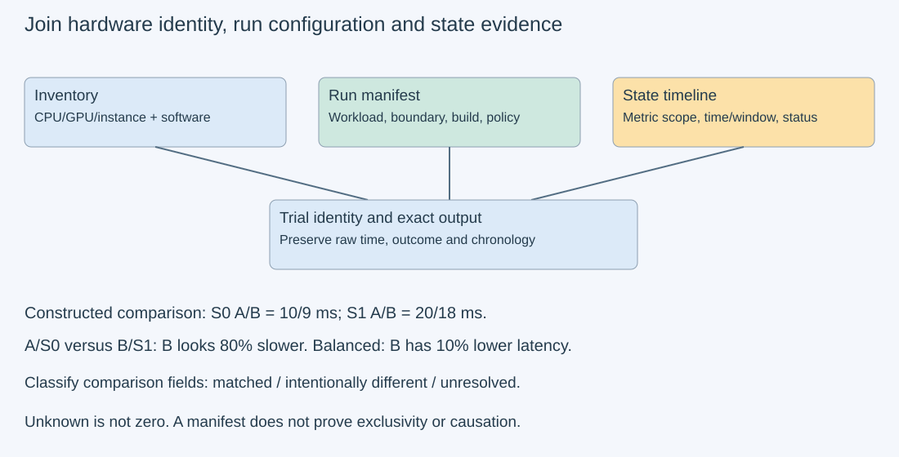

# M9-C16: Recording hardware conditions that change measurements

> **Status: Complete — detailed chapter authored and documentation validated; experimental procedures are proposed unless explicitly labelled observed**

**Module:** Make measurement and correctness part of the foundation

**Category:** [Hardware architecture and topology](index.md)

[Module 9 reading order](../module-9.md) · [Previous: M9-C15](../state-memory-and-caching/m9-c15-accounting-for-weights-kv-state-workspace-and-fragmentation.md) · [Next reading: M9-C17](../numerics-and-correctness/m9-c17-comparing-logits-with-justified-numerical-tolerances.md) · [Execution plan and progress](../chapter-execution-plan.md)

## Target concepts

CPU and GPU models, memory capacity and bandwidth, NUMA and interconnect topology, clocks, power and thermal limits, co-tenancy and partitions, driver and runtime versions, telemetry sampling.

## Concepts

### 1. Record a measurement's environment, not just its result

A benchmark result belongs to a workload, an implementation, a machine configuration and the machine's state during the run. A **manifest** is the record tying these together. A **configuration** describes relatively persistent choices such as GPU instance, allocation policy or installed libraries. **State** describes time-varying conditions such as temperature, clock rate and competing work. **Telemetry** is a sequence of observations of those conditions.

Two programs with the same name can execute different binaries or use different libraries. Two machines with the same GPU marketing name can expose different memory capacity, partitions, interconnect paths or power limits. Even the same unchanged machine can behave differently after idle, during sustained load or when another job starts. An accurate time alone does not establish a reproducible comparison.

Use three related records: an inventory describing hardware/software identity, a run manifest describing workload and configuration, and a timestamped state/exception timeline linked to each trial. Preserve the observed source and observation time for each field. An unsupported or inaccessible value is **unknown**, not zero. A copied product specification is **advertised**, not observed. This chapter establishes the recording discipline used by Modules 1–7, building on [M9-C02 timing boundaries](../measurement-experimentation-and-economics/m9-c02-request-events-clocks-and-measurement-boundaries.md) and [M3-C14 transfer contracts](../networking-and-communication/m3-c14-moving-tensors-between-devices-and-hosts.md).

### 2. Capacity and bandwidth need a resource boundary

Record CPU model, socket/core/thread counts and the CPUs actually available to the process. A logical CPU is a schedulable execution context; it is not necessarily a whole physical core. Record GPU model/variant, stable device identity, visible partition, local memory and supported execution features. State physical memory, allowed/visible capacity and application budget separately. An application can exhaust its allocation budget while physical memory remains elsewhere on the machine.

**Capacity** is how much a resource holds; **bandwidth** is how quickly data crosses a defined boundary. Advertised GPU memory bandwidth is not host-device payload bandwidth. Runtime-reported free memory is a snapshot, not a reservation. Distinguish live application bytes, allocator-reserved bytes and device-wide reported use, following [M9-C15](../state-memory-and-caching/m9-c15-accounting-for-weights-kv-state-workspace-and-fragmentation.md). Define GB as 10⁹ bytes and GiB as 2³⁰ bytes before comparing records.

A constructed capacity ledger illustrates scope: a 24 GiB visible device has a 2 GiB runtime/system reserve, 8 GiB weights, 10 GiB live KV state and 3 GiB workspace. These sum to 23 GiB, leaving 1 GiB under that payload accounting. Adding 2 GiB of communication buffers exceeds the 24 GiB budget by 1 GiB. This arithmetic is not an observation of a real GPU or an allocator's fragmentation behavior.

**NUMA**, non-uniform memory access, means locality affects access costs. CPU affinity, which restricts where a thread runs, and the actual nodes backing its memory pages are different fields. Record GPU/NIC PCI identity, negotiated link generation/width, switch/root ancestry, CPU/node placement and any supported peer path. A NIC is a network interface controller. [M3-C13](m3-c13-pcie-nvlink-numa-and-device-topology.md) explains why a topology label is not a measured bandwidth result. Requested affinity or memory policy alone does not prove actual placement.

### 3. Clocks, power and temperature describe an operating point

A **clock frequency** is cycles per second. A **power limit** constrains an operating envelope; temperature can trigger additional controls. Actual compute or memory clocks can differ from an advertised maximum or a requested setting. A CPU's frequency policy also does not directly establish the rate at which a particular thread retires useful work. The [Linux CPU performance-scaling documentation](https://www.kernel.org/doc/html/latest/admin-guide/pm/cpufreq.html) explains governors, drivers and shared policies. A governor selects performance levels according to a policy; the driver communicates with the hardware.

Record requested policy and observed state independently: CPU policy/driver, actual frequency evidence where available, GPU compute/memory clock observations, temperatures, configured/enforced power scope and available clock-limiting reasons. A reduced clock plus a slow trial is evidence for investigation, not proof that clock reduction caused all of the slowdown. Memory stalls, workload changes and shared resources can vary too. Dividing elapsed time by a clock ratio does not generally normalize a program into an equivalent operating point.

The [NVIDIA management reference](https://docs.nvidia.com/deploy/nvidia-smi/index.html) distinguishes instantaneous and averaged power fields, board versus module scope, and clock-event reasons on supported devices. Record the exact field/version and units. Watts measure power; joules measure energy. A board field is not automatically process-only power, and a module field can include components outside the GPU board.

Warmup is preparation, not a universal guarantee of stable temperature or clocks. Define a reproducible warmup count and record whether the workload starts after idle or prior sustained activity. Keep valid slow trials when state changes; label the change and compare like cohorts. These experiments inspect existing settings and do not require changing power limits, locking clocks, heating hardware deliberately or reconfiguring cooling.

### 4. Sharing, partitions and versions are part of the experiment

**Co-tenancy** means other work shares a resource. Separate processes may compete for GPU execution, host CPU time, memory bandwidth, PCIe links or network queues. A visible process list is useful evidence but may be incomplete in containers or managed infrastructure. Record the sharing visibility and scheduler allocation; do not claim a physically idle device merely because an application cannot see another tenant.

A **partition** exposes a subset of a device's resources. NVIDIA Multi-Instance GPU (MIG) provides defined resource partitions on supported hardware, with documented isolation properties. Record physical GPU identity, instance/profile identity, visible memory and supported metrics. Read the [MIG guide](https://docs.nvidia.com/datacenter/tesla/mig-user-guide/introduction.html); do not replace a partition's capacity with the full GPU's specifications. Also avoid extending a partition's documented isolation to every host, link or power resource. This chapter records existing partitions; it does not create or resize them.

Record OS/kernel, firmware where relevant, driver, loaded runtime/libraries, toolkit/compiler, build identity, optimization settings and the eventual Rust binding/dependency versions. The maximum CUDA version advertised by a driver-facing tool is not necessarily the application's loaded runtime or build toolkit version. The [CUDA compatibility guide](https://docs.nvidia.com/deploy/cuda-compatibility/latest/index.html) describes supported combinations and limits; compatibility does not mean identical performance, kernels or numerical behavior.

For inference, extend the record with model/weight/tokenizer/adapter identity, precision and quantization configuration, selected kernels/backends, batch and input/output lengths, concurrency, cache state, arrival process, cancellation/deadline policy and outcome counts. Cache state means which reusable weights, prefixes or other data were retained before timing. For the exact copy experiment below, model and tokenizer fields are explicitly not applicable. No implementation code is provided.

### 5. Sampling can miss a condition or perturb the workload

A telemetry sample must identify the entity, metric, unit, observation/read interval, metric's own timestamp or averaging window when available, status and source. The **poll interval** is how often the collector asks for a value. The **refresh interval** is how often the underlying metric changes. These can differ. Polling an averaged or cached field more often does not create new independent observations.

A constructed example samples an ideal point metric at 0,100,200 ms. A clock dip from 1,500 to 900 MHz occurs only during [40,60) ms. Every point sample reads 1,500 MHz, so the trace misses the dip. Shifting observations to 50,150 ms catches it once. This is a demonstration of incomplete observation, not a claim about a particular hardware sensor or a guarantee from any faster poll rate. Real fields can average over windows instead of reporting point values.

*Constructed point samples only. Actual sensor windows, refresh behavior and query uncertainty must be recorded before applying this reasoning to telemetry.*

For host query start t_start and finish t_end, the read itself spans **δ=t_end−t_start**. Without a supplied device timestamp, do not pretend the returned value was an exact point observation at trial start. Preserve that interval and any known sensor window. A short copy may have no fresh sample during its entire lifetime; session telemetry can describe context without explaining that individual copy's latency.

Sampling uses CPU time, driver calls, queues and storage. Define collector placement, selected fields, buffering and output policy. Compare a baseline without periodic collection against specified collection rates. If baseline time is T₀ and instrumented time is Tₛ, descriptive relative overhead is **100(Tₛ−T₀)/T₀ percent** for comparable cohorts. Constructed 10,10.2,11 ms times give 2% and 10% increases. Negative differences can be noise or drift, not proof of a beneficial measurement tool.

### 6. Evidence supports comparisons without proving every cause

A **confounder** changes alongside the implementation and can explain a timing difference. Suppose constructed implementations A/B have the following equally weighted cell times:

| Operating-state stratum | A | B | Within-stratum latency reduction for B |
| --- | --- | --- | --- |
| S0 | 10 ms | 9 ms | 10% |
| S1 | 20 ms | 18 ms | 10% |

A **stratum** is a group of trials under a declared comparable condition. Comparing only A/S0 with B/S1 makes B look 80% slower. Equal weighting gives A=15 ms, B=13.5 ms, so B has 10% lower latency in this constructed design. The unequal comparison cannot isolate implementation effect. Telemetry may suggest a state change, but post-hoc grouping by one metric does not remove every confounder.

Predeclare relevant comparison fields, alternate/rotate trial order and preserve chronological samples. Distinguish an implementation comparison on comparable resources from a deployment comparison where a smaller partition is intentionally part of the change. Both can be useful, but answer different questions. A missing environment field limits reproducibility; an identity change mid-run may invalidate the trial's claimed endpoint.

*Comparability is a documented decision. A manifest is evidence about a run, not a certificate of exclusive hardware or causal attribution.*

HFT systems provide a useful lens: a latency result depends on queueing, CPU placement, competing traffic and useful completion, not just device specifications. A tail is the slower end of a latency distribution. Sparse telemetry cannot establish what caused every tail event, and an apparently stable clock does not prove a hard real-time bound. The experiments below measure evidence quality and exact tensor-copy work, not trading outcomes.

## Experiments

All procedures are **proposed**. E1, E3 and E4 are reference/paper audits; E2 describes future single-GPU work. No actual hardware inventory, telemetry capture or GPU benchmark is claimed. Use completed [M9-C01 reference contracts](../numerics-and-correctness/m9-c01-defining-reference-behavior-and-evidence-before-optimizing.md), [M9-C02 completion boundaries](../measurement-experimentation-and-economics/m9-c02-request-events-clocks-and-measurement-boundaries.md), [M9-C07 distributions](../measurement-experimentation-and-economics/m9-c07-latency-distributions-and-statistical-uncertainty.md) and [M9-C15 storage scope](../state-memory-and-caching/m9-c15-accounting-for-weights-kv-state-workspace-and-fragmentation.md). This chapter supplies the hardware-state support used across Modules 1–7.

### E1 — Audit a three-part environment record

- **Description:** Prepare inventory, run and timestamped state records; distinguish observed values, advertised values, requested settings and unavailable fields.
- **Purpose/objective:** Make a result reviewable without assuming the reviewer has access to the original machine.
- **Target concepts:** CPU/GPU identity, capacity/bandwidth, NUMA/topology, sharing/partitions and software versions.
- **Baseline and workload:** Paper baseline uses the 24 GiB capacity ledger and a hypothetical exact 1 MiB copy run. No real CPU/GPU model or capacity is supplied. Apply the minimum manifest below; model/weights/tokenizer are not applicable to the copy fixture.
- **Controls and prediction:** Keep workload and byte boundary explicit. Predict the base ledger uses 23 GiB, leaves 1 GiB, and exceeds capacity by 1 GiB after the extra 2 GiB buffer. A full-device specification cannot replace an unknown partition capacity, and an unknown metric cannot become zero.
- **Procedure:** Link every trial to run ID, build ID, stable device/instance identity and manifest revision. Give each field a source, unit, scope, timestamp and status. Compare requested versus actual CPU/page placement and loaded runtime versus driver compatibility labels. Annotate a deliberately missing page-location report and a hidden co-tenant view as unknown. If later real read-only inspection is possible, retain its original evidence separately from this paper record.
- **Hardware/software:** Paper or spreadsheet suffices. Optional inspection uses supported OS/vendor read-only views; missing permissions/capabilities remain explicit. No configuration change or telemetry service deployment is required.
- **Failure and HFT connection:** A benchmark on the wrong GPU instance resembles a latency claim against the wrong endpoint. Preserve original identity and stop comparisons when the identity cannot be established.
- **Exit criteria:** Every required field is populated or explicitly unavailable/not applicable with reason; all capacity arithmetic and source/scope distinctions agree. The record claims no physical exclusivity or actual measurement absent evidence.

### E2 — Estimate telemetry's effect on a completed-copy benchmark

- **Description:** Compare the same exact one-GPU H2D copy with periodic state collection off, requested every 1,000 ms, or requested every 100 ms.
- **Purpose/objective:** Determine whether the observer materially changes the measured work and how much fresh state evidence each mode supplies.
- **Target concepts:** Telemetry sampling, clocks/power/thermal observations, CPU resources, versions and measurement overhead.
- **Baseline and workload:** n=1,048,576 bytes per transfer, one in flight, three modes. Treat input as m=n/8 little-endian unsigned 64-bit labels Vⱼ(e)=e×2³²+j, j=0,…,m−1 and epoch e=0,…,59. H2D copies preserve bytes exactly. Baseline disables periodic polling but retains bookend inventory/state observations outside primary timing.
- **Controls and prediction:** Allocate/register one pinned source and one pinned verification host buffer plus one device destination, streams/events and bounded telemetry storage before timing. Keep topology, input generation, completion policy, collector affinity, metric list and buffering policy fixed. Collect only supported read-only state fields: clock, temperature, correctly scoped power and available limiting reasons; record missing fields. Predict exact copied labels and no universal overhead percentage or minimum fresh-sample count.
- **Procedure:** Three sessions/mode, 10 excluded warmups and 20 measured copies/session; assign epochs 0–59 per mode, rotating mode order between sessions. Start the collector before warmups and stop after the final checked trial. Time each copy from host submission through successful final completion; source/sentinel initialization, readback and validation remain outside this primary interval. Verify every destination label after readback and retain buffers through CPU validation. Record query start/end, metric timestamp/window/status and actual poll gaps. Persist buffered logs outside timed copies. Avoid simultaneously running a detailed profiler in these timing sessions.
- **Hardware/software:** One supported GPU; two 1 MiB pinned host buffers plus one 1 MiB device allocation, 3 MiB raw payload plus runtime/collector storage. Record collector/tool/runtime versions. No second GPU, NIC or model required. A metric unavailable on a partition is not replaced by an unlabelled whole-device value.
- **Failure and HFT connection:** Logging can steal CPU/driver time from the path it observes. Missing or stale state samples do not explain an individual latency spike. A 120-second watchdog classifies unresolved completion as unknown/error and preserves ownership.
- **Exit criteria:** Reconcile 180 measured copies and 90 warmups, all outcomes and exact bytes. Report raw copy timings, per-session distributions, collector CPU/read costs and fresh/duplicate/missing sample counts. Compare overhead descriptively against the off mode and state coverage limits; no measured slowdown or metric coverage is required for correctness acceptance.

### E3 — Replay sampling blind spots and energy boundaries

- **Description:** Inspect constructed point-clock samples and compute illustrative energy estimates with an explicit sensor model.
- **Purpose/objective:** Show why a clean sparse trace cannot exclude an unobserved state change, and why a power sample is not process energy.
- **Target concepts:** Telemetry windows, clocks, power, units and sampling limitations.
- **Baseline and workload:** Clock is 1,500 MHz except 900 MHz during [40,60) ms. Compare samples at 0/100/200 ms with 50/150 ms. Separately, linearly interpolate hypothetical power observations at 0/0.1/0.2 seconds: 100/140/100 W. Do not conflate these with actual NVIDIA averaged fields.
- **Controls and prediction:** First clock sequence misses the dip; shifted sequence sees it once. Trapezoidal energy estimate is 24 J. A different constructed signal, 100 W baseline with a 140 W pulse only at 40–60 ms, has true energy 20.8 J over 200 ms, while endpoint/100 ms point samples would estimate 20 J. Both examples deliberately specify their underlying signals.
- **Procedure:** Mark each sample/window against the signal and a hypothetical trial interval. Calculate observed coverage and sample gaps; keep unknown intervals unknown. Integrate only the stated power model using the formula below. For 100 successful outputs in the 24 J example, report 0.24 J/output at the specified power boundary; do not call it incremental process-only energy without separate attribution evidence.
- **Hardware/software:** Paper or spreadsheet; no sensors, power control or thermal stress required.
- **Failure and HFT connection:** A short queue/clock event between polls resembles a missed burst in a low-resolution service trace. Faster polling alone does not prove complete observation of arbitrary events.
- **Exit criteria:** Dip detection, 24/20.8/20 J values and 0.24 J/output agree with their distinct assumptions. Do not infer a telemetry cadence guarantee, individual-trial energy or cause of a tail event from these examples.

### E4 — Reject confounded or mismatched performance comparisons

- **Description:** Audit the constructed A/B timing table and four deliberately incomplete environment comparisons.
- **Purpose/objective:** Distinguish implementation effect, deployment effect and unsupported causal attribution.
- **Target concepts:** Operating state, co-tenancy, partitions, versions, topology and reproducibility.
- **Baseline and workload:** Use S0: A=10/B=9 ms and S1: A=20/B=18 ms with equal work and exact output identity stipulated. Compare A/S0 against B/S1, then equal weighting of both strata. Separately inspect pairs with full GPU versus partition, changed loaded library/build, unverified page placement and unknown sharing visibility.
- **Controls and prediction:** Naive comparison shows B 80% slower; each stratum and the balanced comparison show 10% latency reduction. The four incomplete pairs cannot isolate an implementation effect. They may support a separately labelled deployment study after scope, correctness and environment evidence are supplied.
- **Procedure:** Declare comparison fields before grouping trials, preserve raw chronological data and rotate matched run order in a future test. Classify fields as matched, intentionally different or unresolved. Reject clock-only normalization as a general repair. Revalidate exact reference outputs after version/backend changes. Do not resize partitions, change libraries or introduce a competing workload for this paper audit.
- **Hardware/software:** Paper only. A future controlled replication needs access to the actual requested configurations, complete manifests and a fixed representative workload; no such access is assumed.
- **Failure and HFT connection:** A state shift or shared queue can reverse an apparent latency ranking. Missing observations should limit the claim, not be silently removed to improve it.
- **Exit criteria:** Both percentage calculations and balanced means agree; all four mismatch cases get an explicit comparability decision and required missing evidence. Correctness is necessary but does not alone make resource/time comparisons equivalent.

## Verification

### Minimum manifest and interpretation rules

| Record | Required content | Validation rule |
| --- | --- | --- |
| Inventory | CPU model/socket/core/thread topology; GPU physical/instance identity and profile; host/device memory capacity; interconnect/NIC identity where relevant | Distinguish advertised, visible, allocated and available resources; retain identity evidence and unavailable fields |
| Placement/sharing | Allowed CPU/node sets, actual affinity and buffer-page location, link path/current state, scheduler allocation, visible competing work and visibility limits | Requested placement or a partial process list is not proof of actual location or exclusivity |
| Software/build | OS/kernel, driver, loaded runtime/libraries, compiler/build/binding/dependency identity, firmware/tool versions as relevant | Do not substitute driver compatibility maximum for loaded runtime; rerun reference checks after changes |
| Run/workload | Run/trial IDs, exact bytes or model/tokenizer/precision, lengths/batch/concurrency/cache/arrival policy, initialization/warmup, time boundary and outcomes | Same useful work and correctness contract within an implementation comparison; preserve cancellation/failure counts |
| State/telemetry | Entity/scope, clock/power/temperature and limits where supported, field/source/unit, sensor window, query interval, status, cadence and collector configuration | Missing, stale and unsupported are explicit; board/module/partition/process boundaries never silently merge |

The fixed copy fixture is exact transport, not floating-point computation. For m=131,072 labels:

**Σ V = m e 2³² + m(m−1)/2**.

The base sum at e=0 is 8,589,869,056; largest label at e=59 is 253,403,201,535. Serialize each label's byte k=0,…,7 as **floor(V/256ᵏ) mod 256**, least significant first. Initialize each destination byte to expected XOR 255 outside timing, then check every copied label at its index and epoch. Deliberately swapped blocks, stale epochs and incorrect byte order fail independent reference checks. A sum cannot detect every permutation.

Across 180 successful measured E2 transfers, primary H2D payload totals 188,743,680 bytes. Initialization and verification copies have separate byte/time ledgers. Setup-inclusive and checked-cycle times accompany primary completed-copy latency so costs moved outside one interval remain visible. Unknown completion is never converted into a safe buffer-reuse event by the telemetry collector.

For point-power samples Pᵢ at seconds tᵢ, the **trapezoidal estimate** is:

**E_est = Σ [(Pᵢ+Pᵢ₊₁)/2] (tᵢ₊₁−tᵢ)**.

Watts × seconds gives joules. This assumes the stated interpolation and sample meaning. It is not a valid way to reconstruct arbitrary sub-window bursts from cached averages. A documented cumulative energy counter, if available, has different semantics; record its entity, reset/overflow behavior, timestamp boundary and concurrent users before taking differences. Do not claim the illustrative values are a real machine's energy.

### Measurement, benchmarking and profiling

| Experiment | Reference/correctness gate | Evidence to retain | Practical limit |
| --- | --- | --- | --- |
| E1 | Complete-or-explicitly-unknown manifests and capacity ledger | Field source, status, scope, identity and timestamp | Reproducibility record does not prove causal isolation |
| E2 | Exact labels and matching completed-copy records | Raw timings, outcomes, poll gaps/windows, duplicates/missing samples, observer CPU/read costs | A sub-poll-duration trial may have no fresh in-trial state sample |
| E3 | Constructed signal/interpolation and units | Point/window coverage, power boundary and integration arithmetic | No general event-detection or per-request energy guarantee |
| E4 | Same reference work plus declared comparison scope | Matched/different/unresolved fields, stratum calculations and chronological records | Conditioning on one observed metric does not remove all confounding |

For E2 define primary **T = host time after successful copy completion − host time before submission**. Telemetry timestamps share the host monotonic reference where possible; retain any conversion or sensor-clock uncertainty. Record a sample as overlapping a trial only with the actual known interval/window; overlap does not prove the value describes only that trial. “Off” refers to periodic collection, not absence of all bookend observations. Sensor refresh and averaging remain documented even in the fastest collector mode.

Retain all three sessions' 20 raw trial timings per mode, warmup outcomes and run order. Report medians, ranges, session variation and overhead against comparable off-mode cohorts; state if drift or uncertainty prevents a resolved overhead claim. Nearest-rank percentile p uses sorted rank ceil(pN). Twenty samples cannot establish a stable p99, and averaging session percentiles does not produce a pooled percentile. Preserve slow correct observations; label configuration/state changes and record any separately rerun cohort instead of silently replacing failures.

For actual telemetry select supported read-only fields from [NVIDIA System Management Interface](https://docs.nvidia.com/deploy/nvidia-smi/index.html), [NVML](https://docs.nvidia.com/deploy/nvml-api/latest/api/group__nvmlFieldValueEnums.html), OS sources or an existing approved collector. NVML is the vendor management library; DCGM is a host-level GPU management/telemetry framework. Record the installed versions and visibility. [DCGM profiling guidance](https://docs.nvidia.com/datacenter/dcgm/latest/learn/modules/profiling.html) notes that hardware-counter collection can conflict with developer profiling tools. Detailed profiling is a separate cohort with its own instrument configuration; do not mix it into unprofiled timing or assume all collectors coexist harmlessly.

A workload's state can change while the manifest remains textually identical. Preserve chronology and exceptions, invalidate affected identity/configuration claims on device/partition changes, and keep outstanding buffer leases until the real completion/recovery contract is satisfied. Collection failures degrade evidence; they are not proof of zero load, zero power or a healthy device.

For eventual inference, join state evidence to request IDs and useful-service outcomes while preserving model/precision/arrival/cache identity. Recheck full-request latency, useful tokens/second, cancelled/rejected counts, retained bytes and numerical/output correctness. Low board utilization or stable clocks alone do not establish efficient, reliable service.

## Engineering dimensions and principles

| Dimension | Chapter application |
| --- | --- |
| Semantics and invariants | Preserve exact workload/output identity and field definitions; distinguish board, module, instance, process and transfer scopes. |
| Workload and variability | Record cache/arrival/history, warmup and run order; compare telemetry modes without changing useful copy work. |
| Resources and bottlenecks | Account for visible capacity, actual bandwidth path, host placement, partitions, shared resources and collector CPU/driver cost. |
| Time and distributions | Join trial intervals to uncertain sample windows; preserve tails and sampling gaps rather than claiming unseen stability. |
| Ownership and coordination | Link manifests and observations through run/device/instance/trial identity; retain buffers through real completion even if telemetry stops. |
| Failure and adaptation | Mark unknown/stale/unsupported fields, invalidate changed identities and limit comparisons when sharing/state evidence is incomplete. |

1. **Correctness defines the optimization boundary.** Exact outputs and valid completion precede performance claims; a changed build/backend requires renewed reference checks.
2. **Performance depends on workload and operating point.** Clocks, placement, sharing, partition and prior activity belong to each result, not a generic GPU name.
3. **Data movement is part of the algorithm.** Separate local GPU memory bandwidth from the completed host-device payload path and verification traffic.
4. **State has ownership, lifetime and recovery cost.** Instance identity, reservations, cached data and telemetry records have validity boundaries; a collector failure releases no device lease.
5. **Dependencies determine latency; bottlenecks determine capacity.** CPU submission and observer work can delay a copy even without a changed GPU kernel; capacity ledgers need explicit headroom.
6. **Variability and synchronization shape the tail.** Sparse samples may miss short events; chronology and raw outcomes matter more than a reassuring average clock.
7. **Local improvements must be evaluated end to end.** A low observer overhead for one copy workload does not establish low overhead or energy efficiency for an entire serving stack.
8. **Claims require reproducible evidence.** Store three-part manifests, field semantics, observation uncertainty, exact references, all outcomes and explicit comparison decisions.

## Specifications, articles, and hardware

| Primary source | Use and limits |
| --- | --- |
| [NVIDIA System Management Interface reference](https://docs.nvidia.com/deploy/nvidia-smi/index.html) | Device/field identity, clocks, limits and scoped power; field support and averaging vary, so retain installed version and exact definitions. |
| [NVML field definitions](https://docs.nvidia.com/deploy/nvml-api/latest/api/group__nvmlFieldValueEnums.html) | Explicit metric identities and scope/availability; a faster poll does not redefine the metric. |
| [Linux CPU performance scaling](https://www.kernel.org/doc/html/latest/admin-guide/pm/cpufreq.html) | Policy/governor/driver concepts; policy is not proof of a thread's actual useful execution rate. |
| [NVIDIA MIG guide](https://docs.nvidia.com/datacenter/tesla/mig-user-guide/introduction.html) | Existing instance resource and isolation contracts; do not extrapolate to unrelated host/link resources or reconfigure instances here. |
| [CUDA compatibility guide](https://docs.nvidia.com/deploy/cuda-compatibility/latest/index.html) | Driver/runtime compatibility distinctions; compatibility does not prove equal behavior or speed. |
| [DCGM profiling guidance](https://docs.nvidia.com/datacenter/dcgm/latest/learn/modules/profiling.html) | Counter collection and tool conflicts; detailed profiles remain separate from timing runs. |
| [Setting Up GPU Telemetry with NVIDIA Data Center GPU Manager](https://developer.nvidia.com/blog/gpu-telemetry-nvidia-dcgm/) | Historical 2019 primary article on collection architecture. Use current installed-tool contracts, not its historical deployment examples as a prescription; no article code reproduced. |

No specific machine model, hardware inventory or measured sensor stream has been supplied. E1/E3/E4 require no hardware. E2 needs one supported CUDA GPU, exact byte-copy/completion support, 2 MiB pinned host and 1 MiB device raw payload plus runtime and bounded collector storage. Supported state-query visibility is required for a particular metric, not for all copy correctness checks. Additional GPUs, NICs, models and partition administration are unnecessary. Rust remains the intended engine context; management and device specifications define the contract without an implementation in this chapter.

## Completion and next chapter

Track acceptance in the clickable [execution plan](../chapter-execution-plan.md). [M3-C15: Counting FLOPs and bytes at a defined boundary](../measurement-experimentation-and-economics/m3-c15-counting-flops-and-bytes-at-a-defined-boundary.md) is now complete. The next **authoring** chapter is [M3-C16](../measurement-experimentation-and-economics/m3-c16-using-the-roofline-model-to-predict-bottlenecks.md). The next Module 9 **reading** chapter is the completed [M9-C17: Comparing logits with justified numerical tolerances](../numerics-and-correctness/m9-c17-comparing-logits-with-justified-numerical-tolerances.md). Module 9 supports Modules 1–7; Module 8 is excluded.
