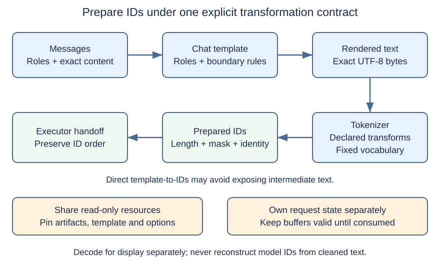
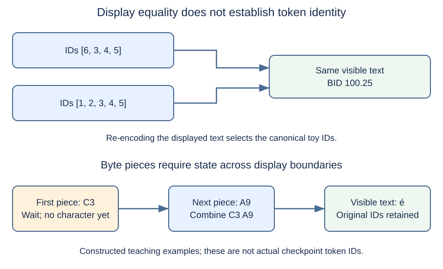

# M1-C02: Representing text as tokens

> **Status: Complete — detailed chapter authored and documentation validated; experimental procedures are proposed unless explicitly labelled observed**

**Module:** Understand exactly what happens when an LLM generates a token

**Category:** [Interfaces, protocols, and streaming](index.md)

[Module 1 reading order](../module-1.md) · [Previous: M1-C01](../model-computation-and-semantics/m1-c01-from-a-prompt-to-the-next-token.md) · [Next: M1-C03](../model-computation-and-semantics/m1-c03-numbers-vectors-matrices-and-tensors.md)

## Target concepts

Vocabulary, token IDs, tokenization, encoding and decoding, special tokens, chat templates, preserving token identity.

## What you should be able to explain

[M1-C01](../model-computation-and-semantics/m1-c01-from-a-prompt-to-the-next-token.md) treated the prompt as a sequence of IDs. This chapter explains how those IDs are chosen and why small preparation changes can change model behavior. After reading it, you should be able to distinguish bytes, visible text and tokens; inspect a formatted conversation; budget its full token count; and specify exact checks before trying to make preparation faster.

Assume basic programming knowledge. All examples concern text generation, with Module 8 excluded. The experiments are **proposed procedures**, not reported tokenizer runs or performance results. Toy IDs below are deliberately constructed; only explicitly cited checkpoint fields describe the real model. No implementation or pseudocode is provided.

## Concepts

### 1. Text has several representations

A **byte** stores eight bits. **Unicode** assigns numbers called **code points** to text elements. **UTF-8** represents permitted Unicode code points using one to four bytes. A visible character can involve several code points; “what looks like one character” is therefore an unreliable storage or token-count unit. The byte sequences allowed in UTF-8 are specified in [RFC 3629, sections 3–4](https://www.rfc-editor.org/info/rfc3629/).

Consider an accented e. A precomposed é, U+00E9, has UTF-8 bytes C3 A9. An e followed by a combining acute accent, U+0065 U+0301, has bytes 65 CC 81. These may look identical while occupying two versus three bytes. Hexadecimal, used in these byte labels, writes each byte using two base-16 digits. **Normalization** transforms text into a declared canonical form; **NFC** is a Unicode form that can compose this second spelling into the first. [Unicode Standard Annex #15, revision 57](https://www.unicode.org/reports/tr15/tr15-57.html) defines normalization and equivalence. Normalization can be legitimate model preprocessing, but adding it independently to an existing model's input path changes that path's contract.

Similarly, a space, a tab, a line feed, and a carriage-return/line-feed pair are distinct. Case, repeated spaces, decimal punctuation and leading whitespace can affect tokenization. Human visual equivalence, Unicode equivalence, byte equality and token-ID equality are four different tests.

### 2. Vocabulary and IDs connect text to learned weights

A **tokenizer** maps text to an ordered sequence of integer **token IDs**. Its **vocabulary** associates those IDs with token pieces or control markers. Pieces can cover part of a word, multiple text elements, or bytes that do not independently form valid visible text. The ID is an identity label. ID 200 is not twice the meaning of ID 100.

The model's learned lookup table associates an ID with numerical values; M1-C09 develops that lookup as an embedding. Reassigning IDs without correspondingly compatible weights changes what the model sees. A tokenizer with the same vocabulary size or familiar token spellings is not automatically interchangeable with another revision.

**Base vocabulary** entries come from the tokenizer's learned segmentation scheme. **Added tokens** are entries recognized separately under additional matching rules. Added does not necessarily mean special: an entry can be added but remain visible during ordinary decoding. The [Tokenizers v0.20.3 added-token specification](https://huggingface.co/docs/tokenizers/v0.20.3/api/added-tokens) describes matching controls such as whether whitespace can be absorbed and whether matching happens against normalized text.

A model can reserve more output positions than there are ordinary text pieces. The admissible ID set must therefore be checked against both the compatible tokenizer and the model, including intentional control-token restrictions. Merely checking that an integer is below the output dimension does not prove it has the intended token meaning. Changing the vocabulary requires a model-compatibility decision, not just a text substitution.

### 3. Encoding is a pipeline, not a word split

**Encoding** produces token IDs from text. It is different from UTF-8 encoding, which produces bytes. When context is ambiguous, name the conversion explicitly. A common tokenizer pipeline has normalization, **pre-tokenization** to identify initial segments, a learned segmentation scheme, and **post-processing** such as adding configured markers. Not every tokenizer performs every transformation. The [Tokenizers v0.20.3 pipeline guide](https://huggingface.co/docs/tokenizers/v0.20.3/pipeline) explains these responsibilities.

**Byte-pair encoding (BPE)** learns reusable pieces by merging frequent adjacent units during tokenizer training; inference uses the fixed learned rules rather than retraining on a request. It need not choose the longest available vocabulary piece at every position. Segmentation boundaries and merge priorities matter. Other tokenizers use different schemes. The original [subword-units paper by Sennrich, Haddow and Birch, 2016](https://aclanthology.org/P16-1162.pdf) explains why representing rare words using smaller units helps avoid a vocabulary made only of complete words. It is background, not a complete specification of a modern checkpoint's tokenizer.

Byte-oriented schemes can preserve arbitrary valid text through byte pieces, while some schemes have an **unknown token** for unsupported input. A byte-level scheme and a byte-fallback scheme are not synonymous; use the actual artifact's rules. Invalid UTF-8 still needs a transport/input policy before tokenization. Do not claim universal lossless round-tripping from the name “BPE”.

*Figure 1. The model consumes prepared IDs, not the caller's original message objects. Each conversion has its own identity and settings. Optional normalization belongs to the tokenizer's declared rules; it is not an invitation to clean text elsewhere.*

### 4. A worked vocabulary makes the identity problem concrete

The following is a **toy specification**, unrelated to Qwen IDs. A blank inside quotes means an ordinary space. The table is only the subset needed for this exercise, not a production vocabulary.

| Toy ID | Piece | Interpretation |
| --- | --- | --- |
| 1 | “BID” | Ordinary text |
| 2 | “ ” | One ordinary space |
| 3 | “100” | Ordinary text |
| 4 | “.” | Decimal point |
| 5 | “25” | Ordinary text |
| 6 | “BID ” | Text including its trailing space |
| 10 | START | Message boundary marker |
| 11 | USER | Role marker |
| 12 | LF | Line feed |
| 13 | END | Message-ending marker |
| 14 | ASSISTANT | Role marker |

For this toy encoder, stipulate that the joined piece “BID ” is preferred when those four characters are supplied together. The text “BID 100.25” has ten UTF-8 bytes and encodes to **[6, 3, 4, 5]**, four tokens. It also has an alternative valid segmentation **[1, 2, 3, 4, 5]**, five tokens, that a toy decoder can turn into the same text. The encoder's canonical choice, meaning its chosen standard representation, remains the stipulated four-token sequence.

Let **E** be the fixed encoder, **D** the decoder, **s** text, and **a** an ID sequence. Even when **D(E(s)) = s**, it does not follow that **E(D(a)) = a** for every valid a. In this example:

**D([6, 3, 4, 5]) = D([1, 2, 3, 4, 5]) = “BID 100.25”**

**E(D([1, 2, 3, 4, 5])) = [6, 3, 4, 5] ≠ [1, 2, 3, 4, 5]**

The inequality symbol means “is not equal to”. Decoding and then re-encoding generated IDs can change token positions and subsequent model context even when the visible text looks right.

Nor can independently tokenized text fragments generally be joined to reproduce full-string encoding. Here, encoding “BID” and then “ ” independently yields [1, 2], while encoding “BID ” yields [6]. In notation, **E(s₁ + s₂) need not equal E(s₁) + E(s₂)**, where plus means concatenation, or joining in order. This is a boundary effect, not numerical noise. Text-prefix caches must respect it; the later KV-cache chapters add further compatibility conditions.

### 5. Decoding is for display and has its own policy

**Decoding**, or **detokenization**, reconstructs text from IDs. This is distinct from the model's next-token decoding policy introduced in M1-C01. Some decoders reverse byte representations; others repair segmentation-specific spacing. See the [Tokenizers v0.20.3 decoder reference](https://huggingface.co/docs/tokenizers/v0.20.3/api/decoders).

The display path can hide special tokens, clean up spaces, or replace malformed byte sequences. Each option can make distinct inputs appear the same. Keep a raw ID record as well as the user-facing string. An exact round-trip check is valid only when the declared normalization, marker removal, byte-error and cleanup policies permit it. Otherwise compare with the specified transformed reference and explain the information intentionally lost.

A token's bytes may end partway through a UTF-8 sequence. For a constructed byte-piece example, suppose one token carries C3 and the next carries A9. Together they form é. Decoding each token independently with replacement for incomplete bytes can produce replacement characters instead. A correct incremental display decoder retains incomplete bytes until more arrive, and handles any leftover incomplete sequence at finalization according to its contract. It must never change the model's retained token IDs to repair display text.

*Figure 2. Two independent hazards: decoding is not necessarily invertible, and visible text boundaries need not align with token or transport boundaries. These are constructed examples, not measured checkpoint output.*

### 6. Special tokens and chat templates supply structure

A **special token** has designated structural meaning, such as beginning-of-sequence (**BOS**), end-of-sequence (**EOS**), or padding (**PAD**). Not every model uses all of them. Padding fills positions in a group of unequal-length requests; an **attention mask** indicates which positions participate in computation. A padding value equal to a possible stop ID must not cause a padded position to be mistaken for a newly selected EOS.

A token's readable marker spelling does not by itself determine whether user text containing that spelling is recognized as control structure. The tokenizer, added-token rules and input policy decide that. Literal marker strings in messages require explicit handling. Hiding a marker in the displayed response does not undo its effect on prepared input IDs.

A **chat template** formats structured messages, including roles such as system, user and assistant, into the sequence the model was trained to continue. A **generation prompt** is the template suffix indicating that an assistant response should begin. It is model-specific and is not the same as an arbitrary English instruction. The [Transformers v4.57.1 chat-template guide](https://huggingface.co/docs/transformers/v4.57.1/chat_templating) explains these boundaries and warns against adding special markers again after rendering a template that already supplies them.

For the toy vocabulary, specify a single user message as START, USER, LF, content, END, LF, followed by START, ASSISTANT, LF for the pending response. The prepared IDs for “BID 100.25” are:

**[10, 11, 12, 6, 3, 4, 5, 13, 12, 10, 14, 12]**

There are **12 prepared tokens = 4 content tokens + 8 formatting tokens**. The toy decoder displays marker labels only for inspection; normal visible response decoding can hide them. Real role names and line breaks may be ordinary text tokens rather than dedicated role IDs. Do not transfer this toy role-ID scheme to a real checkpoint.

A concrete reference continues M1-C01's **Qwen/Qwen2.5-0.5B-Instruct**, snapshot **eaa56b503cc0a8a4d15de1dd8bd2a7e95a716be2**. Its [tokenizer configuration](https://huggingface.co/Qwen/Qwen2.5-0.5B-Instruct/blob/eaa56b503cc0a8a4d15de1dd8bd2a7e95a716be2/tokenizer_config.json) maps `<|im_start|>` to **151644**, `<|im_end|>` to **151645**, and `<|endoftext|>` to **151643**. The last is the configured padding spelling; BOS is null. For text-only messages without tools, the template supplies a default system message if absent and can append an assistant header. This chapter does not reproduce its template implementation. Inspect the exact artifact; the toy counts above are not its counts.

Two preparation routes can be compared: template-to-IDs directly, or template-to-rendered-text followed by encoding without inserting a second set of special markers. Their equality must be demonstrated under the same effective options; shared model names are insufficient. A direct API can still render text internally; it does not establish fused preparation or zero-copy behavior. Omitting the assistant suffix is a deliberate input change. It may change what the model continues even if the user message is identical.

### 7. Budget and preserve the complete prepared sequence

Let **N** be the number of prepared input tokens, **G** the allowed new-token count, and **C** the admitted context budget in tokens. For this chapter's simple full-context service contract:

**N + G ≤ C**

This reserves the full output allowance. It is an admission policy for this exercise, not a statement that every runtime checks limits identically. The complete N includes formatting and any default system message. In the toy case, **12 + 8 = 20** fits C = 20; **12 + 9 = 21** does not. Counting only the four content tokens would incorrectly admit the second request.

Token-ID storage also has a defined boundary. With **b** bytes per stored ID, **ID-array payload = N × b**. At four bytes per ID, the toy prompt occupies **12 × 4 = 48 bytes**, excluding object metadata, masks, copies and tokenizer resources. Its content alone used 16 ID bytes for ten text bytes. Tokenization is a model representation; it does not promise compressed storage. Formatting overhead relative to content is **8 / 4 × 100% = 200%** in this deliberately short example. Empty content needs absolute counts because this ratio would divide by zero.

A tokenizer's declared maximum input length is not necessarily the model's or runtime's supported context. In the pinned example, tokenizer metadata lists **131072**, while [model configuration](https://huggingface.co/Qwen/Qwen2.5-0.5B-Instruct/blob/eaa56b503cc0a8a4d15de1dd8bd2a7e95a716be2/config.json) lists **32768** maximum positions. Neither licenses silently extending the configured service. Record and validate the compatible model/runtime limit and the admitted budget before execution.

Preserve the ordered IDs with their request identity, tokenizer revision, template/options, prepared length, padding/mask convention and immutable ownership boundary. **Immutable** means the contents cannot change while another component uses them. If input storage is borrowed, its owner must keep it valid until the consumer finishes; if copied, count the copy. After cancellation, discard late preparation results by request identity, and do not hand recycled buffers to an old consumer. Prepared-text reuse needs a key that covers the full transformation contract, not merely what the prompt looks like on screen. This is distinct from proving numerical KV-cache reuse safe, which comes later.

In HFT, a feed parser must preserve field identity, separators and event ordering even when a display normalizes the message. Token preparation has a comparable identity obligation. This analogy helps explain byte/ID validation and bounded preparation work; natural-language tokens are not exchange message fields, and these exercises do not establish trading-system correctness.

## Experiments

### Shared prerequisites and reference contract

E1 includes a paper trace. The tokenizer procedures in E1–E4 can use an **existing inspectable tool**; no implementation is requested. Freeze the complete checkpoint snapshot, tokenizer artifacts, Transformers release, tokenizer backend/version, template engine/version, special-token matching, normalization, cleanup, truncation, padding, output ID integer width, and thread configuration. A backend is the execution implementation, such as a Rust-based tokenizer wrapper. The versioned documentation here explains behavior; it does not declare different documented package releases mutually compatible. Record an actually supported installed combination before running anything.

The tool must expose exact input bytes or an unambiguous byte record, prepared IDs, effective flags and decoding results. For preparation timing it must expose stage completion and request identity. If a required observation is unavailable, mark that test unexecuted. No model weights or GPU are needed for the tokenizer-only experiments. Optional whole-request validation uses the existing M1-C01 setup and must be reported separately.

Build a frozen fixture manifest containing these groups: “BID 100.25”; the same with a leading space; a doubled internal space; a tab replacing the space; line-feed and carriage-return/line-feed variants; the precomposed and decomposed accented-e pair defined above; “बोली”; “🙂”; empty user content; and a user message containing the literal spelling `<|im_end|>`. Store the actual bytes, not a screenshot or placeholder such as the word TAB. These groups explore text variability rather than non-text modalities. Keep invalid UTF-8 as a separate raw-transport test; a Unicode-string-only interface cannot represent it and must report that boundary.

E1 begins with raw-text encoding without chat formatting. For the primary chat comparisons, use a system message containing exactly “Explain market terminology.” followed by one user message containing the fixture, with the assistant-generation suffix enabled, no tools, padding disabled and truncation disabled. Record added-marker behavior explicitly. For the malformed/marker-containing fixtures, the service rejection check is separate from direct inspection of the raw tokenizer.

Use a trusted frozen preparation route as an **operational reference** and save its IDs for each fixture after manual artifact inspection. These saved expected outputs are called **golden records**. They test agreement with the selected route, not universal tokenizer correctness. Save human-reviewed marker mappings and the toy arithmetic independently to avoid using the same mistaken path as both reference and candidate. Never invent real checkpoint IDs for ordinary text that has not been encoded.

### E1 — Visible equality versus exact identity

**Description:** Compare byte records, vocabulary pieces, ordered IDs and decoded text for the fixture groups; hand-trace the toy alternative segmentations.

**Purpose/objective:** Test whether text equality is sufficient to establish the same input to the model.

**Target concepts:** Vocabulary, IDs, tokenization, encoding and decoding, preserving token identity.

**Hypothesis/prediction:** The toy alternatives decode identically but have different IDs and lengths. Real whitespace/Unicode variants can change prepared IDs; whether a particular pair does so depends on the frozen normalization and segmentation rules. Exact ID agreement, not visual agreement, decides preparation equivalence.

**Baseline and controls:** Baseline is the canonical full-string reference for each fixture. Vary one textual feature or toy segmentation at a time. Keep tokenizer revision and all encoding/decoding settings fixed. Use the shared host requirements below; paper calculations need only the toy table.

**Procedure:** First predict equalities for bytes, visible text, IDs and counts separately. Trace the toy sequences and re-encoding equation by hand. Then encode each archived fixture with the reference, retain its pieces and IDs, decode with markers retained and cleanup disabled, and compare with the declared round-trip policy. Repeat the encode step in a fresh tokenizer instance. Finally inspect any mismatch at the first differing ID and identify whether normalization, segmentation, marker matching or a bad fixture explains it.

**HFT and systems connection:** A pretty-printed feed message cannot replace its field/byte contract. Here the model-input contract is the exact ordered IDs, without assuming that natural-language pieces are financial protocol fields.

**Exit criteria:** The two toy arrays produce the stated equal text and unequal identity, and re-encoding selects the canonical array. Every real fixture has verified bytes, settings, pieces, counts, and either matching golden IDs or an investigated failure. Invalid encoding receives the declared rejection or explicit transformation outcome; it is not silently treated as the original text. No visual-only comparison counts as an identity pass.

### E2 — One conversation, two preparation routes

**Description:** Compare direct chat-template tokenization with render-then-encode, and deliberately change boundary options.

**Purpose/objective:** Test whether the two routes preserve the entire prepared conversation and whether duplicated/missing markers are detected before inference.

**Target concepts:** Special tokens, chat templates, vocabulary mappings, encoding, preserving identity.

**Hypothesis/prediction:** Correctly matched routes should agree exactly. Duplicating a marker, removing an assistant suffix that the template supplies, or changing a default system message changes the input. A generic flag to add special tokens may do nothing for a tokenizer without such automatic insertion; a negative test must demonstrate an actual changed ID sequence rather than assume a flag causes corruption.

**Baseline and controls:** Use the shared reference and primary two-message conversation, with no tools. Also test a fixed history formed by appending an assistant message “Acknowledged.” and a user message “Define spread.” before the pending assistant suffix. Freeze explicit system content and generation-prompt option for the main comparison. Use the toy formatted sequence as an independent count check. Vary one route or option per comparison; actual padding, truncation and marker policy remain explicit.

**Procedure:** First render and inspect the conversation, including line breaks and assistant boundary. Compare both routes' complete IDs, not only content IDs. Test an explicit versus omitted system message and an assistant-generation suffix on versus off. For a negative control, deliberately insert an extra known start marker into the inspected input and verify exact comparison catches it. Probe literal marker spelling inside user content, an empty message, a missing content field and an unsupported role. Before interpreting results, specify the service's schema policy: reject malformed messages and unsupported roles before rendering; for user content containing reserved control-marker spellings, this exercise chooses explicit rejection at the service boundary rather than assuming raw templating prevents structural interpretation. This is an exercise policy; the raw tokenizer may recognize the marker if called directly. Record any unsupported capability of the existing tool.

**HFT and systems connection:** Duplicated framing or wrong message type can invalidate an otherwise readable message. This exercise checks model-specific framing; a chat template is not an exchange protocol or a security boundary by itself.

**Exit criteria:** Both correct routes match all golden IDs and mask/length metadata. The toy input has 12 tokens and eight formatting tokens. The deliberately inserted marker fails comparison. System/suffix variations are labelled changed contracts, not speed improvements. Malformed roles/fields and marker-spelling cases have declared, checked handling or an explicit unexecuted limitation. No inference is used to excuse a preparation mismatch.

### E3 — Boundaries survive incremental display

**Description:** Compare full decoding with incrementally released display text and compare full-string encoding with separately encoded fragments.

**Purpose/objective:** Test whether output buffering preserves bytes and IDs at Unicode and token boundaries.

**Target concepts:** Encoding and decoding, tokenization, special tokens, preserving identity.

**Hypothesis/prediction:** Correct incremental decoding reproduces the full decode under the same marker/cleanup/error policy. Independent one-token display decoding or independent input-fragment encoding need not match those references. The toy C3/A9 split must wait for a complete character under a strict valid-UTF-8 release policy.

**Baseline, workload and controls:** Use the toy byte split and concatenation seam, plus saved complete valid ID sequences from E1/E2. The baseline is a full decode of each complete sequence. Keep cleanup disabled; compare markers retained and markers hidden as two separate policies. Vary split positions and delivery group sizes while retaining the original IDs. Use an existing decoder exposing the required incremental behavior; if it does not, only the conceptual trace is executable.

**Procedure:** Predict where a visible fragment can safely appear. Hand-trace C3 followed by A9 and “BID” followed by a space. For each saved real sequence, test every token split into two chunks and compare finalized incremental output with full decode. Include an end marker, an empty sequence, and a deliberate final incomplete-byte case in the toy display contract. Cancel once with bytes pending and then start a new request; require state isolation. Retain the original selected IDs throughout. A checkpoint sequence may not expose the toy split, so do not report the constructed byte example as a real token-ID trace.

**HFT and systems connection:** A transport read can end halfway through a field. A stream decoder similarly carries partial state across reads; the analogy concerns framing and state lifetime, not the meaning of a price or order.

**Exit criteria:** Every supported real split reproduces reference display bytes at finalization, with zero ID mutation. The toy trace produces one é after both pieces, and the separately encoded toy prefix differs from full encoding as predicted. A trailing incomplete sequence follows the declared error policy; cancellation cannot leak pending bytes into the next request. Missing incremental controls are recorded as unexecuted, never inferred from a whole-string decoder.

### E4 — Faster preparation under an unchanged contract

**Description:** Compare the already validated E2 routes across text sizes, then examine the complete-request implication of preparation cost.

**Purpose/objective:** Test whether avoiding extra caller-side text materialization or repeated resource loading helps at the measured operating point while preserving exact IDs.

**Target concepts:** Tokenization, templates, encoding/decoding costs, preservation of token identity and associated state.

**Hypothesis/prediction:** A route that avoids copies may help some input sizes, but wrapper overhead and backend work can reverse the result. A faster tokenizer can have little full-request benefit if model work dominates. Results must be reported by actual bytes and prepared tokens.

**Baseline, variables and hardware:** Baseline is the warm loaded direct route with one request outstanding and fixed threading. Compare warm render-then-encode under identical effective settings. Separately compare a fresh process loading tokenizer resources, labelled process-cold rather than storage-cold because filesystem caching may persist. Use the shared CPU record. Build six archived fixture cells from the plain-text string “BID 100.25” and the mixed-Unicode string “बोली 🙂 é”, using precomposed U+00E9 for the last character. Repeat each string 1, 16 and 256 times, placing one line feed between adjacent copies and none after the last copy. Keep exact strings and both byte/token counts; retain the same explicit system message. Do not infer token counts by multiplying the single-unit count, since boundaries can change segmentation.

**Procedure:** First validate every route/fixture pair against golden IDs and context limits for any optional model run. Warm until durations show no systematic settling trend, recording the criterion and excluded warmup count. Randomize the six fixture cells and paired route order, measure stage durations, memory and ID-array size, and retain failures. Compare copy/allocation evidence with elapsed preparation time. Run the same inputs through an existing complete request path only if available with all M1-C01 controls; otherwise provide a clearly labelled arithmetic sensitivity example and leave end-to-end improvement unmeasured.

**HFT and systems connection:** Parser throughput and event-to-action delay are different metrics. This study measures a preparation stage and its caller-visible consequences without claiming a single-request tokenizer benchmark establishes burst-handling capacity.

**Exit criteria:** Every candidate preserves exact IDs and metadata, or is rejected as a different contract. Per-cell records include timings, actual bytes/tokens, loading state, memory, and an explanation or explicit inconclusive result. Cold setup is separated from warm processing. No local improvement becomes an end-to-end claim without whole-request evidence under the same workload and output contract.

## Verification

### Correctness gates and target-concept coverage

The local use of [M9-C01](../numerics-and-correctness/m9-c01-defining-reference-behavior-and-evidence-before-optimizing.md) is exact reference behavior, and [M9-C19](m9-c19-validating-tokenization-stopping-and-final-output.md) supplies the output-identity perspective. Both remain outlines; the checks needed here are stated in full. Equality of integers, counts, masks and required byte sequences has **zero tolerance**. Floating-point numerical tolerance cannot excuse a tokenization mismatch.

| Target concept | Where taught | Exercise and verification |
| --- | --- | --- |
| Vocabulary | Concepts 2 and 4 | E1 pieces and ID mappings; E2 known-marker inspection |
| Token IDs | Concepts 2, 4 and 7 | E1 exact arrays; E3 no mutation across display chunks |
| Tokenization | Concepts 3–4 | E1 segmentation; E3 concatenation seam; E4 per-cell counts |
| Encoding and decoding | Concepts 1, 3 and 5 | E1 declared round trips; E3 full/incremental equality |
| Special tokens | Concept 6 | E2 extra-marker detection and literal-marker policy; E3 marker display settings |
| Chat templates | Concepts 6–7 | E2 route, system-message and assistant-suffix comparisons |
| Preserving token identity | Concepts 4–7 | E1–E4 require byte/artifact/settings records and exact IDs before interpreting performance |

Do not require unequal IDs for every pair of distinct strings: a declared normalizer can map different inputs to one representation. Conversely, equal decoded strings do not justify equal-ID claims. Inspect the first divergence and the applicable transformation policy. A visually convincing response from the model cannot replace these checks.

### Measurement boundaries and proposed comparisons

Use one host's **monotonic clock**, which measures elapsed time without wall-clock adjustments. Apply the introductory boundaries of [M9-C02](../measurement-experimentation-and-economics/m9-c02-request-events-clocks-and-measurement-boundaries.md): preparation starts after the structured request is available at the measured boundary and ends when complete IDs and required metadata are ready for handoff. Explicitly include or exclude input validation, rendering, encoding and allocation; do not change that choice between routes. Separate parsing of a serialized network request if it lies outside the boundary.

For decode timing, start with available complete IDs and stop when the selected display policy has produced finalized text. For incremental tests, distinguish time spent processing a chunk from time waiting for the next chunk. No-output chunks still consume work. Mark cold load time separately from warm preparation. A device-transfer interval, if later added, needs completion-aware measurement and is not part of this CPU-only tokenizer boundary by default.

| Experiment | Required evidence | Measurement or benchmark | Profiling and limits |
| --- | --- | --- | --- |
| E1 | Byte records; toy arrays; fresh-instance exact agreement; round-trip policy and mismatches | Compare ID lengths, text bytes and marker counts for each fixture; no hardware-time conclusion from paper traces | Attribute differences to normalization, segmentation or marker rules using inspected artifacts. Optional runtime attribution belongs to E4. |
| E2 | Complete IDs, masks, effective options; negative control; schema/marker policy outcomes | Compare correct routes on the same conversation; count first differing position and formatting tokens; time validated routes in E4 | Inspect formatting and encoding separately where the existing tool exposes spans. Aggregate tool time cannot establish which stage caused a gap. |
| E3 | Full and incremental byte equality at finalization, unchanged IDs, all splits, pending-state isolation | Count chunks producing no visible output and pending bytes; optionally time decode work and finalization with fixed chunk grouping | Record decoder calls, buffering and copies if exposed. Arrival waits must not be counted as decoder CPU time. No streaming-latency claim from an offline replay. |
| E4 | Zero contract differences for accepted pairs; complete outcome accounting | Per-cell preparation latency, cold load time, input bytes/s, prepared tokens/s, peak memory, and optional full-request latency | Use an existing CPU sampling profiler or allocation/copy trace to attribute CPU time and allocation pressure. A sampling profiler periodically observes running work; record tool release and options. Instrumentation is not free. |

For a serial window of successful, contract-valid preparations, **byte rate = total input UTF-8 bytes / elapsed seconds** and **token rate = total prepared tokens / elapsed seconds**. State whether elapsed time is the sum of operation durations or a continuous wall interval; the two answer different questions. Include formatting in prepared token counts and define whether bytes count original content or rendered input. Report failed/rejected preparations separately. A rate per token is not comparable across changed vocabularies without a common workload and semantics.

A **constructed sensitivity calculation**, not a measured result, illustrates the end-to-end gate. Suppose a serial request takes 20 ms including 2 ms preparation and 18 ms other work. Halving preparation gives **1 + 18 = 19 ms**, a **(20 − 19) / 20 × 100% = 5%** latency reduction. The preparation speedup is 2×, while the request speedup is **20 / 19 ≈ 1.053×**. This assumes unchanged IDs, output work and all other stages, with no overlap. It predicts neither GPU performance nor a live-service tail.

### Repetitions, failures and uncertainty

For E1/E2 correctness, cover every archived fixture and option combination, repeat in a fresh resource instance, and keep both successes and mismatches. For E3, enumerate every two-chunk token split in each saved sequence, including empty leading/trailing chunks, and the separate toy byte-boundary cases. This is systematic finite-fixture coverage; it is not proof for all Unicode or all possible messages.

For optional E3 timing and E4, begin with five pilot observations per cell to check observability and warmup; exclude pilots from the final comparison. Then collect 30 paired observations per cell in each of three independently warmed sessions, with randomized route/cell order. Use the same recorded chunk schedules for paired decoder measurements. Treat cold process startup as a separate population, with 30 fresh-process trials per route if measured. These introductory counts can show large effects and session variation; they do not justify p99. Report medians, ranges, per-session results and all raw samples. When overhead or session variability is as large as the difference, call the result inconclusive and state what additional measurement would resolve it.

Compare minimal instrumentation against detailed tracing on the same representative fixture. If timer resolution is too coarse for one preparation, time a declared group of repeated operations and report the aggregate per-operation estimate; do not invent individual-request percentiles from it. Retain outliers with explanations rather than removing them for aesthetics.

Count every submitted preparation as completed, rejected, cancelled, failed, or unfinished at observation end, with one final outcome per request. Stop submission and drain existing work before closing a run. Test an invalid ID, mismatched artifact identity, out-of-budget request and cancellation with pending preparation/display state. An unsupported capability remains unexecuted. The exercise's service contract rejects unknown IDs, malformed request schemas, invalid UTF-8 at its raw-byte boundary, and incompatible artifact combinations rather than silently repairing them. This stricter boundary policy is distinct from a tokenizer library's optional replacement behavior.

An overloaded preparation pool, shared buffers under concurrency, or loss of a worker requires later scheduler/ownership fault tests; these serial designs do not validate those mechanisms. Conceptually, bound accepted bytes/work, preserve request identity across delayed results, and reclaim borrowed buffers only after consumers finish. Record stale results and failed attempts instead of relabelling them successful retries.

### Reproducibility record

Preserve the exact fixture bytes, message roles and order, full snapshot and artifact checksums, template content identity and options, normalization/marker/cleanup/error policies, backend/version, thread settings, ID width, masks, golden outputs and first-divergence records. A checksum is a content fingerprint; retain the actual records as well, because a fingerprint alone does not explain a mismatch. Freeze these inputs before comparing routes, applying [M9-C11](../measurement-experimentation-and-economics/m9-c11-controlled-comparisons-warmup-and-reproducibility.md), which remains an outline.

Keep warmup criteria, raw start/end timestamps, outcome counts, memory definitions, instrumented/uninstrumented comparisons and hardware conditions. A **peak resident memory** reading counts physical host memory occupied by the process at its observed peak; it differs from cumulative allocated bytes and retained allocator capacity. Explain the measured quantity. Report proposed, hand-derived and runtime-observed evidence separately. This chapter contains definitions and proposed benchmarks; it claims no executed tokenizer or model performance experiment.

## Engineering dimensions and principles

### Six dimensions applied to this chapter

| Dimension | Chapter-specific application |
| --- | --- |
| Semantics and invariants | Prepared IDs, roles, marker placement, masks and decoding policy define correctness. E1/E2 require exact identity; E3 keeps model IDs unchanged while display state evolves. |
| Workload and variability | Case, whitespace, scripts, bytes, length and repeated prefixes can change work and counts. E1 supplies edge fixtures; E4 varies plain/mixed text size. Only text is in scope. |
| Resources and bottlenecks | Vocabulary resources, temporary rendered text, ID arrays and pending decoder bytes have separate costs. E4 attributes copies, allocations and CPU time before blaming computation. No GPU is needed for this boundary. |
| Time and distributions | Preparation precedes model execution; partial UTF-8 can delay visible output. E3 distinguishes waiting from decode work, and E4 reports session variation without a production p99 claim. |
| Ownership and coordination | Share versioned resources read-only; own each request's IDs and pending display bytes separately. E3 cancellation tests state isolation; input buffers remain valid until consumption ends. |
| Failure and adaptation | Reject incompatible artifacts and invalid limits under the declared service contract. E2 covers bad schemas/marker spellings; E3 covers incomplete bytes; later concurrency tests must examine bounded pools and worker loss. |

### Eight principles as concrete decisions

1. **Correctness defines the optimization boundary.** E2/E4 accept faster routes only after complete ID/metadata equality. Stripping whitespace or changing templates changes the input contract and cannot be sold as equivalent acceleration.
2. **Performance depends on workload and operating point.** E4 reports plain versus mixed-script fixtures at each size and fixed thread/concurrency settings. Repetition counts do not predict token counts across joins.
3. **Data movement is part of the algorithm.** Materializing formatted text, copying IDs and buffering byte fragments are measured costs. The toy 48-byte payload explicitly excludes masks, resources and copies.
4. **State has ownership, lifetime, and recovery cost.** Loaded tokenizer resources outlive requests; borrowed text and pending decode bytes do not. E3 must isolate cancellation from the next request, while E4 separates loading from warm reuse.
5. **Dependencies determine latency; bottlenecks determine capacity.** Validated prepared IDs must exist before prompt execution. A serial preparation duration does not establish pool capacity; E4 needs a separate workload before extrapolating throughput under contention.
6. **Variability and synchronization shape the tail.** Large text, allocation stalls and waiting for incomplete bytes can create slow outcomes. Fixed serial trials and whole-string decode speed do not establish live-stream p99.
7. **Local improvements must be evaluated end to end.** The 2 ms to 1 ms constructed improvement saves only 5% of the stated 20 ms request. Real benefit still needs unchanged complete-request work and observed evidence.
8. **Claims require reproducible evidence.** Exact fixtures, pinned artifacts, negative controls, raw IDs and timing boundaries accompany every comparison. A plausible displayed answer is insufficient evidence of preserved model input.

## Specifications, articles, and hardware

### Primary references

These sources were checked on **24 October 2026**. Read their explanations and specifications; their implementation snippets are not reproduced here. Versioned references are chosen for stable semantics, not as a package installation recommendation.

| Source | Use and boundary |
| --- | --- |
| [RFC 3629, November 2003](https://www.rfc-editor.org/info/rfc3629/) | Valid UTF-8 byte sequences. Transport validation is distinct from learned segmentation. |
| [Unicode UAX #15, revision 57, Unicode 17.0.0](https://www.unicode.org/reports/tr15/tr15-57.html) | Canonical/compatibility normalization and why similar-looking text need not have identical bytes. The fixed revision is the reference here, not an assertion about the runtime's Unicode tables. |
| [Sennrich, Haddow and Birch, ACL 2016](https://aclanthology.org/P16-1162.pdf) | Subword vocabulary motivation and BPE background; not a modern checkpoint's exact merge rules. |
| [Tokenizers v0.20.3 pipeline](https://huggingface.co/docs/tokenizers/v0.20.3/pipeline), [added tokens](https://huggingface.co/docs/tokenizers/v0.20.3/api/added-tokens), and [decoders](https://huggingface.co/docs/tokenizers/v0.20.3/api/decoders) | Component responsibilities, marker matching and display transformations. The actual installed backend and artifact behavior must be recorded. |
| [Transformers v4.57.1 tokenizer reference](https://huggingface.co/docs/transformers/v4.57.1/main_classes/tokenizer) | Encoding/decoding options, padding/truncation controls and the distinction between tokenizer implementations. A Rust-backed fast tokenizer is a relevant execution context, not an implementation supplied by this chapter. |
| [Transformers v4.57.1 chat templates](https://huggingface.co/docs/transformers/v4.57.1/chat_templating) | Role formatting, assistant-generation boundaries and avoiding duplicated special markers when using rendered text. |
| [Pinned Qwen tokenizer configuration](https://huggingface.co/Qwen/Qwen2.5-0.5B-Instruct/blob/eaa56b503cc0a8a4d15de1dd8bd2a7e95a716be2/tokenizer_config.json) and [model configuration](https://huggingface.co/Qwen/Qwen2.5-0.5B-Instruct/blob/eaa56b503cc0a8a4d15de1dd8bd2a7e95a716be2/config.json) | Real marker IDs, template behavior and different tokenizer/model length metadata. Full tokenizer resources and compatible runtime settings remain necessary for ordinary-text golden outputs. |

### Hardware requirements and measurement manifest

E1's toy trace and E3's constructed byte trace need only a document viewer. An illustrative provisioning target for tokenizer-only studies is a **64-bit host, four physical CPU cores, 8 GiB system RAM, and 2 GiB free local storage** for tokenizer resources and bounded logs. These are unmeasured planning allowances, not vendor minimum requirements. Check the actual artifacts and trace volume; large exhaustive traces can need more storage. A baseline can deliberately use one worker thread even on a multicore host. GiB means 2³⁰ bytes.

Record the actual CPU model and architecture, physical/logical cores, worker and backend thread counts, affinity (allowed execution cores), RAM capacity, memory policy, storage medium, power mode, operating system and library/tool releases. Record whether filesystem caches are warm and whether other workloads share the cores. Where available, record observed CPU frequency and process memory, naming the sampling method and its overhead. A hardware model name alone cannot establish a tokenizer's achieved bandwidth or latency.

GPU specifications and inter-device links are irrelevant to the tokenizer-only boundary because no model execution or device transfer occurs. If E4 adds whole-request validation, use the separate CPU/GPU, weights, precision, cache, output and timing manifest from M1-C01. Do not combine CPU-only tokenizer measurements with an assumed GPU time and call the sum observed end-to-end latency. No hardware purchase or machine capability is inferred from these requirements.

## Key takeaways

Tokens are model-specific identities, not words or visible characters. Preserve exact prepared IDs, template boundaries and policies; inspect display text as a separate representation. Round-trip text equality does not prove token-sequence equality, and independently processing fragments can change boundaries.

Correctness checks come before preparation speed claims. Count formatting and hidden defaults in the context budget, distinguish initialization from warm work, retain ownership through cancellation, and carry incomplete display bytes without rewriting the model's context.

Next, [M1-C03](../model-computation-and-semantics/m1-c03-numbers-vectors-matrices-and-tensors.md) introduces the numerical objects used after token IDs enter model computation.
