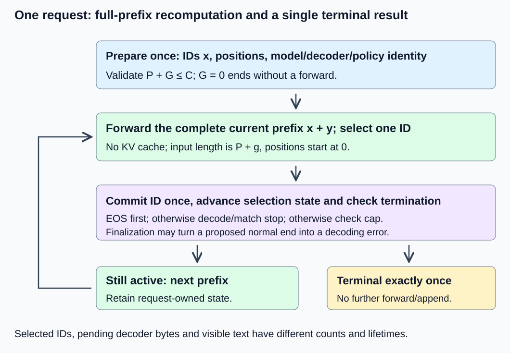
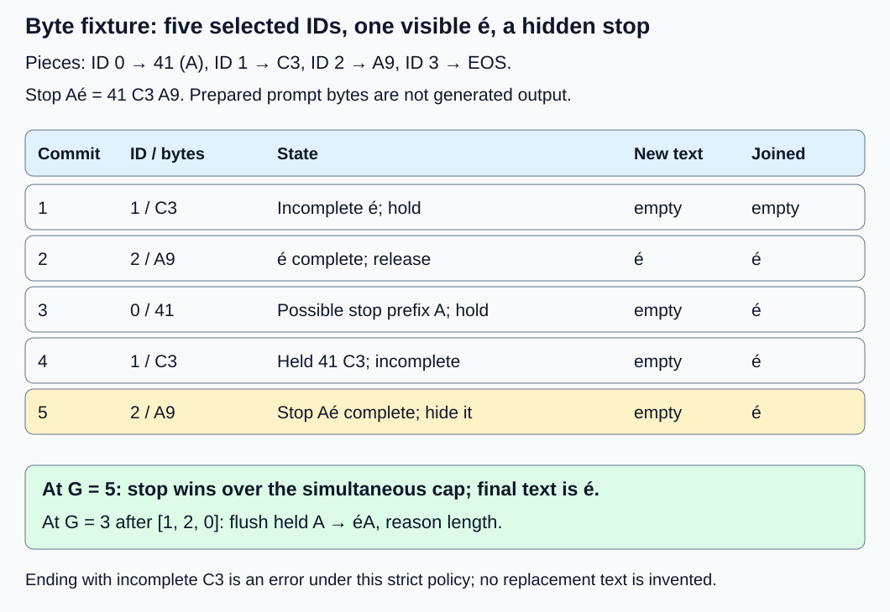

# M1-C16: Building the single-request generation loop

> **Status: Complete — detailed chapter authored and documentation validated; experimental procedures are proposed unless explicitly labelled observed**

**Module:** Understand exactly what happens when an LLM generates a token

**Category:** [Interfaces, protocols, and streaming](index.md)

[Module 1 reading order](../module-1.md) · [Previous: M1-C15](../model-computation-and-semantics/m1-c15-turning-logits-into-the-next-token.md) · [Next: M1-C17](../state-memory-and-caching/m1-c17-reusing-attention-state-with-a-kv-cache.md)

## Target concepts

Prompt preparation, repeated forward passes, appending tokens, end-of-sequence tokens, output limits, stop sequences, incremental detokenization, partial text handling.

## Concepts

### One selection becomes a request only when state advances

A forward pass produces scores; [M1-C15](../model-computation-and-semantics/m1-c15-turning-logits-into-the-next-token.md) chooses one token ID. A **generation loop** repeatedly presents the evolving prefix to the model, chooses an ID, appends it once, updates output state and decides whether the request has ended. It must preserve the association between the request, model, prepared tokens, selection policy and visible output.

This chapter specifies one request with full-prefix recomputation and **no KV cache**. Each forward recomputes all valid positions of that request. The completed M1-C17 chapter explains reusing attention state; this chapter retains its uncached reference contract. Rust is the eventual language context, but these are contracts and experimental procedures without implementation code.

Let prepared prompt IDs be x, with length P, and committed generated IDs be y, with length g. Before selection g + 1, the model input is **h = x concatenated with y**, of length **S = P + g**. Positions are 0 through S − 1; every row is valid. The last logit row predicts the token after that prefix. After selecting ID v, **y′ = y concatenated with [v]** and g′ = g + 1. The next forward consumes that new prefix if, and only if, the request is still active. Reusing the original prompt, appending twice or issuing a forward after termination violates this contract.

**Detokenization** converts generated IDs into text under the bound tokenizer/decoder rules. Its state is separate from the model prefix and random state. A selected token can add no visible text: it may be EOS, a partial UTF-8 sequence, or a possible prefix of a hidden stop string. Token count, byte count, character count and visible chunk count are different quantities.

*The loop feeds back only after committing one ID and checking termination. Model state, generated-ID history, decoder state and visible output retain one request identity.*

### Prepare the prompt once with explicit identities

For real text, bind model/configuration, weights, tokenizer vocabulary/normalizer, chat template, special-token rules and selection policy before preparation. A **chat template** formats message roles/content and any assistant-generation prefix into the sequence expected by a chat model. Tokenize that prepared representation once; record the actual IDs, positions and mask. Do not independently tokenize each message and assume concatenation reproduces the template.

The [Transformers v4.57.1 chat-template guide](https://huggingface.co/docs/transformers/v4.57.1/en/chat_templating) explains that templates can already include required special tokens. Adding another automatic BOS/EOS layer can duplicate them. BOS means beginning of sequence; EOS means end of sequence. Preserve the exact preparation contract from [M1-C02](m1-c02-representing-text-as-tokens.md), including whether an assistant prefix and special tokens are already present. Do not normalize, truncate or remove prompt text silently.

For a prepared-ID request, validate IDs directly and do not tokenize those integers as strings. An empty prefix is rejected in the fixtures here; a real model needing an initial BOS requires its explicitly configured preparation path. The prompt is retained as input history but is not echoed as generated output. Stops match generated output only, not text already present in the prompt or a boundary joining prompt text with new text.

Let C be the admitted total-ID capacity and G the requested maximum new-token count. This chapter uses the conservative policy **P ≥ 1, G ≥ 0, P + G ≤ C**. It reserves space for every allowed new ID, including a terminal EOS or hidden stop piece. This is an admission contract, not a theorem that the model could never predict one token beyond its last input position. Reject a larger reservation before the first forward; do not silently reduce G. G = 0 is admitted after normal validation and finishes with zero forwards and no generated IDs.

A cap on new tokens differs from a cap on total tokens. The [Transformers v4.57.1 generation specification](https://huggingface.co/docs/transformers/v4.57.1/en/main_classes/text_generation) distinguishes `max_new_tokens` from a length that includes the prompt. The chapter defines its own zero-cap and conservative-capacity behavior rather than assuming a library accepts every fixture parameter unchanged.

### Own the request state and its terminal reason

| State or event | Chapter contract |
|---|---|
| Immutable identity | One request, prepared prompt, model/weight version, tokenizer/decoder and selection/stop policy |
| Generated history | Committed IDs in order; each selected ID appended exactly once, including EOS and stop-triggering pieces |
| Counters | g counts selected new IDs, not visible characters; forward count equals successful selections in the no-error fixtures |
| Decoder/output | Pending bytes or unstable decoder suffix, stop-matcher state, emitted stable prefix and terminal status |
| Active work | A full-prefix forward, numerical validation, selection and commit; no second request or cache sharing |
| Normal terminal reasons | eos, stop, length; exactly one chosen reason and no later forward/append |
| Error | Admission rejection or a post-admission failure is recorded distinctly; a decoder/model failure is not a normal completion |

**EOS is an ID-level rule.** The configured EOS ID is recognized before rendering its display spelling; the literal text “<EOS>” is not automatically a control ID. Generated EOS counts against G and remains in the internal ID history, but has no user-visible payload in these fixtures. EOS in the prepared prompt does not itself terminate generation. Special-token stripping is not a license to discard arbitrary ordinary tokens.

After each successful selection/append, this chapter checks EOS first; otherwise it processes decoder bytes and any completed stop; otherwise it checks the new-token cap. Thus a stop completed by the last permitted token has reason stop, and an EOS on that token has reason eos. When a non-stop cap or EOS ends the request, validate decoder completion before flushing the held suffix; flush it only if valid. A malformed or incomplete final UTF-8 sequence is a strict decoding error, overriding a proposed normal reason; preserve only the already emitted valid text as partial/error output, without flushing an invalid pending suffix. No replacement character is invented under this strict policy.

Commit the ID and its sampling-state advancement coherently before progressing. If a committed token later causes a decoding error, keep that ID/count in the audit; do not resample it silently. A failed forward produces no selected ID. A retry, cancellation or client disconnect needs an explicit later lifecycle policy, not a second normal-completion event. This chapter describes state ownership and partial/error results; it does not implement a network service.

### A complete model trace with three forwards

**Fixture M** uses the exact M1-C14 mathematical model: C = 4, prepared prompt [1], greedy selection with lowest-ID ties and G = 3. For this loop exercise, configure ID 3 as EOS and a constructed display table 0 → “a”, 1 → “b”, 2 → “c”; EOS has no visible bytes. These display labels and the termination policy are teaching additions, not a trained tokenizer or evidence of language quality. The model's weights and valid input IDs are unchanged. No stop string is enabled in the first trace.

| Selection | Prefix supplied to full forward | S | Last logits, rounded to six decimals | Selected ID | Generated IDs after commit |
|---|---|---|---|---|---|
| 1 | [1] | 1 | [1.231147, 1.230632, 2.461779, −0.000514] | 2 | [2] |
| 2 | [1, 2] | 2 | [2.451513, 0.642534, 3.094047, −1.808979] | 2 | [2, 2] |
| 3 | [1, 2, 2] | 3 | [2.127601, 0.877838, 3.005439, −1.249764] | 2 | [2, 2, 2] |

The result is visible “ccc”, reason length, three forwards and three selected IDs. The final stored prefix [1, 2, 2, 2] has length four but is not forwarded again. If the same request instead enables hidden stop “cc”, selection 2 completes it: generated IDs are [2, 2], visible text is empty, reason stop, and selection 3 never happens. Holding the first “c” prevents leaking a delimiter prefix that would later have to be retracted.

If G = 0, output is empty with reason length and no forward. For P = 1, G = 4, C = 4, admission fails before model work. If a particular model never chooses EOS, the new-token cap still guarantees this admitted request cannot select indefinitely.

### Incremental text needs stable prefixes and byte correctness

UTF-8 represents Unicode scalar values with one to four bytes. One token piece can end inside such a sequence. For example é, U+00E9, is C3 A9 in hexadecimal: C3 alone is incomplete, while A9 alone is an invalid continuation at the start of a new string. [RFC 3629](https://www.rfc-editor.org/info/rfc3629/) specifies permitted encodings. The [Rust Utf8Error documentation](https://doc.rust-lang.org/std/str/struct.Utf8Error.html) distinguishes a valid prefix from an incomplete or invalid suffix; record actual decoder/toolchain behavior rather than treating every partial piece as corrupt text.

Decoding each ID independently and concatenating display strings can introduce replacement characters or lose context. Some real detokenizers also apply whitespace or cleanup rules that depend on neighboring pieces. The [SentencePiece paper](https://aclanthology.org/D18-2012/) is primary background for tokenizer/detokenizer artifacts; it does not make arbitrary token-by-token decoding equivalent to full-sequence decoding. Freeze the actual decoder's semantics.

An **append-only visible stream** commits text that future tokens cannot revise. Emit only a stable, complete UTF-8 prefix; hold an incomplete code point and any suffix whose decoder interpretation is still unsettled. A byte-append decoder can be checked directly as below. A general tokenizer that revises already decoded text needs a documented stable-prefix interface, additional buffering, or a final-only response. Do not assume that slicing the difference between two whole-prefix decoded strings always produces a valid append-only stream.

For every chunk, joined emitted text must remain a prefix of the final visible result under the same stop/error policy. A chunk boundary is not a token boundary or a character boundary by definition; this chapter emits only complete valid UTF-8 text chunks. An empty decoder update is normal and must not be reported as an empty generated token or a completed request.

### Stop strings can cross tokens, code points and output chunks

A **stop string** here is a nonempty valid UTF-8 string matched exactly, without case folding or Unicode normalization, in generated decoder bytes. A stop-token-ID list would be a different contract. Matching only the last token or only the latest visible chunk misses cross-boundary strings. Checking after emitting the whole chunk can leak a delimiter that cannot be retracted.

For multiple stops, the first completed match by byte-end position wins. Ties use earliest start, then configured list order. This rule is applied as bytes become available, independent of how transport chunks are grouped. With stops “ab” and “abc”, “ab” wins as soon as it completes; do not wait for the longer possibility. With a piece containing “ok<END>tail” and stop “<END>”, visible output is “ok”; the delimiter and later bytes from that piece are hidden, although its selected ID remains committed. Validate/match only through the terminating match; discarded post-stop bytes are not further output.

Before a match, withhold the longest generated suffix that is a **proper prefix** of any stop. A proper prefix is shorter than the full string. Text before that suffix can be released only when it also ends at a valid stable decoder boundary. When the request ends by a cap or EOS without a completed stop, release a valid held prefix because it is ordinary unfinished text, then check decoder completion. A partial stop is not a completed stop.

For a byte-append decoder with longest stop length M bytes, stop-prefix lookbehind requires at most M − 1 bytes; avoiding a cut inside one UTF-8 scalar may hold up to three more. Other tokenizer state, IDs and output buffers are separate memory. This bound is specific to the byte-append/stable-prefix contract, not a universal bound on arbitrary tokenizer cleanup or a network output queue.

**Fixture B** isolates decoding/stopping with scripted selections; it does not claim M1-C14 produces these IDs. Use prepared [0], C = 8, G = 5, EOS ID 3, and byte pieces 0 → 41 (“A”), 1 → C3, 2 → A9, 3 → no visible bytes. Script [1, 2, 0, 1, 2]; a conceptual score oracle gives the scripted ID score 1 and the other IDs score 0 at each selection, so greedy is unambiguous. Stop is the three-byte string “Aé”.

| Commit | New ID/piece | Decoder and stop state | Newly emitted text | Joined visible text |
|---|---|---|---|---|
| 1 | 1 / C3 | Incomplete é; wait | Empty | Empty |
| 2 | 2 / A9 | é complete; not a stop prefix | é | é |
| 3 | 0 / 41 | “A” is a possible stop prefix; hold | Empty | é |
| 4 | 1 / C3 | Held 41 C3 is an incomplete stop/code point | Empty | é |
| 5 | 2 / A9 | 41 C3 A9 completes “Aé”; hide it and stop | Empty | é |

Five selected IDs produce visible “é”, reason stop, even though the last selection also reaches G. If the script ends at [1, 2, 0] with G = 3, no full stop exists: flush the held A and return “éA”, reason length. [1, 2, 3] returns “é”, reason eos. [3] returns empty text, reason eos. [1] at cap, or [1, 3] at EOS, ends with incomplete C3 and returns a decoding error instead of a successful normal result.

*The byte fixture is a loop/decoder oracle, separate from the model trace. The first two IDs form é; the later three IDs form a hidden multi-token stop.*

The [Transformers v4.57.1 stop-criterion source](https://raw.githubusercontent.com/huggingface/transformers/v4.57.1/src/transformers/generation/stopping_criteria.py) describes matches overlapping token pieces, including a piece that extends past a delimiter. Detecting a stop and excluding it from an append-only visible stream are separate responsibilities. This chapter's first-match, stripping, strict-decoding and precedence policies are explicit; no library compatibility is inferred from a similarly named option.

### Work and timing grow with the evolving prefix

If a request actually commits g new IDs without earlier error, full-prefix forwards process lengths P through P + g − 1. Therefore **ΣS = gP + g(g − 1)/2** and **ΣS² = gP² + Pg(g − 1) + g(g − 1)(2g − 1)/6**. These sums explain repeated computation before KV caching is introduced.

M1-C14's two-block, last-row-head matrix-work convention is 112S + 16S² + 16 per forward, excluding nonmatrix arithmetic and data movement. Fixture M has P = 1, g = 3, ΣS = 6 and ΣS² = 14, giving **112 × 6 + 16 × 14 + 16 × 3 = 944 counted operations**. Computing all head rows gives 992 under its corresponding convention. These counts are arithmetic predictions, not runtimes, and hidden decoder output does not erase already performed model work.

The logical prefix has P + g IDs; at four bytes per stored ID its payload is 4(P + g) bytes, 16 bytes in fixture M. Actual Rust container capacity, duplicated histories, model activations, random/decoder state and visible buffers cost more. Do not count a generated-history view twice or call payload a process-memory measurement.

Timestamp preparation, first selected ID, first nonempty visible text and terminal completion separately. Stop-prefix withholding and partial code points can delay first visible text after token selection. If the request returns no visible text, first-visible latency is undefined, not zero; completion latency still exists. A network delivery timestamp and slow-client behavior belong to later serving chapters. Apply [M9-C07](../measurement-experimentation-and-economics/m9-c07-latency-distributions-and-statistical-uncertainty.md) to counts/outcomes and uncertainty rather than treating every emitted chunk as an independent request.

## Experiments

All runtime procedures are proposed. Fixture M is a mathematical model reference; fixture B is a scripted loop/byte oracle. Neither establishes pretrained language quality, a tokenizer artifact, a deployed stream or measured latency. Use an existing numerical/model environment if available; no implementation code is supplied.

### E1 — Trace a complete uncached generation request

**Description:** Follow preparation, evolving prefixes, full forwards, selection and one-time termination through fixture M.

**Purpose/objective:** Establish the generation-loop state contract before adding cache reuse or optimizing output handling.

**Target concepts:** Prompt preparation, repeated forward passes, appending tokens and output limits.

**Baseline and workload:** M1-C14 weights/configuration, prepared [1], greedy, EOS 3, no stop, C = 4 and G = 3; then G = 0 and rejected G = 4. The synthetic display table is fixture M's a/b/c mapping, not fixture B's bytes.

**Controls and prediction:** FP64 reference, exact IDs/positions, one request, no KV cache or random draws. Predict prefixes/last rows in the worked trace, output “ccc”, three forwards and reason length. With stop “cc”, predict two committed IDs, no visible text and reason stop. A deliberately frozen-prompt variant may return the same IDs but must fail prefix/logit checks.

**Procedure:** Preserve the actual prepared IDs and all identity/configuration fields. At each selection record prefix length/IDs, position range, last logit row, selected ID, committed count and status. Compare against independent high-precision references before timing. Repeat with the cap/stop cases, an out-of-range prompt ID, empty prefix and a conflicting tokenizer/template identity. In a real tokenizer environment, separately compare the frozen template/preparation artifact and detect duplicated special tokens; no new tokenizer run is claimed here.

**Hardware/software:** One FP64-capable CPU thread with a numerical reference environment; record model/backend and any actual tokenizer version/artifact.

**Failure and HFT connection:** A plausible final decision can hide stale input history. Preserve state-version and event order, as in a critical event-processing path, and reject a wrong prefix even when final text matches.

**Exit criteria:** V1 validates the complete prefix/logit/ID trace, no extra forward after termination, cap/admission outcomes and the frozen-prefix counterexample. Input mismatches do not become successful empty responses.

### E2 — Withhold partial Unicode and multi-token stops

**Description:** Exercise fixture B's decoder state, exact stops and append-only text, independently of model computation.

**Purpose/objective:** Prevent premature replacement characters, leaked delimiters and chunk-dependent stopping.

**Target concepts:** Stop sequences, incremental detokenization and partial text handling.

**Baseline and workload:** Fixture B script [1, 2, 0, 1, 2], stop “Aé”, C = 8, G = 5. Compare shorter script [1, 2, 0] at G = 3. A separate decoder-input fixture uses byte text “ok<END>tail”, stop “<END>”, partitioned into arbitrary transport chunks. Those chunks do not represent additional selected tokens.

**Controls and prediction:** Strict UTF-8, generated-only exact-byte matching, earliest-completed-match policy and hidden delimiter. Predict visible “é” with reason stop for the full script, “éA” with length for the shorter one, and visible “ok” for every valid partition of the separate decoder input. Stop completion at the cap outranks length.

**Procedure:** Record selected IDs, raw byte payloads, pending suffix and emitted stable text after every commit. Verify the table and compare joined chunks with an independent full-byte reference truncated at the first completed stop. Test all 16 chunk partitions of C3 A9 41 C3 A9 and all 1,024 partitions of “ok<END>tail”. Also test overlapping stops “ab”/“abc” and tied-end stops “b”/“ab”, retaining the specified first-match identity. Do not compare fixture B's scripted outputs with a model's logits as if they were the same experiment.

**Hardware/software:** CPU reference/data-audit environment, strict UTF-8 validator and fixed decoder settings. No inference runtime or network transport is required for the mathematical fixture.

**Failure and HFT connection:** Once a visible byte is committed, a later event cannot silently retract it. Hold unsettled state and delimiters until safe, mirroring ownership and ordered publication in latency-sensitive systems. This does not specify an exchange protocol.

**Exit criteria:** V2 confirms every emitted chunk is valid UTF-8, chunks join to the specified final text, complete/partial stops have different outcomes, and grouping bytes changes neither result nor selected-token accounting.

### E3 — Verify EOS, caps and strict finalization

**Description:** Compare normal terminal reasons with no-token/partial-text failures and simultaneous conditions.

**Purpose/objective:** Make stopping a single observable state transition rather than a collection of loosely ordered checks.

**Target concepts:** End-of-sequence tokens, output limits, stop sequences, appending and partial text handling.

**Baseline and workload:** Fixture B: [3] for immediate EOS; [1, 2, 3] for é then EOS; [1, 2, 0] at cap; [1] at cap and [1, 3] for incomplete UTF-8 finalization; [2] for an invalid leading continuation byte. Include validated G = 0 and a prepared prompt containing EOS with a non-EOS next scripted selection.

**Controls and prediction:** Count committed EOS/hidden pieces against G, suppress EOS bytes, and use EOS → completed stop → length precedence after selection, with strict finalization errors overriding proposed normal success. Predict the terminal outcomes described above; prompt EOS alone is not a generated EOS event.

**Procedure:** Record forward/selection/append counts, generated history, emitted text and exactly one terminal event. Check no state advances after that event. Separate admission rejection, failed forward and decoder failure after a committed ID. Preserve valid partial text as error output and count the triggering committed ID; do not substitute another token or emit an invented replacement character. For a later sampled extension, check selection-state advancement under the frozen M1-C15 contract; do not claim cancellation/retry recovery unless actually exercised.

**Hardware/software:** Same CPU/script reference environment; record EOS ID and decoder/terminal policy. No service lifecycle implementation is supplied.

**Failure and HFT connection:** A termination reason is part of the result's semantics. An error is not a fast normal completion, and a retry cannot erase a committed decision or mutate another request's state.

**Exit criteria:** V3 reconciles all IDs/counts/reasons, exact EOS exclusion, partial-error output and the absence of any post-terminal forward or publication. No-token output retains a real terminal reason rather than a fabricated zero first-visible latency.

### E4 — Compare incremental decoding at the complete-request boundary

**Description:** Compare a whole-generated-prefix decoding reference with a stateful incremental decoder under the same text/stop policy.

**Purpose/objective:** Test whether less repeated output work improves completed useful results without changing IDs, termination or visible text.

**Target concepts:** Repeated forwards, incremental detokenization, stop/partial-text state and output limits.

**Baseline and workload:** First use fixture M's full prepared request with G = 3 and no stop. Separately use a codec-only workload of 1,024 ordered byte pieces “ab”, no stop, finished at a declared piece cap; this is not a longer M1-C14 model request. Baseline re-evaluates the entire accumulated generated byte prefix at each update, allowing an incomplete suffix until finalization; candidate retains decoder/matcher state and processes new bytes only. Both follow the same stable emission policy and sink behavior.

**Controls and prediction:** Exact prepared/model/selection identity for M, identical byte pieces for the codec fixture, one CPU thread, same finalization and required output materialization. Predict equivalent checkpoint-visible prefixes, final output and terminal reasons; predict less repeated byte processing for the longer codec case. The tiny model case may show no improvement or additional state-management cost.

**Procedure:** Pass E1–E3 correctness gates first. In three sessions per case, warm each path five times then collect 30 paired timings, alternating order. Codec boundary is ordered pieces ready through materialized final text and terminal status; model boundary is prepared IDs/admitted weights ready through final visible text and terminal status. Include required decode/stop/UTF-8 work, copying/allocation and sink handling in both paths. Exclude reference arithmetic, diagnostics and network I/O equally. Preserve separate phase and profile runs for forward, selection, decoder/matcher, allocation and emission work.

**Hardware/software:** One CPU thread with recorded runtime/compiler/backend, decoder version, clock resolution and allocation/sink policy. If no actual runtime/decoder exists, leave timings unperformed rather than timing the reference arithmetic as inference.

**Failure and HFT connection:** A locally faster decoder is useful only through its effect on a correct completed request. More buffering may delay first visible output even if completion improves; report both. A no-network single-request exercise cannot establish client backpressure, overload or p99 service behavior.

**Exit criteria:** V4 reports exact output/state equivalence, phase boundaries, 90 paired observations per case if completed, all failures and any regressions. Distinguish codec-only improvement from model-request improvement; no speedup is presumed.

## Verification

### V1 — Validate preparation, prefixes and every forward

Use M1-C14's exact parameter/configuration equations and an independent 80/120-digit reference. Compare the three last logit rows in the worked trace—12 coordinates—under M9-C17/M1-C14's original numerical budgets. Verify all six input positions processed over the three forwards and exact prefix lengths 1, 2, 3. The last committed prefix length four is not another forward. Positions are never reset to zero for only the latest token in this uncached path.

The frozen-prompt variant uses [1] again at selections 2 and 3. It still chooses ID 2, but its later logits remain the first row and fail the correct model trace. This makes final-ID-only or final-text-only comparison insufficient. Check prompt/model/tokenizer/decoder identity before attributing such a mismatch to floating-point error.

Reconcile P = 1, G = 3, C = 4; zero cap produces zero forwards/IDs; the G = 4 reservation is rejected. Empty/out-of-range or mismatched preparation is rejected rather than silently altered. Preparation with a real chat template must have a frozen expected ID artifact and exactly the prescribed special-token layer. A toy display table is not evidence that any pretrained tokenizer was run.

### V2 — Validate chunk stability and the stop reference

For fixture B, concatenated pre-stop generated bytes are C3 A9 41 C3 A9. The first C3 A9 gives é; the last 41 C3 A9 is the hidden stop “Aé”. The emitted result has two bytes and one Unicode scalar value, while generated history has five IDs. Maximum withheld bytes in this specific trace are two, within the conservative byte-append bound M − 1 + 3 = 5 for M = 3. That bound excludes other tokenizer/container/output state.

The independent byte reference finds the first completed stop by end position, applies tie rules, discards the delimiter and later bytes, and validates the retained prefix under strict UTF-8. With no completed stop it validates/flushes the whole output at termination. Use it alongside per-update stable-prefix checks, not only final equality. Malformed bytes before a stopping boundary are errors; bytes discarded after the terminating match are not published or further interpreted.

Check 2⁴ = 16 partitions of the five-byte fixture and 2¹⁰ = 1,024 partitions of the eleven-byte “ok<END>tail” fixture. These are exhaustive chunk-boundary tests for these inputs, not proof for every tokenizer/stop set. Verify no prompt byte is matched as generated output, no delimiter leaks, and a stop inside one decoder piece suppresses that piece's trailing output without deleting its committed token ID.

### V3 — Validate terminal precedence and outcome accounting

| Fixture B committed IDs / condition | Final visible text | Terminal result |
|---|---|---|
| [3] | Empty | eos; one selected ID, no EOS text |
| [1, 2, 3] | é | eos; three selected IDs |
| [1, 2, 0], G = 3 | éA | length; incomplete stop prefix flushed |
| [1, 2, 0, 1, 2], G = 5 | é | stop; outranks simultaneous length |
| [1], G = 1 | Empty | error; incomplete UTF-8, one committed ID |
| [1, 3] | Empty | error on finalization; not successful eos |
| [2] | Empty | error; invalid UTF-8 continuation |
| Validated G = 0 | Empty | length; no forwards or selected IDs |

The [RFC 3629](https://www.rfc-editor.org/info/rfc3629/) byte rules are the reference for incomplete versus invalid sequences; no lossy replacement is permitted in this strict fixture. Check same-step EOS/cap with G = 1 and script [3]: reason eos wins. For multiple stops, verify “ab” wins before “abc”, and “ab” wins a shared end with “b” by earliest start. Never run another selection merely to discover that the previous one was terminal.

Record admitted/completed/error/rejected attempts, terminal reason, forward count, committed generated count, full internal history and visible/held bytes. A first-visible timestamp exists only if some nonempty visible text was emitted. Prefix-preserving error output remains explicitly partial and does not enter successful completion metrics. Retain these outcomes under the M9-C07 population rules.

### V4 — Verify work, equivalence and timing evidence

For fixture M confirm ΣS = 6, ΣS² = 14, matrix-work counts 944 for last-row head versus 992 for all-row head, and no extra model step after the cap. E4 keeps the same head strategy in both paths; this arithmetic explains model work rather than introducing another benchmark change. The logical stored-ID payload is 16 bytes at the end under the four-byte-ID assumption, excluding all other memory and capacity.

For the codec-only case, 1,024 pieces of two bytes produce 2,048 bytes of final text. Re-evaluating all accumulated prefixes presents **2 × (1 + … + 1,024) = 1,049,600 bytes** to the baseline decoder, versus 2,048 newly supplied bytes to an incremental pass. These are input-byte counts under the declared comparison, not actual total memory traffic or a promised speedup. Final output assembly and sink copying still cost work and must be included equally.

Compare generated IDs, selected logits where applicable, terminal reason/counts and checkpoint-visible prefixes before timing. A correct final string with leaked/retracted earlier text is a failure. Conversely, empty updates are allowed and do not imply lost IDs. Preserve request-local decoder/matcher/RNG state; a state reset or cross-request reuse is a separate failure case requiring its own extension.

If executed, report three session medians/ranges and paired baseline-minus-candidate differences, with 90 successful pairs per case only if every planned trial completes. Count failed/incomplete pair members separately. Record preparation versus prepared-request timing, first selection, first nonempty visible emission where defined, and final completion. Calibrate clocks/empty brackets and separately quantify profile/trace overhead; tiny cases near timer cost may be inconclusive. No production percentile or capacity claim follows from three isolated sessions.

## Engineering dimensions and principles

| Dimension | Chapter-specific application |
|---|---|
| Semantics and invariants | Exact preparation, prefix/position progression, one append per selection, generated-only stops and one terminal reason are checked before timing. |
| Workload and variability | Prompt length, actual output count, byte-piece boundaries, stop overlaps and zero-visible cases change work and emission behavior. |
| Resources and bottlenecks | Full-prefix recomputation grows with ΣS/ΣS²; output rescans, lookbehind, histories, allocation and sink copies add distinct costs. |
| Time and distributions | First selected ID, first visible text and completion differ; E4 reports phase boundaries and M9-C07 outcome populations. |
| Ownership and coordination | One request owns prompt/generated history, decoder/matcher and random state through commitment and finalization; visible prefixes cannot be revised silently. |
| Failure and adaptation | Reject invalid preparation/reservations, preserve partial/error output, finalize UTF-8 strictly and never resample or continue after terminal state without a new policy. |

| Practical principle | How the reader applies it |
|---|---|
| 1. Correctness defines the optimization boundary | Decoder paths must preserve IDs, terminal reasons and stable visible prefixes, not only final text. |
| 2. Performance depends on workload and operating point | Separate tiny model requests from longer codec-only work and stop/partial-byte cases. |
| 3. Data movement is part of the algorithm | Account for repeated full-prefix reads, decoder rescans, pending buffers and output materialization. |
| 4. State has ownership, lifetime and recovery cost | Retain committed IDs and request-owned decoder/RNG state; a partial failure is not a fresh request. |
| 5. Dependencies determine latency; bottlenecks determine capacity | Each new prefix depends on the previous selection; faster detokenization may leave model computation dominant. |
| 6. Variability and synchronization shape the tail | Stop withholding and incomplete code points change visible timing; later network/backpressure mechanisms require separate evidence. |
| 7. Local improvements must be evaluated end to end | E4 reports codec and complete prepared-request results separately, including finalization and required sink work. |
| 8. Claims require reproducible evidence | Preserve manifests, prefix/logit traces, exact byte references, terminal ledgers, chunk partitions and all measurement outcomes. |

HFT means High-Frequency Trading, whose systems process market events under tight timing constraints. Relevant parallels are ordered state transitions, coherent identity, bounded pending state and distinguishing a completed decision from its published output. Token selection and text stopping are not exchange semantics; this chapter specifies no trading strategy, profitability or production trading latency.

## Specifications, articles, and hardware

| Primary source | Relevant scope and limit |
|---|---|
| [Transformers v4.57.1 generation specification](https://huggingface.co/docs/transformers/v4.57.1/en/main_classes/text_generation) | Output-length and EOS/stop configuration context; the chapter's admission, zero-cap, stripping and precedence contract is explicit. |
| [Transformers v4.57.1 chat templates](https://huggingface.co/docs/transformers/v4.57.1/en/chat_templating) | Prepared conversation/control-token behavior and duplication hazards; bind actual model/tokenizer artifacts. |
| [Transformers v4.57.1 stop criteria](https://raw.githubusercontent.com/huggingface/transformers/v4.57.1/src/transformers/generation/stopping_criteria.py) | Token-overlap detection background, including pieces extending beyond a stop. Not a guarantee of append-only delimiter stripping. |
| [RFC 3629](https://www.rfc-editor.org/info/rfc3629/) and [Rust Utf8Error](https://doc.rust-lang.org/std/str/struct.Utf8Error.html) | UTF-8 validity and incomplete-prefix diagnosis. Consulted Rust documentation identifies std 1.99.1; record actual decoder/toolchain behavior. |
| [Kudo and Richardson, SentencePiece (2018)](https://aclanthology.org/D18-2012/) | Primary tokenizer/detokenizer background. It is not the byte fixture's artifact or evidence of arbitrary tokenwise concatenation equivalence. |

Proposed requirements are a CPU supporting FP64, one execution thread and at least 1 GiB free RAM for the numerical/reference environment and evidence. These are exercise requirements, not observed hardware or production sizing. Record CPU model, cores/sockets, cache/RAM, NUMA placement (memory proximity to processors), affinity, power/frequency policy, OS, compiler/runtime/backend, clock resolution, decoder/settings, buffer/allocation and sink policy. No accelerator, NIC or interconnect is required. Fixture M uses the fixed M1-C14 mathematical model and a constructed display table; fixture B and the codec workload are explicitly scripted, not model inference. No serialized weights/tokenizer or serving implementation is supplied.

Completed support is [M9-C01](../numerics-and-correctness/m9-c01-defining-reference-behavior-and-evidence-before-optimizing.md) for contracts/evidence, [M9-C17](../numerics-and-correctness/m9-c17-comparing-logits-with-justified-numerical-tolerances.md) for logit comparisons and [M9-C07](../measurement-experimentation-and-economics/m9-c07-latency-distributions-and-statistical-uncertainty.md) for timing populations/uncertainty. [M9-C02](../measurement-experimentation-and-economics/m9-c02-request-events-clocks-and-measurement-boundaries.md), [M9-C18](../numerics-and-correctness/m9-c18-testing-sampling-distributions-and-random-state-behavior.md) remain outlines; [M9-C19](m9-c19-validating-tokenization-stopping-and-final-output.md) is now complete; the elementary checks needed here are stated locally. Its authoring successor M9-C19 is now complete (consult the execution plan for current progress); the next Module 1 reading chapter is M1-C17.

## Key takeaways

Prepare once, advance the full prefix once per selected ID, and stop exactly once under an explicit policy. Preserve EOS/stop-triggering IDs internally while keeping visible output valid and append-only. Partial tokens, partial stop strings and partial results are distinct states. Arithmetic/documentation QA does not execute a generation runtime, tokenizer, UTF-8 stream service or hardware benchmark; the experiments remain proposed.
