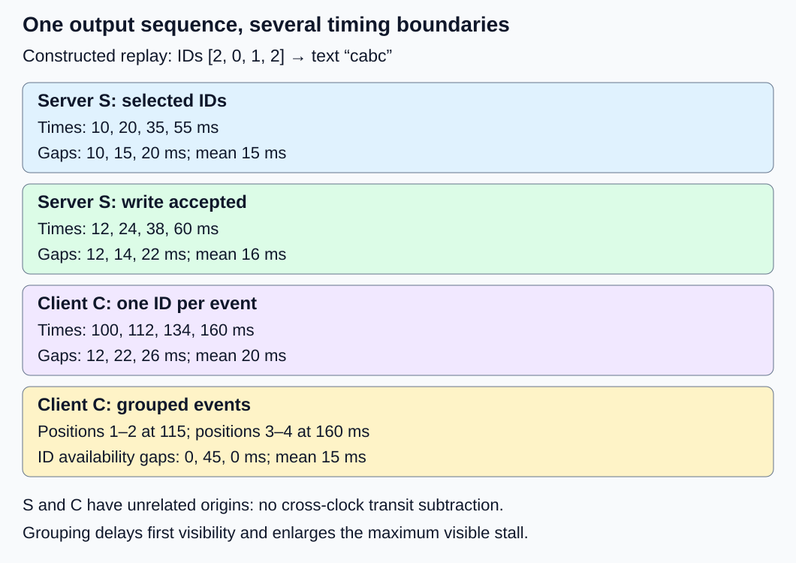
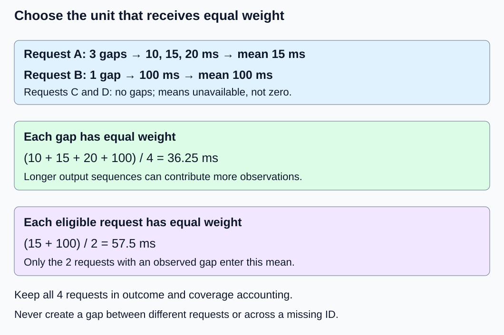

# M9-C04: Measuring inter-token latency in a streamed protocol

> **Status: Complete — detailed chapter authored and reviewed.**

**Module:** Make measurement and correctness part of the foundation

**Category:** [Interfaces, protocols, and streaming](index.md)

[Module 9 reading order](../module-9.md) · [Previous: M9-C03](../measurement-experimentation-and-economics/m9-c03-measuring-time-to-first-token-including-queueing.md) · [Next: M9-C05](../measurement-experimentation-and-economics/m9-c05-measuring-end-to-end-latency-and-throughput.md)

## Target concepts

Token generation versus delivery, token timestamps, chunk coalescing, buffering, network and client delays, per-request gaps, first-token exclusion, limits of inferring tokens from chunks.

## Concepts

### 1. Define which two events form a gap

A token is a model vocabulary ID. A content chunk is a piece of text exposed by a protocol. A transport read is a group of bytes obtained by a client. These are different units: one read may contain several events, one event may contain several tokens, and one token may not yet produce printable text. Begin with [the generation loop](m1-c16-building-the-single-request-generation-loop.md), [clock boundaries](../measurement-experimentation-and-economics/m9-c02-request-events-clocks-and-measurement-boundaries.md) and [first-token latency](../measurement-experimentation-and-economics/m9-c03-measuring-time-to-first-token-including-queueing.md).

For one request attempt, let n be the number of selected output IDs in a declared sequence. Let gᵢ be the monotonic server timestamp in milliseconds when output ID at position i becomes selected and available to the generation loop. Position i is not the vocabulary ID. With positions 1 through n:

**Generation gap dᵢ = gᵢ − gᵢ₋₁, for i = 2,…,n.**

There are n − 1 gaps when n ≥ 2. Arrival to g₁ is first-token latency and is excluded. A zero-ID or one-ID request has no inter-token gap: its mean is unavailable, not zero. Declare whether a selected end-of-sequence ID belongs to the sequence; visible text usually excludes it. Speculative draft IDs are not accepted output IDs. This chapter uses ordinary selected IDs without speculative decoding.

For a complete, contiguous sequence with the same timestamp boundary:

**Mean generation gap = (Σ dᵢ)/(n − 1) = (gₙ − g₁)/(n − 1).**

Σ means sum. This endpoint shortcut recovers the mean, not individual gaps or their distribution. Subtracting first-token latency from arrival-to-last-selected-ID latency gives the same numerator only when both durations share their arrival event, clock and final-token definition. A later terminal message is not the last selected token. The [NVIDIA benchmarking article](https://developer.nvidia.com/blog/llm-benchmarking-fundamental-concepts/) uses a normalized ITL definition and warns that tools differ. Record the precise tool version and boundary instead of assuming the label “ITL” establishes equivalence.

### 2. Follow one stream across boundaries

The following is a constructed replay, not a measured model execution or an extension of an earlier model fixture. Four ordinary IDs [2, 0, 1, 2] display as c, a, b, c, yielding “cabc”. Server clock S and client clock C have unrelated origins. Their timestamps can support differences within each clock, but C minus S does not establish network delay.

| Output position | Vocabulary ID / text | Selected on S (ms) | Write accepted on S (ms) | Parsed ID available on C (ms) |
|---|---|---:|---:|---:|
| 1 | 2 / c | 10 | 12 | 100 |
| 2 | 0 / a | 20 | 24 | 112 |
| 3 | 1 / b | 35 | 38 | 134 |
| 4 | 2 / c | 55 | 60 | 160 |

Here the client protocol explicitly carries one ID and its output position per event. Server arrival is S = 0 ms. Generation gaps are [10, 15, 20] ms, mean 15 ms. Write-acceptance gaps are [12, 14, 22] ms, mean 16 ms. Parsed-ID availability gaps are [12, 22, 26] ms, mean 20 ms. Each is a legitimate metric with a different boundary. “Write accepted” may mean queued in a software buffer; it does not prove that a packet left the host or that the client consumed it.

Generation TTFT is 10 ms. Dividing arrival-to-last selection by four gives 55/4 = 13.75 ms; that quantity mixes first-token work with later gaps and is not mean ITL. Nor does a 20 ms client mean minus a 15 ms generation mean isolate a network cost: server buffering, transport scheduling, parsing and client scheduling all intervene.

*Each row names its clock and event boundary. The grouped variant changes client visibility while preserving the scripted generation trace.*

### 3. Coalescing can hide stalls in an average

Coalescing means grouping several outputs before exposing them. In a second client replay, event one arrives at C = 115 ms with positions 1–2 and text “ca”; event two arrives at C = 160 ms with positions 3–4 and text “bc”. The content-event gap is 45 ms. Because this fixture carries explicit ID positions, chunk-observed ID availability is [115, 115, 160, 160] ms, with gaps [0, 45, 0] ms and mean 15 ms. These are availability timestamps, not reconstructed generation times.

That mean is lower than the earlier client mean of 20 ms, yet first visibility is 15 ms later and the largest visible stall increases from 26 to 45 ms. The last availability time stays 160 ms. Report first visibility, gap distribution, grouping and completion together. A zero availability gap means simultaneous observation at the recorded resolution; it does not prove zero model work.

If the protocol exposes only text, even the four per-ID availability timestamps are unsupported. Retokenizing each chunk independently can change segmentation; retokenizing the final text does not establish original output identity or selection times. UTF-8 decoding and stop-sequence handling may withhold text across multiple selected IDs. Preserve the [tokenization and stopping contract](m9-c19-validating-tokenization-stopping-and-final-output.md).

The [WHATWG event-stream specification](https://html.spec.whatwg.org/multipage/server-sent-events.html) defines UTF-8 text, line handling and blank-line event dispatch. Comments do not become content events, and incomplete event framing is not an output token. Buffering can delay dispatch. Those rules establish framing, not a token-to-event mapping. Network reads can split characters or combine events; time the declared parser boundary after correct reassembly.

Buffer residence, network congestion and delayed client reads can all increase delivery gaps. With bounded queues, a slow consumer may eventually stop the producer from progressing: backpressure can then change generation gaps too. Fixed generation in the replay isolates a hypothesis; it is not a claim that generation and delivery are always independent in a serving system.

### 4. State the population before aggregating

For each eligible request r, let kᵣ be its number of valid adjacent gaps and mᵣ its mean. Two questions produce different answers:

**Pooled gap mean = (Σ kᵣmᵣ)/(Σ kᵣ).** This weights each observed gap equally.

**Mean of request means = (Σ mᵣ)/R.** R is the number of requests with at least one eligible gap; each such request has equal weight.

| Request | Selected IDs | Generation gaps (ms) | Eligible gaps | Request mean (ms) |
|---|---:|---|---:|---:|
| A | 4 | 10, 15, 20 | 3 | 15 |
| B | 2 | 100 | 1 | 100 |
| C | 1 | None | 0 | Unavailable |
| D | 0 | None | 0 | Unavailable |

The pooled mean is 145/4 = 36.25 ms. The mean of eligible request means is 115/2 = 57.5 ms. Neither is wrong; they answer different questions. C and D remain in the request/outcome ledger without contributing zero-valued gaps. Never form a gap between the last output of one request and the first of another. Use [distribution and uncertainty guidance](../measurement-experimentation-and-economics/m9-c07-latency-distributions-and-statistical-uncertainty.md); four gaps cannot support a production p99 claim, and pooled percentiles cannot be reconstructed from request means.

*The same evidence yields different means because the unit receiving equal weight changes.*

### 5. Missing evidence is part of the result

A useful record identifies request, attempt, output sequence, output position, ID, event type, clock domain, timestamp unit and terminal outcome. Define duplicate identity and retain evidence of conflicts. Collection order can differ from producer order; reorder by identities where justified, rather than sorting timestamps to conceal inversions. For Rust-oriented instrumentation, name the monotonic clock contract and record its resolution and capture overhead before interpreting small gaps.

| Constructed trace variant | Defensible result | Invalid repair |
|---|---|---|
| A loses position 2; positions 1, 3, 4 remain | Only 3→4 is a known adjacent gap: 20 ms; report missing coverage | Calling 1→3 a single 25 ms ITL |
| A repeats the identical position-2 record | Deduplicate by declared event identity; original three gaps remain | Counting a new zero gap |
| Same identity has conflicting times | Flag conflict; exclude affected pairs under a declared policy | Silently selecting the convenient timestamp |
| Cancellation after positions 1 and 2 | One observed partial-request gap: 10 ms; cancelled outcome | A gap from position 2 to cancellation |
| One selected ID; heartbeats and terminal metadata follow | No inter-token gaps | Treating metadata as generated tokens |
| All four timestamps, terminal outcome absent | Three observed gaps; request completeness unresolved | Counting a completed successful request |

A negative same-clock adjacent difference is an instrumentation or identity problem to investigate, not a value to clamp to zero. Report expected and observed positions, valid adjacent pairs and excluded pairs by reason. Partial-request gaps can be useful, but label their population separately from completed-request gaps. The versioned [vLLM v0.25.0 per-request metrics](https://docs.vllm.ai/en/v0.25.0/features/per_request_metrics/) illustrate that single-token responses can have unavailable ITL and that per-request instrumentation can add CPU overhead; these are tool-specific contracts to inspect, not proof that every tool behaves alike.

## Experiments

These are proposed experiments, with constructed expected answers. No implementation, model runtime, network benchmark or measured improvement is supplied.

### E1 — Three boundaries, three gap sequences

**Description:** Reconcile selected-ID, write-acceptance and parsed-ID events in the four-ID replay.

**Purpose/objective:** Separate model cadence from server handoff and client observation.

**Target concepts:** Token timestamps, generation versus delivery, first-token exclusion and clock domains.

**Baseline and workload:** Use the complete table above, one request, four IDs, unrelated S/C origins and server arrival zero.

**Controls and prediction:** Keep identities, units and boundaries fixed. Predict means 15, 16 and 20 ms and three gaps at each boundary; arrival-based 13.75 ms must be rejected as mean ITL.

**Procedure:** Review the event ledger, form only adjacent-position differences within each boundary and reconcile endpoint and summed means. Explain why cross-clock subtraction cannot estimate transit time.

**Hardware/software:** A CPU workstation and a table/trace viewer suffice for the fixture. Record viewer version and clock assumptions; no GPU is required.

**Failure and HFT connection:** Inject a terminal event after the last ID. Like separating exchange event time from local market-data receipt, distinguish source and observation clocks; this analogy does not establish clock synchronization or trading-grade precision.

**Exit criteria:** Every gap and denominator matches its reference, terminal timing is excluded, and the report identifies both clock domains without claiming network latency.

### E2 — Grouped delivery and framing

**Description:** Compare one-ID events with two-ID coalesced events and text-only framing variants.

**Purpose/objective:** Detect a misleading average and demonstrate what a protocol cannot reveal.

**Target concepts:** Chunk coalescing, buffering, client parsing, token identity and visibility.

**Baseline and workload:** Baseline C times [100, 112, 134, 160]; grouped events at 115 and 160 ms with explicit position ranges. Final IDs and text remain [2, 0, 1, 2] and “cabc”.

**Controls and prediction:** Preserve the scripted S trace. Predict grouped availability mean 15 ms, maximum 45 ms and first visibility 15 ms later; text-only events permit a 45 ms content gap but no recovered per-ID gaps.

**Procedure:** Compare those boundaries; then consider read fragmentation inside a UTF-8 character, multiple events per read, comments, empty deltas and a missing event terminator. Check parser completeness against the specification. Separately examine stop-prefix withholding without equating hidden IDs with visible characters.

**Hardware/software:** CPU-only trace review; for a later protocol replay record server/client parser versions, flush policy, transport, buffer limits and whether proxies intervene.

**Failure and HFT connection:** A delayed flush resembles grouped market-data delivery hiding individual source events. Feed packets and text tokens have different semantics; packet counts cannot substitute for token counts.

**Exit criteria:** Final identity/text invariants hold for the timing variants; the report exposes the worse visible stall and refuses unsupported token attribution for plain text or partial framing.

### E3 — Aggregation and incomplete evidence

**Description:** Evaluate the four-request population and each fault variant independently.

**Purpose/objective:** Keep sample weighting, adjacency and outcome accounting honest.

**Target concepts:** Per-request gaps, variability, missing events, duplicates and partial outcomes.

**Baseline and workload:** A–D yield four total eligible gaps across two eligible requests. Apply the six fault rows as separate variants of A or the stated one-ID case, not extra members of the baseline population.

**Controls and prediction:** Freeze request/attempt identities and the exclusion policy. Predict pooled mean 36.25 ms, request-mean average 57.5 ms and one surviving adjacent gap after loss of A position 2.

**Procedure:** Reconcile counts, independently recompute both means, and classify duplicate, conflicting, reordered and cancelled records. Include a negative adjacent timestamp as a diagnostic case. Retain no-gap requests and unresolved outcomes in coverage reporting.

**Hardware/software:** CPU workstation; record analysis-tool version, identity schema and quantile convention if exploratory quantiles are shown.

**Failure and HFT connection:** A sequence-number gap in a market-data feed invalidates assumed adjacency. Recovery and feed semantics differ, but both domains require explicit coverage before a timing claim.

**Exit criteria:** Arithmetic and fault classifications match the tables; no cross-request gap, fabricated zero, hidden conflict or completed-success assumption survives review.

### E4 — Buffering comparison with a reproducible benchmark contract

**Description:** Plan a controlled immediate-versus-grouped delivery replay, then specify the evidence needed for a live-service extension.

**Purpose/objective:** Evaluate full-stream usefulness and instrumentation cost rather than optimizing a single reported mean.

**Target concepts:** Workload dependence, buffering resources, tails, backpressure and end-to-end verification.

**Baseline and workload:** Use the four-ID scripted trace in two modes. Propose three independent sessions, five warmup replays per mode per session, followed by 30 randomized paired trials per session: 30 warmups and 90 timed pairs, or 180 timed replays.

**Controls and prediction:** Freeze payload, parser, machine, buffer limits and generation trace; counterbalance pair order. Predict the logical visibility tradeoff from E2, not faster physical execution. Host processing cost and observed jitter remain unknown until measured.

**Procedure:** Verify every final ID/text/outcome, then record first visibility, content gaps, ID-availability gaps when supported, final content and terminal time separately. Time host replay processing from ready input records through parsed final content and terminal processing. Keep prescribed logical timestamps separate from host elapsed time. Compare instrumentation enabled/disabled with identical output checks. A later live-service extension must fix model/tokenizer revisions, stopping policy, arrival schedule and load, and test bounded buffers with slow readers and cancellation.

**Hardware/software:** Record CPU model, core count, affinity, RAM, OS/kernel, power policy, clock source/resolution, parser/runtime and profiler versions. For a network extension add NIC/link speed, topology, proxy/TLS settings and socket/buffer policies; for live inference add GPU model/count, VRAM, driver, precision and interconnect. No minimum GPU purchase or performance guarantee follows from a CPU replay.

**Failure and HFT connection:** Profile buffer occupancy, producer blocking, CPU scheduling, allocations and parser work; correlate stalls using request identities. HFT similarly evaluates source-to-consumer delay and overload recovery, but this experiment establishes no exchange connectivity or deadline guarantee.

**Exit criteria:** Every timed trial has correctness and outcome evidence; warmups are excluded, both modes have 90 timed replays, and uncertainty and overhead are reported. Any live-service claim includes throughput, failure counts and complete-request latency alongside gaps. A speed claim remains unaccepted without measurements.

## Verification

| Check | Required evidence and acceptance |
|---|---|
| V1 ↔ E1 | Independently subtract every timestamp: generation [10,15,20], writes [12,14,22], client [12,22,26] ms. Endpoint means agree; first-token and terminal events do not enter gap counts. Cross-domain transit remains unknown. |
| V2 ↔ E2 | Grouped per-ID availability [115,115,160,160] gives [0,45,0] ms only with explicit mapping. “ca” + “bc” = “cabc”; same IDs, later first visibility and worse maximum stall are preserved. Framing faults and text-only attribution are diagnosed. |
| V3 ↔ E3 | Baseline has four requests, two eligible requests and four gaps. Verify 36.25 versus 57.5 ms, missing-position adjacency, deduplication, conflicts, cancellation and unresolved completion. Retain excluded-pair counts and reasons. |
| V4 ↔ E4 | Trial inventory has 90 pairs/180 timed replays, 720 selected-ID observations and 540 generation gaps if every replay is complete. Separate immediate mode’s 270 content gaps from grouped mode’s 90; do not pool their incompatible observations into a mode comparison. Check warmups, pairing, overhead and correctness before interpreting host timing. |

In an executed benchmark, publish raw event definitions, workload records, hardware/software manifest, outcome totals, per-request samples and analysis conventions. Report confidence intervals across independent sessions where defensible; do not treat every correlated token gap as an independent request. A profiler can suggest a mechanism, but a changed buffering policy must be remeasured without heavy profiling. Reject a latency improvement that drops content, shifts the boundary, excludes stalled requests or changes the workload silently. Documentation checks validate these constructed references; runtime measurements remain future work.

## Engineering dimensions and principles

| Dimension | Application in this chapter |
|---|---|
| Semantics and invariants | Preserve selected-ID identity, output order, text and terminal semantics; name each timestamp boundary. |
| Workload and variability | Vary output length, arrival bursts, slow readers and grouping; one-ID requests have no ITL population. |
| Resources and bottlenecks | Track buffer memory, copies, parser CPU and blocked producers; network bandwidth alone cannot explain cadence. |
| Time and distributions | Separate TTFT, adjacent generation gaps, visible stalls and completion; retain request weighting and uncertainty. |
| Ownership and coordination | Identify who owns buffered IDs/bytes, who can flush them and when cancellation permits reclamation. |
| Failure and adaptation | Treat dropped observations, stale attempts, framing truncation and backpressure explicitly rather than repairing the metric silently. |

1. **Correctness defines the optimization boundary.** Grouping may change timing while preserving final content, but it cannot discard IDs or weaken stopping semantics unnoticed.
2. **Performance depends on workload and operating point.** Short outputs and slow readers change both available gaps and the benefit of buffering.
3. **Data movement is part of the algorithm.** Serialization, copying and transport can dominate client delivery after selection completes.
4. **State has ownership, lifetime and recovery cost.** A buffer needs a bounded owner, cancellation rule and recovery policy for partial output.
5. **Dependencies determine latency; bottlenecks determine capacity.** Parsing depends on complete framing; generation can depend on downstream queue capacity.
6. **Variability and synchronization shape the tail.** Grouped dispatch creates zero gaps and larger stalls without establishing smoother service.
7. **Local improvements must be evaluated end to end.** A lower normalized mean is insufficient when first visibility or complete-request latency worsens.
8. **Claims require reproducible evidence.** Publish timestamp and token contracts, coverage, paired workloads, faults and overhead before accepting an improvement.

## Specifications, articles, and hardware

Sources consulted 25 October 2026. The NVIDIA article supplies practitioner metric definitions, WHATWG supplies framing requirements, and versioned vLLM documentation supplies a concrete instrumentation contract. None establishes a token mapping for an arbitrary streaming API.

- [NVIDIA: LLM benchmarking—fundamental concepts](https://developer.nvidia.com/blog/llm-benchmarking-fundamental-concepts/) (2 April 2025): first-token exclusion, normalized ITL and tool-definition differences.
- [WHATWG HTML: Server-sent events](https://html.spec.whatwg.org/multipage/server-sent-events.html) (living specification, consulted version dated 22 October 2026): encoding, event dispatch and buffering considerations.
- [vLLM v0.25.0: Per-request metrics](https://docs.vllm.ai/en/v0.25.0/features/per_request_metrics/): successive-token metrics, unavailable values and instrumentation overhead.

The hardware manifest in E4 is part of the experiment specification, not a measured configuration. Apply this support chapter to Modules 1–7; Module 8 is excluded. Its Module 9 reading and authoring successor M9-C05 is now complete. Read about [end-to-end latency and throughput](../measurement-experimentation-and-economics/m9-c05-measuring-end-to-end-latency-and-throughput.md). Follow the [execution plan](../chapter-execution-plan.md) for authoring order and current progress.
