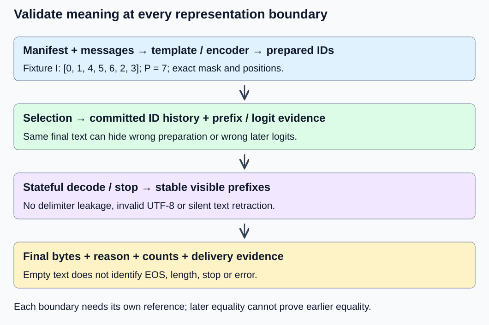
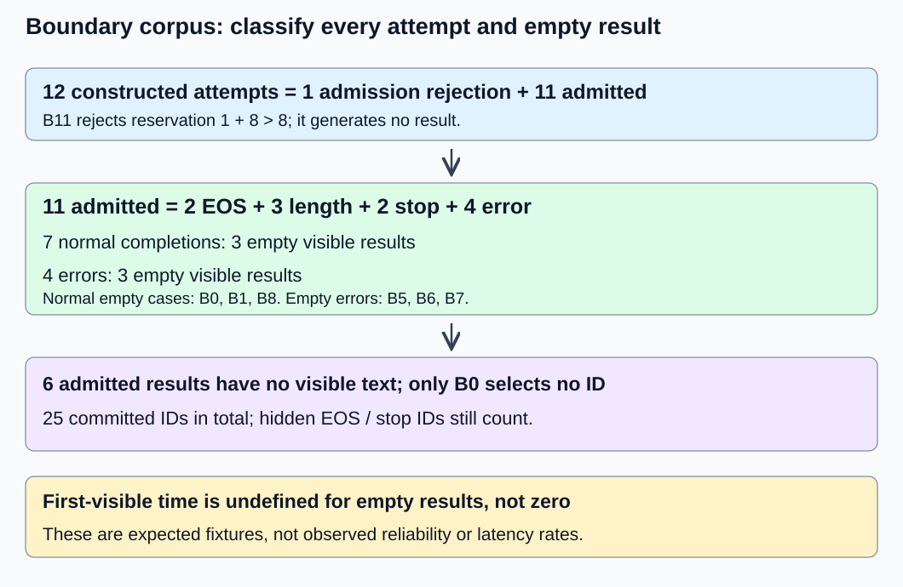

# M9-C19: Validating tokenization, stopping, and final output

> **Status: Complete — detailed chapter authored and documentation validated; experimental procedures are proposed unless explicitly labelled observed**

**Module:** Make measurement and correctness part of the foundation

**Category:** [Interfaces, protocols, and streaming](index.md)

[Module 9 reading order](../module-9.md) · [Previous: M9-C18](../numerics-and-correctness/m9-c18-testing-sampling-distributions-and-random-state-behavior.md) · [Next: M9-C20](../numerics-and-correctness/m9-c20-validating-kv-reuse-and-prefix-cache-identity.md)

## Target concepts

Tokenizer and template identity, control tokens, EOS, length caps, multi-token stop sequences, boundary-spanning text, incremental detokenization, terminal reasons, no-token and truncated outputs.

## Concepts

### Validate a chain of representations

A serving system transforms structured messages into prepared token IDs, generated IDs, decoded text and an externally observed result. A **contract** states the inputs, required outputs and allowed failures at each boundary. An **oracle** is a separately established expected answer. A **regression** is a change that violates an accepted answer or requirement. This chapter builds evidence for those boundaries using the completed [M1-C16 generation loop](m1-c16-building-the-single-request-generation-loop.md) and [M9-C01 reference methodology](../numerics-and-correctness/m9-c01-defining-reference-behavior-and-evidence-before-optimizing.md).

Let m be the ordered messages, T the chat template, E the encoder, x the prepared IDs, y the generated IDs and D the configured decoder. Then **x = E(T(m))**. The visible response is not generally D(x concatenated with y): this chapter excludes prompt echo and applies a declared generated-only stopping and output policy to y. Even D(y) requires the correct decoder, special-token filtering and cleanup settings. An **incremental decoder** retains state while new IDs arrive rather than treating each ID as an independent string.

Validate five separately recorded observations: preparation identity and x; each committed generated ID and its prefix; decoded/stable visible prefixes; final bytes; terminal reason and counts. Equality at a later boundary does not prove equality at an earlier one. Two tokenizers may display the same text with different IDs. Two loops may select the same IDs despite different logits, as M1-C16's frozen-prompt fault demonstrates. Conversely, a deliberate template or normalization change requires new reference behavior; it is not an equivalent optimization merely because the output looks reasonable.

*Every arrow has its own reference. A checksum identifies recorded bytes; it does not prove the bytes implement the intended semantics.*

### Bind tokenizer, template and model identities

A **manifest** is a recorded set of artifacts and effective settings. Bind the model revision and vocabulary/output-head relationship; tokenizer vocabulary, merges or model file; normalizer and pre-tokenizer; added-token definitions and flags; decoder; special-ID map; template bytes and selected template; template arguments and role ordering; library/backend versions; and generation settings. A normalizer transforms text before segmentation; a pre-tokenizer divides it before subword encoding. Record file digests, meaning fingerprints of exact bytes, plus the readable settings and golden input/output cases. A mutable model name or vocabulary size alone is insufficient. Changing one vocabulary ID can preserve the size while changing its meaning.

Resolved settings matter: include generation-prompt versus continuation behavior, BOS/EOS insertion, prompt truncation side, padding side and attention mask, explicit EOS-ID set, cap interpretation, stop strings and their order, prompt echo, decoder cleanup and special-token filtering. BOS means beginning of sequence; EOS means end of sequence. A chat end-of-message control ID need not be an EOS ID. When PAD and EOS share a numeric ID, the mask and generated-versus-padding boundary distinguish roles; never stop because an input padding slot contains that number.

The [Transformers v4.57.1 template documentation](https://huggingface.co/docs/transformers/v4.57.1/en/chat_templating) describes why a second special-token insertion can duplicate template controls. Test both the intended integrated preparation route and any permitted separate render/encode route. Require identical prepared IDs and masks under matched settings, rather than assuming the routes agree.

**Constructed identity fixture I** is a small specification, not a pretrained tokenizer. Its control IDs are BOS 0, USER 1, END_MESSAGE 2 and ASSISTANT 3. Its payload encoder maps the UTF-8 bytes of “Aé” to [4, 5, 6], where 4 carries 41, 5 carries C3 and 6 carries A9 in hexadecimal. Hexadecimal expresses a byte using two base-16 digits. The template is one BOS, USER, payload, END_MESSAGE, ASSISTANT. Thus the exact prepared IDs are **[0, 1, 4, 5, 6, 2, 3]**, P = 7. All seven mask entries are 1, and positions are 0 through 6. The fixture specifies this one payload; it makes no claim about an encoder for all possible text.

Double BOS gives [0, 0, 1, 4, 5, 6, 2, 3], P = 8. Omitting the assistant prefix gives [0, 1, 4, 5, 6, 2], P = 6. Both fail the preparation reference, even if a later display hides controls and still shows “Aé”. With illustrative context C = 16 and generated cap G = 5, correct preparation reserves P + G = 12 positions and leaves 4. The duplicate reserves 13; the missing prefix reserves 11. All fit, so admission alone cannot detect either defect. This is a shape-valid semantic error.

Real artifact tests must also cover empty content, multiple roles, embedded control-looking text, whitespace, unsupported roles and explicit truncation. For each, record the tokenizer's intended handling: literal text, recognized added token, escaping or rejection. Never invent a universal escaping rule or interpret control-looking user text as trusted role metadata. Keep those real-artifact cases distinct from fixture I.

### Bytes, Unicode and token identity are different units

A UTF-8 byte sequence encodes Unicode scalar values, the numbered text values excluding surrogate code points. Several scalars may form one perceived character; token boundaries are a separate segmentation. “é” as U+00E9 has bytes C3 A9: two bytes, one scalar. Visually similar “e” plus U+0301 has bytes 65 CC 81: three bytes, two scalars. **Byte equality is stricter than canonical text equivalence.** Unicode normalization can relate these spellings, but this chapter's stop policy performs no normalization. The [Unicode normalization specification, revision 58](https://www.unicode.org/reports/tr15/tr15-58.html) defines the relevant forms and conformance tests; adopting one changes the contract and must be pinned separately.

Thus an exact stop “é” matches C3 A9 but does not match 65 CC 81. A terminal text assertion must specify bytes, not a screenshot or a count of “characters”. The [RFC 3629 UTF-8 specification](https://www.rfc-editor.org/info/rfc3629/) supplies validity rules. A lone C3 can be a temporarily incomplete prefix, whereas A9 alone is an invalid leading continuation byte. Neither justifies silently inserting a replacement character under the strict fixture policy.

For actual tokenizers, require the declared round-trip property. **D(E(text)) = text** is appropriate only if the artifact promises lossless preservation with those settings. With documented normalization or whitespace cleanup, compare against that transformed reference instead. Nor does **E(D(ids)) = ids** hold universally: distinct token sequences can decode to identical text. Exact ID checks and decoded-text checks therefore remain separate gates. The [SentencePiece paper](https://aclanthology.org/D18-2012/) provides primary tokenizer/detokenizer background; its existence does not establish either identity for an arbitrary configured artifact.

### Freeze stopping and terminal precedence before testing

Use M1-C16's conservative admission **P + G ≤ C**, where P is prepared prompt length, G is maximum selected generated IDs and C is available context positions. This reserves space even for a terminal ID. A production API may use different conventions; document and adapt them rather than silently applying this fixture to every backend. [Transformers v4.57.1 generation settings](https://huggingface.co/docs/transformers/v4.57.1/en/main_classes/text_generation) distinguish caps on new IDs from prompt-plus-output length.

The local validation contract is explicit. Valid G = 0 terminates with length, empty text and no forward or selected ID. Otherwise each successful selection commits exactly one ID and advances its request state. A configured EOS ID terminates before rendering that ID. For other IDs, decode and detect stops; an exact stop wins over a simultaneous cap. If neither occurs, reaching G ends with length. EOS and stop-triggering IDs count internally, even when their bytes are hidden. A failed forward commits no ID. A decoder failure after commitment retains the triggering ID and ends in error, without resampling. There is exactly one terminal result and no post-terminal forward or append.

Stops are nonempty valid UTF-8 strings matched over generated output only. Select the earliest completed match by byte end position; ties use earliest start, then configured list order. Hide the matched delimiter and all later bytes, including a suffix within the same token piece. For stops “ab” and “abc”, completion of “ab” wins; waiting for the longer string changes policy. For stops “b” and “ab” sharing the same end, “ab” wins by earlier start. Empty stop strings are rejected at admission. Prompt bytes are excluded, so prompt-ending “A” plus generated “é” does not create a generated stop “Aé”.

Withhold a pending suffix that could complete a stop, and withhold incomplete UTF-8. An emission is stable only if later output will never retract it. At normal EOS/cap, validate decoder completion before flushing an unmatched stop prefix as ordinary text. Invalid final bytes turn the proposed normal completion into error; retain only already emitted valid text. Once a complete stop is found, discard its trailing piece suffix without interpreting it. An invalid byte encountered before the stop instead fails. These choices are the fixture's semantics, not universal library defaults.

### Use a finite boundary corpus with explicit expected outcomes

**Fixture B** reuses M1-C16's scripted byte pieces: ID 0 → 41 (“A”), ID 1 → C3, ID 2 → A9, ID 3 → EOS without visible bytes. It is a separate vocabulary from fixture I and is not produced by a trained model. Use prepared prompt [0], C = 8 and EOS set {3}. Stop “Aé” has bytes 41 C3 A9. Scripted IDs force boundaries without depending on model probabilities. The table specifies the complete 12-record base corpus; stop is enabled in every admitted row. Scripts are available choices, not instructions to continue beyond termination.

| Case | Available scripted IDs; cap | Final visible text | Outcome; committed IDs |
| --- | --- | --- | --- |
| B0 | Any; G = 0 | Empty | length; 0 |
| B1 | [3]; G = 1 | Empty | eos; 1 |
| B2 | [1, 2, 3]; G = 5 | é | eos; 3 |
| B3 | [1, 2, 0]; G = 3 | éA | length; 3 |
| B4 | [1, 2, 0, 1, 2]; G = 5 | é | stop; 5 |
| B5 | [1]; G = 1 | Empty | error: incomplete UTF-8; 1 |
| B6 | [2]; G = 1 | Empty | error: invalid continuation; 1 |
| B7 | [1, 3]; G = 5 | Empty | error at EOS finalization; 2 |
| B8 | [0, 1, 2]; G = 3 | Empty | stop; 3 |
| B9 | [1, 2, 0, 1]; G = 4 | é | error at cap finalization; 4 |
| B10 | [1, 2]; G = 2 | é | length; 2; prompt A cannot complete a generated stop |
| B11 | Any; G = 8 | No generated result | rejected: P + G = 9 exceeds C = 8; 0 |

B4's checkpoints are empty, “é”, “é”, “é”, “é”. B3 instead flushes the held A at its cap. B9 preserves “é” but does not flush held A followed by incomplete C3. B8 is a normal completion with three selected IDs and no visible text. B0, B1 and B8 show why “no text”, “no selected token” and “failed request” cannot share one Boolean result.

For each admitted case, record reason, committed IDs, forward count, bytes and per-checkpoint stable prefix. Scripted replay is not a forward pass: its number of real model forwards is zero. When an actual generation-loop run forces these choices, its successful selection-forward count should equal committed IDs for this single-request uncached policy. Do not mislabel replay as model execution. In a service extension, a timeout or lost terminal event is an unresolved observation, not evidence of successful length termination.

*These counts describe constructed expected cases. They are not service success rates or observed failure frequencies.*

### Partition invariance and reference independence

A **partition** divides one ordered byte sequence into consecutive nonempty chunks without changing byte order. For n ≥ 1 bytes, there are **2^(n − 1)** partitions, because each gap can either contain a cut or not. Empty updates may also occur but carry no new content. Chunk count is not generated-token count. A production transport must reassemble valid protocol records before interpreting their payload; this chapter's raw byte partitions exercise the decoder/matcher boundary, not a network protocol parser.

For B4, C3 A9 41 C3 A9 has five bytes and **16** partitions. Every partition must produce final “é”, reason stop and the same earliest stop span. Require each emitted prefix to be a valid prefix of the final visible bytes. Do not require identical update timing or chunk sizes across partitions. At the same consumed byte offset, the stateful byte-fixture reference must agree; token checkpoints are checked separately before transport grouping.

Use a second independent reference: examine complete valid generated bytes for the earliest stop end/start/list tuple, remove that delimiter and suffix, then compare final bytes. Prefix/finalization rules still need separate assertions; an offline final string alone will miss a leaked delimiter later retracted by a client. For the 11 ASCII bytes “ok<END>tail”, stop “<END>” gives “ok” across **1,024** partitions, including a whole-piece boundary that contains text after the stop. Add the two overlap examples above; their lengths two and three require 2 and 4 partitions. This is **1,046 partition cases** in total. Exhaustive small-corpus coverage does not prove all possible Unicode, tokenizer or service behavior.

A second backend can share the same mistake. Combine independently written expected cases, stage traces, partition relations and **negative controls**: deliberately specified defects that a check must reject. Useful defects include duplicate BOS, wrong EOS set, counting visible chunks as tokens, matching prompt text, flushing incomplete UTF-8, leaking a delimiter and using a decoder from another tokenizer revision. Do not publish a single “pass percentage” that hides a failed correctness case. All mandatory cases must pass, and every deliberately faulty behavior must be detected at its intended boundary.

## Experiments

These are proposed procedures. Rust is the primary execution context if an existing environment is used; no implementation is supplied. Hand-derived fixtures establish expected answers, while actual artifact and runtime checks require separately supplied pinned artifacts. There are four matched verification treatments below.

### E1 — Audit preparation identity and control boundaries

**Description:** Compare prepared IDs and manifests through the declared chat preparation routes. **Purpose/objective:** Detect identity drift even when displayed text and context admission look correct. **Target concepts:** Tokenizer/template identity, control tokens, prompt truncation and length units.

**Baseline and workload:** Fixture I's one exact message and seven-ID reference; in an existing environment add six artifact-specific classes: empty content, multiple roles, control-looking payload, whitespace, unsupported roles and overlength input. Freeze one expected case per class before the candidate run. Those six answers cannot be inferred from the constructed vocabulary.

**Controls and prediction:** Fix message bytes, role ordering, normalizer, template arguments, vocabulary/special map, mask and truncation policy. Correct integrated and separate preparation agree when they claim the same contract. Duplicate BOS and missing assistant prefix should fail despite fitting C = 16.

**Procedure:** Review the manifest; compare both routes against stored IDs/masks/positions and expected decoded prompt; inspect first divergent boundary. Evaluate the two deliberate fixture defects. For actual overlength inputs record rejection or declared truncation and exact surviving IDs, never accept an unspecified truncation. Keep each original input and its transformed representation together.

**Hardware/software:** CPU-only reference work, UTF-8 inspection and artifact digests; record tokenizer/template/runtime versions and actual hardware as specified below. No GPU/model inference is necessary for preparation checks.

**Failure and HFT connection:** A wrong role/control map resembles interpreting an event under the wrong schema: valid-looking data can carry the wrong meaning. HFT comparison concerns identity and ordering only; token templates are not exchange message formats. **Exit criteria:** Fixture I and both negative controls have their exact expected classification; actual-artifact cases, if run, have frozen manifests and exact IDs/masks or declared rejection. Pending artifacts cannot be reported as tested. Use V1.

### E2 — Challenge incremental text and stop matching

**Description:** Replay B4 and the independent ASCII/overlap streams under every listed byte partition. **Purpose/objective:** Prove the specified cases neither leak a hidden delimiter nor replace incomplete Unicode prematurely. **Target concepts:** Multi-token stops, boundary-spanning text, incremental detokenization and exact byte identity.

**Baseline and workload:** The independent full-byte stop oracle and checkpoint expectations; 1,046 partition cases. Also compare the precomposed/decomposed accent bytes as two explicit normalization cases. In an existing tokenizer environment, repeat checkpoint comparisons on approved real ID sequences with cleanup/filtering fixed.

**Controls and prediction:** Preserve ID order and tokenizer state independently of transport grouping. Vary chunk boundaries only. B4 always ends as “é”; a no-normalization exact “é” stop matches only the precomposed form. Single-token independent decoding is not presumed equivalent to full-sequence decoding.

**Procedure:** Compare stable emissions and final stop spans with references. Include an empty update before, between and after payload chunks; ensure it changes no counters. Challenge a delimiter wholly inside one piece and one extending across multiple pieces. Introduce delimiter leakage and premature replacement as negative controls. Real tokenizers with revisable cleanup require a stable-prefix interface, enough buffering or a declared final-only fallback, not silent text retraction.

**Hardware/software:** CPU decoder/matcher reference environment; record actual tokenizer library and settings for extensions. No model runtime or network is required for byte-boundary validation.

**Failure and HFT connection:** Preserving incomplete state resembles framing partial events before publication. The analogy does not imply Unicode stops behave like trading controls. **Exit criteria:** All 1,046 cases agree on final bytes/span/reason, every emitted prefix is valid and append-only, empty updates preserve state, both negative controls fail and normalization cases remain distinct. Record real-artifact coverage separately. Use V2.

### E3 — Classify empty, capped and failed outcomes

**Description:** Evaluate the 12-record base corpus and terminal ledgers. **Purpose/objective:** Prevent silent output corruption and success-only accounting. **Target concepts:** EOS, caps, terminal precedence, no-token output, truncated and partial results.

**Baseline and workload:** B0–B11 exactly as tabulated, including same-step EOS/cap, same-step stop/cap, incomplete UTF-8 and rejected reservation. Repeat each case twice from fresh request state and once interleaved with another case in an existing replay facility; order must not alter either request's result.

**Controls and prediction:** Fix P = 1, C = 8, EOS {3}, hidden exact stop “Aé” and strict finalization. EOS text is not emitted. Finalization error overrides a proposed eos/length success. No output cannot identify the terminal reason.

**Procedure:** Compare committed IDs and stable text at each checkpoint, then verify one terminal result. Check no activity after terminal, no prompt-boundary stop and no reuse of pending bytes between requests. Supply the wrong EOS set and a visible-chunk cap counter as negative controls. For a service extension, separately classify terminal loss/disconnect and timeout; do not rewrite them as an observed normal completion.

**Hardware/software:** Same CPU reference environment. Request interleaving is a state-isolation exercise; it is not a concurrent service or overload benchmark.

**Failure and HFT connection:** Exactly one classified final outcome resembles tracking an event to a known disposition, with retained partial evidence after failure. Trading acknowledgement and recovery semantics require their own specification. **Exit criteria:** All 12 cases match bytes, reason and counts; repeated/interleaved cases are isolated; negative controls are detected; the V3 population identity balances. Use V3.

### E4 — Benchmark validation cost without weakening evidence

**Description:** Compare full-prefix decoding with a compatible stateful incremental decoder in an existing environment, under the same stable-output policy. **Purpose/objective:** Measure whether less repeated decoding improves complete work while preserving the contract. **Target concepts:** Incremental detokenization, final output, evidence overhead and workload-dependent benefit.

**Baseline and workload:** A codec-only sequence of 1,024 ASCII pieces, each “ab”, with no stop and cap 1,024; add B4 separately as a short boundary case. Baseline decodes the complete accumulated prefix per piece. Candidate consumes new pieces with state. Both materialize the same final bytes and execute the same required output sink. A sink is the receiving buffer/consumer, whose copying cost must remain inside the boundary. These scripted pieces are not inference output or tokenizer token IDs.

**Controls and prediction:** Fix bytes, per-piece checkpoints, finalization, sink, allocation policy, thread/affinity and environment. Baseline logical decoder input is **2 × (1 + … + 1,024) = 1,049,600 bytes**; candidate logical new input is **2,048 bytes**. This predicts less rescan work, not a 512.5-fold speedup: allocation, copying and matcher/decoder behavior still contribute. B4 may be too short for meaningful timing.

**Procedure:** First pass V1–V3 and real-artifact equivalence where relevant. In each of three separate sessions, warm each path with five untimed trials per workload, then collect 30 paired trials per workload, alternating path order. Preserve all attempted pairs. Time pieces-ready to final materialized bytes plus terminal record; setup before pieces-ready is excluded equally. Compare reduced trace recording with full diagnostic traces in a separate overhead study. A future complete inference request comparison must include preparation/generation/finalization as declared and use real model artifacts; a codec-only improvement cannot establish that result.

**Hardware/software:** CPU, one worker thread, monotonic clock, fixed runtime/allocator/decoder and fully recorded sink. No GPU/NIC is required here. Record clock granularity, warmup and instrumentation separately.

**Failure and HFT connection:** Removing a text rescan parallels reducing repeated event conversion, but total decision/publication latency may remain dominated elsewhere. **Exit criteria:** Identical mandatory bytes, prefixes, reasons and counts; per-session paired results and failures retained; profiler attributes time/copies/allocations without changing the comparison policy; conclusions confined to the measured boundary. Inconclusive timing is acceptable, semantic mismatch is not. Use V4.

## Verification

### V1 — Compare identities before outputs

For E1, archive original message bytes, resolved manifest, expected prepared IDs/mask/positions and both route outputs. Exact discrete data use exact equality; a floating-point tolerance is inappropriate for an ID or byte mismatch. If inference is later included, use [M9-C17](../numerics-and-correctness/m9-c17-comparing-logits-with-justified-numerical-tolerances.md) for logits separately. Fixture I has lengths 7/8/6 for correct/duplicate/missing-prefix cases and reservation counts 12/13/11. Golden references must be reviewed independently before testing a candidate; regenerating them from that candidate erases the check.

For an identity mutation, the gate can detect manifest drift before execution; for a semantic mutation with a correctly updated manifest, require a newly approved expected behavior rather than merely updating a digest. Keep unsupported artifact cases explicitly unexecuted. Measure preparation-only time from immutable messages/settings ready to prepared IDs/mask materialized if studying preparation cost; file loading and digest computation have separate reported boundaries. Profile rendering, normalization, segmentation and allocation separately in diagnostic runs. No timing is needed to establish the fixture's exact failure classifications.

### V2 — Check final and intermediate text independently

For E2, compare the 16 + 1,024 + 2 + 4 = 1,046 expected partition outcomes. At every byte reference checkpoint assert valid UTF-8, no output retraction and no emitted delimiter prefix that the policy must withhold. Check earliest end/start/list tuple and discard-after-match behavior. Reconstruct final output by concatenating actual emissions, not by trusting a separately calculated final string. Keep the normalization examples' bytes explicit: C3 A9 versus 65 CC 81.

For tokenizer extensions, compare the reference's actual full-ID decoding policy with the candidate's final bytes and approved stable prefixes. Cleanup can make intermediate full decoding revisable; do not demand publication of an unstable reference suffix. Record a fallback as a different streaming capability, not a silent timing improvement. Invalid streams must have the specified valid partial prefix and error classification; replacement text is not close enough. Profile pending-buffer size and copies outside correctness runs. For exact append-only byte matching with longest stop length M bytes, stop lookbehind is at most M − 1 bytes; incomplete UTF-8 adds at most three. The **M − 1 + 3** bound concerns these pending bytes only, not total tokenizer/history/matcher storage. B4 has M = 3 and bound 5; a generic tokenizer may need more state.

### V3 — Balance the terminal population

For E3's base corpus, **12 attempted = 1 rejected + 11 admitted**. Among admitted cases, **11 = 2 eos + 3 length + 2 stop + 4 error**. Seven normal completions include three with empty visible text; four errors include three with empty visible text. There are six empty visible admitted outcomes, but only B0 selected no ID. The total expected committed-ID count is **25** across admitted cases, including terminal IDs; this is a corpus accounting number, not throughput. Check each row before aggregating. A wrong EOS set may preserve some final strings while corrupting reasons/counts.

For a later live service, keep rejected, normal-completed, errored, cancelled and unresolved attempts mutually exclusive at the stated observation cutoff. “Truncated” needs a definition: a valid length-capped output can end mid-sentence without any encoding error; an incomplete UTF-8 final state is an error here; a transport ending before terminal evidence is unresolved delivery. Preserve these distinctions. Final text being valid UTF-8 does not establish task quality or intended semantic completeness.

First-selected-ID time is undefined if no ID was selected. First-visible-text time is undefined for all six empty admitted outcomes, not zero milliseconds. Completion time belongs to the observed terminal result, including error as its own population. Use [M9-C07](../measurement-experimentation-and-economics/m9-c07-latency-distributions-and-statistical-uncertainty.md) to avoid silently dropping empty/failed outcomes. Replays test expected classifications; no service latency distribution or reliability estimate follows from this intentionally adversarial corpus.

### V4 — Preserve correctness while explaining cost

For E4, record 90 planned pairs per workload across three sessions, only labelled successful pairs if both members finish correctly. Three sessions × two workloads × two paths × five warmups = **60 untimed path trials**. Timed work is three × two × 30 × two = **360 path trials**, or 180 pairs across both workloads. Failed or incomplete members remain in the ledger and do not become fast successes. Report individual session medians/ranges and paired baseline-minus-candidate differences; identify the unit as microseconds or nanoseconds and preserve clock resolution. Three sessions do not establish a production p99 or capacity limit.

Measure the declared completed codec boundary; the clock must stop after required final bytes and terminal evidence are available. Calibrate empty timing brackets, quantify full versus reduced instrumentation cost and separate profiling runs from headline timings. A profile attributes time to stages; it does not prove equivalence. Record decode/match/finalization, materialization/copying, allocation counts and peak pending bytes. The 1,049,600/2,048 = 512.5 ratio describes logical input volume only; memory traffic and elapsed-time ratios must be measured separately. If validation or buffering dominates, retain that result instead of removing a correctness gate to create a speedup.

Archive corpus version, manifests, expected and actual bytes/IDs/reasons, first-divergence reports, deliberate-defect detection, timing attempts and session conditions. Reproducibility requires another reader to know both what ran and what remained proposed. This chapter's hand calculations and documentation checks are not executed tokenizer/model/service benchmarks.

## Engineering dimensions and principles

| Dimension | Chapter-specific application |
| --- | --- |
| Semantics and invariants | Exact manifests, prepared IDs, stable visible prefixes and one terminal reason are separate gates in E1–E3. |
| Workload and variability | Whitespace, Unicode representation, piece/chunk boundaries, stop overlaps and empty output vary independently; E4 separates short and long streams. |
| Resources and bottlenecks | Measure rescans, pending bytes, histories, copies and allocation; a lookbehind bound is not total memory. |
| Time and distributions | Distinguish first selection, first visible output and terminal completion; undefined first-visible times remain in outcome counts. |
| Ownership and coordination | One request owns decoder/matcher state, manifest and terminal evidence; E3 tests fresh and interleaved state without cross-request leakage. |
| Failure and adaptation | Detect identity drift, invalid final bytes and unresolved delivery; final-only fallback is an explicit capability change. |

| Practical principle | How it shapes the evidence |
| --- | --- |
| 1. Correctness defines the optimization boundary | E4 timing conclusions require unchanged IDs/bytes/reasons/stable-output policy. |
| 2. Performance depends on workload and operating point | Long ASCII and short Unicode/stop workloads can have different costs; neither represents production load. |
| 3. Data movement is part of the algorithm | Logical rescans, output copies and state retention are recorded alongside time. |
| 4. State has ownership, lifetime and recovery cost | Pending UTF-8/stop state survives empty updates and is finalized once; a failed request cannot donate it to another. |
| 5. Dependencies determine latency; bottlenecks determine capacity | Text needs stable decoder output before publication; reducing codec work may leave model work dominant. |
| 6. Variability and synchronization shape the tail | Withholding delays visibility and shared service behavior requires later load evidence; the finite corpus yields no p99 claim. |
| 7. Local improvements must be evaluated end to end | Codec and future complete inference timing boundaries are separate, with required sink work included. |
| 8. Claims require reproducible evidence | Frozen manifests, independent expected answers, negative controls, partition relations and complete attempt ledgers support each claim. |

HFT means High-Frequency Trading: systems processing market events under tight timing constraints. Schema identity, ordered state, bounded pending work and distinguishing internal completion from publication transfer as engineering habits. A text stop is not an exchange cancel, and a generation terminal result is not a trade acknowledgement. No trading strategy, service implementation, profitability or production latency is established here.

## Specifications, articles, and hardware

| Primary source | Scope and limit |
| --- | --- |
| [Transformers v4.57.1 templates](https://huggingface.co/docs/transformers/v4.57.1/en/chat_templating) | Preparation arguments, roles and special-token duplication; actual model templates must still be pinned and tested. |
| [Transformers v4.57.1 tokenizer base specification/source](https://raw.githubusercontent.com/huggingface/transformers/v4.57.1/src/transformers/tokenization_utils_base.py) | Decoding/filtering/cleanup settings are explicit configuration, not a universal exact-text round trip. |
| [Transformers v4.57.1 generation](https://huggingface.co/docs/transformers/v4.57.1/en/main_classes/text_generation) | Cap/EOS/stop configuration background; local stripping, zero-cap and precedence rules remain explicitly specified fixtures. |
| [RFC 3629](https://www.rfc-editor.org/info/rfc3629/) | UTF-8 validity; no tokenizer segmentation or service terminal policy is implied. |
| [UAX #15 revision 58](https://www.unicode.org/reports/tr15/tr15-58.html) | Unicode normalization and conformance; this chapter's exact matching performs no normalization. |
| [Kudo and Richardson, SentencePiece (2018)](https://aclanthology.org/D18-2012/) | Primary tokenizer/detokenizer article; it does not validate the constructed fixtures or arbitrary artifact settings. |

Proposed CPU exercises require one worker thread, at least 1 GiB free RAM for corpus/evidence and a monotonic clock for E4; these are exercise requirements, not an observed machine or production sizing recommendation. Record CPU model, core/socket/cache/RAM, NUMA placement (which memory is close to a processor), thread affinity, OS, power/frequency/thermal policy, runtime/compiler/allocator, tokenizer/model revisions and artifact digests, decoder settings, clock granularity, warmup, sink and co-tenancy. No GPU, NIC or interconnect is required for scripted validation. Actual model comparisons need independently specified model/precision/backend and adequate hardware; this chapter supplies no such runtime artifacts.

This Module 9 chapter supports Modules 1–7: apply its preparation/output gates to cache and kernel equivalence, serving delivery, optimization fallback and distributed result assembly as those mechanisms are introduced. Completed [M9-C01](../numerics-and-correctness/m9-c01-defining-reference-behavior-and-evidence-before-optimizing.md), [M9-C17](../numerics-and-correctness/m9-c17-comparing-logits-with-justified-numerical-tolerances.md) and [M9-C07](../measurement-experimentation-and-economics/m9-c07-latency-distributions-and-statistical-uncertainty.md) provide evidence, numerical and population foundations. Advanced timing/load/lifecycle chapters remain outlines; needed elementary contracts are local. The next authoring chapter is M1-C17, while Module 9 reading navigation continues to M9-C20.

## Key takeaways

Pin the meanings of IDs before trusting decoded text. Validate preparation, commitment, stable publication and terminal evidence independently. Empty output can be correct; capped text, invalid encoding and unresolved delivery need distinct outcomes. Exact boundary fixtures and negative controls establish limited correctness evidence before any performance claim. All experiments remain proposed; no real tokenizer, model, network service or performance benchmark was executed for this chapter.
