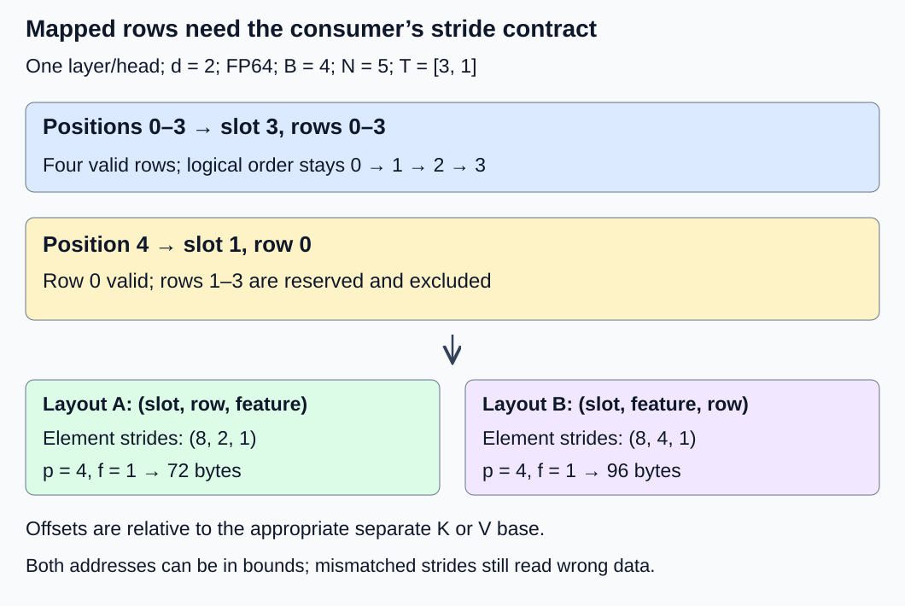
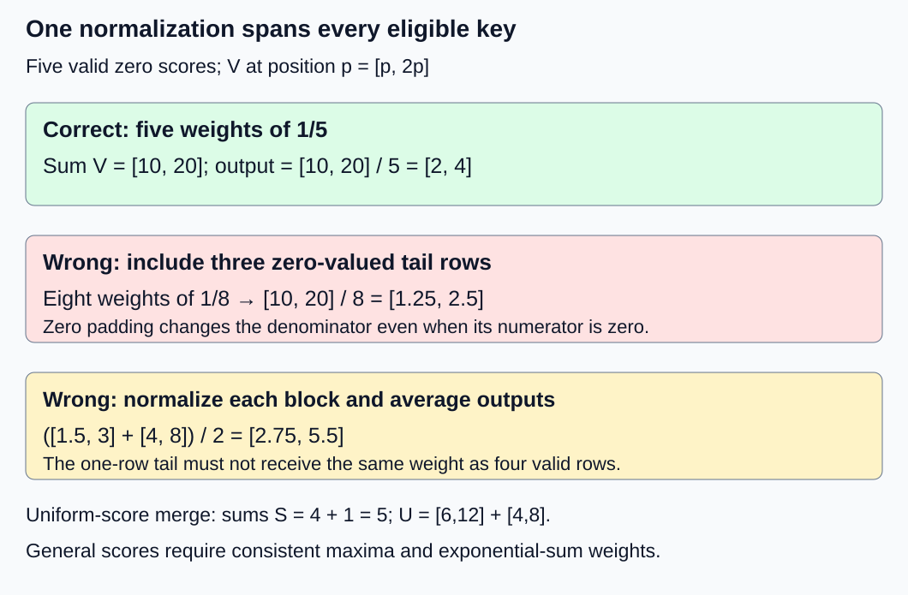

# M2-C07: How attention reads a paged KV layout

> **Status: Complete — detailed chapter authored and documentation validated; experimental procedures are proposed unless explicitly labelled observed**

**Module:** Treat the KV cache as a first-class systems problem

**Category:** [Kernels, compilers, and execution](index.md)

[Module 2 reading order](../module-2.md) · [Previous: M2-C06](../state-memory-and-caching/m2-c06-paged-kv-storage-and-logical-to-physical-mapping.md) · [Next: M2-C08](../state-memory-and-caching/m2-c08-designing-a-fixed-size-kv-block-allocator.md)

## Target concepts

Block-table lookup, KV tensor strides and layouts, valid token counts, partial tail blocks, gather access, kernel-layout compatibility, metadata and data movement.

## Concepts

### 1. The table is part of the attention input

[M2-C06](../state-memory-and-caching/m2-c06-paged-kv-storage-and-logical-to-physical-mapping.md) mapped logical sequence blocks to storage slots. Attention must use that mapping whenever it reads keys K and values V. A **kernel** is the execution routine that performs the operation on its target processor; receiving a pointer and a tensor shape does not tell it where every logical coordinate lives.

For zero-based position p and B positions/block, the logical block is **j = floor(p/B)**, the within-block row is **r = p mod B**, and the physical pool slot is **s = T[j]**, where T is this request's block table. Floor rounds down; modulo gives the remainder. The valid prefix length N requires **0 ≤ p < N**. Logical order, owner/attempt identity and protected storage lifetime remain requirements even when every address is within the allocation.

The [original PagedAttention paper, section 4.1](https://arxiv.org/html/2309.06180v1), describes attention consuming separately located KV blocks. Its layout is not our fixture's interface. The [vLLM design explanation](https://docs.vllm.ai/en/latest/design/paged_attention/) illustrates distinct K/V layouts but explicitly warns that it is historical and no longer describes today's code. A real experiment must pin the backend version and inspect its actual supported contract.

This chapter uses a **consumer subproblem**: one request, one layer, one query head, one KV head, feature dimension d = 2 and FP64 elements of w = 8 bytes. Unlike M2-C06's all-layer packed fixture, K and V have separate backing allocations here. Each position has **2 × d × w = 32 bytes of KV payload**. Do not reuse the previous chapter's 128-byte position count for this subproblem.

### 2. Strides translate coordinates into bytes

A **stride** is the address increment for advancing one coordinate along an axis, measured here in elements. For an allocation base, byte offset is **w × Σ(axis index × axis stride)**. Offsets must also respect bounds, alignment and allocation lifetime. Multiplication/addition must not overflow the representation used for addressing.

Choose P = 4 slots, B = 4 rows/slot, N = 5 and **T = [3, 1]**. Separate K and V allocations each contain P × B × d = 32 FP64 elements, or 256 bytes. Consider two deliberately specified layouts:

| Contract | Axis order | Element strides in axis order | Element offset for slot s, row r, feature f |
|---|---|---|---|
| A: row-major within a slot | (slot, row, feature) | (8, 2, 1) | s × 8 + r × 2 + f |
| B: feature-major within a slot | (slot, feature, row) | (8, 4, 1) | s × 8 + f × 4 + r |

For p = 4, j = 1, r = 0, s = 1. Feature f = 1 is at byte offset **(8 + 0 + 1) × 8 = 72** in A, versus **(8 + 4 + 0) × 8 = 96** in B, relative to the appropriate K or V base. Both offsets can be inside the same allocation while identifying different values. Reinterpreting A as B changes semantics; an explicit reorder preserves semantics by moving data.

**Gather access** means collecting logically related values from their mapped locations. It can describe direct mapped loads inside attention, or a separate operation that materializes a contiguous temporary. Name which one is used. Adjacent logical positions may occupy nearby rows within one slot and then jump from slot 3 to slot 1 at p = 4. This does not by itself specify cache-line transactions, device memory coalescing or physical DRAM placement.

*The fifth valid position is in slot 1, row 0. Feature order is a contract; unused rows remain outside the valid sequence.*

### 3. A partial block must not change the denominator

For this single-query decode subproblem, query q corresponds to logical position 4 after that position's K/V have completed. Eligible keys are exactly positions 0–4, including itself. No dropout is applied. This defines causality explicitly; a generic causal flag on a non-square query/key shape is not a substitute for this eligibility rule. The [PyTorch 2.14 attention specification](https://docs.pytorch.org/docs/2.14/generated/torch.nn.functional.scaled_dot_product_attention.html) documents its own mask conventions, dropout behavior and backend-dependent numerics; translate these deliberately when selecting a reference.

For eligible positions E, define scaled scores **zₚ = (q · Kₚ)/√d**, where the dot is the sum of feature-wise products. Stable normalization subtracts **m = max(zₚ for p in E)**:

**αₚ = exp(zₚ − m) / Σ(t in E) exp(zₜ − m).**

**o = Σ(p in E) αₚ Vₚ.**

Here α is a scalar weight, exp is the exponential function, and o is the two-feature output. The common denominator spans all eligible positions, regardless of physical block placement. The final block has **vⱼ = min(B, max(0, N − jB))** valid rows. Our blocks have valid counts 4 and 1, not 4 and 4.

Let q = [0, 0], every valid Kₚ = [0, 0], and **Vₚ = [p, 2p]**. All five scores are zero, each weight is 1/5, and:

**o = ([0,0] + [1,2] + [2,4] + [3,6] + [4,8])/5 = [2,4].**

If three unused tail rows are incorrectly treated as zero-valued valid rows, the denominator becomes eight. Their numerators contribute zero but the result becomes **[10/8, 20/8] = [1.25, 2.5]**. Zero padding is not a validity mask. Unused data need not actually be zero.

If each block is normalized independently, the block outputs are [1.5, 3] and [4, 8]. Averaging those two gives **[2.75, 5.5]**, also wrong. In this equal-score example the correct combination weights are 4/5 and 1/5. Equal block weights incorrectly give a one-row tail as much influence as a four-row block.

*Padding and equal block weighting produce different wrong answers. Preserve the eligible set and the shared denominator.*

A finite, initialized sentinel in reserved rows can reveal leakage. The baseline must exclude invalid rows before reading them. A backend that deliberately loads allocated padded lanes must document legal readable storage and masking behavior; uninitialized/out-of-allocation reads are never a valid poison test. Multiplying a NaN by zero does not reliably erase it, so masking V only after invalid arithmetic is insufficient. An empty eligible set is outside this operation's contract: reject it explicitly rather than normalize an empty sum.

### 4. Block summaries need globally consistent weights

For nonempty eligible subsets A and C with finite scores, each subset can have maximum m, shifted exponential sum S and weighted value sum U:

**S_A = Σ(p in A) exp(zₚ − m_A); U_A = Σ(p in A) exp(zₚ − m_A) Vₚ.**

Set **m = max(m_A, m_C)**. Then combine using:

**S = exp(m_A − m) S_A + exp(m_C − m) S_C.**

**U = exp(m_A − m) U_A + exp(m_C − m) U_C; o = U/S.**

These mathematical identities explain why a block-local normalized output alone loses information needed for general merging. They are not an implementation or a promise of bitwise equality under reordered floating-point reductions. Empty subsets need explicit handling and must not evaluate undefined differences of negative infinities. This chapter's input contract rejects nonfinite valid q/K/V; a later backend may specify other behavior explicitly.

For the uniform example, both maxima are zero; S_A = 4, U_A = [6,12], S_C = 1 and U_C = [4,8]. Thus S = 5, U = [10,20] and o = [2,4]. A layout bug must first fail exact coordinate checks; numerical tolerance must not disguise it.

### 5. Direct mapped consumption versus materializing a temporary

Reading all five valid K/V rows once consumes **5 × 32 = 160 logical payload bytes** for this one-head/layer subproblem. The two assigned blocks contain 256 payload bytes, including 96 tail bytes; the full pool has 512 backing payload bytes. Two four-byte slot IDs contribute eight active table bytes, excluding length/header, generations, duplicated tables and padding. These are storage amounts, not measured memory traffic or a guarantee of one table load per block.

A separate gather of both K and V reads 160 bytes and writes 160 temporary bytes; attention then reads those 160 bytes again. Its combined logical payload movement is **480 bytes**, versus 160 for the idealized direct path. The difference is 320 bytes, excluding query/output, metadata, intermediate scores and extra passes. Fused/blockwise consumers can have different actual access counts. Query and output each contain 16 bytes here.

Avoiding a temporary can save movement but add dependent table loads or a less favorable access pattern. A specialized backend may require head dimensions, alignment, grouping, dtype, strides and block sizes different from this fixture. Reject an incompatible descriptor or perform an explicit, accounted conversion. A successful launch is not proof that the kernel read the intended data. In Rust, valid slices and ownership protect some access boundaries; external device completion and semantic layout compatibility require additional contracts.

## Experiments

These are proposed experiments without code. The execution plan records documentation and reference arithmetic checks separately; it does not report an executed attention kernel.

### E1 — Same logical coordinates, two stride contracts

- **Description:** Audit independently labelled K/V data through layouts A and B and the scattered table.
- **Purpose/objective:** Detect in-bounds layout misinterpretation before attention can hide it.
- **Target concepts:** Block-table lookup, KV tensor strides/layouts, gather access and kernel-layout compatibility.
- **Baseline and workload:** P = 4, B = 4, N = 5, T = [3,1], separate FP64 K/V; unique small integer labels for each valid tensor/position/feature. This label corpus is separate from E2's numerical values.
- **Controls and prediction:** Hold logical labels fixed; vary physical layout and its matching descriptor. Predict the 72/96-byte feature offsets and exact agreement after correct interpretation.
- **Procedure:** Enumerate ten valid elements in each of K and V against a flat reference. Compare both matching layouts; then deliberately mismatch A data with B strides and require detection. Reject missing entries, slot 4, wrong owner/generation, unsupported strides and overflow-sized descriptors before payload access.
- **Hardware/software:** Paper address ledger first; future harness records compiler/backend and the full manifest below.
- **Failure and HFT connection:** An event descriptor can be in bounds but decode the wrong field. This tests data-contract integrity, not a trading protocol.
- **Exit criteria:** All 20 valid elements agree exactly in matching cases. The mismatched case fails and invalid descriptors reject; no unsafe access is needed to demonstrate the error.

### E2 — Partial-tail normalization counterexamples

- **Description:** Compare correct attention with two deliberately incorrect denominator/merge interpretations.
- **Purpose/objective:** Show why valid counts and global normalization are semantic requirements.
- **Target concepts:** Valid token counts, partial tail blocks and mapped attention consumption.
- **Baseline and workload:** The five-position q/K/V fixture above; query position 4, eligibility 0–4, dropout zero. Use initialized finite sentinels in allocated unused rows as a separate case.
- **Controls and prediction:** Hold valid data fixed; vary only tail eligibility or block combination. Predict [2,4], [1.25,2.5] for zero-tail inclusion and [2.75,5.5] for equal block averaging.
- **Procedure:** Compare the flat five-row reference and correctly mapped output. Change only unused-row sentinels and require unchanged correct output. Calculate both wrong alternatives and require the correctness gate to fail them. Separately reject N = 0 and nonfinite valid inputs under this chapter's contract.
- **Hardware/software:** Independent arithmetic reference; any candidate runtime uses explicit eligibility and recorded arithmetic settings, not an assumed causal-flag meaning.
- **Failure and HFT connection:** Counting empty buffer capacity as real events changes an aggregate even when padding is zero. The analogy concerns eligibility, not market-model validity.
- **Exit criteria:** Valid outputs meet the small-fixture numerical gate below; sentinel changes have no effect. Each wrong alternative fails, and empty/nonfinite cases follow their explicit rejection contract.

### E3 — Stable block merging and publication boundary

- **Description:** Test mapped consumption against a flat reference with unequal scores and interrupted storage availability.
- **Purpose/objective:** Separate numerical reduction differences from wrong state or premature visibility.
- **Target concepts:** Partial tails, block summaries, kernel-layout compatibility and ownership of mapped reads.
- **Baseline and workload:** Five positions and the same geometry. Use q = [1,0], K = [[−4,0], [−1,0], [0,0], [2,0], [4,0]] and V = [[−2,1], [0,−1], [2,3], [4,−2], [6,4]] in logical position order. These integer FP64 inputs are exact; scaled scores lie in [−4,4] and values in [−8,8]. Repeat with q = [0,0], whose output is [2,1]. Compare T = [3,1] and T = [0,2], moving payload to preserve each logical coordinate.
- **Controls and prediction:** Preserve eligibility and represented values; vary placement and block grouping. Predict the same mathematical result, with bounded recorded rounding differences rather than assumed bit equality.
- **Procedure:** Compare independent high-precision flat evaluations at 80 and 120 decimal digits before fixing the reference. Verify exact coordinates, then compare output and merged summaries. Withhold completion of the final valid row; readers must wait or reject before consuming it. Cancel while a reader holds the old table and record deferred safe return.
- **Hardware/software:** High-precision reference method/version and actual candidate dtype/reduction settings must be recorded; no reference library or device runtime is required to read this protocol.
- **Failure and HFT connection:** A correct formula over a stale or unfinished buffer is still wrong. Event consumers likewise need a publication contract; this does not prove lock-free or production safety.
- **Exit criteria:** No unpublished/stale data is exposed, old storage remains live through required readers, and every numerical coordinate passes a predeclared, justified budget. Require the 80/120-digit output coordinates to agree within 10⁻³⁰; otherwise resolve the reference before judging a candidate.

### E4 — Conditional complete-path benchmark

- **Description:** Compare flat attention, gather-plus-flat attention and direct mapped attention if compatible implementations become available.
- **Purpose/objective:** Measure whether saved materialization improves completed work at a declared operating point.
- **Target concepts:** Gather access, mapping metadata, data movement and backend compatibility.
- **Baseline and workload:** One request/layer/head, d = 2, FP64, B = 4; N in {4,5}, both fitting T's two-slot capacity. Use preinitialized uniform and nonuniform correctness corpora, but E3's nonuniform fixture for timing, retaining its first N logical K/V rows and q = [1,0]. Allocation and fixture preparation are outside timing.
- **Controls and prediction:** Hold inputs, eligibility, output precision and completion rules fixed. Gather-plus-flat includes the gather in its interval. Direct mapped must accept the declared layout; otherwise report unsupported rather than silently change geometry or precision. No speed ranking is predicted.
- **Procedure:** Run three sessions. Per length/session, exclude five warmups per path, then 30 randomized balanced groups of all three paths. Each trial performs one completed attention operation; verify outputs outside timing. Include gather, required metadata transfers, execution and completion waits; state whether query/output transfer is included. Profile table access, gather traffic, reductions, launch/host overhead and synchronization separately from unprofiled timing. Record failures/timeouts and drain admitted work before closing accounting.
- **Hardware/software:** Use the manifest below and a local monotonic clock with completion-defined boundaries. A 120-second watchdog marks unresolved work; it does not permit freeing active storage.
- **Failure and HFT connection:** Fewer local copies may help a critical path yet lose to dispatch or coordination overhead. This resembles low-latency event processing; tiny single-request results establish neither serving capacity nor production tails.
- **Exit criteria:** 180 balanced groups produce 540 timed trials and 90 excluded warmups if all paths are supported. Each path/length has 90 trials. Publish all outcomes, unsupported cells and raw durations; do not substitute fabricated timings when an implementation is absent.

## Verification

| Pair | Correctness and reference gate | Measurement and profiling boundary |
|---|---|---|
| V1 / E1 | Exact coordinate equality; descriptor bounds, identity and stride compatibility | Audit 20 values and the 72/96-byte offsets. Log each negative case; address arithmetic alone does not prove a real kernel's behavior. |
| V2 / E2 | Explicit eligibility and exact expected mathematical outputs; valid-data finite checks | Record both output coordinates and each counterexample verdict. No latency claim follows from paper calculations. Reserved-row tests use only legal initialized storage. |
| V3 / E3 | Independent stabilized reference; exact input-coordinate agreement before numerical comparison | Record maximum coordinate error and every failure by position/layout. Observe completion/publication/retirement separately in a future harness; do not conflate rounding and stale state. |
| V4 / E4 | All earlier gates pass before accepting performance; unsupported layouts stay visible | Report median, spread and session effects per path/length plus all attempted outcomes. Profile separately; include the gather and required completion. Ninety trials do not establish reliable p99. |

For E2's tiny FP64 fixture, use **|candidate − reference| ≤ 10⁻¹² + 10⁻¹² × |reference|** per output coordinate, and reject nonfinite results. Small five-term positive sums and bounded values make this a conservative teaching allowance for ordinary FP64 rounding; the wrong outputs differ by at least 0.75, far beyond it. It is not a universal attention or lower-precision budget. E1 always uses exact labels. For E3's declared five-row FP64 corpus, use the same mixed gate after the 80/120-digit references agree within 10⁻³⁰. Its bounded scores and values keep this a deliberately small, well-scaled exercise; the absolute term protects cancellation near zero. E4 inherits this gate for its N = 4 or N = 5 prefix. Other dtypes, larger shapes or more extreme values require a separately justified budget before comparison, never a tolerance chosen after viewing failures.

E4's full supported design has 540 intended completed operations; attempted and actual completed counts must be reported separately. For N = 4 and N = 5, valid KV payload is 128 and 160 bytes respectively. The idealized gather-plus-consume movement is 384 and 480 bytes, excluding other traffic. Log table/length bytes, temporary bytes and query/output separately. Actual counters may show cache reuse, multiple passes or transactions wider than an element; logical byte counts are explanatory accounting, not measured DRAM bandwidth.

Use [M9-C01](../numerics-and-correctness/m9-c01-defining-reference-behavior-and-evidence-before-optimizing.md) for state/reference contracts, [M9-C02](../measurement-experimentation-and-economics/m9-c02-request-events-clocks-and-measurement-boundaries.md) for completion timestamps, [M9-C07](../measurement-experimentation-and-economics/m9-c07-latency-distributions-and-statistical-uncertainty.md) for populations and uncertainty, and [M9-C17](../numerics-and-correctness/m9-c17-comparing-logits-with-justified-numerical-tolerances.md) for coordinate-wise budgets. Its method transfers to attention outputs; these outputs are not vocabulary logits. Advanced M9-C22 safety remains outlined; the elementary validity/lifetime contract is local here.

Reproduction records must include raw represented inputs, layouts/strides, tables, valid counts, backend identity, clock/resolution/overhead, warmup status, randomized group order, raw durations, outcome and completion status. Tiny workloads can be dominated by launch/timer overhead. A larger context/concurrency sweep needs a separately declared protocol. End-to-end acceptance additionally needs cached/uncached generator agreement and complete-request latency under matched arrivals, lengths, stopping and admission outcomes; a kernel win alone is insufficient.

## Engineering dimensions and principles

| Dimension | Chapter-specific application |
|---|---|
| Semantics and invariants | Logical coordinates, eligibility and one global normalization define correctness; E1/E2 detect in-range wrong data and padded denominators. |
| Workload and variability | A full block and a one-row tail exercise different occupancy; larger lengths, head shapes and concurrency need separate trials. |
| Resources and bottlenecks | Count table reads, K/V payload, gather temporary and output separately before interpreting cache/device profiles. |
| Time and distributions | Table resolution precedes payload access; visibility and completion waits belong on the measured path. |
| Ownership and coordination | Readers require a consistent table/length snapshot and protected payload lifetime through device completion. |
| Failure and adaptation | Reject unsupported layouts, invalid descriptors and unpublished state; cancellation cannot reclaim an active reader's storage. |

1. **Correctness defines the optimization boundary:** Exact mapping and eligible keys are nonnegotiable; numerical budgets cover permitted rounding, not missing tokens.
2. **Performance depends on workload and operating point:** E4 separates full and partial blocks; tiny FP64 shapes may be unsupported or overhead-bound.
3. **Data movement is part of the algorithm:** Materialization adds a write/read round trip; direct consumption still pays for metadata and its actual access pattern.
4. **State has ownership, lifetime, and recovery cost:** Table publication and reclamation are distinct events. A failed descriptor check must not expose another request's data.
5. **Dependencies determine latency; bottlenecks determine capacity:** Address lookup and completed writes constrain reads; fewer bytes alone do not establish capacity or overlap.
6. **Variability and synchronization shape the tail:** Partial blocks, metadata contention and device waits require explicit populations; local medians cannot establish serving p99.
7. **Local improvements must be evaluated end to end:** Compare completed gather-plus-attention with completed direct attention, then validate complete generation under the same contract.
8. **Claims require reproducible evidence:** Preserve represented inputs, exact mapping gates, numerical budgets, manifests and failed/unsupported outcomes before accepting speed claims.

## Specifications, articles, and hardware

- [PagedAttention paper, version 1, 12 September 2023](https://arxiv.org/html/2309.06180v1): block-based attention motivation; paper measurements are not reproduced here.
- [vLLM historical Paged Attention design](https://docs.vllm.ai/en/latest/design/paged_attention/), checked 26 October 2026: illustrates layout-dependent consumption and explicitly warns about current-code applicability.
- [PyTorch 2.14 scaled dot-product attention](https://docs.pytorch.org/docs/2.14/generated/torch.nn.functional.scaled_dot_product_attention.html): an explicit reference contract for scale, masks, dropout and backend-dependent execution; not a claim that this API accepts our paged layout.

Paper examples need no special hardware. A proposed CPU reference harness requires FP64 arithmetic, one declared worker and at least 1 GiB available RAM for the small fixtures and harness overhead. Record CPU model, core/cache sizes, affinity, frequency/power policy, RAM capacity/speed, page size, OS/kernel, Rust/compiler version/optimization settings, allocator and reference-library versions. No machine is claimed to have run this protocol.

A separate GPU candidate needs documented support for the chosen dtype, head dimension, block size and strides; there is no assumed compatible GPU or kernel. Record device/count, VRAM, driver/runtime, backend build, reduced-precision settings, table/payload/query/output placement, transfers, stream ownership and completion primitive. Record any layout conversion as real work. No attention kernel, allocator, GPU or runtime benchmark has been executed for this chapter.

## Key takeaways

A paged attention reader must agree with the writer about coordinates, strides, valid rows and lifetime. Partial blocks affect eligibility, not just occupancy. All valid keys share a normalization, and avoiding a gather temporary helps only when the complete compatible path benefits. [M2-C08: Designing a fixed-size KV block allocator](../state-memory-and-caching/m2-c08-designing-a-fixed-size-kv-block-allocator.md) is now a completed detailed chapter. M2-C09 is next for authoring.
