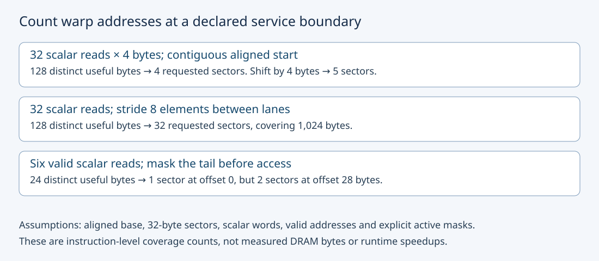
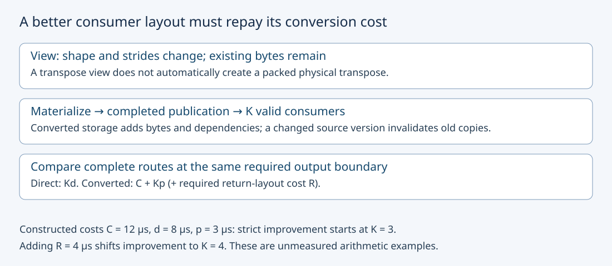

# M3-C07: Memory coalescing, alignment, and tensor layouts

> **Status: Complete — detailed chapter authored and documentation validated; experimental procedures are proposed unless explicitly labelled observed**

**Module:** Learn GPU architecture through data movement

**Category:** [Kernels, compilers, and execution](index.md)

[Module 3 reading order](../module-3.md) · [Previous: M3-C06](../hardware-architecture-and-topology/m3-c06-registers-shared-memory-and-local-resource-pressure.md) · [Next: M3-C08](m3-c08-tiling-and-reuse-through-the-memory-hierarchy.md) · [Execution plan and progress](../chapter-execution-plan.md)

## Target concepts

Warp memory accesses, contiguous versus strided access, alignment, memory transactions, useful versus transferred bytes, tensor strides, layout conversion costs.

## Concepts

### 1. Coalescing describes addresses in an instruction, not a tensor's name

**Coalescing** combines participating threads' memory accesses into service requests according to a device's rules. A warp is a group of threads issuing instructions together under the scoped execution model; this chapter uses NVIDIA's 32-lane warps. **Contiguous** means neighboring logical elements occupy adjacent storage positions along a specified traversal. **Strided** means advancing a logical coordinate changes the address by a specified step. A packed tensor can still be accessed poorly if neighboring lanes walk its widely separated rows.

The [CUDA Best Practices coalescing tutorial](https://docs.nvidia.com/cuda/cuda-c-best-practices-guide/index.html#coalesced-access-to-global-memory) describes the NVIDIA compute-capability-6.0-and-later model using aligned 32-byte service units. We use that bounded scalar-access model below; actual instruction width, architecture and active lanes must be checked before interpreting a profile. One warp instruction is not necessarily one transaction or one DRAM access.

**Alignment** describes an address relative to a required boundary. An address aligned to q bytes has remainder zero when divided by q. Four-byte alignment for an FP32 scalar and 32-byte alignment for sector coverage answer different questions. A pointer can be legal for scalar access yet request an extra sector. A subview's offset can change alignment even when the original allocation is well aligned. A wider vector access has its own alignment and validity contract; do not infer it from scalar legality.

High-Frequency Trading (HFT) systems process market events under tight timing constraints; the transferable lessons here concern data placement, freshness and useful completion rather than trading outcomes. Rust is the eventual host-engine context for descriptors, lifetimes and submission. A host slice does not encode a GPU kernel's lane-to-coordinate mapping. Read completed [M3-C03](../hardware-architecture-and-topology/m3-c03-threads-warps-blocks-grids-and-streaming-multiprocessors.md), [M3-C05](../hardware-architecture-and-topology/m3-c05-device-memory-hbm-and-the-cache-hierarchy.md) and [M1-C05](../state-memory-and-caching/m1-c05-how-tensors-occupy-memory.md) for warp indexing, memory levels and tensor storage. This chapter contains no implementation code or observed GPU benchmark.

### 2. Enumerate the requested byte ranges before estimating efficiency

Let lane j read four bytes starting at **aⱼ = base + o + 4sj**. Here base is 32-byte aligned, o is a byte offset and s is stride in elements. For active lanes whose words are four-byte aligned and do not cross a sector boundary:

**requested sector count S = number of distinct floor(aⱼ / 32).**

Floor rounds down. More generally, include every sector intersecting each requested byte range, rather than count only its starting address. The table is an isolated read-instruction model, with all addresses valid:

| Active lanes | s / o | S | Requested coverage | Distinct useful bytes / coverage |
|---|---|---:|---:|---:|
| 32 | 1 / 0 B | 4 | 128 B | 100% |
| 32 | 1 / 4 B | 5 | 160 B | 80% |
| 32 | 1 / 28 B | 5 | 160 B | 80% |
| 32 | 1 / 32 B | 4 | 128 B | 100% |
| 32 | 2 / 0 B | 8 | 256 B | 50% |
| 32 | 8 / 0 B | 32 | 1,024 B | 12.5% |
| 6 | 1 / 0 B | 1 | 32 B | 75% |
| 6 | 1 / 28 B | 2 | 64 B | 37.5% |

Each full-warp row has 128 distinct useful read bytes; each six-lane row has 24. The useful-byte fraction is **U / (32S)**, where U counts distinct requested bytes in this instruction. Coverage is requested at this service boundary, not proof of a DRAM transfer. A later cache can satisfy requests, adjacent warps can reuse fetched sectors, and several instructions touching the same sector still create an instruction/request population that must be accounted separately.

Permuting lane addresses within the same four aligned sectors leaves sector coverage unchanged. Conversely, if every lane reads the same four-byte word, U is four bytes and coverage is 32 bytes under this model. Summing four bytes for all 32 lanes gives 128 logical lane-read bytes, but those are repeated demand. Dividing 128 by 32 gives 400%, which is a reuse ratio rather than a unique-byte utilization fraction. Define the numerator before calling a ratio “efficiency.”

The read table says nothing about output stores; count them separately. Duplicate read addresses can be valid, while duplicate output writers require an explicit operation contract. A program with fewer sectors but incorrect output ownership fails before performance evaluation.

### 3. Tensor strides are a coordinate-to-address specification

For a two-dimensional tensor with row r, column c, element size e bytes, element strides sᵣ,s꜀ and byte offset o:

**address(r,c) = allocation base + o + e(rsᵣ + cs꜀).**

Shape specifies legal coordinate ranges; strides specify placement. State units explicitly: [NumPy 2.5 documents byte strides](https://numpy.org/doc/stable/reference/generated/numpy.ndarray.strides.html), while tensor interfaces may express strides in element units. Multiplying an already-byte-valued stride by e again is wrong. This chapter uses nonnegative element strides unless stated otherwise and requires a separate authorized, nonoverlapping output.

Take logical shape 5 × 7, FP32 values **A[r,c] = 7r + c**. These three physical layouts must preserve exactly the same 35 logical values:

| Layout | Element strides (sᵣ,s꜀) | Allocated storage | Last logical value's byte start |
|---|---|---:|---:|
| Packed row-major | (7,1) | 140 B | 136 B |
| Padded rows, pitch 8 | (8,1) | 160 B | 152 B |
| Packed column-major | (1,5) | 140 B | 136 B |

For nonnegative strides, the highest accessed byte, inclusive, is **o + e((rows−1)sᵣ + (columns−1)s꜀) + e − 1**. The padded fixture's final byte is 155, but its prescribed allocation is 160 bytes because it retains a full eight-element pitch for every row. There are five unused padding words. Tensor payload, addressed span and allocated storage are different quantities.

A **view** is a descriptor interpreting existing storage without necessarily copying it. Transposing the packed row-major descriptor produces shape 7 × 5 and element strides (1,7); it reads **T[c,r] = A[r,c]**. It does not rearrange the original 140 bytes. Creating a packed physical transpose would allocate/copy values. [PyTorch 2.14's tensor-view documentation](https://docs.pytorch.org/docs/2.14/tensor_view.html) distinguishes views, noncontiguity and materializing contiguous storage.

A descriptor can be in bounds yet wrong: reading the padded fixture as (7,1) reaches padding and shifts later rows. A zero row stride can overlap several logical output coordinates at one address. Such overlapping outputs are rejected by this chapter's unique-writer contract even if all addresses lie inside the allocation. Bounds checks alone do not establish correct tensor meaning.

### 4. Match lane traversal to layout and the consumer

For packed row-major storage, lanes moving along columns usually access neighboring elements; lanes moving along rows advance by the row pitch. For the column-major layout the preference reverses. The relevant question is which coordinates the **consumer operation** requires simultaneously, not which layout is universally best.

An **array of structures** stores all fields of one record together; a **structure of arrays** stores each field's values for all records together. Consider 32 records with eight FP32 fields, **V[j,f] = 100j + f**. Both representations occupy 1,024 payload bytes. In record-major storage the element address is 8j + f; in field-major storage it is 32f + j. A warp reading field f = 3 for all records requests 32 distinct sectors from record-major storage and four from field-major storage, assuming the aligned bases and scalar instructions used here. Both return the same 32 logical values, from 3 to 3,103, defined by **output[j] = 100j + 3**, for j = 0,…,31. This layout example resembles selecting a tensor channel, a head component or metadata field. If all fields are consumed together or a different traversal is used, the tradeoff changes. Converting the layout can also add storage, traffic and dependencies.

Coalesced global accesses and shared-memory bank conflicts are different interfaces. A layout change can help one and hurt another; [M3-C06](../hardware-architecture-and-topology/m3-c06-registers-shared-memory-and-local-resource-pressure.md) defines shared bank and synchronization checks. The next tiling chapter will combine those concerns. No complete transpose or attention kernel design is implied here.

### 5. Include conversion cost, reuse horizon and required output layout

A **layout conversion** materializes values in a new physical arrangement. A metadata-only view may be cheap to create but leave the expensive consumer traversal unchanged. Let C be the completed conversion cost, d the direct consumer cost/pass, p the converted consumer cost/pass and K the number of uses before the source changes or the converted copy becomes invalid:

**direct cost = Kd; converted route cost = C + Kp.**

When d > p, the converted route is faster only if **K > C/(d−p)**. If d ≤ p, positive conversion cost cannot repay under this model. If returning to a required output layout costs R, compare **C + Kp + R** with Kd. Allocation, synchronization and validation belong in whichever declared interval they actually affect; hiding them can manufacture a gain.

For **constructed, unmeasured** times C = 12 μs, d = 8 μs and p = 3 μs, conversion repays at integer K ≥ 3. At K = 2, direct costs 16 μs and converted costs 18 μs; at K = 3 they cost 24 and 21 μs. Adding a required R = 4 μs shifts strict improvement to K ≥ 4. These are arithmetic examples, not benchmark predictions.

An immutable weight layout may serve many consumers; a changing KV region can have a shorter valid reuse horizon. A converted buffer needs source identity, version, shape, dtype and layout identity, plus completed publication before use. Source mutation invalidates the old converted representation under this contract. Failed conversion must not publish partial data; cancellation cannot release storage while pending consumers still access it.

## Experiments

All experiments are proposed. Apply completed [M9-C01](../numerics-and-correctness/m9-c01-defining-reference-behavior-and-evidence-before-optimizing.md) references, [M9-C02](../measurement-experimentation-and-economics/m9-c02-request-events-clocks-and-measurement-boundaries.md) completion timing, [M9-C07](../measurement-experimentation-and-economics/m9-c07-latency-distributions-and-statistical-uncertainty.md) distributions, [M9-C15](../state-memory-and-caching/m9-c15-accounting-for-weights-kv-state-workspace-and-fragmentation.md) storage/traffic scope and [M9-C17](../numerics-and-correctness/m9-c17-comparing-logits-with-justified-numerical-tolerances.md) numerical gates. Advanced profiling guidance remains later work; the necessary controls are defined here.

### E1 — Audit sectors, alignment and active masks

- **Description:** Enumerate the eight read patterns in the sector table, then check a reversed-lane permutation and a same-word read fixture separately.
- **Purpose/objective:** Separate distinct useful bytes, repeated lane demand and requested service coverage.
- **Target concepts:** Warp memory accesses, alignment, transactions and useful/transferred byte boundaries.
- **Baseline and workload:** The table's aligned base, four-byte words, strides/offsets and active lanes. For distinct addresses place logical value j at lane j's authorized input address; output[j] must equal j. For the reversed-lane probe reverse addresses and place the same logical values at their corresponding addresses. Same-word reads instead return 37 to every lane.
- **Controls and prediction:** Hold lane count fixed within full-warp comparisons; partial masks are separate cells. Predict S = 4,5,5,4,8,32,1,2. Reversal retains four sectors; the broadcast-style read requests one sector with four distinct useful bytes.
- **Procedure:** Enumerate each requested byte range, sector set and legal allocation extent. Compare all outputs. If later executed on GPU, verify actual generated load width and active mask before collecting matching read-scope metrics, separately from stores and timing. A tiny isolated instruction does not establish peak bandwidth.
- **Hardware/software:** Reference checks need no device; optional CUDA extension needs warp width 32 and the stated applicable 32-byte access-unit model, supported counters and recorded compiler target/options.
- **Failure and HFT connection:** Reject out-of-range or insufficiently aligned descriptors before executing them. HFT locality reasoning motivates byte accounting, but CPU cache-line transfers and GPU sector requests are distinct mechanisms.
- **Exit criteria:** All eight sector/byte ledgers and two separate probes reconcile, outputs match and no requested-coverage value is relabelled measured DRAM traffic.

### E2 — Validate shape and strides independently of placement

- **Description:** Compare packed row-major, padded-row and column-major representations of the same 5 × 7 tensor, plus the metadata-only transpose view.
- **Purpose/objective:** Preserve tensor meaning while changing storage layout.
- **Target concepts:** Tensor strides, alignment, bounds, views and materialization.
- **Baseline and workload:** A[r,c] = 7r + c; each of the three physical layouts supplies a packed row-major output Y[r,c] = 2A[r,c] + 1. Separately inspect the 7 × 5 view T[c,r] = A[r,c] over the original row-major allocation. Initialize each padded-row unused word to a sentinel value −999.
- **Controls and prediction:** Fixed logical values, FP32 and independent output; only input strides/storage differ. Predict identical 35-value outputs, with five padding words untouched, and correct view coordinates without a data copy.
- **Procedure:** Enumerate addresses and compare every logical coordinate. Include paper/reference rejection probes for byte strides interpreted as element strides, padded rows read with pitch 7, and overlapping output coordinates from a zero row stride. Check shape before flattening; an in-bounds wrong coordinate still fails. No GPU performance assertion follows from this small reference audit.
- **Hardware/software:** Arithmetic baseline requires no GPU; optional device execution needs descriptor support, applicable scalar alignment and allocation identity/lifetime checks.
- **Failure and HFT connection:** Reject stale descriptor versions and overlapping outputs. Explicit field identity resembles HFT message-schema discipline, but this tensor transpose is not a market protocol transformation.
- **Exit criteria:** All 105 transform coordinates, 35 transpose-view coordinates, allocation extents and sentinels pass; all three deliberate descriptor faults fail their intended gate.

### E3 — Test conversion break-even and validity

- **Description:** Reconcile the constructed cost model with source-version and output-layout obligations.
- **Purpose/objective:** Require conversion to repay before its representation becomes stale.
- **Target concepts:** Layout conversion, reuse, critical-path dependencies and storage lifetime.
- **Baseline and workload:** C = 12 μs, d = 8 μs, p = 3 μs; K in {1,2,3,4,8}. Evaluate both R = 0 and a required R = 4 μs. These times are synthetic and not device observations.
- **Controls and prediction:** Hold cost values and source identity fixed while changing K/R. Predict first strict improvement at K = 3 without return cost and K = 4 with it. A view that retains the same expensive consumer cost does not get p = 3 by assumption.
- **Procedure:** Tabulate both route totals, then test d = p as a no-repayment case. Create a source-version transition between conversion and consumption; reject the old converted copy, and account for a fresh conversion if the new version is used. Trace publication, last consumer and safe release. Never publish a partially completed conversion as reusable state.
- **Hardware/software:** Arithmetic and identity-ledger baseline needs no GPU. Any measured extension must replace all times with completed observations at matching boundaries and preserve the output-layout requirement.
- **Failure and HFT connection:** Retain cancellation/error and unknown completion until safe recovery. HFT precomputed state also has a validity horizon, but this arithmetic cannot predict trading latency or establish data freshness on its own.
- **Exit criteria:** All ten K/R comparisons and no-repayment case reconcile; stale source-version use is rejected and ownership remains valid through the final consumer.

### E4 — Benchmark direct versus converted field access end to end

- **Description:** Compare two routes producing the same per-record field outputs, including conversion in the converted route's primary time.
- **Purpose/objective:** Connect address-model improvements to useful completed work and amortization.
- **Target concepts:** Strided/contiguous warp access, tensor layout conversion, traffic and reuse cost.
- **Baseline and workload:** 131,072 records × eight FP32 fields; V[i,f] = 8(i modulo 256) + f. Direct route reads field 3 from record-major input. Converted route first materializes all eight fields in field-major storage, then reads field 3. K in {1,2,4,8} consumer passes, each producing a distinct packed output vector with identical values. Both routes use B = 256 for consumer work; pin a legal conversion configuration separately.
- **Controls and prediction:** Eight route/K cells share source identity, output contract, dtype, device and numerical settings. Source remains immutable for the complete trial. Reuse the same preallocated source, conversion buffer and maximum-sized output arena across sequential route trials, after each prior trial completes, to hold allocation conditions fixed. Only one route trial is in flight. Predicted sector advantage for field reads is a hypothesis; conversion changes access history and adds traffic, so no measured speed ranking is guaranteed.
- **Procedure:** Verify every converted field and all K outputs after completion. Use 3 sessions × 20 trials/cell = 480 scheduled measured trials, plus 10 warmups/cell/session = 240 warmups. Randomize matched route order per K with a recorded seed. Converted-route timing includes a fresh conversion every trial and ordered dependent consumers; record conversion and consumer subintervals separately without summing overlapping clock scopes. Profile representative deterministic trials separately.
- **Hardware/software:** One supported GPU, actual scalar warp instructions and descriptor support, final compiler/target identity and sufficient capacity for 12 MiB payload at maximum K plus overhead/reserve. Source and packed copy each occupy 4 MiB; eight output vectors occupy 4 MiB.
- **Failure and HFT connection:** Invalid conversion, stale source versions, failed completion and wrong output remain explicit outcomes; pending buffers retain ownership. HFT critical-path comparisons motivate inclusive cost, but this resident-data pipeline omits queues, networks and inference semantics.
- **Exit criteria:** All 480 outcomes reconcile, every successful route produces identical correct vectors, every converted trial preserves all field values, and any speed claim includes conversion plus useful completed consumers. A regression or no break-even within the tested K range is valid evidence.

## Verification

### Exact references, bounds and fault probes

For E1 the full-warp strided s = 8 case's highest start is 992 bytes; its final byte is 995, requiring at least 996 bytes from aligned base. Offset 28 with s = 1 ends at byte 155, requiring 156 bytes. Six lanes at offset 28 end at byte 51. Count complete byte ranges rather than accidentally authorizing only their start. A full distinct-value output sums to **496**; the six-lane output sums to **15**. The same-word 37 fixture sums to **1,184**, but compare each element and mask.

For E2, input values are 0,…,34 and output values are odd integers 1,…,69 with sum **1,225** for each layout. The transpose-view values still sum to **595**, but the shape and individual coordinates are required. Row/column-major addressed spans are 140 bytes; the padded addressed span ends at byte 155 inside its 160-byte allocation. At coordinate (1,0), the padded value is 7; using pitch 7 instead reads sentinel −999. The byte-stride confusion makes a purported padded row step four times too large; coordinate (4,6) then exceeds the prescribed allocation. The zero-row-stride output aliases five rows per column and violates the nonoverlap contract. Do not execute a known out-of-bounds descriptor merely to provoke a fault.

For E3, K = 1,2,3,4,8 gives direct totals **8,16,24,32,64 μs**, converted totals **15,18,21,24,36 μs**, and converted-plus-return totals **19,22,25,28,40 μs**. Strict improvement excludes ties. For d = p = 8 μs and C = 12 μs the converted route is always 12 μs slower before any return cost. Any new source version restarts the validity horizon under this contract.

For E4, field-3 values range from 3 to 2,043 and each possible value occurs 512 times. Every output vector sums to **134,086,656**. All values are exactly represented in FP32; every field, record and output pass must match, not merely the sums. Conversion permutes the same 1,048,576 field values and preserves each (i,f) identity.

Each consumer pass requests 512 KiB read payload and 512 KiB output writes: **1 MiB logical accesses**. Full conversion reads and writes 4 MiB each, adding **8 MiB logical accesses** per converted-route trial. Across 60 measured trials/route/K, both routes' consumers request **2 × 60 × (1 + 2 + 4 + 8) = 1,800 MiB** of logical payload accesses. The 240 converted-route trials add **1,920 MiB** for conversion. Total planned logical accesses are **3,720 MiB**, excluding warmups, validation readbacks, profiler replays and actual transaction overfetch. More logical traffic can coexist with fewer strided requests; only measurement resolves net completed cost.

### Measurement, benchmarking and profiling contract

For E4, primary host timing starts with resident source and preallocated outputs ready, immediately before route submission, and stops when valid device completion for conversion and all K consumers, as applicable, is observed on the host. Outputs remain on device. Initialization, compilation, warmup and post-completion readback validation are excluded and reported separately. Both routes have the same required packed output layout; no return conversion is omitted. Preserve device-event scopes and never subtract device timestamps from host clocks.

Use a predeclared 120-second observation watchdog for future trials. It is not a latency goal or authorization to reclaim pending allocations. Retain successful completion, incorrect output, unsupported configuration, launch/runtime failure and timeout/unknown completion separately, preserving missing timings and every scheduled attempt. Quarantine uncertain storage until recovery establishes safe release.

Report per-cell/session counts, raw values, median, spread, explicitly defined nearest-rank quantiles and paired route differences at the same K. Twenty trials/session cannot certify stable p99; do not average percentiles or pool different reuse horizons into one latency claim. Record power/clocks/temperature and co-tenancy. Warmup is a specified access history, not proof of cache residency; conversion's cache effects are part of the route being compared.

Inspect actual generated load/store widths, participating masks and resource allocation. Record level-specific read/write requests, sectors, useful bytes and observed device-memory bytes where supported. The [Nsight Compute memory tables](https://docs.nvidia.com/nsight-compute/ProfilingGuide/index.html#memory-tables) define different request/sector scopes; do not compare an L1 request ratio with an L2 ratio as if their request populations were identical. A metric unavailable on the device is missing evidence, not zero traffic. Instrumented replay can change cache state and timing, so use unprofiled timing for performance claims and retain profiler version, replay/cache policy and exact metric definitions.

The eventual serving gate preserves model/token/cache identity, arrivals and outcomes while measuring useful completed throughput, TTFT and delivered response distributions. A layout that speeds one consumer may add preparation delay, retained memory or invalidation work elsewhere. The proposed resident field benchmark cannot establish a production inference or HFT latency result.

## Engineering dimensions and principles

### Six dimensions applied

| Dimension | Chapter-specific reasoning and evidence |
|---|---|
| Semantics and invariants | Shape, strides, dtype, (record,field) identity and unique writers survive every view or conversion. |
| Workload and variability | Active masks, row pitches, selected fields, reuse horizon and source mutation change the useful access pattern. |
| Resources and bottlenecks | Distinguish distinct payload, sector requests, cache/DRAM traffic and the additional conversion allocation. |
| Time and distributions | Include conversion-to-consumer dependencies and completed route timing; retain K-specific distributions and failed attempts. |
| Ownership and coordination | Views share backing lifetime; converted copies need completed publication, source-version identity and safe last use. |
| Failure and adaptation | Reject malformed/overlapping output descriptors, stale copies and unknown completion; do not reuse partial converted state. |

### Eight principles applied

1. **Correctness defines the optimization boundary.** In-bounds addresses alone do not establish the right tensor coordinates or conversion version.
2. **Performance depends on workload and operating point.** A field-only scan, full-record consumer, six-lane tail and long reuse horizon can favor different layouts.
3. **Data movement is part of the algorithm.** Coalescing and conversion alter request coverage and traffic; every claimed byte needs a memory-level boundary.
4. **State has ownership, lifetime, and recovery cost.** Views retain backing allocations; converted buffers add storage, invalidation and recovery obligations.
5. **Dependencies determine latency; bottlenecks determine capacity.** Consumers wait for valid converted data; a shorter consumer cannot erase its conversion predecessor.
6. **Variability and synchronization shape the tail.** Source updates, short horizons and competing memory traffic can change route completion; average sector ratios do not establish p99.
7. **Local improvements must be evaluated end to end.** Include conversion, publication and required output layout before promoting a better access pattern.
8. **Claims require reproducible evidence.** Preserve descriptors, masks, target instructions, versions, raw outcomes and correctly scoped counters/timing.

## Specifications, articles, and hardware

Primary sources checked 26 October 2026:

- [CUDA Best Practices Guide 13.4 coalescing tutorial](https://docs.nvidia.com/cuda/cuda-c-best-practices-guide/index.html#coalesced-access-to-global-memory): scalar access examples, alignment and strided coverage. Its device-specific measurements are source examples, not results reproduced here.
- [CUDA SIMT kernel guide](https://docs.nvidia.com/cuda/cuda-programming-guide/02-basics/writing-cuda-kernels.html): lane/index mapping and type-alignment context.
- [NumPy 2.5 strides specification](https://numpy.org/doc/stable/reference/generated/numpy.ndarray.strides.html): explicit byte-stride convention and coordinate offsets.
- [PyTorch 2.14 tensor views](https://docs.pytorch.org/docs/2.14/tensor_view.html): shared backing, view noncontiguity and physical materialization distinctions.
- [Nsight Compute Profiling Guide](https://docs.nvidia.com/nsight-compute/ProfilingGuide/index.html): memory tables, request/sector definitions and collection/replay limitations.

| Required specification | Record before a future GPU run |
|---|---|
| Hardware | Exact GPU/partition, compute capability, warp/access-unit assumptions, visible memory capacity, CPU host and co-tenancy |
| Descriptor | Shape, byte versus element strides, element width, storage offset, alignment, active mask, allocation extent and overlap policy |
| Software | Driver/runtime/compiler/target/options, binary identity, actual load/store widths and resource reports |
| Route and state | Source/version and output identity, conversion configuration, K, publication order, live payload and reserve |
| Observation | Profiler/counter availability, exact scope/units, replay/cache policy, clocks/power/temperature, seed and trial order |

Arithmetic checks require no GPU. E4 needs one supported device, legal consumer/conversion launches and 12 MiB maximum live payload plus runtime overhead/reserve. Exact runtime limits and scalar/vector alignment must be verified for that device and function. Multi-GPU, network and storage hardware are unnecessary. No actual GPU test machine or measured benchmark has been supplied.

## Completion and next chapter

Track acceptance in the clickable [execution plan](../chapter-execution-plan.md). [M3-C08: Tiling and reuse through the memory hierarchy](m3-c08-tiling-and-reuse-through-the-memory-hierarchy.md) is now complete and remains the next Module 3 reading chapter. The next authoring chapter is [M3-C09](m3-c09-tensor-cores-and-supported-matrix-operations.md). Module 9 supports Modules 1–7; Module 8 is excluded.
