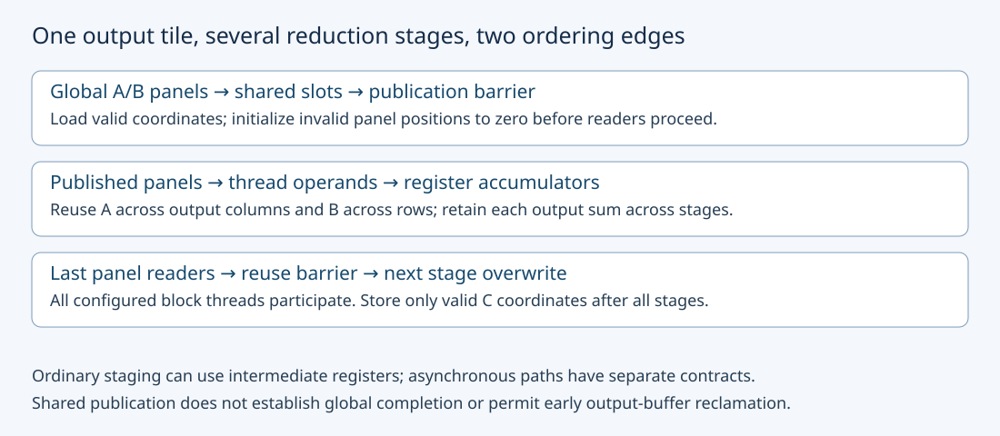
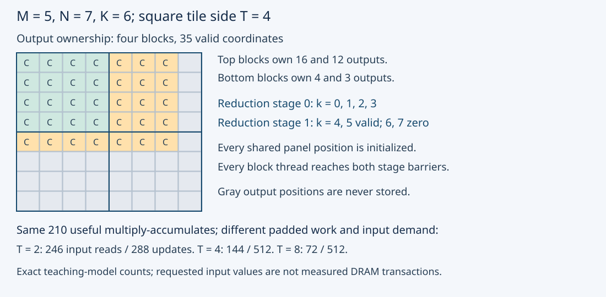

# M3-C08: Tiling and reuse through the memory hierarchy

> **Status: Complete — detailed chapter authored and documentation validated; experimental procedures are proposed unless explicitly labelled observed**

**Module:** Learn GPU architecture through data movement

**Category:** [Kernels, compilers, and execution](index.md)

[Module 3 reading order](../module-3.md) · [Previous: M3-C07](m3-c07-memory-coalescing-alignment-and-tensor-layouts.md) · [Next: M3-C09](m3-c09-tensor-cores-and-supported-matrix-operations.md) · [Execution plan and progress](../chapter-execution-plan.md)

## Target concepts

Matrix tiles, global-to-shared-to-register movement, reuse, synchronization, tile-size tradeoffs, edge tiles, shared-memory capacity, data movement versus redundant work.

## Concepts

### 1. A tile changes where values are reused, not the matrix product

A **tile** is a bounded rectangular portion of a larger tensor. Matrix multiplication combines A of shape M × K with B of shape K × N to produce C of shape M × N. M identifies output rows, N output columns, and K the reduction dimension shared by the two inputs. For every valid row i and column j:

**C[i,j] = sum over k = 0,…,K−1 of A[i,k] × B[k,j].**

The **reduction** combines several contributions into one output. The required operation here overwrites C with AB, starting its accumulator at zero; it does not add a previous C. A **multiply-accumulate** multiplies two operands and adds their product to an accumulator. We count one such update as two conventional floating-point operations, or FLOPs, even when one fused instruction performs it. Thus conventional useful work is **2MNK FLOPs**. This count is distinct from exact mathematical addition count or actual instruction count.

A direct conceptual baseline obtains both operands from global memory for every output contribution. A tiled arrangement can bring an A panel and B panel into block-owned shared memory and reuse them across outputs. A **panel** is the rectangular input region needed for one reduction stage of an output tile. Accumulators can remain in per-thread registers across stages. The mathematical coordinates and output ownership must remain unchanged.

Completed [M1-C04](../model-computation-and-semantics/m1-c04-dot-products-and-matrix-multiplication.md) supplies matrix-product foundations; [M3-C07](m3-c07-memory-coalescing-alignment-and-tensor-layouts.md) supplies layout/traffic boundaries; [M3-C06](../hardware-architecture-and-topology/m3-c06-registers-shared-memory-and-local-resource-pressure.md) supplies register/shared-memory and ordering contracts. Rust is the host-engine context for descriptors, ownership and submission. No implementation, kernel body or pseudocode is provided.

High-Frequency Trading (HFT) systems motivate attention to repeated data access, bounded working state and the critical path to useful completion. Those systems-engineering lessons transfer to inference; this chapter makes no trading-performance claim and does not equate exchange semantics with GPU execution.

### 2. Follow one output tile through the hierarchy

Use a square teaching tile of side T. One block owns a T × T output region. Each reduction stage covers T consecutive k positions and uses one T × T A panel and one T × T B panel. The baseline teaching mapping assigns T² configured threads, one output accumulator/thread. This mapping makes costs transparent; production kernels can assign several outputs/thread or use other execution mechanisms.

The stages of the data path have different scopes:

| Boundary | Meaning in this chapter |
|---|---|
| Global input → shared panels | Cooperating threads obtain valid A/B values and initialize invalid panel positions to zero |
| Shared panels → thread working operands | Each output contribution reads its A/B operands from the published panels; actual instructions/cache/broadcast behavior must be inspected |
| Thread accumulator across reduction stages | Each output retains the sum of its contributions; compiler allocation determines actual register cost |
| Completed accumulator → global C | Only valid output coordinates are stored, with exactly one authorized writer |

Ordinary synchronous staging can use a temporary register between a global load and a shared store. Architecture-specific asynchronous copy paths may move data differently; they are not assumed here. The [CUDA shared-memory tutorial](https://docs.nvidia.com/cuda/cuda-c-best-practices-guide/index.html#shared-memory) illustrates both reuse and the distinction between staging mechanisms. Removing a repeated global request is not the same as eliminating all data movement.

A panel value of A can feed T output columns within a full tile; a B value can feed T output rows. This is **within-block reuse**. Another output block may request the same global value again; a hardware cache might serve it, but the baseline does not promise inter-block shared storage. [M3-C05](../hardware-architecture-and-topology/m3-c05-device-memory-hbm-and-the-cache-hierarchy.md) explains why global request bytes and DRAM bytes differ.

### 3. Derive the saved requests and the added work

For a full T × T output tile and one full T-wide reduction stage, the direct operand-demand model requests **2T³ scalar global reads**: two operands for each of T³ multiply-accumulates. Staging requests **2T² scalar global reads** for the panels, then permits reuse. For FP32, four bytes/value, the two shared panels require **8T² bytes** before padding/alignment/implementation overhead.

This model also has **2T² logical shared-slot writes** and **2T³ logical per-output shared operand reads** per full stage. Same-address reads can be served by broadcast, the compiler can retain operands in registers, and instructions can be vectorized. Therefore logical operand reads are not a prediction of bank transactions or issued shared instructions. Record the accounting boundary.

For a divisible square problem of side L and T dividing L, the baseline's direct input-read demand is **2L³ scalar values**. Staged input-read demand is **2L³/T scalar values**, assuming each output block stages both panels once per reduction stage. Output writes remain **L² values**. These are algorithmic demand counts, not guaranteed DRAM transfers. Hardware caching can already reuse direct reads; register/shared staging adds its own overhead.

For L = 32, useful work is 32,768 multiply-accumulates, or 65,536 conventional FLOPs. FP32 output is 4,096 bytes:

| Arrangement | Global input-read demand | Shared panel bytes/block | Configured threads/block |
|---|---:|---:|---:|
| Direct demand model | 262,144 B | 0 | Mapping chosen separately |
| T = 4 | 65,536 B | 128 B | 16 |
| T = 8 | 32,768 B | 512 B | 64 |
| T = 16 | 16,384 B | 2,048 B | 256 |

A larger tile improves this particular global-read demand ratio but can reduce the number of blocks, consume more shared memory, increase register demand or change instruction scheduling. Sixteen threads form a partial warp under the 32-lane NVIDIA model. Thread count alone does not determine occupancy or runtime. [M3-C04](../hardware-architecture-and-topology/m3-c04-occupancy-latency-hiding-and-hardware-utilization.md) explains those distinctions.

### 4. Edge tiles require two input masks and an output mask

**Edge tiles** intersect the boundaries of M, N or K. Let **Gᵣ = ceil(M/T), G꜀ = ceil(N/T), Q = ceil(K/T)**. Ceil rounds up. There are GᵣG꜀ output blocks and Q reduction stages per block. An A panel load is authorized by its row and k coordinate; a B load by its k and column coordinate. Output stores require both valid output row and column. Output validity alone cannot authorize either input load.

This chapter's padded-work model initializes invalid shared panel slots to zero, evaluates all T³ contribution positions/stage, and suppresses stores outside C. It preserves a uniform block protocol while doing extra arithmetic. A valid-output-only arithmetic variant is possible, but has a different operation count and must preserve collective participation. It cannot silently borrow the padded model's counts.

Use **M = 5, N = 7, K = 6**, with A[i,k] = i + k and B[k,j] = k + j. An independent exact formula is:

**C[i,j] = 55 + 15(i + j) + 6ij.**

Here the sums of k and k² for k = 0,…,5 are 15 and 55. For example C[0,0] = 55, C[0,6] = 145, C[4,0] = 115 and C[4,6] = 349. All inputs, products and partial sums are small exactly representable FP32 integers. The output sum is **5,810**, but every coordinate still needs comparison.

| T | Output blocks × stages/block | Padded multiply-accumulates | Valid scalar global input reads | Zero-filled panel slots |
|---|---|---:|---:|---:|
| 2 | 12 × 3 | 288 | 246 | 42 |
| 4 | 4 × 2 | 512 | 144 | 112 |
| 8 | 1 × 1 | 512 | 72 | 56 |

Useful work remains **MNK = 210 multiply-accumulates** in every case. The padded work count is **GᵣG꜀QT³**. Valid global input reads are **G꜀MK + GᵣKN**, because A is staged again for each output-column tile and B for each output-row tile. Total shared initialization slots are **2GᵣG꜀QT²**; subtract valid reads to obtain zero-filled slots.

At T = 2, useful work is 210/288 ≈ 72.917% of padded work; at T = 4 or 8 it is 210/512 = 41.015625%. These are arithmetic fractions, not measured GPU efficiency. T = 8 makes fewer valid global input requests than T = 2 while doing more padded arithmetic. This is the chapter's central tradeoff: data movement and redundant work must be evaluated together.

### 5. Publication and overwrite boundaries surround every stage

After staging, consumers must not read the panels before the required producers finish and publish their writes. Before the next stage overwrites the same shared region, all readers of the old stage must finish. The teaching protocol retains **one block-wide publication barrier and one block-wide reuse barrier per stage**, including the last stage for uniform accounting.

All configured block threads participate in those barrier instances, including threads whose output coordinate is invalid. Invalid global reads are suppressed and their shared positions are initialized to zero; an early return before a required collective violates this protocol. The [CUDA SIMT guide](https://docs.nvidia.com/cuda/cuda-programming-guide/02-basics/writing-cuda-kernels.html) explains shared-memory cooperation and block synchronization. A fence alone does not establish that all readers have completed, and a block barrier is not a grid-wide rendezvous.

At T = 4 in the 5 × 7 × 6 fixture, each block has two stages and four prescribed barrier instances. Across four blocks that is **16 block-barrier instances** and **256 thread/barrier arrivals**. The final output tile begins at row 4, column 4. It has only three valid outputs, but all 16 threads still initialize their assigned shared slots and participate in synchronization.

The second reduction stage contains only k = 4,5; k = 6,7 panel positions must be zero even if the shared region held nonzero data in the previous stage. Missing zero fill can turn stale memory into a spurious contribution. Missing reuse ordering can let stage 1 overwrite data while a slower warp still consumes stage 0. Small single-warp examples do not justify removing ordering from a larger multi-warp candidate.

### 6. Capacity, numerical behavior and useful latency bound the choice

Shared-memory feasibility requires the actual per-block allocation to fit the function/device limit. A rough single-buffer lower bound is **8T² bytes** for two FP32 square panels. Two panel-buffer sets would double that to **16T² bytes**, before padding and other state. Double buffering does not guarantee overlap; hardware support, independent work and correct publication/lifetime rules are necessary. Overlap is developed later rather than assumed here.

Registers also hold accumulators, operands and addresses. Several outputs/thread can increase reuse while increasing live working state; final compiler reports, allocation granularity and spill evidence determine actual costs. Tile padding can improve one access pattern while increasing shared allocation. Larger T is not automatically better. The [CUDA capability limits](https://docs.nvidia.com/cuda/cuda-programming-guide/05-appendices/compute-capabilities.html) distinguish per-block and per-SM limits and configuration requirements; record exact runtime byte limits for the actual device.

General floating-point matrix products can change with reduction order, fusion or precision. The exact integer fixtures below deliberately avoid that ambiguity; they do not certify arbitrary model weights. Preserving dtype alone does not justify an unbounded tolerance. Tensor-core formats and their contracts belong to M3-C09; this chapter's baseline is scalar FP32 with recorded numerical options.

Global inputs remain immutable while pending readers require them. Each valid output has one authorized writer. Cancelled host work cannot release device buffers before last use is known to have ended; failed staging cannot publish a valid panel. Under allocation/launch failure, reject the candidate explicitly rather than silently skip outputs. HFT's bounded state and producer/consumer ownership concerns motivate this discipline, with CUDA-specific ordering used directly.

## Experiments

All experiments are proposed. Use completed [M9-C01](../numerics-and-correctness/m9-c01-defining-reference-behavior-and-evidence-before-optimizing.md) references, [M9-C02](../measurement-experimentation-and-economics/m9-c02-request-events-clocks-and-measurement-boundaries.md) completed timing, [M9-C07](../measurement-experimentation-and-economics/m9-c07-latency-distributions-and-statistical-uncertainty.md) distributions, [M9-C15](../state-memory-and-caching/m9-c15-accounting-for-weights-kv-state-workspace-and-fragmentation.md) storage/traffic scopes and [M9-C17](../numerics-and-correctness/m9-c17-comparing-logits-with-justified-numerical-tolerances.md) numerical gates. Advanced profiling/overlap material remains later work; required introductory controls are local here.

### E1 — Preserve a matrix product across tile sizes

- **Description:** Compare the direct mathematical reference with padded tile decompositions at T = 2,4,8.
- **Purpose/objective:** Establish correct coordinate/reduction behavior before discussing reuse.
- **Target concepts:** Matrix tiles, edge masks, accumulator state and redundant arithmetic.
- **Baseline and workload:** M = 5, N = 7, K = 6; A[i,k] = i + k, B[k,j] = k + j; C starts from zero and is overwritten by AB. Independent oracle C[i,j] = 55 + 15(i+j) + 6ij.
- **Controls and prediction:** Hold shapes, values, output layout and precision fixed; vary only the reference decomposition. Predict 35 identical outputs/tile size, while padded work and staging counts differ as in the table.
- **Procedure:** Enumerate each output block's row/column bounds and all k stages. Apply separate A/B validity rules and zero invalid panel positions. Compare every output to the independent formula, then reconcile useful and padded work counts. Include wrong reduction-offset and uninitialized-edge reference probes that must fail.
- **Hardware/software:** Arithmetic baseline needs no GPU; optional supported device candidate requires recorded target/numerical options and valid thread/shared limits for each T.
- **Failure and HFT connection:** Reject skipped or duplicated output ownership and stale panel values. HFT identity-preserving partitioning is a useful analogy, but matrix reduction is not an exchange event sequence.
- **Exit criteria:** All 105 output comparisons pass, all tile/stage masks reconcile and deliberate faults are rejected. No performance result follows from this reference agreement.

### E2 — Account for reuse at every memory boundary

- **Description:** Compare direct operand demand with shared-panel staging for L = 32 and T = 4,8,16.
- **Purpose/objective:** Quantify saved global requests without hiding shared movement or resource cost.
- **Target concepts:** Global-to-shared-to-register movement, reuse, capacity and data movement versus repeated work.
- **Baseline and workload:** Square 32 × 32 matrices, scalar FP32 and zero-initialized output accumulators; use A[i,k] = (i+k) modulo 4 and B[k,j] = (k+j) modulo 4. Pin the same reference matrix product in all arrangements.
- **Controls and prediction:** Hold useful work/outputs fixed. Predict 262,144 direct input-demand bytes versus 65,536,32,768,16,384 staged bytes and panel allocations 128,512,2,048 bytes. These are logical models, not device-memory observations.
- **Procedure:** Reconcile valid global reads, shared writes, logical shared operand reads, output writes and live allocations. Calculate one versus two panel-buffer sets separately. A later GPU profile must identify actual retained register operands, broadcasts, instruction widths and caches rather than forcing physical counters to equal these models.
- **Hardware/software:** Reference ledger needs no device; optional profiling requires a supported GPU, final compiled resource reports and available level-specific counters.
- **Failure and HFT connection:** Reject a ledger that calls all logical input-demand bytes DRAM traffic. HFT repeated-state access motivates reuse accounting, but GPU shared staging differs from CPU caches.
- **Exit criteria:** All byte/work/storage scopes reconcile and all arrangements preserve the reference product. Report unavailable counters and model limits explicitly; fewer modeled global reads alone does not prove lower elapsed time.

### E3 — Audit edge publication and safe panel reuse

- **Description:** Trace panel validity and collective obligations at partial dimensions and empty cases.
- **Purpose/objective:** Preserve correctness when tails contribute little useful work but still own synchronization duties.
- **Target concepts:** Edge tiles, zero fill, shared lifetime, synchronization and failure behavior.
- **Baseline and workload:** T = 4; (M,N,K) in {(1,1,1),(5,7,6),(8,8,8),(9,7,5),(0,7,6),(5,0,6),(5,7,0)}. Use A/B modulo-4 formulas from E2. M = 0 or N = 0 is no-output work and skips dispatch under this specification; K = 0 with nonempty C requires all valid C values zero, with no operand reads.
- **Controls and prediction:** Same masks, ownership and two barriers/stage for nonempty reduction work. No-input K = 0 has zero reduction stages and requires a separate defined output-initialization behavior; it is not permission to retain old C.
- **Procedure:** Enumerate valid/zero panel slots, unique output writers and matching collective instances. Use paper-only missing-publication, missing-reuse and invalid-output-early-return counterexamples; do not launch a known-invalid collective. Treat incomplete zero fill as a separate reference fault. For a future correct candidate use compatible memory/hazard/synchronization diagnostics in separate runs.
- **Hardware/software:** Paper/reference checks need no GPU. Optional device diagnostics require a supported block contract, legal resource configuration and compatible correctness tooling.
- **Failure and HFT connection:** Cancellation cannot authorize overwriting still-read shared state or reclaiming global outputs. HFT buffers have analogous last-reader obligations, but CUDA collective rules must be established directly.
- **Exit criteria:** All seven shape contracts and their output/mask counts pass; every invalid paper protocol has a concrete rejected obligation. Tool success supports tested cases, not all possible schedules.

### E4 — Benchmark useful completed work against tile overhead

- **Description:** Compare a direct consumer with T = 8 and T = 16 single-buffer tiled candidates.
- **Purpose/objective:** Test whether saved requests improve completed matrix-product cost at representative small, aligned and ragged shapes.
- **Target concepts:** Tile-size tradeoffs, memory hierarchy reuse, shared capacity, redundant work and critical-path synchronization.
- **Baseline and workload:** Four (M,N,K) shapes: (5,7,6),(32,32,32),(128,128,128),(129,127,65). Inputs use the E2 modulo-4 formulas. The direct candidate maps one output/thread with 256 threads/block; tiled candidates use T² threads/block, one accumulator/thread and the specified padded-work protocol. All return the same packed C = AB.
- **Controls and prediction:** Twelve shape/arrangement cells share input/output identity, dtype, recorded scalar FP32 numerical options and device residency. Geometry, staging and synchronization differ between arrangements and must be reported together; this is not a one-variable causal test of shared memory alone. No speed ranking is guaranteed.
- **Procedure:** Check function/device legality and every reference output before comparison. Use 3 sessions × 20 measured trials/cell = 720 scheduled trials and 10 warmups/cell/session = 360 warmups. Randomize matched arrangement order within each shape with a recorded seed; preallocate buffers and keep one trial in flight. Profile representative deterministic trials separately from timing.
- **Hardware/software:** One supported GPU with legal 256-thread blocks and sufficient actual shared allocation; T = 16 has a 2,048-byte panel lower bound. Largest input/output payload is 192 KiB, plus runtime workspace/overhead/reserve. Record exact device/partition, compiler/target and actual resource usage.
- **Failure and HFT connection:** Retain wrong outputs, rejected configurations, launch errors and unknown completion; protect pending buffers. HFT critical-path comparisons motivate completed useful-work timing, but this resident matrix benchmark omits arrivals, KV semantics and delivery latency.
- **Exit criteria:** All 720 trial outcomes reconcile, successful outputs pass exact comparison and any performance claim includes useful-work timing plus resource/traffic evidence. No gain or a regression is a valid result; service benefit requires a later end-to-end gate.

## Verification

### Independent references and exact work ledgers

E1's independent output formula supplies 35 coordinates and checksum 5,810; all three decompositions must match each coordinate. For T = 2,4,8, shared initialization-slot counts are **288,256,128**, of which **246,144,72** come from valid global input values and the rest **42,112,56** are zero fill. Padded multiply-accumulate counts are **288,512,512**, while useful work is 210. Valid global input bytes are **984,576,288**; valid output bytes remain **140**. The direct operand-demand model requests 1,680 input bytes. These counts exclude actual transaction granularity and cache service.

E2's useful work is 32,768 multiply-accumulates. Logical shared operand reads are **65,536 scalar values** for every tiled arrangement under the per-output demand model; broadcasts or register reuse may reduce physical service. Shared initialization writes are **16,384;8,192;4,096 values** for T = 4,8,16 respectively. Single panel-buffer allocations are 128,512,2,048 bytes and two sets would require 256,1,024,4,096 bytes before other overhead. The double-buffer ledger makes no overlap claim.

For E3, valid output counts in listed shape order are **1,35,64,63,0,0,35**. The four cases with nonempty reduction work have output block counts **1,4,4,6**, stages/block **1,2,2,2**, and block-barrier instances **2,16,16,24**. The empty-output cases skip dispatch; the nonempty K = 0 case writes 35 zeros and performs no operand reads or reduction-stage barriers under this contract.

A concrete publication fault at T = 8 lets thread handling local output (0,0) read B panel position (4,0) before its producer in another warp writes it. A reuse fault lets that producer overwrite the same shared position for the next reduction stage while the old reader still expects stage 0. For these paper counterexamples use M = N = K = 32 with A[i,k] = i+k and B[k,j] = k+j, rather than the periodic benchmark inputs. B[4,0] is 4 and the next stage's B[12,0] is 12: a stale zero or premature 12 can change the expected contribution with A[0,4] = 4. The reuse witness requires at least two stages. A tail-output early return in the T = 4 edge block removes 13 of its 16 configured threads even though all must participate in the prescribed barriers. The tiny T = 4 reference is not evidence that a missing barrier is safe for T = 8.

To detect wrong stage offsets, compare against the independent product with a candidate that repeats k = 0,…,T−1 instead of advancing to the next stage. To detect missing zero fill, use the E1 T = 4 fixture and seed both A[0,6] and B[6,0] teaching panel positions with 1 instead of their required zeros. This deliberately invalid reference contribution raises C[0,0] from 55 to 56. These are panel positions beyond valid k, not authorized global reads. Do not rely on a fortunate previous zero or on checksum equality alone.

E4's useful multiply-accumulate counts per trial are **210;32,768;2,097,152;1,064,895** in shape order. All modulo-4 input products are nonnegative integers at most nine. The largest K is 128, so every reference partial sum is at most 1,152 and exactly representable in FP32. Record numerical options and scalar execution; this fixture does not validate reduced-precision arithmetic on general weights.

There are 180 measured trials/shape across the three arrangements, so the planned valid-output population is **180 × (35 + 1,024 + 16,384 + 16,383) = 6,088,680 values**, excluding warmups and diagnostic reruns. Compute useful rate from valid outputs or useful FLOPs at a declared boundary; padded arithmetic is not extra successful service.

### Timing, benchmarking and profiling

For E4 the primary host interval begins with resident immutable inputs and preallocated outputs ready, immediately before submission, and ends when valid device completion is observed on the host. C remains on device. The interval includes staging, accumulation and required synchronization; it excludes compilation, initialization, warmups and later validation readback, which are reported separately. Device-event intervals describe their own scope; never subtract timestamps from different clock domains or use submission return as completion.

Use a predeclared 120-second observation watchdog in future trials. It is not a latency objective or permission to reclaim pending allocations. Track success, incorrect output, unsupported/infeasible configuration, launch/runtime error and timeout/unknown completion separately. Preserve missing timings, reconcile every scheduled attempt, and quarantine uncertain global buffers until recovery establishes safe reuse.

Retain raw timings and session identities per shape/arrangement, medians, spread, explicitly defined nearest-rank quantiles and matched arrangement differences within each shape. Twenty trials/session cannot certify stable p99; do not average percentiles or pool matrix shapes. Record clocks/power/temperature and co-tenancy alongside randomized trial order.

For representative diagnostic runs, record final register usage, allocated shared bytes/block, theoretical/achieved resource occupancy definitions, global read/write sectors, shared service/conflict evidence, local spill traffic and relevant compute/memory throughput where supported. Inspect final load/store/accumulation instructions and retained work before attributing a result to reuse. The [Nsight Compute Profiling Guide](https://docs.nvidia.com/nsight-compute/ProfilingGuide/index.html) defines counter scopes and replay limitations. Logical per-output reads, cache requests and observed device-memory bytes are separate populations. Missing counters are unavailable evidence, not zero overhead.

Use unprofiled timing for performance claims. Profiler replay can alter cache histories and add work; sanitizer runs alter execution too. In separate future diagnostics use applicable [Compute Sanitizer](https://docs.nvidia.com/compute-sanitizer/ComputeSanitizer/index.html) memory, shared-hazard and collective checks. Their coverage differs and cannot replace the reference, mask and ownership review. No sanitizer run is claimed here.

The later service gate preserves model/token/cache identity, arrivals and outcome populations while measuring useful throughput, TTFT and delivered response distributions. A faster isolated matrix product can still add memory pressure, preparation or queueing elsewhere. None of these proposed experiments certifies a production inference or HFT latency result.

## Engineering dimensions and principles

### Six dimensions applied

| Dimension | Chapter-specific reasoning and evidence |
|---|---|
| Semantics and invariants | C = AB, reduction offsets, zero-filled invalid operands and unique output writers survive every tile choice. |
| Workload and variability | M/N/K tails, divisible versus ragged shapes, reuse and small grids change the balance of useful and padded work. |
| Resources and bottlenecks | Shared panels, registers, spills, global requests and bank service impose different costs; fewer input requests need not imply faster work. |
| Time and distributions | Publication and last-reader edges constrain every stage; retain shape-specific completed timing and slow outcomes. |
| Ownership and coordination | Block-owned panels cannot be overwritten before readers finish; global allocations persist through pending device use. |
| Failure and adaptation | Reject illegal tile configurations, retain unknown completion and define empty-output/K = 0 behavior explicitly. |

### Eight principles applied

1. **Correctness defines the optimization boundary.** Better reuse cannot compensate for wrong k offsets, missing outputs or stale panel values.
2. **Performance depends on workload and operating point.** The same tile can reduce requests on a full matrix and waste arithmetic on a small ragged one.
3. **Data movement is part of the algorithm.** Global staging, shared reads/writes and register retention all belong in the accounting.
4. **State has ownership, lifetime, and recovery cost.** A shared region has a stage lifetime; device outputs have a longer allocation lifetime and recovery obligations.
5. **Dependencies determine latency; bottlenecks determine capacity.** Consumers wait for published panels; shared/register budgets bound how much work can reside.
6. **Variability and synchronization shape the tail.** Edge work, uneven progress and competing resources affect completion even at fixed useful FLOPs.
7. **Local improvements must be evaluated end to end.** Saved global requests matter through correct useful completion including staging, synchronization and service effects.
8. **Claims require reproducible evidence.** Preserve shapes, descriptors, masks, resource reports, exact references, raw outcomes and counter/timing scopes.

## Specifications, articles, and hardware

Primary sources checked 26 October 2026:

- [CUDA Best Practices Guide 13.4 shared-memory tutorial](https://docs.nvidia.com/cuda/cuda-c-best-practices-guide/index.html#shared-memory): matrix reuse, redundant-load removal, bank/layout interactions and staging mechanisms. Its device-specific published examples are not results reproduced here.
- [CUDA SIMT kernel guide](https://docs.nvidia.com/cuda/cuda-programming-guide/02-basics/writing-cuda-kernels.html): block coordination, shared storage and thread mapping.
- [CUDA capability limits](https://docs.nvidia.com/cuda/cuda-programming-guide/05-appendices/compute-capabilities.html): architecture-specific thread/register/shared limits and configuration footnotes; read the actual target column.
- [Nsight Compute Profiling Guide](https://docs.nvidia.com/nsight-compute/ProfilingGuide/index.html): memory/resource metrics, instruction scopes and replay effects.
- [Compute Sanitizer guide](https://docs.nvidia.com/compute-sanitizer/ComputeSanitizer/index.html): diagnostic coverage for memory accesses, shared hazards and synchronization.

| Required specification | Record before future device execution |
|---|---|
| Hardware | Exact GPU/partition, compute capability, visible SMs, warp width, thread/block limits and CPU host |
| Local resources | Actual register allocation, static/dynamic shared bytes, allocation granularity, per-block/per-SM limits and reserve |
| Work contract | M/N/K, T, descriptors, dtype, scalar numerical options, masks, staging method and one/two panel-buffer sets |
| Software | Driver/runtime/compiler/target/options, executable identity, profiler/sanitizer versions and supported counters |
| Observation | Clock/completion boundaries, replay/cache policy, clocks/power/temperature, co-tenancy, seed and trial order |

The arithmetic references require no GPU. E4 needs one supported device with legal 256-thread blocks, actual shared-memory allocation for both candidates and up to 192 KiB input/output payload plus overhead/workspace/reserve. These are workload minima, not a guarantee that a particular compiled function is legal or fast. Multi-GPU, network and storage hardware are unnecessary. No GPU test machine, profile or measured benchmark has been supplied.

## Completion and next chapter

Track acceptance in the clickable [execution plan](../chapter-execution-plan.md). [M3-C09: Tensor cores and supported matrix operations](m3-c09-tensor-cores-and-supported-matrix-operations.md) is now complete and remains the next Module 3 reading chapter. The next authoring chapter is [M3-C10](../state-memory-and-caching/m3-c10-host-and-device-buffer-placement-and-lifetime.md). Module 9 supports Modules 1–7; Module 8 is excluded.
