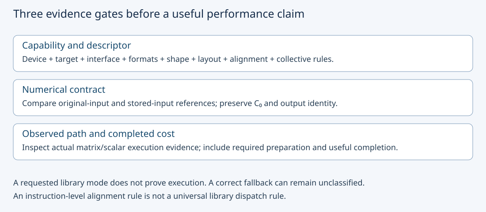
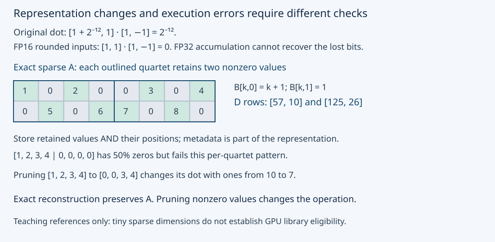

# M3-C09: Tensor cores and supported matrix operations

> **Status: Complete — detailed chapter authored and documentation validated; experimental procedures are proposed unless explicitly labelled observed**

**Module:** Learn GPU architecture through data movement

**Category:** [Kernels, compilers, and execution](index.md)

[Module 3 reading order](../module-3.md) · [Previous: M3-C08](m3-c08-tiling-and-reuse-through-the-memory-hierarchy.md) · [Next: M3-C10](../state-memory-and-caching/m3-c10-host-and-device-buffer-placement-and-lifetime.md) · [Execution plan and progress](../chapter-execution-plan.md)

## Target concepts

Matrix multiply-accumulate, tensor-core versus scalar execution paths, operand and accumulator formats, shape and alignment requirements, dense versus sparse paths, architecture-dependent capabilities.

## Concepts

### 1. A specialized matrix unit changes execution, not the required answer

A **tensor core** is NVIDIA's specialized execution hardware for supported matrix operations. **Matrix multiply-accumulate**, or MMA, combines input matrices A and B with an initial accumulator C₀ to produce D. For A of shape M × K, B of shape K × N and C₀,D of shape M × N:

**D[i,j] = C₀[i,j] + sum over k = 0,…,K−1 of A[i,k]B[k,j].**

The required axes, transpose choices and accumulator seed belong to the operation contract. An interface for general matrix multiplication, or GEMM, may additionally scale AB and C₀ or apply an output transformation. This chapter fixes both scales to one, with no bias, activation or other output transformation. A candidate that accidentally starts its accumulator at zero computes a different operation.

A **scalar execution path** performs the product through ordinary arithmetic instructions organized across threads. A **tensor-core path** uses supported collective matrix instructions and their associated layouts. A high-level matrix call can dispatch to different algorithms depending on shape, types, architecture, workspace and policy. A requested fast mode, matching result, kernel name or short elapsed time does not by itself prove which path executed. Require target-specific generated-instruction and/or profiler evidence, with its scope recorded.

Completed [M3-C08](m3-c08-tiling-and-reuse-through-the-memory-hierarchy.md) explains tiling and data reuse; [M3-C02](../hardware-architecture-and-topology/m3-c02-reading-gpu-specifications-and-capability-limits.md) explains capability/specification boundaries; [M1-C07](../numerics-and-correctness/m1-c07-floating-point-arithmetic-and-numerical-correctness.md) explains finite-precision arithmetic. Rust is the host-engine context for identity, submission and ownership. No implementation, instruction sequence or kernel code is supplied here.

High-Frequency Trading (HFT) systems motivate preserving semantic contracts while investigating specialized hardware and critical-path costs. This transfers the discipline of reproducible, useful completion; it does not equate GPU matrix instructions with exchange processing or establish trading performance.

### 2. Record storage, multiplication, accumulation and output separately

An **operand format** determines which input values are represented. An **accumulator format** describes the state combining products. The **output format** may round the accumulated result again. FP32 accumulation does not restore distinctions already lost when inputs were converted to a narrower format. Nor does a format label establish the internal reduction order or bitwise agreement with sequential scalar arithmetic.

For finite normal values near one, the following representation facts help explain conversion. Fraction bits exclude the implicit leading significand bit:

| Format or input mode | Storage/carrier context | Fraction precision near one | Main distinction |
|---|---|---:|---|
| FP32 | 32-bit floating-point storage | 23 bits | Baseline single-precision representation |
| FP16 | 16-bit floating-point storage | 10 bits | Narrower exponent range than FP32 |
| BF16 | 16-bit floating-point storage | 7 bits | FP32-like exponent range with fewer fraction bits |
| Conventional TF32 input rounding model | FP32 carrier; specialized matrix input precision | 10 fraction bits in this teaching model | A compute/input mode, not a two-byte tensor-storage promise |

TF32's internal representation and the actual selected compute policy must be checked for the interface/device. FP8 names such as E4M3 and E5M2 identify different exponent/fraction arrangements; newer low-bit/block-scaled paths additionally require explicit scaling and architecture contracts. They are optional extensions, not interchangeable ways to relabel the FP16 baseline. Integer MMA likewise needs operand signedness, accumulator width, scale and overflow rules; it is not floating-point arithmetic with smaller storage.

Consider original FP32 inputs **a = [1 + 2⁻¹², 1]**, **b = [1, −1]**, and zero initial accumulator. Their exact dot product is **2⁻¹² = 0.000244140625**. Round a to FP16 with round-to-nearest, ties-to-even: 1 + 2⁻¹² becomes 1, so the stored-input dot product is zero even with FP32 accumulation. The expected conversion difference is not an execution bug, but it may still violate the intended application accuracy budget.

Use two references: **Doriginal** from original inputs and **Dstored** from exactly decoded stored/converted operands. For any output coordinate:

**Dcandidate − Doriginal = (Dstored − Doriginal) + (Dcandidate − Dstored).**

The first term isolates representation change; the second tests execution relative to those stored inputs. A reference also needs an independent accumulation policy and uncertainty estimate for general real-valued data. Output casting, reduced intermediate precision, exceptional values and flush/rounding settings must be recorded separately. Completed [M9-C17](../numerics-and-correctness/m9-c17-comparing-logits-with-justified-numerical-tolerances.md) supplies justified error gates; do not enlarge tolerances merely to admit a fast candidate.

### 3. Instruction contracts and library eligibility are different layers

**WMMA**, warp matrix multiply-accumulate, is one CUDA collective interface. A **fragment** is a distributed representation of a matrix tile across participating threads; its internal element-to-lane mapping is not a portable logical matrix layout. Do not infer that one thread owns the same element positions across different targets.

As a versioned example, the [CUDA 12.8.1 WMMA specification](https://docs.nvidia.com/cuda/archive/12.8.1/cuda-c-programming-guide/index.html#warp-matrix-functions) includes FP16 operands with FP32 accumulators at m = n = k = 16. Its documented matrix load/store pointer alignment is **256 bits = 32 bytes**; its leading dimension is in elements, with multiples of eight for FP16 and four for FP32. The collective requires full-warp participation with consistent parameters. These are this named interface's rules, not universal requirements for every tensor-core library call. Confirm the installed target/interface before any future run.

A **leading dimension** is the physical stride between successive rows or columns according to the chosen layout. It must also be large enough for the logical row/column span and backed by a valid allocation. An aligned base plus a misaligned storage offset can violate a collective load contract. Correct scalar alignment does not establish collective matrix-load legality.

For an illustrative row-major 16 × 16 FP16 operand, leading dimension 16 spans 32 bytes per row and satisfies the stated multiple-of-eight rule. Leading dimension 18 fails that rule. A pointer shifted by two bytes fails the stated 32-byte requirement even though individual FP16 scalars remain aligned. Do not execute such invalid descriptors as a benchmark condition.

A ragged product with M = 17, N = 15, K = 9 could be embedded in zero-padded dimensions 32 × 16 × 16 for this teaching tile. Useful multiply-accumulates remain **17 × 15 × 9 = 2,295**, while a full padded product contains **8,192**, giving useful/padded work **2,295/8,192 ≈ 28.0151%**. Padding changes storage and preparation too; stores must still return only valid outputs with the correct C₀ seed.

Library dispatch is a separate layer. The [cuBLAS 13.4 Tensor Core usage section](https://docs.nvidia.com/cuda/cublas/index.html#tensor-core-usage) distinguishes performance-friendly alignment from broad eligibility and notes that the library chooses algorithms. Do not transplant the WMMA tile rule into a claim that every ragged cuBLAS product must fall back. Conversely, accepting a descriptor does not prove a tensor instruction was used.

### 4. Architecture support is a tuple, not a product-family label

A capability record should identify **device/partition + compiled target + runtime/library version + interface/instruction + operand/accumulator/output types + shape/layout/alignment + numerical policy + dense/sparse mode**. Support for one tuple does not establish support for a neighboring one. Toolkit version alone does not create hardware capabilities, and a device with tensor cores need not accelerate every supported floating-point format through the same interface.

The archived WMMA tables provide different shape/type combinations, including a 16 × 16 × 8 TF32 example and 16 × 16 × 16 FP16/BF16 examples. Treat them as scoped examples rather than a complete current architecture matrix. Newer architecture-specific matrix mechanisms require their own collective, storage and lifetime rules.

A library **policy** permits or restricts algorithm/precision choices. The [cuBLAS numerical and compute-type documentation](https://docs.nvidia.com/cuda/cublas/index.html) explains compute modes, automatic selection and numerical caveats. Defaults and environment overrides belong in the manifest. Preserve actual policy and observed path for the exact call; “FP32 output” alone says little about how multiplication happened.

Even when a tensor path is legal, launch overhead, preparation, a small grid or memory movement can dominate. Compare compatible useful FLOPs and elapsed boundaries to the correct dense/sparse, format-specific specification. A nameplate peak is an upper rate under its stated conditions, not a latency prediction or evidence that those conditions occurred.

### 5. Structured sparsity is an additional semantic and representation contract

A **dense** matrix stores its values without assuming a prescribed zero pattern. A **structured sparse** path exploits a particular pattern and an encoding that identifies retained values and positions. Generic “50% zeros” is insufficient to establish a specific sparse instruction's eligibility.

Use a mathematical 2:4 teaching pattern: along each row's reduction dimension, every contiguous group of four positions has exactly two retained nonzero values. Real eligibility depends on operand/layout/transpose, dtype, grouping and metadata rules in the selected interface. The [cuSPARSELt documentation](https://docs.nvidia.com/cuda/cusparselt/index.html) and NVIDIA's [structured-sparsity article](https://developer.nvidia.com/blog/exploiting-ampere-structured-sparsity-with-cusparselt/) explain the additional library/architecture context. The small reference below is not asserted to meet a GPU library's minimum dimensions.

Take A of shape 2 × 8, with rows:

**[1,0,2,0, 0,3,0,4]** and **[0,5,0,6, 7,0,8,0]**.

Let B[k,0] = k+1 and B[k,1] = 1. With zero seed, the exact output rows are **[57,10]** and **[125,26]**. Encoding retained values with their correct positions and reconstructing the same A preserves the operation. At FP16, A's dense values occupy 32 bytes; eight retained values occupy 16 bytes **plus metadata, padding and any workspace**. The complete representation is not automatically half the bytes.

An A row [1,2,3,4,0,0,0,0] has 50% zeros overall but fails the stated per-group pattern. **Pruning**, removing selected nonzero values to impose sparsity, changes the matrix. For [1,2,3,4] dotted with four ones, the original result is 10; retaining only 3 and 4 gives 7. That is an approximation requiring a separate quality/accuracy contract, not an equivalent faster implementation of the original matrix product.

Report the work convention: the 2 × 8 by 8 × 2 product has 32 dense multiply-accumulates, or **64 dense-equivalent FLOPs**. Exploiting eight nonzeros in A yields 16 nonzero product contributions, but actual sparse instruction work and metadata service are separate. Do not compare a sparse dense-equivalent rate with a dense peak without matching the vendor's convention and including compression/preparation costs where required.

## Experiments

All experiments are proposed. Apply completed [M9-C01](../numerics-and-correctness/m9-c01-defining-reference-behavior-and-evidence-before-optimizing.md) references, [M9-C02](../measurement-experimentation-and-economics/m9-c02-request-events-clocks-and-measurement-boundaries.md) timing, [M9-C07](../measurement-experimentation-and-economics/m9-c07-latency-distributions-and-statistical-uncertainty.md) distributions, [M9-C15](../state-memory-and-caching/m9-c15-accounting-for-weights-kv-state-workspace-and-fragmentation.md) byte scope and [M9-C17](../numerics-and-correctness/m9-c17-comparing-logits-with-justified-numerical-tolerances.md) numerical gates. Advanced kernel/quantization/profiling material remains later work; required introductory controls are local here.

### E1 — Audit a supported operation tuple before dispatch

- **Description:** Check MMA shape, layout, alignment, seed and collective obligations using the versioned WMMA example.
- **Purpose/objective:** Separate descriptor legality and mathematical agreement from executed-path evidence.
- **Target concepts:** MMA, supported shapes/alignment, formats and architecture-dependent capabilities.
- **Baseline and workload:** 16 × 16 × 16; A[i,k] = (i+k) modulo 4, B[k,j] = (k+j) modulo 4; C₀[i,j] = (i+j) modulo 3. FP16 A/B, FP32 C₀/accumulation/output. All input values are exactly representable; use an independent integer product-plus-seed reference.
- **Controls and prediction:** Fixed values and operation contract. For the named descriptor rules, base offsets 0 and 32 bytes preserve 32-byte alignment; offsets 2 and 16 do not. FP16 leading dimension 16 is valid for the stated layout, 18 fails the multiple rule. FP32 leading dimension 12 passes its multiple rule but fails a required 16-column span.
- **Procedure:** Produce the device/interface tuple and check shape, allocation span and consistent full-warp parameters before any optional launch. Reject invalid descriptors on paper. Validate all 256 outputs including nonzero seeds. A later correct runtime candidate needs generated matrix-instruction or matching profiler evidence before being called a tensor-core run.
- **Hardware/software:** Arithmetic needs no GPU. Optional device work requires actual support for the specified interface/type combination, recorded target/version and legal resources; archived requirements are not a promise about an arbitrary installed stack.
- **Failure and HFT connection:** Reject unsupported tuples and inconsistent participation rather than launch invalid collectives. HFT hardware capability checks motivate explicit contracts, but a CUDA warp is not a host processing thread.
- **Exit criteria:** All descriptor decisions and 256 exact outputs pass; a wrong zero seed is rejected. Keep mathematical success, eligibility and observed executed path as three separate evidence fields.

### E2 — Separate input conversion from accumulation error

- **Description:** Compare original-input and stored-input dot-product references under explicit format rounding.
- **Purpose/objective:** Avoid attributing lost input information to an execution defect or excusing it with accumulation precision.
- **Target concepts:** Operand/accumulator/output formats, numerical policy and scalar/tensor comparison.
- **Baseline and workload:** The two-element cancellation fixture above, plus 1 + 2⁻⁸ rounded to FP16/BF16. Define round-to-nearest, ties-to-even for these reference conversions; separately inspect a finite original FP32 value 70,000 whose FP16 conversion overflows under this policy.
- **Controls and prediction:** Hold original values and comparison identities fixed. The cancellation fixture has exact original result 2⁻¹² and FP16-stored reference zero. At 1 + 2⁻⁸, FP16 preserves the value while BF16 rounds the halfway value to 1. Finite-output policy rejects a conversion producing infinity before a performance claim.
- **Procedure:** Record original values, stored bit/value identities, independent stored-input result and candidate output. Apply an illustrative application absolute-error budget of 10⁻⁵ to the original cancellation result: zero fails even if execution against stored inputs is exact. This is a fixture-specific rejection example, not a default tolerance for real models. Record actual device conversion/rounding settings if later measured.
- **Hardware/software:** Exact rational/format reference needs no GPU. Device extension needs the selected conversion and compute policies, output format, exceptional-value behavior and recorded compiler/library versions.
- **Failure and HFT connection:** Reject unexplained nonfinite values and changed input identity. HFT decisions can also depend on small numeric distinctions, but this fixture does not define acceptable trading or model-quality error.
- **Exit criteria:** Conversion and execution errors are attributed separately, the 10⁻⁵ gate rejects the lossy original-input result, and overflow is explicit. FP32 accumulation is never reported as proof of original FP32 input fidelity.

### E3 — Validate sparse structure without silently pruning

- **Description:** Compare dense reference execution with a retained-value/position representation of the same small sparse A.
- **Purpose/objective:** Distinguish exact sparse encoding from a changed matrix and misleading work/byte rates.
- **Target concepts:** Dense/sparse paths, metadata, architecture eligibility and approximation boundaries.
- **Baseline and workload:** A is the two-row 2 × 8 fixture and B the 8 × 2 fixture above; C₀ = 0. For every row/quartet record two distinct retained positions and their values. Use an abstract identity ledger, not an invented hardware metadata encoding.
- **Controls and prediction:** Fixed A/B identity and exact output rows [57,10],[125,26]. Dense values are 32 FP16 bytes; retained values are 16 bytes plus separately specified representation costs. Overall 50% zeros alone is insufficient.
- **Procedure:** Reconstruct all 16 A positions and compare each. Validate all quartets and output coordinates. Reject the overall-half-zero but invalid-group row, a swapped retained-position ledger and a missing metadata version. Separately evaluate the pruning example 10 → 7 and label it changed computation. Optional GPU sparse execution must first satisfy the selected library's actual minimum sizes, layouts and pattern checker; the tiny fixture is only a mathematical reference.
- **Hardware/software:** No device required for the reference; an extension needs an explicitly supported sparse tuple, metadata/compression specification and recorded library/architecture. Include pruning/compression/workspace costs in any relevant timed route.
- **Failure and HFT connection:** Reject stale compressed copies and malformed metadata; keep buffers alive through dependent consumers. HFT precomputed-state identity is analogous, but a 2:4 matrix encoding is not a market-data compression guarantee.
- **Exit criteria:** All structure/identity checks and four output values pass, negative ledgers are rejected and dense-equivalent/nonzero/physical-work conventions remain distinct. No sparse hardware use or speedup is claimed without device evidence.

### E4 — Compare observed dense paths at fixed stored inputs

- **Description:** Compare an intended scalar FP32-accumulation control and a permitted tensor-core candidate on the same FP16 operands and FP32 seed/output.
- **Purpose/objective:** Relate actual executed path and completed cost without conflating input precision or padding work.
- **Target concepts:** Scalar versus tensor execution, shape/layout, formats, architecture support and useful service.
- **Baseline and workload:** (M,N,K) in {(16,16,16),(128,128,128),(129,127,65)}. Use A/B modulo-4 and C₀ modulo-3 formulas from E1. Both candidates read the same stored FP16 A/B and FP32 C₀ and produce separate FP32 D. Control promotes stored operands for scalar arithmetic; tensor candidate uses its supported declared accumulation mode.
- **Controls and prediction:** Six shape/route cells share exact semantic inputs, operation and output contract, residency, device and recorded numerical policies. Pin layout/algorithm/workspace and required padding/preparation. Eligibility may produce a fallback; no tensor path or speed ranking is assumed. A control observed using matrix instructions cannot be labelled a scalar control.
- **Procedure:** Establish exact outputs and descriptor legality first. Use 3 sessions × 20 trials/cell = 360 scheduled measured trials and 10 warmups/cell/session = 180 warmups. Randomize matched route order per shape with a recorded seed; preallocate buffers and keep one trial in flight. Profile representative deterministic calls separately to classify actual paths. Report an unclassified/fallback comparison explicitly rather than claim a scalar-versus-tensor result.
- **Hardware/software:** One supported GPU and compatible dense candidates with recorded target/library/math policies. Largest raw input/seed/output payload is 192 KiB, plus route-specific padding, conversion, workspace and reserve. If the required control or tensor tuple is unavailable, record that cell as unsupported.
- **Failure and HFT connection:** Preserve unsupported cells, incorrect outputs, asynchronous errors and unknown completion. HFT useful-work timing motivates inclusive boundaries and honest fallback reporting, but this resident matrix operation omits arrivals, KV behavior and response delivery.
- **Exit criteria:** All 360 outcomes reconcile; completed outputs pass and executed-path claims have actual evidence. Report completed cost and preparation-inclusive cost separately. A fallback, neutral result or slowdown is valid evidence, not grounds to change the input/reference silently.

## Verification

### Numerical, descriptor and sparse references

E1 has 256 output coordinates and 4,096 product contributions, or 8,192 conventional product-accumulation FLOPs. Compare each seed-inclusive value. Dropping C₀ must fail at any coordinate whose (i+j) modulo 3 is nonzero. The input and seed magnitudes bound every result by 146; all products and partial sums are exact FP32 integers. This exact fixture is not a proof for arbitrary real-valued inputs or every tensor-core reduction implementation.

The versioned alignment probes check base + offset modulo 32, leading-dimension multiples and logical span independently. A pointer offset of 32 retains alignment but is still invalid if allocation extent was not increased appropriately. All load/store matrices require valid backing ranges; full-warp agreement cannot repair a bad pointer. The ragged padding example preserves only 255 valid outputs; neither padded outputs nor 8,192 padded product contributions count as additional useful results.

For E2, 1 + 2⁻¹² is **1.000244140625**. FP16 spacing near one is 2⁻¹⁰, so nearest rounding gives 1. The original cancellation result is 0.000244140625 and stored-input result zero; absolute original-input error exceeds 0.00001. At **1 + 2⁻⁸ = 1.00390625**, FP16 represents the value exactly while BF16's halfway conversion ties to 1 under the declared policy. The finite FP32 value 70,000 is above FP16's finite range and produces infinity under the chosen nearest conversion. Preserve the conversion failure, rather than compare two infinities as evidence of correctness. Actual TF32 modes require their own stored/compute reference; the ten-fraction-bit teaching model is not a portable internal bit-layout claim.

For E3, reconstruct row 0 retained groups as positions (0,2) with values (1,2), then positions (1,3) with values (3,4); row 1 uses (1,3)/(5,6), then (0,2)/(7,8). Positions are local to each four-element group. A swapped pair of positions with unchanged unequal values reconstructs a different A even if its nonzero count remains eight. The exact D checksum is 218; compare all four values since metadata mistakes may preserve other aggregates. Dense-equivalent work is 64 FLOPs; nonzero product contributions are 16. Metadata, alignment and compression workspace must be added before claiming a storage reduction or effective rate.

E4's valid-output population across all successful planned trials is **120 × (256 + 16,384 + 16,383) = 3,962,760 values**. Conventional useful product-accumulation work/trial is **8,192;4,194,304;2,129,790 FLOPs** in shape order. Count optional packing/padding operations separately. Maximum K is 128, so product sum is at most 1,152 and the seed adds at most two: every fixture output remains an exactly representable FP32 integer. Use this exact gate for these fixtures; real model tensors require separately justified tolerances and output-quality evidence.

For FP16 A/B and FP32 C₀/D, raw payload is **2MK + 2KN + 8MN bytes**. The 128-cubed case requires **196,608 bytes = 192 KiB**. The ragged case requires **164,344 bytes** before padding/workspace. Library-owned memory, extra outputs for comparison and prepared representations increase live memory and must be recorded rather than hidden by raw payload counts.

### Timing, benchmarking and executed-path evidence

The primary E4 host interval begins with resident prepared operands/seed and preallocated outputs ready, immediately before operation submission, and ends when valid device completion is observed on the host. It includes the operation's required internal work; D remains on device. Report a second preparation-inclusive interval from the common resident source representation through any route-specific conversion/packing/padding to completed D. Identify which preparation is reused and its valid horizon. Compilation, warmup and later validation readback are excluded and reported separately. Device events retain their own scope; never subtract device timestamps from host clocks or equate dispatch return with result completion.

Use a predeclared 120-second observation watchdog for future trials. It is not a latency goal or permission to release in-flight buffers. Retain success, wrong output, unsupported tuple, fallback/unclassified path, launch/runtime failure and timeout/unknown completion as explicit outcome/evidence fields. Path classification and correctness are separate: a correct fallback can be a successful operation while failing to establish the intended path comparison. Preserve missing timings and all scheduled attempts; quarantine uncertain allocations until safe recovery.

Report raw values and counts per shape/route/session, medians, spread, explicitly defined nearest-rank quantiles and matched route differences at the same shape. Twenty trials/session cannot establish stable p99. Do not average percentiles or pool shapes. Preserve clocks/power/temperature, co-tenancy and trial order. Sparse preparation-inclusive experiments, if added later, must also include required pattern validation/compression and metadata publication, with identical matrix identity.

For diagnostic calls inspect target-specific generated matrix/scalar arithmetic instructions and supported tensor/scalar pipeline evidence, resource reports and actual dispatched algorithms. The [Nsight Compute Profiling Guide](https://docs.nvidia.com/nsight-compute/ProfilingGuide/index.html) defines collection/replay and throughput scopes; instruction names and counter availability vary by target. Missing evidence means unclassified, not zero tensor use. A requested library mode is not path proof. Use unprofiled timing for speed claims because instrumentation/replay can alter execution and cache histories.

Ownership covers stored operands, seed, prepared/encoded copies, metadata, workspace and outputs through device last use. A cancelled host request does not authorize their reuse. Failed preparation must not publish a ready representation. Before promoting an optimization, preserve model/token/cache identity, arrivals and outcomes in a later end-to-end serving test with useful throughput, TTFT and delivered response distributions. Neither peak tensor FLOPs nor these isolated matrix fixtures certify a production inference or HFT deadline.

## Engineering dimensions and principles

### Six dimensions applied

| Dimension | Chapter-specific reasoning and evidence |
|---|---|
| Semantics and invariants | D = AB + C₀, stored-value identity and sparse retained positions remain explicit; pruning is changed computation. |
| Workload and variability | Matrix shapes, padding, precision, zero structure and preparation reuse change the useful operating point. |
| Resources and bottlenecks | Tensor/scalar arithmetic, operand movement, registers, workspace and sparse metadata can limit different routes. |
| Time and distributions | Separate prepared-operation and preparation-inclusive completion; retain per-shape distributions and fallback evidence. |
| Ownership and coordination | Collective parameters agree; operands, fragments, prepared copies and metadata retain valid publication and lifetime. |
| Failure and adaptation | Reject unsupported/invalid tuples, nonfinite conversion and stale encodings; preserve unknown completion and honest fallback classification. |

### Eight principles applied

1. **Correctness defines the optimization boundary.** Scalar/tensor path changes must preserve the declared numerical contract; pruning needs a separate approximation contract.
2. **Performance depends on workload and operating point.** Tiny, ragged and large aligned matrices need different evidence, even on one device.
3. **Data movement is part of the algorithm.** Conversion, packing, sparse metadata and padding can dominate a faster multiply.
4. **State has ownership, lifetime, and recovery cost.** Prepared operands and encoded structure must match a source version and survive pending device access.
5. **Dependencies determine latency; bottlenecks determine capacity.** Collective execution waits on valid operands; arithmetic capability cannot erase preparation dependencies.
6. **Variability and synchronization shape the tail.** Algorithm selection, workspace pressure and shared device conditions change completion distributions.
7. **Local improvements must be evaluated end to end.** A higher matrix rate matters through correct useful service including representation/preparation costs.
8. **Claims require reproducible evidence.** Preserve capability tuples, stored inputs, references, numerical policies, observed path and raw outcome/timing records.

## Specifications, articles, and hardware

Primary sources checked 26 October 2026:

- [CUDA 12.8.1 WMMA specification](https://docs.nvidia.com/cuda/archive/12.8.1/cuda-c-programming-guide/index.html#warp-matrix-functions): explicitly versioned shape/type, alignment and collective examples; not a complete current instruction catalog.
- [cuBLAS 13.4 documentation](https://docs.nvidia.com/cuda/cublas/index.html): library compute/dispatch policies, numerical behavior and tensor-core eligibility versus favorable alignment.
- [cuSPARSELt documentation](https://docs.nvidia.com/cuda/cusparselt/index.html): sparse support tuples, representations and library requirements; inspect the selected dtype/layout rather than infer eligibility from global zero count.
- [Exploiting NVIDIA Ampere Structured Sparsity with cuSPARSELt](https://developer.nvidia.com/blog/exploiting-ampere-structured-sparsity-with-cusparselt/): explanatory article distinguishing structured sparse preparation and execution.
- [Nsight Compute Profiling Guide](https://docs.nvidia.com/nsight-compute/ProfilingGuide/index.html): path/throughput evidence, metric scopes and replay limitations.

| Required specification | Record before future GPU execution |
|---|---|
| Hardware/target | Exact GPU/partition, compute capability, compiled target and supported operation/type/shape tuple |
| Numerical contract | Original and stored A/B/C₀, multiply/accumulator/output policy, rounding, exceptional-value and environment overrides |
| Descriptor/collective | Layout/transposes, dimensions, leading-dimension units, allocation extents, alignment and participation rules |
| Dense/sparse route | Algorithm, pattern/group axis, metadata/compression version, source identity, padding and workspace |
| Software/observation | Driver/runtime/library/compiler versions, binary identity, actual executed-path evidence, profiler scope/replay, clocks/power/temperature and co-tenancy |

Arithmetic references require no GPU. E4 needs one device supporting the chosen dense candidates and actual workspace/resources; the largest raw payload is 192 KiB before additional buffers. Optional sparse hardware work needs a separately supported sparse tuple and valid dimensions/metadata. Multi-GPU, network and storage hardware are unnecessary. No test machine, tensor/scalar device trace, sparse-library execution or measured benchmark has been supplied.

## Completion and next chapter

Track acceptance in the clickable [execution plan](../chapter-execution-plan.md). [M3-C10: Host and device buffer placement and lifetime](../state-memory-and-caching/m3-c10-host-and-device-buffer-placement-and-lifetime.md) is now complete and remains the next Module 3 reading chapter. The next authoring chapter is [M3-C11](../runtime-and-concurrency/m3-c11-streams-events-and-dependency-ordering.md). Module 9 supports Modules 1–7; Module 8 is excluded.
