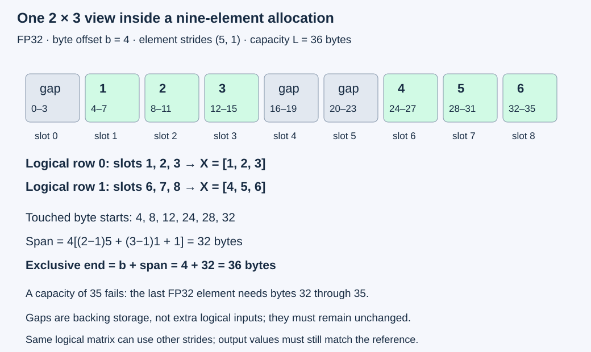
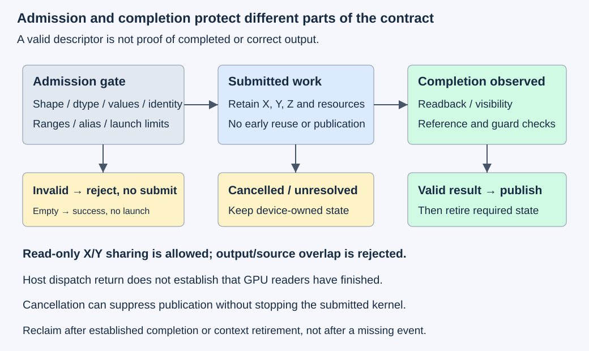

# M4-C01: Defining a GPU kernel and its contract

> **Status: Complete — detailed chapter authored and documentation validated; experimental procedures are proposed unless explicitly labelled observed**

**Module:** Understand kernels and execution overhead

**Category:** [Kernels, compilers, and execution](index.md)

[Module 4 reading order](../module-4.md) · [Previous authoring: M3-C23](../measurement-experimentation-and-economics/m3-c23-explaining-gpu-profiles-and-end-to-end-serving-effects.md) · [Next: M4-C02](m4-c02-mapping-an-operation-onto-cuda-threads-and-blocks.md) · [Execution plan and progress](../chapter-execution-plan.md)

## Target concepts

Kernel inputs and outputs, shapes, strides, dtypes, devices, aliasing, valid memory ranges, mathematical reference behavior, launch configuration.

## Concepts

### 1. A kernel needs a contract before it needs tuning

A **GPU kernel** is device work launched through an execution interface. A launch asks the GPU to run work; a successful submission does not necessarily mean the work has finished. The [CUDA programming model](https://docs.nvidia.com/cuda/cuda-programming-guide/01-introduction/programming-model.html) distinguishes host execution, device execution and launch configuration. CUDA calls a device entry function a kernel; one higher-level tensor operation can require several such launches.

A **contract** states accepted inputs, required results, permitted memory access, lifetime rules, failure behavior and completion. It gives a reviewer a concrete reason to reject a fast result. A mathematically correct array can still violate the contract if it belongs to a stale request, overwrites an input, reads outside its view or is published before completion. Completed [M9-C01](../numerics-and-correctness/m9-c01-defining-reference-behavior-and-evidence-before-optimizing.md) establishes reference-before-optimization reasoning.

Use a deliberately small operation to make the contract inspectable: for matrices X and Y with R rows and C columns,

**Zᵣ꜀ = 2Xᵣ꜀ + Yᵣ꜀**, for 0≤r<R and 0≤c<C.

Here r/c identify a coordinate, not an implementation thread. This resembles an elementary activation or feature-combination stage; it is not a complete normalization, attention or sampling operator. No reduction, random state, sparse representation, graph replay, bias broadcasting or implicit conversion is included. Those features need their own contracts later in Module 4.

For X rows [1,2,3], [4,5,6] and Y rows [10,20,30], [40,50,60], the result has rows **[12,24,36], [48,60,72]**. If X and Y are the same immutable input, the mathematical result is 3X. That read-only sharing is different from writing Z over a live source.

Rust is the primary host-language context. At a **foreign-language boundary**, where Rust passes work to a CUDA/C++ or Triton/Python component, shape, element type, device, ownership, error and completion meanings must agree. The host owner must retain buffers while the device uses them. A temporary Rust reference ending when dispatch returns does not prove GPU access ended. No implementation, kernel body or pseudocode is supplied here.

### 2. Specify a deliberately bounded baseline

**FP32** means four-byte binary floating-point storage. A **dtype** identifies an element's numerical representation; equal byte sizes do not make integer and floating-point interpretations interchangeable. This teaching baseline accepts only exactly represented integer values in FP32 in [−1,024,1,024]. It intentionally restricts the input domain: it is not a production contract for arbitrary model activations. Every result is an integer in [−3,072,3,072], so scaling and addition are exact in full FP32. Signed zero is numerically equivalent to zero. NaN, infinity, fractional values and implicit narrowing are rejected before dispatch.

| Contract component | Baseline requirement |
| --- | --- |
| Mathematics | Z=2X+Y, with the same R×C logical shape for all operands |
| Shape and bound | R/C are nonnegative, fit unsigned 32-bit dimensions, and T=RC≤1,048,576; size arithmetic is checked |
| Representation | FP32 storage, full FP32 arithmetic, integer-valued inputs in the stated range; no cast or approximation |
| Layout | Nonempty X/Y use positive element strides; Z is a unique contiguous row-major output with strides (C,1) |
| Device | All nonempty buffers and the launch stream belong to the same supported device/context; producers are complete or explicitly ordered before readers |
| Read/write permission | X/Y immutable; Z exclusively writable; input/input sharing allowed; output/source bounding intervals must be disjoint |
| Valid storage | Trusted live allocations, correct generation identity, aligned element addresses, checked ranges within capacity |
| Empty result | If R=0 or C=0, return an identified empty success with no device access, function loading or kernel launch |
| Completion | Publish caller-readable output only after required device completion and output visibility/validation |
| Failure | Reject invalid descriptors/data/launch configurations before submission; retain submitted state until completion or established context retirement |

An **allocation** is a backing storage region; a **view** describes logical elements within it. A descriptor should retain canonical allocation identity and generation, device/context, capacity in bytes, byte offset, shape, strides, dtype and access role. Generation distinguishes successive uses of a reusable allocation slot. Different wrapper handles are not proof of different storage: canonical ownership and actual address ranges must agree.

For empty operands, validate shape/dtype/device/request identity and mark the descriptors empty; no allocation or element stride is needed and no pointer is dereferenced. Negative or oversized dimensions still fail. For nonempty inputs, domain evidence must come from validated host images or a trusted producer contract; metadata alone cannot establish actual values. A future device-side validator would be separate work. Keep its cost if it becomes necessary.

### 3. A shape is not a memory layout

A **stride** is the distance between adjacent logical elements along an axis. This chapter measures strides in elements, while offsets/capacities are bytes. Nonempty strides are positive integers; offsets/capacities are nonnegative integers. These metadata values must fit unsigned 64-bit arithmetic, with every range operation checked. Let sᵣ and s꜀ be positive row and column strides, b the byte offset within a live allocation of capacity L, and each element four bytes. The byte start of a coordinate is:

**offset(r,c)=b+4(rsᵣ+cs꜀).**

For R,C>0, the enclosing byte span from the first element through the last is:

**span=4[(R−1)sᵣ+(C−1)s꜀+1].**

Require **b+span≤L**, with every multiply/add checked for overflow before pointer arithmetic. An **overflow** means an arithmetic result exceeds its representable integer range; wrapping it can make an invalid region appear small. Base and b must also produce four-byte-aligned element addresses. A vectorized candidate requiring stronger alignment must declare that additional restriction or provide a compatible path; it cannot silently reject previously accepted inputs while claiming the same interface.

For the 2×3 X example, use b=4, strides (5,1), L=36. Its logical byte starts are **4,8,12,24,28,32**. The span is **32 bytes**, and b+span=36 exactly fits. The three untouched backing positions are not logical elements. Reducing capacity to 35 fails even though the final element's first byte is at 32: its four-byte value extends through byte 35, with exclusive end 36.

The same logical X can use transposed storage [1,4,2,5,3,6] with strides (1,2), b=0 and L=24. Its shape is still 2×3; its output must still be the same six values. A contiguous-only interpretation would read a different matrix. The [PyTorch 2.14 tensor-view article](https://docs.pytorch.org/docs/2.14/tensor_view.html) illustrates how views can share backing and change layout without copying; this is a specification reference, not a requirement to replace the Rust host.

A bounding span can contain gaps. The baseline conservatively rejects Z overlapping either input's enclosing byte interval, even if exact touched element sets could be disjoint. This is a declared restriction, not proof that every such overlap is inherently unsafe. Input views may overlap because they only read. Negative strides, zero strides and output overlap need different range/coordination arguments and are outside this baseline.

*The last element needs four bytes, and padding is not part of the logical matrix. Correct values, valid ranges and immutable backing are independent checks.*

### 4. Aliasing and ownership determine which work can overlap

**Aliasing** means two views refer to some of the same storage. Exact output/input aliasing can be safe for certain specifically designed elementwise operations, but this contract forbids it. Partial overlap can cause one execution group to overwrite another group's unread input. Neither equal shapes nor the mathematical expression proves a particular in-place schedule safe.

A **lifetime** is the interval during which storage remains valid. After submission, keep X/Y immutable and retain Z, descriptors, loaded device function, stream/completion state and any workspace until their last required use ends. An output must not be consumed until its producer completes. A source must not be overwritten until its readers finish. These are different dependencies, and one wait does not automatically establish every required visibility boundary.

The [CUDA asynchronous-execution guide](https://docs.nvidia.com/cuda/cuda-programming-guide/02-basics/asynchronous-execution.html) distinguishes dispatch from synchronization. Define outcomes as rejected-before-submit, submitted, completion-observed, validated/published, or failed/unresolved. Cancellation can suppress publication while submitted work still reads buffers. A missing completion observation or expired host deadline does not authorize reuse; quarantine uncertain state until completion or context retirement is established. Context loss may require reconstructing inputs and retrying under a new attempt identity, never publishing a partial result as success.

*The admission gate covers descriptors, values, aliasing and launch compatibility. The completion gate protects lifetime; output/reference validation protects useful publication.*

### 5. Launch configuration belongs in the contract

A CUDA **thread block** groups threads; a **grid** groups blocks. A launch configuration names grid/block dimensions, stream and shared-memory requirements along with a particular compiled device function. Device limits, function-specific resource limits and actual target compatibility all matter. The [CUDA runtime function-attribute reference](https://docs.nvidia.com/cuda/cuda-runtime-api/group__CUDART__HIGHLEVEL.html) supplies function-specific attributes; a device's maximum threads per block alone does not prove a chosen function can use that maximum.

For a proposed one-dimensional coverage policy with T logical elements and B threads per block, **G=ceil(T/B)** blocks cover at least T positions. Ceil rounds upward. A correct candidate must suppress all accesses for covered positions beyond T and write each valid output once. This is a coverage requirement, not an implementation mapping; M4-C02 develops mapping and cooperation.

For T=16,705, teaching choices B=64,128,256 yield G=262,131,66 and excess coverage 63,63,191 respectively. All three can compute the same valid output if supported and bounded correctly. Extra coverage does not authorize reading padding or writing a guard. B=0 is invalid for a nonempty launch. Empty work follows the host no-launch policy instead of requesting a zero-sized grid.

Triton uses program/grid and compiler configuration concepts that should not be equated mechanically with CUDA thread counts. Its [JIT interface](https://triton-lang.org/main/python-api/generated/triton.jit.html) compiles device work and can specialize arguments. A **specialization** is a compiled variant for particular properties such as types or shape information. Retain the actual compiler/interface/version and selected variant. This chapter's B/G studies explicitly describe a CUDA-style candidate; another backend must state its own compatible execution contract.

### 6. Correctness and performance have different evidence boundaries

For this pointwise formula, report the conventional **F=2T FLOPs**, one multiply and one add per result, and **Q_min=12T bytes**, two FP32 reads plus one write per coordinate. This is logical traffic, not measured DRAM. Read-only sharing X=Y can reduce unique input storage and physical traffic without changing the conventional operation count. Pitched allocations increase capacity demand without necessarily changing logical reads.

For R=257,C=65, T=16,705, F=33,410 and Q_min=200,460 bytes. At an invented completed device interval of 10 µs, logical effective bandwidth is **20.046 GB/s**, with decimal GB=10⁹ bytes; the useful arithmetic rate is **3.341 GFLOP/s**. Neither establishes a memory bottleneck or real hardware speed.

Separate process-first-use time, host submission time, device-event time, host submit-to-completion time and validated caller-visible time. **First use** can include loading, compilation, specialization and allocation; **steady state** follows a declared preparation history. A new process can still hit a persistent compiler cache, so record cache state rather than call every fresh process fully cold. Input packing, host/device transfers and validation remain costs even when excluded from a named device interval.

Correctness tools are diagnostic interventions. [Compute Sanitizer](https://docs.nvidia.com/compute-sanitizer/ComputeSanitizer/index.html) has different checks for memory access, initialization and synchronization hazards; a clean run does not prove all semantic or lifetime properties. Racecheck's shared-memory scope is not a universal detector of all cross-kernel/global-memory races. Tool timing is not normal execution timing. Use the completed Module 9 guidance and separate uninstrumented cohorts before claiming an improvement.

## Experiments

All four experiments are proposed. E1/E2 are specification/reference exercises that need no GPU. E3/E4 require an existing reviewed candidate implementing this contract; producing one is not part of this chapter. No kernel implementation, sanitizer run or hardware benchmark is claimed.

### E1 — Reconstruct the view and mathematical contract

**Description:** Calculate the small 2×3 result from both logical coordinates and actual backing positions.

**Purpose/objective:** Distinguish correct arithmetic from correct interpretation of a tensor descriptor.

**Target concepts:** Inputs/outputs, shapes, strides, dtype, reference behavior and valid ranges.

**Baseline and workload:** Use the example X/Y above, the pitched X view with b=4/strides (5,1)/L=36, and the transposed-storage X view with strides (1,2)/L=24. Z is separate contiguous storage. Also evaluate X=Y as read-only sharing.

**Controls and prediction:** FP32 integer inputs and exact full-FP32 arithmetic. Predict the six output values, untouched gaps and guard regions, and 3X for shared inputs. Both X layouts represent the same mathematical matrix.

**Procedure:** Independently enumerate all logical coordinates, byte starts and exclusive ends. Form 2X+Y by integer arithmetic and by separately checked FP32 operations. Compare pitched/transposed representations coordinate by coordinate. Compute storage spans, legal offsets and the coverage/work/byte examples. Deliberately interpret the transposed storage as contiguous or omit the last coordinate; the value/shape gate must reject the observation. Do not dereference an invalid descriptor on a GPU.

**Hardware/software:** Exact integers/rationals plus explicitly rounded FP32 references suffice. Record tool/rounding versions if numerical tools are used.

**Failure and HFT connection:** A feature record with the right shape but wrong stride can produce plausible values belonging to the wrong field. The analogy motivates layout/identity checks; these are not market data or trading strategy tests.

**Exit criteria:** V1 reconciles every coordinate, exclusive range end, untouched slot and exact result. No valid-looking byte address is mistaken for proof that the whole element fits.

### E2 — Audit admission before any device dispatch

**Description:** Apply the stated descriptor/data/launch contract to an explicit case ledger.

**Purpose/objective:** Make rejected inputs observably different from submitted work and prevent unsafe launches.

**Target concepts:** Devices, generations, alignment, aliasing, range overflow and launch compatibility.

**Baseline and workload:** Start from E1's valid pitched X, contiguous Y/Z, live generation, one matching device/context and legal B=64. All changes below are independent relative to that baseline unless stated. “Reject” means before device submission, not provoke an execution error.

| Case | Single change or named condition | Expected outcome |
| --- | --- | --- |
| A01 | Baseline pitched input | Accept |
| A02 | Correct transposed-storage X descriptor from E1 | Accept |
| A03 | X and Y share the same immutable view; Z separate | Accept; output 3X |
| A04 | R=0,C=7; all operands explicitly empty | Empty success; no launch |
| A05 | X capacity 35 bytes | Reject: last element exceeds capacity |
| A06 | X byte offset 2 | Reject: element alignment |
| A07 | Y dtype FP16 | Reject: representation mismatch |
| A08 | Y belongs to another device/context | Reject: device/context mismatch |
| A09 | Z exactly aliases X | Reject: output/source overlap |
| A10 | Z at offset 4 within Y’s 32-byte parent allocation | Reject: output/source overlap |
| A11 | X row stride −5 | Reject: unsupported stride |
| A12 | X offset 2⁶⁴−4, stated capacity 2⁶⁴−1 | Reject: checked end arithmetic overflows |
| A13 | X handle refers to an earlier allocation generation | Reject: stale identity |
| A14 | B=0 for nonempty work | Reject: invalid launch configuration |
| A15 | Teaching function/device block limit 64, requested B=128 | Reject: incompatible resource limit |
| A16 | One X value is 0.5 | Reject: outside integer input domain |
| A17 | One Y value is NaN | Reject: nonfinite input |
| A18 | Y logical shape 2×2 | Reject: shape mismatch |

**Controls and prediction:** Fixed operation, numerical domain and canonical storage registry. A15 uses an invented limit, not a supplied GPU specification; A12 is an arithmetic-only descriptor fixture, with no enormous live allocation claimed. Predict four accepted cases including the empty case and fourteen rejected cases; admitted nonempty output is always disjoint from its sources.

**Procedure:** Reconstruct each verdict from independent range/set, identity, domain and capability checks. Record all applicable failures; a chosen error-priority policy must be deterministic if multiple gates fail. Retain request/attempt ID and whether submission occurred. Model cancellation before submission as a no-launch outcome and cancellation after submission as publication suppression with retained ownership. Keep invalid cases on paper or in a future host-only validator; none is an unsafe device fault injection.

**Hardware/software:** No GPU required for the case ledger. A future admission validator requires authoritative allocation/generation and actual device/function capability records.

**Failure and HFT connection:** Stale-generation or wrong-device acceptance can turn a bounded low-latency path into corrupted state or recovery work. The analogy is safe admission and freshness, not an exchange protocol guarantee.

**Exit criteria:** V2 obtains all eighteen verdicts with independent reasons and no submitted invalid case. Empty success, rejection, cancellation and unresolved device ownership remain distinct outcomes.

### E3 — Validate one existing candidate across layouts and legal launches

**Description:** Exercise the contract's numerical, layout, boundary and empty-work behavior using a pre-existing candidate.

**Purpose/objective:** Establish correctness before considering a launch configuration's performance.

**Target concepts:** Shapes, positive strides, valid memory, launch coverage, immutable sources and complete output.

**Baseline and workload:** Use shapes **(0,7), (1,1), (1,63), (3,5), (7,33), (64,64), (257,65)**. For nonempty shapes compare tight row-major X/Y with pitched row strides C+3 and C+5 respectively; column strides are one and Z remains contiguous. For measured epoch e=0,…,59, define **Xᵣ꜀=((17r+3c+e) mod 257)−128**, **Yᵣ꜀=((5r+11c+2e) mod 127)−63**. Mod is nonnegative remainder. All values satisfy the integer domain. Empty shapes use explicitly empty descriptors for both layout labels. For R=1, differing row strides do not change the touched addresses; those cells check singleton-axis metadata rather than demonstrate a memory-layout cost.

**Controls and prediction:** Same candidate/build, full FP32, stream and device; separately test B=64,128,256 only where device and function limits permit. Request zero dynamic shared memory and retain actual static resource use. Predict identical valid values across supported configurations, untouched source/gap/guard storage and no launch for empty results. Do not predict the fastest B.

**Procedure:** In three sessions use shape order listed/reversed/listed, alternate layout order and rotate starting B. For every shape/layout/B cell, run ten excluded warmups at e=0 and twenty measured validation attempts, globally e=0–59. Prepare finite gap sentinels and 32-byte 0xA5/0x5A guards around each backing region; Z starts at −2²⁰. Complete producer preparation, submit nonempty work, wait, and validate all logical Z coordinates, guards, input images and gaps. Reuse bounded 1 MiB host diagnostic scratch. Keep empty attempts and their no-launch evidence. A 120-second watchdog does not release unresolved device-owned state.

**Hardware/software:** One GPU and existing reviewed CUDA-style candidate supporting the contract, readback and completion. At most 64 MiB raw fixture storage per host/device plus explicit runtime/module/workspace/staging/alignment reserves. The largest pitched X/Y and tight Z spans plus guards total **208,844 bytes**; allocation padding beyond those spans is additional. If any required launch/layout support is missing, report that cell unsupported rather than change its contract.

**Failure and HFT connection:** Reject stale epochs, missing final writes, modified input/gap storage or unproven completion. Sharing a producer's feature buffer requires its last reader to finish before reuse; a host return alone is insufficient. No trading throughput or model-quality claim follows.

**Exit criteria:** V3 accounts for **2,520 measured validation attempts and 1,260 warmups**. With all cells supported, measured attempts include **2,160 nonempty launches and 360 empty skips**, checking **7,599,960 output coordinates**. Report failures/unsupported remainder explicitly; no speed claim is accepted before all applicable gates pass.

### E4 — Benchmark first use, steady execution and validated completion separately

**Description:** Measure a subset of the validated contract using separate first-use, normal timing and diagnostic populations.

**Purpose/objective:** Learn whether launch/layout changes improve useful work after preparation, validation and instrumentation are accounted for.

**Target concepts:** Launch configuration, layout cost, bounded work, completion and reproducible benchmarking.

**Baseline and workload:** Shapes (1,63) and (257,65), both layouts and all three supported B values from E3, twelve cells. Keep E3's data family and exact reference. A new process per cell/session supplies one first-use attempt at e=0, ten excluded warmups and twenty steady attempts; three sessions give e=0–59 for each cell's steady cohort. Do not reuse E3 validation attempts as timing samples.

**Controls and prediction:** Record actual module/compiler specialization, persistent-cache state, backend/build, allocations, workspace, clocks and competing work. Keep the same output and numerical domain. Predict that first-use and validated wall time can differ substantially from a device-only interval, with no universal fastest B or speed threshold.

**Procedure:** Define first-use start before module loading/compilation and required device preparation, with host input records already ready; end after completed readback, reference/source/guard checks and publication. Retain initialization components rather than label the whole interval kernel time. For steady trials, time host dispatch through successful completion wait, the ordered device-event interval, and a separate full preparation-to-validated-publication interval. Validate every trial. Add one separate memory-check diagnostic for the largest pitched case/B/session, nine total, after one independently recorded preparatory e=0 attempt each; diagnostics and preparations are outside normal timing counts. Any replay or extra tool execution must be counted separately. Do not run unsafe descriptors or infer timing from sanitizer runs.

**Hardware/software:** E3 requirements plus supported monotonic/event timing and optional Compute Sanitizer memory checking. A denied/unavailable tool is unsupported diagnostic evidence, not proof of safety or zero overhead. Record host/library/binding/compiler and actual tool/device compatibility.

**Failure and HFT connection:** A fast device interval can coexist with slow first use or expensive validation. Cold path and deadline behavior matter in a bounded decision service, but this offline affine study contains neither representative arrivals nor a complete generator.

**Exit criteria:** V4 accounts for **36 first-use attempts, 360 warmups and 720 steady attempts**, plus nine diagnostic attempts and nine preparations if supported. Cold/steady output counts are **301,824** and **6,036,480** respectively. Every accepted timing comes from a correct completed result under the same contract; no population p99 or serving-capacity claim follows.

## Verification

### V1 — Independent math, layout and byte accounting

Reconstruct the small example by ordinary integer arithmetic and by explicit FP32 multiplication/addition, then compare alternate layouts against logical-coordinate reference values. For the pitched X, each touched interval is [start,start+4), the exclusive high end is 36, and gap elements remain unchanged. Verify the transposed storage against the same logical matrix rather than reuse the same mistaken layout rule as the candidate. E1's shared-input result is 3X and requires separate Z.

The exact integer domain justifies zero numerical tolerance here: |2X+Y|≤3,072<2²⁴, so all intermediate products/sums are representable in FP32. This does not extend to arbitrary floats, lower precision, nonfinite inputs, a reduction or an approximate operator. Follow completed [M9-C17](../numerics-and-correctness/m9-c17-comparing-logits-with-justified-numerical-tolerances.md) for a separately justified broader numerical contract; widening a tolerance cannot repair wrong shape, aliasing or identity.

### V2 — Validate metadata and lifetime independently

Check shape, dtype, values, trusted storage generation, device/context, stride/alignment, range arithmetic, output overlap and launch limits as separate gates. For positive nonempty strides, independently enumerate touched byte intervals and compare their extrema with the span formula. A bounding interval intentionally rejects some disjoint-gapped layouts; document that conservatism rather than call those layouts unsafe. Same-typed pointers, different wrapper handles or an accepted launch are not proof of nonaliasing or live storage.

Test the lifetime ledger with cancellation before submit, after submit but before completion, after completion but before publication, and a lost completion observation. Only established completion/retirement permits reuse after submission. A valid host-only reference verdict is not evidence that an invalid GPU launch was attempted. Preserve rejected/empty/cancelled/failed/unresolved identities, with one final outcome per attempt and a clean drain of admitted work.

### V3 — Verify every coordinate and surrounding storage

For each E3 epoch, calculate the integer formula independently from retained logical X/Y images and compare against separate FP32 arithmetic and the candidate. Keep row/column/epoch identity. Validate the full result, not a checksum; one corrupted coordinate, omitted last coordinate or stale epoch must fail. Check source and gap bytes as well as outer guards: guards alone cannot detect all wrong in-bounds accesses. A complete output match alone cannot prove all inputs were read or that an extra write did not occur elsewhere.

Across the nonempty shapes, ΣRC=21,111. Two layouts, three block choices and sixty epochs yield 360×21,111=7,599,960 coordinates. There are 42 shape/layout/B cells; six empty cells account for 360 measured skips. Nonempty warmup launches total 1,080, with 180 empty warmup skips. Count actual unsupported cells separately. Coverage beyond T must perform no memory access even if backing padding happens to exist. Review the existing candidate’s documented access policy and source/instruction evidence for suppressed tail accesses; a memory checker may not detect an unwanted read inside a valid allocation. Matching outputs across B values tests a declared invariant; it does not establish complete memory safety or all possible scheduling behavior.

### V4 — Match timing to the accepted contract

Report raw per-cell samples, count, median, range and session differences with precise clock units/resolution. Sixty steady samples per cell are exploratory; under independent sampling only 0.6 observations would be expected beyond a true continuous-population p99. Actual trials can be correlated. Use completed [M9-C07](../measurement-experimentation-and-economics/m9-c07-latency-distributions-and-statistical-uncertainty.md) before a tail study. A same-tick or failed event interval gives no finite throughput estimate. Host waits can contain device work and cannot be added again as independent request stages.

Keep sanitizer errors, unsupported checks, tool settings and extra executions explicit. Memory checking supports address evidence; it does not replace mathematical reference, alias/lifetime reasoning or full outcome accounting. Use [M9-C12](../measurement-experimentation-and-economics/m9-c12-reading-cpu-gpu-timelines-and-scheduling-gaps.md) for a separate timeline when completion/extra-launch attribution is unresolved, and [M9-C13](../measurement-experimentation-and-economics/m9-c13-using-kernel-profilers-to-explain-hardware-bottlenecks.md) for question-driven counter diagnosis. Additional captures are separate cohorts with recorded work and perturbation.

For a real generator extension, include packing/conversion, transfers, allocation, dependencies, model/tokenizer/input/output identity, arrivals, concurrency, cancellation and useful-output criteria. This operation's two FLOPs per output and device bandwidth do not establish token throughput or production readiness.

## Engineering dimensions and principles

| Dimension | Application in this chapter |
| --- | --- |
| Semantics and invariants | E1 fixes Z=2X+Y and exact integer values; E2/E3 enforce valid layouts, disjoint output, identity and complete writes. |
| Workload and variability | Shapes, pitches, empty work and launch choices vary explicitly. Real text lengths, skew and buffer reuse would change the workload; non-text modalities and Module 8 are outside scope. |
| Resources and bottlenecks | Count logical reads/writes, enclosing spans, gaps, guards, module/workspace, host validation and preparation; declared bounds precede allocation/dispatch. |
| Time and distributions | Distinguish first use, submission, device completion and validated publication; retain per-cell populations and valid slow trials. |
| Ownership and coordination | Immutable X/Y can share; Z cannot alias a source. Retain generations, buffers and execution resources until device use ends, including after cancellation. |
| Failure and adaptation | Invalid metadata/data reject before launch; unsupported capability, allocation failure, context loss and unresolved completion remain explicit rather than optimistic reuse. |

| Engineering principle | Consequence for the contract |
| --- | --- |
| 1. Correctness defines the optimization boundary | Exactness holds on a declared restricted domain; broader activations or in-place behavior need a new evaluated contract. |
| 2. Performance depends on workload and operating point | Pitches, lengths, empty paths, compiler/cache state and launch choice define each comparison. |
| 3. Data movement is part of the algorithm | Logical bytes, touched addresses, storage gaps, transfers and validation cost accompany arithmetic. |
| 4. State has ownership, lifetime and recovery cost | Generation identity and last-reader completion control reuse; context recovery requires reconstruction and a distinct attempt. |
| 5. Dependencies determine latency; bottlenecks determine capacity | Submission is not completion; one isolated kernel experiment does not establish sustainable loaded service. |
| 6. Variability and synchronization shape the tail | First use, host waits and resource interference can change slow outcomes; sixty samples cannot certify p99. |
| 7. Local improvements must be evaluated end to end | A better device interval must survive preparation, validation and eventual generator integration. |
| 8. Claims require reproducible evidence | Preserve descriptors, values, accepted/rejected cases, raw samples, tool limits and actual hardware/compiler manifests. |

## Specifications, articles, and hardware

Primary sources checked on 2026-10-27:

| Source | Role and limits |
| --- | --- |
| [CUDA programming model](https://docs.nvidia.com/cuda/cuda-programming-guide/01-introduction/programming-model.html) | Host/device work and launch organization; no architecture-independent performance guarantee. |
| [CUDA asynchronous execution](https://docs.nvidia.com/cuda/cuda-programming-guide/02-basics/asynchronous-execution.html) | Submission versus completion and ordering; actual visibility/lifetime evidence remains required. |
| [CUDA runtime 13.4 function attributes](https://docs.nvidia.com/cuda/cuda-runtime-api/group__CUDART__HIGHLEVEL.html) | Function-specific launch compatibility; verify actual installed device and interface. |
| [PyTorch 2.14 tensor-view article](https://docs.pytorch.org/docs/2.14/tensor_view.html) | Shared backing and strided-view concepts; this contract's accepted views are deliberately narrower. |
| [Triton JIT specification](https://triton-lang.org/main/python-api/generated/triton.jit.html) | Compiler/specialization boundary; Triton configuration is not interchangeable with CUDA block size. |
| [Compute Sanitizer guide](https://docs.nvidia.com/compute-sanitizer/ComputeSanitizer/index.html) | Different correctness-tool scopes and limitations; a clean report is not proof of semantic equivalence. |

E3/E4 require one supported GPU, an existing reviewed candidate and sufficient host/device storage; no second GPU, network adapter, exchange connection or complete model is required. Record exact GPU SKU/architecture/partition, visible memory, per-device and per-function launch/resource limits, compiled target and device-function identity, host CPU/NUMA/RAM and host-device link, OS, driver/runtime/compiler/library/Rust-binding/Triton/tool versions, module/specialization/cache state, input generations/addresses/layouts/dtypes, allocation capacity, stream/event/wait policy, clocks/power/thermals, competing work and telemetry cadence. Apply completed [M9-C16](../hardware-architecture-and-topology/m9-c16-recording-hardware-conditions-that-change-measurements.md), [M9-C15](../state-memory-and-caching/m9-c15-accounting-for-weights-kv-state-workspace-and-fragmentation.md) and [M9-C02](../measurement-experimentation-and-economics/m9-c02-request-events-clocks-and-measurement-boundaries.md). No device specification, implementation or observed benchmark was supplied. M9-C18/M9-C22 remain outlines; this chapter supplies its elementary range, alias and lifetime gates locally.

## Key takeaways and next chapter

A useful kernel interface specifies mathematics, admissible data, storage, ownership and execution compatibility together. Equal shapes do not establish equal layouts, and a valid launch does not establish correct or completed output. Validate that contract before comparing launch choices or preparation costs.

Track acceptance in the clickable [execution plan](../chapter-execution-plan.md). Next in Module 4 reading order is the completed [M4-C02: Mapping an operation onto CUDA threads and blocks](m4-c02-mapping-an-operation-onto-cuda-threads-and-blocks.md). The next authoring chapter is [M4-C03](m4-c03-understanding-the-triton-programming-model.md). Module 9 supports Modules 1–7; Module 8 is excluded.
