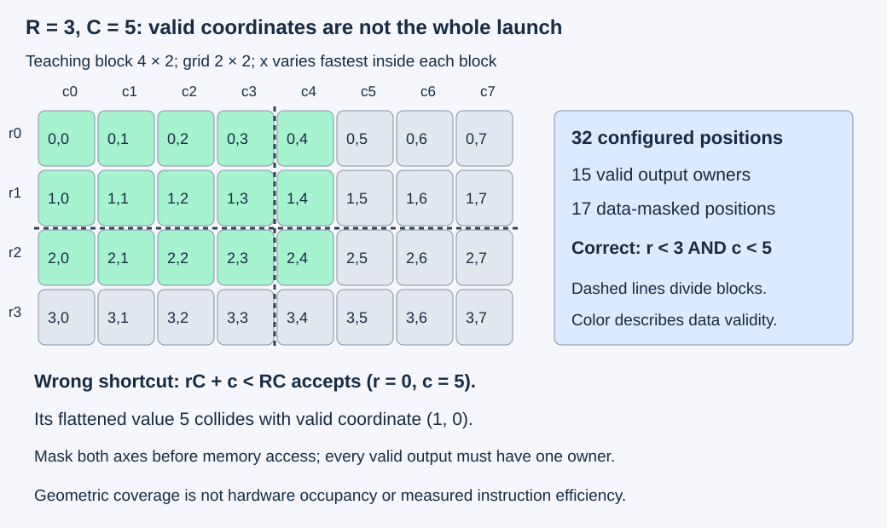
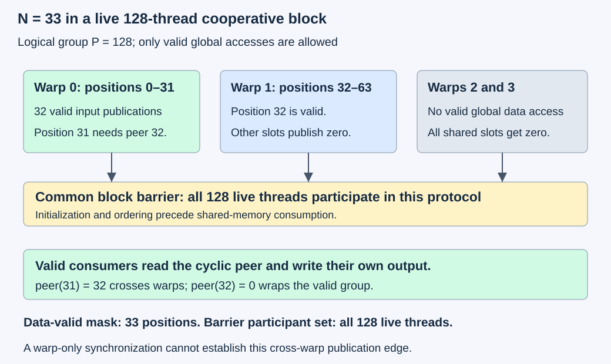

# M4-C02: Mapping an operation onto CUDA threads and blocks

> **Status: Complete — detailed chapter authored and documentation validated; experimental procedures are proposed unless explicitly labelled observed**

**Module:** Understand kernels and execution overhead

**Category:** [Kernels, compilers, and execution](index.md)

[Module 4 reading order](../module-4.md) · [Previous: M4-C01](m4-c01-defining-a-gpu-kernel-and-its-contract.md) · [Next: M4-C03](m4-c03-understanding-the-triton-programming-model.md) · [Execution plan and progress](../chapter-execution-plan.md)

## Target concepts

CUDA execution model, thread and block indexing, SIMT execution, memory access, masked boundaries, warp and block cooperation, synchronization scope.

## Concepts

### 1. Give every logical output an owner

A **thread** is one logical execution instance of device work. A **block** groups threads that can cooperate under block-scoped rules. A **grid** contains the blocks of a launch; a **streaming multiprocessor**, or SM, is hardware that executes blocks and their warps. Logical thread counts are not physical processor counts, and a block index does not specify execution order. Use completed [M3-C03](../hardware-architecture-and-topology/m3-c03-threads-warps-blocks-grids-and-streaming-multiprocessors.md) for the hierarchy and [M4-C01](m4-c01-defining-a-gpu-kernel-and-its-contract.md) for accepted data, addresses, aliasing, generations and completion.

Begin with M4-C01's pointwise contract **Zᵣ꜀=2Xᵣ꜀+Yᵣ꜀** over R×C coordinates. FP32 is four-byte floating-point storage. Inputs are immutable FP32 integers in [−1,024,1,024], the output is contiguous and disjoint, and all values/results are exactly representable under full FP32 arithmetic. The mapping changes who performs each coordinate's work, not the mathematics or tensor identity. No implementation, pseudocode or kernel body is provided. Rust remains the host-engine context; CUDA device concepts do not mean one Rust host thread per GPU thread.

A correct mapping needs three independent properties: **coverage**, every valid coordinate is assigned; **uniqueness**, each output has exactly one authorized writer; and **bounds**, no unauthorized memory location is accessed. Two threads writing the same correct value still violate the unique-writer baseline. A checksum or unchanged outer guards alone cannot establish these properties.

The [CUDA SIMT-kernel guide](https://docs.nvidia.com/cuda/cuda-programming-guide/02-basics/writing-cuda-kernels.html) describes thread organization and indexing. The formulas below are mathematical assignment specifications, not runnable implementations.

### 2. Derive the index and its validity together

For a one-dimensional launch, B is threads per block, b a block index and t a local thread index, with 0≤t<B. Define:

**i=bB+t; G=ceil(T/B), where T=RC.**

For positive C and a valid i, the corresponding row/column are **r=floor(i/C)** and **c=i mod C**. Floor rounds downward, ceil upward, and mod is nonnegative remainder. The data-valid predicate is **0≤i<T**. Empty work skips dispatch under M4-C01; it does not divide by zero or request a zero-sized grid.

The inverse assignment **b=floor(i/B), t=i mod B** proves each i in [0,T) has one owner in this model. Covered positions at or beyond T have no input reads or output writes. Masks must protect the access itself: selecting zero after an out-of-range load does not undo that access.

For a two-dimensional block of Bₓ×Bᵧ threads, use block coordinates (bₓ,bᵧ) and local coordinates (tₓ,tᵧ):

**c=bₓBₓ+tₓ; r=bᵧBᵧ+tᵧ.**

**Gₓ=ceil(C/Bₓ); Gᵧ=ceil(R/Bᵧ).**

Authorize work only when **0≤r<R and 0≤c<C**. The inverse uses floor(c/Bₓ), c mod Bₓ, floor(r/Bᵧ), and r mod Bᵧ. Checked arithmetic and actual device/function launch limits still apply; formulas do not grant support for an arbitrary configuration.

For R=3,C=5 and a teaching 4×2 block, the grid is 2×2, with 32 configured threads covering 15 valid coordinates and 17 masked positions. The shortcut **rC+c<RC** is not a sufficient two-dimensional predicate: r=0,c=5 gives 5<15 while c is invalid. It can collide with the valid coordinate r=1,c=0. This is an in-bounds-looking error that may overwrite another output or read padding without touching an outer guard.

### 3. Separate configured threads, warp lanes and useful work

**SIMT** means single instruction, multiple threads: hardware issues instructions to participating lanes of a warp while threads retain their own state. A **lane** is a thread's position in a warp. For the NVIDIA/CUDA contract studied here, warp width is 32; verify the target rather than transferring this number to other accelerators.

Within a two-dimensional block, x varies fastest. Its linear thread rank is **t=tₓ+Bₓtᵧ**, warp index **floor(t/32)** and lane **t mod 32**. Warps do not combine threads from neighboring blocks. For a 32×4 block, a warp follows one row of 32 columns; for 16×8 it spans two rows; for 8×16 it spans four rows. Each block contains 128 threads and four warps, yet its data-access pattern differs.

As a separate review example, T=70,B=48 gives two blocks and 96 configured threads, 70 valid and 26 masked. Each block has two warps, so there are 128 nominal warp-lane slots. Useful/configured work is **70/96≈72.9167%**, while useful/nominal lanes is **70/128=54.6875%**. Neither ratio is occupancy, an instruction-issue measurement or an elapsed-time prediction. The partially populated final warp of one block cannot be filled with threads from the next.

**Divergence** occurs when threads in a warp follow different control-flow paths. A compiler may instead predicate instructions, enabling them for selected threads. These are execution choices, not permission to ignore memory validity. A **data-valid mask** names logical elements allowed to load/store; a **collective membership mask** names threads participating in an exchange or synchronization. They answer different questions. An invalid data lane may still be a live thread required at a block barrier.

*The 4×2 block is a teaching geometry. Coverage and uniqueness concern coordinates; physical occupancy, issue efficiency and actual load/store behavior need separate evidence.*

### 4. Follow warp addresses through the actual tensor strides

For positive-stride FP32 X, use M4-C01's address offset **b+4(rsᵣ+cs꜀)**. Adjacent logical columns are adjacent bytes only when the actual column stride is one. Flattening logical coordinates does not turn a pitched or transposed view into contiguous storage.

**Coalescing** describes combining a warp's memory requests into transactions. The [CUDA Best Practices memory-access discussion](https://docs.nvidia.com/cuda/cuda-c-best-practices-guide/index.html#coalesced-access-to-global-memory) motivates counting the addresses and their transaction boundary. Use a declared sector model rather than assume every architecture or memory level transfers the same unit.

For a constructed first-warp comparison, assume FP32, 32-byte sectors, unit column stride, row stride 260 elements, and all 32 lanes valid. A 32×4 block's first warp reads row 0, columns 0–31. An 8×16 block's first warp reads columns 0–7 of rows 0–3. Both request 128 useful bytes, but different coordinates:

| Operand base relative to a 32-byte boundary | 32×4 first-warp sectors | 8×16 first-warp sectors |
| --- | --- | --- |
| Aligned | 4 | 6 |
| Offset by four bytes, still naturally FP32-aligned | 5 | 8 |

With an aligned base, the four row chunks in the 8×16 case begin at offsets 0,16,0,16 modulo 32. Their sector counts are 1,2,1,2; the six-sector model covers 192 bytes for 128 useful bytes, or **66.6667%**. This is one operand's first-warp geometry, not a whole-kernel DRAM measurement. Stores, other rows, caches, reuse and compiler instructions require separate accounting. Another pitch can reverse or remove the difference. Do not infer a universal best block shape from this example.

### 5. Cooperation requires a communication contract

Pointwise Z=2X+Y needs no peer exchange or device-side barrier when every output is independent and source lifetimes are correct. Adding shared memory or synchronization without reuse can add cost. **Shared memory** is block-accessible storage with a lifetime and visibility contract; storing a value there does not by itself establish that another thread can safely read it.

Use a separate neighbor-exchange operation to study cooperation. Divide a vector of length N into logical groups of P=128 elements. For group q, let **m_q=min(128,N−128q)** be its valid length. For valid local position t<m_q:

**i=128q+t; peer=128q+[(t+1) mod m_q]; Zᵢ=Xᵢ+X_peer.**

This is a cyclic neighbor sum within each valid group. P is part of the logical specification, not a tunable block-size parameter that can silently change the result. A direct reference reads both values from immutable device input. A proposed staged candidate assigns one 128-thread block per group, with 128 FP32 shared slots, or 512 bytes. All live block threads initialize their slot to valid input or a zero placeholder, reach a common block barrier, and only valid output owners consume the required shared neighbor and publish. Empty work skips the launch.

For N=33, local position 31 needs position 32 from another warp. For N=129, the last group contains one element, whose peer is itself. Invalid logical lanes in either partial block must not read global input or write global output, but remain live for the stated initialization/barrier protocol. Early return based only on data validity would break that protocol.

A warp register exchange can serve a genuinely warp-contained group when participant/source rules hold. It cannot directly exchange with another warp. The [CUDA synchronization specification](https://docs.nvidia.com/cuda/cuda-programming-guide/05-appendices/cpp-language-extensions.html#synchronization-primitives) distinguishes warp and block synchronization and memory ordering. Do not rely on an assumed permanent lockstep schedule for shared-memory communication. A fence orders specified memory effects; it does not make a missing producer arrive or synchronize an entire grid.

### 6. Match synchronization scope to the dependency

A **barrier** coordinates a defined participant group before dependent work proceeds. For this chapter's staged protocol, all 128 live block threads reach the same barrier instance; only their data accesses are masked. Conditional execution of a block barrier under a nonuniform data-valid condition is invalid for that protocol. Warp participation must likewise satisfy the chosen intrinsic's exact membership rules; a named live thread cannot simply skip the required collective.

An ordinary block barrier does not synchronize other blocks, even if they share an SM. Blocks may execute in any allowed order and need not all be resident together. A software spin barrier across ordinary blocks can wait for blocks that cannot yet run. The [CUDA execution-model specification](https://docs.nvidia.com/cuda/cuda-programming-guide/05-appendices/cuda-cpp-execution-model.html) states progress guarantees; block index is not a global sequencing mechanism. Grid-wide cooperative mechanisms have additional constraints and are outside these baseline studies.

For a producer and consumer in separate launches, use a justified ordered-stream dependency or explicit cross-stream event ordering. Host submission return does not make output readable. Cancellation can suppress publication while device readers still own buffers. Reclaim only after required completion or established context retirement, as in M4-C01. A barrier inside a kernel cannot repair a wrong-device pointer, stale generation or early host reuse.

*Data validity determines accesses; participation determines communication. N=33 exposes a cross-warp dependency and a live partial block, which need more than a warp-local synchronization assumption.*

## Experiments

All four experiments are proposed. E1/E4 are paper/reference exercises. GPU procedures require existing reviewed candidates implementing the declared contracts; producing implementations is not part of this chapter.

### E1 — Prove coordinate coverage and calculate warp addresses

**Description:** Reconcile flat and two-dimensional ownership, validity masks, warp grouping and sector geometry.

**Purpose/objective:** Catch missing, duplicate and incorrectly authorized work before timing any mapping.

**Target concepts:** Indexing, SIMT lanes, masked boundaries and memory access.

**Baseline and workload:** Use the R=3,C=5,4×2 example; T=70,B=48; and the 260-element-pitch first-warp sector example. Enumerate both valid and configured-but-invalid positions.

**Controls and prediction:** Zero-based indices, x-fastest thread rank, 32-thread warps and the explicit 32-byte sector model. Predict fifteen unique writers out of thirty-two configured positions for the two-dimensional case, and the stated configured/warp-slot distinctions for the flat case. Sector estimates remain geometry only.

**Procedure:** Derive forward and inverse ownership independently. Count each valid coordinate's owners and list invalid positions. Test the incorrect flattened-only predicate, floor instead of ceil grid sizing, and a block-index omission on paper; identify duplicate/missing/unauthorized coordinates. Enumerate every requested byte for each first-warp pattern and count distinct sector numbers. Compare actual pitched addresses with an intentionally contiguous interpretation. Do not run invalid access patterns on hardware.

**Hardware/software:** Exact integer/set arithmetic suffices; record the chosen sector and warp model. No GPU required.

**Failure and HFT connection:** A duplicated or skipped feature position can silently change a decision even when a timing result looks good. The analogy concerns exact work identity, not a claim about trading strategy behavior.

**Exit criteria:** V1 proves coverage/uniqueness/bounds for the correct maps and identifies every deliberate reference defect. All utilization-like fractions name their denominator.

### E2 — Compare equivalent mappings across shapes and pitches

**Description:** Apply four mappings to the same exact pointwise contract, keeping mathematical outputs fixed.

**Purpose/objective:** Investigate layout/geometry effects after passing correctness and ownership gates.

**Target concepts:** Flat/two-dimensional indexing, coalescing, boundary masks and SIMT work distribution.

**Baseline and workload:** Shapes **(0,7), (1,31), (1,32), (1,33), (7,33), (17,65), (129,257)**. Compare tight inputs against X row stride C+3 and Y row stride C+5; column strides are one and Z is contiguous. Use M4-C01's epoch family **Xᵣ꜀=((17r+3c+e) mod 257)−128**, **Yᵣ꜀=((5r+11c+2e) mod 127)−63**, e=0,…,59. Test flat B=128 and two-dimensional blocks **32×4,16×8,8×16**, each with 128 threads. Empty descriptors skip dispatch; singleton-row pitch changes do not change touched addresses.

**Controls and prediction:** Same build/backend, full FP32, data/epoch identity, source/output alias rules, stream, base alignment and completion/validation contract. No shared memory or barrier is needed for this independent pointwise operation. Predict equal outputs across supported mappings and possible performance differences; no winner or automatic bandwidth-saturation claim.

**Procedure:** Use three sessions with shape order listed/reversed/listed, alternating layout order and cyclically rotated mapping order. Per shape/layout/mapping/session, run ten excluded warmups at e=0 followed by twenty normal attempts, globally e=0–59. Prepare finite gap sentinels, Z=−2²⁰ and 32-byte 0xA5/0x5A prefix/suffix guards. Complete producers, time the ordered device interval and host submit-to-successful-completion interval, then validate every output, immutable source image, gap and guard. Retain a wider preparation-to-validated-publication interval. One attempt remains in flight until validation finishes. For the largest shape, add one separate memory-check run and one minimal memory/launch diagnostic profile per layout/mapping/session, twenty-four of each, each after its own single e=0 preparatory attempt; these forty-eight diagnostics and forty-eight preparations are outside normal counts.

**Hardware/software:** One supported GPU and reviewed candidates for all declared mappings, documented device/function grid/block limits and sufficient host/device storage. Reserve at most 64 MiB raw fixture memory per host/device plus explicit runtime/module/workspace/tool/staging/alignment charges. Largest pitched X/Y and tight Z spans with guards total **402,124 bytes**. If a mapping/tool is unsupported, preserve that outcome rather than silently replace its geometry.

**Failure and HFT connection:** Reject wrong coordinate/epoch, duplicate ownership, invalid tail access or unproven completion. Keep valid slow trials; a 120-second watchdog does not release device-owned state. Shape and layout variability resemble heterogeneous feature workloads, but complete inference or trading service requires its own arrivals and outcomes.

**Exit criteria:** V2 accounts for **3,360 normal attempts and 1,680 warmups**. With all cells supported, normal work comprises **2,880 nonempty launches and 480 empty skips**, checking **16,600,800 output coordinates**. Diagnostics remain separate and normal performance claims require all applicable contract gates.

### E3 — Compare direct and block-staged neighbor exchange

**Description:** Study the separate P=128 cyclic-neighbor contract using direct immutable-input reads and a block-shared staged variant.

**Purpose/objective:** Make cross-warp communication and partial-block participation observable without changing the function.

**Target concepts:** Warp/block cooperation, shared memory, synchronization scope and masked boundaries.

**Baseline and workload:** N in **{31,32,33,127,128,129}**, FP32 integer **Xᵢ=((i+e) mod 257)−128**, e=0,…,59. Output is disjoint, and each valid owner computes the defined cyclic sum. Both candidates use one 128-thread block per P=128 logical group; the staged candidate reserves 512 shared bytes per block and initializes every live thread's slot before the common barrier.

**Controls and prediction:** Same N/input, logical group boundaries, arithmetic, stream, completion and output validation. Predict exact equality, including position 31's cross-warp peer at N=33 and the self-peer at N=129. Staging may reduce global requests but adds shared traffic and a barrier, so predict no universal speed benefit.

**Procedure:** In three sessions use N listed/reversed/listed and direct-first/staged-first/direct-first order. For each N/candidate/session run ten excluded warmups at e=0 and twenty measured attempts, globally e=0–59 per cell. Validate all outputs, sources and guards after completion and before reuse. Retain normal host/device and validated-publication intervals. Review the staged candidate's documented publication-before-consumption and participant evidence. Add separate memory, shared-hazard and synchronization diagnostic runs for N=129 per candidate/session, eighteen intended runs, each after one separately recorded e=0 preparation. Retain tool coverage/errors; none enters the timing population. No intentionally deadlocking or unsafe candidate is executed.

**Hardware/software:** E2 device/completion support, legal 128-thread candidates and 512-byte staged shared storage plus any actual static resources. The three correctness-tool runs are optional diagnostics; any unavailable check leaves a stated evidence gap.

**Failure and HFT connection:** Reject missing barrier participants, wrong wraparound, read-before-publication or output written by invalid threads. Synchronizing only one warp cannot satisfy another warp's producer dependency. This models coordination of a shared feature stage, not exchange synchronization or distributed trading correctness.

**Exit criteria:** V3 accounts for **720 normal attempts, 360 warmups and 57,600 normal output coordinates**, plus the separate diagnostic/preparation populations where supported. It accepts only equivalent outputs and scope-correct communication; lower global traffic alone is not a useful-result improvement.

### E4 — Audit synchronization scope before accepting an experiment

**Description:** Classify twelve dependency/participation situations without running faulty device work.

**Purpose/objective:** Distinguish data masking, collective membership, memory ordering, rendezvous and host completion.

**Target concepts:** Warp synchronization, block cooperation, cross-block progress and stream ordering.

**Baseline and workload:** Each row states its own assumptions. “Accept” means the stated dependency has an adequate mechanism under those assumptions, not that a whole application has been proved correct.

| Case | Situation | Scope verdict |
| --- | --- | --- |
| S01 | Independent pointwise outputs; immutable sources already ready | Accept: no device peer barrier needed |
| S02 | Warp-contained register exchange; all required live participants and sources valid under the documented collective | Accept: warp scope suffices |
| S03 | Same-warp shared publication/consumption with required warp memory ordering and matching participation | Accept: stated warp dependency covered |
| S04 | A named live lane skips the required warp collective | Reject: membership mismatch |
| S05 | Position 31 reads position 32 of a shared block stage after only warp-local synchronization | Reject: cross-warp dependency uncovered |
| S06 | Every live block thread publishes its initialized slot, reaches the common block barrier, then valid consumers read | Accept: block dependency covered |
| S07 | Only data-valid threads reach a required barrier; other block threads remain live but skip it | Reject: nonuniform barrier protocol |
| S08 | A memory fence is treated as a substitute for producer/consumer rendezvous | Reject: ordering alone insufficient |
| S09 | Ordinary blocks spin at a global software barrier assuming all blocks can run together | Reject: no such residency/progress guarantee |
| S10 | Separate producer/consumer launches have a justified same-stream dependency and compatible storage lifetimes | Accept: inter-launch ordering covered |
| S11 | Different streams share output without an ordering dependency | Reject: producer completion not established |
| S12 | Host consumes output because dispatch returned | Reject: return is not device completion |

**Controls and prediction:** Fixed stated participant sets, memory scope and storage identity. Predict five accepted and seven rejected scope claims. Warp masks are not interchangeable with data-valid masks or block participant sets.

**Procedure:** Draw producer, publication, synchronization and consumer events for each case. Name the group and ordered memory effects. Model a valid partial block with masked global access but full live-block participation; distinguish it from early exits that violate the chosen protocol. For rejected cases, state the missing edge or participation obligation. Review cancellation before submission, during execution and after completion; publication can be suppressed while device ownership remains. No faulty barrier, spin-wait or out-of-bounds access is submitted.

**Hardware/software:** Paper event/participant ledgers suffice; consult the installed CUDA interface's actual collective requirements before a future run.

**Failure and HFT connection:** A local readiness signal cannot certify another coordination domain. Bounded waiting and stale-state handling matter in low-latency systems, but warp/block ordering is not a substitute for application or exchange protocols.

**Exit criteria:** V4 reproduces all twelve verdicts, with explicit participant and dependency reasons. No clean tool report is substituted for an invalid scope argument.

## Verification

### V1 — Prove coverage, then count addresses

Use both enumeration and inverse maps to show that every valid coordinate has one owner. Check shapes around row, block and warp boundaries, not only dimensions divisible by a tile. For R=3,C=5, enumerate the invalid columns separately from invalid rows; the flattened-only predicate must expose collisions, not merely an outer-range violation.

For T=70,B=48, independently reconcile configured threads, valid work, partial warps and nominal lanes. For the sector example, enumerate all four bytes of every requested FP32 value and count distinct floor(address/32) values. Check aligned and four-byte-offset bases. The six-sector result is one modeled read instruction's geometry; it cannot be labelled actual DRAM bandwidth or added to a cache counter from another interval.

### V2 — Validate complete results and actual execution scope

For each E2 epoch, independently generate logical X/Y images and exact integer Z, then gather inputs through the actual dense/pitched offsets. Compare all outputs against separately evaluated full-FP32 arithmetic. M4-C01's bounded domain gives exact numerical equality, with signed zero accepted. A corrupted coordinate, missing last write, wrong row pitch or stale epoch must fail. Preserve request/attempt, buffer generation, shape, mapping, stream and input identity.

Across the nonempty shapes, ΣRC=34,585. Two layouts, four mappings and sixty epochs give **480×34,585=16,600,800** normal coordinates. Fifty-six cells include eight empty cells. Nonempty/empty warmup counts are 1,440/240. Retain actual failed or unsupported populations and drain admitted work before closing outcomes.

Check source/gap/guard storage and the candidate's documented masked-access evidence. A tool can miss a wrong read inside an otherwise valid allocation. Retain compiler/instruction evidence and complete operation/dispatch coverage where attribution requires it. Profile actual read/write interfaces, transactions, launch/resource limits and elapsed time with installed metric definitions; logical sector estimates are hypotheses, not counter observations. Follow completed [M9-C12](../measurement-experimentation-and-economics/m9-c12-reading-cpu-gpu-timelines-and-scheduling-gaps.md) and [M9-C13](../measurement-experimentation-and-economics/m9-c13-using-kernel-profilers-to-explain-hardware-bottlenecks.md). Do not mix profiled/replayed timing with normal samples.

### V3 — Check the peer relation and publication order

An independent reference partitions the input into consecutive chunks of at most 128, rotates each chunk left by one, and adds it elementwise to the original. This produces the same peer relation without relying on execution indices. For N=33, peer(31)=32 and peer(32)=0; for N=129, peer(127)=0 and peer(128)=128. Every chosen X/result is an integer with |Z|≤256, exactly representable in FP32. The six N values sum to 480; two candidates and sixty epochs give 57,600 normal coordinates.

Inspect the staged producer/barrier/consumer ordering and common live participant set, not just final values. Invalid logical positions write a shared zero placeholder, participate as required and perform no global access. The staged global logical model reads X once and writes Z once, **8N bytes**; direct evaluation has **12N requested logical bytes** when its two source reads are counted separately. Both can share the same 4N-byte unique input payload. The staged model additionally writes **512 ceil(N/128)** shared bytes and reads 4N shared bytes for valid consumers. Actual compiler/cache behavior can change physical traffic. Do not compare these distinct ledgers as if they were one measured interface.

Use [Compute Sanitizer's documented scopes](https://docs.nvidia.com/compute-sanitizer/ComputeSanitizer/index.html) for memory, shared hazards and synchronization evidence. Preserve tool errors, unsupported cases and instrumentation work. A clean report is not proof of every global-memory race, participant rule or input identity; synchronization defects remain specification failures even when one execution happens to produce correct values.

### V4 — Keep scope, outcomes and timing populations explicit

For each S-case, identify which producer write must become visible to which consumer, which threads must participate, and what guarantees progress. A warp operation cannot cover another warp by assertion; a block barrier cannot cover another block. A fence alone supplies no rendezvous. Ordinary cross-block waiting must not rely on a launch-order or simultaneous-residency assumption.

Normal studies retain raw per-cell samples, medians, ranges and session differences. Separate first-use/module/compilation/preparation observations from post-warmup samples and record persistent-cache state. Sixty normal samples per cell are exploratory; under independent sampling only 0.6 exceedances of a true continuous-population p99 would be expected. Correlated trials weaken that interpretation further. Follow completed [M9-C07](../measurement-experimentation-and-economics/m9-c07-latency-distributions-and-statistical-uncertainty.md) before a tail study. Failed/same-tick device timings produce no finite rate estimate, and host waits may contain device work already counted elsewhere.

Retain accepted, rejected, empty, cancelled, failed and unresolved attempts separately. An expired host deadline does not release buffers still owned by device readers. A real generator improvement must also pass complete model/output, arrival/concurrency, transfer/preparation, cancellation and useful-response checks. Mapping efficiency and a faster isolated kernel establish neither token throughput nor sustainable serving capacity.

## Engineering dimensions and principles

| Dimension | Chapter-specific application |
| --- | --- |
| Semantics and invariants | E1/E2 prove ownership and exact pointwise results; E3 fixes logical peer groups; E4 states participant/dependency obligations. |
| Workload and variability | Row/warp boundaries, shapes, pitches and partial groups change behavior. Real text lengths, skew and reuse need serving strata; non-text modalities and Module 8 remain outside scope. |
| Resources and bottlenecks | Count global/shared traffic, extra covered lanes, shared capacity, compiled resources and diagnostic overhead separately. |
| Time and distributions | Separate dispatch, device completion, validation and first use; a barrier's slow participant and host interference can affect tails. |
| Ownership and coordination | Unique output owners, immutable sources, shared publication and correctly scoped synchronization precede consumption or reuse. |
| Failure and adaptation | Reject invalid masks/scopes/descriptors; preserve unsupported tools, cancelled publication and unresolved device ownership without unsafe fault injection. |

| Engineering principle | Consequence for mapping decisions |
| --- | --- |
| 1. Correctness defines the optimization boundary | Geometry changes preserve outputs; changing P=128 peer groups is a semantic change requiring a new contract. |
| 2. Performance depends on workload and operating point | Block shape, pitch, tail size, resource use and actual hardware state define the comparison. |
| 3. Data movement is part of the algorithm | Follow actual addresses and global/shared interfaces; coalescing and staging claims need compatible traffic evidence. |
| 4. State has ownership, lifetime and recovery cost | Source readers, shared stages and unpublished outputs remain live until their required completion. |
| 5. Dependencies determine latency; bottlenecks determine capacity | Missing synchronization cannot be optimized away; isolated geometry does not prove loaded capacity. |
| 6. Variability and synchronization shape the tail | Partial groups and barriers alter readiness; sample averages cannot establish p99. |
| 7. Local improvements must be evaluated end to end | Less global traffic can cost shared work/barriers; require validated useful completion before accepting a change. |
| 8. Claims require reproducible evidence | Preserve map/mask definitions, identities, raw outcomes, compiler/tool settings and actual resource manifests. |

## Specifications, articles, and hardware

Primary sources checked on 2026-10-27:

| Source | Role and limits |
| --- | --- |
| [CUDA SIMT-kernel guide](https://docs.nvidia.com/cuda/cuda-programming-guide/02-basics/writing-cuda-kernels.html) | Thread organization, indexing and memory patterns; no universal best mapping. |
| [CUDA synchronization specification](https://docs.nvidia.com/cuda/cuda-programming-guide/05-appendices/cpp-language-extensions.html#synchronization-primitives) | Block/warp participation and ordering; exact requirements depend on the chosen primitive. |
| [CUDA execution model](https://docs.nvidia.com/cuda/cuda-programming-guide/05-appendices/cuda-cpp-execution-model.html) | Progress guarantees and inter-launch dependencies; no ordinary-grid simultaneous-residency promise. |
| [CUDA Best Practices memory-access article](https://docs.nvidia.com/cuda/cuda-c-best-practices-guide/index.html#coalesced-access-to-global-memory) | Transaction/coalescing methodology; sector examples must retain their explicit model. |
| [Compute Sanitizer guide](https://docs.nvidia.com/compute-sanitizer/ComputeSanitizer/index.html) | Memory/hazard/synchronization diagnostic scopes, not a complete proof of semantics or scheduling safety. |

E2/E3 need one supported GPU, existing reviewed candidates and completion/readback support; no second GPU, NIC, exchange connection or complete model is required. Record exact GPU SKU/architecture/partition, warp width, visible memory, per-device/per-function block/grid/resource limits, shared-memory allocation, compiled target/function identity, host CPU/NUMA/RAM and actual host-device path, OS/driver/runtime/compiler/library/Rust-binding/tool versions, input generations/layouts/base alignment, maps and collective membership, stream/event/wait policy, cache/replay/clock settings, observed clocks/power/thermals and competing work. Use completed [M9-C16](../hardware-architecture-and-topology/m9-c16-recording-hardware-conditions-that-change-measurements.md), [M9-C15](../state-memory-and-caching/m9-c15-accounting-for-weights-kv-state-workspace-and-fragmentation.md) and [M9-C02](../measurement-experimentation-and-economics/m9-c02-request-events-clocks-and-measurement-boundaries.md). M9-C22 remains an outline; elementary lifetime/scope gates are supplied here. No actual device specifications, implementations, traces, diagnostic reports or benchmark results were supplied.

## Key takeaways and next chapter

Prove who owns every output, protect each memory access with the right validity condition, and match every communication edge to its participant scope. Equal thread counts do not imply equal memory access or useful progress. Staging and synchronization are costs justified by a concrete dependency or reuse opportunity.

Track acceptance in the clickable [execution plan](../chapter-execution-plan.md). Next in Module 4 reading order is the completed [M4-C03: Understanding the Triton programming model](m4-c03-understanding-the-triton-programming-model.md). The next authoring chapter is [M4-C04](m4-c04-compilation-specialization-and-the-warm-execution-path.md). Module 9 supports Modules 1–7; Module 8 is excluded.
