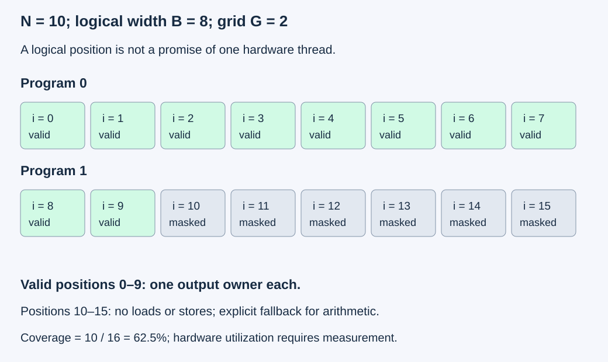
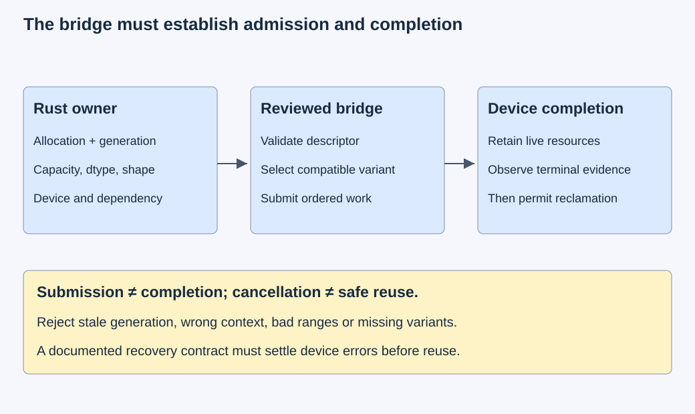

# M4-C03: Understanding the Triton programming model

> **Status: Complete — detailed chapter authored and documentation validated; experimental procedures are proposed unless explicitly labelled observed****Module:** Understand kernels and execution overhead

**Category:** [Kernels, compilers, and execution](index.md)

[Module 4 reading order](../module-4.md) · [Previous: M4-C02](../kernels-compilers-and-execution/m4-c02-mapping-an-operation-onto-cuda-threads-and-blocks.md) · [Next: M4-C04](../kernels-compilers-and-execution/m4-c04-compilation-specialization-and-the-warm-execution-path.md)

[Execution plan and progress](../chapter-execution-plan.md)

## Target concepts

Triton programs and launch grids, block-oriented operations, masks, loads and stores, reductions, compile-time parameters, comparison with CUDA, Rust host integration boundaries.

## Concepts

### 1. A program describes a block of values

A GPU kernel is a device operation launched by a host. In the CUDA model introduced in M4-C02, a programmer reasons about threads and their coordinates. Triton raises the starting point: one **program instance** describes operations on a block of values, and a launch grid selects how many instances execute. The compiler distributes those operations over hardware threads. A block of values is a logical tensor, not an allocation promise or a statement that every value has its own thread. The [Triton introduction](https://triton-lang.org/main/programming-guide/chapter-1/introduction.html) explains this block-oriented distinction.

For example, one program can describe 256 element positions while a particular NVIDIA configuration uses four warps, or 128 threads. Some threads then handle multiple values. Logical block size, warp count, register use and memory transactions describe different things. Triton does not eliminate hardware limits or the need to inspect generated execution. The [configuration reference](https://triton-lang.org/main/python-api/generated/triton.Config.html) documents the warp-count control; verify its interpretation on the selected backend rather than transferring NVIDIA's 32-thread warp arithmetic to every target.

| Question | CUDA starting point | Triton starting point |
|---|---|---|
| Who describes work? | Thread coordinates and cooperation | Program coordinates and block operations |
| What is a launch dimension? | Blocks, each with configured threads | Program instances; compiler configuration supplies execution resources |
| What establishes correctness? | Coordinate ownership, access validity and ordering | The same obligations, expressed over logical blocks |
| Where is performance explained? | Instructions, transactions, resources and dependencies | Generated instructions, transactions, resources and dependencies |

This chapter uses the conventional single-CTA NVIDIA path; clusters, distributed layouts and descriptor-based memory access are outside the experiment contract. A CTA is a cooperating thread block. No inter-program ordering is assumed.

### 2. Derive coverage before choosing a tile

Retain the M4-C01 pointwise operation Z=2X+Y. Inputs and output contain FP32 values; input integers lie in [-1024,1024], making the expression exact in FP32. Output coordinates have one writer. Inputs may share read-only storage; output must be disjoint from both. The earlier chapter's checked capacities, strides, device/context identity and retained lifetimes still apply.

For a contiguous flattened input of N elements and B logical elements per program:

**G=ceil(N/B);  i=pB+j;  0≤ p<G,;  0≤ j<B,;  m(i)=(i<N).**

Here G is the number of programs, p the program identifier and j a logical position inside a program. For every valid i, the inverse p=floor(i/B), j=i mod B establishes unique ownership. It establishes neither hardware scheduling order nor thread identity. Noncontiguous inputs require coordinate-to-stride address calculation; flattening the logical output does not make a pitched input contiguous.

With N=10,B=8, two programs describe 16 positions: program zero owns 0–7, program one owns 8–9 and has six invalid positions. Define **coverage efficiency**, a geometric diagnostic:

**ηcoverage=N/(GB)=10/16=62.5%.**

This is not measured utilization: invalid positions may still incur some instruction overhead, while compiler predication changes actual work. For N=0, return an identified empty success without compilation, allocation or launch; the ratio is undefined. Do not launch a dummy program and count it as useful work.

### 3. Masks protect accesses; fallback values define arithmetic

For this chapter's ordinary **tensor of pointers** interface, a false load mask suppresses that element's memory load. An explicit fallback supplies its arithmetic value. Without an explicit fallback, a masked-out load value can be undefined. A false store mask suppresses that store. These are separate obligations: a safe load does not authorize an out-of-range store. See the [load](https://triton-lang.org/main/python-api/generated/triton.language.load.html) and [store](https://triton-lang.org/main/python-api/generated/triton.language.store.html) contracts. Other pointer modes have different interfaces; do not apply this rule mechanically to block pointers or descriptors.

For pointwise addition, zero-filled invalid positions are harmless only if invalid outputs are also masked. For a sum, zero is a neutral element because a+0=a. For a maximum over finite values, negative infinity is neutral because max(a,-∞)=a. Zero is a wrong maximum fallback for an all-negative row. A mask is not a substitute for checking pointer capacity, checked integer address arithmetic, alignment or an operation's semantic membership.

Distinguish **padding** from **data**. A padded position exists to make a block representation convenient; it must not silently become an additional token, feature or sample. That distinction matters when a reduction denominator counts members.

### 4. A reduction changes the ownership question

A reduction combines an axis into a smaller output. Define a separate row-sum operation, not an optimization of 2X+Y:

**S[r]=sum of X[r,c] over c = 0,…,C−1.**

Assign one program per row, with a logical width B≥ C. Positions c≥ C receive zero; only the row result is stored. The [sum reference](https://triton-lang.org/main/python-api/generated/triton.language.sum.html) specifies the reduced axis and optional accumulation dtype. The compiler chooses a reduction schedule; floating-point addition is not associative, so changing that schedule can change a general numerical result.

Use exact teaching fixtures to isolate mapping mistakes first: 1≤ C≤257, integer inputs in [-128,128], FP32 accumulation and output. Every partial sum has magnitude at most 257 × 128=32,896, well below FP32's exact integer limit 2²⁴. Therefore every addition order stays exact for this fixture. This argument does not establish bitwise equivalence for arbitrary model activations; those need M9-C17 error budgets and downstream checks.

For the rows [1,2,3,4,5] and [-5,-4,-3,-2,-1], width eight gives sums 15 and −15, and maxima 5 and −1. Zero padding incorrectly changes the second maximum to zero. Define C=0 row sums as zero in a host-side empty-axis path; row maximum is rejected as undefined by this contract. Neither case invokes a device reduction. For R=0, both operations return empty output. A row wider than the admitted width is rejected, rather than silently truncated. Multi-program reductions and synchronization belong to M4-C06.

### 5. Compile-time choices and runtime facts

A **compile-time parameter** is known while the compiler constructs an executable variant. Logical block width is commonly such a parameter. A runtime length controls which elements of that width are valid. Explicit compile-time values specialize a JIT function according to the [JIT reference](https://triton-lang.org/main/python-api/generated/triton.jit.html). Runtime arguments can also participate in specialization policies; do not assume that only explicit compile-time values affect the artifact key.

Changing width from 128 to 256 can alter register pressure, program count, padding and reduction structure. Changing the number of warps can alter how the same block is distributed over threads. Neither is an automatic speedup. A valid experiment varies one control at a time and retains the generated artifact identity. Unsupported resource configurations are recorded as inadmissible, not as timed successes.

For N=1000, widths 128, 256 and 512 give 8, 4 and 2 programs respectively, each covering 1024 positions. All have 97.65625% geometric coverage, yet their runtime costs can differ. Equal padding does not imply equal occupancy, latency hiding or useful throughput. M4-C04 will develop compilation caches and the cold versus warm path; here it is sufficient to keep compilation outside steady-state kernel timing and report it separately.

### 6. Rust owns a host boundary, not an implicit interoperability guarantee

Rust remains the host-language context. Its ownership types do not by themselves prove that an asynchronous GPU has finished reading a buffer. Triton's documented JIT interface is Python-oriented; the documented pointer conversion is not a specification for an arbitrary Rust object. A Rust integration must name a reviewed bridge, its supported versions and its executable/launch contract. This chapter supplies no bridge or kernel implementation and promises no portable direct launch of arbitrary compiler artifacts.

A bridge specification must carry allocation identity and generation, byte capacity/offset, dtype, shape/strides, device/context, producer dependency, selected variant and output owner. Validate it before launch. Retain buffers, executable and context until completion or a documented failure-recovery procedure establishes that use has ended. Submission success is not completion; cancellation is not permission to reuse memory. A missing compatible variant causes explicit rejection or a separately specified fallback, never an unrecorded semantic change. A borrowed host descriptor and the device allocation it describes can have different lifetimes.

HFT supplies a useful analogy: event batches need bounded work, stable ownership and an explicit point at which state may be reused. A market event's freshness policy does not define an LLM tensor's numerical validity. No exchange protocol, profitability claim or trading behavior is inferred here.

## Experiments

These are proposed protocols. GPU work requires existing, separately reviewed candidates satisfying these contracts; this documentation does not supply implementations. CPU reference calculations below are analytical checks, not GPU measurements. Keep raw fixtures within a 64 MiB host budget and a separate 64 MiB device budget; charge runtime, compilation, profiling and generator state independently. Admit one case at a time and include guards in capacity checks.

### E1 — Establish program ownership and mask behavior

**Description:** Audit pointwise program coverage and rejected descriptors before any hardware trial.

**Purpose/objective:** Prove that every required output has one owner and no padded element accesses memory.

**Target concepts:** Program identifiers, launch grids, logical block width, masks, loads and stores.

**Baseline and workload:** Exact scalar reference for Z=2X+Y; contiguous lengths 0, 1, 7, 8, 9, 10, 127, 128, 129, 1000 and width 128, with the width-eight teaching case checked separately. Inputs cycle through integers −128 through 128; the second input reverses that cycle.

**Controls and prediction:** Hold dtype, operation and valid data fixed. Compare correct ceiling coverage with floor coverage, omitted store mask and duplicate ownership as descriptor/coverage counterexamples, without launching unsafe candidates. Only valid masked mapping should pass.

**Procedure:** Enumerate logical positions and independent inverse owners; check guards and output writes. Audit nonempty descriptors with undersized capacity, overflowing address arithmetic, output/input overlap and wrong device/context as rejected cases. An ordinary contiguous valid descriptor is accepted; the empty case bypasses launch.

**Hardware/software:** CPU reference and descriptor records suffice. Optional later GPU checking requires a compatible NVIDIA device, pinned Triton/compiler/runtime versions and a reviewed candidate.

**Failure and HFT connection:** Off-by-one writes can corrupt unrelated retained state. Like a bounded event-batch boundary, validity must be explicit even on a partial final batch.

**Exit criteria:** All valid outputs match exactly, ownership count is one, guards unchanged and invalid descriptors rejected before submission. Unsafe mapping variants are explained by reference evidence, not executed.

### E2 — Separate logical width from hardware configuration

**Description:** Benchmark equivalent pointwise mappings while varying block width and warp configuration separately.

**Purpose/objective:** Explain whether fewer programs help completed latency without assuming that larger tiles are better.

**Target concepts:** Block operations, compile-time parameters, CUDA comparison and resource pressure.

**Baseline and workload:** Reviewed CUDA candidate from M4-C02 and reviewed Triton candidates, all implementing the same exact operation. Lengths 127, 128, 129, 1000, 4096 and 65,537; widths 128, 256, 512. Test each supported width with four warps first; then compare four versus eight warps at width 256 if supported. Use the E1 data family with 60 distinct cyclic shifts.

**Controls and prediction:** Same device, inputs, layout, stream dependencies and output contract. Hold all other compiler controls fixed. Predict fewer programs for larger widths, but no unconditional timing winner. Validate all variants before timing; retain compilation failures as excluded configurations with reasons.

**Procedure:** Precompile admitted variants, verify references, warm each for 100 completed invocations and collect 60 alternating-order paired sessions of 100 completed invocations per case. Report distributions of session medians and paired ratios. Capture separate diagnostic profiles for selected small/large cases; compare program count, registers, spills and memory traffic to the prediction.

**Hardware/software:** One dedicated supported NVIDIA GPU; exact device, backend, drivers, clocks/power state, artifact identity and profiler versions recorded. No cross-device comparison without separate strata.

**Failure and HFT connection:** Excess resource demand or first-use compilation can turn a local optimization into a tail event. Bounded batch size is a control, not evidence of bounded elapsed time.

**Exit criteria:** Exact equality and guard checks for every admitted fixture; completed timings and uncertainty reported, no unsupported universal winner, and resource evidence explains or leaves unresolved the measured change.

### E3 — Neutral elements and row-reduction semantics

**Description:** Compare correctly padded row sums and maxima with deliberately wrong reference padding.

**Purpose/objective:** Separate numerical membership from block representation and catch a plausible wrong result.

**Target concepts:** Reduced axes, masked loads, neutral elements and accumulation precision.

**Baseline and workload:** Exact integer row reference for R=3, widths C=1,5,127,128,129,257; logical block width is the smallest power of two at least C. Values follow ((17r+3c) mod 257)-128. Include the two explicit five-element rows, zero-row input, zero-column input, all-negative rows and a rejected row exceeding admitted width.

**Controls and prediction:** Hold row membership and FP32 accumulation fixed. Zero padding preserves sums; negative-infinity padding preserves finite maxima. Wrong zero padding changes some all-negative maxima. No cross-program collective is permitted.

**Procedure:** Independently compute direct and padded results and output counts; audit empty-axis policies. If a reviewed candidate exists, compare every output and guards, then apply E2's timing protocol to sum and maximum separately. Never time sum against maximum as equivalent work.

**Hardware/software:** CPU exact reference; optional same pinned GPU/software platform as E2, with documented accumulator/output types.

**Failure and HFT connection:** A valid memory access can still produce the wrong aggregate. Excluding nonexistent events from an aggregate resembles excluding padded tensor positions, but statistical and numerical contracts differ.

**Exit criteria:** Exact fixture equality, expected wrong-padding counterexample reproduced analytically, no output for empty rows, defined zero sums for empty columns and explicit rejection of undefined maxima or oversized rows. General floating-point claims remain outside this exact fixture.

### E4 — Verify the Rust bridge's ownership contract

**Description:** Review bridge admission, dependency and retirement records without supplying a bridge implementation.

**Purpose/objective:** Establish what evidence is required before a device operation can be called safely by a Rust service.

**Target concepts:** Host integration boundaries, asynchronous completion, artifact identity and state lifetime.

**Baseline and workload:** A specified single-request bridge with one admitted variant and retained buffers. Review eight scenarios: valid ordered submission; missing variant; wrong context; stale allocation generation; insufficient capacity; missing producer dependency; cancellation before completion; completion followed by reclamation.

**Controls and prediction:** Keep operation and artifact fixed. First and last scenarios are accepted as described; middle four admission defects plus the missing producer dependency are rejected or deferred before submission. Cancellation retains in-flight resources and changes client outcome only.

**Procedure:** Trace owner, dependency and terminal event for each scenario. Record who reports errors and who can reclaim each resource. Any future fault injection must use an isolated test context and reviewed recovery contract; do not intentionally free live device memory.

**Hardware/software:** Document-only lifecycle review is sufficient initially; execution requires an identified reviewed bridge, ABI/schema, artifact format, GPU context and completion mechanism.

**Failure and HFT connection:** Client disinterest does not end device use. A stale handle resembles reuse of an event slot before its consumer has finished, without implying identical recovery semantics.

**Exit criteria:** Eight explicit lifecycle verdicts, no reclamation before safe terminal evidence, no silent fallback and all rejected descriptors excluded from launch. An unspecified bridge leaves execution blocked rather than presumed safe.

### E5 — Test whether a kernel improvement reaches the service

**Description:** Place an already validated candidate in an existing text-generation path that actually uses the same operation and data contract.

**Purpose/objective:** Measure useful service rather than extrapolating a microbenchmark speedup.

**Target concepts:** Host/device boundaries, operating point, specialization and end-to-end dependencies.

**Baseline and workload:** Existing generator baseline versus one admitted equivalent replacement. Use a fixed tokenizer/model identity, deterministic request/output contract, fixed prompt/output-length strata and arrival rates below and near baseline saturation. If the generator has no matching operation, record this experiment as not applicable; do not insert synthetic work into a request.

**Controls and prediction:** Same admission policy, queue capacity, cache policy, workload replay and hardware. Compilation and first-use are a separate cohort. Predict that benefits depend on critical-path share; extra dispatch or coordination may erase them.

**Procedure:** Use 60 paired replay sessions with declared duration and equal arrival traces, warm state and isolated diagnostics. Record admitted, rejected, completed, cancelled and failed counts; completion latency, time to first token, inter-token latency and useful tokens/second. Include drain/censoring rules and output checks.

**Hardware/software:** Full CPU/GPU topology, memory/connection limits, Rust bridge and executable identities, model/tokenizer hashes and scheduling configuration.

**Failure and HFT connection:** Overload, stale work and cancellation can dominate an otherwise faster device stage. Trading latency objectives do not supply acceptable inference error budgets.

**Exit criteria:** Output contract passes, capacity and failure populations are accounted for, and any claimed improvement has paired evidence at a named operating point. A faster isolated kernel alone does not pass an end-to-end improvement claim.

## Verification

### V1 — Ownership, ranges and useful bytes (E1)

For every valid element, verify the forward coordinate and independent inverse owner. Check byte ranges using checked arithmetic and canonical allocation identity before submission. For contiguous FP32 pointwise data, useful logical traffic is two four-byte loads and one four-byte store: Q=12N bytes. It excludes guards, runtime storage, cache effects and transactions. At N=1000, this is 12,000 bytes, not a measured HBM count. Clear output coverage records before each case so untouched output cannot pass by reusing an earlier value. Read guard/output data only after proven completion.

### V2 — Timing and profiling boundaries (E2)

A GPU event interval around ordered device work measures completed device elapsed time. A monotonic host interval from bridge invocation through observed completion additionally includes dispatch and waiting. Report both; submission-only time is neither. Use the same event/host synchronization policy for all candidates and name whether event overhead is included. Collect compilation, module loading and first-use separately from warm execution.

Six thousand invocations per case are grouped into 60 sessions, not 6000 independent samples. Report paired session effects and uncertainty; do not certify service p99 from these session medians. Keep raw invocation data to expose within-session variation. A small measured difference unresolved by timer resolution or session variability is inconclusive. Profiles are separate runs because instrumentation can perturb timing. Registers, spills and transaction counters support a bottleneck explanation; they do not by themselves establish a speedup.

### V3 — Reduction reference and numerical limits (E3)

Compare every row result against both direct integer aggregation and correctly padded aggregation. Assert the axis and output shape, input domain, accumulator dtype and the 32,896 partial-sum bound. For a broader activation domain, first declare NaN/infinity/empty-axis semantics and justify absolute/relative tolerances using M9-C17; exact integer acceptance cannot be transferred. A sanitizer can detect some access or synchronization defects, but cannot prove correct reduction membership or all race freedom.

### V4 — Lifecycle and error evidence (E4)

Retain a scenario table with descriptor identity, admission decision, producer event, submission outcome, terminal event, owner and permitted reclamation. The eight verdicts are: accept; reject; reject; reject; reject; defer/reject; retain while in flight; reclaim after established completion. The last is a retirement decision rather than a new submission. A device error needs the documented recovery/quiescence contract; an error message alone is not proof that all references are dead. Sanitizer and integration runs remain proposed until a bridge and compatible test hardware exist.

### V5 — Useful service and bounded capacity (E5)

Use M9-C02 event definitions and M9-C07 distribution guidance. Report completed-request percentiles alongside timeout, rejection and cancellation counts; exclude neither overload failures nor unfinished work silently. Define useful throughput as accepted, contract-valid output tokens divided by the declared wall-clock observation interval, with warmup and drain policy disclosed. Separate prompt-length, output-length and concurrency strata. Set queue/in-flight limits before the run and report reached limits. Stop on correctness, guard or lifetime failure; retain diagnostic evidence and do not report that run as a performance success.

Supporting completed chapters M9-C01, C02, C07, C12, C13, C15, C16 and C17 supply reference, clock, uncertainty, profiling, capacity, manifest and numerical methods. M9-C22 remains an outline; the elementary ownership gates needed here are specified locally. No Module 8 material is required.

## Engineering dimensions and principles

| Dimension | Application in this chapter |
|---|---|
| Semantics and invariants | One pointwise writer; exact fixture; defined reduction membership and empty-axis outcomes. |
| Workload and variability | Lengths around tile boundaries, negative rows, cold variants and arrival-rate strata. |
| Resources and bottlenecks | Program count, registers, spills, logical bytes and separately charged runtime state. |
| Time and distributions | Completed device versus host boundaries, paired sessions and service tails. |
| Ownership and coordination | Producer dependencies and retained allocations/artifacts through terminal evidence. |
| Failure and adaptation | Reject invalid descriptors/configurations; preserve ownership during cancellation; account for overload. |

| Engineering principle | Concrete learning step |
|---|---|
| 1. Correctness defines the optimization boundary | Equivalent pointwise variants share one contract; reduction is a separate operation. |
| 2. Performance depends on workload and operating point | Tile edges, small inputs and near-saturation queues are separate comparisons. |
| 3. Data movement is part of the algorithm | Strided addresses, padding and transactions remain relevant under block syntax. |
| 4. State has ownership, lifetime and recovery cost | Rust bridge keeps device resources alive past submission and cancellation. |
| 5. Dependencies determine latency; bottlenecks determine capacity | A shorter kernel helps the service only on a relevant path and operating point. |
| 6. Variability and synchronization shape the tail | Warm medians cannot establish cold-start or overloaded request p99. |
| 7. Local improvements need end-to-end evaluation | E5 tests useful tokens and completion outcomes after E2 establishes equivalence. |
| 8. Claims require reproducible evidence | Fixture references, versioned artifacts, controlled sessions and explicit unexecuted status. |

## Specifications, articles, and hardware

The official [Triton introduction](https://triton-lang.org/main/programming-guide/chapter-1/introduction.html) and [vector-add tutorial](https://triton-lang.org/main/getting-started/tutorials/01-vector-add.html) are explanatory articles for the programming model; read their conceptual treatment without treating published examples as measurements of this workload. The linked load, store, sum, Config and JIT API pages specify the interfaces used here. Pin a release or source revision when running experiments because the online main documentation can change. The [CUDA programming guide](https://docs.nvidia.com/cuda/cuda-programming-guide/02-basics/writing-cuda-kernels.html) supplies the thread/block comparison, and [Compute Sanitizer documentation](https://docs.nvidia.com/compute-sanitizer/ComputeSanitizer/index.html) defines diagnostic tool scope.

| Manifest item | Required specification and reason |
|---|---|
| GPU | Exact model/architecture, SM count, memory capacity, warp size, block/resource limits and supported compiler target. |
| Execution resources | Admitted widths/warps, registers, shared memory, spills and generated artifact identity for each variant. |
| Host and connection | CPU, NUMA placement, RAM, PCIe/device topology, affinity and other device users. |
| Software | OS, driver, CUDA runtime/toolkit, Triton release/revision, Python bridge dependencies, Rust version and bridge schema/ABI. |
| Operating conditions | Clock/power/thermal policy, utilization, warmup, compilation cache state and sampling intervals. |
| Evidence | Exact fixtures, logical traffic boundary, timing populations, profiler versions, failures and unavailable counters. |

No GPU specification or benchmark number is assumed for the reader's machine. All hardware timing, profiling, sanitizer and generator studies in this chapter are proposed. Authorship validation checks documentation and mathematical references; it does not certify an implemented runtime.

## What to carry forward

Triton describes blocks of values, while the compiler maps them onto execution resources. Prove ownership and access validity, select arithmetic fallbacks deliberately, and preserve the host's dependency and lifetime contract. Then measure completed work at an explicit operating point.

Next in Module 4 reading order is the completed [M4-C04: Compilation, specialization, and the warm execution path](m4-c04-compilation-specialization-and-the-warm-execution-path.md). The next authoring chapter is [M4-C05](m4-c05-tiling-an-operation-for-data-reuse.md). Track acceptance in the [execution plan](../chapter-execution-plan.md).
