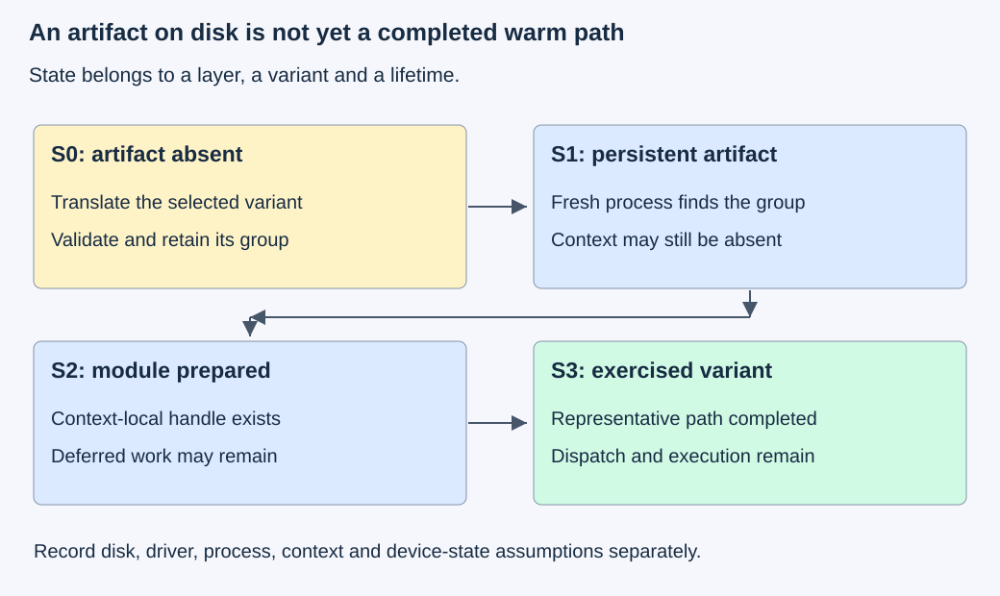
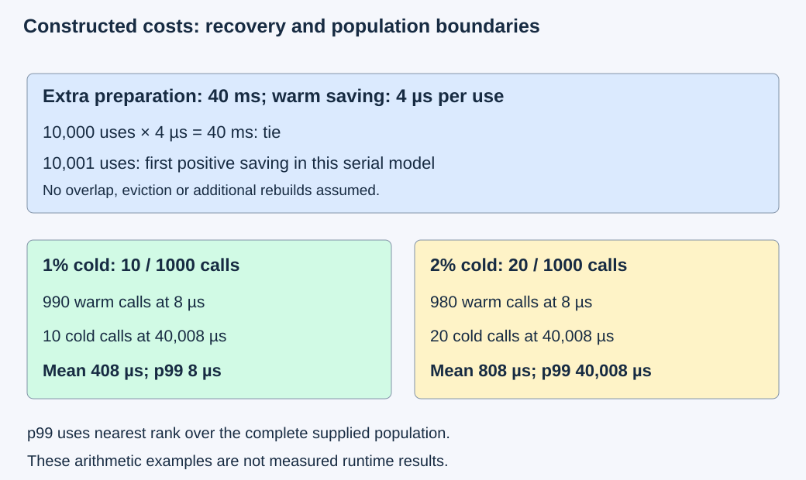

# M4-C04: Compilation, specialization, and the warm execution path

> **Status: Complete — detailed chapter authored and documentation validated; experimental procedures are proposed unless explicitly labelled observed**

**Module:** Understand kernels and execution overhead

**Category:** [Kernels, compilers, and execution](index.md)

[Module 4 reading order](../module-4.md) · [Previous: M4-C03](../kernels-compilers-and-execution/m4-c03-understanding-the-triton-programming-model.md) · [Next: M4-C05](../kernels-compilers-and-execution/m4-c05-tiling-an-operation-for-data-reuse.md)

[Execution plan and progress](../chapter-execution-plan.md)

## Target concepts

Ahead-of-time and just-in-time compilation, device targets, generated artifacts, specialization keys, compilation caches, first-use overhead, cold versus warm execution, version compatibility.

## Concepts

### 1. Compilation prepares an executable; execution uses it

A compiler translates a description of an operation into a form a processor can execute. **Ahead-of-time compilation (AOT)** performs this translation before the application needs the operation, often during a build or preparation stage. **Just-in-time compilation (JIT)** performs a translation during application execution, after relevant facts become known. These terms describe when a particular translation happens. One application can use both.

For example, a CUDA build can prepare device instructions for a selected GPU target before deployment. Alternatively, it can include PTX, NVIDIA's virtual instruction representation, which a driver translates for the installed device. Triton can specialize a kernel during runtime and produce a device artifact. An **artifact** is a retained output of a preparation step: an intermediate representation, binary, or associated launch metadata. An intermediate representation is a compiler's structured description of the computation between source and final machine instructions. The [NVCC guide](https://docs.nvidia.com/cuda/cuda-programming-guide/02-basics/nvcc.html) describes the host/device compilation split; the [CUDA platform guide](https://docs.nvidia.com/cuda/cuda-programming-guide/01-introduction/cuda-platform.html) explains device artifacts.

A **cubin** contains machine code for an NVIDIA GPU target; a **fatbin** can package several device representations. AOT therefore does not mean every possible runtime preparation step has disappeared: a package containing virtual instructions can still need a later translation, and a native artifact still needs an appropriate context and executable handle. Do not equate “file exists” with “ready for a request.”

The learning goal is to locate preparation costs, make executable identity explicit and establish when a request may use a variant. Rust remains the host context; this chapter specifies an integration contract, not a Rust runtime, compiler wrapper or kernel implementation.

### 2. “Warm” must name the retained state

A **cache** retains something so later work can reuse it. Compilation caches retain generated artifacts, while a process can separately retain loaded modules and callable handles. The driver can also retain translated code. These caches have different owners and lifetimes. A new process may find a disk artifact while having no context-local module. A process restart is not evidence that every compilation cache was empty.

Use the following experimental states. They are controlled cohorts, meaning groups of trials with the same starting conditions, not universal names supplied by a runtime.

| State | Preparation condition | What can still happen on first use? |
|---|---|---|
| S0: artifact miss | Fresh process; required artifact absent from isolated test caches | Context setup, translation, artifact writes, module/function preparation and first execution |
| S1: persistent hit | Fresh process; matching complete artifact retained on disk | Lookup/read/validation, context setup, loading, and possibly another translation layer |
| S2: loaded, not exercised | Context and selected module/function prepared through the reviewed bridge | Deferred initialization, allocation, or device-state effects not settled by loading |
| S3: exercised variant | Same variant and dependency path completed representative warmup | Lookup/dispatch, actual device work, waiting and completion observation |

Disk, operating-system file cache, driver translation cache, process cache, GPU instruction/data caches and clock state must be recorded separately. If a layer cannot be controlled or observed, label it unknown and narrow the cohort claim. S3 says nothing about all future shapes, other contexts, thermal behavior or queueing. A new variant can be cold inside an otherwise warm service.

*The retained artifact crosses process lifetimes; the loaded handle belongs to a context. Exercising a variant establishes only that the tested path has completed.*

NVIDIA's [lazy-loading guide](https://docs.nvidia.com/cuda/cuda-programming-guide/04-special-topics/lazy-loading.html) explains why initialization can move toward first use and recommends preparation before steady-state measurement. It also describes module memory allocation arriving after application startup. Reserve capacity for this possibility; allocating every available byte to model or KV state can leave no room for late module loading. Record the actual loading mode and versions rather than relying on a default.

### 3. Specialization trades generality for assumptions

A **specialized variant** is an executable prepared under particular assumptions, such as dtype, layout, logical block width or a constant dimension. A **specialization key** identifies the facts used to select that variant. Runtime length may remain a normal argument while block width is fixed during compilation. Conversely, treating every exact length as a compile-time value can create many variants.

The [Triton JIT specification](https://triton-lang.org/main/python-api/generated/triton.jit.html) distinguishes explicit compile-time values and specialization controls. Runtime values, argument types and alignment information can also affect a backend's policy. Do not infer the complete cache key from a function name or assume every change of length causes compilation.

Separate two records:

| Record | Purpose | Example contents |
|---|---|---|
| Build identity | Explain how an artifact was produced | Source/dependency digests, compiler/backend revision, target/features, argument types, constants, arithmetic options, launch configuration and relevant environment |
| Eligibility contract | Decide whether this invocation may use it | Operation/version, dtype, shape bounds, layout/strides, alignment, validated address ranges, device/context and required numerical behavior |

A **digest** is a compact identifier computed from content; the full manifest and artifact checks remain necessary. The exact backend cache algorithm is version-specific. The maintained [Triton runtime](https://github.com/triton-lang/triton/blob/main/python/triton/runtime/jit.py), [cache](https://github.com/triton-lang/triton/blob/main/python/triton/runtime/cache.py) and [compiler](https://github.com/triton-lang/triton/blob/main/python/triton/compiler/compiler.py) sources illustrate several layers. They are evidence to inspect at a pinned revision, not a stable interchange format for Rust.

Do not use model or tokenizer identity as an automatic kernel compilation axis when the executable does not depend on them; retain those identities in the service run manifest instead. Conversely, weights or constants embedded into generated code do become artifact dependencies. A runtime pointer address ordinarily identifies invocation storage, not reusable semantics; any alignment specialization must still hold for the next allocation.

For a policy allowing eight shape classes, two dtypes, three layouts, two targets and two warp choices, the Cartesian product has:

**Vmax = 8 × 2 × 3 × 2 × 2 = 192 possible combinations.**

This is an upper bound for independently admitted combinations, not a claim that a compiler emits 192 binaries. Unsupported combinations reduce it; additional specialization can increase it. If every artifact occupies a constructed 192 KiB, 192 artifacts require 36 MiB. A 16 MiB disk budget holds only floor(16,384/192) = 85 such artifacts before metadata. Keep disk artifacts, loaded modules, compilation workspace and tensor allocations in separate budget categories. KiB and MiB mean 1024 and 1,048,576 bytes respectively.

### 4. A cache hit is useful only when the artifact is eligible

Retain the exact pointwise contract Z = 2X + Y from M4-C03: contiguous FP32 inputs with integer values in [−128,128], disjoint output, checked capacities, ordered producers and retained lifetimes. No numerical approximation or random state is involved. N = 0 returns empty success without compilation or launch.

Consider the request-length trace **127, 128, 127, 129, 1000, 128, 129, 1000**. Hold target, dtype, layout, compiler controls and alignment class fixed. Compare three declared policies:

| Policy | Declared variant rule | Distinct variants / cold misses with unlimited retention | Hits after lookup |
|---|---|---|---|
| G: generic | One width-128 variant; valid N stays runtime data | 1 | 7 |
| X: exact length | Each distinct N is a compile-time constant | 4 | 4 |
| B: bounded buckets | Widths 128, 256 and 1024; N stays runtime data; one program per request | 3 | 5 |

For B, lengths up to 128 use width 128, 129–256 use 256, and 257–1024 use 1024. Larger lengths are rejected by B's contract. Each block masks positions beyond N; output shape remains N. This bucket policy is chosen for the example, not Triton's automatic behavior. Policy G uses as many programs as ceiling(N/128) requires. A separately reviewed candidate for each policy is a prerequisite to hardware experiments; none is supplied here.

With an initially empty **two-entry least-recently-used cache**, B's key trace is A, A, A, B, C, A, B, C, where A/B/C name the three widths. Least-recently-used means a hit refreshes recency and a miss evicts the least recently accessed retained entry if full. The result is six misses, two hits and four evictions. With three entries it has three misses and five hits. This is a model of artifact retention; an evicted disk entry can still have a live loaded module, so these misses do not automatically equal actual recompilations. The experiment must reset or separately record the process layer.

Artifact validity is not guaranteed by a matching filename. A conservative service admission contract rejects a mismatched target, arithmetic policy, schema or source dependency; it verifies a complete manifest/artifact group before use. Interrupted construction never publishes a ready variant. Existing immutable files can be retained while a new generation is prepared, but new requests must select an eligible generation and in-flight users retain their own handles until completion. A proposed one-build-per-key coordination rule should be tested explicitly; atomic replacement of one file alone does not prove that an entire artifact group is complete or that concurrent callers avoid duplicate builds.

### 5. Preparation has a break-even point and a tail cost

Use a **constructed serial cost model**, with no overlap or queueing, to decide what to measure. Let C be extra one-time preparation compared with a baseline; tg and ts are completed warm costs per invocation for the generic and specialized paths; K is invocation count. The specialized path recovers its extra preparation only when:

**K × (tg − ts) > C**, provided tg > ts.

For an invented C = 40 ms, tg = 12 µs and ts = 8 µs, C is 40,000 µs and the saving is 4 µs/use. Ten thousand uses tie; the first strictly favorable integer count is 10,001. Overlap, eviction, rebuilds and model changes invalidate this simple calculation unless incorporated. A faster warm kernel can lose over a short deployment lifetime.

Means also hide preparation events. A constructed population of 1000 completed calls with 990 at 8 µs and 10 at 40,008 µs has mean **408 µs**. Under nearest-rank p99, the 990th sorted observation is 8 µs. With 20 cold and 980 warm calls, the mean becomes **808 µs** and p99 becomes 40,008 µs. This discontinuity is a property of the supplied population and quantile definition; it is not a service measurement or a sample-size recommendation. Preserve separate first-use counts and populations rather than interpreting a single percentile as a complete cold-start report.

*The break-even calculation accounts for one extra preparation cost. The percentile example shows why cold-event frequency must accompany a warm-path distribution.*

Preparation can delay other requests. In a separate constructed serial worker, four requests arrive at 0, 1, 2 and 3 ms. The first triggers a 10 ms blocking preparation, then each request takes 1 ms. Completion times are 11, 12, 13 and 14 ms; every request's latency is 11 ms even though only one triggered preparation. If preparation is finished before arrivals, completion times are 1, 2, 3 and 4 ms and latencies are all 1 ms. This model assumes one worker, no rejection, no overlap and no other work. An actual GPU service needs its own timeline and queue accounting.

### 6. Compatibility is several questions, not one version string

A **device target** describes the hardware/features an executable expects. Compute capability identifies NVIDIA GPU architecture features; it is distinct from driver and toolkit versions. Verify native binary compatibility, virtual-instruction version support, required device features, runtime/library compatibility, and the bridge's launch metadata/ABI separately. An ABI is the binary-level agreement on argument representation and calling conventions.

For a limited historical-style native example, NVIDIA documents sm_86 binary compatibility on compatible 8.x devices with equal or higher minor capability, and not across arbitrary major capability versions. PTX can offer a translation path to later targets when the driver understands it and required features are available. Neither implies arbitrary artifact portability, especially across backends. Newer architecture-specific/family-specific targets and finalization rules need their exact documented constraints; this chapter makes no general binary-compatibility promise beyond the identified target. See the [CUDA platform compatibility sections](https://docs.nvidia.com/cuda/cuda-programming-guide/01-introduction/cuda-platform.html#binary-compatibility).

CUDA's [minor-version compatibility guide](https://docs.nvidia.com/deploy/cuda-compatibility/minor-version-compatibility.html) describes feature and PTX limitations on older drivers. A working native path does not establish that a newer PTX path works there. Test supported combinations and capture explicit unsupported outcomes rather than copying a cache across machines and assuming eligibility.

At the Rust boundary, retain executable identity, context, input/output resources and completion evidence together. A pointer borrowed by the host is not proof that device use has ended. Choose a bounded policy for an unexpected variant: reject it, use a validated compatible generic path, or admit preparation behind a bounded queue. Name which policy applies before measurement. Warming selected variants before readiness can reduce request first-use work but consumes startup time and resources; it cannot promise zero compilation for unbounded future shapes.

HFT provides a systems analogy: preparing an admitted set of execution paths and making bounded fallback decisions can reduce surprises on an event-processing path. Inference kernels have their own numerical and hardware contracts; trading deadlines, financial outcomes and exchange semantics do not supply those contracts.

## Experiments

All protocols below are **proposed**. This repository supplies documentation, not runnable candidates, a compiler cache service or a Rust bridge. CPU reference and ledger checks validate the stated examples only. Hardware experiments require independently reviewed candidates and a bridge that exposes the named events. Raw pointwise fixtures are limited to 64 MiB each on host and device; compilation workspace, runtime memory, disk artifacts and model/KV state receive separate explicit budgets. Use isolated test cache namespaces; never erase a user's or production service's shared cache to simulate a miss.

### E1 — Locate first-use work across cache layers

**Description:** Compare the same admitted pointwise variant in S0–S3, retaining its numerical contract.

**Purpose/objective:** Determine which preparation stages persist after a disk hit or module load, and separate them from warm execution.

**Target concepts:** AOT/JIT, artifacts, compilation caches, first-use overhead and cold versus warm execution.

**Baseline and workload:** Existing reviewed width-128 FP32 pointwise candidate with N = 129 and 65,537, evaluated separately. Use X[i] = ((i + e) mod 257) − 128 and Y[i] = ((11i + 2e) mod 127) − 63, for fixture index e = 0,…,59; the reference evaluates 2X[i] + Y[i] independently. Compare an AOT-native path and a runtime-specialized path only if each has an independently validated equivalent candidate.

**Controls and prediction:** Independent variable is declared readiness state. Hold inputs, target, arithmetic options, layout, stream ordering, compiler and bridge fixed within each path. Expect S0 to expose more preparation stages; do not predict a universal ordering because file cache, clocks and initialization vary.

**Procedure:** Establish each cohort from isolated namespaces and explicit process/context records. Collect 60 first-completion trials per state/size, each with a correctly reset starting state. For S3 only, finish 100 representative warmups before the measured call. Record context initialization, artifact lookup/translation/write, module/function readiness, submission and completion events where exposed. Preserve unknown stages. Alternate cohort order across sessions; separately profile selected trials and collect a warm repeated-call baseline.

**Hardware/software:** One compatible NVIDIA GPU, CPU/storage identity, pinned compiler/Triton/runtime/driver, documented bridge and loading mode; native/PTX artifact contents and every controllable cache state recorded.

**Failure and HFT connection:** Cache permissions, disk exhaustion, unsupported target or preparation timeout must produce named failures, not fabricated hits. As with preparing an event path, readiness moves work earlier but does not define inference correctness or guarantee a deadline.

**Exit criteria:** Exact output and guard checks pass; all trials have start-state evidence and terminal outcomes; first-use host cost and warm completed device cost remain separate. Unknown driver-cache state prevents claiming a fully cold driver cohort.

### E2 — Measure variant growth and bounded reuse

**Description:** Replay the eight-length trace under G, X and B, then compare B with two and three retained disk entries.

**Purpose/objective:** Test whether the declared specialization policy controls variant count and whether retention is sufficient for the workload.

**Target concepts:** Specialization keys, compile-time assumptions, cache identity, eviction and workload variability.

**Baseline and workload:** Exact trace and policy definitions in Concepts; target/dtype/layout/alignment class fixed. Use E1's data family on every length. An unlimited-retention key ledger is the baseline; two/three-entry LRU ledgers are constructed comparison models.

**Controls and prediction:** Vary only policy, then capacity for B. Predict G/X/B distinct counts 1/4/3; for B predict six/two misses/hits at capacity two and three/five at capacity three. These counts describe declared keys, not unobserved compiler internals.

**Procedure:** First audit every request's eligibility and exact reference. Replay the ledger from empty state and record lookup key, hit layer, last use and eviction. If candidates exist, run 60 paired process-reset replays per policy/capacity, retaining disk state only as the case specifies and keeping process-module reuse visible. Record actual emitted artifact identities and builds, including extra backend specialization. Report any disagreement with the declared model rather than forcing observed keys to fit it.

**Hardware/software:** CPU ledger initially; runtime extension uses E1's platform and versioned instrumentation. Enforce a 16 MiB isolated disk-artifact budget and separately measured loaded-module/workspace budgets; actual sizes replace the illustrative 192 KiB value.

**Failure and HFT connection:** Alternating uncommon lengths can churn a bounded cache and consume preparation capacity. This resembles skew changes in event processing, while token shapes and arithmetic eligibility remain inference-specific.

**Exit criteria:** Ledger counts reconcile and every accepted shape is correct; measured builds/hits/evictions identify their layer and retain failures. No warm-path claim is made from a disk-hit rate alone.

### E3 — Reject stale artifacts and unsafe publication

**Description:** Review ten artifact/lifecycle scenarios and, where a reviewed test bridge exists, exercise safe isolated failures.

**Purpose/objective:** Establish compatibility and publication gates before measuring cached execution.

**Target concepts:** Device targets, generated-artifact groups, version compatibility and ownership.

**Baseline and workload:** A matching immutable manifest/artifact group with its supported bridge. Cases: matching group; missing group member; corrupted digest; changed source dependency; mismatched target; changed arithmetic option; incompatible bridge schema; unsupported driver/PTX combination; concurrent requests for one absent key; replacement while an old handle is in flight.

**Controls and prediction:** Change one recorded fact per case. First case is eligible; cases two through eight cannot use the stale group. They may enter separately bounded rebuild/fallback handling if available. Case nine follows a declared one-build-per-key policy with at most one active build and one waiting caller in this two-request test. Case ten admits a new eligible generation while retaining the old in-flight handle.

**Procedure:** Audit expected verdicts before execution. Use copied artifacts in a disposable namespace for missing/corrupt-file cases, not malformed device binaries submitted to a GPU. Simulate an interrupted build before publication and verify that no ready group appears. For two concurrent callers, record build ownership and publication/wait/failure transitions. During replacement, trace the old completion and eventual reclamation. A compiler failure releases its build slot and wakes waiters with an explicit result.

**Hardware/software:** Manifest/lifecycle review needs only CPU records. Actual loader/bridge validation needs compatible isolated hardware, supported driver/compiler combinations and a documented recovery contract; absent combinations are untested.

**Failure and HFT connection:** A failed preparation cannot publish half-ready state or allow early resource reuse. This matches the need for complete state publication in event systems, without equating inference artifacts with market data.

**Exit criteria:** Ten documented verdicts, no stale/incomplete artifact used, declared build bound respected, every waiter terminally accounted for, and old handles retained through safe completion. Tests do not execute corrupt binaries or free live device resources.

### E4 — Recover preparation cost and expose service impact

**Description:** Compare generic, on-demand specialization and prewarmed specialization using completed execution and request boundaries.

**Purpose/objective:** Determine whether extra preparation pays back within a defined lifetime and whether its placement changes useful service.

**Target concepts:** Warm execution, first-use distributions, compatibility across restarts and local versus end-to-end improvement.

**Baseline and workload:** Constructed break-even, 1000-call populations and four-arrival worker references above. Hardware extension: G versus one validated specialized pointwise path for admitted lengths, using 60 paired sessions per length, with N = 129 and 65,537 evaluated separately and a declared number K of uses per session. A separate existing text generator is eligible only if it actually contains the same operation and exact data contract; otherwise report the generator portion not applicable.

**Controls and prediction:** Vary preparation placement or policy, not model, arithmetic, arrival trace, queue limit or admission policy. Predict that warm savings alone are insufficient when the lifetime is shorter than measured recovery cost, and that prewarming moves cost to startup rather than eliminating it.

**Procedure:** First reproduce the supplied mathematical ledgers. In runtime sessions, time startup/preparation and K completed uses together as well as warm intervals separately. Choose K at approximately half, one and twice the measured break-even count, rounded upward to positive integers; retain the pilot separately from comparison trials. If no positive resolved warm saving exists, report that result instead of inventing a recovery count. For a qualifying generator, use 30-second open-loop arrival windows at 50% and 90% of baseline sustainable arrival rate established in a separate pilot. Open-loop arrivals follow scheduled times independent of earlier completions. Use prompt/output token-count pairs (32,32), (32,128), (128,32) and (128,128) only where the model and memory contract admit them; record excluded strata. Retain the same arrival trace for each pair of policies. Set waiting-request capacity to 64, in-flight-request limit to eight, active-build limit to one and build-waiter limit to eight; reject excess arrivals explicitly. Record readiness time, queue wait, output validity, time to first token (TTFT), inter-token gaps and terminal outcomes. Stop arrivals after 30 seconds and allow a further 30-second drain, marking unfinished work censored and retaining its resources until safe recovery. These are experiment controls, not recommended production limits.

**Hardware/software:** Full CPU/GPU/storage topology, pinned model/tokenizer and bridge identities for any service extension, all cache/lifetime limits and compiler resource charges. No deployed generator or bridge is assumed here.

**Failure and HFT connection:** Compile storms, cancellations and overload can delay requests that did not cause a miss. The event-path analogy concerns bounded coordination; it does not establish trading performance or an acceptable inference SLO.

**Exit criteria:** Mathematical references reconcile; real benefit claims include preparation, capacity, failure and output evidence at a named operating point. Warm microbenchmark savings alone cannot pass a service improvement claim; unexecuted extensions remain proposed.

## Verification

### V1 — Separate clocks, stages and starting states (E1)

Use one monotonic host clock for stage endpoints and host elapsed time, in ns or µs with stated resolution. Primary first-use boundary is invocation of the admitted bridge operation to observed completion with caller-readable output; it includes any preparation on that path. Record process launch to service readiness separately, including imports/context preparation moved outside the primary boundary. A GPU event interval brackets ordered device work only; it cannot measure host compilation and may include waiting if readiness has not been established. Retain event placement and producer dependencies rather than subtracting unrelated clock timestamps.

Each of the 60 first-use observations must begin from its declared state; 60 calls in one warm process are not 60 S0 trials. Keep failures, missing timestamps and timeouts visible. Report medians, ranges and paired-session uncertainty for each cohort, plus raw samples. Sixty cold trials are exploratory evidence, insufficient to certify rare-event service p99. Use timelines from [M9-C12](../measurement-experimentation-and-economics/m9-c12-reading-cpu-gpu-timelines-and-scheduling-gaps.md) to locate preparation; profiles occur in separate runs with instrumentation overhead disclosed. CPU/storage profiling is appropriate for translation and cache reads; GPU kernel counters cannot explain all host first-use time.

Compare all output elements against independent integer and FP32 references before any speed claim. The E1 family has integer outputs within [−319,319], so both intermediate multiplication and final addition are exact in FP32. Include X = [1,2,3], Y = [10,20,30], whose reference is [12,24,36]; returning X or omitting Y fails this reference. Retain per-coordinate checks and guard checks, not a checksum alone. A source-correct result does not prove that an intended cache state was used; artifact and timeline evidence are independent gates.

### V2 — Key accounting and capacity (E2)

Use per-request identity to reconcile eight lookups into hits plus misses, and distinguish disk misses, process misses, compiler invocations, driver translations and ready-module reuse. For a two-entry LRU model, count only resident entries and verify last-use order after every lookup; miss insertion can evict one entry, while a hit never increases resident count. No-op empty input is not a cache hit and must not create a variant.

Report declared versus observed variant counts, bytes per artifact group, peak disk/workspace/resident bytes, time spent compiling and time stalled behind preparation. Replay timing starts before the first lookup and ends after the eighth request's terminal outcome and required completion. A separate per-request interval includes its own waiting; do not divide total replay time by eight and call that p99. Retain 60 paired replay summaries, alternate policy order and do not treat repeated requests within one evolving cache as independent trials. Use file/host traces and runtime build records; GPU profiling is secondary to identifying which work actually ran.

### V3 — Eligibility and lifetime evidence (E3)

Create a scenario ledger with requested identity, artifact identity, compatibility decision, build owner, waiter state, publication event, terminal result and permitted reclamation. Check the ten verdicts plus the interrupted-publication subcase. Record all unsupported combinations as rejected or untested; never report an untested GPU/driver pair as supported. A version string match cannot override a failed manifest or eligibility check.

No performance threshold applies to the document-only ledger. Optional runtime failure timings begin at test-bridge admission and end at rejection, successful completion or the declared timeout; failed work stays outside successful-execution latency populations and remains in outcome accounting. Repeat controlled concurrency interleavings—before build, during build, before publication and after publication—with explicit event ordering. Repeating one schedule 60 times cannot prove all schedules safe. Correctness uses state/ownership evidence; profiling may reveal waiting or duplicate compilation but does not prove publication atomicity. Retain resources on uncertain device completion and apply the documented recovery path.

### V4 — Amortization and mixed populations (E4)

Use measured extra preparation C and measured completed warm difference tg − ts with uncertainty; if the difference is nonpositive or unresolved, no finite reliable break-even claim follows. For repeated rebuilds, include their total cost rather than charging just the first. Compare total session cost including preparation at each K, using paired session differences and confidence intervals; the formula is a prediction to check, not a substitute for observation.

For service trials, follow [M9-C02 timing boundaries](../measurement-experimentation-and-economics/m9-c02-request-events-clocks-and-measurement-boundaries.md) and [M9-C07 distribution guidance](../measurement-experimentation-and-economics/m9-c07-latency-distributions-and-statistical-uncertainty.md). Record which requests triggered preparation, waited behind it, used fallback, timed out, were rejected or were cancelled. State percentile population, quantile definition and sample counts; report startup/readiness alongside request intervals so prewarming cannot hide a longer deployment delay. Keep model output checks and selected-token identity separate from numerical kernel checks. Readiness, queue and preparation limits are fixed before the run. Censored or failed work is disclosed rather than silently dropped from a good-looking latency table.

Completed [M9-C01](../numerics-and-correctness/m9-c01-defining-reference-behavior-and-evidence-before-optimizing.md), [M9-C15](../state-memory-and-caching/m9-c15-accounting-for-weights-kv-state-workspace-and-fragmentation.md) and [M9-C16](../hardware-architecture-and-topology/m9-c16-recording-hardware-conditions-that-change-measurements.md) supply reference, capacity and manifest discipline. M9-C11, M9-C22 and M9-C27 remain outlines; paired controls, elementary lifetime gates and local acceptance checks needed here are supplied explicitly. No Module 8 is required.

## Engineering dimensions and principles

| Dimension | Application to compilation and warm execution |
|---|---|
| Semantics and invariants | Matching executable assumptions, exact pointwise output and complete artifact publication precede timing. |
| Workload and variability | Length diversity, cache recency, restart state and cold-event frequency change behavior. |
| Resources and bottlenecks | Disk artifacts, compiler CPU/workspace, late module memory and resident handles have distinct budgets. |
| Time and distributions | Preparation and waiting can sit on the critical path; warm medians omit first-use effects. |
| Ownership and coordination | One declared build owner, bounded waiters and retained generation/context handles through completion. |
| Failure and adaptation | Reject stale or incompatible artifacts; contain failed builds and name bounded fallback or rejection policy. |

| Engineering principle | Specific reasoning step |
|---|---|
| 1. Correctness defines the optimization boundary | Specialization preserves the operation and eligibility contract; a cache hit cannot waive it. |
| 2. Performance depends on workload and operating point | Reuse count and admitted shape diversity determine whether preparation pays back. |
| 3. Data movement is part of the algorithm | Artifact reads/writes and module loading add movement beyond tensor traffic. |
| 4. State has ownership, lifetime and recovery cost | Eviction of disk files differs from releasing an executable used by in-flight work. |
| 5. Dependencies determine latency; bottlenecks determine capacity | Build/readiness dependencies delay requests; compiler or queue capacity can limit admission. |
| 6. Variability and synchronization shape the tail | One build can delay multiple waiters, and mixed cold/warm percentiles depend on frequency. |
| 7. Local improvements need end-to-end evaluation | Warm savings must survive startup, repeated rebuilds, dispatch, queueing and output validation. |
| 8. Claims require reproducible evidence | Pin artifacts/versions, prove starting state, retain failures and separate examples from measurements. |

## Specifications, articles, and hardware

Sources were checked against the online documentation on 27 October 2026. NVIDIA's programming-guide pages identify their September 2026 update; Triton's main documentation/source is a moving reference. Pin the exact compiler and source revision in a run manifest before applying its internal cache behavior. No version range is declared tested by authoring this chapter.

| Primary source | What to use it for |
|---|---|
| [NVCC guide](https://docs.nvidia.com/cuda/cuda-programming-guide/02-basics/nvcc.html) | Explanatory article on host/device compilation and selected representations. |
| [CUDA platform guide](https://docs.nvidia.com/cuda/cuda-programming-guide/01-introduction/cuda-platform.html) | Artifact definitions, target compatibility, PTX translation and driver compute cache. |
| [Lazy-loading guide](https://docs.nvidia.com/cuda/cuda-programming-guide/04-special-topics/lazy-loading.html) | Deferred initialization, capacity implications and warmup requirements. |
| [CUDA minor-version compatibility](https://docs.nvidia.com/deploy/cuda-compatibility/minor-version-compatibility.html) | Supported version relationships and feature/PTX restrictions. |
| [Triton JIT](https://triton-lang.org/main/python-api/generated/triton.jit.html) and maintained runtime/cache/compiler sources linked above | Public specialization controls and revision-specific cache/readiness evidence, without promising a stable Rust artifact ABI. |

| Hardware/software specification | Required record |
|---|---|
| GPU | Exact model, compute capability/target features, visible partition, local memory and block/resource limits. |
| Compiler and artifacts | Compiler/backend revision, toolkit components, artifact kind, target, build manifest, actual group sizes and arithmetic options. |
| Driver/runtime/bridge | Exact versions, supported PTX/device combination, library dependencies, loading mode, Rust/bridge ABI and completion mechanism. |
| Host and storage | CPU/core availability, RAM/workspace limit, NUMA/affinity, cache storage/filesystem, capacity, permissions and read/write contention. |
| Operating state | Clocks, power/thermal conditions, other device users, process/context identity and state of each cache layer. |
| Service extension | Model/tokenizer hashes, prompt/output strata, queue/in-flight/build limits, restart policy and readiness definition. |

Hardware requirements describe what to record and admit, not an invented machine specification. No compiler execution, GPU timing, cache-service test, profiler capture or text-generator run is claimed. Documentation validation covers references, mathematical ledgers, navigation and rendering only.

## What to carry forward

A warm execution claim needs a named variant, an eligible invocation and evidence about which preparation layers are already ready. Specialization is valuable when its completed savings survive preparation, retention and service coordination costs.

Next in Module 4 reading order is the completed [M4-C05: Tiling an operation for data reuse](m4-c05-tiling-an-operation-for-data-reuse.md). The next authoring chapter is [M4-C06](m4-c06-parallel-reductions-and-synchronization.md). Continue through the [execution plan and progress tracker](../chapter-execution-plan.md).
