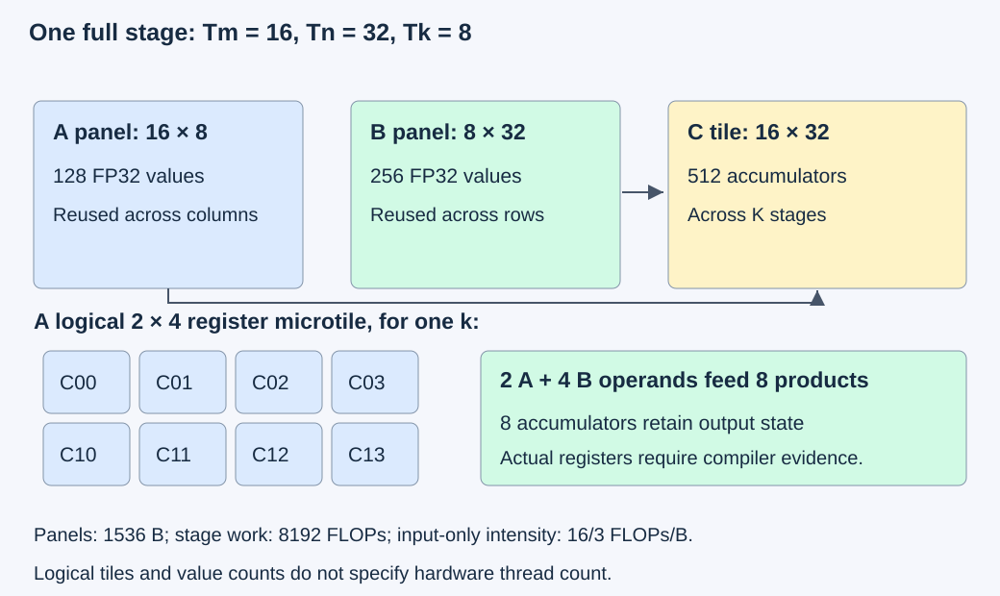
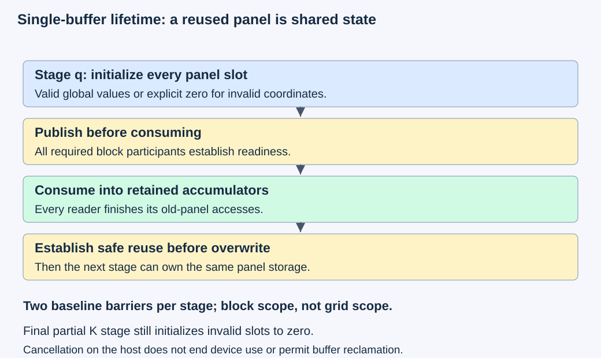

# M4-C05: Tiling an operation for data reuse

> **Status: Complete — detailed chapter authored and documentation validated; experimental procedures are proposed unless explicitly labelled observed**

**Module:** Understand kernels and execution overhead

**Category:** [Kernels, compilers, and execution](index.md)

[Module 4 reading order](../module-4.md) · [Previous: M4-C04](../kernels-compilers-and-execution/m4-c04-compilation-specialization-and-the-warm-execution-path.md) · [Next: M4-C06](../kernels-compilers-and-execution/m4-c06-parallel-reductions-and-synchronization.md)

[Execution plan and progress](../chapter-execution-plan.md)

## Target concepts

Tile selection, register and shared-memory reuse, coalesced accesses, edge tiles, redundant work, data-movement accounting, synchronization costs.

## Concepts

### 1. Select a tile around an unchanged operation

A **tile** is a bounded rectangular part of a tensor. Tiling changes which values are brought together and reused; it must preserve the operation's mathematical meaning. Here the operation is matrix multiplication: A has M rows and K columns, B has K rows and N columns, and C has M rows and N columns. Each output is:

**C[i,j] = sum of A[i,k] × B[k,j] over k = 0,…,K−1.**

C overwrites its destination; it does not add an old C. M and N identify output axes; K is the reduction axis whose contributions are combined. Count one multiplication plus accumulation as two conventional floating-point operations, so useful work is **F = 2MNK FLOPs**. A FLOP is a floating-point operation in this counting convention; it is not necessarily one hardware instruction.

The earlier [M3-C08](m3-c08-tiling-and-reuse-through-the-memory-hierarchy.md) explained square tiles and panel lifetime. This chapter selects rectangular output tiles of Tm rows by Tn columns, with a reduction-stage width Tk. A **panel** is the input region needed by one stage: Tm × Tk values from A and Tk × Tn values from B. One cooperating block owns an output tile. Output accumulators retain contributions across stages. Different block or Triton-program mappings are possible, so logical tile sizes are not thread counts.

Use contiguous row-major FP32 inputs, FP32 accumulation and FP32 output for the teaching contract. FP32 is the four-byte binary32 format. Inputs may share read-only storage if the full descriptors allow it; output must be disjoint from both inputs. Validate shapes, byte capacities, arithmetic used for addresses, device/context and producer dependencies before submission. Keep buffers and executable handles alive through observed completion, as in [M4-C01](m4-c01-defining-a-gpu-kernel-and-its-contract.md) and [M4-C04](m4-c04-compilation-specialization-and-the-warm-execution-path.md). Rust is the host context; this document supplies neither a bridge nor a kernel implementation.

M = 0 or N = 0 returns empty output without a launch. If K = 0 with nonempty output, the contract requires an all-zero C; it cannot return uninitialized storage. Treat that as a separately validated zero-fill path, not an ordinary tiled timing case. Numerical acceptance for the bounded integer fixtures below is exact. General model activations need an explicit numerical budget and downstream checks.

### 2. Separate three sizes of reuse

**Block reuse** lets the same A panel feed several output columns and the same B panel feed several output rows. **Register reuse** retains operands or accumulators in a thread's working storage. **Cache reuse** may serve repeated requests from another block without fetching the data again from device memory. These scopes have different ownership and costs. A tile count cannot guarantee a hardware cache hit or an inter-block execution order.

For one full output tile and one full reduction stage, a direct per-output operand-demand model has **2TmTnTk scalar input reads**. Staging each input panel once reduces the model's global input requests to **Tk(Tm + Tn) scalar reads**. With four-byte values:

**Panel storage S = 4Tk(Tm + Tn) bytes.**

**Stage work Fstage = 2TmTnTk FLOPs.**

**Input-only intensity Ipanel = Fstage / S = TmTn / [2(Tm + Tn)] FLOPs/byte.**

This intensity excludes output writes, edge effects, shared accesses, spills, transactions and cache behavior. For (Tm,Tn,Tk) = (16,32,8), the two panels contain 384 values or 1536 bytes; stage work is 8192 FLOPs and Ipanel = 16/3 ≈ 5.333 FLOPs/byte. A 16 × 16 output tile at Tk = 8 has 1024 panel bytes, 4096 FLOPs and intensity 4. Increasing Tk from 8 to 16 doubles panel storage and stage work but leaves this full-stage ratio unchanged. It can reduce stage count and change scheduling costs; it does not automatically increase input reuse per FLOP.

*A full rectangular stage reuses A across output columns and B across output rows. A register microtile adds another reuse opportunity while retaining more live values.*

A **register microtile** is a small output rectangle retained by one logical owner. With rm rows and rn columns, it needs rm × rn scalar accumulators. For one k, rm A values and rn B values can feed rm × rn products. A 2 × 4 microtile therefore has eight accumulators and six operand values feeding eight multiply-accumulates, versus sixteen logical operand reads for eight independent scalar outputs. The comparison is operand demand, not measured shared-memory instructions: broadcast, compiler reuse and vectorization can already reduce issued instructions in the baseline.

Eight FP32 accumulators contain 32 bytes of values. The six operands contain another 24 bytes while live, before addresses, predicates, temporaries and compiler allocation effects. This is not an actual register count. Registers are allocated under device-specific limits and granularity; excessive pressure can cause **spills**, transfers of values to a per-thread memory area backed by device memory. Greater register reuse can thus add memory traffic or reduce how many blocks remain resident. Inspect the final compiled resource report rather than setting occupancy from the eight-accumulator arithmetic.

### 3. Reuse and coalescing answer different questions

**Coalescing** combines memory requests from lanes in a warp into transactions. Reuse asks how often data is demanded; coalescing asks how a particular demand maps to transferred address regions. A warp is a group of hardware execution lanes; the NVIDIA examples here use 32 lanes. Cooperative loading can assign contiguous k positions in row-major A and contiguous column positions in row-major B to neighboring lanes, independently of which outputs those lanes later compute.

As an address model for the NVIDIA 32-byte sector case, 32 aligned adjacent FP32 addresses occupy four sectors: 128 useful bytes across 128 sector bytes. The same 32 useful values separated by 32 FP32 words occupy 32 sectors, or 1024 sector bytes. Shifting the adjacent pattern by one FP32 word can make it span five sectors. These are address/sector counts for a named access pattern, not predictions of DRAM bytes or instruction timing. The [CUDA Best Practices Guide](https://docs.nvidia.com/cuda/cuda-c-best-practices-guide/index.html#coalesced-access-to-global-memory) explains coalescing and shared-memory reuse; its hardware-specific examples must not become measurements of this chapter's workload.

Staging can also rearrange data for consumption. A global-coalesced arrangement may have unfavorable shared-memory bank accesses. A **bank** is a shared-memory subdivision that serves a subset of addresses; competing distinct addresses in a bank can require additional service. Padding or changing panel layout can reduce a conflict pattern while increasing allocation. Same-address broadcast differs from a conflict. Record both panel layout and actual shared transactions; “contiguous input” alone does not prove efficient consumption.

### 4. Count edge work before declaring a winner

For positive M, N and K, define output-tile counts **Gm = ceil(M/Tm)** and **Gn = ceil(N/Tn)**, and stages per block **Q = ceil(K/Tk)**. Ceil rounds upward. This chapter's padded model initializes every panel slot each stage, substitutes zero for invalid input coordinates, evaluates the full configured arithmetic rectangle, and stores only valid output coordinates.

A loads require valid row and k; B loads require valid k and column. Output stores require valid row and column. These predicates are different. Invalid outputs do not authorize early departure from a required block collective. Invalid k positions must become zero for this sum even if a reused panel held nonzero data in the previous stage.

Under this declared model:

**Padded multiply-accumulates = GmGnQ × TmTnTk.**

**Valid global scalar input reads Rinput = GnMK + GmKN.**

**Initialized shared slots H = GmGnQ × Tk(Tm + Tn).**

**Zero-filled slots = H − Rinput; useful arithmetic fraction = MNK / padded multiply-accumulates.**

The input-read count includes fetching A again for each output-column tile and B again for each output-row tile. It assumes each valid panel element is staged once per block/stage; cache reuse can change DRAM traffic. Total logical global bytes in this model are **4Rinput + 4MN**, including one valid output store. A direct no-staging operand-demand model has **8MNK + 4MN bytes**, before caches or compiler reuse. Neither expression is a physical bandwidth measurement.

Use M = 5, N = 9, K = 7 with A[i,k] = i + k and B[k,j] = k + j. The sums of k and k² over 0,…,6 are 21 and 91, giving the independent reference:

**C[i,j] = 91 + 21(i + j) + 7ij.**

C[0,0] = 91, C[0,8] = 259, C[4,0] = 175 and C[4,8] = 567. There are 45 valid outputs, a checksum of 12,285, and **315 useful multiply-accumulates**. Check every coordinate; the checksum alone can hide permutations.

| Tile (Tm,Tn,Tk) | Gm × Gn × Q | Valid input reads | Zero-filled slots | Padded multiply-accumulates | Useful arithmetic fraction |
|---|---|---:|---:|---:|---:|
| (4,4,4) | 2 × 3 × 2 | 231 | 153 | 768 | 41.015625% |
| (4,8,4) | 2 × 2 × 2 | 196 | 188 | 1024 | 30.76171875% |
| (8,4,8) | 1 × 3 × 1 | 168 | 120 | 768 | 41.015625% |

The second tile requests fewer valid input values than the first while doing more padded arithmetic. Logical global bytes are 1104, 964 and 852 respectively; the direct demand model is 2700 bytes. These facts make a falsifiable performance hypothesis, not a speed ranking. Some real kernels suppress invalid arithmetic, redirect safe loads or use different layouts; their work and traffic counts must be recomputed from their actual contract. The [Triton matrix-multiplication tutorial](https://triton-lang.org/main/getting-started/tutorials/03-matrix-multiplication.html) is a useful article on block shapes and reuse, but its mapping and arithmetic path need not match this padded scalar teaching model.

### 5. Panel ownership determines synchronization costs

For ordinary synchronous shared staging, producers must finish and publish panel writes before consumers read them. Consumers must finish reading a panel before the next stage overwrites it. A **barrier** is a collective ordering/arrival point for a specified group; a memory fence alone does not establish that every consumer has finished. This chapter's baseline has one block-wide publication barrier and one block-wide reuse barrier per stage, retaining the final reuse barrier for uniform accounting.

Every live thread required by that block protocol participates, including threads with invalid output coordinates. A block barrier does not order other blocks. A compiler-generated Triton implementation may realize ordering differently; inspect its generated behavior and scope instead of claiming exactly the baseline's explicit barrier count. NVIDIA's [synchronization specification](https://docs.nvidia.com/cuda/cuda-programming-guide/05-appendices/cpp-language-extensions.html#synchronization-primitives) supplies the CUDA collective contract.

The padded baseline has **2Q barrier instances per block**, and **2GmGnQ instances across the launch**. The three teaching shapes therefore have 24, 16 and 6 block-barrier instances. This is not a duration or a count of thread arrivals; the latter also depends on actual participating threads. The time spent waiting depends on work imbalance, memory service and scheduling. Removing a redundant final barrier is a separate candidate with a new count and a proof that no later consumer or reuse needs it.

*Load validity, panel readiness and safe overwrite are separate checks. Zero fill remains required at the final partial reduction stage.*

Two sets of panels would nominally require **2S bytes** before padding and other state. More storage does not itself establish useful overlap. Asynchronous copy mechanisms require their own producer/consumer protocol; they are not assumed here. Basic ordering stays local to this chapter; advanced reductions and synchronization are developed in M4-C06.

### 6. Choose from evidence at the intended operating point

Tile selection balances reuse, geometry, instruction count, compiler resources, available parallel blocks and coordination. For a full 16 × 32 output tile, increasing Tk from 8 to 16 doubles nominal panels from 1536 to 3072 bytes. At K = 64, it halves Q from eight to four and baseline barriers per block from sixteen to eight. At K = 65, the corresponding Q values are nine and five, and padded reduction extents are 72 and 80: the larger Tk adds more redundant reduction work. Feasibility also requires actual function/device thread, shared-memory and register constraints to hold.

A **prefill-like** matrix has many output rows from prompt tokens. A **decode-like** matrix can have few rows, often one per active request. These are shape analogies, not a complete generator workload. A tile that makes good use of a large M can create mostly invalid output rows when M = 1. More useful work per block can also leave too few blocks to use the device. The best tile therefore belongs to a named workload and hardware configuration.

The bounded reference corpus uses K ≤ 129 and integer inputs A in [−7,7], B in [−11,11]. Each product has magnitude at most 77, and any partial sum has magnitude at most **129 × 77 = 9933**, below binary32's exact-integer limit 2²⁴. Scalar FP32 multiplication and any addition order remain exact for this corpus. Tensor Core or reduced-precision arithmetic is a separate candidate requiring its own demonstrated contract; neither the dtype label nor this scalar proof certifies its instruction behavior for general activations.

HFT supplies a systems-engineering lens: bounded working sets, repeated access, resource contention and delayed participants affect the critical path. An inference tile is not a market-event batch, and GPU synchronization does not provide an exchange deadline. The transferable lesson is to account for costs and ownership end to end rather than infer useful service from a local traffic ratio.

## Experiments

All experiments are proposed. Existing independently reviewed candidates and an identified Rust/CUDA or Rust/Triton bridge are prerequisites to GPU trials; no implementation is supplied. Raw fixtures plus guards are limited to 64 MiB on host and separately 64 MiB on device, admitted one case at a time. Charge compiler/runtime state, profiler memory, temporary packing and generator/model/KV memory separately. A failed correctness or lifetime gate stops performance comparison.

### E1 — Prove rectangular coverage and edge accounting

**Description:** Compare three rectangular tile descriptions on the 5 × 9 × 7 fixture before any hardware run.

**Purpose/objective:** Establish that reduced input demand can coexist with increased padded work while output semantics remain fixed.

**Target concepts:** Tile selection, edge tiles, redundant work and data-movement accounting.

**Baseline and workload:** Independent closed-form and direct integer matrix-product references above. Compare tiles (4,4,4), (4,8,4) and (8,4,8); retain all 45 outputs and panel-slot/ownership records. Add empty M, empty N and empty K contract cases.

**Controls and prediction:** Independent variable is tile shape. Hold operation, layout, input values, scalar FP32 arithmetic and padded-stage protocol fixed. Predict the tabulated reads, zero fills, padded work and barriers, with identical valid outputs.

**Procedure:** Enumerate valid panel coordinates and output owners independently of the formulas. Compare direct, staged and zero-padded results coordinate by coordinate. Audit deliberately wrong input masks, omitted final-stage zero fill, omitted output mask and duplicate output ownership as reference counterexamples; do not launch unsafe variants. Verify that K = 0 with nonempty output uses the defined zero-fill behavior.

**Hardware/software:** CPU mathematical/descriptor records suffice. Optional later GPU validation needs supported hardware, a reviewed candidate and pinned compiler/bridge versions.

**Failure and HFT connection:** A partial batch of work can retain stale state even when most coordinates are valid. The lesson transfers to bounded event buffers; inference's zero-padding and arithmetic rules remain distinct.

**Exit criteria:** Every valid output matches exactly; one output owner each; all table counts reconcile; invalid accesses/ownership cases are rejected and empty cases have explicit outputs. Guards and completion are required if a GPU candidate is later used.

### E2 — Compare block reuse and register reuse

**Description:** Evaluate direct, panel-staged and register-blocked scalar FP32 candidates on the same matrix product.

**Purpose/objective:** Test whether lower logical operand demand survives actual register pressure, shared transactions and completed latency.

**Target concepts:** Register/shared-memory reuse, tile choice, spills and resource feasibility.

**Baseline and workload:** A reviewed direct candidate and reviewed staged candidates at output tile 16 × 32 with Tk = 8 or 16. Register microtile choices are 1 × 1, 2 × 2 and 2 × 4 where supported. Test (M,N,K) = (1,33,17), (5,9,7), (16,32,8), (31,65,33), (64,128,64) and (65,33,129), using 60 fixtures per shape from the exact corpus specified in Verification.

**Controls and prediction:** Compare direct versus staged first, Tk second, and microtile third. Keep input addresses, operation, scalar arithmetic, layout, compilation state and stream dependencies fixed. Document any changed thread mapping/count as a coupled change; do not attribute its effect solely to registers. Predict lower logical input demand for staging and lower per-output operand demand for microtiles, without predicting a universal latency winner.

**Procedure:** Validate all cases before timing; reject unsupported resource configurations explicitly. Precompile variants and complete 100 warm invocations per case. Collect 60 paired alternating-order sessions, each with 100 completed invocations of each admitted variant; rotate the 60 data fixtures in the same order for both candidates. Capture separate profiles on selected small and larger shapes, including register allocation, spills, actual shared allocation, transactions and achieved residency.

**Hardware/software:** One supported dedicated NVIDIA GPU, exact resource limits, compiler/target/bridge identity, arithmetic settings, clocks/power state and profiler versions. The direct candidate and a tuned library can be contextual baselines only when their arithmetic contracts pass the same checks.

**Failure and HFT connection:** Enlarging local state can reduce capacity or add spills, just as a larger working set can hurt an event-processing path. The analogy gives no tile recommendation or trading latency guarantee.

**Exit criteria:** Every admitted output and guard passes; resources fit the actual function/device; paired completed timings and uncertainty are reported; counter evidence supports or leaves unresolved the proposed explanation. Fewer logical reads alone cannot establish an improvement.

### E3 — Separate cooperative loading from operand reuse

**Description:** Compare two legal loading mappings for the same staged tile and inspect global and shared address behavior separately.

**Purpose/objective:** Distinguish reuse gains from coalescing, alignment and shared-bank costs.

**Target concepts:** Coalesced accesses, layout, shared-memory reuse and transaction boundaries.

**Baseline and workload:** Aligned row-major inputs at (64,128,64), tile (16,32,8), exact E2 fixtures. A second reviewed mapping visits the same valid panel elements with a different lane/address assignment. Separately test a four-byte-offset input view with sufficient capacity and, if supported, a padded shared layout.

**Controls and prediction:** Hold input values, tile shape, global read demand and useful work fixed; vary one loading/address-layout choice at a time. Predict different sector demand for contiguous versus strided warp addresses; shared layout can trade bank behavior against allocation. Mapping and shared padding changes are separate comparisons.

**Procedure:** First enumerate actual warp addresses and sectors, including masks and row boundaries. Verify unique panel-slot publication and output equality. Apply E2's warm paired timing protocol to supported mappings, then obtain separate profiles of global sectors, cache/DRAM traffic, shared transactions, bank-conflict indicators and allocated bytes. Record compiler transformations that remove the hypothesized address pattern.

**Hardware/software:** Same platform as E2, with architecture-specific sector/bank definitions and counter availability recorded. Offsetting a view does not waive capacity or alignment requirements of a candidate.

**Failure and HFT connection:** An address-layout optimization can move contention to a different resource. This resembles shifting a working-set bottleneck in an event service, not a promise that shared memory behaves like a CPU cache.

**Exit criteria:** Exact outputs, valid aligned accesses under each candidate's requirements, unchanged useful operation and independently reconciled addresses. Unsupported offset/layout cases are rejected. Timing and transactions must be distinguished from logical requested bytes.

### E4 — Verify publication and safe panel reuse

**Description:** Review stage ownership at a partial K boundary and across multiple warps without executing a broken collective.

**Purpose/objective:** Establish both producer-to-consumer and consumer-to-overwrite ordering while quantifying the chosen barrier protocol.

**Target concepts:** Synchronization costs, zero fill, shared ownership and failure handling.

**Baseline and workload:** The three E1 tiles and a reviewed multi-warp (16,32,8) candidate with K = 17. Review six scenarios: valid stage publication; missing publication order; missing reuse order; invalid-output thread leaves a required collective; stale final-stage panel slots; host cancellation during in-flight work.

**Controls and prediction:** Hold the numerical operation and shared-buffer count fixed. Baseline has two barriers per stage; incorrect ordering/participation cases fail the contract, stale slots can alter results, and cancellation retains device resources. An optional candidate removing the last reuse barrier requires a separate final-use proof.

**Procedure:** Trace each panel slot's writer, publication, readers, last read and next overwrite. Verify all required participants reach each collective instance. Count the specified barrier instances; do not convert counts into time. If reviewed valid candidates exist, collect separate sanitizer and timeline evidence and compare supported ordering protocols under E2 timing controls. Unsafe cases remain reference/lifecycle counterexamples.

**Hardware/software:** Document review initially; runtime studies need a supported multi-warp GPU candidate, exact generated synchronization scope, Compute Sanitizer version and bridge completion/recovery contract.

**Failure and HFT connection:** A delayed consumer can make early state reuse unsafe even after the producer finishes. The ownership lesson applies to event buffers, while GPU barrier semantics remain device-specific.

**Exit criteria:** Six explicit verdicts, correct participation and stage-zero-fill proofs, expected barrier counts, no premature overwrite or host reclamation. Sanitizer success supplements these checks and does not certify every schedule safe.

### E5 — Test the selected tile through the full path

**Description:** Evaluate the best validated candidate on useful completed matrix operations and, conditionally, an existing text-generation projection.

**Purpose/objective:** Determine whether a local tiling gain survives dispatch, conversions, shape variation and service load.

**Target concepts:** Workload-dependent tile selection, critical paths, data movement and end-to-end validation.

**Baseline and workload:** E2's exact matrices for the operator boundary. A generator extension is eligible only when an existing generator contains the corresponding matrix product; general activations require a separate M9-C17 numerical/output gate. Use a fixed model/tokenizer, prompt/output pairs (32,32), (32,128), (128,32), (128,128) only where supported, with identical arrival traces below and near capacity.

**Controls and prediction:** Keep numerical/selection behavior, model, cache policy, arrival trace and admission limits fixed. Vary only the validated tile policy. Predict possible operator gains but limited service gains when the operation is a small critical-path share or packing/dispatch costs dominate.

**Procedure:** Collect 60 paired operator sessions using the same prewarmed variants. Include every required packing/conversion/allocation/completion in a separate full-operator interval. For a qualifying generator, finish 100 warmup requests per admitted stratum, then use 60 paired 30-second arrival windows at 50% and 90% of baseline sustainable rate from a separate pilot, then a 30-second drain. Arrivals follow scheduled times independently of prior completions. Mark work still unfinished after drain as censored and retain its resources until safe completion/recovery. Limit waiting requests to 64 and in-flight requests to eight; report exclusions when memory prevents a stratum. Account for startup/new-variant preparation separately, and retain all rejected, cancelled, timed-out and unfinished requests.

**Hardware/software:** Full CPU/GPU/topology, model/tokenizer/bridge/artifact identity, memory and queue budgets, tile-dispatch policy and profiling mode. No generator runtime is assumed to exist in this documentation repository.

**Failure and HFT connection:** Tail effects from contention, queueing or stale work can dominate local efficiency. HFT motivates end-to-end critical-path evidence, without supplying inference numerical tolerances or service objectives.

**Exit criteria:** Operator and any generator contract pass; completed timings include required supporting work; capacity/outcome counts reconcile. A faster isolated tile is reported as an operator result unless service-level evidence also supports the claim; unavailable generator studies remain proposed.

## Verification

### V1 — Independent mathematical and address references (E1)

Compare the closed-form 5 × 9 × 7 output to direct integer products and a separately enumerated padded-stage reference. Count valid A/B loads, initialized slots, zero fills, arithmetic positions and valid output ownership. Confirm the 45 outputs, checksum 12,285 and four corner values, then check every coordinate. Compute masks from the relevant axes; a flattened output check cannot authorize arbitrary A/B input addresses.

Reference counterexamples must identify a concrete defect: a valid output in the last K stage still needs k masking; leaving invalid panel slots untouched admits previous-stage data; an output outside M/N must not be stored. These are mathematical/descriptor checks without runtime timing. Optional GPU acceptance adds checked ranges, guards, completion and error records. Empty K uses its specified zero-fill path and is excluded from FLOP/byte ratios involving a nonzero product.

### V2 — Exact corpus, timing and resource evidence (E2)

For fixture e = 0,…,59, define integer vectors:

**a[i] = ((3i + e) mod 9) − 4; b[k] = ((5k + e) mod 7) − 3.**

**c[k] = ((7k + 2e) mod 11) − 5; d[j] = ((11j + e) mod 13) − 6.**

Set **A[i,k] = a[i] + b[k]** and **B[k,j] = c[k] + d[j]**. Mod gives a nonnegative remainder. A direct integer dot product is the baseline; an independent algebraic check is:

**C[i,j] = K a[i] d[j] + a[i] sum(c) + d[j] sum(b) + sum of b[k]c[k] over k.**

The bounded partial-sum proof above permits exact FP32 comparison under scalar multiplication/addition, even if grouping changes. Compare every output, not means or checksums; verify actual arithmetic mode. Broader activations and library/Tensor Core candidates need explicit format/rounding/accumulation evidence rather than inheriting this proof automatically.

Use GPU event elapsed time for ordered completed kernel work, and a monotonic host interval from admitted bridge invocation through observed completion for dispatch-inclusive latency. Submission time alone is insufficient. Keep compilation/module preparation outside warm trials and report it separately under M4-C04. Specify whether copies and guard reads are outside the kernel interval; include them if the full-operator contract requires them. Pair candidates on identical fixture order and starting allocation/cache policy. Sixty sessions of 100 invocations are 60 clustered session comparisons, not 6000 independent p99 observations. Report session medians, paired effects, raw variation and uncertainty; unresolved small differences are inconclusive.

Actual resource evidence includes threads/warps, registers, spills/local traffic, shared allocation including padding, resident blocks and generated instructions. A 2 × 4 microtile's 32 accumulator bytes is a value count, not the compiler's register footprint. Diagnose limits using [M9-C13](../measurement-experimentation-and-economics/m9-c13-using-kernel-profilers-to-explain-hardware-bottlenecks.md); do not assume the largest admitted tile has the best useful latency.

### V3 — Keep traffic boundaries and cache state visible (E3)

For the illustrative aligned contiguous warp, enumerate byte addresses 4l for lane l = 0,…,31; sector IDs are floor(address/32). The offset pattern uses 4 + 4l; the strided pattern uses 128l. The unique-sector counts are four, five and 32. This address model has 128 useful requested bytes in each case, but different sector demand. Actual kernel instructions, masking, cache hits and replay determine observed transfers.

Report algorithmic requested bytes, measured sectors/shared transactions and measured DRAM bytes as separate quantities. Use distinct kernel timing and diagnostic runs. The [Nsight Compute profiling guide](https://docs.nvidia.com/nsight-compute/ProfilingGuide/index.html#cache-control) explains replay and cache-control effects; record them so a profile collected after cache flushing is not treated as a natural warm-serving measurement. Counter names/availability are architecture/tool dependent; unavailable counters remain unknown. Repeat representative profiles to check stability, and retain E2's paired uninstrumented trials as performance evidence. A lower sector count can support a coalescing hypothesis without proving that memory service is the limiting stage.

### V4 — Ordering and failures before speed (E4)

The six scenario verdicts are: accept the valid protocol; reject missing publication; reject missing reuse ordering; reject invalid collective participation; reject stale final-stage slots; retain resources after cancellation until safe terminal evidence. For K = 17 and Tk = 8 there are three stages and six baseline barrier instances per block. The E1 launch counts 24/16/6 refer to block-barrier instances, not cycles or thread arrivals.

Review required ordering directly and use a multi-warp candidate for any hardware study. [Compute Sanitizer](https://docs.nvidia.com/compute-sanitizer/ComputeSanitizer/index.html) distinguishes memory checks, shared-memory race hazards, uninitialized global memory and invalid synchronization. None proves all logical tensor membership or every possible schedule. Run supported diagnostic modes separately from performance trials, record errors/unsupported modes, and stop on correctness failure. Timing comparisons of valid protocols use identical tile/participant contracts and the E2 clocks/populations. A removed barrier is acceptable only when the last-use argument holds, not merely when a stress run happens to pass.

### V5 — Useful completion and numerical boundaries (E5)

Full-operator latency begins with caller-ready admitted inputs and ends with caller-readable output after all required work; identify which input placement is promised. Record kernel, packing and dependency waits separately, without subtracting unrelated host/device clocks. For service studies, preserve model/tokenizer identity, reference logits/tolerance, selected-token/stopping behavior and request outcome accounting. Exact small-integer correctness does not validate arbitrary model activations.

Report time to first token, inter-token latency, completed-request percentiles and contract-valid output tokens per declared wall-clock interval with request/token weighting and counts. State warmup, drain/censoring and startup/new-variant populations. Use the same arrival trace and limits for paired policies; admission failures and unfinished work remain visible. Thirty-second windows and 60 sessions are controlled exploratory trials, not a universal tail-certification sample size. Use [M9-C07](../measurement-experimentation-and-economics/m9-c07-latency-distributions-and-statistical-uncertainty.md) for sample uncertainty and [M9-C12](../measurement-experimentation-and-economics/m9-c12-reading-cpu-gpu-timelines-and-scheduling-gaps.md) for critical-path evidence. No service gain is inferred by multiplying a local speedup by a FLOP count.

Completed [M9-C01](../numerics-and-correctness/m9-c01-defining-reference-behavior-and-evidence-before-optimizing.md), [M9-C02](../measurement-experimentation-and-economics/m9-c02-request-events-clocks-and-measurement-boundaries.md), [M9-C15](../state-memory-and-caching/m9-c15-accounting-for-weights-kv-state-workspace-and-fragmentation.md), [M9-C16](../hardware-architecture-and-topology/m9-c16-recording-hardware-conditions-that-change-measurements.md) and [M9-C17](../numerics-and-correctness/m9-c17-comparing-logits-with-justified-numerical-tolerances.md) supply reference, timing, capacity, hardware and numerical methods. M9-C22 remains an outline; the basic ownership/ordering gates needed here are stated locally. No Module 8 material is required.

## Engineering dimensions and principles

| Dimension | Chapter-specific application |
|---|---|
| Semantics and invariants | Exact AB output, one writer, valid A/B/C masks and complete panel publication. |
| Workload and variability | Rectangular versus skinny matrices, three boundary axes and partial final stages. |
| Resources and bottlenecks | Shared panels, accumulator/operand registers, spills, sector demand and resident blocks. |
| Time and distributions | Stage barriers and waiting, completed kernel/operator boundaries and service tails. |
| Ownership and coordination | Panel readers finish before overwrite; host resources survive asynchronous use/cancellation. |
| Failure and adaptation | Reject unsupported resource/layout cases and stop performance studies on numerical/lifetime failure. |

| Engineering principle | Concrete reasoning step |
|---|---|
| 1. Correctness defines the optimization boundary | Tiling preserves AB and output ownership; changed arithmetic needs a declared numerical gate. |
| 2. Performance depends on workload and operating point | Prefill-like reuse and decode-like edge waste can favor different tiles. |
| 3. Data movement is part of the algorithm | Count global demand, shared/register reuse and actual transactions at distinct boundaries. |
| 4. State has ownership, lifetime and recovery cost | Accumulators persist across stages and shared storage cannot be reused before readers finish. |
| 5. Dependencies determine latency; bottlenecks determine capacity | Barrier dependencies and resource residency constrain useful overlap and throughput. |
| 6. Variability and synchronization shape the tail | A late producer/consumer or mixed shape can change waiting despite good mean efficiency. |
| 7. Local improvements need end-to-end evaluation | E5 includes packing, dispatch and service outcomes after E2/E3 local validation. |
| 8. Claims require reproducible evidence | Exact fixtures, address/ownership proofs, pinned artifacts, paired trials and separate profiles. |

## Specifications, articles, and hardware

Primary sources were checked on 27 October 2026. CUDA Best Practices identifies version 13.4; Triton's online main tutorial is a moving source. Pin compiler/tool revisions and hardware when executing the proposed protocols. The linked CUDA Best Practices and Triton matrix-multiplication articles explain reuse and layouts; their published performance numbers and arithmetic modes are not this chapter's results. The CUDA synchronization specification, Compute Sanitizer manual and Nsight Compute guide define the relevant ordering and diagnostic contracts.

| Required specification | Record before runtime experiments |
|---|---|
| Device | Exact GPU/architecture, SM count, visible partition, warp size, memory capacity and target support. |
| Resource limits | Per-block and per-SM shared/register limits, actual function limits, allocation granularity, threads/warps, static/dynamic shared bytes and compiled resource report. |
| Memory behavior | Global alignment/strides, actual shared layout, sector/bank behavior for the selected architecture and cache policy. |
| Software/bridge | Driver/runtime/toolkit, compiler/Triton revision, artifact/configuration, scalar/other arithmetic mode, Rust bridge ABI and completion/error behavior. |
| Run conditions | CPU/NUMA/device topology, clocks/power/thermal conditions, co-tenancy, profiler replay/cache controls and fixture/session identity. |
| Budgets | Raw host/device fixtures, guards, packing/workspace, compiler/modules, profiler state and any model/KV/queue capacity separately. |

No GPU specification or achieved speedup is assumed. All device timing, counter/sanitizer studies and generator runs remain proposed; observed authorship validation checks the mathematical references and documentation only.

## What to carry forward

Select a tile by proving its ownership and numerical contract, counting its useful and padded work, and explaining which data is reused at each memory boundary. Then measure whether that reuse outweighs resource and synchronization costs at the intended workload.

Next in authoring and Module 4 reading order is [M4-C06: Parallel reductions and synchronization](m4-c06-parallel-reductions-and-synchronization.md). Track acceptance in the [execution plan and progress tracker](../chapter-execution-plan.md).
