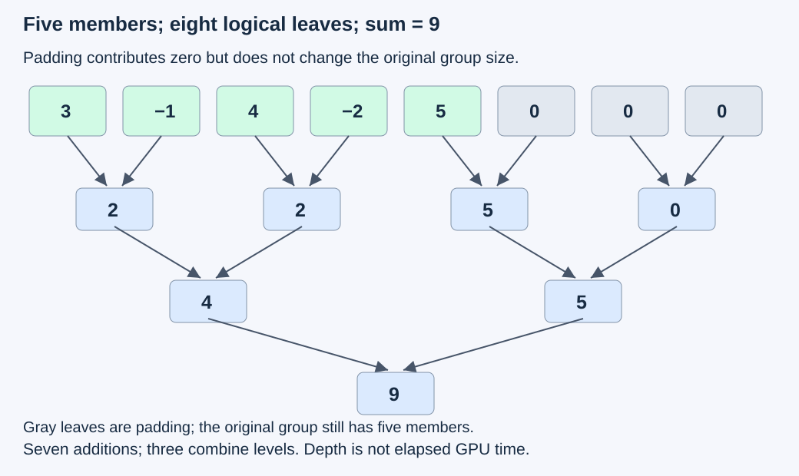
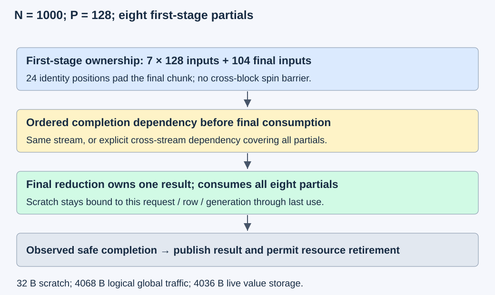

# M4-C06: Parallel reductions and synchronization

> **Status: Complete — detailed chapter authored and documentation validated; experimental procedures are proposed unless explicitly labelled observed**

**Module:** Understand kernels and execution overhead

**Category:** [Kernels, compilers, and execution](index.md)

[Module 4 reading order](../module-4.md) · [Previous: M4-C05](../kernels-compilers-and-execution/m4-c05-tiling-an-operation-for-data-reuse.md) · [Next: M4-C07](../numerics-and-correctness/m4-c07-online-softmax-and-stable-incremental-reductions.md)

[Execution plan and progress](../chapter-execution-plan.md)

## Target concepts

Tree reductions, warp and block reductions, cross-block decomposition, neutral elements, masked lanes, synchronization, reduction order, accumulation precision.

## Concepts

### 1. A reduction needs a group, an operator and a result owner

A **reduction** combines a group of values into a smaller result. For a row X with N elements, the sum is **S = sum of X[i] over i = 0,…,N−1**. For a tensor with R rows, this chapter reduces each row independently and produces R results. The selected axis defines membership; combining neighboring rows by mistake is incorrect even if the output shape remains plausible.

The operation's contract also specifies its input domain, accumulator/output formats, empty-group behavior and who may publish the result. The primary fixture uses contiguous row-major FP32 inputs, FP32 accumulation and output. FP32 is the four-byte binary32 format. Output and scratch storage are disjoint from input and from one another; input is read-only. Each valid output has exactly one writer. A result computed in one designated lane is not automatically a valid result in every lane.

For N = 0 with R > 0, this chapter defines sum results as positive zero through a separately validated host or zero-fill path; maximum is rejected because the finite maximum contract has no empty member. For R = 0, output is empty and no reduction is launched. This differs deliberately from the nonempty exercise policy in [M1-C06](../numerics-and-correctness/m1-c06-reductions-probabilities-and-stable-softmax.md). Declare the policy rather than infer it from a library default. Inputs to maximum experiments are finite; NaNs and infinities require a separate declared policy and are excluded here.

Rust remains the host context. Validate descriptors, checked byte ranges, device/context, producer dependencies and ownership before launch. Retain input, output, scratch and executable handles through the completion of every operation that uses them. No Rust bridge, CUDA kernel or Triton implementation is supplied.

### 2. Trees shorten dependency depth without removing work

A serial sum carries one running accumulator from element to element. A **tree reduction** combines independent pairs, then pairs of partial results, until one remains. A **partial** is an aggregate for a named subset of the input. When all leaves and partials belong to the intended group exactly once, the tree computes the same real-number sum. Floating-point rounding needs a separate check.

For a power-of-two leaf count L, a balanced binary tree has:

**Addition count = L − 1; dependency depth = log₂(L) levels.**

Depth is the longest chain of dependent additions in this ideal tree. It is not elapsed time: communication, local accumulation, launch overhead and synchronization still matter. For arbitrary N > 0, a simple teaching tree pads to **L = 2^ceil(log₂ N)** leaves. It performs L − 1 additions, including operations on padding, compared with N − 1 additions in a nonempty serial sum. Real implementations can use other decompositions.

For X = [3,−1,4,−2,5], pad with three zeros. The levels are [2,2,5,0], then [4,5], then [9]. The tree uses seven additions over three levels; the five-element serial sum uses four dependent additions. More total additions can accompany a shorter dependency chain.

*The padded leaves are arithmetic identities, not extra members of the original five-element group. The result owner publishes 9 after all required dependencies.*

### 3. Neutral values and participant masks serve different purposes

A **neutral element**, or identity, leaves the aggregate unchanged: zero for addition, one for multiplication, and negative infinity for maximum of finite values. For an all-negative row [−5,−2,−9], padding with zero changes its maximum from −2 to zero. Memory-safe padding can still give the wrong answer.

A masked load prevents an invalid input access and supplies an explicit arithmetic fallback. A **participation mask** specifies which execution lanes take part in a collective operation. These are different masks. A lane with no valid input can remain a live participant carrying an identity value. Conversely, choosing the correct identity does not make a read from an absent source lane valid.

In this chapter's NVIDIA examples, a **warp** has 32 lanes. A **shuffle** transfers a register value between participating lanes within that warp. A 32-leaf conceptual tree has five combine levels. The required source must participate, and all required callers must follow the collective's mask/arrival rules. A partial or sparse participant group needs a specifically validated mapping; it is not safe to apply a full-warp partner pattern blindly. These requirements come from the [CUDA shuffle and synchronization specification](https://docs.nvidia.com/cuda/cuda-programming-guide/05-appendices/cpp-language-extensions.html#warp-shuffle-functions).

The simple baseline retains all configured live lanes and supplies identities for invalid data. It does not equate data validity with execution membership. If a later mean divides the sum, its denominator is the original N, not padded L: the teaching sum 9 gives mean 9/5 = 1.8, not 9/8 = 1.125. Padding must not become an extra token or feature.

### 4. A block reduction joins warp results at block scope

A **block** is a cooperating group of threads with block-local shared storage. A common decomposition first reduces each warp's values, publishes one partial per warp in shared memory, establishes readiness at block scope, and combines those partials. Shared storage cannot be overwritten or repurposed until all its readers have finished.

For a teaching block with 128 live threads and one input position per thread, four warp partials are required. With N = 33, warp zero has 32 valid data positions, warp one has one, and warps two and three carry only identities. All four warps still follow the declared block protocol. Warp-local ordering alone cannot make warp one's publication ready for warp zero. An early departure that omits an assigned publication or required participation violates this protocol.

A library collective can hide the implementation while retaining its contract. The [CUB BlockReduce reference](https://nvidia.github.io/cccl/unstable/cub/api/classcub_1_1BlockReduce.html) identifies the result owner for its documented operations and requires appropriate synchronization before reusing temporary storage. Do not treat a valid result in the designated owner as an all-thread broadcast. [Triton's sum API](https://triton-lang.org/main/python-api/generated/triton.language.sum.html) specifies the reduced axis and accumulator type control; its implementation still needs an eligible compiled layout and ordering.

A fence orders memory under its defined scope; it does not establish that every peer has arrived. A block barrier is not a grid-wide rendezvous. Barrier counts are also not durations: delayed producers, divergent work, memory service and resident resources change waiting. Keep the scope and participants explicit, building on [M4-C05 panel lifetime](m4-c05-tiling-an-operation-for-data-reuse.md).

### 5. Cross-block reduction needs a complete second stage

For a large row, let each first-stage block own P consecutive logical inputs. Define **G = ceil(N/P)** partials. Partial g covers indices gP through min((g+1)P,N)−1. Those intervals partition the input; no element is dropped or counted twice. A second operation combines all G partials into one result. Logical items per block do not have to equal configured threads: threads can process several values before a collective.

The conservative baseline uses two launches ordered on one stream, or an explicit completion dependency across streams. A stream is an ordered submission sequence; the relevant dependency must include every first-stage partial before its consumer reads it. The second stage uses one block with an admitted mapping, potentially processing several partials per thread. No general inter-block spin barrier is assumed. Such a barrier can prevent progress when waiting blocks occupy resources needed by blocks that have not run.

*Scratch belongs to this row/request generation until its last consumer completes. Submission or client cancellation does not end its device lifetime.*

For N = 1000 and P = 128, G = 8. Seven blocks own 128 inputs each, and the last owns 104. The first stage pads 24 logical positions. A padded 128-leaf tree per block performs **8 × 127 = 1016 additions**; an eight-leaf final tree adds seven, giving **1023 additions** versus 999 for an unpadded serial sum. The ideal two-stage addition depth is 7 + 3 = 10 levels, excluding launch/communication and any different local accumulation.

With FP32 partials, scratch is **4G = 32 bytes** per row before alignment/allocator overhead. Logical global traffic is:

**Qglobal = 4N + 4G + 4G + 4 = 4(N + 2G + 1) bytes.**

For the example this is 4068 bytes: inputs, partial writes, partial reads and final output. A single-pass input/read-output model is 4004 bytes, so the extra scratch traffic is 64 bytes. Live input/scratch/output value storage is **4(N + G + 1) = 4036 bytes**. These are accounting models, not DRAM measurements. Alignment, retained allocations, register spills, library workspace and cache behavior are separate.

At N = 65,537 and P = 128, G = 513; a final teaching tree pads those partials to 1024 leaves. The final block's resource/width support must be checked rather than assuming 513 partials fit a particular library overload. More generally, recursively applying bounded passes is possible; that is a different pass/traffic count and must be reported.

A sum based on unordered atomic updates is another decomposition. Atomicity of each update does not by itself establish a fixed floating-point addition order. It also requires an initialized destination and complete producer/consumer ordering. This chapter's performance baseline uses ordered staged reduction; it supplies no atomic or grid-barrier implementation.

### 6. Reduction order and accumulation precision are independent choices

Binary32 addition rounds each intermediate value. **Accuracy** describes agreement with a justified numerical reference. **Repeatability** describes whether repeated executions produce the same result under specified conditions. A fixed tree can be repeatable and still differ from the exact mathematical answer. A wider accumulator can reduce rounding loss without proving arbitrary precision or cross-device reproducibility. NVIDIA's [Floating Point and IEEE 754 article](https://docs.nvidia.com/cuda/floating-point/index.html) explains these distinctions and non-associativity.

All values in this constructed vector are exactly representable FP32 inputs:

**X = [16,777,216; 1; 1; −16,777,216]; exact sum = 2.**

Under round-to-nearest, ties-to-even, with an explicit FP32 rounding after each addition:

| Declared order/accumulator | Result | Absolute error against exact 2 |
|---|---:|---:|
| Left-to-right FP32 | 0 | 2 |
| Adjacent pairs, then combine, FP32 | 1 | 1 |
| Pair the large cancellation and pair the ones, FP32 | 2 | 0 |
| FP64 accumulation followed by FP32 output | 2 | 0 |

The first addition 16,777,216 + 1 rounds back to 16,777,216. The adjacent-pair tree's other pair is 1 − 16,777,216 = −16,777,215, which is exactly representable, giving final result 1. Wider accumulation preserves the two ones for this fixture. Compiler reassociation, instruction mode and tree identity must be controlled when testing a declared-order reference. “FP32 input” alone does not specify those choices.

There are two separate acceptance modes below. The bounded integer corpus requires exact sums regardless of grouping. The cancellation probe requires agreement with the candidate's explicitly declared rounded order and reports its error against exact 2; it is diagnostic, not acceptance of those errors in a model. A general model reduction needs a predeclared [M9-C17 numerical budget](../numerics-and-correctness/m9-c17-comparing-logits-with-justified-numerical-tolerances.md) and downstream output checks. Do not create a tolerance afterward merely to excuse a mismatch.

Library determinism also has a scope. The [CUB device-reduction contract](https://nvidia.github.io/cccl/unstable/cub/api/structcub_1_1DeviceReduce.html) and [CCCL determinism guidance](https://nvidia.github.io/cccl/unstable/cccl/determinism.html) describe version-, tuning- and device-dependent guarantees and supported policy choices. Pin the actual release/overload and requested policy; the linked unstable documentation is not proof that every installed version supports every guarantee. Repeatability does not replace a numerical reference.

HFT supplies a systems lens: partial aggregates need complete membership, bounded coordination and safe state reuse; waiting for a delayed participant can dominate a short arithmetic path. Market-event aggregation and LLM reductions have different semantics. No trading result, exchange deadline or general production-readiness claim follows from a reduction benchmark.

## Experiments

All experiments are proposed. CPU arithmetic/ledger checks validate the supplied examples only. GPU experiments require separately reviewed candidates and an identified Rust/CUDA or Rust/Triton bridge; no implementation is provided. Keep raw fixtures and guards within 64 MiB on host and separately on device, with scratch/runtime/compiler/profiler charges recorded separately. Admit one case at a time. A correctness, range or lifetime failure stops performance comparison.

### E1 — Establish membership and neutral-element references

**Description:** Compare serial and padded-tree sum/max references before testing execution mechanisms.

**Purpose/objective:** Show that padding and membership rules, rather than memory safety alone, determine a correct aggregate.

**Target concepts:** Tree reductions, neutral elements, masked data, output ownership and empty groups.

**Baseline and workload:** The five-value teaching sum and three-value negative maximum, plus lengths 0, 1, 7, 31, 32, 33, 127, 128 and 129. For positive N, use integer X[r,i] = ((17i + 5r + e) mod 129) − 64 with R = 1 and e = 0,…,59; add R = 0 and R = 4,N = 33 cases.

**Controls and prediction:** Vary tree width or identity while keeping group membership fixed. Correct zero/negative-infinity padding preserves sum/finite maximum; wrong max padding or a padded denominator fails the reference. Empty sum and maximum follow the explicit contract.

**Procedure:** Enumerate input members and padded leaves independently, compare every row result, and check addition counts/depth. Audit missing, duplicated and cross-row members; inspect an incorrect padded mean as a mathematical counterexample. For a later candidate, verify output owner and guard regions after proven completion, without executing unsafe accesses.

**Hardware/software:** CPU reference initially; optional GPU checks require pinned compiler/target, supported widths and reviewed collective participation.

**Failure and HFT connection:** A missing or duplicate member corrupts an aggregate even if all memory accesses are valid. Event aggregation has the same membership concern, but token/feature and market-event identities differ.

**Exit criteria:** Exact row results, one result owner, correct identity and denominator, rejected invalid groups and specified empty outputs. No timing claim is required for document-only arithmetic checks.

### E2 — Compare warp, block and wider local accumulation

**Description:** Compare eligible local reduction candidates and their participation/resource contracts.

**Purpose/objective:** Test whether a shorter dependency structure or more local work improves completed latency without dropping members.

**Target concepts:** Warp/block reductions, masks, synchronization and accumulation precision.

**Baseline and workload:** Reviewed single-warp candidates for admitted lengths at most 32, and reviewed block candidates for larger admitted rows. Use (R,N) = (1,31), (4,33), (17,129), (4,1000); all 60 E1 fixture indices. Compare one versus multiple items per thread only under a documented valid mapping. Candidate sets need not cover identical widths; compare only their shared eligible cases.

**Controls and prediction:** Hold values, layout, dtype, numerical acceptance, artifact readiness and producer ordering fixed. Vary local decomposition; record coupled thread/item changes. Predict a tradeoff between collective communication, per-thread dependency chains and registers, without a universal winner. FP64 accumulation is a separate precision comparison with output conversion included.

**Procedure:** Validate all outputs/participants before timing. Precompile and complete 100 warm invocations per admitted case, then collect 60 alternating-order paired sessions with 100 completed invocations per candidate. Rotate the 60 fixtures identically. Capture selected separate profiles for registers, spills, shared allocation, barrier waits and execution dependencies. An appropriate library reduction is a contextual baseline only if it satisfies the same operation and precision contract.

**Hardware/software:** Supported NVIDIA GPU, actual warp/block/function limits, FP64 capability/throughput specification, compiler arithmetic settings, library/bridge versions and generated collective scope.

**Failure and HFT connection:** Extra items per owner can reduce communication while creating a longer critical chain or resource pressure. This resembles balancing batching and dependency costs in event processing, without supplying an inference deadline.

**Exit criteria:** Exact bounded-corpus equality and guards pass; invalid participant/width configurations are rejected; completed timings with paired uncertainty and scoped profiles support or leave unresolved the hypothesis. Submission time is not the reduction's elapsed time.

### E3 — Account for a complete cross-block reduction

**Description:** Compare one-block and ordered two-pass candidates where both admit the workload, and evaluate the larger two-pass path separately.

**Purpose/objective:** Determine when extra parallelism outweighs partial traffic and an additional launch.

**Target concepts:** Cross-block decomposition, scratch ownership, stage dependencies and capacity.

**Baseline and workload:** R = 1, N = 127,128,129,1000,65,537; plus R = 4,N = 1000. Use E1's 60 exact fixtures. First-stage P = 128 is the teaching baseline; P = 256 is a separately admitted comparison. Every partial names its row and contiguous interval. One-block comparison is conditional on an existing eligible candidate; otherwise report it unavailable.

**Controls and prediction:** Keep numerical contract, layout, final output and readiness fixed. Vary decomposition, then P. Predict changing G/scratch/launch cost; no unconditional speedup. Same-stream ordering is the baseline; a cross-stream variant must carry explicit dependencies.

**Procedure:** Verify intervals partition each row and the final stage consumes each partial exactly once. Validate scratch capacity/generation and final block support. Apply E2's paired timing protocol to the full reduction chain, with per-pass intervals retained separately. Include required scratch setup in a full-operation host interval, report allocation policy and record bytes/counter boundaries. Audit second-stage submission failure, missing dependency and stale scratch generation as lifecycle counterexamples without unsafe execution.

**Hardware/software:** Same pinned platform, supported final-stage mapping for all G, per-request scratch allocation/retention policy, stream/event identities and completion/recovery mechanism.

**Failure and HFT connection:** A complete local partial is not a complete global result. Bounded event systems likewise need a defined join before publication; inference's numerical and device ordering rules remain specific.

**Exit criteria:** Exact final results, complete partial accounting, valid scratch lifetimes and capacities, all failures visible, and timing includes every required pass. A fast first pass alone cannot pass an end-to-end reduction claim.

### E4 — Diagnose order, precision and repeatability

**Description:** Compare declared rounded orders on the cancellation probe and check repeatability separately from error.

**Purpose/objective:** Distinguish algorithmic membership errors, floating-point rounding differences and nondeterministic execution.

**Target concepts:** Reduction order, FP32/FP64 accumulation and determinism scope.

**Baseline and workload:** Exact rational/integer sum 2 for the four-value probe, the four declared orders above, and the bounded exact corpus as a control. A candidate without an inspectable declared tree is compared to the exact reference and reported with its observed order policy, not assigned an invented bitwise oracle.

**Controls and prediction:** Hold represented input values fixed. Vary grouping, then accumulator precision. Predict 0/1/2/2 for the specified rounded models. Retain output conversion, arithmetic/reassociation settings and library policy; no universal accuracy advantage is inferred from one vector.

**Procedure:** Compute each rounded intermediate independently. For eligible reviewed candidates, run 60 sessions of 100 completed repetitions per mode with the same configuration, retaining every result bit pattern. Perform supported alternate-device/version/tuning comparisons as separate strata, never pooled. Measure conversion and full-operation costs using E2's clocks; diagnostic probes are not model-quality benchmarks.

**Hardware/software:** Exact software rounding reference plus hardware/compiler modes, accumulator/output format, denormal/rounding policy, CUB/Triton release and any requested determinism guarantee.

**Failure and HFT connection:** A reproducible aggregate can still disagree with its intended reference. HFT's need for replayable evidence transfers; accepted inference error budgets remain independent of trading arithmetic requirements.

**Exit criteria:** Supplied rounded models match their references and exact-reference errors are disclosed; exact controls pass. Hardware results satisfy their declared numerical/repeatability contract, or the discrepancy is retained as a failure/inconclusive result. No tolerance is relaxed after observing a mismatch.

### E5 — Verify synchronization and useful service boundaries

**Description:** Review collective/scratch lifecycle failures and conditionally evaluate a validated reduction inside an existing generator.

**Purpose/objective:** Establish safe publication/reclamation and test whether a local gain reaches useful output.

**Target concepts:** Synchronization scope, ownership, cross-block completion, failure and end-to-end latency.

**Baseline and workload:** Six lifecycle scenarios: valid warp-partial publication; missing cross-warp readiness; invalid shuffle source; early scratch reuse; second-pass submission failure; client cancellation with device work in flight. A generator extension requires an existing matching row reduction and a predeclared general-activation numerical/output contract; otherwise it remains unavailable.

**Controls and prediction:** Hold the accepted operation and ownership policy fixed. The valid case passes; missing ordering/source/reuse cases fail admission/protocol; submission failure and cancellation retain every still-used resource. Predict that queueing or an unrelated critical path may hide a local kernel gain.

**Procedure:** Trace producers, participant sets, result owners, terminal events and resource retirement for each scenario. Use only valid reviewed candidates for separate sanitizer/profile runs; invalid protocols remain reference scenarios. In a qualifying generator, fix model/tokenizer and supported prompt/output strata (32,32), (32,128), (128,32), (128,128). Complete 100 warmup requests per stratum, then use 60 paired 30-second open-loop arrival windows at 50% and 90% of baseline sustainable rate from a separate pilot. Arrivals follow scheduled times independently of prior completions. Limit waiting requests to 64 and in-flight requests to eight; allow a 30-second drain and retain unfinished work as censored with resources protected.

**Hardware/software:** Document-only lifecycle ledger initially; runtime extension needs a reviewed bridge, supported diagnostic modes, full CPU/GPU topology, model/tokenizer/artifact identity and explicit memory/queue limits.

**Failure and HFT connection:** Cancellation changes client outcome before it necessarily ends device use; a stalled participant can delay unrelated work. The event-service analogy concerns lifetime and tails, not financial outcomes or identical failure semantics.

**Exit criteria:** Six explicit verdicts with no premature publication/reuse, valid diagnostic evidence where executed, and any service claim includes correctness, queue/outcome counts, startup/new-variant effects and completed useful output. All unavailable studies stay proposed.

## Verification

### V1 — Membership, shape and identities (E1)

Use an independent direct integer sum/max reference, a padded adjacent-pair tree and explicit membership records. Compare every row and assert exactly one output owner. The exact corpus has N ≤ 65,537 and absolute input ≤ 64, so **sum of absolute values ≤ 4,194,368 < 2²⁴**. Every intermediate integer sum remains exactly representable in FP32 for any grouping. This proof applies to the declared corpus, not arbitrary activations or overflowing integer accumulators.

Empty and rejected-group outcomes are separate from successful nonempty reductions. For the teaching examples, verify sum 9, maximum −2, means 1.8 versus wrong 1.125, addition counts and depth. A CPU ledger has no device timing or profiler requirement; any optional GPU run adds guards, checked ranges and completion evidence. Keep deliberate wrong identities/membership cases as falsifying references.

### V2 — Participants, clocks and diagnostic scope (E2)

Record data-valid indices, configured live threads/warps, collective participant sets, valid source lanes, scratch writers/readers and designated result owner. A mask bit does not manufacture a source value in a missing lane. For the 128-thread/N=33 example, enumerate four partial memberships and the block-scoped join before the final owner reads them.

GPU event intervals measure ordered completed device work; monotonic host intervals begin at admitted bridge invocation and end at caller-observed completion. Retain event placement and units/resolution. Keep compilation and first-use state separate under M4-C04. Sixty sessions of 100 invocations are clustered session comparisons; report raw variation, session medians, paired effects and uncertainty rather than claim 6000 independent p99 samples. Warmup is excluded and stated explicitly. Collect profiles separately because instrumentation/replay can perturb timing and cache state. A counter can explain a wait or resource limit without proving collective correctness.

The [Compute Sanitizer manual](https://docs.nvidia.com/compute-sanitizer/ComputeSanitizer/index.html) distinguishes memory checks, shared-memory race hazards, uninitialized global accesses and invalid synchronization. Record supported modes and errors; a clean diagnostic run does not prove correct membership, numerical behavior or every interleaving.

### V3 — Whole-chain accounting and scratch retirement (E3)

For N = 1000,P = 128, verify eight disjoint intervals, seven full chunks and one 104-value chunk, 24 padded positions, 1023 modeled additions, 32 scratch bytes, 4068 logical global bytes and 4036 live value bytes. For larger G, record final-tree padding and actual function limits. Library workspace may differ from this teaching model and must be measured separately.

The primary device interval surrounds both passes and their required dependency. Per-pass numbers are attribution, not the total operation. Input/scratch/output buffers stay owned until their last submitted user completes. If the final submission fails after stage one was accepted, retain stage-one resources until its completion/recovery, mark the operation failed and do not publish a partial result as success. A missing event or unknown completion does not authorize reuse. Record request/row/generation identity even when stale scratch happens to contain numerically plausible values. Use E2's paired trials and separate profiles; record cache/DRAM traffic independently from logical bytes.

### V4 — Accuracy and repeatability are separate reports (E4)

Use exact arithmetic for the input sum and an independent round-to-nearest-even binary32 reference for every declared intermediate. Record result, signed/absolute error, bit pattern, order and output conversion. FP64 yields 2 for this probe; that is fixture evidence rather than an arbitrary-length accuracy guarantee. Repeatability acceptance names configuration, device, software version and tuning. A wider or reproducible result still needs a numerical-reference check. General inference acceptance uses a predeclared tolerance justified through M9-C17 and downstream sensitivity; the four-value diagnostic alone establishes no such budget.

Each mode's performance interval includes required conversions and completion; use the same warmup and paired-session controls as E2. Preserve mismatches, unsupported modes and failures separately from successful timings. Repeating a fixed schedule cannot establish all possible thread schedules or cross-device guarantees. Do not time a changed-precision result as an equivalent optimization until its required acceptance gate passes.

### V5 — Lifecycles and service claims (E5)

The six verdicts are: accept valid publication; reject missing cross-warp readiness; reject invalid shuffle source; reject early reuse; fail final submission while retaining stage-one users; retain in-flight resources after cancellation. Lifecycle review uses state/ordering evidence, not a performance threshold. Optional sanitizer/timeline evidence supplements the ledger. A protocol with fewer barriers needs a valid dependency proof before any timing comparison.

For a qualifying service, report time to first token, inter-token gaps, completed-request latency distributions and contract-valid output tokens per declared wall-clock interval. Keep request/token weighting and counts, failures/rejections/cancellations, drain/censoring and preparation populations visible. Use identical arrival traces and capacity controls for paired candidates, with M9-C07 uncertainty guidance; 30-second windows do not automatically establish rare-tail guarantees. A faster local sum is a local result until the service comparison and output contract support a broader claim.

Completed [M9-C01](../numerics-and-correctness/m9-c01-defining-reference-behavior-and-evidence-before-optimizing.md), [M9-C02](../measurement-experimentation-and-economics/m9-c02-request-events-clocks-and-measurement-boundaries.md), [M9-C07](../measurement-experimentation-and-economics/m9-c07-latency-distributions-and-statistical-uncertainty.md), [M9-C12](../measurement-experimentation-and-economics/m9-c12-reading-cpu-gpu-timelines-and-scheduling-gaps.md), [M9-C13](../measurement-experimentation-and-economics/m9-c13-using-kernel-profilers-to-explain-hardware-bottlenecks.md), [M9-C15](../state-memory-and-caching/m9-c15-accounting-for-weights-kv-state-workspace-and-fragmentation.md), [M9-C16](../hardware-architecture-and-topology/m9-c16-recording-hardware-conditions-that-change-measurements.md) and M9-C17 support references, timing, uncertainty, diagnostic scope, capacity, manifests and numerical gates. M9-C22 remains an outline; local ownership checks are supplied here. No Module 8 is required.

## Engineering dimensions and principles

| Dimension | Application in this chapter |
|---|---|
| Semantics and invariants | Exact group partition, operator/identity, result owner and declared numerical contract. |
| Workload and variability | Tiny and large rows, partial warps/chunks, row counts and cancellation-heavy service populations. |
| Resources and bottlenecks | Accumulators, shared partials, cross-block scratch, launch costs and resident resources. |
| Time and distributions | Tree depth, local chains, producer joins and complete-operation versus service distributions. |
| Ownership and coordination | Collective membership and scratch generation/last-use completion determine safe reuse. |
| Failure and adaptation | Reject invalid sources/orderings; preserve resources on partial submission or uncertain completion. |

| Engineering principle | Specific learning step |
|---|---|
| 1. Correctness defines the optimization boundary | Membership and precision acceptance precede a reduction speed comparison. |
| 2. Performance depends on workload and operating point | One warp, one block and multiple passes serve different admitted lengths and row counts. |
| 3. Data movement is part of the algorithm | Partials add shared/global transfers beyond input reads and output stores. |
| 4. State has ownership, lifetime and recovery cost | Partial storage remains owned through final consumers, failure and cancellation. |
| 5. Dependencies determine latency; bottlenecks determine capacity | Tree levels shorten arithmetic depth while joins, launches and resources still limit progress. |
| 6. Variability and synchronization shape the tail | A delayed publisher or overloaded service can dominate a short reduction. |
| 7. Local improvements need end-to-end evaluation | Count both passes and all conversions before interpreting generator outcomes. |
| 8. Claims require reproducible evidence | Exact/rounded references, participant ledgers, versioned policies and separate timings/diagnostics. |

## Specifications, articles, and hardware

Sources were checked on 27 October 2026. NVIDIA's [Optimizing Parallel Reduction](https://developer.download.nvidia.com/assets/cuda/files/reduction.pdf) is a historical explanatory article for trees and multi-stage decomposition; its old warp assumptions and performance numbers are not a current synchronization specification. Use the current CUDA shuffle/block contracts instead. The Floating Point and IEEE 754 article identifies version 13.4; Triton's online sum reference and CCCL's linked unstable documentation require exact release/revision checks before experiments. CUB's participant, result-owner, temporary-storage and determinism contracts are specific to the selected overload and policy.

| Required hardware/software record | Why it matters |
|---|---|
| GPU architecture/partition | Actual warp size, available SMs, supported collective operations and device identity. |
| Function resources | Threads/warps, items per owner, register/shared allocation, spills and admitted final-stage width. |
| Numerical path | Input/accumulator/output formats, rounding/reassociation/denormal modes and generated instructions. |
| Toolchain and bridge | Driver/runtime/compiler, CUB/CCCL/Triton revisions, target/artifact, Rust ABI, completion and recovery contract. |
| Memory and topology | Input/scratch/output capacity/alignment, allocation generation, CPU/NUMA/device path and workspace budgets. |
| Run conditions | Warm/cold readiness, clock/power/thermal state, co-tenancy, profiler replay/cache policy and exact fixtures. |

No GPU specification, speedup, profiler counter, sanitizer success or generator result is assumed. All hardware studies remain proposed; authorship validation checks arithmetic references and documentation only.

## What to carry forward

A reduction is correct when its group is complete, its identities and numerical behavior match the contract, and its designated owner publishes only after required dependencies. Choose warp, block or multi-pass execution using complete-operation evidence and explicit state lifetimes.

Next in Module 4 reading order is the completed [M4-C07: Online softmax and stable incremental reductions](../numerics-and-correctness/m4-c07-online-softmax-and-stable-incremental-reductions.md). The next authoring chapter is [M4-C08](m4-c08-kernel-fusion-and-its-tradeoffs.md). Track acceptance in the [execution plan and progress tracker](../chapter-execution-plan.md).
