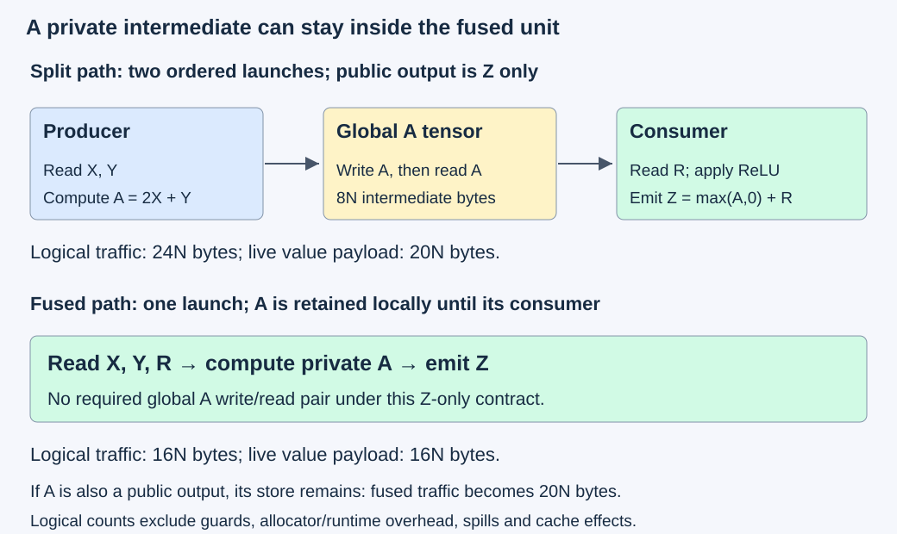
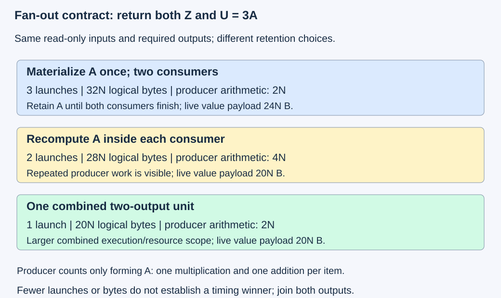

# M4-C08: Kernel fusion and its tradeoffs

> **Status: Complete — detailed chapter authored and documentation validated; experimental procedures are proposed unless explicitly labelled observed**

**Module:** Understand kernels and execution overhead

**Category:** [Kernels, compilers, and execution](index.md)

[Module 4 reading order](../module-4.md) · [Previous: M4-C07](../numerics-and-correctness/m4-c07-online-softmax-and-stable-incremental-reductions.md) · [Next: M4-C09](../kernels-compilers-and-execution/m4-c09-register-pressure-occupancy-and-spills-in-kernel-design.md)

[Execution plan and progress](../chapter-execution-plan.md)

## Target concepts

Producer-consumer fusion, intermediate tensors, eliminated reads and writes, reduced launches, dependency boundaries, resource growth, fusion versus recomputation.

## Concepts

### 1. Fusion changes the execution boundary, not the requested function

A **producer** computes values that a **consumer** uses. An **intermediate tensor** holds those values between operations. **Kernel fusion** combines device work into a shared execution unit so some intermediate values can stay in registers or block-local storage instead of being written to and read from global memory. It can also reduce the number of launches. It does not automatically preserve every numerical, dependency or ownership contract.

Use the following pointwise chain for N elements:

**A[i] = 2X[i] + Y[i].**

**Z[i] = max(A[i],0) + R[i].**

The maximum with zero is the **ReLU** activation: negative values become zero, nonnegative values remain unchanged. R is a residual input, added after the activation. This resembles an activation/residual stage in an inference path without claiming to be an entire Transformer operation. The required public output in the first contract is Z alone; A is private temporary state. A fused candidate may retain each A value locally until Z is computed.

The teaching contract uses contiguous FP32 inputs/output, finite integer X,Y,R in [−128,128], checked capacities and producer dependencies. FP32 is four-byte binary32. Inputs are read-only; output is disjoint from inputs, and materialized A is disjoint from them all. Each valid Z has exactly one writer. Empty N returns identified empty success without allocation or launch. Rust is the host-engine context; retain allocations and executable/context handles through their last device consumers. No kernel or bridge implementation is provided.

The range of A is [−384,384] and Z is [−128,512]. Multiplication by two, addition and activation are exact in FP32 on this bounded integer corpus. This isolates scheduling/data-movement changes from numerical approximation. Broader activations need a separate numerical gate before a speed claim.

For X = [−2,0,1,3], Y = [1,−1,2,−8], R = [10,20,−3,4], the intermediate is **A = [−3,−1,4,−2]** and output **Z = [10,20,1,4]**. Moving the residual inside ReLU changes the result to [7,19,1,2]. Equal shapes and fewer launches do not make that rewrite equivalent.

### 2. Count the intermediate traffic and launches explicitly

In a stipulated two-kernel baseline, the producer reads X/Y and writes A: 12N logical bytes. The consumer reads A/R and writes Z: another 12N. A fused one-pass candidate reads X/Y/R and writes Z: 16N bytes.

**Qsplit = 24N bytes; Qfused = 16N bytes; avoided intermediate demand = 8N bytes.**

The saved 8N is one four-byte A write plus one four-byte A read per element. At N = 1000, the counts are 24,000 versus 16,000 bytes, with 8000 avoided logical bytes. Launch count changes from two to one under these declared mappings.

If all inputs/output remain allocated, the split chain's live value payload is **20N bytes** for X,Y,R,A,Z; the fused chain has **16N bytes** for X,Y,R,Z. At N = 1000 that is 20,000 versus 16,000 bytes. These are payload accounting models before guards, allocation granularity, metadata, compiler/runtime state or spills. They are not peak physical-memory measurements. Reusing an allocator block after A's last read can change residency, but it does not remove the read/write demand from the unfused algorithm.

*Deleting a private intermediate can remove its global write/read pair. Input/output and completion contracts still remain.*

A cache may already serve the split consumer's A reads, so logical bytes saved are not automatically DRAM bytes saved. Conversely, register spills can add memory traffic to the fused candidate. The [Triton fused-softmax tutorial](https://triton-lang.org/main/getting-started/tutorials/02-fused-softmax.html) illustrates intermediate elimination for a particular row-size/resource regime. It motivates a hypothesis, not a transferable speedup for this pointwise chain.

If the public interface also returns A, fusion must still emit it. The fused path then reads three inputs and writes A/Z: **20N logical bytes**, not 16N. It can avoid A's consumer read but cannot remove a required output store. A tensor used by debugging, another operation or a caller may be observable; determine the actual interface before claiming its removal.

### 3. A dependency boundary can be essential

Separate ordered launches can provide a completion boundary between all producer blocks and downstream work. Fusion removes that boundary only when each consumer still has a valid way to obtain all required inputs before use. Pointwise A-to-Z can use local values. A row/global reduction is different.

Consider a separate row-centering operation:

**mean = sum of X[i] over the row / N; Z[i] = X[i] − mean.**

For X = [1,2,3,4], the mean is 2.5 and Z = [−1.5,−0.5,0.5,1.5]. If two blocks independently replace that with their two-element local means, the output becomes [−0.5,0.5,−0.5,0.5]. Both halves can have zero local sum while the requested row operation is wrong.

A valid one-block-per-row candidate may compute the complete mean and then normalize the row if its resources and layout admit it. An ordered multi-pass candidate can instead retain global reduction boundaries. A candidate that recomputes the whole row mean for every output tile may preserve the function while adding substantial work. These are different decompositions, not interchangeable timing populations. [M4-C06](m4-c06-parallel-reductions-and-synchronization.md) supplies complete partial membership and cross-block ordering.

A block barrier cannot generally join arbitrary producer blocks. An ad hoc grid spin barrier can prevent progress when resident waiting blocks occupy resources needed by unscheduled producers. This chapter assumes no such mechanism. The [CUDA asynchronous-execution guide](https://docs.nvidia.com/cuda/cuda-programming-guide/02-basics/asynchronous-execution.html) describes streams and dependencies; record the actual ordering and context, including any explicit cross-stream join.

Fusion can also remove an earlier stage's publication opportunity. Another consumer might have started after A became ready, while a larger fused unit delays that boundary or uses resources that previously permitted independent work. Eligibility, latency and capacity therefore depend on the whole dependency graph, the set of operations and edges describing who waits for whom.

### 4. Fan-out makes recomputation a real alternative

**Fan-out** means that one result has more than one consumer. Extend the public contract to return both Z and **U[i] = 3A[i]**. U lies in [−1152,1152] for the exact fixture. This is a new output contract, not extra work silently added to the Z-only comparison.

Three declared mappings show the choice:

| Mapping returning Z and U | Launches | Logical global bytes | Producer arithmetic | Live value payload |
|---|---:|---:|---|---:|
| Materialize A once, then two consumers | 3 | 32N | 2N multiply/add operations | 24N bytes |
| Fuse each consumer with a private recomputed A | 2 | 28N | 4N multiply/add operations | 20N bytes |
| One fused unit computes A once and both outputs | 1 | 20N | 2N multiply/add operations | 20N bytes |

The two-consumer baseline has 12N producer bytes, 12N Z-consumer bytes and 8N U-consumer bytes. The duplicated-producer mapping has 16N bytes for Z and 12N for U. The combined mapping reads X/Y/R once and writes Z/U. Live payload assumes all inputs and public outputs retained and no aliasing, with A also retained in the materialized mapping; actual allocator peaks can differ. Producer arithmetic counts only multiplication/addition used to form A, not activation/comparison or the consumers' arithmetic.

**Recomputation** intentionally evaluates a value again instead of retaining and transporting it. A cheap producer can make this attractive; an expensive producer, many consumers, or different required arithmetic modes can make it a poor choice. Recomputed values must use the same input snapshot, masks and version. Random draws, mutable reads or side effects cannot be duplicated while pretending the behavior is unchanged.

*The options trade global temporary storage against repeated producer work and a larger combined execution unit. One kernel is not a guarantee of the lowest completed latency.*

For a constructed compute/transfer comparison, recomputing a producer adds cost Cextra but avoids transfer/wait cost Tavoided. The relevant hypothesis is **Cextra + other added costs < Tavoided**, evaluated at the intended workload. Arithmetic counts alone cannot decide it. Independent consumers may also have useful concurrent execution; the two-output comparison must end only when both outputs are ready.

### 5. Resource growth can consume the savings

A value is **live** while future work still needs it. Fusion can extend live ranges for inputs, accumulators, addresses and predicates. Registers and shared memory have finite budgets. More per-block resources can reduce resident blocks or cause spills into thread-private memory backed by device memory; “local” storage does not promise on-chip residency. The [CUDA resource/launch-bound discussion](https://docs.nvidia.com/cuda/cuda-programming-guide/05-appendices/cpp-language-extensions.html#launch-bounds) and completed M3-C06 provide the compiler/resource context. Source-level value counts do not establish actual register allocation.

The consumer and producer may also prefer different tile shapes or levels of parallelism. Combining them can force a compromise or duplicate edge work. A longer fused unit may delay other runnable work; fewer launches alone does not establish better tail latency or throughput. [M4-C05](m4-c05-tiling-an-operation-for-data-reuse.md) explains tile/edge accounting. Detailed register/occupancy analysis is next in M4-C09, rather than an assumed benefit here.

Use a **constructed serial latency model** to frame a test. Let h be exposed per-launch overhead and ta/tb be completed stage costs excluding that overhead. Let tf be fused work cost under the same artificial accounting:

**Tsplit = 2h + ta + tb; Tfused = h + tf.**

**Fusion helps in this model only if tf − (ta + tb) < h.**

With invented h = 3 µs, ta = 4 µs, tb = 5 µs, split time is 15 µs. If tf = 10 µs, fused time is 13 µs; if tf = 14 µs, it is 17 µs. Resource penalties can outweigh one removed launch. These are arithmetic examples, not measured GPU overheads. Actual host submission, device execution, queueing and overlap do not generally decompose into one independently measurable constant h. Use a timeline and full-chain measurement instead of subtracting an empty-launch number from unrelated runs.

### 6. Kernel fusion and fused arithmetic are different decisions

A fused kernel can still preserve explicit intermediate rounding. An unfused-looking expression can still be contracted by a compiler into a **fused multiply-add (FMA)** instruction, which rounds one multiply-plus-add once rather than rounding the product and then the sum. Neither term guarantees a bitwise result by itself. The [NVIDIA Floating Point and IEEE 754 article](https://docs.nvidia.com/cuda/floating-point/index.html#the-fused-multiply-add-fma) specifies this numerical distinction.

Let a = 1 + 2⁻²³, b = 1 − 2⁻²³ and c = −1, all exactly represented FP32 inputs. The exact product is 1 − 2⁻⁴⁶. With round-to-nearest, ties-to-even:

| Declared arithmetic | Result |
|---|---|
| FP32-rounded product, then FP32 addition of c | 0 |
| One rounding of a × b + c | −2⁻⁴⁶, approximately −1.42108547 × 10⁻¹⁴ |

Both models are well-defined, but they satisfy different rounded-operation specifications. If the interface requires the materialized FP32 intermediate's rounding, preserve that boundary or establish an authorized numerical allowance. A more accurate result does not automatically pass a bitwise-equivalence contract. The bounded integer chain avoids this ambiguity; general inference uses [M9-C17](../numerics-and-correctness/m9-c17-comparing-logits-with-justified-numerical-tolerances.md) plus downstream logits, selection and stopping checks.

Fusion also changes error-reporting and lifetime boundaries. A split chain whose second submission fails can leave a first stage in flight; its buffers cannot be reclaimed on the assumption the whole chain never ran. A fused failure does not promise an untouched destination or rollback. Publish success only after the required outputs complete, and use the reviewed recovery contract when completion is uncertain. Cancellation is not device completion.

HFT supplies a systems lens: eliminating handoffs can reduce a critical path, but larger working sets, delayed publication and shared-resource contention can hurt useful service. Market-event semantics and inference arithmetic remain distinct. This chapter supplies no trading result, deadline guarantee or production certification.

## Experiments

All protocols are proposed. Existing separately reviewed candidates and an identified Rust/CUDA or Rust/Triton bridge are prerequisites to hardware execution; this repository supplies documentation without implementation code. Raw inputs, required outputs, intermediates and guards are limited to 64 MiB on host and separately device. Admit one case and one fixture at a time; reuse controlled buffers only after their last users finish. Compiler/runtime, packing, profiler and generator/model/KV charges are separate. Stop performance comparison on correctness or lifetime failure.

### E1 — Prove the fusion boundary and arithmetic contract

**Description:** Compare the split and fused pointwise chain while exposing invalid rewrites and rounding changes.

**Purpose/objective:** Establish exactly which intermediate can disappear and what numerical behavior must survive.

**Target concepts:** Producer-consumer fusion, intermediate visibility and rounded equivalence.

**Baseline and workload:** The four-element worked chain, empty N, and integer fixtures X[i] = ((17i + e) mod 257) − 128, Y[i] = ((5i + 2e) mod 257) − 128, R[i] = ((11i + 3e) mod 257) − 128 for e = 0,…,15. Include the separate a/b/c FMA probe. The baseline returns Z only; a separate contract also returns A.

**Controls and prediction:** Keep input snapshots, operation order, layout and required outputs fixed. Vary materialization only. Predict exact integer equality; moving R inside ReLU fails. The FMA probe predicts different results under its two declared arithmetic models and is not an authorization to change precision semantics.

**Procedure:** Evaluate A and Z independently, compare every coordinate and verify output ownership. Confirm the extra A-output contract still writes A. Reproduce both rounded FMA answers with exact arithmetic and explicit FP32 rounding. Review mismatched masks, output/input aliasing and unexpected observable intermediates as rejected cases before any candidate timing.

**Hardware/software:** CPU exact/rounded references initially; optional GPU candidate requires recorded contraction/reassociation and input/accumulator/output formats, compiler/target and bridge identity.

**Failure and HFT connection:** Deleting a handoff cannot delete an externally required observation or change operation order. The lesson transfers to event processing, while activation and floating-point semantics are inference-specific.

**Exit criteria:** Exact fixture outputs and visibility contracts pass; wrong rewrite is distinguished; rounded probes match their declared models. No speed claim follows from arithmetic-only checks.

### E2 — Measure traffic savings against resource costs

**Description:** Benchmark eligible split and fused Z-only candidates across lengths and edge cases.

**Purpose/objective:** Test whether fewer launches and logical bytes reduce completed operation time after compiler resource changes.

**Target concepts:** Eliminated reads/writes, reduced launches, resource growth and operating point.

**Baseline and workload:** Reviewed two-kernel baseline versus one-kernel equivalent. N = 1,31,32,33,127,128,129,1000,4096,65,537,1,048,576; use E1's 16 fixtures and an explicit no-launch N = 0 contract check. The largest split payload is 20 MiB before guards under the stipulated five-array accounting.

**Controls and prediction:** Hold represented inputs, output/precision, allocation placement, layout, producer ordering and compiled readiness fixed. Compare the declared mappings first; vary supported tile/configuration choices as separately labelled candidates. Predict 24N versus 16N logical bytes and two versus one launch, without predicting universal speedup.

**Procedure:** Validate all outputs, guards and descriptor ranges. Precompile candidates, complete 100 warm invocations per case, then collect 60 paired alternating-order sessions of 100 completed invocations per candidate. Rotate the 16 fixtures identically, preparing/refilling inputs outside kernel timing and disclosing that boundary. Record actual emitted kernels. Obtain separate profiles for small and largest cases covering registers, spills, shared allocation, residency, cache/DRAM traffic and dependency gaps.

**Hardware/software:** One supported NVIDIA GPU with exact function/device limits, compiler/bridge/artifact identity, clock/power/thermal state and profiler versions/cache-replay controls.

**Failure and HFT connection:** A larger fused working set can consume the saved handoff cost or reduce capacity for other work. This is a resource/critical-path analogy, not an inference latency guarantee.

**Exit criteria:** Exact outputs/guards and resource admission pass; actual launch/traffic scopes and paired completed timings with uncertainty are retained. Fewer logical bytes alone cannot establish lower latency.

### E3 — Preserve essential dependency and failure boundaries

**Description:** Review pointwise and row-centering dependencies plus partial-submission/lifetime scenarios.

**Purpose/objective:** Determine when a removed launch boundary has a valid replacement and when fusion changes the requested function.

**Target concepts:** Dependency boundaries, reduction membership, synchronization and ownership.

**Baseline and workload:** The pointwise chain and independent row-centering fixture [1,2,3,4]. Six scenarios: valid local producer-consumer ownership; complete-row reduction before normalization; local-only mean substituted for a complete-row mean; consumer without its required cross-stream dependency; second split-stage submission failure; cancellation during submitted work.

**Controls and prediction:** Hold required outputs and group membership fixed. First two pass; the wrong local mean and missing dependency fail; partial submission/cancellation retain all resources still used. A valid one-block row candidate and an ordered multi-pass candidate are distinct resource/dependency contracts.

**Procedure:** Trace every consumer's required inputs, readiness scope and last use. Derive both correct and wrong row-centering outputs independently. Audit guards, ownership and success publication without executing a broken grid barrier or unsafe reuse. Only reviewed valid candidates may receive separate sanitizer and timeline diagnostics. Keep missing/unknown completion as retained state pending documented recovery.

**Hardware/software:** Document-only dependency ledger initially; runtime extension needs supported block/stream/event mechanisms, reviewed bridge error handling and a complete-row mapping admitted by actual resources.

**Failure and HFT connection:** Removing a publication boundary can deprive another consumer of readiness or hide incomplete work. The event-system lesson is complete dependencies and explicit retirement; GPU synchronization remains device-specific.

**Exit criteria:** Six explicit verdicts; correct row outputs, complete membership and ordering; no partial result published as success and no premature reclamation. Invalid protocols remain reference counterexamples.

### E4 — Compare retention, recomputation and full fan-out fusion

**Description:** Evaluate the three mappings that return both Z and U = 3A.

**Purpose/objective:** Test whether avoiding an intermediate justifies extra producer work or a larger combined kernel.

**Target concepts:** Fan-out, intermediate lifetime, fusion versus recomputation and resource growth.

**Baseline and workload:** Materialized A with two consumers, duplicated producer fused independently into each consumer, and one combined two-output candidate. Use N = 33,1000,65,537 and E1's 16 exact fixtures. Both Z and U are required; A is private.

**Controls and prediction:** Same inputs, output lifetimes, precision, readiness and completion join. Vary mapping; report thread/tile/resource changes. Predict 32N/28N/20N logical bytes and producer arithmetic 2N/4N/2N, without inferring a timing order. Serial consumer submission is the baseline; any concurrent-consumer variant is a separate declared scheduling comparison.

**Procedure:** Compare every Z/U coordinate against independent references and count which producer values are computed or retained. Use E2's paired timing protocol, ending only after both outputs are complete. Report full-path time, per-kernel attribution, peak intermediate/output allocation and resource profiles. Test input-generation/version mismatch as a rejected recomputation case; do not duplicate randomness or mutable side effects as equivalent work.

**Hardware/software:** Same pinned platform; versioned candidate mappings, allocation policies, output-completion join and stream/event identities. No cache residency or concurrency benefit is assumed.

**Failure and HFT connection:** A shared result can be cheaper to retain, recompute or jointly consume depending on workload and contention. Event systems face similar handoff/working-set tradeoffs, but their side-effect contracts cannot be assumed for tensor operations.

**Exit criteria:** Both output contracts pass, declared counts reconcile, all required completion is included and repeated work is visible. A single fast consumer does not pass a two-output latency claim.

### E5 — Verify useful operator and generator improvements

**Description:** Evaluate a validated fusion choice through the full caller boundary and, conditionally, a matching existing generator stage.

**Purpose/objective:** Determine whether local gains survive preparation, packing, dispatch, queueing and model-level correctness checks.

**Target concepts:** End-to-end dependencies, fusion resource costs, numerical acceptance and useful service.

**Baseline and workload:** Existing unfused operator/generator baseline versus one eligible equivalent. Use E2 vectors for the operator boundary; any matching generator path uses its actual activation domain with a separate M9-C17 numerical/logit/selection/stopping gate. Use supported prompt/output strata (32,32), (32,128), (128,32), (128,128); report unavailable paths/strata rather than insert synthetic work.

**Controls and prediction:** Same caller interface, model/tokenizer identity, masks/cache/positions, arrival trace, admission and memory limits. Vary only the admitted fusion policy. Predict useful gain only when the changed work affects the relevant critical path and does not create a worse bottleneck.

**Procedure:** Collect 60 paired full-operator sessions with 100 completed invocations after 100 warmups, including all required caller-visible preparation/conversion/allocation and completion. A qualifying generator completes 100 warmup requests per stratum, then uses 60 paired 30-second open-loop windows at 50% and 90% of baseline sustainable rate from a separate pilot. Arrivals follow scheduled times independently of completions. Limit waiting requests to 64 and in-flight requests to eight; allow a 30-second drain and retain censored/failed/cancelled outcomes with resources protected. Report startup and unseen-variant costs separately.

**Hardware/software:** Full CPU/GPU/NUMA topology, compiler/bridge/artifact/model/tokenizer identity, queue/memory budgets and output/error policy. This documentation repository supplies no running inference engine.

**Failure and HFT connection:** Reduced handoffs can help one path while contention, late publication or overload hurts service tails. HFT motivates useful end-to-end evidence; it supplies no model tolerance, financial outcome or service deadline.

**Exit criteria:** Operator/model/output and lifetime/capacity gates pass; paired evidence identifies the workload and operating point of any improvement. Isolated fusion speedup remains a local result unless the service comparison also passes.

## Verification

### V1 — Reference behavior and observable outputs (E1)

Verify A = [−3,−1,4,−2], Z = [10,20,1,4] and wrong residual placement [7,19,1,2]. For general teaching fixtures, compare a staged integer reference and the independent identity **Z[i] = R[i] + (A[i] + absolute A[i])/2**. The bounded integers make this exact; it is a reference relation, not a proposed kernel rewrite. Require one writer, correct element identity and unchanged input storage, with checked alias/range/mask contracts.

The FMA probe uses exact rational product 1 − 2⁻⁴⁶ and explicitly rounded intermediates. Preserve the declared zero versus −2⁻⁴⁶ behavior; do not classify an allowed arithmetic change by final bit agreement on an unrelated integer fixture. These CPU/reference checks have no runtime performance threshold. General activations require a predeclared numerical allowance and downstream validation, not a tolerance enlarged after seeing differences.

### V2 — Whole-chain clocks, bytes and compiler evidence (E2)

A GPU event interval brackets the complete ordered chain, including both split kernels and their dependency, or the complete fused operation. A monotonic host interval runs from admitted bridge invocation through observed output completion. Keep units/resolution, stream/context and start/end events. Per-kernel timings are attribution, not a replacement for full-chain latency. Exclude input refill from the kernel interval only under the declared ready-input contract; include required transfers/conversions in the full caller report.

Verify the 24N/16N demand model and actual kernel count independently. Report logical requests, measured cache/DRAM bytes, peak allocation and allocator-reserved capacity separately. Record actual registers/shared bytes, generated instructions, spills/local traffic and residency. The [Nsight Compute guide](https://docs.nvidia.com/nsight-compute/ProfilingGuide/index.html) explains collection/replay effects; profiles are separate runs with cache controls disclosed, while uninstrumented paired timings establish performance.

Sixty sessions of 100 invocations are clustered paired comparisons, not 6000 independent p99 samples. Report session medians, paired effects, raw variation and uncertainty; small unresolved differences are inconclusive. The synthetic h/ta/tb model is an explanatory check, not a method of subtracting host timing from GPU timing. Compilation/module preparation stays in separately recorded cohorts under M4-C04.

### V3 — Dependency and lifecycle ledger (E3)

The six verdicts are: accept valid pointwise local ownership; accept a complete-row reduction with its admitted join; reject local-mean substitution; reject missing cross-stream ordering; fail the chain after second-stage submission failure while retaining first-stage users; retain in-flight resources after cancellation. Correct row-centering output is [−1.5,−0.5,0.5,1.5]; the wrong local output is [−0.5,0.5,−0.5,0.5]. Local invariants alone do not prove the requested row operation.

Trace producers, consumers, intervals, required publication and safe retirement, including other users of A. Document-only review has no GPU timing requirement. Supported [Compute Sanitizer diagnostics](https://docs.nvidia.com/compute-sanitizer/ComputeSanitizer/index.html) can expose some memory/synchronization defects; they do not prove complete membership or every schedule safe. Run them separately and retain errors/unsupported modes. If valid dependency variants are timed, use E2's completed-chain populations and report all failure outcomes.

### V4 — Count every consumer and every producer evaluation (E4)

For the worked four-element inputs, U = [−9,−3,12,−6]. Check both outputs, not just their checksum. Reconcile 32N/28N/20N logical demand, 24N/20N/20N live payload and producer arithmetic counts. Capacity accounting includes concurrently retained outputs; no reuse is permitted merely because one output finished earlier.

A serial baseline's completion join follows both consumers. A concurrent baseline needs explicit readiness of A and a final join covering both outputs. Treat scheduling as a controlled variable rather than comparing different hidden concurrency policies. Apply the same warmup/paired-session and separate-profile controls as E2; retain actual repeated instructions/traffic and resource evidence, including unavailable counters as unknown. Deterministic pure recomputation is eligible only for the same input generation and arithmetic contract.

### V5 — Useful service, not launch count (E5)

A caller interval starts with admitted inputs at the promised placement and ends when all required outputs are usable. Include required packing, allocation, transfers and completion; identify what is already resident. For an existing generator, retain request/query/head/position and model/tokenizer identity, numerical checks, selected-token and stopping behavior. The small exact corpus does not validate general activations.

Report time to first token, inter-token latency, completed-request distributions and contract-valid output tokens per declared wall-clock interval, with request/token weighting and counts. Preserve rejections, errors, cancellations and drain/censoring. Report preparation/new-shape cohorts so warm fusion results cannot hide deployment cost. Use identical traces/limits in paired runs; short windows and fixed session counts do not certify rare tails. A resource-heavy fused stage can reduce useful capacity even if isolated latency improves.

Completed [M9-C01](../numerics-and-correctness/m9-c01-defining-reference-behavior-and-evidence-before-optimizing.md), [M9-C02](../measurement-experimentation-and-economics/m9-c02-request-events-clocks-and-measurement-boundaries.md), [M9-C07](../measurement-experimentation-and-economics/m9-c07-latency-distributions-and-statistical-uncertainty.md), [M9-C12](../measurement-experimentation-and-economics/m9-c12-reading-cpu-gpu-timelines-and-scheduling-gaps.md), [M9-C13](../measurement-experimentation-and-economics/m9-c13-using-kernel-profilers-to-explain-hardware-bottlenecks.md), [M9-C15](../state-memory-and-caching/m9-c15-accounting-for-weights-kv-state-workspace-and-fragmentation.md), [M9-C16](../hardware-architecture-and-topology/m9-c16-recording-hardware-conditions-that-change-measurements.md) and M9-C17 supply reference, clocks, uncertainty, diagnostics, capacity, manifests and numerical methods. M9-C22 remains an outline; elementary lifetime checks are supplied locally. No Module 8 is required.

## Engineering dimensions and principles

| Dimension | Chapter-specific application |
|---|---|
| Semantics and invariants | Preserve activation/residual order, observable intermediates, complete reduction groups and all required outputs. |
| Workload and variability | Lengths around tile edges, small/large chains, fan-out and caller placement change the opportunity. |
| Resources and bottlenecks | Intermediate traffic/payload, repeated arithmetic, live registers/shared state, spills and resident blocks. |
| Time and distributions | Exposed launch/dispatch work, removed publication points, overlap and full-chain/service completion. |
| Ownership and coordination | Other intermediate users, two-output joins and retained resources after partial submission. |
| Failure and adaptation | Reject illegal rewrites/dependencies and protect allocations on cancellation or uncertain completion. |

| Engineering principle | Specific reasoning step |
|---|---|
| 1. Correctness defines the optimization boundary | Removing materialization does not authorize changed output, rounding or operation order. |
| 2. Performance depends on workload and operating point | Launch savings, cache reuse, fan-out and competing work alter the result. |
| 3. Data movement is part of the algorithm | Count eliminated intermediate requests alongside spills, remaining outputs and recomputation traffic. |
| 4. State has ownership, lifetime and recovery cost | A remains live through every consumer, even if one stage fails or a client cancels. |
| 5. Dependencies determine latency; bottlenecks determine capacity | Essential global joins and resource growth can defeat a shorter launch sequence. |
| 6. Variability and synchronization shape the tail | Longer execution units and changed publication/overlap can delay other work. |
| 7. Local improvements need end-to-end evaluation | E5 includes caller support work and generator outcomes after local gates pass. |
| 8. Claims require reproducible evidence | Exact/rounded references, fixed mappings, output joins, paired trials and scoped resource profiles. |

## Specifications, articles, and hardware

Primary sources were checked on 27 October 2026. CUDA Best Practices and NVIDIA's Floating Point/IEEE 754 article identify version 13.4; use the latter's rounding explanation rather than its historical hardware examples as a description of the reader's device. Triton's main fused-softmax tutorial is a moving explanatory article with its own size/resource limits. CUDA's asynchronous and resource specifications and the Nsight Compute/Compute Sanitizer guides define the relevant dependency and diagnostic scope. Pin actual compiler/tool revisions before executing the proposed experiments.

| Required specification | Record before runtime comparisons |
|---|---|
| GPU/target | Exact architecture/partition, SMs, memory capacity and actual function/device limits. |
| Resources | Threads/warps, tile/configuration, registers/shared allocation, spills/local-memory cause and residency evidence. |
| Numerical contract | Input/intermediate/accumulator/output formats, FMA/reassociation/rounding/denormal settings and required outputs. |
| Data and lifetimes | Shape/strides/alignment, bytes and aliases, intermediate/output visibility, request/allocation generations and completion joins. |
| Software/bridge | Driver/runtime/toolkit/compiler/Triton versions, target/artifact, Rust ABI and dependency/error/recovery mechanism. |
| Run/service state | CPU/NUMA/device topology, clocks/power/thermal/co-tenancy, profile replay/cache mode, queue/memory/model/tokenizer/workload limits. |

No achieved speedup, GPU specification or diagnostic result is assumed. Device/profile/sanitizer and generator studies remain proposed; observed authorship validation checks references and documentation only.

## What to carry forward

Fusion is useful when eliminating a private handoff saves more than the added arithmetic, resources and coordination cost, while preserving every required output and dependency. Compare complete eligible paths and let evidence determine the fusion boundary.

Next in Module 4 reading order is the completed [M4-C09: Register pressure, occupancy, and spills in kernel design](m4-c09-register-pressure-occupancy-and-spills-in-kernel-design.md). The next authoring chapter is [M5-C18: Choosing chunk sizes and balancing prefill with decode](../scheduling-and-queueing/m5-c18-choosing-chunk-sizes-and-balancing-prefill-with-decode.md), position 125. Track acceptance in the [execution plan and progress tracker](../chapter-execution-plan.md).
