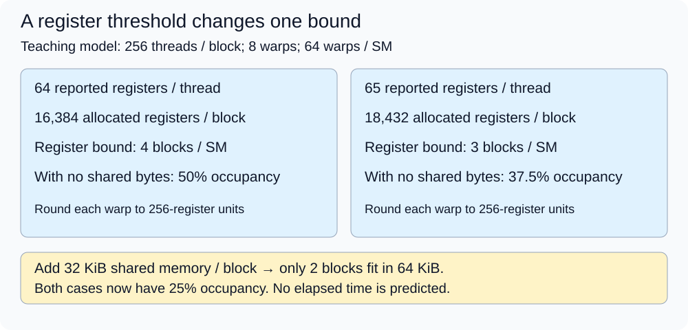
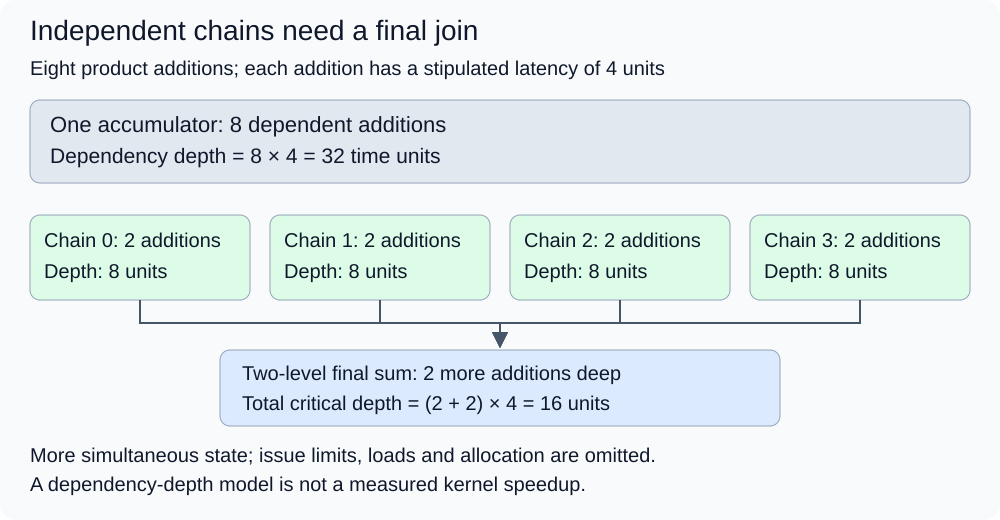

# M4-C09: Register pressure, occupancy, and spills in kernel design

> **Status: Complete — detailed chapter authored and documentation validated; experimental procedures are proposed unless explicitly labelled observed**

**Module:** Understand kernels and execution overhead

**Category:** [Kernels, compilers, and execution](index.md)

[Module 4 reading order](../module-4.md) · [Previous: M4-C08](m4-c08-kernel-fusion-and-its-tradeoffs.md) · [Next: M4-C10](m4-c10-shape-specialization-padding-and-dispatch.md) · [Execution plan and progress](../chapter-execution-plan.md)

## Target concepts

Live values, register allocation, tile and fusion choices, occupancy limits, local-memory spills, instruction parallelism, measured utilization versus occupancy.

## Concepts

### 1. A working value has a lifetime

A **register** is storage close to a GPU thread's execution units. A value is **live** from its creation until its last needed use along the relevant execution path. **Register pressure** describes the demand to retain such values at the same time. Loading everything early can lengthen live ranges; producing a value close to its consumer can shorten them. Neither scheduling choice establishes faster execution without measurement.

Suppose a thread forms four products p0, p1, p2, p3 and eventually adds them. Retaining all products until the addition creates four simultaneously live products. Consuming products sooner can reuse storage, but can also create a longer chain of dependent additions. Addresses, predicates (true/false execution conditions), loop state, accumulators and temporary conversions contribute additional demand. Four mathematical products do not mean four total physical registers.

**Register allocation** is the compiler's assignment of values to finite physical storage. It can remove unused computations, reuse storage after last use, or regenerate a cheap value. A source variable count is therefore not a compiled resource report. A 64-bit address may need more than one 32-bit register unit. A Triton logical tile is distributed among threads according to its lowering, the translation into target instructions; it is not automatically a tile stored separately by every thread. Rust remains the host-engine context: a CPU Rust variable does not establish the register use of a CUDA or Triton device kernel.

[CUDA's compiler resource guidance](https://docs.nvidia.com/cuda/cuda-programming-guide/05-appendices/cpp-language-extensions.html#launch-bounds) explains that register constraints can change instruction count and local storage. Preserve the final binary identity, compiler report and target, rather than inferring the result from a source annotation. No implementation or measured GPU result is supplied here.

### 2. Occupancy is a constrained residency calculation

A **streaming multiprocessor (SM)** executes resident blocks of threads. A **warp** is a group of 32 threads in this chapter's CUDA model. A resident warp is **active** in occupancy terminology even while waiting; it need not be ready to issue its next instruction. **Theoretical occupancy** is the resource-permitted resident warp count divided by the architectural maximum. It says how much work could reside, given the compiled kernel and launch resources, not how much useful work completes per second.

Here ceil rounds up to the nearest integer and floor rounds down. Define B as threads per block, W = ceil(B/32) as warps per block, r as reported 32-bit registers per thread, Qreg as actual allocated registers per block, and Sblock as allocated shared-memory bytes per block. Shared memory is on-chip storage used jointly by threads of a block. Let RSM, SSM, TSM, WSM and CSM be the per-SM register, shared-byte, thread, warp and block limits. An introductory resource model is:

**Cresident = min(floor(RSM/Qreg), floor(SSM/Sblock), floor(TSM/B), floor(WSM/W), CSM).**

**Otheory = Cresident × W / WSM.**

For Sblock = 0, omit the shared-memory bound rather than divide by zero. This model assumes ordinary independent blocks, no clusters, no extra barrier limits, legal block size and adequate grid work. Actual allocation granularity, partition restrictions and other architecture limits must come from the target-specific calculator/runtime. If the result is zero or the block violates a per-block limit, reject the configuration before timing; do not call it a zero-occupancy benchmark.

Use a **declared teaching machine**, not an asserted board specification: RSM = 65,536 registers, SSM = 65,536 bytes, TSM = 2,048 threads, WSM = 64 warps, CSM = 32 blocks. Assume register allocation rounds each warp's demand up to a multiple of 256 registers:

**Qreg = W × 256 × ceil(32r/256).**

These combined assumptions isolate resource arithmetic. The [CUDA compute-capability tables](https://docs.nvidia.com/cuda/cuda-programming-guide/05-appendices/compute-capabilities.html#features-and-technical-specifications) describe actual architecture-dependent limits; replace every assumed limit, including rounding, for a real experiment.

| B, r and Sblock | Allocated Qreg | Register-bound blocks | Final resident blocks / occupancy |
|---|---:|---:|---:|
| 256, 32, 0 | 8,192 | 8 | 8 / 100% |
| 256, 64, 0 | 16,384 | 4 | 4 / 50% |
| 256, 65, 0 | 18,432 | 3 | 3 / 37.5% |
| 256, 64, 32 KiB | 16,384 | 4 | 2 / 25% |
| 256, 65, 32 KiB | 18,432 | 3 | 2 / 25% |
| 128, 65, 0 | 9,216 | 7 | 7 / 43.75% |

One KiB is 1,024 bytes. Moving from r = 64 to 65 crosses an allocation step: 32 × 65 = 2,080 rounds to 2,304 per warp. Eight warps consume 18,432 registers. The shared-memory cases show why a register reduction may change one bound without changing final residency. The 128-thread case shows why changing block size requires recomputing every bound. None predicts elapsed time.

*At the same block size, one more reported register can cross an allocation threshold. An independent shared-memory limit can hide that change in final occupancy.*

A small grid cannot fill all theoretically available slots. For an illustrative device with ten SMs, three resident blocks per SM and a grid of seven blocks, only seven blocks exist for thirty possible block slots. Their scheduling and durations still determine achieved residency. Conversely, thirty-one equal-work blocks need at least two block-residency rounds in a simplified non-overlapping round model; the last round has little work. Real scheduling is not synchronized into such rounds. This is a finite-work warning, not a device time formula.

### 3. Tile size and instruction parallelism compete for storage

A **tile** is a bounded portion of an operation assigned to an execution unit. Larger tiles may reuse more inputs or amortize fixed work while retaining more accumulators. Fusion can retain producer and consumer state together; [M4-C08](m4-c08-kernel-fusion-and-its-tradeoffs.md) explains the eliminated intermediate boundary. A smaller tile can reduce live state while creating more blocks, edge work, loads or coordination. Changing tile, warp count and pipeline depth simultaneously makes causal attribution difficult. Pipeline depth is the number of work stages allowed to coexist in progress.

**Instruction-level parallelism (ILP)** means independent instructions from one thread's work can be available while other instructions wait. **Thread-level parallelism** supplies work from other threads/warps. Both can help cover latency, but consume finite resources. A dependent sum with one accumulator has an addition chain. Several independent partial accumulators can expose more work, then require a final join. More independent accumulators can improve progress even if their storage lowers occupancy; beyond an operating point, resource growth may instead hurt.

Consider an exact row dot product:

**Y[j] = sum over k = 0…K−1 of X[j,k] × V[k].**

X has R rows and K columns; V has K entries and Y has one output per row. j names a row and k names a reduction position. FP32 means 32-bit floating-point storage. X and V contain integer-valued FP32 numbers from −4 through 4. K ≤ 4,096. Every product has magnitude at most 16; the sum of absolute products is at most 65,536. All integer products and intermediate sums within that bound are exactly representable in FP32, including different addition groupings. This deliberately narrow fixture permits exact comparison across one, two and four partial accumulators; it does not authorize regrouping arbitrary model reductions without numerical gates.

For one row X = [1,−2,3,4,−1,2,0,−3] and V = [2,1,−1,2,3,−2,4,1], products are [2,−2,−3,8,−3,−4,0,−3] and Y = −5. Grouping product indices by remainder modulo four gives partial sums [−1,−6,−3,5], again totaling −5. Duplicating a product or forgetting the final partial join fails this reference even if some occupancy counter rises.

The **critical path** is the dependency chain that determines completion. A toy arithmetic schedule with eight additions each of latency four time units takes 32 units along a single accumulator chain. Four chains with two additions each followed by a two-level pairwise join have a dependency depth of four additions, or 16 units under the same artificial latency assumption. This ignores issue bandwidth, loads, register allocation and all scheduling contention; it is a dependency-depth calculation, not a claimed execution speedup. An architecture may issue independent work at a limited rate regardless of chain depth.

*Four chains shorten a constructed dependency depth while increasing simultaneous accumulator state. The final join remains mandatory; runtime evidence decides whether the trade is useful.*

### 4. Spills are extra state movement with a cause to establish

A **spill** moves a value out of registers because the chosen allocation cannot retain it there, with later access when needed. **Local memory** denotes thread-private addressable storage; on the discrete-GPU model it is device-memory-backed and can use caches. Local storage can also hold addressable arrays or other automatic state, so a local byte count alone does not prove register spilling. Final target allocation can differ from an earlier intermediate report. These distinctions follow the [CUDA local-memory discussion](https://docs.nvidia.com/cuda/cuda-c-best-practices-guide/index.html#local-memory).

For a constructed spill ledger, suppose each of 256 threads stores and reloads four FP32 values once. The logical instruction demand is **256 × 4 × (4 + 4) = 8,192 bytes per block**, excluding addresses, stack padding and transaction effects. If the same save/reload occurs in each of ten iterations, logical demand becomes 81,920 bytes. Static local footprint and dynamic traffic are different quantities. Cache hits can reduce downstream DRAM transfers; they do not erase instructions or establish a fixed spill penalty.

Lowering an allowed register budget is an intervention, not free storage. The compiler may spill, recompute, change instruction scheduling or produce a different binary; the cap may have no effect if already above actual use. Validate the resulting launch and output, then inspect reports/instructions and dynamic local transactions. No report of spills is not proof that a candidate is optimal; the bottleneck might be memory bandwidth or dependencies elsewhere. Some toolchains/targets support other spill backing strategies; this chapter's teaching model assumes device-backed local spilling. Record any shared-memory spill feature and recompute shared residency when enabled.

A causal claim needs a chain of evidence: changed constraint → changed allocation/instructions → changed executed memory demand or dependency readiness → changed completed useful time. A larger spill count with unchanged time may be hidden at that workload; a smaller spill count with slower time may indicate lost ILP. Use a preserved baseline and a single controlled change to test that explanation.

### 5. Occupancy, readiness and utilization answer different questions

**Achieved occupancy** measures observed active warps against a maximum over the profiler's stated sampling/averaging scope. **Eligible warps** are ready for issue. **Issue activity** concerns issuing instructions; a compute or memory throughput metric concerns work at its own interface. These denominators are not interchangeable. Preserve the exact metric name, units, scope, normalization, availability and tool version. [Nsight Compute's profiling guide](https://docs.nvidia.com/nsight-compute/ProfilingGuide/index.html) documents occupancy/resource sections and collection overhead; replay can change execution/cache conditions.

For a constructed whole-window example with 64 possible warps, 100 cycles and a total of 3,200 active-warp cycles, the defined average residency ratio is **3,200/(64 × 100) = 50%**. If one stipulated issue slot per cycle issues in 80 cycles, its issue activity is 80%. These two ratios can coexist. They are definitions for this paper example, not a reconstruction of vendor metrics. A 100%-resident set of warps all waiting for a dependency can make no issue progress at that instant. A monitoring sample marked GPU-busy does not identify useful instruction throughput or request latency.

Resource limits describe possible coexistence. Grid size, unequal block duration, dependencies, memory stalls and interference describe whether useful coexistence occurs. Reducing a kernel's isolated duration also need not improve a request if submission, queueing or another operation dominates. If a kernel accounts for fraction f of serial request time and its duration changes by speed factor s, with all else unchanged, **Srequest = 1 / ((1−f) + f/s)**. At f = 0.2 and s = 2, the constructed bound is 1/0.9 ≈ 1.111, not 2. Queueing and concurrent-resource effects require their own measured request comparison.

HFT supplies a useful systems lens: retain bounded working state, avoid unexpected memory demand on a critical path, and evaluate burst tails at the caller boundary. A GPU register threshold is not an exchange rule or a CPU cache guarantee. No market-data protocol, trading profitability or trading-time result is inferred.

### Target-concept coverage

| Target concept | Explanation and experiment/verification |
|---|---|
| Live values | Section 1 defines live ranges; E2/V2 checks accumulator state and ownership. |
| Register allocation | Sections 1–2 distinguish values from rounded resources; E1/V1 audits actual reports. |
| Tile and fusion choices | Sections 3–4 define the trade; E2/V2 varies tiles and E3/V3 audits the epilogue boundary. |
| Occupancy limits | Section 2 calculates all bounds; E1/V1 reconciles independent constraints and finite grids. |
| Local-memory spills | Section 4 separates cause, footprint and traffic; E3/V3 tests attribution. |
| Instruction parallelism | Section 3 works the independent chains/join; E2/V2 tests preserved outputs and compiled scheduling. |
| Measured utilization versus occupancy | Section 5 defines distinct denominators; E1/V1 and E4/V4 compare progress and service outcomes. |

## Experiments

All four experiments are proposed. Paper arithmetic can be performed without a GPU; device work requires independently available, reviewed candidates and a measurement harness. This chapter supplies neither candidate implementation nor a serving engine. If unavailable, stop at paper/reference evidence and record the device phase as unexecuted. Each procedure belongs to Module 4's execution reasoning, with Module 9 supplying evidence discipline.

### E1 — Predict the resource cliff, then audit residency

- **Description:** Reconcile a per-block resource ledger with theoretical and observed occupancy.
- **Purpose/objective:** Falsify the claim that lowering registers necessarily increases final residency or useful utilization.
- **Target concepts:** Live values, register allocation, occupancy limits, measured utilization versus occupancy.
- **Hypothesis and prediction:** The teaching cases change the register bound at 64→65 but not final residency under 32 KiB shared memory; a real candidate may have a different threshold.
- **Baseline and independent variable:** Paper baseline B = 256, r = 64, zero shared bytes; change only r, then independently shared bytes, then B. Device phase compares only available legal binaries/launches, without pretending r is a runtime knob.
- **Workload and reference:** Reproduce all six resource rows and the seven-/thirty-one-block cases. For actual candidates use the E2 exact dot corpus and preserve binary/shape identity for each occupancy calculation.
- **Controlled variables and procedure:** First calculate rounded allocation and every bound. Then obtain final resource reports and the target calculator result for each available candidate. Explain mismatches using actual granularity/limits. Finally collect occupancy and eligibility/issue evidence in a separate profile; compare enough-grid and small-grid launches without mixing their latency populations. A resource-changing rebuild may also change instructions, which must be reported as a confounder.
- **Hardware/software and HFT connection:** Paper machine as specified; device phase needs target limits, compiler reports and supported occupancy counters. HFT analogy: available capacity is different from runnable useful work; residency is not service capacity.
- **Exit criteria and expected failures:** All paper bounds match; real resource calculations reconcile with the actual calculator or remain explicitly unresolved. Invalid launch/resource cases are rejected and counted. Never convert missing counters into zeroes or declare a performance win from occupancy alone. Verify with V1.

### E2 — Trade independent accumulators against live state

- **Description:** Compare one, two and four accumulator groupings of the exact row dot product, with a separately varied output tile.
- **Purpose/objective:** Test whether shorter dependency chains outweigh allocation and instruction costs at different shapes.
- **Target concepts:** Live values, register allocation, tile choices, instruction parallelism, occupancy versus utilization.
- **Hypothesis and prediction:** Extra independent chains may help a dependency-limited case but can lose at a resource threshold or a small grid. The exact fixture must remain unchanged.
- **Baseline and independent variable:** One-accumulator reviewed candidate is baseline. Change only accumulator count within a fixed mapping, then separately compare available row tiles of one and four outputs per program/block. Report any compiler changes to mapping, instruction count or reduction tree; source intent does not prove actual ILP.
- **Workload and reference:** Use R in {1,7,32,257} rows, K in {31,32,33,127,128,129,1024,4096}, epochs e = 0,1,2,3. Define X[j,k] = ((7j+3k+e) mod 9)−4 and V[k] = ((5k+2e) mod 9)−4. Compare every Y coordinate to an independently accumulated integer reference. Include the eight-product example, K = 0 yielding zero for each row, and R = 0 yielding an empty output without a device launch. Repeated modular values require the coordinate/ownership probes in V2.
- **Controlled variables and procedure:** Freeze dtype, stored inputs, contraction/rounding policy, device/context, block configuration, stream and cache policy within each comparison. Check outputs and guards first. Warm each binary/shape, then run balanced baseline/candidate pairs under V2. Profile selected cases that improve, regress or cross a resource threshold. Explain performance through actual compiled dependencies/resources and completion evidence, not accumulator count alone.
- **Hardware/software and HFT connection:** FP32-capable discrete CUDA GPU, validated candidate artifacts and host/device timing support; record Rust host and CUDA/Triton boundary versions. HFT analogy: bounded parallel work can shorten a decision path but increases working state; no CPU scheduling or trading equivalence is assumed.
- **Exit criteria and expected failures:** Exact output equality, complete valid-coordinate coverage and no ownership/guard failures precede timing. Publish per-shape distributions and inconclusive outcomes; retain baseline if evidence does not establish benefit. Reject an omitted join, duplicate/missing product, wrong row stride or unsafe masked access. Verify with V2.

### E3 — Attribute a cap or fusion change to its actual costs

- **Description:** Audit register constraints and a fused dot-product epilogue as separate interventions.
- **Purpose/objective:** Distinguish compiler spills, other local storage, recomputation and eliminated global intermediates.
- **Target concepts:** Register allocation, tile and fusion choices, local-memory spills, instruction parallelism.
- **Hypothesis and prediction:** A tighter cap can increase local demand or instructions despite raising permitted residency; fusion can save an intermediate yet retain enough state to regress.
- **Baseline and independent variable:** First compare the E2 baseline dot binary with one separately rebuilt capped variant at a time, same source mapping and launch contract. Then use a distinct fixed public contract Z[j] = max(Y[j]+b[j],0), with b[j] = ((j+e) mod 9)−4: split dot plus epilogue versus fused dot/epilogue, holding cap policy fixed. Do not compare Z to raw Y as if identical outputs.
- **Workload and reference:** Use the full E2 corpus and integer Z reference. For the worked row with b = 2, Y = −5 and Z = 0. Counts exclude cache effects: the split private Y adds 8R logical bytes (one FP32 write and read), and removes a launch when fused; required public Y would retain its write. Separately reproduce the four-value/256-thread spill ledger.
- **Controlled variables and procedure:** Validate cap support/legality, then archive final binaries, allocation, stack/local footprint and spill diagnostics. Run correctness and completed timing for each intervention separately. On selected cases collect dynamic local loads/stores, cache/interface traffic and instruction/eligibility evidence. Correlate the executed path with final instructions; local arrays, calls or other stack state must not be mislabeled as spills. Return to unprofiled pairs to confirm the timing outcome.
- **Hardware/software and HFT connection:** Same device manifest as E2, cap semantics for the selected toolchain, disassembly/resource and dynamic-counter access. Shared-memory spill policies, if present, must be fixed and named. HFT concern: hidden critical-path state movement and overload margin; GPU local storage is not a host allocation event.
- **Exit criteria and expected failures:** All dot/Z references pass; each claim states whether spill attribution is established, ambiguous or unsupported. Reconcile static footprint, logical instruction demand and measured interface bytes without equating them. Count unsupported caps and launch failures; no faster failure is a speedup. Verify with V3.

### E4 — Carry a resource change through the request boundary

- **Description:** Use an already validated generator integration to compare the baseline with one selected eligible candidate.
- **Purpose/objective:** Test whether local kernel evidence survives request dependencies, mixed shapes and bursts.
- **Target concepts:** Tile/fusion choices, occupancy versus utilization, live-state lifetime and resource contention.
- **Hypothesis and prediction:** A local win can disappear under a different shape mix or cause queueing regressions; no fixed service gain follows from occupancy.
- **Baseline and independent variable:** Same validated text-generation system with only the selected kernel policy changed. E2/E3 synthetic equality is necessary for those fixtures but does not qualify a real model operation by itself. Integration must first pass its full stored-input numerical/decision contract.
- **Workload and reference:** Freeze model/weights/tokenizer, FP32 or explicitly justified deployment dtype, greedy policy, prompts and output limits. Use separate trace strata with prompt lengths 32/128 and output caps 8/32, 100 requests per combination per run. Compare a spaced trace scheduled every 100 ms with a burst trace scheduling ten requests at each whole second for 40 seconds (400 requests in either trace). If an earlier request remains active, retain the scheduled arrivals and account for backlog rather than slowing the generator. Number attempts 0–399 and cycle through the four prompt-length/output-cap combinations in a fixed archived order, preserving that order in both traces. Fix admission and finite memory limits; neither trace is claimed representative of all production traffic.
- **Controlled variables and procedure:** Preflight reference logits and outputs for each prompt at identical prefixes. Complete 20 excluded warmup requests per stratum and drain before each steady-state run; record first-load/compilation/cold requests separately. Preserve request-owned buffers until all dependent device work completes. Execute the same offered trace for baseline/candidate, recording actual sends, admissions, timeouts, cancellations and drain. Use five independent paired runs per trace initially, balanced order; tune on different data. Inject a cancelled request with in-flight device work and an unavailable candidate, checking safe drain and validated fallback before performance runs. An asynchronous device fault requires the documented recovery path; do not assume the same context is reusable.
- **Hardware/software and HFT connection:** Requires an existing generator, candidate compatible with its exact operator contract, event tracing and independently scheduled load. If absent, this remains a design. HFT analogy: unchanged offered demand, bounded queues and stale-result suppression matter at caller boundaries; text-generation stopping differs from exchange execution.
- **Exit criteria and expected failures:** No numerical/decision, memory-lifetime, publication or fallback regression; all scheduled attempts have outcomes or explicit unresolved status. Compare arrival-to-first-token, delivery gaps, arrival-to-terminal latency and useful completed output under the same offered load. Retain baseline where evidence is inadequate or regressions violate the preregistered service budget. Verify with V4.

## Verification

### Shared evidence and timing rules

Apply completed [M9-C01](../numerics-and-correctness/m9-c01-defining-reference-behavior-and-evidence-before-optimizing.md) to preserve equivalent behavior and [M9-C17](../numerics-and-correctness/m9-c17-comparing-logits-with-justified-numerical-tolerances.md) to justify deployment numerical budgets. The integer dot fixture uses exact equality; NaNs, missing outputs and invalid accesses fail. For general model values, freeze tolerances from reference uncertainty, format and operation sensitivity before inspecting candidate speed. Preserve greedy tie/decision rules and compare logits at the same prefix before free-running output comparison. No stochastic sampling is introduced.

For E2/E3, use one operation in flight on a named stream for the isolated baseline. Device timing begins at an ordered event before the operation's first kernel and ends at an ordered event after all required output work; cross-stream work must explicitly join. Host monotonic timing spans ready inputs before submission to observed completion, with submission overhead separately named. Output readback/reference checks occur outside the isolated device interval but count in a separate caller-ready boundary if required there. A split epilogue interval ends after Z is ready, not after Y. Compilation, first-load/allocation and warm execution are separate populations.

Per binary/shape, complete 20 untimed warmup operations, then start five paired runs of 100 timed operations per variant, using alternating AB/BA order across pairs and reversing the initial order on a repeat. This is a starting evidence budget, not a universal confidence guarantee. Record individual observations; for very short kernels use a separately labeled ordered batch of 100 invocations divided by 100 for amortized throughput timing. That quotient is not an individual-kernel latency distribution. Predeclare a 2% run-median relative spread screen (maximum minus minimum divided by the median of run medians); if exceeded, investigate operating state, add independent runs or report inconclusive. The screen is an experimental precision choice, not a hardware claim. Do not tune variants on the final evaluation set or silently trim slow samples.

Use run-paired effects and uncertainty under [M9-C07](../measurement-experimentation-and-economics/m9-c07-latency-distributions-and-statistical-uncertainty.md); correlated operations from one run are not independent repetitions. A small median change within uncertainty is inconclusive. No universal required speedup is imposed. Profile outside the timing runs: retain replay/cache policy, serialization, counter coverage and perturbation under [M9-C12](../measurement-experimentation-and-economics/m9-c12-reading-cpu-gpu-timelines-and-scheduling-gaps.md) and [M9-C13](../measurement-experimentation-and-economics/m9-c13-using-kernel-profilers-to-explain-hardware-bottlenecks.md). An instrumented time is not a replacement for unprofiled completion evidence.

### V1 — Reconcile bounds before interpreting counters

Recalculate each E1 row including ceiling/floor operations, thread/warp bounds and zero-shared handling. Preserve actual per-thread report, allocated per-block resources, dynamic shared bytes and calculator/runtime result. If a launch limit, barrier or partition explains a mismatch, amend the ledger before any occupancy explanation. The hypothetical small-grid ratios demonstrate supply limits only; they do not establish where blocks execute or for how long.

For actual runs, record theoretical and achieved occupancy with their exact denominators and sampling scope, ready/eligible warp evidence and completed operation time. Compare large/small grids separately. Verify the constructed 50% residency and 80% issue example without treating them as measured counter values. A counter's unsupported status or a sampling gap is a coverage limitation. E1 passes as an explained resource audit even when no performance improvement is found; device conclusions remain pending without device evidence.

### V2 — Validate every output, then explain the trade

Use independent integer products/sums to generate every reference, then compare every returned FP32 coordinate for each E2 variant. Each valid (j,k) product must participate once in its row, and each output must have one final owner. For paper mapping review, enumerate tiles including partial rows; for actual candidates use instrumented diagnostic builds or appropriate memory/race tools separately from timing. Include red-zone canaries, distinct-row/column one-hot probes, reversed row order, changed epochs and K edge lengths: periodic sums alone can hide wrong-coordinate reads. A one-hot probe has one X coordinate set to 1 and one matching V coordinate set to 1, all others zero; the selected row returns 1 and others 0. Test both ends and a tile boundary, deduplicating coincident coordinates.

Before a timed phase, enforce a 64 MiB host fixture/reference budget and a separate 64 MiB device fixture/output budget, one case/variant at a time. The largest X has 257 × 4,096 × 4 = 4,210,688 bytes, V has 16,384 bytes and Y has 1,028 bytes; total raw device dot payload is 4,228,100 bytes. Host FP32 input/reference images and integer reference storage must be counted explicitly; allocator/framework/canary/profiler overhead is additional, under [M9-C15](../state-memory-and-caching/m9-c15-accounting-for-weights-kv-state-workspace-and-fragmentation.md). Do not promise the device can run from this payload bound alone.

Archive per-case exact validation, coverage/safety outcome, final registers/local/shared bytes, mapping and timing distributions. If four accumulators compile into a different schedule than intended, report that fact instead of attributing an effect to four independent chains. Check the −5 worked output and 32/16-unit dependency-depth illustration; only actual timing can support an ILP speed claim.

### V3 — Separate spill evidence from other traffic

For each cap/fusion pair first apply V2's exact dot or Z gate, guards and ownership checks. The largest fused raw payload adds b and Z while removing private Y: X + V + b + Z = 4,229,128 bytes; split retention of Y adds 1,028 bytes. Count retained allocations rather than adding unrelated component peaks. For the logical epilogue comparison, split reads/writes X/V/Y/b/Z according to the declared mapping; the private intermediate difference is 8R bytes, without assuming X/V reuse or a corresponding DRAM reduction.

Match final compiler spill diagnostics and generated accesses to dynamic local demand on the same invocation. Preserve calls, array storage and spill-policy settings. Report static bytes/thread, executed loads/stores, cache transactions and downstream bytes as different evidence layers. The 8,192/81,920-byte spill examples are stipulated demand, not predicted traffic counters. If cap and fusion both change, separate their ablations (comparisons removing one change at a time) before assigning a cause. Recheck unprofiled latency after profiling. A failed cap launch, unsupported report or unresolved origin remains visible in the result ledger.

### V4 — Accept only equivalent useful service

At the integration boundary, freeze model inputs and compare each affected operator against its numerical reference, then same-prefix logits and exact greedy/stopping outcomes. Protect state on cancellation: suppress stale publication, retain buffers while in use and release only after covered completion. Check fallback preserves the same output contract. Explicitly account for candidate-unavailable, rejected, timed-out, cancelled, failed and unfinished attempts; they cannot disappear from the denominator.

Under completed [M9-C02](../measurement-experimentation-and-economics/m9-c02-request-events-clocks-and-measurement-boundaries.md), use a monotonic scheduled-arrival timestamp and actual send/admission/delivery/terminal events; record scheduling lag. Keep closed-loop isolated work distinct from the prescribed independent arrival traces. Drain for up to 60 seconds after the final scheduled arrival, label remaining attempts unfinished at cutoff and follow the recovery policy to release resources safely; a reporting cutoff does not authorize unsafe reclamation. Compare identical trace strata and outcomes, not only successful survivors.

The five 400-request runs provide 2,000 attempts per trace/variant and nominally about 20 observations beyond p99 only if all have that latency metric. Within a run, burst/request/token correlation limits independence. Report run-level uncertainty, eligible sample counts and unresolved/censored coverage; do not average run p99s into a pooled p99 or count correlated token gaps as request samples. Use more independent runs if a tail claim needs greater precision. Predeclare the deployment service budget and acceptable regressions from its actual requirements; absent such requirements, report results without asserting production acceptance. Check the constructed Amdahl example separately; it cannot predict queueing or certify a service objective.

## Engineering dimensions and principles

| Dimension | Application within this chapter |
|---|---|
| Semantics and invariants | E2/V2 require every product exactly once and every output correct; E3 changes the public contract explicitly for Z. |
| Workload and variability | E2 sweeps reduction/row edges; E4 separates prompt/output strata and burst arrivals. Prefix reuse/skew can change shape and contention and must be fixed or recorded. Non-text modalities and Module 8 are excluded. |
| Resources and bottlenecks | E1 rounds per-block allocations; E3 separates instructions, local demand and interface bytes. CPU submission, memory capacity and profiling overhead remain part of caller cost. |
| Time and distributions | Independent chains alter a dependency-depth model; V2/V4 measure completed boundaries and uncertainty rather than infer tails from occupancy. |
| Ownership and coordination | Accumulators belong to their executing work; outputs/buffers remain request-owned until all consumers finish. Partial sums require a join; cancellation does not release in-flight storage. |
| Failure and adaptation | Illegal resource configurations, missing counters and unavailable candidates remain visible; safe fallback and device-fault recovery precede service timing. |

| Practical engineering principle | Application and evidence |
|---|---|
| 1. Correctness defines the optimization boundary | Exact bounded integers isolate execution changes; deployed formats need justified numerical gates before speed claims. E2–E4. |
| 2. Performance depends on workload and operating point | More independent work can help a long reduction and lose with small grids or bursts. E1/E2/E4. |
| 3. Data movement is part of the algorithm | Spills and intermediates add different movement; logical bytes do not establish DRAM traffic. E3/V3. |
| 4. State has ownership, lifetime and recovery cost | Live ranges consume registers; in-flight buffers remain retained during cancellation/recovery. E2/E4. |
| 5. Dependencies determine latency; bottlenecks determine capacity | Chain depth, ready warps and service arrivals answer different questions from permitted residency. E1/E2/E4. |
| 6. Variability and synchronization shape the tail | Partial tiles, sparse grids and burst contention require distinct populations; joins still lie on the critical path. V2/V4. |
| 7. Local improvements must be evaluated end to end | Kernel timing and generator outcomes are separate comparisons; the constructed 1.111× bound is conditional. E4/V4. |
| 8. Claims require reproducible evidence | Preserve binaries, manifests, references, workload identities, rejected configurations and unprofiled paired runs. V1–V4. |

## Specifications, articles, and hardware

Primary sources checked during authorship on 2026-10-27; pin the actual installed versions for any future experiment. The worked arithmetic and diagrams are constructed teaching examples.

| Specification or technical article | Use and boundary |
|---|---|
| [CUDA Best Practices Guide 13.4: register pressure, occupancy and local memory](https://docs.nvidia.com/cuda/cuda-c-best-practices-guide/index.html) | Compiler allocation, local storage and the ILP/residency trade; no published performance result is inherited. |
| [CUDA Programming Guide: launch bounds](https://docs.nvidia.com/cuda/cuda-programming-guide/05-appendices/cpp-language-extensions.html#launch-bounds) | Constraints can alter registers, instructions and local storage; do not treat an annotation as measured residency. |
| [CUDA compute-capability specifications](https://docs.nvidia.com/cuda/cuda-programming-guide/05-appendices/compute-capabilities.html#features-and-technical-specifications) | Verify actual thread/warp/block/resource limits for the target, replacing the teaching-machine assumptions. |
| [Nsight Compute profiling guide](https://docs.nvidia.com/nsight-compute/ProfilingGuide/index.html) | Occupancy/resource reports, metric definitions and replay/collection overhead; retain exact report identity. |
| [Compute Sanitizer documentation](https://docs.nvidia.com/compute-sanitizer/ComputeSanitizer/index.html) | Future separate access/synchronization diagnostics; a clean tool run alone does not prove all request ownership or numerical behavior. |

| Hardware/software manifest field | Required specification or evidence |
|---|---|
| Visible device | Model, architecture/compute capability, SM count, partition/context, memory capacity, driver and runtime identity. No physical GPU was supplied or used for the chapter's experiments. |
| Resource limits | Register units, allocation granularity, per-thread/per-block/per-SM limits, warp/thread/block/barrier limits and actual shared-memory configuration; distinguish queried values from assumptions. |
| Candidate | Source/binary hash, compiler/backend and target, flags/caps, block/tile/warp/stage mapping, arithmetic policy, local/stack/spill reports and shared spill setting if supported. |
| Host and boundary | CPU model/NUMA placement, Rust toolchain/host boundary, CUDA/Triton versions, stream/event order, allocation and caller-completion policy. |
| Conditions and observability | Clock/power/thermal/co-tenancy state, profiler version/permissions/replay/cache policy, metric definitions and unavailable evidence, under completed [M9-C16](../hardware-architecture-and-topology/m9-c16-recording-hardware-conditions-that-change-measurements.md). |
| Workload and limits | Fixture/trace hashes, shapes/strides/dtypes, model/tokenizer and decision identities, finite memory/admission budget, warmup/trials, outcome and recovery policy. |

## What to carry forward

Choose register use by the correct useful work it enables: enough independent work to make progress, bounded state to fit the target, and evidence for any added movement. Occupancy is one part of the explanation; the completed operation and request remain the acceptance boundaries.

Next in Module 4 reading order is the completed [M4-C10: Shape specialization, padding, and dispatch](m4-c10-shape-specialization-padding-and-dispatch.md). The next authoring chapter is [M5-C18: Choosing chunk sizes and balancing prefill with decode](../scheduling-and-queueing/m5-c18-choosing-chunk-sizes-and-balancing-prefill-with-decode.md), position 125. Track completion in the [execution plan and progress tracker](../chapter-execution-plan.md).
