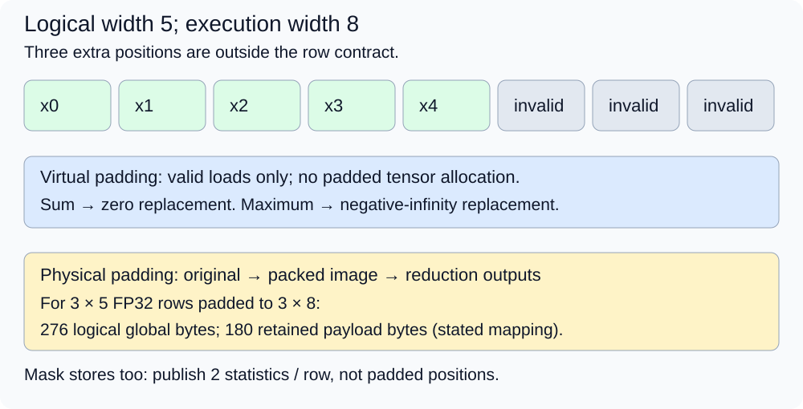
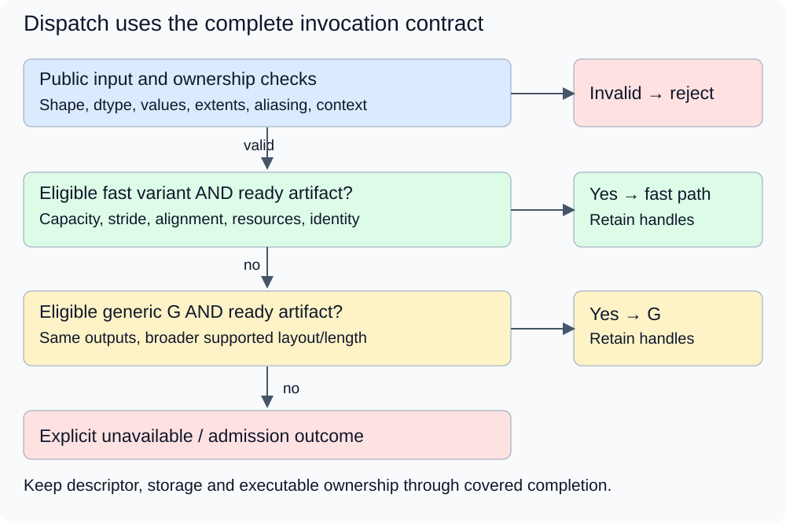

# M4-C10: Shape specialization, padding, and dispatch

> **Status: Complete — detailed chapter authored and documentation validated; experimental procedures are proposed unless explicitly labelled observed**

**Module:** Understand kernels and execution overhead

**Category:** [Kernels, compilers, and execution](index.md)

[Module 4 reading order](../module-4.md) · [Previous: M4-C09](m4-c09-register-pressure-occupancy-and-spills-in-kernel-design.md) · [Next: M4-C11](m4-c11-flashattention-as-an-io-aware-attention-algorithm.md) · [Execution plan and progress](../chapter-execution-plan.md)

## Target concepts

Shape families, strides and alignment, padding overhead, masked lanes, padded reduction identities, specialization count, dispatch guards, generic fallbacks.

## Concepts

### 1. A shape family is a promise about admissible inputs

A **shape** lists an array's dimensions. A matrix with R rows and N columns has R × N logical elements. A **shape family** groups invocations that can use the same execution strategy, such as rows with 1–32 columns, instead of preparing a separate executable for every N. A **specialized variant** is an executable whose preparation uses particular assumptions. A **generic fallback** is a validated, more broadly applicable execution path for valid inputs outside a specialized path's assumptions.

The mathematical operation remains the same across a family. Consider **row statistics**: for each row j, return both **S[j] = sum of X[j,k]** and **M[j] = maximum of X[j,k]**, over k = 0…N−1. This chapter's core contract accepts R = 1…257, N = 1…4096 and integer-valued FP32 inputs in [−16,16]. FP32 is 32-bit floating-point storage. Sum magnitude is at most 65,536, so every integer partial sum is exactly representable; maxima are exact as well. The finite-integer restriction deliberately isolates execution and layout changes from numerical approximation. General model values need their own justified numerical contract.

For R = 0, return two empty outputs without a device launch. For R > 0 and N = 0, reject the input: this contract does not define an empty-row maximum. NaNs (not-a-number values), infinities and unsupported formats are outside the contract, not silently ignored values. Input contents must be established by a trusted fixture or a validated upstream contract; checking metadata cannot prove that every element is finite. Any required content validation belongs in its declared end-to-end cost.

[Compilation and executable identity in M4-C04](m4-c04-compilation-specialization-and-the-warm-execution-path.md) are prerequisites. This chapter adds the runtime selection contract. Rust is the eventual host-engine context; CUDA or Triton defines the device boundary. No dispatch implementation, kernel body or pseudocode is provided.

### 2. Equal shapes can have different addresses

A **stride** is the distance between successive elements along an axis. Use element strides sr for rows and sc for columns here. For FP32 and byte address base:

**address(j,k) = base + 4 × (j × sr + k × sc).**

Some interfaces, including [NumPy's stride specification](https://numpy.org/doc/stable/reference/generated/numpy.ndarray.strides.html), express strides in bytes; convert explicitly rather than interpreting those values as element counts. Our accepted layouts use sc = 1 or 2 and sr ≥ (N−1)sc+1, so positive-stride rows do not overlap. The output arrays are contiguous, distinct from each other and disjoint from input storage. Checked address arithmetic and backing-allocation extents must cover every valid coordinate; a large shape number alone does not establish an accessible allocation.

For two rows of three elements, sr = 5 and sc = 1 select offsets [0,1,2] and [5,6,7]. Treating them as a packed matrix would wrongly select [3,4,5] for row 1. A transpose or sliced view may retain the same logical values while changing strides and eligibility. A layout conversion is a separate copy with lifetime and timing costs.

**Alignment** means that an address is a multiple of a required byte boundary. At base = 0x1000, row 0 is 16-byte aligned. With sr = 5, row 1 starts at 0x1014, which has remainder 4 modulo 16. With sr = 4 it starts at 0x1010 and is aligned. A view beginning four bytes after an aligned allocation is not itself 16-byte aligned. Hexadecimal addresses here are teaching labels, not real device pointers.

If an available fast variant requires 16-byte-aligned row starts, its eligibility must check both the view base and relevant row starts/stride. Four FP32 elements occupy 16 bytes, but a four-element vector load also needs four valid elements or a supported safe tail mechanism. Alignment alone cannot make a three-element row safe for an unguarded four-element read. [CUDA's memory-access guidance](https://docs.nvidia.com/cuda/cuda-c-best-practices-guide/index.html#coalesced-access-to-global-memory) supplies the architecture context; our 16-byte guard is a declared candidate contract, not a universal requirement for all kernels.

### 3. Padding has several different costs

**Padding** extends a computation or storage shape beyond its logical length. For N > 0, a next-power-of-two width is **P = 2 raised to ceil(log2 N)**. log2 is the base-two logarithm and ceil rounds upward to an integer. P is the smallest power of two at least N. Define:

**Valid-position fraction = N/P; extra positions = P−N; relative position overhead = (P−N)/N.**

These describe logical execution positions, not measured occupancy, useful lane issue time or DRAM traffic. SIMD means single instruction, multiple data; SIMT means single instruction, multiple threads. A lane is a position in such a parallel group; one logical Triton position need not be one physical thread. Compiler mapping and predication (conditional execution of instructions) determine actual executed instructions.

| Logical N | Power-of-two P | Extra positions | Relative position overhead |
|---|---:|---:|---:|
| 31 | 32 | 1 | 3.23% |
| 32 | 32 | 0 | 0% |
| 33 | 64 | 31 | 93.94% |
| 128 | 128 | 0 | 0% |
| 129 | 256 | 127 | 98.45% |
| 1025 | 2048 | 1023 | 99.80% |

A tiny length change can nearly double the logical width. Registers, shared memory and residency can then change discontinuously; apply [M4-C09's resource accounting](m4-c09-register-pressure-occupancy-and-spills-in-kernel-design.md) instead of assuming time scales with P alone.

**Virtual padding** supplies neutral values to nonexistent positions without allocating a padded tensor. **Physical padding** allocates and initializes additional storage, which may require packing and later unpacking. A **mask** is a true/false condition specifying valid positions. A correctly masked memory operation avoids an invalid access; computing an invalid load and masking its result afterward is insufficient. The [Triton load specification](https://triton-lang.org/main/python-api/generated/triton.language.load.html) says masked-off addresses are not loaded and warns that an omitted replacement value is undefined. The replacement must suit the consumer's reduction.

For a 3 × 5 FP32 input, raw payload is 60 bytes. A physical 3 × 8 image needs 96 bytes, and two row-statistic outputs need 24 bytes. In a stipulated pack-then-reduce mapping, packing reads 60 and writes 96 bytes; reduction reads 96 and writes 24 bytes: **276 logical global bytes**, versus **84 bytes** for one read of the original valid inputs and writes of the two outputs. Retaining original, packed and output payloads simultaneously takes **180 bytes**, versus **84 bytes** without the packed copy. These omit allocator padding, caches, transactions, addresses and host/device transfers. A physical zero-filled image still needs the proper max mask for negative rows; physical existence does not make padding part of the logical input.

*Five logical values can be processed in eight positions without publishing three extra outputs. Sum and maximum require different replacement values; packing adds a separate storage and movement boundary.*

### 4. A neutral value belongs to an operation

An **identity** is a value that leaves a reduction unchanged when combined with valid values. The correct replacement depends on the operation and its contract.

| Reduction or stage | Padded-position treatment | Required extra condition |
|---|---|---|
| Sum | Add zero | Count valid elements once; no duplicate reads. |
| Maximum | Use negative infinity, or exclude the position | At least one valid finite element under this contract. |
| Minimum | Use positive infinity, or exclude the position | Same nonempty requirement. |
| Product | Multiply by one | Overflow/underflow and general product precision need a separate contract. |
| Mean | Zero contribution to sum; zero contribution to count | Divide by valid count N, not padded width P. |
| Stable softmax | Invalid scores excluded; zero exponential mass | At least one valid finite score; publish only valid positions. |

For X = [−3,−2,−1] padded to four positions, sum is −6 and mean is −2. Dividing by four gives −1.5, which changes the operation. Zero is not a maximum identity: max(−3,−2,−1,0) = 0, while the valid maximum is −1. Zero padding also turns the product −6 into zero. These counterexamples are independent of any performance measurement.

For softmax, probabilities over valid positions are **p[k] = exp(x[k]−m) / sum over valid positions of exp(x−m)**, with m the valid maximum. Two valid zero scores yield [1/2,1/2]. Adding two zero-score padding positions to the denominator yields [1/4,1/4] for the two published outputs: their sum is 1/2, not 1. Negative-infinity score padding contributes zero exponential mass when the valid maximum is finite. An all-masked row must be handled before subtracting negative infinity from itself; our contract rejects empty reductions rather than assigning a fabricated distribution. [Triton's fused-softmax technical tutorial](https://triton-lang.org/main/getting-started/tutorials/02-fused-softmax.html) illustrates masked row padding and its row-resource limit. Its approximate exponential path requires numerical verification; no tutorial speedup is inherited.

Means, products and softmax are separate paper probes here, not extra outputs added silently to the row-statistics benchmark. Padding a causal attention row or vocabulary must preserve the valid-token set and its meaning; this chapter does not add new model tokens or authorize replacing a model's attention mask.

### 5. Dispatch proves eligibility before choosing speed

**Dispatch** selects an executable for one invocation. A **guard** is a condition that must hold for a candidate to be eligible. Distinguish public validity from specialized eligibility: an invalid address range must be rejected, while a valid unusual stride can use a supported fallback.

Use this declared policy for the row-statistics study. The generic candidate G supports all accepted layouts and lengths in Section 1–2 with bounded tiled execution. Four fast capacities are 32, 128, 512 and 1024. Length classes are 1–32, 33–128, 129–512 and 513–1024; N stays runtime data. Specialized F32/F128/F512/F1024 require sc = 1, base and row stride byte-aligned to 16, disjoint outputs, the supported FP32 numerical contract, correct target/context, checked extents and legal resources. Each needs a complete, ready artifact. A fast capacity is an execution assumption, not the output length. These coarse capacities are chosen to compare policy cost, not asserted as Triton's automatic specialization behavior.

| Invocation state | Declared route | Reason |
|---|---|---|
| R = 2, N = 33, sc = 1, sr = 36, aligned view, ready F128 | F128 | Valid input and all specialized guards pass. |
| Same logical values, sr = 35 | G | Row stride is 140 bytes, failing the fast alignment guard. |
| R = 2, N = 33, sc = 2, sr = 68 | G | Valid nonoverlapping column-strided input. |
| N = 1025 with valid layout/extents | G | Beyond the largest fast capacity, within the public limit. |
| Eligible N = 33 but F128 unavailable | Ready G | A missing fast artifact does not invalidate the input. |
| Short backing allocation or overlapping output | Reject | The public safety contract fails. |
| R > 0, N = 0 or nonfinite real input | Reject | The mathematical contract fails. |
| R = 0 with otherwise valid empty metadata | Empty success | No device operation or variant preparation required. |

G must itself be prepared, validated and compatible with this invocation. If no eligible ready path exists, return an explicit unavailable/error outcome according to the surrounding admission policy. Do not reinterpret a known-invalid input as “generic.” Do not catch an asynchronous device fault and blindly relaunch through G in a possibly damaged context. A safe fallback handles an eligibility/preparation miss before launch; fault recovery requires separately validated context and state recovery.

A descriptor is the metadata describing an invocation and its storage; a device context is the execution environment owning its device resources. A guard decision and launch must use the same immutable descriptor snapshot, including view offset, strides, lengths, extents and storage identity. Another owner must not resize or release the input after validation. Retain input/output storage and executable handles until all dependent work completes; cancellation suppresses publication but does not make those resources immediately reusable. Changing which variant is preferred for future requests cannot invalidate in-flight users of the old one.

*Reject invalid work, select only an eligible ready executable, and preserve ownership through completion. Fallback is a validated path with a wider contract, not a promise that every input or fault can be recovered.*

### 6. More specialization has a preparation budget

An exact-N policy can create many keys. The coarse policy above has four fast shape classes plus G when all other compile-time choices are fixed; actual emitted artifacts must still be counted. A hypothetical expanded catalog with four widths, two dtypes, two layouts, two device targets and three warp choices has **4 × 2 × 2 × 2 × 3 = 96 possible combinations**, excluding a separate fallback. This catalog is a cardinality example; it does not broaden this chapter's FP32 contract. Unsupported combinations, backend-specific specialization and retained generations change the actual count. [Triton's JIT specification](https://triton-lang.org/main/python-api/generated/triton.jit.html) distinguishes specialization controls; pin the installed compiler rather than guessing its cache key.

At a constructed 192 KiB per artifact, 96 artifacts occupy **18 MiB**, while an 8 MiB artifact budget holds only **42** such artifacts before metadata. KiB and MiB mean 1,024 and 1,048,576 bytes. Keep disk artifacts, loaded modules, compilation workspace and tensor storage separate. Bound preparation concurrency, variant count and retained bytes; cap exhaustion should use a ready eligible G or an explicit admission outcome, not unbounded compilation on the request path. [M4-C04](m4-c04-compilation-specialization-and-the-warm-execution-path.md) explains readiness and cache-layer identity.

For a constructed serial cost model, let generic warm work take 10 microseconds plus 0.5 microseconds dispatch; specialized warm work takes 6 plus 1 microsecond dispatch and needs 20 milliseconds extra preparation. A microsecond is one millionth of a second; a millisecond is 1,000 microseconds. The per-call saving is **10.5−7 = 3.5 microseconds**. For H invocations, recovery needs **H × 3.5 > 20,000**, so the first strictly positive saving occurs at **H = 5,715**. If packing adds four microseconds to every specialized call, its warm total is 11 and it never recovers the extra preparation under this model. Costs are stipulated with no overlap or queueing; actual batching and reuse can change them.

Specialize based on observed useful work and reuse, with held-out evaluation shapes and a safe bounded policy for unseen inputs. HFT offers the systems concern of predictable critical-path work and bounded preparation under bursts. A kernel dispatch class is not a trading signal, exchange order type or guarantee of financial outcomes. Text generation and market-event processing retain their own semantics.

### Target-concept coverage

| Target concept | Explanation and experiment/verification |
|---|---|
| Shape families | Sections 1/5 define public/fast domains; E1/V1 compares fine and coarse capacities. |
| Strides and alignment | Section 2 derives addresses; E3/V3 checks view/stride/extent guards. |
| Padding overhead | Section 3 counts positions, physical payload and movement; E1/V1 measures matched paths. |
| Masked lanes | Sections 3–4 separate safe access and arithmetic participation; E2/V2 checks tails and canaries. |
| Padded reduction identities | Section 4 works wrong-result cases; E2/V2 validates each operation separately. |
| Specialization count | Section 6 counts possible/actual variants and preparation budgets; E4/V4 tracks cold/warm cost. |
| Dispatch guards | Section 5 defines eligibility and descriptor ownership; E3/V3 exercises each boundary. |
| Generic fallbacks | Sections 5–6 require ready compatible G; E3/E4 and V3/V4 check misses, budgets and failures. |

## Experiments

All four experiments are proposed, through Module 4's execution-overhead lens. Paper/reference phases require no GPU. Device phases require independently available, reviewed candidate binaries and a harness; none is implemented here. If those prerequisites are absent, record the device phases as unexecuted rather than infer measurements from arithmetic.

### E1 — Compare shape families and padding cost

- **Description:** Compare generic tiled row statistics, per-N specialization and the four coarse capacity classes on identical valid inputs.
- **Purpose/objective:** Test whether fewer variants and larger execution widths improve completed work after their costs are included.
- **Target concepts:** Shape families, padding overhead, specialization count and resource cliffs.
- **Hypothesis and prediction:** Coarse classes reduce possible shape keys but can waste more logical positions; a smaller key set does not establish a lower caller cost.
- **Baseline and independent variable:** Ready G is baseline; change only selection/shape policy for equivalent candidates. Compare virtual and physical padding in a separate controlled comparison, including pack/unpack if used.
- **Workload and reference:** R in {1,7,257}, N in {1,31,32,33,127,128,129,511,512,513,1024,1025,4096}, fixture versions e = 0…3. Define logical X[j,k] = ((11j+7k+e) mod 33)−16. Use sc = 1, sr = 4 × ceil(N/4), aligned allocation. Independently compute exact integer sum/max for each row. N > 1024 routes to G in the coarse policy. Empty and invalid cases belong to E3, not successful timing samples.
- **Controlled variables and procedure:** First calculate P and coarse capacity for each N, then count keys. Check every output before timing. Preserve target, arithmetic mode, numerical reference, cache policy, row mapping and launch settings within each pair; record unavoidable compiled differences. Warm each candidate, run balanced pairs under V1, and profile cases around 32/33, 128/129 and 1024/1025. Separately time packing, reduction and complete caller-ready output for any physical-copy path.
- **Hardware/software and HFT connection:** FP32 CUDA device, supported row candidates and event timing; record the full manifest below. HFT concern: a small workload change can cross a resource/preparation threshold, but no GPU position count predicts a market-event tail.
- **Exit criteria and expected failures:** Exact sum/max equality, complete output coverage and valid memory/lifetimes precede comparisons. Publish per-shape results, key counts and inconclusive/regressing cases. Reject omitted pack cost, nonexistent fast capacities or a fake win from dropped valid elements. Verify with V1.

### E2 — Prove the identity and tail contract

- **Description:** Test arithmetic participation and access masks independently across padded reductions.
- **Purpose/objective:** Falsify a universal zero-padding rule and distinguish correct values from safe memory access.
- **Target concepts:** Masked lanes, padded reduction identities and logical versus physical padding.
- **Hypothesis and prediction:** Zero works for sum but fails negative maxima, products and valid-count means; score padding must contribute zero softmax mass.
- **Baseline and independent variable:** Unpadded integer references and independent high-precision softmax are baselines. Change one replacement/count rule or tail-access condition at a time in reviewed diagnostic candidates; wrong-result paper probes need no device code.
- **Workload and reference:** Use [−3,−2,−1] padded to four, two zero logits padded to four, and E1's corpus for sum/max. Include all-negative rows, a maximum in the final valid element, and one-hot coordinate probes. Test N = 31/32/33 and 127/128/129. Empty/all-masked rows are rejected before reduction. Nonfinite values in valid input fail this contract; diagnostic NaN sentinels in addressable padding must remain outside logical arithmetic.
- **Controlled variables and procedure:** Derive exact identity/counterexample outputs first. Then validate loads, neutral replacements and stores separately; inspect canaries around output and input padding and run appropriate access/synchronization diagnostics outside timing. Compare virtual padding with a physical image containing sentinel tails, using identical valid coordinates. For softmax use its own declared numerical budget in V2; do not add it to sum/max timing totals.
- **Hardware/software and HFT connection:** Paper arithmetic or separately reviewed diagnostic kernels, high-precision reference and memory-tool support. HFT concern: unused capacity must not become an extra event in a calculation; GPU masking and order-book membership have different protocols.
- **Exit criteria and expected failures:** All sum/max references and sentinel/guard checks pass; deliberate wrong identity/count probes are detected. Mean, product and softmax paper outputs match Section 4. A clean canary alone is not proof of safe reads. Invalid loads, unexpected nonfinite arithmetic and published padded outputs fail. Verify with V2.

### E3 — Audit eligibility and safe fallback

- **Description:** Exercise each public validity, layout, artifact and resource guard, with a deterministic expected route.
- **Purpose/objective:** Establish that valid out-of-family work preserves behavior and invalid work never reaches an unsafe candidate.
- **Target concepts:** Strides and alignment, dispatch guards, generic fallbacks and descriptor ownership.
- **Hypothesis and prediction:** Equal shapes with different view offsets or strides can need different routes; an eligible-but-unready fast variant should use ready G without changing outputs.
- **Baseline and independent variable:** Always-G execution for valid descriptors; dispatcher route ledger for valid/invalid descriptors. Change one guard at a time while preserving valid logical values whenever possible.
- **Workload and reference:** Reproduce all eight route-table cases. For R = 2, N = 33, add base offsets of zero/four bytes, sc = 1/2, sr = 36/35/68, N = 1024/1025, wrong dtype/target/context, short extents, aliased outputs, stale descriptor generation and unavailable G/F artifacts. When varying N, enlarge sr and backing extents to remain valid; layout/extent failures are separate cases. Distinguish unsupported valid device layout from malformed metadata. Output values for valid routes must match the same logical reference.
- **Controlled variables and procedure:** Freeze operation identity and input contents; independently enumerate addressed coordinates. Record public validation result, each fast guard, chosen artifact and readiness before launch. Test concurrent cancellation after submission and variant retirement while another invocation still owns its handle. An immutable validated snapshot must survive these events. Report intentional rejections separately; validate prelaunch fallback and explicit no-ready-path outcome without injecting unsafe memory operations into performance trials.
- **Hardware/software and HFT connection:** Paper route audit plus an existing host/device integration that can expose routing/handle identities; missing candidates leave device checks pending. HFT concern: stale metadata and state reuse can invalidate a fast path; no exchange retry or recovery semantics are assumed.
- **Exit criteria and expected failures:** Every case has the specified route or documented explicit rejection/unavailable outcome; valid G/F outputs agree, no stale result publishes after cancellation, and in-flight resources remain retained. Wrong alignment, unchecked overflow/extent, stale snapshots or blind retry after device fault fail. Verify with V3.

### E4 — Bound specialization and measure complete request cost

- **Description:** Compare fine/coarse dispatch policies under repeated and changing shapes, then carry one eligible policy into an already validated generator if available.
- **Purpose/objective:** Test whether warm savings justify preparation/storage and survive unseen shapes and request boundaries.
- **Target concepts:** Specialization count, generic fallbacks, shape families and dispatch overhead.
- **Hypothesis and prediction:** A policy can win warm and lose cold or under variant churn; a ready fallback bounds preparation work only if it is itself eligible and available.
- **Baseline and independent variable:** Same reviewed G with same external workload; change only dispatch/catalog policy. Freeze any cap and admission settings. Actual preparation behavior must be observed rather than inferred from distinct key counts.
- **Workload and reference:** Fixed shape trace N = [31,32,33,127,128,129,511,512,513,1024,1025], R = 7, epoch e = 0, sc = 1, sr = 4 × ceil(N/4) and an aligned view; repeat this order 100 times per run. Compare exact-N keys, coarse F keys plus G, and always-G, separating initially absent fast artifacts, persistent hits and exercised variants under M4-C04. G is prepared before every measured trace; its common preparation cost is reported separately. The unbounded exact policy has 11 distinct shape keys plus pinned G; coarse routing uses five including G. Replay a separate shuffled order with archived seed/permutation for evaluation, never tune on it. A catalog cap of five entries is a declared separate intervention; preserve a ready G outside any four-entry fast budget.
- **Controlled variables and procedure:** Record actual misses, compilations, loads, waits, evictions, fallback and outcomes, plus disk/loaded/workspace bytes. A missing fast artifact routes the invocation to G. Any catalog preparation occurs separately with at most one build in flight and four pending keys; a full preparation queue keeps using G without admitting more build work. Hold these preparation limits fixed across policies. Record preparation completion/drain separately from caller completion; do not insert a synchronous fast build into this routing contract. Use isolated experimental caches and name every uncontrolled cache layer. Test an unavailable fast artifact and exhausted fast budget before timed runs. Measure ready-input arrival through caller-ready sum/max, including dispatch, preparation, conversion, device completion and required readback. Separate one operation in flight from independent offered-arrival load. If a generator bridge exists, qualify actual operator semantics and model numerics before substituting a variant; use the V4 request protocol rather than equating synthetic stats with a model operator.
- **Hardware/software and HFT connection:** Existing candidates, compiler/cache observability and host timing; optional generator requires compatible operator integration, fixed text/model/tokenizer and independently scheduled arrivals. HFT concern: bounded first-use work and bursts of unusual events; compilation caches are not model KV caches or exchange state.
- **Exit criteria and expected failures:** References and safe fallback pass; budgets and all outcomes reconcile; publish cold/warm totals, per-invocation distributions and actual artifact counts. Validate the 5,715-call constructed break-even separately. No unbounded request-path preparation or speed claim based only on a warm kernel minimum. Generator results remain pending without a qualified integration. Verify with V4.

## Verification

### Shared reference and timing rules

Use completed [M9-C01](../numerics-and-correctness/m9-c01-defining-reference-behavior-and-evidence-before-optimizing.md) for explicit inputs/outputs and invalid cases. E1's bounded integers permit exact FP32 sum/max checks across reduction groupings. For arbitrary deployed model values, use [M9-C17](../numerics-and-correctness/m9-c17-comparing-logits-with-justified-numerical-tolerances.md): justify numerical budgets from the reference, format and decision margin before measuring speed. Every valid coordinate must contribute once; both outputs must be complete. No stochastic sampling is introduced.

For a warm isolated operation, use one in flight on a named stream. Ordered device events span the first needed device stage through completion of both outputs, including any packing and cross-stream joins. Report packing, core and whole-chain intervals separately without adding overlapping intervals twice. A host monotonic ready-input → caller-ready boundary includes selection, waits, required preparation/conversion and readback. Compilation, load, first exercise and exercised-variant execution remain separate cohorts. Timestamp meanings follow completed [M9-C02](../measurement-experimentation-and-economics/m9-c02-request-events-clocks-and-measurement-boundaries.md).

For warm E1 pairs, complete 20 excluded warmups per binary/shape, then start five independent paired runs of 100 observations per variant, alternating AB/BA order and reversing the initial order on a repeat. This is an initial precision budget. Record individual observations and use run-paired effects/uncertainty; correlated operations are not independent experimental runs. If a very short operation needs a 100-invocation ordered batch, its interval divided by 100 is an amortized cost, not an individual latency distribution. Predeclare a 2% relative run-median spread screen, (maximum minus minimum)/median; if exceeded, investigate operating state or add independent runs; report inconclusive if instability remains. This chosen precision screen establishes no universal speed threshold.

Under [M9-C07](../measurement-experimentation-and-economics/m9-c07-latency-distributions-and-statistical-uncertainty.md), preserve slow/failing/censored outcomes and sample counts. Small differences within uncertainty are inconclusive. Record final resource reports and profile selected cases outside timing trials with [M9-C12](../measurement-experimentation-and-economics/m9-c12-reading-cpu-gpu-timelines-and-scheduling-gaps.md) and [M9-C13](../measurement-experimentation-and-economics/m9-c13-using-kernel-profilers-to-explain-hardware-bottlenecks.md). Preserve metric scope, replay/cache policy and instrumented overhead; unsupported counters are unavailable evidence, not zeroes.

### V1 — Reconcile positions, traffic and completion

For every E1 case, calculate next-power-of-two P and coarse-policy capacity separately: N = 129 uses P = 256 in the fine power-of-two model but capacity 512 in our coarse policy. N = 1025 has P = 2048 yet routes to G, not an invented F2048. Count useful logical elements, execution positions and physically allocated elements independently. Check the six overhead rows and the 3 × 5 movement/payload calculation. These are arithmetic checks, not measured bandwidth or occupancy.

Build integer sum/max references from logical coordinates, then compare both outputs for every variant. Preserve layout and output identity. Under a separate 64 MiB host fixture/reference budget and 64 MiB device fixture/output budget, retain one case at a time. Largest logical FP32 input is 257 × 4096 × 4 = 4,210,688 bytes and both outputs take 2,056 bytes, total **4,212,744 raw bytes** for the stipulated aligned layout. Packing retains an additional image and allocation overhead; explicitly budget it under [M9-C15](../state-memory-and-caching/m9-c15-accounting-for-weights-kv-state-workspace-and-fragmentation.md). The raw bound excludes allocator, executable, profiler and driver state.

Compare correct useful rows per completed time, per-shape latency and caller cost. Profile final registers/shared/local bytes, actual memory-interface demand and achieved progress around thresholds; larger logical widths need not cause proportional traffic or time. Publish physical-copy preparation cost and retained capacity even when its core kernel is faster. E1 has no required speedup: a correct, reproducibly explained regression is an informative outcome.

### V2 — Validate arithmetic participation and safe access separately

Check exact sum −6, maximum −1, product −6 and mean −2 for the negative fixture; wrong zero maximum, zero product and padded mean −1.5 must be detected. For the two-zero softmax, an independent high-precision reference gives exactly 1/2 at each valid position; wrong padding gives 1/4. For a nonuniform additional probe [−2,−1,0], generate shifted probabilities at 80 and 120 decimal digits; require reference agreement within 10 to the power −70. For a proposed FP32 candidate, use an illustrative preregistered per-coordinate absolute screen of 10 to the power −6 and valid probability-sum error at most 3 × 10 to the power −6 for this three-position probe. The sum bound follows three coordinate budgets; these are teaching acceptance choices for this probe, not universal model tolerances or guarantees of an approximate exponential implementation.

Place the maximum at both row ends in separate probes. A single selected valid coordinate set to 1 among zeros gives sum/max 1 for its row; all-zero other rows give sum/max 0. Test first/last and tile-edge coordinates and distinct row markers to expose misplaced ownership. Fill allocated gaps and tails with distinctive sentinels, including a separately labeled NaN-tail diagnostic, while leaving logical inputs finite. Vary sentinels without changing expected outputs. Unchanged canaries detect some writes but cannot establish that forbidden reads were absent. Use access tools and path review, keep diagnostics outside timed populations, and record the limits of each tool. Empty, invalid and guard-failed cases do not contribute zero-duration success observations.

### V3 — Reconcile descriptor, route and lifetime

Independently enumerate every byte address for E3's accepted descriptors. Verify bounds, nonoverlapping rows/output regions, alignment classes, integer-overflow rejection and selected capacity. Record whether stride units are bytes or elements. The row-1 starts 0x1014 versus 0x1010 and shifted view 0x1004 must yield the stated alignment distinctions. Test each guard separately and include combined failures to ensure one passing condition cannot mask another failing condition.

For valid out-of-family invocations, compare G to the same logical integer reference, including non-unit column strides and rows with gaps. For unavailable artifacts, record ready G selection or explicit unavailability before any device access; a fallback hit rate without correct outputs is insufficient. Track descriptor generation/storage identity, artifact generation, context and covered completion. During cancellation or retirement, check that publication stops as required while in-flight users still hold storage/handles. A reporting timeout does not authorize their reuse. Malformed descriptors are rejected without dangerous launch; diagnostics do not intentionally dereference an invalid pointer to prove host validation.

Measure dispatch/guard CPU time independently and within the full operation boundary. A profile of one fast launch cannot establish the cost of the path that selected or prepared it. If guard observability changes timing, preserve that diagnostic evidence separately and confirm uninstrumented full-path behavior. Wrong target/context, failed preparation and explicit fallback outcomes remain in the trial ledger.

### V4 — Validate budgets and useful end-to-end work

Reproduce cardinality 96, payload 18 MiB, 8 MiB capacity 42 and the 5,715-call break-even; these are constructed models. For actual traces count requests, unique declared keys, emitted artifacts and ready handles separately. Five cold-fast-catalog repetitions per policy start from the same named cache state in fresh processes with G prepared; this is not a claim that every cache layer or G is cold. Five exercised repetitions per policy warm all eligible paths and drain before measurement. Each measured trace has 1,100 invocations; cold results cannot be merged with warm results. Report whole-trace cost, each invocation's completion time, preparation episodes and retained/peak bytes. Trace order and distribution shift are experimental variables, not noise to discard. Missing or inaccessible cache state narrows the claim.

For an optional qualified generator, freeze model/weights/tokenizer, dtype, greedy/stopping rules, prompt hashes and operator mapping; first compare same-prefix operator results and logits, then exact greedy/terminal behavior. Select prompt lengths 32/128 and output caps 8/32 with 100 requests per combination per run. Cycle the four combinations in a fixed archived order. Compare spaced arrivals every 100 ms with ten arrivals at each whole second for 40 seconds, 400 requests per trace. Preserve intended arrivals when backlog grows and record actual-send lag; this is independent offered load, not a loop waiting for the previous completion. After 20 excluded warmup requests per combination and drain, begin five independent paired runs per trace/variant, balancing policy order. Keep first-use/cold studies separate.

Record arrival-to-first-token, token-delivery gaps, arrival-to-terminal time and useful completed output, under fixed finite admission/memory and preparation budgets. Count rejection, cancellation, timeouts, failures and unfinished attempts explicitly. Drain up to 60 seconds after the final scheduled arrival, label unfinished work at cutoff and follow safe recovery before reclamation. Five runs give 2,000 attempts per trace/variant, nominally about 20 beyond p99 only if all have the relevant metric; within-burst/token correlation limits independence. Preserve run-level uncertainty and eligible sample counts, never average run p99s into a pooled p99. Predeclare actual service budgets and acceptable regressions; absent such requirements or adequate evidence, report measurements without production acceptance. No synthetic row-statistics result alone qualifies a model integration.

## Engineering dimensions and principles

| Dimension | Application within this chapter |
|---|---|
| Semantics and invariants | E2/V2 preserves valid-set arithmetic; E3/V3 distinguishes invalid input from a valid fallback case. |
| Workload and variability | Boundary lengths, layouts and shape reuse alter widths/keys; E4 changes order and arrival bursts. Record prefix reuse/skew that changes the mix. Non-text modalities and Module 8 are excluded. |
| Resources and bottlenecks | E1 counts positions and packed movement; E4 bounds artifacts, loaded state, workspace and host preparation. CPU dispatch can dominate small device work. |
| Time and distributions | Preparation, packing and joins belong to the critical path when exposed; V1/V4 separate warm, cold and request distributions. |
| Ownership and coordination | E3 holds one immutable descriptor snapshot and retains buffers/executable handles through covered completion, including cancellation. |
| Failure and adaptation | Missing fast artifacts use only eligible ready G; invalid metadata rejects; preparation caps and device-fault recovery have explicit outcomes. |

| Practical engineering principle | Application and evidence |
|---|---|
| 1. Correctness defines the optimization boundary | Shape policy preserves outputs; invalid padding identities fail before any timing. E2/V2. |
| 2. Performance depends on workload and operating point | 32/33 and 128/129 cross width boundaries; reuse and arrival mix change payoff. E1/E4. |
| 3. Data movement is part of the algorithm | Physical padding adds packing and retained copies; logical masked positions are not DRAM bytes. E1/V1. |
| 4. State has ownership, lifetime and recovery cost | Descriptor/artifact generations and in-flight buffer retention survive policy changes and cancellation. E3/V3. |
| 5. Dependencies determine latency; bottlenecks determine capacity | Faster core work can lose after packing/dispatch; bounded preparation competes with useful service. E4/V4. |
| 6. Variability and synchronization shape the tail | Unseen shapes, artifact misses and bursts require outcome-aware distributions and safe drain. V4. |
| 7. Local improvements must be evaluated end to end | Measure both outputs caller-ready and qualify actual model operation before generator claims. V1/V4. |
| 8. Claims require reproducible evidence | Preserve guards/routes, binaries, trace order, cache states, reference probes and profiler conditions. V1–V4. |

## Specifications, articles, and hardware

Primary sources checked on 2026-10-27. Pin installed versions/revisions for a future device study; live documentation does not identify a local binary.

| Specification or technical article | Application and limit |
|---|---|
| [Triton load specification](https://triton-lang.org/main/python-api/generated/triton.language.load.html) | Masked access and explicit replacement semantics; no missing replacement may be assumed neutral. |
| [Triton fused-softmax tutorial](https://triton-lang.org/main/getting-started/tutorials/02-fused-softmax.html) | Technical article on padded rows, masks and finite on-chip resources; neither its exponential accuracy nor speed transfers automatically. |
| [Triton JIT specification](https://triton-lang.org/main/python-api/generated/triton.jit.html) | Specialization/alignment controls; actual emitted artifacts require observation at a pinned version. |
| [NumPy 2.5 stride specification](https://numpy.org/doc/stable/reference/generated/numpy.ndarray.strides.html) | Byte-stride convention; this chapter explicitly converts to element-stride address formulas. |
| [CUDA Best Practices Guide 13.4](https://docs.nvidia.com/cuda/cuda-c-best-practices-guide/index.html) | Memory-access and resource context; declared alignment guards describe particular candidates. |
| [Nsight Compute profiling guide](https://docs.nvidia.com/nsight-compute/ProfilingGuide/index.html) and [Compute Sanitizer](https://docs.nvidia.com/compute-sanitizer/ComputeSanitizer/index.html) | Future counter/replay and access diagnostics, with separate timing and tool-coverage limits. |

| Hardware/software record | Required evidence |
|---|---|
| Device and limits | Model, compute capability, visible SMs/partition, memory capacity, register/shared limits and allocation granularity, legal block/grid dimensions. No GPU benchmark machine is assumed. |
| Executable boundary | Rust host/toolchain, CUDA/Triton/runtime/driver and compiler revisions, binary/source hash, arithmetic options, actual constants/tiles/warps/stages and dispatch-policy version. |
| Descriptor and eligibility | Shape, byte/element stride units, view base/offset, backing extents, alignment, aliasing, storage/context generation and readiness/selected guard results. |
| Preparation and state | Artifact/cache-layer identity, isolated cache controls, catalog/byte/workspace limits, loaded handles, clocks/power/thermal/co-tenancy and profiler permissions/replay/cache policy. Apply completed [M9-C16](../hardware-architecture-and-topology/m9-c16-recording-hardware-conditions-that-change-measurements.md). |
| Reference and workload | Fixture/trace hashes, invalid-case outcomes, exact and numerical budgets, warmups/trials, memory/admission caps, optional model/tokenizer identities and recovery/drain policy. |

## What to carry forward

A specialized executable is useful only for inputs satisfying its whole contract. Preserve logical membership through padding, prove layout and lifetime guards, and compare the complete path against a ready validated fallback before expanding the variant catalog.

Next in Module 4 reading order is the completed [M4-C11: FlashAttention as an IO-aware attention algorithm](m4-c11-flashattention-as-an-io-aware-attention-algorithm.md). The next authoring chapter is [M4-C17](../kernels-compilers-and-execution/m4-c17-designing-a-fused-normalization-kernel.md). Follow the [execution plan and progress tracker](../chapter-execution-plan.md) for chapter acceptance.
