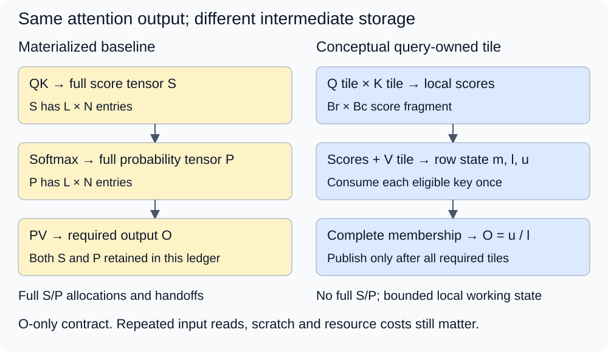
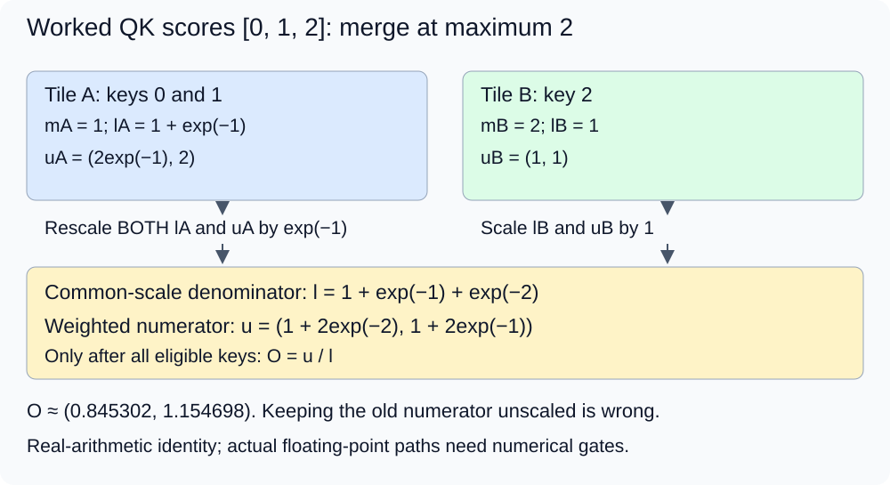

# M4-C11: FlashAttention as an IO-aware attention algorithm

> **Status: Complete — detailed chapter authored and documentation validated; experimental procedures are proposed unless explicitly labelled observed**

**Module:** Understand kernels and execution overhead

**Category:** [Kernels, compilers, and execution](index.md)

[Module 4 reading order](../module-4.md) · [Previous: M4-C10](m4-c10-shape-specialization-padding-and-dispatch.md) · [Next: M4-C12](m4-c12-distinguishing-flashattention-pagedattention-and-prefix-caching.md) · [Execution plan and progress](../chapter-execution-plan.md)

## Target concepts

Tiled QK and value aggregation, online softmax, HBM versus on-chip storage, avoiding full attention-matrix materialization, mathematical exactness versus floating-point differences, quadratic full-attention arithmetic.

## Concepts

### 1. Keep the attention contract while changing its evaluation

**Attention** returns a weighted combination of value vectors for each query. **IO-aware** means choosing the computation with transfers between memory levels in mind. On the discrete-GPU model, **HBM** is high-bandwidth device memory; registers and shared memory provide much smaller on-chip working storage. A cache can satisfy some accesses without HBM traffic, so a logical global-memory read is not automatically a measured HBM transfer.

For one request and head, Q has L query rows and d features; K has N key rows and d features; V has N rows and D value coordinates. For query i and eligible key j:

**x[i,j] = (sum over t of Q[i,t]K[j,t]) / sqrt(d).**

**p[i,j] = exp(x[i,j]−m[i]) / sum over eligible k of exp(x[i,k]−m[i]).**

**O[i,c] = sum over eligible j of p[i,j]V[j,c].**

m[i] is the maximum eligible score. sqrt is square root, exp is the natural exponential, t indexes features and c indexes value coordinates. Requests and heads have independent copies of this calculation. The output contract here requests O only, not the full probability matrix. Inputs are finite, feature widths positive, and every requested query has at least one eligible key. Empty query collections return empty output without launch; a requested row with no eligible key is rejected before publication. Dropout, a training technique randomly removing contributions, is disabled. No backward pass is studied.

For causal text generation, eligibility uses absolute positions: key_valid[j] AND kpos[j] ≤ qpos[i]. In full-prefix self-attention, qpos and kpos both run from 0 to N−1. A suffix query's local row zero can instead represent position N−2 or N−1. Position transformations, including any rotary encoding, must already be applied consistently to Q/K. Scaling, masks, value pairing, head mapping and positions belong to the contract; faster execution cannot silently change them.

The [original FlashAttention paper, v2](https://arxiv.org/html/2205.14135v2) organizes attention around tiled computation and reduced HBM transfers. This chapter explains forward inference through a conceptual query-owned schedule, not a claim that all published versions use the same loop order. Rust remains the host context with an independently reviewed CUDA/Triton boundary. No kernel, host implementation or pseudocode is supplied.

### 2. The full score matrix is an intermediate, not always an output

A **materialized** intermediate is written into an addressable tensor retained for a later stage. A declared baseline forms all L × N scores S, normalizes them into a separate L × N probability tensor P, then multiplies P by V. This is easy to inspect but can transport large temporary arrays through global memory. If scores and probabilities each use four-byte FP32 storage, their combined payload is **8LN bytes**. Writing and reading each once creates **16LN logical intermediate bytes**, before any extra normalization scans or input/output movement.

For square full attention L = N, the following constructed ledger retains distinct S and P until O completes. It is one explicit baseline, not the unavoidable peak of every library implementation.

| N, with d = D = 64 | S + P payload | S/P write-and-read demand | Dense core arithmetic |
|---|---:|---:|---:|
| 1024 | 8 MiB | 16 MiB | 268,435,456 FLOPs |
| 2048 | 32 MiB | 64 MiB | 1,073,741,824 FLOPs |
| 4096 | 128 MiB | 256 MiB | 4,294,967,296 FLOPs |

MiB means 1,048,576 bytes. A FLOP is a floating-point operation under a counting convention. Counting each multiply-add as two operations gives **Fcore = 2LN(d+D)**, or **4N²d** when L = N and d = D. This omits exponentials, maxima, normalization, masks and address work. Exact dot arithmetic can have a different count; the convention is for comparing the same useful core work.

FP16 uses two bytes per stored value. At N = 4096, FP16 Q/K/V/O with d = D = 64 contain 2 MiB combined, while separate FP32 S/P contain 128 MiB. Allocating all these arrays simultaneously gives **130 MiB of retained payload**, excluding allocator, workspace and executable costs. Reusing storage or releasing intermediates earlier changes the actual peak. A tiled O-only path removes the full S/P allocations, but still needs inputs, outputs and bounded working state. Requesting all attention probabilities restores an L × N output requirement; an algorithm cannot eliminate a required public output.

*The tiled path consumes score fragments while they are local and retains a weighted summary. It does not retain the full probability matrix for later inspection.*

### 3. A tile joins score computation directly to value aggregation

A **query tile** contains Br query rows; a **key tile** contains Bc key/value rows. Their score fragment has Br × Bc entries, produced by multiplying a Br × d Q fragment with a d × Bc transposed K fragment. Each score row is masked using the original logical positions. Its weights then combine the matching Bc × D V fragment into Br × D weighted accumulators.

For a conceptual query-owned schedule, a query tile and its row summaries remain available while key/value tiles are consumed. Each query row must visit every eligible key exactly once. After the final tile, normalize its weighted accumulator and publish its D-coordinate output. Different query tiles can proceed independently subject to resource and scheduling limits; key tiles within one summary have an update dependency. Splitting a row across multiple workers requires correctly merged partial summaries and additional storage/joins, not an uncoordinated sum of normalized outputs.

**On-chip capacity is finite.** Consider a declared simultaneous array-payload ledger with input element size s bytes: Q tile Brd, K tile Bcd, V tile BcD; FP32 weighted numerator BrD; one reused FP32 score/weight fragment BrBc; and FP32 maximum/normalizer plus a four-byte member count per row. Its payload is:

**Wtile = s[Brd + Bc(d+D)] + 4BrD + 4BrBc + 12Br bytes.**

At Br = Bc = d = D = 64 and s = 2, this is **58,112 bytes = 56.75 KiB**. Double-buffering K/V, meaning retaining current and next fragments concurrently, adds 16,384 bytes for **72.75 KiB**. Separate score and weight fragments would add another 16 KiB. KiB means 1,024 bytes. This is a declared array ledger, not a physical shared-memory allocation: compiler lowering, the translation into target operations, distributes state among registers/shared storage and adds addresses, predicates, alignment, barriers and other state. Some implementations do not store a member count explicitly. Use actual resource reports and occupancy limits from [M4-C09](m4-c09-register-pressure-occupancy-and-spills-in-kernel-design.md).

Removing S/P does not mean reading K/V once globally. For the illustrative noncausal query-owned mapping, N = 4096 and Br = 64 give 64 query tiles. Each scanning FP16 K and V with d = D = 64 has 1 MiB logical input demand; 64 scans request 64 MiB, plus 0.5 MiB Q reads and 0.5 MiB O writes, or **65 MiB** under this simplified mapping. Caches, tile reuse, partial-state spills and different loop orders change measured traffic. “No full attention matrix” and “no repeated input traffic” are different claims.

### 4. Online softmax supplies the missing summary

For a nonempty processed key subset A of one fixed query, retain **mA**, its maximum score; **lA = sum exp(x−mA)**; and **uA[c] = sum exp(x−mA)V[c]**. l is the normalizer and u the unnormalized weighted numerator. The final output is **u/l**. [M4-C07](../numerics-and-correctness/m4-c07-online-softmax-and-stable-incremental-reductions.md) established the scale/membership invariants; here x is produced inside the QK tile rather than supplied as a stored score row.

For two disjoint nonempty tile summaries A and B, let **m = max(mA,mB)**, **a = exp(mA−m)** and **b = exp(mB−m)**. Then:

**l = a lA + b lB; u[c] = a uA[c] + b uB[c].**

Both l and u need rescaling. Their common scale is what makes u/l equal to materialized attention in real arithmetic. A fully masked tile contributes an explicit empty state, not a made-up zero maximum or uniform distribution. An empty state bypasses undefined differences of empty maxima. Membership must remain disjoint and complete across tiles; the same count can still hide a duplicated key and an omitted key.

The [online normalizer article, v2](https://arxiv.org/html/1805.02867v2) motivates stable incremental normalization; [Rabe and Staats, v3](https://arxiv.org/html/2112.05682v3) explains memory-efficient weighted attention. The equations describe a mathematical summary, not a required hardware storage layout.

Use an end-to-end worked fixture with d = 4, D = 2, Q = (2,0,0,0), K rows (0,0,0,0), (1,0,0,0), (2,0,0,0), and V rows (2,0), (0,2), (1,1). Scaling by 1/sqrt(4) gives scores **[0,1,2]** exactly from represented FP32 inputs. Write e = exp(1). With all three keys eligible:

**O = ((2+e²)/(1+e+e²), (2e+e²)/(1+e+e²)) ≈ (0.845302, 1.154698).**

| Completed subset | Maximum and normalizer | Weighted numerator u |
|---|---|---|
| Keys 0 and 1 | m = 1; l = 1 + exp(−1) | (2exp(−1), 2) |
| Key 2 alone | m = 2; l = 1 | (1,1) |
| All keys at common scale | m = 2; l = 1 + exp(−1) + exp(−2) | (1 + 2exp(−2), 1 + 2exp(−1)) |

The first subset is rescaled by exp(−1) when key 2 arrives. Keeping its old numerator instead produces **u_wrong = (1+2exp(−1),3)** with the correct final l, which fails the reference. A summary belongs to this Q, head, scale and eligible-key set; it is not reusable for a different query merely because K/V are unchanged.

*The example starts with QK-derived scores. Tile-local exponentials feed both the normalizer and V-weighted numerator, and the final division waits for complete membership.*

### 5. Masks and floating-point modes are part of equivalence

Repeat the worked Q as three query rows at absolute positions 0,1,2 with keys at 0,1,2. Causal outputs are **(2,0)**, **(2/(1+e),2e/(1+e))**, and the three-key result above. Changing the last key/value must not alter the first two outputs. Two suffix queries at positions 1,2 use those last two visibility sets; a local upper-left triangle instead selects only one/two keys and is wrong for this contract.

A padding slot is not a key. It must not influence maximum, denominator or weighted values; safe loads and arithmetic exclusion are separate checks under [M4-C10](m4-c10-shape-specialization-padding-and-dispatch.md). Entirely future causal tiles can be skipped; a diagonal-crossing tile still needs correct per-pair masking. A dense L × N mask allocation can itself reintroduce quadratic storage, so this study uses implicit absolute-position eligibility rather than materializing one.

Backend flags do not define the same mask universally. [PyTorch 2.14 SDPA](https://docs.pytorch.org/docs/2.14/generated/torch.nn.functional.scaled_dot_product_attention.html) documents upper-left non-square causality, while the [FlashAttention project documentation](https://github.com/Dao-AILab/flash-attention#21-change-behavior-of-causal-flag) records a v2.1 change to bottom-right alignment and a zero output for all-masked rows. Our empty-row rejection policy is explicit and may require an adapter/precheck. Pin the actual backend/version and verify eligibility; do not combine an incompatible implicit causal flag with an explicit mask and hope it matches.

**Mathematically exact** means preserving the full attention function in real arithmetic, without deliberately dropping eligible interactions or changing softmax. It does not mean bitwise-identical outputs across floating-point evaluation orders. Dot accumulation, approximate exponentials, rescaling, probability conversion and output dtype each affect a numerical path. The [Triton fused-attention tutorial](https://triton-lang.org/main/getting-started/tutorials/06-fused-attention.html) illustrates base-two exponentials and conversion of weights before value aggregation. A base-two path must use **exp(z) = 2 raised to z log2(e)** consistently; otherwise it changes score temperature, the concentration of the distribution.

Compare against references built from the actual represented Q/K/V inputs and declared scale. An approximate exponential instruction does not by itself turn the mathematical algorithm into sparse or approximate attention, but its numerical error still needs a gate. Conversely, deleting low-weight keys is an intentional approximation even when its observed error happens to be small. If full probabilities are not public outputs, a separate diagnostic path can expose them for validation; its extra writes change timing and must not be used as the production performance measurement.

### 6. Full attention still does quadratic arithmetic

For square noncausal full attention there are N² query/key interactions. Causal full-prefix attention has N(N+1)/2 eligible pairs, which still grows quadratically. A useful core count is **2 × eligible_pairs × (d+D)**. At N = 4096 and d = D = 64, causal useful core work is **2,148,007,936 FLOPs**, versus 4,294,967,296 for the dense noncausal convention. Actual kernels may execute additional diagonal-tile, padding and rescaling work; do not count excluded ideal pairs as executed instructions.

At a fixed tile size, doubling N roughly quadruples pair work and doubles the linear Q/K/V/O payload. Avoiding full S/P therefore changes storage and movement, not the asymptotic pair count. The original paper also studies sparse extensions; they are outside this dense exact-attention chapter. The [FlashAttention-2 paper, v1](https://arxiv.org/html/2307.08691v1) further improves work partitioning and non-matrix overhead. Versions and device-specific kernels are distinct measurement subjects, not automatic speed multipliers.

For a single decode query, L = 1 with N cached keys gives **2N(d+D)** useful core work: at d = D = 64, N = 4096, that is 1,048,576 FLOPs. Its score row has only 4096 entries, unlike a square 4096 × 4096 matrix. KV reads, small-query parallelism and joins can dominate this different operating point. Do not transfer a full-prefill memory/speed ratio to decode, or equate FlashAttention with managing or reusing KV storage. The next chapter separates these techniques.

HFT provides a systems lens: reduce critical-path handoffs while preserving event membership, keep working state bounded, and test burst tails end to end. Query positions are not exchange timestamps, and an attention kernel is not a market-data or trading engine. No trading outcome is inferred.

### Target-concept coverage

| Target concept | Explanation and experiment/verification |
|---|---|
| Tiled QK and value aggregation | Section 3 joins score fragments to V; E1/V1 checks full versus tiled outputs. |
| Online softmax | Section 4 derives common-scale state; E1/V1 tests tile boundaries and wrong rescaling. |
| HBM versus on-chip storage | Sections 1–3 distinguish memory levels and resource payload; E3/V3 reconciles allocations and measured traffic. |
| Avoiding full attention-matrix materialization | Section 2 defines O-only output and full S/P ledger; E3/V3 compares matched retained storage. |
| Mathematical exactness versus floating-point differences | Section 5 fixes semantics and numerical paths; E1/E2 with V1/V2 applies independent references and gates. |
| Quadratic full-attention arithmetic | Section 6 counts dense/causal versus decode work; E3/V3 sweeps length without claiming linear full-attention compute. |

## Experiments

All four studies are proposed for Module 4's kernel/execution reasoning. Paper/reference work needs no GPU. Device phases require independently available, reviewed materialized and tiled candidates plus a harness; this chapter supplies no implementation. Unsupported formats, shapes or masks remain explicit outcomes or use a separately validated eligible fallback.

### E1 — Join QK tiles to online weighted state

- **Description:** Compare materialized attention with tiled score/value consumption under the same O-only contract.
- **Purpose/objective:** Test that tile decomposition changes storage/evaluation rather than the attention function.
- **Target concepts:** Tiled QK/value aggregation, online softmax and mathematical versus numerical equivalence.
- **Hypothesis and prediction:** Correct disjoint tile membership and rescaling preserve the mathematical output; a missing numerator rescale or tile join fails.
- **Baseline and independent variable:** Independent high-precision materialized reference; reviewed materialized FP32 device path as timing baseline. Vary available Br in {1,3} and Bc in {1,2,5,16} separately, with the actual mapping/resource differences archived.
- **Workload and reference:** Worked fixture plus core corpus: two requests b = 0,1; two heads h = 0,1; d = 4, D = 2; N in {1,3,7,17,33}; fixture versions e = 0,1. Query modes are full positions 0…N−1, the last min(2,N) positions, or only N−1. For feature t = 0…3 and value coordinate c = 0,1, define Q[b,h,i,t] = ((3b+5h+7qpos[i]+t+e) mod 5−2)/4, K[b,h,j,t] = ((11b+3h+2j+3t+e) mod 5−2)/4, V[b,h,j,c] = ((13b+7h+5j+3c+e) mod 17−8)/4. Test noncausal and absolute-position causal eligibility separately. All values are exact binary fractions; scale is 1/2.
- **Controlled variables and procedure:** First derive scores, eligible sets and O independently. Validate per-row state/output under every tile partition, including partial and entirely masked tiles. Then qualify candidate format/layout/mask support, compare every output and run balanced isolated timing under V1. Use separate diagnostic state/probability output when needed, outside timing. Change tile dimensions one at a time; keep arithmetic mode and stored inputs fixed.
- **Hardware/software and HFT connection:** Paper high precision or FP32-capable target with reviewed candidates/resource reports; record Rust/device boundary versions. HFT concern: combining partial results requires complete, ordered membership and compatible units; attention weights are not exchange event priorities.
- **Exit criteria and expected failures:** Reference precision converges, bounded FP32 gates pass, tile coverage is complete and unique, and wrong-rescale/duplicate/omitted-key probes fail. No device performance conclusion without actual candidates. Verify with V1.

### E2 — Preserve causal, padded and numerical contracts

- **Description:** Test mask alignment, empty cases and numerical modes independently of favorable benchmark shapes.
- **Purpose/objective:** Detect a shape-compatible but semantically wrong fused path before speed comparisons.
- **Target concepts:** Online softmax membership, tiled QK/value pairing and floating-point differences.
- **Hypothesis and prediction:** Future-key changes cannot affect earlier causal rows; suffix rows use absolute positions; padding and empty-state handling must not create probability mass.
- **Baseline and independent variable:** E1's materialized references; vary only mask alignment, padding condition, feature/scale mode or tile order in each diagnostic comparison.
- **Workload and reference:** Reuse the core corpus and the three-query worked causal witness. Include suffix positions 1,2 over three keys; a single query at position 2; N = 0 with requested queries (reject); L = 0 (empty output); zero feature width (reject); invalid/nonfinite inputs (reject). Place sentinels only in allocated padding, not valid Q/K/V. Change the final future K/V in a separate witness, and change only request 1 to test request isolation. Add the bounded cancellation-sensitive V pattern and wrong scale/base probe specified in V2.
- **Controlled variables and procedure:** Establish each backend's documented mask alignment, padding and all-masked policies. Record any precheck/adapter and its cost. Validate outputs, permitted accesses, unique ownership and no stale-state reuse across epochs. Compare high-precision references before classifying a rounding difference. Run safety diagnostics separately from timing; a wrong causal flag must be detected without intentionally executing invalid pointers.
- **Hardware/software and HFT connection:** Candidate-specific mask/dtype support, independent reference and access diagnostics. HFT concern: stale snapshots or future-event leakage invalidate a result regardless of speed; token causality does not implement an exchange ordering protocol.
- **Exit criteria and expected failures:** Correct visibility, request/head identity and stated empty policies; no padding contribution or unexpected nonfinite output. Unsupported behavior uses a validated compatible path or explicit failure. Exact greedy model agreement alone cannot replace operator numerical checks. Verify with V2.

### E3 — Explain storage, traffic and scaling

- **Description:** Compare full S/P materialization with a tiled O-only path over prefill and single-query shapes.
- **Purpose/objective:** Test whether intermediate elimination reduces actual retained memory/traffic and completed time without claiming linear dense arithmetic.
- **Target concepts:** HBM/on-chip storage, matrix materialization, resource limits and quadratic arithmetic.
- **Hypothesis and prediction:** Removing S/P eliminates their declared allocations, but repeated inputs, spills or insufficient parallel work can limit the time benefit.
- **Baseline and independent variable:** Reviewed disjoint-S/P materialized baseline versus eligible tiled candidate, same inputs/output/dtype/mask. Record any storage reuse by a library as a different baseline rather than assuming the declared two-matrix peak.
- **Workload and reference:** One request, four heads, d = D = 64, N in {128,512,1024,2048}, L = N or 1 at position N−1; causal/noncausal separately. Use E1's formulas extended to t,c = 0…63 and scale 1/8, with e = 0,1. Inputs are exactly representable FP16 fractions. Validate against stored-input references under V3; a candidate lacking this FP16 path is ineligible. Keep N = 4096 as a paper ledger unless the predeclared memory budget admits it.
- **Controlled variables and procedure:** Count logical pairs, S/P arrays, input/output payload, tile/scratch state and actual allocation peaks first. Check candidate outputs before timing. Warm binary/shape, run unprofiled balanced pairs and collect separate selected profiles for memory interfaces, register/shared/local resources, occupancy and useful completion. Preserve cache/replay settings; inspect the actual dispatched path. Distinguish isolated attention from projections, KV updates and complete generation.
- **Hardware/software and HFT connection:** FP16-capable discrete CUDA GPU with eligible reviewed kernels, resource/counter permissions and finite budgets. HFT concern: eliminating an intermediate handoff can help while another resource becomes limiting; GPU memory ratios do not predict a trading service's capacity.
- **Exit criteria and expected failures:** Numerical gates and safety pass; declared and observed allocations reconcile; every traffic/performance claim names its boundary and actual arithmetic path. Report unsupported cases, allocation failures and regressions. No quadratic pair reduction is claimed from O-only storage. Verify with V3.

### E4 — Qualify the effect on text-generation requests

- **Description:** Compare one validated attention substitution in an already working generator at unchanged offered demand.
- **Purpose/objective:** Determine whether an attention-level improvement helps useful request completion and tail behavior.
- **Target concepts:** Tiled attention dependencies, numerical equivalence, prefill/decode differences and resource contention.
- **Hypothesis and prediction:** Full-prefill gains can be diluted by other stages or fail to transfer to decode and bursts.
- **Baseline and independent variable:** Same validated generator with only attention backend/policy changed. Operator qualification precedes model use; this chapter implements no generator.
- **Workload and reference:** Freeze model/weights/tokenizer, precision, greedy/tie/stopping rules, prompt hashes and admission/memory limits. Use prompt lengths 32/128 and output caps 8/32, 100 attempts per combination per run. Cycle four combinations in archived order. Compare spaced arrivals every 100 ms with ten arrivals at each whole second for 40 seconds, 400 attempts per trace. Preserve scheduled arrivals when backlog grows and record actual-send lag.
- **Controlled variables and procedure:** Compare same-prefix attention outputs and logits, then greedy/terminal outcomes. Complete 20 excluded warmup requests per combination and drain. Begin five independent paired runs per trace/backend, alternating order. Record prefill, decode, queueing and caller-visible events. Test cancellation with in-flight work and unavailable-candidate fallback before performance runs; retain buffers/handles through all covered device consumers and suppress stale publication. Faulted device contexts follow their documented recovery policy, not blind fallback relaunch.
- **Hardware/software and HFT connection:** Existing qualified text generator, compatible attention path and independent offered-arrival tracing; absent integration leaves this study proposed. HFT concern: unchanged arrival demand, bounded queues, retention and slower outcomes at the caller boundary; no market semantics are imported.
- **Exit criteria and expected failures:** No operator/logit/decision, lifetime or terminal-outcome regression; complete attempt accounting and useful-output distributions under the same offered load. Apply a preregistered service budget if one exists; otherwise report evidence without production acceptance. Verify with V4.

## Verification

### Shared evidence and timing rules

Use completed [M9-C01](../numerics-and-correctness/m9-c01-defining-reference-behavior-and-evidence-before-optimizing.md) and [M9-C17](../numerics-and-correctness/m9-c17-comparing-logits-with-justified-numerical-tolerances.md) to separate semantic validity, represented-input references and numerical allowances. Every candidate must use the same query/key positions, scale, eligible members, head mapping and value identities. Different dtypes, probability conversions or math modes are separate labeled comparisons, not silently equivalent bit patterns.

For isolated work, one invocation is in flight on a named stream. Device events span inputs-ready ordered execution before the first attention stage through completion of O, including any required masks, conversion, scratch reduction and cross-stream join. A host monotonic ready-input → observed caller-ready boundary includes dispatch, waits and required readback; compilation/loading, first use and exercised execution are separate cohorts. Follow completed [M9-C02](../measurement-experimentation-and-economics/m9-c02-request-events-clocks-and-measurement-boundaries.md). Diagnostic S/P dumps and safety-tool overhead stay outside performance trials.

Per eligible binary/shape, complete 20 excluded warmups. Start five independent paired runs of 100 timed invocations per variant, balanced AB/BA with initial order reversed on a repeat. These are starting budgets, not precision guarantees. For very short operations, an ordered 100-invocation batch divided by 100 estimates amortized cost, not individual latency or p99. Predeclare a 2% relative run-median spread screen: (maximum−minimum)/median. Investigate state or add independent runs if exceeded; unresolved instability or small effects within uncertainty remain inconclusive. No universal speed threshold is imposed.

Apply [M9-C07](../measurement-experimentation-and-economics/m9-c07-latency-distributions-and-statistical-uncertainty.md) to run-paired effects, correlated observations and missing outcomes. Under completed [M9-C12](../measurement-experimentation-and-economics/m9-c12-reading-cpu-gpu-timelines-and-scheduling-gaps.md) and [M9-C13](../measurement-experimentation-and-economics/m9-c13-using-kernel-profilers-to-explain-hardware-bottlenecks.md), profile selected cases separately, preserving metric definitions, interface scope, replay/cache mode and unavailable counters. Instrumented duration cannot replace unprofiled completion evidence.

### V1 — Match independent materialized and tiled references

Generate QK scores and scaled softmax/O at 80 and 120 decimal digits from exact stored binary fractions. Require per-coordinate reference agreement within 10 to the power −65. Compare an independent unshifted reference (safe in this bounded corpus) with shifted tile summaries. Enumerate tile membership, including reversed key-tile order and uneven final tiles, without changing the eligible set. The worked fixture's fractional/exponential expressions and deliberately wrong numerator must be checked independently.

For core FP32 candidates, predeclare per-coordinate absolute O error ≤ 10 to the power −4. A separate probability diagnostic has row L1 error ≤ 2 × 10 to the power −5 and mass error ≤ 2 × 10 to the power −6. These are bounded teaching acceptance allocations, not universal FP32 error bounds: |V| ≤ 2 means the distribution allocation contributes at most 4 × 10 to the power −5 to one weighted coordinate, leaving 6 × 10 to the power −5 for other weighted-path error. Independently check final O against the full allowance. Approximate exponentials must actually pass; the budget does not guarantee that they will.

For the d = 4 corpus, Q/K magnitudes are at most 1/2 and scale is 1/2, so scores lie in [−1/2,1/2] and score subtraction stays bounded. Exact quarter inputs make scalar FP32 dot/scale exact in this small case. Confirm no unexpected nonfinite states, positive normalizers and output within eligible value-coordinate extrema (allowing the numerical budget). Such invariants supplement full reference equality/gates; they do not prove correct pairing. Duplicate/omitted-key and wrong-rescale diagnostic outputs must fail their reference, not merely produce plausible bounded values.

### V2 — Validate membership and arithmetic modes

In the causal worked fixture, verify row 0 returns (2,0), row 1 its two-key output and row 2 the three-key output. Alter only key/value 2 and verify rows 0/1 remain unchanged. Check the two suffix rows against absolute positions 1/2; detect a local-triangle error. Change only request 1 in the corpus and require request 0 outputs unchanged. Include head identity and distinct epoch markers so matching shapes cannot hide stale or mixed state.

For a near-zero weighted-output probe, use zero Q/K with V = [(1,−1),(−1,1)] and both keys eligible: reference O = (0,0), requiring an absolute gate. For a scale/base probe, reuse worked Q/K/V and compare scale 1/2 against incorrectly omitted scaling (scores [0,2,4]); require the wrong result to be detected. A base-two implementation must reproduce exp-based reference with the proper conversion. Round inputs first when testing a lower-precision path; do not compare altered stored inputs to an unrounded ideal silently.

Enumerate allocated and valid coordinates separately at tile edges; vary padding sentinels without changing expected O. Unchanged red-zone canaries reveal some writes but do not prove absence of invalid reads. Use appropriate access/synchronization diagnostics and path review separately from timing. Enforce empty collection, empty-row, nonfinite, extent, overlap and unsupported-path policies before unsafe launch. During cancellation, keep descriptors/storage/executable generations valid through covered completion; publication cancellation alone does not release device ownership.

### V3 — Reconcile memory and arithmetic at the same boundary

Recalculate the three matrix ledgers, 130 MiB retained example, 56.75/72.75 KiB tile ledgers, 65 MiB illustrative input/output demand, and dense/causal/decode counts. Distinguish useful arithmetic, padded executed work, logical global bytes and measured cache/HBM bytes. Confirm that the tiled path truly avoids full S/P allocation; a wrapper that secretly materializes them is a different execution path. Record partial-state scratch, row statistics and executable/workspace memory rather than omitting them from a “linear memory” claim.

For E3's exact FP16 fractions at d = 64 and scale 1/8, scores lie in [−2,2]; FP32 accumulation of these bounded binary-fraction products is exact if that is the actual arithmetic path. Build the high-precision reference from those stored values. Predeclare a per-coordinate absolute O gate of 2 × 10 to the power −3, 0.1% of the permitted value magnitude 2. This is a teaching performance-study budget allowing probability conversion/weighted/output rounding; it is not a proven bound or model-quality certificate. Inspect the actual path and require it to pass before timing. BF16/FP8 or different shapes need newly justified budgets, not this label transferred automatically.

Use a 256 MiB raw tensor/intermediate budget per device case and a separate 256 MiB host image/reference budget, one case at a time. At N = 2048, four heads, square FP16 inputs/outputs and distinct FP32 S/P, retained payload is **132 MiB**: 4 MiB Q/K/V/O plus 128 MiB S/P. Runtime/allocator/profiler overhead and on-chip/scratch resources are additional and need separate headroom under completed [M9-C15](../state-memory-and-caching/m9-c15-accounting-for-weights-kv-state-workspace-and-fragmentation.md). The four-head N = 4096 disjoint baseline would require 520 MiB raw and is excluded by this budget. High-precision references can stream one row at a time instead of retaining quadratic arbitrary-precision tensors; explicitly account for their actual storage.

Timing starts only after correctness/eligibility and memory admission. Report per-shape causal/noncausal, square/single-query distributions and useful pairs per second. Collect resource/traffic evidence for improved and regressed cases; do not infer bandwidth saturation or a speedup from eliminated logical bytes alone. Unsupported cases, allocation failures, context loss and unavailable counters remain visible in outcome accounting.

### V4 — Validate useful generation, not a kernel ratio

Qualify the actual model operation, then compare same-prefix attention outputs/logits and exact greedy/stopping outcomes under frozen identities. After free-running prefixes diverge, later logits no longer represent the same conditional computation; diagnose the first divergence. Preserve a ready compatible fallback for unavailable candidates; malformed metadata and asynchronous device faults have their own rejection/recovery paths.

Keep prefill/decode and queueing/caller metrics separate. A constructed serial example with attention occupying fraction 0.3 of request time and attention speed factor 2 gives **Srequest = 1/[(1−0.3)+0.3/2] = 20/17 ≈ 1.1765** if all other costs are unchanged. This arithmetic does not predict queueing under bursts or imply that any measured attention speedup exists.

For E4, record every scheduled attempt, admission, token event and terminal outcome, including rejection, cancellation, timeout, failure and unfinished work. Preserve intended arrivals/actual-send lag and drain for up to 60 seconds after the final scheduled arrival; label unfinished attempts at cutoff and follow safe recovery before reuse. Compare arrival-to-first-token, delivery gaps, arrival-to-terminal time and useful completed output. Do not drop unsuccessful attempts or average separate p99s into a pooled p99.

Five 400-attempt runs yield 2,000 attempts per trace/backend and nominally about 20 observations beyond p99 only when all have the metric. Burst/request/token correlations limit independence; use run-level uncertainty, eligible sample counts and additional independent runs if needed. A kernel's median or arithmetic fraction cannot establish service tails. Predeclare actual service budgets; without a qualified generator or sufficient evidence, leave end-to-end acceptance unclaimed.

## Engineering dimensions and principles

| Dimension | Application within this chapter |
|---|---|
| Semantics and invariants | E1/V1 checks the same full attention function and tile membership; E2/V2 enforces absolute-position causality and empty policies. |
| Workload and variability | E3 separates full-prefill versus one-query work and length/head dimensions; E4 varies arrivals and prompt/output strata. Record reuse/skew changing shapes. Non-text modalities and Module 8 are excluded. |
| Resources and bottlenecks | E3/V3 counts S/P, repeated inputs, tile state, scratch and actual interfaces; CPU submission and unrelated generator work can remain limiting. |
| Time and distributions | Score-to-summary dependencies and final joins lie on the critical path; V4 measures caller tails rather than extrapolating a kernel median. |
| Ownership and coordination | Summaries belong to one query/head/version; request buffers and executable handles remain retained until all covered consumers finish, even after cancellation. |
| Failure and adaptation | Empty rows, unsupported formats/masks, allocation pressure, stale epochs and unavailable/faulted backends require explicit outcomes and safe recovery. |

| Practical engineering principle | Application and evidence |
|---|---|
| 1. Correctness defines the optimization boundary | O-only materialization changes preserve dense attention; masks and approximation choices require explicit references. E1/E2. |
| 2. Performance depends on workload and operating point | Decode has one query and different memory/parallelism limits from square prefill. E3/E4. |
| 3. Data movement is part of the algorithm | Avoid full S/P while counting repeated K/V and scratch; logical demand is not measured HBM traffic. E3/V3. |
| 4. State has ownership, lifetime and recovery cost | Online state is query-specific and coherently published; cancellation does not release in-flight storage. E2/E4. |
| 5. Dependencies determine latency; bottlenecks determine capacity | Independent query tiles still share finite resources; split rows add merge dependencies. E1/E3. |
| 6. Variability and synchronization shape the tail | Edge tiles, short queries, backend eligibility and bursts affect slower outcomes. V2/V4. |
| 7. Local improvements must be evaluated end to end | Attention speed factors are separate from equivalent useful text-generation service. E4/V4. |
| 8. Claims require reproducible evidence | Preserve reference precision, exact stored inputs, masks, binary/math paths, budgets, profiles and all outcomes. V1–V4. |

## Specifications, articles, and hardware

Primary sources checked on 2026-10-27. Published versions motivate concepts; no paper/tutorial performance result is reported as a measurement of this curriculum.

| Primary article/specification | Application and boundary |
|---|---|
| [FlashAttention, v2 (2022)](https://arxiv.org/html/2205.14135v2) | Tiling and IO-aware exact attention; backward/sparse extensions and published benchmarks are outside our forward study. |
| [FlashAttention-2, v1 (2023)](https://arxiv.org/html/2307.08691v1) | Work partitioning and non-matrix overhead; distinguish versions and selected target kernels. |
| [Online normalizer, v2 (2018)](https://arxiv.org/html/1805.02867v2) and [memory-efficient attention, v3 (2022)](https://arxiv.org/html/2112.05682v3) | Stable summary and weighted aggregation foundations; storage savings do not remove dense pair work. |
| [Triton fused-attention technical tutorial](https://triton-lang.org/main/getting-started/tutorials/06-fused-attention.html) | Concrete numerical/layout considerations; its example is not a Rust integration contract or universal format guarantee. |
| [FlashAttention project semantics](https://github.com/Dao-AILab/flash-attention) and [PyTorch 2.14 SDPA](https://docs.pytorch.org/docs/2.14/generated/torch.nn.functional.scaled_dot_product_attention.html) | Check actual backend eligibility, mask alignment, empty behavior and numerical choices at the installed revision. |

| Hardware/software manifest field | Required evidence |
|---|---|
| Device | GPU model/architecture, visible SMs/partition, HBM/cache capacity, register/shared limits, allocation granularity and supported arithmetic modes. No GPU is assumed to have run these experiments. |
| Executable and boundary | Rust host/toolchain, CUDA/Triton/backend/driver/runtime versions, source/binary identity, tiles/warps/stages, selected dispatch and fallback; distinguish FP16 inputs from accumulator/score/weight/output formats. |
| Semantics | Q/K/V/O shapes/strides/alignment/extents, batch/head mapping, absolute positions, scale, dropout disabled, causal/padding policy, no requested full P, storage/version ownership. |
| Measurement conditions | Clocks/power/thermal/co-tenancy, stream/event boundaries, profiling permissions/replay/cache policy and metric scope under completed [M9-C16](../hardware-architecture-and-topology/m9-c16-recording-hardware-conditions-that-change-measurements.md). |
| Evidence and budgets | Fixture/model/tokenizer hashes, reference precision/gates, finite tensor/scratch/admission budgets, warmup/trials, diagnostic overhead, terminal outcome and safe drain/recovery policy. |

## What to carry forward

FlashAttention makes dense attention's temporary data movement a design choice: compute score fragments, consume them with scale-correct weighted state, and publish only the requested output. Preserve the same eligible interactions and validate the actual numerical path; reduced matrix storage does not remove quadratic full-attention work.

Next in Module 4 reading order is the completed [M4-C12: Distinguishing FlashAttention, PagedAttention, and prefix caching](m4-c12-distinguishing-flashattention-pagedattention-and-prefix-caching.md). The next authoring chapter is [M5-C18: Choosing chunk sizes and balancing prefill with decode](../scheduling-and-queueing/m5-c18-choosing-chunk-sizes-and-balancing-prefill-with-decode.md), position 125. Track acceptance in the [execution plan and progress tracker](../chapter-execution-plan.md).
