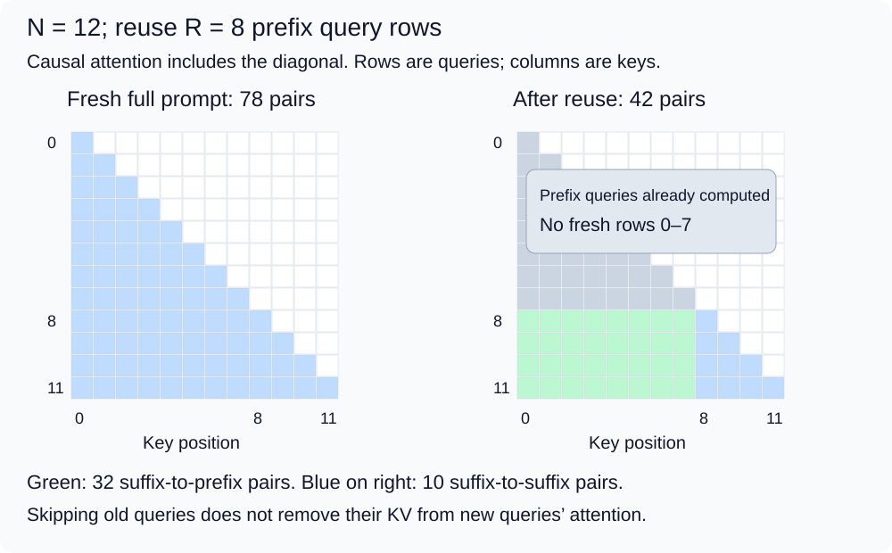
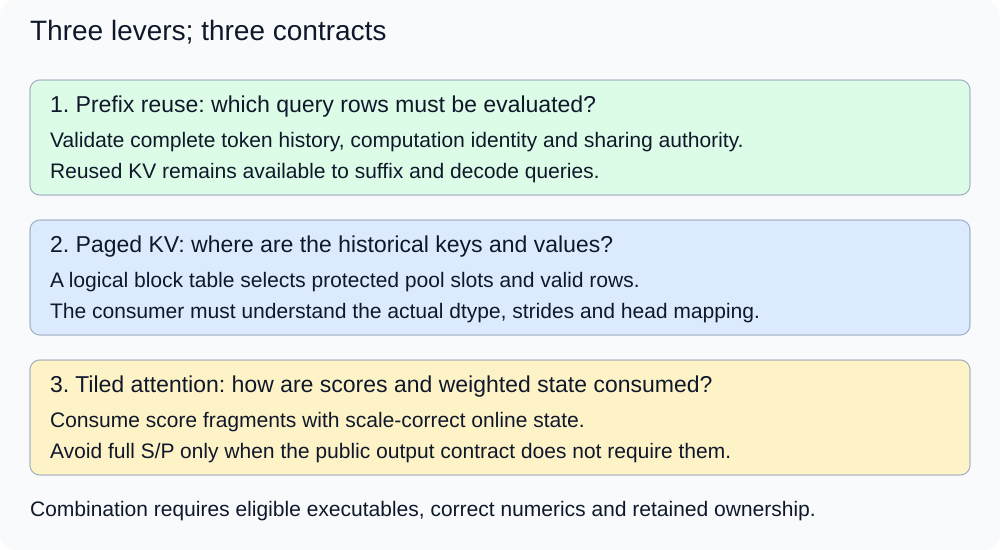

# M4-C12: Distinguishing FlashAttention, PagedAttention, and prefix caching

> **Status: Complete — detailed chapter authored and documentation validated; experimental procedures are proposed unless explicitly labelled observed**

**Module:** Understand kernels and execution overhead

**Category:** [Kernels, compilers, and execution](index.md)

[Module 4 reading order](../module-4.md) · [Previous: M4-C11](m4-c11-flashattention-as-an-io-aware-attention-algorithm.md) · [Next: M4-C13](../runtime-and-concurrency/m4-c13-tracing-cpu-to-gpu-launch-overhead.md) · [Execution plan and progress](../chapter-execution-plan.md)

## Target concepts

Intermediate-data movement, dynamic KV layout, exact-prefix reuse, complementary techniques, applicability and compatibility, correctness boundaries, choosing the constrained stage.

## Concepts

### 1. Three techniques change different parts of the work

A text-generation request first evaluates its prompt (**prefill**) and then processes newly supplied tokens during **decode**. Attention reads queries Q, keys K and values V. A **KV cache** retains per-layer keys/values so later queries need not reconstruct the whole history. These retained model tensors differ from a processor's hardware cache and from a compiler's executable cache.

| Technique | Main question it addresses | What it does not establish by itself |
|---|---|---|
| FlashAttention-style evaluation | Can attention consume score fragments with bounded weighted state instead of writing full score/probability matrices? | Exact-prefix hits, block allocation/sharing or removal of dense attention interactions. |
| PagedAttention and KV management | Can attention follow logical token order across separately placed KV blocks while storage grows and is shared? | A faster individual kernel, an automatic prefix match or less mathematical attention work for the same queries. |
| Exact-prefix caching | Can a new request reuse compatible state computed for the beginning of its token sequence? | A cached answer, fewer keys for later attention or universal decode acceleration. |

The names describe related systems ideas, not interchangeable switches. [FlashAttention, v2](https://arxiv.org/html/2205.14135v2) focuses on tiled IO-aware attention. [PagedAttention, v1](https://arxiv.org/html/2309.06180v1) connects attention over KV blocks with serving-memory management and sharing. [vLLM's automatic-prefix-caching description](https://docs.vllm.ai/en/latest/features/automatic_prefix_caching/) distinguishes reuse of prefill computation from decode work. Published results are not measurements of this chapter's fixtures.

A **bottleneck** is the resource or dependency limiting useful progress at the stated workload. The right comparison starts from that constrained stage, rather than choosing a technique by name. Rust remains the eventual host-engine context, with a reviewed CUDA/Triton boundary for device work; this chapter provides specifications and proposed experiments without implementation code.

### 2. Intermediate movement and persistent KV are separate ledgers

For one head with L queries, N keys, Q/K feature width d and value width D, attention returns an L × D weighted output O. A materialized path writes an L × N score matrix S and an L × N probability matrix P. At four-byte FP32 storage, retaining both takes **8LN bytes**; writing and reading each once adds **16LN logical intermediate bytes** before other traffic. FP32 is 32-bit floating-point storage. A tiled O-only path can consume fragments without these full allocations, as [M4-C11](m4-c11-flashattention-as-an-io-aware-attention-algorithm.md) explains.

Persistent KV belongs to the model's history, not to S/P. With A layers, Hkv KV heads, common key/value width d and w bytes per element, payload per retained token is **c = 2AHkv d w bytes**. The factor two counts K and V. Storage alignment, quantization metadata and nonstandard state require additional accounting.

A declared FP64 teaching cache has A = 2, Hkv = 2, d = 2 and w = 8, giving **c = 128 bytes/token**. FP64 is eight-byte floating-point storage. This is the all-layer fixture inherited from [M2-C13](../state-memory-and-caching/m2-c13-prefix-reuse-and-cache-identity.md), separate from the single-head attention fixture below. It is not a real model's memory specification.

For full attention with L = N = 1024, two FP32 S/P matrices occupy 8 MiB and their stipulated write/read demand is 16 MiB, while 1024 tokens of this separate teaching KV format contain 128 KiB. MiB and KiB mean 1,048,576 and 1,024 bytes. These are different scopes, so do not add them into a claimed real model peak. Reducing a temporary can free capacity, but it does not itself replace the persistent KV representation.

For L = 1 decode at N = 1024, the two S/P rows contain only 8 KiB in this materialized convention. Attention must still consume eligible historical KV. A prefill memory ratio cannot automatically predict decode latency. Dense full-prefill core arithmetic remains **2LN(d+D)** under the convention counting a multiply-add as two floating-point operations (FLOPs); paging changes addresses, while a prefix hit changes which query rows need evaluation.

### 3. Paging changes placement and ownership, not logical attention

A **logical KV block** holds up to B consecutive token positions. A request's **block table** T maps logical blocks to physical pool slots. At token position p:

**logical block j = floor(p/B); within-block row r = p mod B; physical slot s = T[j].**

Floor rounds down and mod gives the remainder. A KV storage block is not a GPU thread block. Slot IDs also do not describe exact DRAM-chip placement. The reader needs the declared strides, dtype, feature/head mapping, valid length and live storage generation, not just a table of integers.

Use B = 4, N = 5 and T = [3,1]. Positions 0–3 come from slot 3; position 4 comes from row 0 of slot 1. Three allocated tail rows are outside the valid sequence. For a separate single-layer/head attention probe, let q = (0,0), K[p] = (0,0), V[p] = (p,2p), with FP64 elements. All five scores are zero and the correct output is **(2,4)**. Counting three zero-filled tail rows in normalization gives **(1.25,2.5)**. Equally averaging block outputs gives **(2.75,5.5)**. Correct mapping and global normalization remain mandatory even if accesses stay within allocated storage.

This probe has 32 KV bytes per valid position. Directly consuming five valid K/V rows requests 160 logical payload bytes. A separate gather reads 160 bytes, writes a 160-byte contiguous temporary, then attention reads that temporary: **480 bytes** in the combined mapping. These omit query/output, metadata, cache effects and score work. A gather can provide compatibility with a contiguous-only kernel, but its cost and temporary must be part of the comparison. A direct mapped kernel can avoid that copy while adding table dependencies or different access patterns.

[The vLLM paged-attention design page](https://docs.vllm.ai/en/latest/design/paged_attention/) explicitly says it is historical and no longer describes current code. Use it for concepts, not as a current ABI, meaning an exact binary/interface contract. The fixture's separate FP64 K/V arrays are our declared layout, not a claim about an installed backend.

For capacity, return to the all-layer c = 128 format. Prompts of lengths 12,13,6 have 31 valid token positions. At B = 4 they occupy **3+4+2 = 9 blocks = 4,608 bytes**, including **640 tail bytes**. Reserving 20 positions for each of the three in a stipulated contiguous baseline takes **7,680 bytes**. The difference, 3,072 bytes, depends on that reservation policy; a tightly sized or growable contiguous allocator has different costs. Metadata and backing pools are additional. Paging can improve a capacity-constrained workload while an isolated attention invocation stays unchanged or slower.

### 4. Prefix reuse removes fresh query work while retaining historical reads

An **exact-prefix hit** means that already-computed state may substitute for the beginning of a new token-ID sequence under the same computation and authorized sharing contract. Similar text is insufficient. The cache identity must cover weights/configuration, adapters, token interpretation, positions/masks, numerical contract and compatible KV storage. A digest is a fixed-size content identifier used as an index aid, not proof of identity or authority to share. Verify the exact relevant prefix chain and current storage generation before attaching request ownership.

This chapter retains M2-C13's conservative full-block, KV-only policy. Let N > 0 be prompt length, Lcp the longest common prefix starting at token zero, and B block length. Reuse:

**R = B × floor(min(Lcp,N−1)/B); fresh query positions F = N−R.**

The N−1 cap leaves prompt work to obtain final logits because this policy does not retain a final hidden state or logits. It can leave a whole last block fresh after rounding. Other validated interfaces may cache additional outputs or use different reuse boundaries; this is not a universal backend rule.

With B = 4 and a cached source S = token IDs [1,2,…,12], use four N = 12 requests, independently against the same retained source:

| Request | Difference from S | Lcp | R / fresh F | Fresh causal pairs |
|---|---|---:|---|---:|
| Q1 | Position 9 becomes 99 | 9 | 8 / 4 | 42 |
| Q2 | Position 4 becomes 50 | 4 | 4 / 8 | 68 |
| Q3 | First four IDs become 21,22,23,24 | 0 | 0 / 12 | 78 |
| Q4 | No difference | 12 | 8 / 4 | 42 |

A full causal prefill evaluates N(N+1)/2 query/key pairs. Reusing the first R query rows leaves:

**Fresh_pairs = [N(N+1)−R(R+1)]/2 = R(N−R) + (N−R)(N−R+1)/2.**

The first term counts suffix queries attending to reused prefix keys. At N = 12, R = 8, there are **32 prefix-key interactions plus 10 suffix interactions = 42**. Reuse saves eight query positions and 36 of the original 78 pairs, yet every fresh query still sees the eight old keys. A subsequent query at position 12 attends to 13 keys whether or not the prompt state came from a prefix hit.

Across Q1–Q4, request hit rate is 3/4 = 75%, reused-position fraction is 20/48 ≈ 41.67%, and saved-pair fraction is **82/312 ≈ 26.28%**. Fresh positions total 28 and fresh pairs total 230. These denominators differ; none is a latency speedup. Q3 cannot reuse a later matching block after its changed first block because causal state depends on the preceding context.

For a separate uniform-score attention check with q/K = zero and V[p] = (p,2p), suffix queries at positions 8,9,10,11 return **(4,8), (4.5,9), (5,10), (5.5,11)**. The next query at 12 returns (6,12). These supplied-KV arithmetic probes do not prove model-derived KV equivalence: the toy values depend on position and deliberately do not encode token history. Exact token/identity checks and actual fresh-versus-reused model KV/logit checks are separate gates.

*For N = 12 and R = 8, skipping the first eight query rows leaves 42 eligible pairs. Of these, 32 still read keys in the reused prefix.*

Prefix reuse can work with a contiguous representation through a validated copy of retained state, or through sharing if its ownership/layout permits it; paging is not a mathematical prerequisite. Copy bytes, retained state and copy completion then matter. With paged sharing, two 12-token requests sharing their first eight positions can use two common blocks and one private suffix block each: **four unique blocks = 2,048 bytes**, versus six blocks = 3,072 bytes without sharing. An extra unused retained source block raises actual occupancy to five blocks, 2,560 bytes. A cache ownership edge is not another physical copy, while retention of otherwise-unused data really consumes capacity.

*Reuse determines which prompt queries are fresh; block tables determine where their historical KV lives; tiled attention determines how score fragments are consumed. Each retains its own correctness and lifetime requirements.*

### 5. Complementary ideas still need a compatible executable

A fused attention implementation can follow a page table if its actual interface supports that layout. Another implementation may require contiguous K/V and an accounted gather. A paged consumer may use online reductions without implementing the same tiling/work partitioning as a particular FlashAttention version. Names alone do not establish compatibility.

Consider three conceptual binary axes: materialized/tiled attention, contiguous/paged KV and prefix reuse off/on. Their product has **2 × 2 × 2 = 8 conceptual configurations**. It does not guarantee eight valid binaries. A fair ablation, a comparison removing or changing one feature at a time, records eligible configurations and explicit unsupported outcomes rather than filling missing cells with invented timings.

| Compatibility boundary | Evidence required before combining |
|---|---|
| Model and reuse | Exact prefix, weight/adapter/configuration and position/mask identity, authorized sharing, complete current state. |
| Storage and consumer | Dtype/scales, block size, strides/alignment, lengths, head mapping, table generation, supported device/context and valid extents. |
| Arithmetic | Same attention function; declared score/weight/accumulator/output modes and numerical gates for real versus represented inputs. |
| Ownership and recovery | Immutable shared prefix, private continuation/copy-on-write where needed, covered device completion and safe retain/evict coordination. |
| Dispatch and conversion | Ready eligible executable or validated fallback; explicit gather/copy/preparation cost and scratch admission. |

Changing a backend can change rounded KV produced by the prefix computation. Either the cache identity makes that a miss or a separately validated equivalence policy admits it; do not assume the old state is compatible merely because model weights match. A complete semantic match can still be a storage miss or capacity failure. Distinguish these from an invalid request.

During lookup, validate and retain the whole candidate prefix under protection from eviction/reassignment. Shared blocks are immutable. Continuing one request must not mutate another's retained prefix. Client cancellation stops publication but does not immediately release storage or executable handles used by in-flight device work. An unavailable candidate can use an eligible ready fallback; a faulted context requires its documented recovery path, not blind retry through another kernel.

### 6. Choose the constrained stage and measure the whole path

A constructed serial first-token ledger demonstrates why speed factors cannot simply be multiplied. All columns below are disjoint costs in milliseconds, with no overlap or queueing. They are stipulated examples, not measured results.

| Configuration | Prep + lookup + other prompt (ms) | Attention + layout (ms) | Final (ms) | Total (ms) |
|---|---|---|---:|---:|
| Baseline | 2 + 0 + 4 | 6 + 0 | 2 | 14 |
| Tiled attention only | 2 + 0 + 4 | 3 + 0 | 2 | 11 |
| Prefix hit only | 2 + 0.5 + 1 | 2 + 0 | 2 | 7.5 |
| Paging only, same useful work | 2 + 0 + 4 | 6.3 + 0.2 | 2 | 14.5 |
| Qualified combination | 2 + 0.5 + 1 | 1 + 0.2 | 2 | 6.7 |

Preparation here means request input preparation; executable first-use costs are separate. “Other prompt work” includes projections/MLP work remaining after reuse; “final boundary” covers stipulated remaining first-output work. Real profiles must establish their own interval boundaries and avoid adding overlapping time twice. The 14/11 and 14/7.5 ratios multiply to about 2.376, while the combined ratio is **14/6.7 ≈ 2.090**. Prefix reuse changes the remaining attention work, and paging can change metadata/copy cost, so independent-baseline ratios are not independent factors.

| Observed constraint hypothesis | Candidate investigation and limits |
|---|---|
| Large S/P allocations and intermediate traffic | Test an eligible tiled O-only path; include scratch, repeated inputs and actual interface measurements. |
| KV reservation/fragmentation limits admissions | Audit block allocation and retention with paging; faster attention alone does not prove adequate KV capacity. |
| Repeated compatible long prompts spend time in prefill | Measure exact-prefix reuse, lookup and fresh rows/pairs; still count suffix/decode KV reads. |
| Long-history decode or unique prompts dominate | Profile KV reads, parallelism and contention; prefix caching may offer few hits. |
| Host dispatch/waits dominate | Investigate the host/device timeline, the next chapter's subject; none of these labels alone fixes it. |

Reclaiming temporary storage can also relieve admission pressure; these hypotheses overlap and need controlled evidence. Retaining prefixes can reduce free capacity on a no-hit workload. A six-block retained cache in a 12-block pool leaves six block slots for new work, even if every request misses. Do not turn a free-slot or isolated-kernel ratio into a sustainable-throughput claim.

HFT provides a systems lens: reduce critical-path movement, bound retained state, and validate history/version before reusing an event-derived snapshot. KV blocks are not exchange events and prefix identity is not market causality. No trading result or financial advice follows from these comparisons.

### Target-concept coverage

| Target concept | Explanation and experiment/verification |
|---|---|
| Intermediate-data movement | Section 2 separates S/P from KV; E1/V1 audits the attention-only change. |
| Dynamic KV layout | Section 3 derives mapped reads, tails and capacity; E2/V2 checks all layouts/tables. |
| Exact-prefix reuse | Section 4 derives reuse and remaining work; E3/V3 checks identity and fresh-versus-reused behavior. |
| Complementary techniques | Sections 1/5 define three axes and eight conceptual cells; E4/V4 compares only eligible combinations. |
| Applicability and compatibility | Section 5 specifies input/executable contracts; E2/E4 with V2/V4 records conversion and unsupported paths. |
| Correctness boundaries | Sections 3–5 separate membership, identity, numerics and lifetime; V1–V4 gate speed claims. |
| Choosing the constrained stage | Section 6 gives competing hypotheses and serial costs; E4/V4 tests end-to-end evidence. |

## Experiments

All four experiments are proposed for Module 4's execution reasoning. Paper arithmetic and logical references require no GPU. Runtime phases require independently available, reviewed attention, memory and generator candidates; none is implemented here. A documentation check is not an executed serving benchmark.

### E1 — Isolate intermediate elimination

- **Description:** Compare materialized and tiled attention on the same supplied Q/K/V, with layout and prefix work fixed.
- **Purpose/objective:** Test whether intermediate movement changes without introducing cache reuse or changing attention membership.
- **Target concepts:** Intermediate-data movement, correctness boundaries and constrained-stage diagnosis.
- **Hypothesis and prediction:** The O-only tiled path can avoid full S/P while computing the same output; actual time depends on resources and repeated input traffic.
- **Baseline and independent variable:** Reviewed materialized attention versus eligible tiled candidate, contiguous storage and prefix reuse disabled. Only attention evaluation changes; preserve actual formats and arithmetic-path differences in the record.
- **Workload and reference:** Use M4-C11's worked single-query fixture: d = 4, D = 2, Q = (2,0,0,0); K rows (0,0,0,0),(1,0,0,0),(2,0,0,0); V rows (2,0),(0,2),(1,1); scale 1/2, all keys eligible. Reference O = ((2+e²)/(1+e+e²),(2e+e²)/(1+e+e²)), with e = exp(1). A proposed device sweep uses one request/head, N = 32/128/512, L = N or 1, d = D = 4, exact quarter-valued FP32 inputs under V1 and no dropout.
- **Controlled variables and procedure:** Derive the same output independently, then check every candidate coordinate before timing. Count actual S/P allocations, scratch, input/output and conversion. Warm each path and run balanced comparisons under V1. Profile the completed attention interval separately; do not attribute a different layout or skipped query to this intervention.
- **Hardware/software and HFT connection:** FP32-capable GPU with eligible reviewed kernels, or paper phase only; record host/device boundary and resource conditions. HFT concern: eliminate handoffs while preserving the event set; attention probabilities are not market-event weights.
- **Exit criteria and expected failures:** Numerical and safety gates pass, retained storage/traffic boundaries reconcile and both paths complete identical useful work. Unsupported candidates remain unmeasured. Detect changed scale, mask, value pairing or hidden materialization. Verify with V1.

### E2 — Change placement while preserving logical KV

- **Description:** Compare contiguous reference, direct paged consumption and gather-plus-contiguous consumption where each is supported.
- **Purpose/objective:** Distinguish layout/capacity effects from fewer attention interactions.
- **Target concepts:** Dynamic KV layout, applicability, compatibility and correctness boundaries.
- **Hypothesis and prediction:** Correct mappings preserve O; a gather adds a separate movement boundary, while direct mapped consumption needs its own supported layout.
- **Baseline and independent variable:** Same logical q/K/V in contiguous storage; change only placement/consumer strategy, keeping prefix reuse disabled and numerical mode fixed.
- **Workload and reference:** Four physical slots, B = 4, N = 1…9, single layer/head, d = D = 2, FP64 q/K = zero and V[p] = (p,2p). For each N, enumerate all ordered selections of ceil(N/4) distinct slots. Test row-major and feature-major within-slot layouts with their correct descriptors; use independent unique coordinate labels before numerical reduction. Expected O = ((N−1)/2,N−1). The N = 5 table [3,1] reproduces Section 3. Add a separate nonuniform-score probe from E1, packed into B = 2 blocks with separate declared K-width-4 and V-width-2 strides, so uniform means cannot hide all pairing errors.
- **Controlled variables and procedure:** Audit exact addressed coordinates and legal extents first. Vary tail sentinels without adding them to membership. Qualify consumer block size/strides/dtype/head support; either reject incompatibility or explicitly account for conversion. Compare direct and gather timings only after equality/gates. Separately reproduce the all-layer reservation/paged-capacity example; do not combine its 128-byte token format with this 32-byte token probe.
- **Hardware/software and HFT connection:** Paper mapping or reviewed FP64 candidates and suitable diagnostics; record actual support rather than assume a production fast kernel accepts the teaching format. HFT concern: an in-bounds descriptor can still select the wrong data; this does not specify a trading feed format.
- **Exit criteria and expected failures:** All valid coordinates and outputs agree, tails are excluded and global normalization holds. Wrong strides, stale slot generations, duplicate mappings for distinct owned blocks and unsupported formats are detected before unsafe access. Verify with V2.

### E3 — Reuse only the exact protected prefix

- **Description:** Compare fresh prompt work with the four prefix cases and controlled identity/lifetime failures.
- **Purpose/objective:** Test skipped query work, remaining historical reads and safe sharing without treating a hit as a cached answer.
- **Target concepts:** Exact-prefix reuse, complementarity, compatibility and correctness boundaries.
- **Hypothesis and prediction:** Reuse saves validated prefix query rows but suffix queries still consume prefix KV; retained state can cost capacity when hits disappear.
- **Baseline and independent variable:** Same requests computed fresh; enable the declared B = 4 full-block, KV-only reuse policy with unchanged attention evaluation/layout in each comparison.
- **Workload and reference:** Source [1…12] and Q1–Q4 in Section 4, sequential independent trials reset to the same three retained source blocks before each request. Use M2-C13's exact model/configuration, adapter, tokenizer/template, positions/mask, numerical, namespace and storage identity gates. Its D0 is a teaching descriptor, not a real model artifact. Reproduce R/F/pair/unique-block ledgers; use uniform-score attention only as a membership probe. An actual model phase must compare compatible cached KV and same-prefix logits against fresh execution, not merely the toy outputs.
- **Controlled variables and procedure:** First enumerate longest-prefix/block rounding and candidate chain identity. Force a collision with the teaching digest sum(token IDs) mod 16 on [1,2,3,4] versus [1,2,4,3]; exact comparison must miss. Separately change weights/adapter/position/namespace/layout generation, omit an earlier source block, and race retain against eviction. In a reviewed runtime, check cancellation and private continuation cannot mutate shared sealed state. Record hit, identity miss, storage miss, capacity failure and invalid request distinctly.
- **Hardware/software and HFT connection:** Paper state ledger; actual KV/logit phase needs a fixed validated model and ownership-aware harness. No such engine is supplied here. HFT concern: cached snapshots need matching history and version, not similar labels; token identity is not an exchange sequence protocol.
- **Exit criteria and expected failures:** Exact prefix/authorization and current lifetime gates pass before attachment; all deliberate mismatches/collisions fail safely. Fresh/reused KV/logit/output gates pass for any actual model; otherwise that phase remains pending. Verify with V3.

### E4 — Ablate compatible combinations at fixed offered load

- **Description:** Compare supported cells of the three-axis design under equivalent model requests and finite budgets.
- **Purpose/objective:** Identify the constrained stage and whether local benefits survive lookup, conversion, retention and queueing.
- **Target concepts:** Complementary techniques, applicability/compatibility and choosing the constrained stage.
- **Hypothesis and prediction:** A combined configuration can help a repeated-prefix prefill workload yet regress with unique prompts, cold prefix state or decode-heavy work; individual speed factors need not multiply.
- **Baseline and independent variable:** Same validated generator, with one attention/layout/reuse axis changed per matched ablation. Archive all eight conceptual cells as eligible, unsupported or failed; record any change to numerical mode or scheduling as a confounder, another change that can affect the result, requiring a separate comparison.
- **Workload and reference:** Freeze model/weights/tokenizer, precision, greedy/tie/stopping rules and prompt hashes. Two separate 400-attempt traces each have prompt lengths 32/128 and output caps 8/32, 100 per combination. One trace has eight fixed repeated prefix families with complete identity records; another has no eligible shared full prefix blocks. Compare spaced arrivals every 100 ms with ten arrivals per whole second for 40 seconds, preserving archived order and scheduled demand. Record actual-send lag. Use a declared common memory/admission budget and cap cache-owned unique block slots at floor(pool slots/4), a chosen 25% experimental retention policy rather than a universal recommendation. Count a slot once even when also request-owned. Dropping a cache ownership edge removes reuse eligibility but does not release active readers or in-flight storage; record actual assigned/live/retained and pending-reclamation occupancy and failures.
- **Controlled variables and procedure:** Qualify semantics and backend/layout support before any substitution. Separate prefix-cache-empty and prepopulated-prefix trials; kernel warmup is not a prefix hit. Prepare executable paths using separate nonmatching warmup prompts, then reset prefix state as specified. For seeded trials, account for prefix preparation outside and alongside request cost. Begin five independent paired runs per trace/load/cache state and eligible ablation, balancing order. Track stage timelines, allocations, actual fresh rows/pairs, fallback/conversion and terminal outcomes. Test safe cancellation/fallback before performance runs.
- **Hardware/software and HFT connection:** Existing validated generator, eligible attention/storage interfaces, finite pool/retention control and independent load/events. HFT concern: burst tails and retained-state pressure at unchanged demand; no trading-result claim is made.
- **Exit criteria and expected failures:** Operator/model/lifetime gates pass and all attempted work reconciles. Diagnose changes in useful service through actual stage/resource evidence; report unsupported cells and regressions rather than inventing missing combinations. Accept against preregistered service limits only when supplied and supported by evidence. Verify with V4.

## Verification

### Shared reference, timing and evidence rules

Apply completed [M9-C01](../numerics-and-correctness/m9-c01-defining-reference-behavior-and-evidence-before-optimizing.md) to fix semantic behavior before speed and [M9-C17](../numerics-and-correctness/m9-c17-comparing-logits-with-justified-numerical-tolerances.md) to separate exact identity/address checks from numerical allowances. Numerical tolerance cannot excuse the wrong block, prefix or mask. Current-request input/output descriptors, source-state generation and actual binary/format identities must agree across variants.

For isolated attention/layout paths, use one invocation in flight. Ordered device events span the first required gather/conversion/attention stage through all output completion, with cross-stream joins explicit. A host monotonic ready-input → caller-ready boundary includes lookup/retain, dispatch, waits and required readback. Report component intervals without double-counting overlap. Compilation, executable first use, hardware-cache conditions and prefix-cache content are separate state dimensions, under completed [M9-C02](../measurement-experimentation-and-economics/m9-c02-request-events-clocks-and-measurement-boundaries.md).

For eligible isolated device pairs, complete 20 excluded warmups per binary/shape, then start five independent paired runs of 100 observations per variant, alternating AB/BA and reversing initial order on a repeat. This is a starting precision budget, not a guarantee. If a very short operation needs an ordered batch of 100, dividing by 100 estimates amortized cost, not individual latency or p99. Predeclare a 2% relative run-median spread screen, (maximum−minimum)/median; investigate state or add independent runs if exceeded, and report unresolved instability or small effects within uncertainty as inconclusive. No universal speedup threshold is imposed.

Use [M9-C07](../measurement-experimentation-and-economics/m9-c07-latency-distributions-and-statistical-uncertainty.md) for run-paired effects, correlated observations and outcome coverage. Profile selected cases separately under completed [M9-C12](../measurement-experimentation-and-economics/m9-c12-reading-cpu-gpu-timelines-and-scheduling-gaps.md) and [M9-C13](../measurement-experimentation-and-economics/m9-c13-using-kernel-profilers-to-explain-hardware-bottlenecks.md). Preserve metric scope, replay/cache policy and instrumentation overhead; unavailable counters are not zero. Use unprofiled completed times for performance conclusions.

### V1 — Establish the attention-only baseline

Check the E1 worked expression at 80 and 120 decimal digits and require agreement within 10 to the power −65. For the bounded device corpus, define Q[i,t] = ((3i+t+e) mod 5−2)/4, K[j,t] = ((2j+3t+e) mod 5−2)/4, V[j,c] = ((5j+3c+e) mod 17−8)/4, e = 0,1, d = D = 4 and scale 1/2. Full queries use absolute positions 0…N−1; a single query is at N−1. Test causal/noncausal cases separately. Inputs are exact FP32 fractions and |V| ≤ 2; build stored-input stabilized materialized references without timing their construction.

Predeclare per-coordinate absolute O error ≤ 10 to the power −4. This bounded teaching allocation is 0.005% of the allowed value magnitude 2, retained from M4-C11; it is an acceptance choice, not a proved worst-case FP32 bound or a model-quality certificate. Actual approximate exponential/weight/accumulator paths must pass; general deployment formats need their own budget. Use high-precision direct and shifted-tile references, test uneven tile boundaries and deliberate scale/membership faults, and check every output rather than just generated text.

Count actual S/P storage and measured memory-interface demand independently. Keep logical 8LN payload and 16LN traffic ledgers separate from HBM counter bytes. Under separate 64 MiB host and device fixture/intermediate budgets, one largest case N = L = 512 has 2 MiB S/P plus 32 KiB Q/K/V/O FP32 payload, **2.03125 MiB raw**. Scratch/allocator/executable/profiler headroom is additional. A candidate which cannot run the stated shape or format is unsupported, not a zero-time result.

### V2 — Verify address identity before aggregate outputs

Enumerate every valid (K-or-V, position, feature) coordinate for E2's two layouts and all distinct slot tables. Use unique labels to catch row, tensor and feature swaps even where the uniform-score average coincides. The row-major element offset is **s × Bd + r × d + f**; feature-major is **s × Bd + f × B + r**, multiplied by eight for FP64 byte offsets. Confirm valid-tail counts and extents independently. Changing only placement must preserve all labels and O exactly for the uniform fixture.

A matching table/dtype is insufficient if the consumer assumes different strides or generations. Verify slot ownership, protected retain and producer completion before reading. Illegal descriptors reject without a dangerous launch. Allocated sentinel tails remain outside arithmetic; unchanged canaries detect some writes but cannot prove safe reads. Use appropriate access/synchronization diagnostics separately from timing. Check the (2,4), (1.25,2.5) and (2.75,5.5) counterexamples and the nonuniform E1 probe; wrong member/value pairing must fail a semantic or numerical gate.

Measure gather plus temporary write plus attention as a complete path. The 160/480-byte comparison is logical payload demand, not a bandwidth measurement or guarantee of one physical fetch. Record table metadata, scratch peaks and actual interface bytes under completed [M9-C15](../state-memory-and-caching/m9-c15-accounting-for-weights-kv-state-workspace-and-fragmentation.md). The 4,608/7,680-byte capacity example is a different all-layer format and a stipulated reservation policy; it cannot establish runtime throughput.

### V3 — Validate skipped work and retained state independently

Recompute all four R/F/pair rows, totals 20 reused and 28 fresh positions, 82 saved and 230 remaining causal pairs, and each denominator. Count suffix reads of reused keys rather than labeling all retained KV “work avoided.” Under the all-layer B = 4, c = 128 format, distinguish shared unique blocks from request/cache edges and unused retained blocks. The sequential independent Q1–Q4 trials fit in the inherited eight-slot pool: three retained source blocks plus at most three fresh blocks, before unrelated workspace. They are not a simultaneous four-request admission claim.

Identity changes, missing earlier blocks, stale generations, untrusted namespace substitutions and forced digest collisions must miss or reject according to the stated category. Retain/evict races must either preserve complete eligible ownership or report a miss and roll back tentative request edges; a partial attached prefix is not published. Cancellation cannot reclaim in-flight readers' state. A private continuation may use copy-on-write but cannot silently mutate shared prefix contents.

For a real model phase, compare exact descriptor/token/position identity, compatible all-layer KV, same-prefix logits and exact greedy/stopping outcomes under a declared numerical contract. Use independent fresh execution and locate the first divergence. Uniform position-only toy KV can yield the same output for different token histories; that agreement is explicitly insufficient for cache correctness. An implementation that lacks this validated model phase must leave model reuse acceptance pending.

### V4 — Identify causes through matched end-to-end outcomes

Recalculate the serial totals 14,11,7.5,14.5,6.7 ms and the combined ratio, while labeling them constructed. In actual ablations, preserve identical request traces, identity/retention policy, admission budget and numerical contract. Count actual fresh rows/pairs, lookup misses/hits, gather/copy stages, backend fallback, peak unique assigned blocks, retained blocks, pending reclamation and scratch. An unsupported configuration is not comparable to a successful one; rejected/failed requests are not speedups.

Record arrival-to-first-token, token-delivery gaps, arrival-to-terminal time and useful completed output, separately from attention and layout kernel intervals. Preserve scheduled arrivals, actual-send lag, admissions, cancellations, timeouts, failures and unfinished attempts. Drain up to 60 seconds after the last scheduled arrival; label unfinished work at cutoff and follow safe recovery before reclamation. Seeded cache construction and all memory it retains must be disclosed even when excluded from warm request latency.

Five 400-attempt runs give 2,000 attempts per trace/load/cache-state/variant and nominally about 20 beyond p99 only if every attempt has that metric. Within-run bursts and token gaps are correlated; use run-level uncertainty and eligible sample counts, adding independent runs when needed. Do not average run p99s into a pooled p99 or hide unsuccessful attempts. The no-hit trace specifically tests retention cost. Service acceptance requires actual preregistered latency/capacity limits; absent those or a qualified generator, report measurements without asserting production readiness.

## Engineering dimensions and principles

| Dimension | Chapter-specific application |
|---|---|
| Semantics and invariants | E1/E2 preserve attention membership and addresses; E3/V3 requires exact compatible prefix identity and immutable sharing. |
| Workload and variability | Prefill/decode query counts, common-prefix lengths, reuse skew and bursts alter benefits. E4 separates repeated/unique prompts and cache states. Non-text modalities and Module 8 are excluded. |
| Resources and bottlenecks | S/P scratch, persistent KV, table/copy traffic, prefix retention and CPU lookup have separate ledgers. E1–E4. |
| Time and distributions | Gather, lookup and final logits lie on the exposed critical path; V4 measures caller distributions at unchanged offered demand. |
| Ownership and coordination | Physical blocks can have multiple edges; retain/evict and device completion determine safe reuse, including cancellation. E2/E3. |
| Failure and adaptation | Correct identity misses compute fresh under admission; invalid layouts reject or explicitly convert; unavailable versus faulted backends have different fallback/recovery paths. |

| Practical engineering principle | Application and evidence |
|---|---|
| 1. Correctness defines the optimization boundary | Exact layout/prefix checks precede numerical and speed gates. V1–V3. |
| 2. Performance depends on workload and operating point | A prefill hit differs from unique long-context decode and capacity pressure. E4/V4. |
| 3. Data movement is part of the algorithm | Avoided S/P, mapped KV and gather-copy demand are separate transfers. E1/E2. |
| 4. State has ownership, lifetime and recovery cost | Shared prefixes remain immutable; unused retention still consumes slots. E3/V3. |
| 5. Dependencies determine latency; bottlenecks determine capacity | A kernel win can leave lookup/queue/host limits; paging can aid admission without a faster isolated kernel. Section 6, V4. |
| 6. Variability and synchronization shape the tail | Misses, skew, conversion/fallback and burst drain require outcome-aware distributions. E4/V4. |
| 7. Local improvements must be evaluated end to end | Do not multiply baseline ratios or mistake skipped queries for fewer later keys. E3/E4. |
| 8. Claims require reproducible evidence | Preserve all conceptual cells, unsupported outcomes, actual binaries/layouts, cache seeds, budgets and reference records. V1–V4. |

## Specifications, articles, and hardware

Primary sources checked on 2026-10-27. Live documentation requires a pinned installed revision for any future experiment; no current backend implementation is inferred from a historical page.

| Primary article/specification | Use and boundary |
|---|---|
| [FlashAttention v2](https://arxiv.org/html/2205.14135v2) | Intermediate movement and tiled attention; no published speedup is adopted. |
| [PagedAttention v1](https://arxiv.org/html/2309.06180v1) | Logical/physical KV separation, dynamic allocation and sharing; our teaching layouts and reservations remain explicit choices. |
| [vLLM prefix-caching feature](https://docs.vllm.ai/en/latest/features/automatic_prefix_caching/) and [design](https://docs.vllm.ai/en/latest/design/prefix_caching/) | Prefill reuse, parent-linked identity and retained-block management; this chapter keeps its own exact verification, authorization and final-logit policy. |
| [Historical vLLM paged-attention explanation](https://docs.vllm.ai/en/latest/design/paged_attention/) | Educational layout/consumer context, explicitly not a specification of today's code. |
| [M4-C11 numerical and causal contract](m4-c11-flashattention-as-an-io-aware-attention-algorithm.md) | O-only attention, stored-input reference gates and backend mask-alignment qualification. |

| Hardware/software manifest | Required evidence |
|---|---|
| Device and resources | Model/architecture, visible SMs/partition, memory/cache capacity, register/shared limits, supported FP32/FP64 or deployed formats. No GPU is assumed to have run these studies. |
| Executable boundary | Rust host/toolchain, runtime/driver/compiler/backend revisions, source/binary identity, actual tiles/warps/stages and selected dispatch/fallback/conversion. |
| KV and identity | Layers/heads/features/dtype/scales, block size/pool capacity, strides/alignment/extents, table/storage generations, exact model/adapter/tokenizer/position/mask and authorized namespace. |
| Conditions and state | Clocks/power/thermal/co-tenancy, profiler permissions/replay/cache policy, prefix-cache empty/seeded contents, kernel preparation and retained-memory limits under completed [M9-C16](../hardware-architecture-and-topology/m9-c16-recording-hardware-conditions-that-change-measurements.md). |
| Workload and evidence | Prompt/trace hashes, actual fresh-work/hit denominators, reference precision/budgets, trial/run counts, admission/outcome accounting and safe drain/recovery policy. |

## What to carry forward

Choose the resource or dependency to change, then prove that the whole eligible path remains correct. Intermediate elimination, block-based KV placement and exact-prefix reuse can cooperate, but their contracts, remaining work and costs must be measured separately before judging useful service.

Next in authoring and Module 4 reading order is [M4-C13: Tracing CPU-to-GPU launch overhead](../runtime-and-concurrency/m4-c13-tracing-cpu-to-gpu-launch-overhead.md). Follow the [execution plan and progress tracker](../chapter-execution-plan.md) for acceptance and progress.
