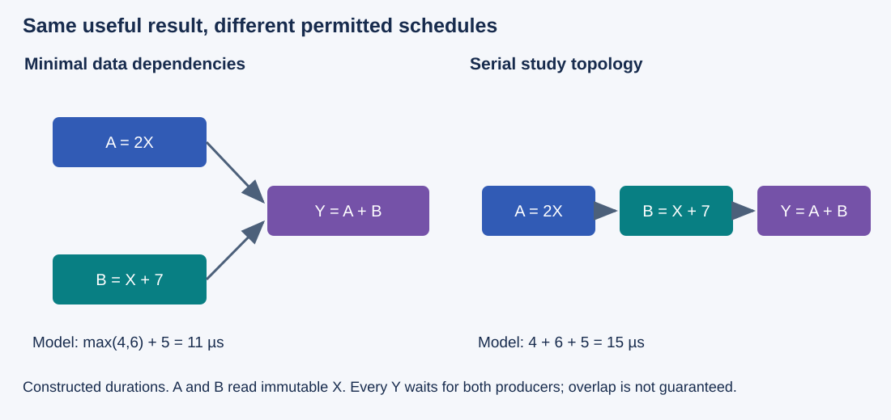
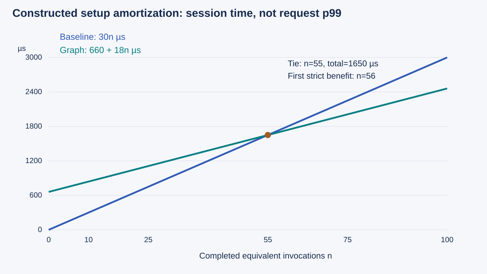

# M4-C15: CUDA Graph capture, instantiation, and replay

> **Status: Complete — detailed chapter authored and documentation validated; experimental procedures are proposed unless explicitly labelled observed**

**Module:** Understand kernels and execution overhead

**Category:** [Kernels, compilers, and execution](index.md)

[Module 4 reading order](../module-4.md) · [Previous: M4-C14](../runtime-and-concurrency/m4-c14-cpu-gpu-synchronization-and-hidden-serialization.md) · [Next: M4-C16](../runtime-and-concurrency/m4-c16-replay-constraints-graph-variants-and-buffer-lifetimes.md)

[Execution plan and progress](../chapter-execution-plan.md)

## Target concepts

Graph nodes and dependencies, explicit construction versus stream capture, instantiation, repeated submission, setup amortization, capture restrictions, graph versus kernel fusion.

## Concepts

### 1. Separate the workflow from its submission

A **CUDA Graph** describes device operations and their ordering. A node represents an operation; an edge states a dependency. This chapter uses ordinary full-completion dependencies: a consumer may start after its required producers finish. A graph is distinct from its executable instance and from any one execution. The [CUDA Graph guide](https://docs.nvidia.com/cuda/cuda-programming-guide/04-special-topics/cuda-graphs.html) defines these concepts.

Imagine three operations on an N-element FP32 array X: A = 2X, B = X + 7, then Y = A + B. FP32 means 32-bit floating-point values. A and B read immutable X and write disjoint arrays; Y requires both. The **topology**, or node-and-edge structure, must express those requirements.

*Figure 1. Both graphs compute the same result. The serial graph also orders A before B, matching the single-stream baseline used in the experiments.*

In the minimal graph, edges A → Y and B → Y permit the branches to overlap if resources allow. In a single-stream submission A then B then Y, ordering also places A before B. Its serial graph uses A → B → Y; the transitive path still covers A → Y. Graph node count is not enough to establish equivalence: compare operations, parameters, dependencies and data ownership.

For a constructed dependency-only model, A takes 4 µs, B takes 6 µs, and Y takes 5 µs. The minimal graph has earliest finish **max(4,6) + 5 = 11 µs**, while the serial chain has **4 + 6 + 5 = 15 µs**. These exclude submission, contention and synchronization. Missing A → Y or B → Y can cause a read before its producer finishes. Adding the A → B edge is safe for this fixture but restricts concurrency. Scheduling and resource limits can serialize even the minimal graph.

For the main study, hold the serial topology fixed across ordinary submission, explicit graph construction and stream capture. A separate topology study may investigate removing A → B, but its results cannot be attributed solely to graph launch overhead.

### 2. Two ways to describe the same work

**Explicit construction** creates graph nodes and dependencies directly. **Stream capture** records eligible stream operations into a graph instead of executing those captured operations at capture time. Instantiation prepares an executable representation; replay submits it again. These mechanisms are described in the [official graph guide](https://docs.nvidia.com/cuda/cuda-programming-guide/04-special-topics/cuda-graphs.html).

| Creation route | What the author must establish | Useful evidence |
|---|---|---|
| Explicit graph | Correct node parameters and every required dependency | Node/edge inventory, argument identities and reference outputs |
| Stream capture | Eligible operations and intended ordering within a valid capture region | Capture status, returned graph, inspected topology and reference outputs |
| Both | Equivalent useful work, completion and lifetime | Same workload and binary, independent reference, safe state-retirement ledger |

A Rust host can reach CUDA through a reviewed binding or native library. A Triton/Python or CUDA/C++ component may prepare kernels, perform allocation or launch work. Inspect the actual boundary rather than assuming all wrapper activity becomes a graph node. Ordinary host validation, branching, logging and argument preparation during capture are not automatically repeated by replay. A host function deliberately represented by a supported node is a different case; this chapter's fixture has kernel nodes only.

If a host loop unrolls four token steps during capture, replay does not re-run that host loop's decisions. Conditional graph facilities exist in some configurations, but this introductory study does not use them. A captured fixed sequence is not automatically a correct variable-length generator. Preserve the stopping and publication contract from [M4-C14](../runtime-and-concurrency/m4-c14-cpu-gpu-synchronization-and-hidden-serialization.md).

### 3. Construction, instantiation and execution have different costs

NVIDIA's [getting-started article](https://developer.nvidia.com/blog/cuda-graphs/) separates a graph description from an executable instance and demonstrates repeated submission of prepared work. Use that distinction to build a complete cost ledger, not to borrow its historical device timings.

| Stage | Meaning in this chapter | Measurement boundary |
|---|---|---|
| Kernel preparation | Compile/load specializations and establish valid operands | Archive cold preparation separately; inherited from M4-C04 |
| Construction or capture | Describe the workflow | Host entry to successful graph return; include required wrapper work |
| Instantiation | Validate/prepare the executable graph | Instantiation call boundary plus status and diagnostics |
| Upload / first execution | Make prepared work available and execute the first iteration | Record explicit upload if used; otherwise preserve first-launch effects |
| Warm replay | Submit an already prepared executable | Host launch interval, device interval and completed caller interval separately |
| Retirement | Drain all users and release graph-owned application state | Last user to safe release; errors require documented recovery |

The [graph API reference](https://docs.nvidia.com/cuda/cuda-runtime-api/cuda_runtime_api/group__CUDART__GRAPH.html) specifies instantiation, upload and launch operations. Graph launch is asynchronous with respect to the host. One host graph-launch call does not mean one kernel or a completed request. Check submission and completion errors, retain operands until actual completion, and do not assume that an executable owns every external allocation referenced by its nodes.

Use one executable and one in-flight invocation at a time in the introductory experiments. Serialize graph-object manipulation on the host. These conservative study rules avoid relying on overlapping-execution or mutation behavior. Shape changes, updates, variant pools and advanced lifetime management belong to the next chapter; they remain outside this study's fixed-address, fixed-shape contract.

### 4. Setup must be repaid by useful repetitions

Let n be completed equivalent invocations. Let t_b be ordinary completed iteration time, t_r warm completed replay time, S extra graph preparation cost relative to the prepared baseline, and F additional first-launch cost beyond a warm replay. Under a deliberately additive, serial model:

**T_baseline(n) = n × t_b.**

**T_graph(n) = S + F + n × t_r.**

For t_b > t_r, strict total-time improvement requires **n > (S + F)/(t_b − t_r)**. At equality, the two totals tie. If t_b ≤ t_r and S+F is nonnegative, no repetition count repays setup under this model. All terms need the same completion scope; a host API-call duration cannot substitute for a completed iteration duration.

Use the **constructed** values S=600 µs, F=60 µs, t_b=30 µs and t_r=18 µs. Shared compilation/allocation is already paid equally by both policies and excluded here. The quotient is **660/12 = 55**, so the first strictly beneficial integer count is **56**.

*Figure 2. A faster warm replay can lose for short sessions. The table and chart are predictions, not measurements.*

| Completed invocations n | Baseline total | Graph total including setup / first excess | Graph average per invocation |
|---|---|---|---|
| 1 | 30 µs | 678 µs | 678 µs |
| 10 | 300 µs | 840 µs | 84 µs |
| 55 | 1,650 µs | 1,650 µs | 30 µs |
| 56 | 1,680 µs | 1,668 µs | About 29.786 µs |
| 100 | 3,000 µs | 2,460 µs | 24.6 µs |

The amortized average is not an individual-request latency or percentile. Rebuilding before every invocation would instead cost S+F+t_r per invocation in this model. Variant churn, cache eviction and process restarts can shorten the actual reuse horizon. Account for failed constructions and never-used instances when evaluating total resource cost.

NVIDIA's [2024 graph performance article](https://developer.nvidia.com/blog/constant-time-launch-for-straight-line-cuda-graphs-and-other-performance-enhancements/) distinguishes first and repeat launches and reports a particular CUDA 12.6 topology/hardware study. Its approximately constant host overhead result is scoped to that configuration and straight-line kernel graphs; it is not a guarantee of constant total GPU runtime or arbitrary graph performance. Record your topology, CPU/GPU and runtime versions before comparing numbers.

### 5. Capture is a constrained phase

The [capture restrictions and invalidation rules](https://docs.nvidia.com/cuda/cuda-programming-guide/04-special-topics/cuda-graphs.html#prohibited-and-unhandled-operations) prohibit querying or synchronizing captured work and broader scopes that encompass it. The legacy default stream cannot be captured. Cross-stream captures must rejoin their origin before ending. Invalid capture must be ended and its failure handled; an invalid result is not replayable work.

| Study boundary | Required procedure | Failure evidence |
|---|---|---|
| Before capture | Prepare kernels and fixed buffers; verify the ordinary reference path | Preparation errors keep graph path unavailable |
| During capture | Restrict to the reviewed eligible operations; no result-dependent host observation | Record the first error, capture mode and operation boundary |
| Capture end | Check status and returned graph, then inspect expected nodes/dependencies | Reject null/invalid or mismatched graph; do not launch it |
| Instantiation | Check success before publishing the executable | Preserve diagnostics; no success state on failure |
| Replay | Require the original shapes, addresses, completion and ownership contract | Wrong contract selects a reviewed ordinary path before submission |

This is a study policy, not an exhaustive list of every supported API or capture mode. Binding/library behavior can depend on version. Test the actual path. Do not silently call a fallback inside an active invalidated capture. End capture and restore valid application state first; if recovery cannot establish safety, stop that trial and report failure. Fault experiments use an isolated reviewed harness, not a serving process with live requests.

For this fixture, input **contents** may change at the same allocation only after the previous invocation and its readers retire; its address, extent and layout remain fixed. Keep updates and input transfers outside the core replay measurement and include them in a second caller-level measurement. A successful replay returning the previous epoch's data is a correctness failure even if its launch time improves.

### 6. Graph submission and kernel fusion change different boundaries

A graph groups submission of a workflow. **Kernel fusion** combines operations into a different kernel body, potentially removing intermediate memory traffic. The unfused fixture reads/writes logical FP32 payload as follows: A reads X and writes A, 8N bytes; B reads X and writes B, 8N; Y reads A and B and writes Y, 12N. Total: **28N logical bytes**. A reviewed fused kernel computing Y=3X+7 can read X and write Y, **8N bytes**. The written unfused expressions use three arithmetic operations per element; the simplified fused expression uses two, counting a multiply and an add separately even if implemented by one fused instruction. This fixture therefore changes both intermediate traffic and the written arithmetic; report actual compiled instructions before attributing the entire fusion effect to traffic.

These are logical payload requests, not measured DRAM transactions. Caches, compiler transformations, alignment and actual instructions change hardware traffic. The unfused four-array storage is **16N bytes**; a minimal fused two-array layout is **8N bytes**. Keep storage policy explicit when comparing memory capacity.

| Useful computation | Ordinary submission | Graph replay |
|---|---|---|
| Three existing kernels A, B, Y | Three host kernel submissions | One graph launch, three kernel nodes |
| Existing reviewed fused kernel | One host kernel submission | One graph launch, one kernel node |

The four cells are conceptual comparisons, not four available binaries. Graph replay does not itself prove that A/B temporaries disappeared, and fusion does not prove graph setup is profitable. If only the unfused implementation exists, complete that comparison and leave fusion cells pending. Use [M4-C08](m4-c08-kernel-fusion-and-its-tradeoffs.md) for the fusion tradeoff, including register/resource effects.

The HFT systems connection is repeated preparation: a known workflow can be prepared ahead of time so the event path does less host coordination. Correctness still defines which decisions and state transitions must occur. Inference graph replay is not a model of exchange matching or network acknowledgement, and these constructed timings imply no trading performance.

## Experiments

All studies are **proposed**; no CUDA implementation, executable graph, hardware benchmark or generator result is supplied by this chapter.

### Shared reference, topology and timing contract

For zero-based index i and integer epoch e, set **X_i = ((17i + 5e) mod 257) − 128**, **A_i=2X_i**, **B_i=X_i+7**, **Y_i=A_i+B_i=3X_i+7**. Modulo returns a nonnegative remainder. All arrays are contiguous FP32 and disjoint; X is immutable during an invocation. Values are bounded: X in [−128,128], A in [−256,256], B in [−121,135], Y in [−377,391]. All intermediate integers are exactly representable in FP32. Fusion must preserve these exact fixture results; arbitrary inference numerics require their own contract.

Use N={1,31,32,33,127,128,129,4096,65537}, epochs 0–7, plus N=0. Empty extents return an empty result through a declared no-launch path; do not capture a meaningless kernel and count it as useful work. The largest unfused payload is **16 × 65,537 = 1,048,592 bytes**. Budget 64 MiB each for host/device fixtures; report executable metadata, runtime allocations and profiler buffers separately. One invocation is in flight at a time, and a full generation identity supplements periodic input values.

The performance baseline submits A then B then Y in one explicit stream, with one final completion observation. It has no per-kernel host wait. Construct/capture the same serial dependencies in graph cells. Input production and transfers complete before core timing; readback/validation follows core completion. Report separately a caller interval from fresh-input preparation to validated host result, including transfers and required checks. Prepare an independent exact reference before measuring speed.

For warm measurements, use five paired sessions, 20 completed warm-ups and 100 measured invocations per cell. Alternate policy order; maintain binary, stream, memory residency, GPU work and capture settings unless they are the named factor. Separate untraced performance runs from short diagnostic traces. Cold/setup studies use fresh graph instances and retain first-launch observations instead of warming them away.

### E1 — Establish capture and explicit-construction equivalence

- **Name:** One workflow, three submission routes.
- **Description:** Compare ordinary stream submission, explicitly constructed graph and stream-captured graph for the same serial three-kernel workflow.
- **Purpose / objective:** Verify graph structure and reference behavior before attributing timing differences to submission.
- **Target concepts:** Graph nodes/dependencies, explicit construction versus capture, instantiation, repeated submission.
- **Baseline and hypothesis:** The ordinary single-stream path is baseline. Hypothesis: prepared graphs can reduce host submission cost while preserving the three operations; completed iteration benefit remains workload-dependent.
- **Workload and controls:** Shared N/epoch matrix and paired warm protocol. Use fixed addresses, one stream and the same compiled kernels. No topology relaxation or fusion in this comparison.
- **Procedure:** Validate the ordinary path, inventory each graph's kernel operations and transitive dependency coverage, instantiate with checked status, and perform a separately recorded first execution. Refresh input contents only after retirement. Compare every epoch's output with the independent reference and reconcile three kernel operations per nonempty invocation. Record host submission, device chain and completed caller intervals separately.
- **Hardware and failure conditions:** Use the manifest below. Reject missing dependencies, wrong argument identity, stale-epoch output and unsupported bindings. A structural safety model can detect missing edges without executing a race.
- **Exit criteria:** Exact outputs, equivalent operations/ordering coverage, successful preparation and checked completion for every accepted trial. A shorter launch API interval alone does not establish faster useful work.

### E2 — Measure the reuse horizon

- **Name:** Setup-inclusive graph amortization.
- **Description:** Compare total session cost for newly prepared graphs and equivalent prepared ordinary execution over increasing reuse counts.
- **Purpose / objective:** Determine when construction, instantiation and first-launch costs are repaid.
- **Target concepts:** Instantiation, repeated submission, setup amortization.
- **Baseline and hypothesis:** Prepared ordinary workflow is baseline. Hypothesis: a warm replay advantage can lose at short reuse horizons or after repeated rebuilds.
- **Workload and controls:** N={32,4096}, n={1,10,55,56,100,1000}; five paired fresh-instance sessions per cell, with no graph warm-up before the first measured launch. Shared kernel compilation/input allocations are prepared equally. Input contents remain fixed within each timed session; sweep epochs in separate cells.
- **Procedure:** Archive construction/capture, instantiation, optional upload, first completed launch, repeats and final drain separately. Time total from graph preparation start through the nth completion; use the corresponding ordinary boundary without extra graph preparation. Also report cleanup duration and retained bytes separately. Compare the measured total curve and empirical crossover with the formula, without forcing data to match the constructed 56-invocation example.
- **Hardware and failure conditions:** Record graph topology, runtime/driver, device state and concurrent load. Count failed constructions and unused instances in preparation accounting; label timeouts and incomplete sessions rather than dividing by requested n.
- **Exit criteria:** All requested useful completions reconciled with exact output checks; setup and first-launch costs visible; measured crossover or “no crossover observed” reported with uncertainty. No extrapolated universal repetition threshold.

### E3 — Separate graphs from fusion

- **Name:** Submission-by-computation comparison.
- **Description:** Evaluate the four conceptual cells in the table only where equivalent reviewed implementations already exist.
- **Purpose / objective:** Attribute benefit to submission changes, temporary removal or their interaction.
- **Target concepts:** Graph versus kernel fusion, graph nodes, repeated submission, setup amortization.
- **Baseline and hypothesis:** Ordinary unfused path is baseline. Hypothesis: graphs can improve host overhead while fusion changes payload/resource demand; their combination may help or hurt by extent.
- **Workload and controls:** Shared N/epoch matrix and warm protocol, fixed FP32 contract and one in-flight invocation. Preallocate the same four-array budget in the initial timing comparison; report minimal fused storage as a separate capacity comparison. Use E2 for setup-inclusive conclusions.
- **Procedure:** Gate every available cell on exact outputs. Record kernel/node counts, logical payload scopes, host/device/caller timings and temporary allocation policy. Use focused resource profiling separately from timing to examine actual memory traffic and resource pressure. Compare graph effects within each computation row and fusion effects within each submission column; disclose unavailable cells.
- **Hardware and failure conditions:** Record compiler/options, actual kernel identities and profiler perturbation. Include unsupported graph/fused combinations and numerical-contract failure as explicit excluded outcomes with reasons.
- **Exit criteria:** Equivalent useful results, reconciled operation counts and honest byte scopes. No attribution of removed temporaries to graphs without evidence; no four-cell conclusion if required cells are unavailable.

### E4 — Exercise capture failure and useful-service boundaries

- **Name:** Invalid-capture recovery and generator gate.
- **Description:** First test rejected capture and safe ordinary-path selection in an isolated harness; then evaluate an existing graph-enabled generator only if it preserves request semantics.
- **Purpose / objective:** Prevent invalid graph publication and establish whether replay improves useful generation rather than just launch cost.
- **Target concepts:** Capture restrictions, instantiation, repeated submission, setup amortization, graph dependencies.
- **Baseline and hypothesis:** Reviewed ordinary path is baseline. Hypothesis: a graph path is useful only with valid construction, a sufficient reuse horizon and unchanged token/stopping and publication behavior.
- **Workload and controls:** Fault matrix: prohibited captured-work query/wait, invalid/missing graph result, instantiation failure and pre-submit contract mismatch, using supported isolated diagnostics or state-model injections. For an available equivalent generator, prompt lengths {32,128}, output caps {8,32}, 20 warm-ups per class and five paired sessions per arrival pattern. Offer 400 attempts/session, 100 per class: one per 100 ms or bursts of ten each second for 40 seconds; drain up to 60 seconds after final arrival. Keep token IDs, model, precision, cache/admission/batching/stopping and publication and instrumentation fixed.
- **Procedure:** Verify capture-end recovery and that invalid instances are never launched. Choose ordinary execution only after valid state is restored; archive preparation/fallback latency. Before service timing, check token/stopping and publication equivalence. Measure offered/admitted/completed rates, setup/replay counts, queueing, first/inter-token and full-request latency, CPU time, retained memory and outcomes. Preserve offered arrival times independently of completion. Test cancellation/overload separately with the existing safe retirement policy.
- **Hardware and failure conditions:** Record manifest, exact unsupported operation/status and recovery boundary; no deliberate race or unsafe pointer use. Missing equivalent generator leaves service study pending. Failed waits require documented drain/recovery before reuse.
- **Exit criteria:** No invalid graph submission or unaccounted state; exact required outputs and reconciled 400-attempt outcomes where service is run. Useful-service improvement requires setup/fallback-inclusive evidence and no unexplained correctness, tail or memory regression.

## Verification

| Match | Reference and invariant | Measurement and profiling | Acceptance and limit |
|---|---|---|---|
| V1 ↔ E1 | Independent exact coordinates, three operations, serial dependency coverage, current epoch/addresses | Graph topology and node identity; host submission, device chain, completed invocation and caller interval | Exact outputs and checked completion; capture is not execution, and success alone does not certify the graph's intended work |
| V2 ↔ E2 | Equivalent completed work, fixed topology, all preparation attempts counted | Construction, instantiation, upload, first/repeat, total and cleanup ledger; session totals and retained bytes | Empirical crossover or no observed crossover, with all endpoint scopes and uncertainty; no invented warm-only total |
| V3 ↔ E3 | Exact fixture contract and known kernel identities in each available cell | Within-row/column comparisons; logical bytes versus measured traffic; profiling on separate runs | Separate graph/fusion effects and record missing cells; setup and minimal-storage conclusions require their separate studies |
| V4 ↔ E4 | Capture state, invalid-instance rejection, restoration before fallback, token/stopping and publication and lifetime | Fault outcomes, setup/fallback counts, class-specific request timing, rates, CPU and memory | No invalid replay or lost outcomes; device/service evidence remains pending where no reviewed path exists |

Use [M9-C01](../numerics-and-correctness/m9-c01-defining-reference-behavior-and-evidence-before-optimizing.md) for references, [M9-C02](../measurement-experimentation-and-economics/m9-c02-request-events-clocks-and-measurement-boundaries.md) for timing and [M9-C12](../measurement-experimentation-and-economics/m9-c12-reading-cpu-gpu-timelines-and-scheduling-gaps.md) for timeline evidence. Distinguish a graph launch, a kernel operation and an application attempt in count reconciliation. Capture-only operations do not count as completed useful work.

Use the five paired sessions as comparison units; repeated launches share machine state. Apply [M9-C07](../measurement-experimentation-and-economics/m9-c07-latency-distributions-and-statistical-uncertainty.md) to uncertainty. A 2% run-median change is an initial investigation threshold, not a universal benefit requirement. Predeclare practical service and memory budgets for the actual system; effects smaller than collection variability are inconclusive.

For percentiles, report estimator, eligible population and sample count. One hundred attempts per request class/session is weak evidence about extreme tails and does not establish a production p99 guarantee. Keep rejected, cancelled, failed and unfinished outcomes visible; do not treat a shorter completed-only population as proof of improvement. Archive capture windows, missing events and clock mapping; a blank lane is not proof of device-wide idleness. No API/device overlap may be double-counted in request time.

**Evidence status:** Numerical times and traffic counts above are constructed predictions and logical accounting. Documentation reference checks do not prove capture support, sanitizer success, measured graph speedup or generator behavior. Device, profiler and service studies remain proposed until their actual configurations, binaries, raw measurements and outcomes are archived.

## Engineering dimensions and principles

| Dimension | Application within this chapter |
|---|---|
| Semantics and invariants | Preserve operations, transitive dependencies, current inputs, stopping and publication; graph validity alone is insufficient. |
| Workload and variability | Sweep extent and reuse horizon, then spaced/bursty text-generation arrivals; non-text modalities and Module 8 remain out of scope. |
| Resources and bottlenecks | Separate host launch/setup, kernel work, temporary traffic, executable retention and profiling cost. |
| Time and distributions | Separate preparation, first launch, repeat, completed request and tails; compare compatible endpoint scopes. |
| Ownership and coordination | Keep fixed operands alive through completion; mutate contents only after retirement; serialize graph-object management. |
| Failure and adaptation | Reject invalid capture and instantiation, restore state before fallback, count failed preparation and safely retire cancelled work. |

| Practical engineering principle | Required action |
|---|---|
| 1. Correctness defines the optimization boundary. | Validate exact fixtures and full generator semantics before comparing time. |
| 2. Performance depends on workload and operating point. | Measure short and long sessions and multiple extents; do not import a vendor microbenchmark as a promise. |
| 3. Data movement is part of the algorithm. | Graph submission does not itself remove intermediate reads/writes or result copies. |
| 4. State has ownership, lifetime and recovery cost. | Budget prepared instances and operands, including failed/unused preparation and safe drain. |
| 5. Dependencies determine latency; bottlenecks determine capacity. | Keep topology fixed when attributing submission effects; explore topology changes separately. |
| 6. Variability and synchronization shape the tail. | Include setup misses, fallback, host scheduling and arrival bursts in request evidence. |
| 7. Local improvements must be evaluated end to end. | Require useful generation and publication evidence, including preparation where exposed. |
| 8. Claims require reproducible evidence. | Archive graph inventories, exact references, statuses, machine manifest and setup/first/repeat outcomes. |

## Specifications, articles, and hardware

### Primary reading

| Source | Scope and reading limit |
|---|---|
| [CUDA Graph programming guide](https://docs.nvidia.com/cuda/cuda-programming-guide/04-special-topics/cuda-graphs.html) | Definitions, construction/capture and restrictions; installed capabilities must be checked. |
| [Graph management API, CUDA 13.4](https://docs.nvidia.com/cuda/cuda-runtime-api/cuda_runtime_api/group__CUDART__GRAPH.html) | Instantiation/upload/launch status and object contracts; no API implementation is supplied here. |
| [Getting Started with CUDA Graphs, Alan Gray, 2019](https://developer.nvidia.com/blog/cuda-graphs/) | Original vendor tutorial separating workflow preparation and repeat submission; historical performance is not this study's result. |
| [Constant Time Launch for Straight-Line CUDA Graphs, Hoffman and Oh, 2024](https://developer.nvidia.com/blog/constant-time-launch-for-straight-line-cuda-graphs-and-other-performance-enhancements/) | Topology/hardware/runtime-specific benchmark methodology; host launch overhead differs from time to solution. |

### Hardware and software specifications to archive

No actual GPU or graph-enabled generator has been supplied. Proposed CUDA studies require a supported NVIDIA GPU, compatible driver/runtime, FP32 support and the required capture/graph capabilities in the binding and libraries. The fixture does not require tensor cores or a particular GPU model.

| Manifest area | Required details |
|---|---|
| Host | CPU model/cores, affinity, NUMA placement, OS/kernel, scheduling, power mode and competing load |
| Device | GPU model/architecture/UUID, memory budget, clocks, power/thermal state, partitioning and co-tenancy |
| Software | Driver/runtime, Rust compiler/binding, native/framework/kernel compiler versions, binary identity and specialization flags |
| Graph | Construction route, capture mode, node/edge inventory, fixed shapes/addresses, instantiation flags, upload policy, executable identity and preparation failures |
| State | Fixture payload, actual allocated/retained bytes, metadata/pool scope, last-user and drain/recovery rules |
| Measurement | Host timer, device timing/correlation, profiler version/settings, trace loss, warmup, first/repeat and total-session boundaries |
| Generator | Model/tokenizer revisions, token inputs, precision, cache/admission/batching/stopping and publication policy, arrival log and all terminal outcomes |

Use [M9-C15](../state-memory-and-caching/m9-c15-accounting-for-weights-kv-state-workspace-and-fragmentation.md) for memory scope and [M9-C16](../hardware-architecture-and-topology/m9-c16-recording-hardware-conditions-that-change-measurements.md) for comparable machine conditions. Revalidate correctness when changing runtime, binding, graph topology or kernel binary.

## Continue learning

Next in Module 4 reading order is the completed [M4-C16: Replay constraints, graph variants, and buffer lifetimes](../runtime-and-concurrency/m4-c16-replay-constraints-graph-variants-and-buffer-lifetimes.md). The next authoring chapter is [M5-C18: Choosing chunk sizes and balancing prefill with decode](../scheduling-and-queueing/m5-c18-choosing-chunk-sizes-and-balancing-prefill-with-decode.md), position 125. Track acceptance in the [execution plan and progress tracker](../chapter-execution-plan.md). Only M4-C15 is authored in this step.
