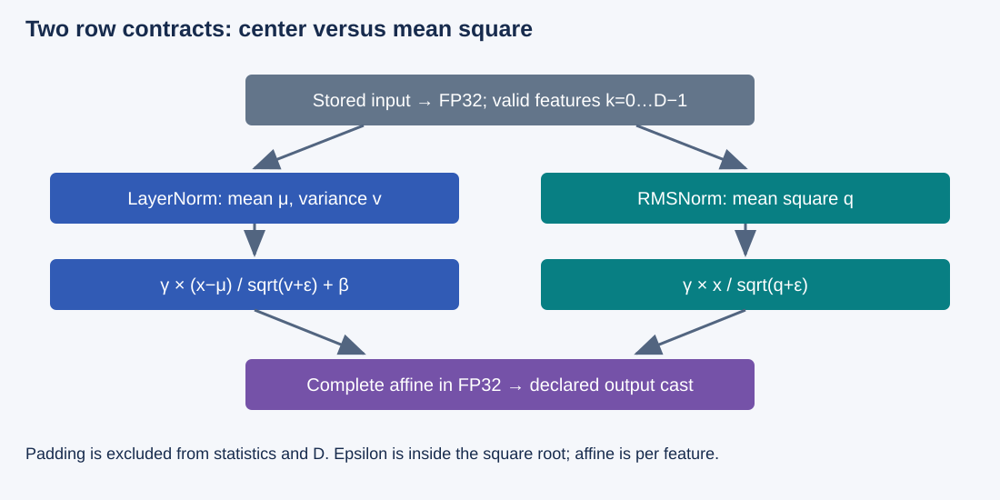
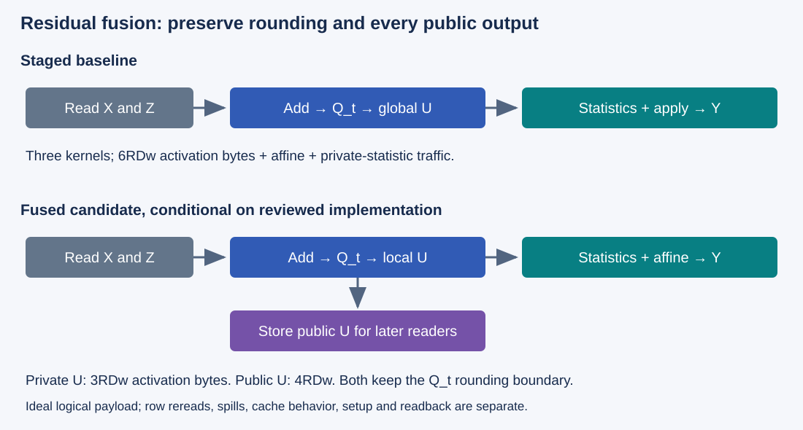

# M4-C17: Designing a fused normalization kernel

> **Status: Complete — detailed chapter authored and documentation validated; experimental procedures are proposed unless explicitly labelled observed**

**Module:** Understand kernels and execution overhead

**Category:** [Kernels, compilers, and execution](index.md)

[Module 4 reading order](../module-4.md) · [Previous: M4-C16](../runtime-and-concurrency/m4-c16-replay-constraints-graph-variants-and-buffer-lifetimes.md) · [Next: M4-C18](../kernels-compilers-and-execution/m4-c18-designing-a-fused-sampling-kernel.md)

[Execution plan and progress](../chapter-execution-plan.md)

## Target concepts

LayerNorm versus RMSNorm, row-wise reductions, epsilon placement, affine parameters, residual fusion options, accumulation precision, output dtype, traffic and launch savings.

## Concepts

### 1. Freeze the normalization contract before fusing it

Normalization transforms a row of features using statistics of that row. It is not a correctness check or a probability normalization. Flatten leading dimensions into R independent rows of width D; feature index k runs from 0 to D−1. A token's hidden features form one row. Do not reduce across tokens or requests.

For row x, define mean **μ = Σx_k/D**, population variance **v = Σ(x_k−μ)²/D**, and mean square **q = Σx_k²/D**. Population variance divides by D, not D−1. With positive epsilon ε and learned per-feature scale γ and optional offset β:

**LayerNorm: y_k = γ_k (x_k−μ) / sqrt(v+ε) + β_k.**

**RMSNorm: y_k = γ_k x_k / sqrt(q+ε).**

The [Layer Normalization paper](https://arxiv.org/abs/1607.06450) motivates per-example statistics and affine gain/bias. The [RMSNorm paper](https://arxiv.org/abs/1910.07467) proposes a different operation without re-centering. Neither authorizes replacing one by the other in a fixed checkpoint. This chapter's RMSNorm has scale and no offset; LayerNorm uses both. If a model omits LayerNorm bias, that omission is part of its contract.

| Input, γ=1, β=0, ε=1 | LayerNorm | RMSNorm |
|---|---|---|
| [1,3] | [−1/sqrt(2), 1/sqrt(2)] | [1/sqrt(6), 3/sqrt(6)] |
| [3,3] | [0,0] | [3/sqrt(10), 3/sqrt(10)] |
| [0,0] | [0,0] | [0,0] |
| One feature [a] | [0], before adding β | [a/sqrt(a²+1)] |

For [1,3], μ=2, v=1 and q=5. Epsilon inside the square root gives denominator sqrt(2) for LayerNorm; putting it outside gives sqrt(1)+1=2 and incorrectly changes outputs to [−0.5,0.5]. The deliberately large ε=1 makes the distinction easy to see; use the checkpoint's explicit value in a real model.

Affine parameters are indexed by feature, shared across rows. For γ=[2,0.5], β=[1,−1], the LayerNorm result becomes **[1−sqrt(2), −1+1/(2sqrt(2))]**. Applying bias before normalization or using one scale per row changes the function. Constant rows produce β under LayerNorm, not necessarily zero after affine transformation. Before affine transformation, LayerNorm's output variance is **v/(v+ε)**, not unconditionally one. RMSNorm's output mean square is **q/(q+ε)**. These are useful exact-reference identities, not substitutes for coordinate checks.

### 2. Row reductions need valid counts and stable statistics

A reduction combines many values into a statistic. Threads may process a rounded-up capacity P larger than D. Inactive positions must contribute neither samples nor count. For a three-feature row, reducing four positions and dividing by four changes both statistics even if the extra value is zero. Padding is storage/execution capacity, not another feature.

*Figure 1. Only valid feature coordinates enter the statistics. LayerNorm and RMSNorm use different statistics, but share the need for explicit epsilon, affine and output rules.*

A numerically stable LayerNorm reference can center around the mean before summing squared deviations. Computing variance as q−μ² is algebraically equal in exact arithmetic but vulnerable to cancellation. For stored FP32 values [10000,10001,10002,10003], exact v=1.25. Exact q=100030003.5 and μ²=100030002.25 both round to **100030000** in FP32; subtracting those rounded moments gives zero. Clamping the result to zero avoids a negative square root but does not restore the lost variance.

A parallel candidate can combine **Welford states** (n,m,M2): valid sample count, mean, and sum of squared deviations. For two nonempty groups a and b:

**n = n_a+n_b; δ = m_b−m_a; m = m_a+δ n_b/n.**

**M2 = M2_a+M2_b+δ² n_a n_b/n; v = M2/n.**

An empty group is an identity: merging it returns the other group without evaluating a division by zero. This explains a reduction contract, not an implementation or a promise of bitwise-identical reduction order. RMSNorm instead needs a valid-count sum of squares; it does not need a centered variance. Different parallel groupings can still round differently.

FP32 accumulation reduces many low-precision risks but does not eliminate them. Squaring a large finite FP32 value can overflow; epsilon cannot repair an infinite moment or NaN. Use a separately validated scaled/statistically stable path or reject an out-of-contract input before device execution. Do not silently replace unexpected data with zero.

### 3. Input, accumulation, affine and output precision are separate

A dtype is a stored numerical format. FP16, BF16 and FP32 have different precision and representable ranges. **Accumulation precision** is the arithmetic used to combine values; it need not equal input or output storage. A cast converts between formats and can round.

The [ONNX LayerNormalization-17 specification](https://onnx.ai/onnx/operators/onnx__LayerNormalization.html) distinguishes normalization computation precision from its affine stage. [RMSNormalization-23](https://onnx.ai/onnx/operators/onnx__RMSNormalization.html) similarly specifies axes, epsilon and stages. Inspect the model/operator version and cast boundaries; superficially matching formulas need not identify the same mixed-precision operation.

The proposed fixture contract is explicit: promote stored FP16/BF16/FP32 inputs to FP32; compute statistics, reciprocal denominator and affine expression in FP32; cast the completed affine result once to the declared output dtype. γ and β are FP32. This is our study contract, not a claim that every ONNX/framework LayerNorm uses that affine/cast ordering. A model that casts normalized values before affine needs a matching reference and candidate.

NVIDIA's [floating-point white paper](https://docs.nvidia.com/cuda/floating-point/index.html) explains why reduction order and fused operations can change rounding. Record reciprocal-square-root approximation, multiply/add fusion, rounding and subnormal behavior. A final low-precision cast can hide errors in a denominator; validate FP32 diagnostic results or a reviewed equivalent intermediate-observation mode before accepting only low-precision outputs.

### 4. Residual fusion must preserve addition and rounding boundaries

A residual connection adds an update z to an earlier representation x. Normalizing x+z differs from normalizing x and adding z later. Fusion is valid only for the architecture's actual operation order and required outputs.

| Declared residual contract | Value normalized | Required output / rounding |
|---|---|---|
| Materialized residual | U = Q_t(FP32(x)+FP32(z)), then promote U | Preserve the cast Q_t even if U stays local; write U if public |
| FP32 residual arithmetic | U32 = FP32(x)+FP32(z) | Normalize U32; a low-precision saved residual, if any, needs a separately specified relation |
| Post-normalization addition | norm(x)+z | A different function; cannot be substituted for either preceding row |

Q_t denotes round-to-nearest, ties-to-even conversion to the declared residual dtype t. For FP16 x=[2048,2048] and z=[1,−1], materialized residual is **[2048,2047]**, because 2049 is a tie that rounds to 2048. The FP32 residual is **[2049,2047]**. With ε=1, γ=1, β=0, their LayerNorm outputs before output casting are respectively **[1/sqrt(5), −1/sqrt(5)]** and **[1/sqrt(2), −1/sqrt(2)]**. Removing the residual cast is therefore not just eliminating a memory transfer.

If later sublayers use U, it remains a public output even when the normalization is fused. A candidate may compute rounded U once, keep it for statistics/application, and also store it. It may not omit that store or overwrite x/z while another consumer still reads them. The conservative experiments use disjoint read-only inputs and output arrays, no in-place aliasing. Keep Rust allocations and native executable/context handles alive through every GPU and CPU consumer; cancellation does not establish completion.

### 5. Count logical traffic and launches by the actual outputs

A staged normalization baseline uses a statistics kernel and an apply kernel. Let w be activation bytes per element, with equal input/output dtype for this accounting. Assume the fused candidate retains a row locally and reads it once. Per-row logical affine traffic is D×4 bytes for γ, plus D×4 for LayerNorm β; this counts accesses per row even if hardware caches reuse the arrays.

| Path, private row statistics | Activation payload | Affine payload | Nominal kernel launches |
|---|---|---|---|
| Staged normalization | 3RDw: X read for statistics, X reread, Y written | 4RD for RMSNorm; 8RD for LayerNorm | 2 |
| Fused normalization | 2RDw: X read, Y written | Same | 1 |
| Residual add + staged normalization | 6RDw | Same | 3 |
| Fused residual + norm, only Y public | 3RDw: X/Z read, Y written | Same | 1 |
| Fused residual + norm, U and Y public | 4RDw: X/Z read, U/Y written | Same | 1 |

For the staged path, writing and reading FP32 private statistics adds **16R bytes** for LayerNorm's mean/inverse denominator, or **8R** for RMSNorm's inverse denominator. These statistics bytes are additional to the table. If statistics are public outputs, their stores cannot be eliminated. The stipulated counts exclude metadata, instructions, spills, actual cache behavior, readback and setup. A fused implementation that rereads rows or spills private data can exceed its ideal payload.

For R=8, D=4096, w=2, one activation array is **64 KiB**. LayerNorm affine accesses total **256 KiB** across rows, while unique γ/β storage is only **32 KiB**. Logical staged normalization requests **448 KiB + 128 bytes** of private-statistics traffic; ideal fusion requests **384 KiB**. Residual plus staged normalization requests **640 KiB + 128 bytes**; fused private-U and public-U paths request **448 KiB** and **512 KiB** respectively. These are logical byte predictions, not DRAM measurements or latency ratios.

*Figure 2. Fusion may remove a temporary's write/read when no later consumer needs it. Public residual output and a declared rounding boundary remain obligations.*

The [Triton Layer Normalization tutorial](https://triton-lang.org/main/getting-started/tutorials/05-layer-norm.html) is primary implementation-oriented reading on row reduction and fusion; this chapter supplies no code. A row-resident design can increase registers, live values and spills. Long rows, small R, scheduling and memory bandwidth may favor a staged or differently tiled path. Use [M4-C09](m4-c09-register-pressure-occupancy-and-spills-in-kernel-design.md) and [M4-C10](m4-c10-shape-specialization-padding-and-dispatch.md) to define a supported shape family and safe fallback, not an assertion that one kernel covers every width efficiently.

### 6. Connect local savings to useful generation

A removed launch helps only where submission lies on the critical path; saved logical bytes help only to the extent they reduce relevant resource demand. A constructed serial request with 20% of its time in normalization and a 2× faster normalization would have speedup **1/(0.8+0.2/2) = 10/9 ≈ 1.111**, assuming all other work and outputs unchanged. Actual queueing, overlap, preparation and resource contention can change the result.

The HFT systems lens asks whether fewer boundaries make correct state available sooner under the intended arrivals, with bounded retained state and predictable recovery. Neural normalization is not an exchange risk check, and these examples make no trading claim. Record request/token identity, first/inter-token publication and end-to-end latency before promoting a local kernel improvement.

## Experiments

All studies below are **proposed**. Use an existing reviewed reference and candidate path or leave the unavailable comparison pending. No kernel implementation, sanitizer run, device profile or measured speedup is supplied.

### Shared reference, fixtures and numerical gates

Treat input as R independent contiguous rows. Use R={1,8,32}, D={1,3,31,32,33,127,128,129,255,256,257,1024,4096}, epochs e={0,1,2,3}; input/output dtype in {FP32,FP16,BF16} where supported. γ cycles [1,0.5,−1,2] by feature; LayerNorm β cycles [0,0.25,−0.5]. Set ε explicitly to 1 or 2^−10 in separate fixture cells; real-checkpoint runs use its original epsilon.

Regular input **X[j,k] = ((17k+11j+5e) mod 33)−16** and residual **Z[j,k] = ((3k+2j+e) mod 9)−4** use zero-based indices and nonnegative modulo. These small integers and sums are exactly stored in all three input formats. Validate norm-only and materialized-residual contracts separately. R=0 returns empty output without a kernel launch; positive R with D=0 is rejected. Unsupported shape, dtype, layout or aliasing selects a reviewed eligible fallback or is rejected before submission.

Add explicit correctness probes: all zeros; constant rows; [1,3]; alternating ±1/32; the offset FP32 row [10000,10001,10002,10003]; and the FP16 residual rounding example above. Keep large finite overflow, NaN/infinity and invalid metadata outside timed normal cells, as guarded contract/recovery tests; do not let a NaN comparison count as a pass.

Compute an independent high-precision reference from the **stored inputs and declared cast boundaries**, using centered variance or exact moment identities before high-precision square roots. Reconcile at 80 and 120 decimal digits. For regular bounded fixtures, propose the FP32 pre-output gate **|candidate−reference| ≤ 2×10^−5 + 2×10^−5 |reference|**, with explicit finite-result checks. This is a conservative study acceptance budget, not a theorem for arbitrary data or an achieved result; validate it against the actual reference/backend before timing. Apply separate statistic and denominator checks and exact small counterexamples so a coarse output budget cannot hide a wrong norm or epsilon.

For FP16/BF16 outputs, compare to the independently rounded reference and allow at most one local output ULP after the FP32 diagnostic gate passes. A ULP is spacing between adjacent values in that output format; use the larger adjacent spacing at a boundary and the format's subnormal spacing at zero. Record flush-to-zero behavior; unsupported subnormal semantics fail this contract rather than silently widening its budget. A missing reviewed diagnostic path leaves that part of validation pending. Numerical approximation beyond these gates requires a separately approved mathematical contract, not post-hoc tolerance inflation.

At R=32,D=4096 with two residual inputs plus U/Y outputs, activation payload is at most **2 MiB** for FP32; γ/β add 32 KiB. Budget 64 MiB each for host/device fixtures, separately reporting reference storage, private statistics, compiled binaries, graph instances and profiler buffers. No in-place reuse; retain all inputs/outputs through their last readers.

### E1 — Establish normalization semantics and precision

- **Name:** Row-statistic and affine reference matrix.
- **Description:** Compare existing LayerNorm and RMSNorm implementations with their separate independent references over boundary widths and dtype cells.
- **Purpose / objective:** Detect wrong reduction axes/counts, epsilon placement, affine indexing and cast boundaries before speed comparisons.
- **Target concepts:** LayerNorm versus RMSNorm, row reductions, epsilon, affine parameters, accumulation precision and output dtype.
- **Baseline and hypothesis:** Reviewed operation-matched reference is baseline. Hypothesis: a fused candidate can preserve each specified norm, but swapping norms or changing precision stages will fail discriminating fixtures.
- **Workload and controls:** Shared regular/correctness matrix; fixed binary, epsilon, row strides, γ/β and declared dtype path per cell. Reset outputs and isolate reference collection from timed measurements.
- **Procedure:** Compare every output coordinate and diagnostic statistic with 80/120-digit references. Verify D=1, constant rows, zero rows, non-power-of-two masks and per-row isolation. Check output rounding, finite status and the variance-cancellation/FP16-residual witnesses. Use invalid-axis/count/epsilon alternatives only as mathematical counterexamples, not accepted candidate variants.
- **Hardware and failure conditions:** Manifest below; guard unsupported dtypes, invalid extents/aliasing and nonfinite data according to the declared contract. Use a reviewed memory-safety tool in separately labelled trials if available; no unsafe deliberate pointer access.
- **Exit criteria:** All required semantic/numerical gates and bounds checks pass for the declared supported family; failures narrow eligibility or keep the candidate unavailable. No performance conclusion before this gate.

### E2 — Compare staged and fused normalization

- **Name:** Row-width and traffic/launch comparison.
- **Description:** Compare two-kernel statistics/apply baseline with an existing fused norm under the same operation and dtype contract.
- **Purpose / objective:** Determine where reduced launches/logical traffic improve completed operation time and where row resources limit the candidate.
- **Target concepts:** Row reductions, accumulation precision, output dtype, traffic and launch savings.
- **Baseline and hypothesis:** Staged operation-matched baseline. Hypothesis: fusion may help short rows or small request work, while large row live state, spills or occupancy can offset savings.
- **Workload and controls:** Shared R/D/dtype matrix, each norm separately, fixed ε/affine values and input residency. Five paired sessions, 20 completed warm-ups and 100 measured invocations/arm/cell; use the pairing/state rules in M9-C11. Baseline has one final completion observation, not a host wait after every kernel.
- **Procedure:** Recheck E1 gates, then measure host submit, completed device chain and full caller boundaries separately. Count launches and actual allocated/statistic bytes. Compare logical payload estimates with focused profiler evidence for reads/writes, register use, spills and resource limits on separate diagnostic runs. Preserve cold compilation/first-use and preparation-inclusive results.
- **Hardware and failure conditions:** Archive specialization, row strategy and compiler/resource report. Record fallback, allocation failure, preemption, trace loss and timing uncertainty; no claim that nominal byte savings equal measured bandwidth savings.
- **Exit criteria:** Equivalent outputs, valid supported shape selection, reconciled counts and a reproducible benefit/no-benefit map with uncertainty. Do not infer model speedup from the microbenchmark alone.

### E3 — Preserve residual rounding and public state

- **Name:** Residual fusion with private versus public U.
- **Description:** Compare residual-add plus staged norm with reviewed fused variants that preserve the materialized-residual cast, separately for Y-only and U/Y outputs.
- **Purpose / objective:** Verify that eliminating storage does not remove a rounding boundary, required residual output or reader lifetime.
- **Target concepts:** Residual fusion options, accumulation/output precision, affine parameters, traffic and launch savings.
- **Baseline and hypothesis:** Three-kernel materialized-residual baseline is reference. Hypothesis: private-U fusion may save more traffic than public-U fusion, but both must preserve Q_t and all consumer obligations.
- **Workload and controls:** Shared X/Z matrix and FP16 rounding witness, both norms and explicit output policies. Five paired sessions, 20 warm-ups and 100 invocations/cell; fixed allocator, producer dependencies, binary identities and reference cast contract. The FP32-residual alternative is a separate semantics study, not the same baseline.
- **Procedure:** Independently calculate rounded U and normalized Y; compare public U bitwise and Y with E1 gates. For private U, use a reviewed diagnostic path or preserve a separate reference witness. Archive consumer fan-out and last-reader retirement. Measure caller/device time and live/retained bytes, then reconcile payload for private/public output paths. Model rejected in-place reuse, cancelled callers and delayed readers without executing a race.
- **Hardware and failure conditions:** Record supported residual/output dtypes, graph slot bindings and alias policy. Unknown completion retains arrays; unsupported fusion selects a checked pre-submit fallback. Errors after submission require drain/recovery rather than duplicate publication.
- **Exit criteria:** Correct rounding and required outputs, no unauthorized overwrite/reuse, bounded retained memory and separately scoped performance conclusions for the two output policies.

### E4 — Verify normalization in the existing generator

- **Name:** Model contract and useful-service regression gate.
- **Description:** Evaluate an already available fused-normalization path only after confirming the checkpoint uses that norm, epsilon, affine and residual order.
- **Purpose / objective:** Establish whether local normalization savings improve useful text generation without numerical, token or ownership regressions.
- **Target concepts:** All normalization/fusion concepts in their model context, especially precision, residual state and end-to-end savings.
- **Baseline and hypothesis:** Current reviewed generator path is baseline. Hypothesis: local savings may have small or workload-dependent service effects and must not change model behavior.
- **Workload and controls:** Prompt lengths {32,128}, output caps {8,32}, fixed token IDs/model/tokenizer/adapters/precision and deterministic stopping. Use 20 scratch warm-ups/class then restore declared prefix/request state. Five paired sessions/arrival pattern, 400 attempts/session, 100/class: one per 100 ms or bursts of ten each second for 40 seconds. Keep cache/admission/batching/publication and instrumentation fixed; drive offered arrivals independently of completion and drain 60 seconds after the final arrival.
- **Procedure:** Validate intermediate norm/logit references under the original model tolerance, token IDs and stopping/publication before timing. Archive first divergence rather than accepting a changed token stream as equal work. Measure queueing, first/inter-token and terminal latency, useful completion rate, CPU/device time and retained memory; correlate representative norm windows separately. Exercise cancellation/overload and safe fallback in labelled fault studies.
- **Hardware and failure conditions:** Full machine/model manifest; classify failed, rejected, cancelled and unfinished attempts. Missing reviewed candidate/model validation leaves this study pending, with no fabricated runtime or generator result.
- **Exit criteria:** Reference/numerical/token/stopping gates and safe ownership pass; all 400 attempts reconciled; setup/fallback-inclusive useful service has no unexplained tail or memory regression. A kernel-only speedup is insufficient.

## Verification

| Match | Correctness reference | Measurement and profiling | Acceptance and limit |
|---|---|---|---|
| V1 ↔ E1 | Stored-input high precision, correct axes/count, ε/affine/casts and finite results | Stage diagnostics, output ULPs, valid masks and row isolation | Pass the declared numerical family; changed norm or residual rounding is a different function |
| V2 ↔ E2 | Operation-matched E1 gate, disjoint buffers and checked completion | Paired completed intervals, launch counts, logical/actual traffic, registers/spills and cold/warm costs | Supported shape map with uncertainty; ideal byte counts do not certify runtime benefit |
| V3 ↔ E3 | Bitwise U where public; Y budget and last-user ledger | Private/public payload, live/retained state, fan-out and caller time | Preserve Q_t, required outputs and safe retirement; no alias shortcut without a new proof |
| V4 ↔ E4 | Checkpoint norm/residual/dtype contract, logits/tokens/stopping and attempt identities | Class-specific service latency/rates, resource and fault outcomes | Useful generation and recovery remain correct; unavailable real paths stay pending |

Apply [M9-C01](../numerics-and-correctness/m9-c01-defining-reference-behavior-and-evidence-before-optimizing.md), [M9-C17](../numerics-and-correctness/m9-c17-comparing-logits-with-justified-numerical-tolerances.md) and [M9-C02](../measurement-experimentation-and-economics/m9-c02-request-events-clocks-and-measurement-boundaries.md) to references, numerical budgets and completion scope. LayerNorm centering/variance and RMSNorm mean-square checks are different. A final-token match alone cannot certify all intermediate values, just as a small intermediate error alone cannot authorize a changed stopping decision.

Use [M9-C11](../measurement-experimentation-and-economics/m9-c11-controlled-comparisons-warmup-and-reproducibility.md) for state resets, paired sessions and raw artifact retention, and [M9-C07](../measurement-experimentation-and-economics/m9-c07-latency-distributions-and-statistical-uncertainty.md) for uncertainty. Five pairs are an initial design, not guaranteed precision. Predeclare practical performance/memory budgets and treat effects below collection variability as unresolved. Do not discard slow sessions solely for being slow.

For tails, report estimator, eligible count and class. One hundred attempts/class/session is weak extreme-percentile evidence and establishes no production p99 guarantee. Retain rejected/cancelled/failed/unfinished outcomes and original offered arrivals. Profile in separate diagnostic runs with documented clock/cache/replay settings and loss counters; host waits and device execution may overlap and must not be added twice. Correctness, memory-safety diagnostics and performance establish different evidence.

**Evidence status:** Formulas, numerical witnesses and logical byte counts are mathematical/constructed examples. Documentation reference checks do not establish candidate accuracy, sanitizer success, measured traffic or generator speed. Device, profiler and service studies remain proposed until actual binaries, configuration and raw outcomes are archived.

## Engineering dimensions and principles

| Dimension | Chapter-specific application |
|---|---|
| Semantics and invariants | Preserve norm kind, valid feature count, ε, affine/residual order, cast boundaries and all public outputs. |
| Workload and variability | Sweep rows, widths/tails, dtype, constant/offset inputs, consumer fan-out and arrivals; non-text modalities remain out of scope. |
| Resources and bottlenecks | Count logical traffic and actual memory/register/spill behavior; separate parameter reuse from per-row accesses. |
| Time and distributions | Measure completed chains, preparation, publication and request tails; removed launches need an exposed critical-path benefit. |
| Ownership and coordination | Keep read-only inputs and public U/Y alive through producers, GPU consumers and CPU readers. |
| Failure and adaptation | Reject unsupported shapes/aliasing, diagnose nonfinite data and keep cancelled/uncertain state retained until safe recovery. |

| Practical principle | Required action |
|---|---|
| 1. Correctness defines the optimization boundary. | Norm substitution or removed residual rounding cannot masquerade as equivalent fusion. |
| 2. Performance depends on workload and operating point. | Compare row/dtype/output families and service load; retain staged fallbacks where needed. |
| 3. Data movement is part of the algorithm. | Distinguish private statistics/residuals from public outputs and count parameter traffic at a declared scope. |
| 4. State has ownership, lifetime and recovery cost. | Track fan-out, graph bindings and last-user release, including cancellation. |
| 5. Dependencies determine latency; bottlenecks determine capacity. | Profile launch exposure, reductions and resource pressure before attributing end-to-end benefit. |
| 6. Variability and synchronization shape the tail. | Include large widths, mixed requests, scheduling variation and fallback in tail evidence. |
| 7. Local improvements must be evaluated end to end. | Require unchanged model/token/stopping/publication behavior and useful service. |
| 8. Claims require reproducible evidence. | Archive high-precision references, binary/dtype contracts, actual profiles, paired runs and failures. |

## Specifications, articles, and hardware

| Primary source | Scope |
|---|---|
| [Ba, Kiros and Hinton, Layer Normalization, 2016](https://arxiv.org/abs/1607.06450) | Original per-example normalization and affine motivation; historical training results are not this study's performance. |
| [Zhang and Sennrich, RMSNorm, 2019](https://arxiv.org/abs/1910.07467) | Distinct RMS-based normalization; partial RMS estimation is outside this exact-operation contract. |
| [ONNX LayerNormalization-17](https://onnx.ai/onnx/operators/onnx__LayerNormalization.html) | Axes, ε, affine and stage precision; inspect cast ordering rather than assuming interchangeability. |
| [ONNX RMSNormalization-23](https://onnx.ai/onnx/operators/onnx__RMSNormalization.html) | Mean-square normalization and scale/output contracts; record the actual operator version. |
| [Triton Layer Normalization tutorial](https://triton-lang.org/main/getting-started/tutorials/05-layer-norm.html) | Primary row-reduction/fusion reading; no tutorial code is reproduced or implemented here. |
| [NVIDIA floating-point white paper, 13.4](https://docs.nvidia.com/cuda/floating-point/index.html) | Arithmetic rounding, operation order and fused-operation reasoning. |

No particular GPU or model/candidate is claimed to have been used. Proposed device studies require a compatible GPU/runtime/binding, the requested dtype support, safe reduction/transfer capabilities and profiling access. FP32 diagnostic paths are required even where the public output is FP16/BF16; unsupported formats remain outside the accepted family.

| Manifest area | Required specifications |
|---|---|
| CPU / host | CPU model/cores, affinity/NUMA, OS/kernel, Rust/native/framework versions, scheduler/power and competing load |
| GPU / software | Architecture/model/UUID, memory, partitioning/co-tenancy, clocks/power/thermal state, runtime/driver/compiler and actual kernel binaries |
| Operation | Norm kind, R/D, strides/alignment, affine arrays, ε, stored/accumulation/affine/output dtype, rounding/FTZ and residual/public-output policy |
| Resources / ownership | Register/shared/spill report, actual allocated/live/reserved bytes, graph bindings, fan-out, last users and recovery boundary |
| Evidence / service | High-precision corpus, tolerance provenance, profiling settings/loss, pairing/reset logs, model/tokenizer/adapter identity and every request outcome |

Use [M9-C15](../state-memory-and-caching/m9-c15-accounting-for-weights-kv-state-workspace-and-fragmentation.md) for memory scope and [M9-C16](../hardware-architecture-and-topology/m9-c16-recording-hardware-conditions-that-change-measurements.md) for comparable conditions. Revalidate when kernel, checkpoint, precision or fusion boundaries change.

## Continue learning

Next in Module 4 reading order is [M4-C18: Designing a fused sampling kernel](m4-c18-designing-a-fused-sampling-kernel.md). The next authoring chapter is [M5-C18: Choosing chunk sizes and balancing prefill with decode](../scheduling-and-queueing/m5-c18-choosing-chunk-sizes-and-balancing-prefill-with-decode.md), position 125. Follow the [execution plan and progress tracker](../chapter-execution-plan.md). Only M4-C17 is authored in this step.
