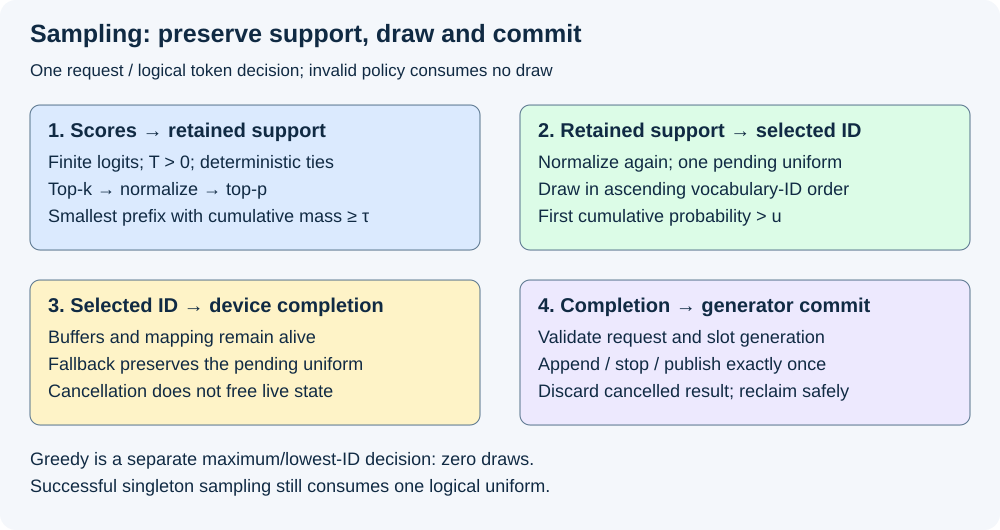
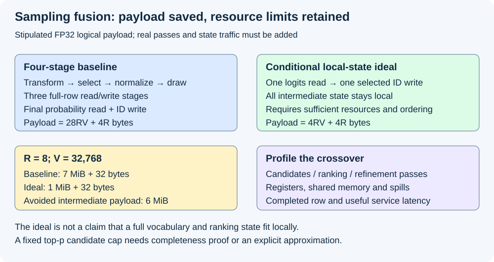

# M4-C18: Designing a fused sampling kernel

> **Status: Complete — detailed chapter authored and documentation validated; experimental procedures are proposed unless explicitly labelled observed.**

**Module:** Understand kernels and execution overhead

**Category:** [Kernels, compilers, and execution](index.md)

[Module 4 reading order](../module-4.md) · [Previous: M4-C17](../kernels-compilers-and-execution/m4-c17-designing-a-fused-normalization-kernel.md) · [Next: M4-C19](../numerics-and-correctness/m4-c19-randomness-reproducibility-and-sampling-equivalence.md)

## Target concepts

Logit transforms, temperature, greedy selection, top-k and top-p boundaries, normalization, random draws, tie rules, vocabulary padding, exact versus approximate sampling contracts.

[Execution plan and progress](../chapter-execution-plan.md)

## Concepts

### 1. Fusion must preserve a decision, not just a probability vector

A sampling kernel turns one row of model scores into a token ID. A **logit** is an unnormalized score; a probability is a nonnegative share of total mass. Fusion keeps intermediate results inside a smaller execution region instead of writing every intermediate array to device memory. The benefit depends on how much movement and launch overhead disappear and how much ranking, synchronization and live state the fused region adds.

The observable contract includes which IDs survive filtering, how ties are resolved, which random draw belongs to a request, and when the result may become visible. Small probability error alone cannot establish the same token. Use the completed [sampling foundations](../model-computation-and-semantics/m1-c15-turning-logits-into-the-next-token.md) and [randomness contract](../numerics-and-correctness/m4-c19-randomness-reproducibility-and-sampling-equivalence.md) as prerequisites. This chapter designs experiments and acceptance boundaries; it supplies no kernel, host implementation or pseudocode.

The working family has R independent rows, V valid vocabulary IDs per row, contiguous FP32 stored logits, FP32 production arithmetic with explicitly recorded reduction/rounding rules, and a 32-bit selected-ID result. Actual vocabulary identity and ID range must fit the public result representation. Strided rows, other storage formats, additional policy transforms and larger ID types require separate qualification. An empty batch R=0 produces no selections or draws; V must be positive for every nonempty row.

| Contract item | Required behavior inherited from M1-C15 |
|---|---|
| Input and mode | Finite valid logits; explicit greedy or sampling mode; reject invalid policy before consuming a draw |
| Greedy | Maximum score, lowest ID on an exact tie; no temperature, filter or random draw |
| Temperature | Sampling requires finite T>0; T=0 is rejected, not a greedy shortcut |
| Top-k | Disabled explicitly, or integer 1≤k≤V; retain exactly k under descending score then ascending-ID order |
| Top-p | Disabled explicitly, or finite 0<τ≤1; for τ<1 retain the smallest ranked prefix whose cumulative mass is ≥τ; τ=1 adds no truncation |
| Stage order | Temperature → top-k → normalization on that support → top-p → final normalization → draw |
| Final selection | Traverse retained probabilities in ascending vocabulary-ID order; choose first cumulative total strictly greater than u, with 0≤u<1 |
| Random ownership | One logical uniform per successful sampling decision, including singleton support; zero for greedy or validation failure |
| Failure | Reject invalid/nonfinite input, invalid draw or unsupported numerical range; no selected token is published from a failed row |

A logical uniform may require several physical generator words. Record that conversion and consumption using M4-C19. The kernel's output is a proposed selected ID, not an instruction to append, decode, stop or publish twice. The generator owns those actions and the one-time state commit.

### 2. Stable normalization and filter order

Let ℓ_i be a stored score and T the temperature. In real arithmetic, subtracting the row maximum before exponentiation gives weights and probabilities

**m = max(ℓ_i) over valid IDs; w_i = exp((ℓ_i−m)/T); q_i = w_i / Σ(j∈K) w_j for i∈K.**

Here exp(x)=eˣ, where e≈2.71828; Σ denotes a sum over the indicated IDs. K is the top-k support, or all valid IDs if top-k is disabled. The maximum shift avoids positive exponential overflow. It does not remove every finite-arithmetic hazard: an extreme subtraction or division at tiny T may overflow, and small weights may underflow. Declare the supported range, exponent/reduction behavior and fallback before measuring. Do not silently turn an unsupported row into a greedy result. This formula is the mathematical specification; the approved staged numerical reference also fixes where each rounding occurs.

Let π list K by descending score and ascending ID. For τ<1, find the least prefix length h with

**h = smallest prefix length with Σ(a=1…h) q(π_a) ≥ τ; S = {π₁,…,π_h}; p_i = w_i / Σ(j∈S) w_j for i∈S.**

For τ=1, S=K without another cutoff search. The cumulative distribution function (CDF) is the running sum of probabilities in a specified traversal order. The ranking order used to construct S differs from the ascending-ID order used for the final CDF. Keeping a sorted temporary array does not authorize drawing in score order: it changes the coupling between a fixed uniform and its token even when the categorical frequencies agree.

Supported logit transforms must be versioned. The default here is identity followed by temperature. A model requiring an additive bias must specify its place before adopting that expanded policy. For example, scores [2,1], bias [−1,0] and T=2 give transformed scores [0.5,0.5] when bias precedes division, but [0,0.5] when bias follows division. Moving a transform across temperature changes the distribution.

The nucleus method motivates keeping the high-probability prefix; it does not define this site's complete tie, composition, finite-arithmetic or draw contract. See [Holtzman et al., The Curious Case of Neural Text Degeneration](https://arxiv.org/abs/1904.09751) for the original sampling discussion.

### 3. A worked row with exact stored inputs

Use five IDs 0…4 and logits **[2,1,1,0,−2]**, all exactly representable in FP32. For T=1 and k=3, K={0,1,2}. ID 1 precedes ID 2 on the tied score. The high-precision mathematical probabilities on K are:

| ID | Stored logit | Probability after top-k normalization | Ranked cumulative mass |
|---|---:|---:|---:|
| 0 | 2 | e/(e+2) ≈ 0.5761168848 | 0.5761168848 |
| 1 | 1 | 1/(e+2) ≈ 0.2119415576 | 0.7880584424 |
| 2 | 1 | 1/(e+2) ≈ 0.2119415576 | 1 |

At τ=0.75, the smallest qualifying prefix is {0,1}. Final probabilities are **[e/(e+1), 1/(e+1)] ≈ [0.7310585786,0.2689414214]**. A supplied u=0.5 selects ID 0; u=0.75 selects ID 1. At k=2, the exact tie must keep ID 1 and exclude ID 2. At T=2 with k=3 and τ=0.75, the first two cumulative masses are approximately 0.4518627619 and 0.7259313809: all three IDs survive. Temperature changes the policy even though the real-arithmetic rank order stays the same.

Order matters without changing any input. With T=1, k=3 and **τ=0.55**, ID 0 alone survives because 0.5761168848≥0.55. Applying top-p to the full five-entry distribution first gives ID 0 mass approximately **0.5292658044**, so the prefix also needs ID 1. Top-k afterward does not undo the difference. A faster implementation of the reversed order is a different policy.

For an exact boundary fixture at the normalization/filter interface, use weights [2,1,1]. Their probabilities are [1/2,1/4,1/4]. At τ=1/2 keep only the first ID; at τ=3/4 keep the first two. This injected-stage fixture isolates the inclusive nucleus comparison. It is not a claim that rounded logarithms recreate those exact weights in a full FP32 pipeline. Test full pipelines from the actual stored logits and reference rounding rules.

*The nucleus uses score order; the final draw uses ascending ID. Selected IDs and request-owned random progress become externally effective only at the generator's commit boundary.*

### 4. Global selection, padding and bounded work

A reduction combines many local results into one row result. Greedy needs a maximum plus the associated ID under a total tie order. It does not need softmax or a random draw. Sampling additionally needs globally correct filter support and a normalizer. Replacing these with independent local decisions changes the operation.

For fixed top-k, retaining each chunk's own best k entries is sufficient to contain the global best k, provided every comparison uses the same total score/ID order. An excluded element already has at least k entries ahead of it in its own chunk, so it cannot enter the global first k. The retained union still requires a global merge; concatenating local winners is insufficient. This is a correctness argument, not a prescribed implementation or a performance promise.

For top-p, a fixed candidate count is not generally sufficient. If V equal-score IDs have equal mass and τ<1, the prefix length is **ceil(τV)**. At V=32,768 and τ=0.9, it is **29,492**. A hard cap of 1,024 candidates cannot implement that policy exactly. A bounded fast path therefore needs a proved completeness condition and a correct refinement/fallback, or an explicitly approved approximation with separate validation. Local nuclei normalized independently do not establish the global nucleus.

Padding rounds a physical row width P up for a dispatch family, but valid IDs remain 0…V−1. Padded entries must be excluded from loads where needed, ranking, reductions and selection. A private −∞ score sentinel can express exclusion; it does not make nonfinite external logits valid. Padding with zero is incorrect for all-negative rows: a fictitious token can win. Probe V=31,32,33 around a 32-wide boundary and V=127,128,129 around a 128-wide boundary, including tied maxima at the last valid ID. Also require invalid-ID checks after selection and no reads beyond the valid allocation.

A row that requires fallback must retain its logical request, token position, policy and pending uniform. Falling back must not draw a second uniform or publish a partial result. A bounded rejection algorithm needs an attempt budget and declared recovery; “keep trying until fast” offers no tail bound.

### 5. A payload ledger and the physical limits of fusion

Consider a stipulated four-stage baseline: transform logits into Z; select support and write unnormalized retained weights W; normalize W into P; draw from P. The selection stage includes the required top-k/top-p normalization decisions. Count one full-row read and write in each of the first three stages, then one probability read plus one ID write in the fourth. Ranking workspace, row statistics, policy/RNG traffic and extra passes are excluded and must be added for a real baseline.

For FP32 rows and 32-bit result IDs, this deliberately simplified logical payload ledger is

**B_base = 28RV+4R bytes; B_ideal = 4RV+4R bytes; ΔB = 24RV bytes.**

The ideal assumes one read of logits and all intermediate state kept locally until the ID write. For R=8 and V=32,768, baseline payload is **7 MiB + 32 bytes**, ideal payload **1 MiB + 32 bytes**, and avoided intermediate payload **6 MiB**. MiB means 2²⁰ bytes. These are neither measured DRAM transactions nor a claim that such a row and its ranking state fit in registers/shared memory. Multi-pass selection, spills, cache behavior and masked lanes can dominate the actual result.

*The lower payload is conditional. A larger live candidate set can cause spills or reduce resident work, and top-p refinement can add passes. Count the actual execution and retained storage.*

The [Triton fused-softmax tutorial](https://triton-lang.org/main/getting-started/tutorials/02-fused-softmax.html) illustrates fusion's movement benefit for rows that fit locally. Sampling adds ranking and random-state obligations; its result cannot inherit that tutorial's performance figures. Report valid and padded widths, launches, actual workspace, register/shared allocations, spills, occupancy and complete row latency by policy family. A one-launch variant can lose to a staged variant if it serializes too much selection work or loses memory-level parallelism.

A useful conditional service model is **S=1/[(1−f)+f/s]**, where f is the baseline critical-path fraction spent sampling and s its isolated speedup, with every other cost and dependency unchanged. If f=0.05 and s=2, S≈1.02564, only about 2.56% overall. This constructed arithmetic predicts no observed gain; measure inter-token completion and useful output directly.

### 6. Numerical equivalence and state ownership

Maintain two references: a high-precision mathematical oracle computed from the actual stored inputs, and an approved staged production reference with fixed exponent, summation, rounding, tie and CDF rules. The former diagnoses numerical errors; the latter defines token-wise compatibility for an existing runtime. Record any difference between them before optimizing. A mathematically accurate replacement can still change an existing staged cutoff and therefore require a policy/version decision.

For the proposed smooth fixtures, require candidate probabilities to satisfy **|p−p_ref|≤10⁻⁶+10⁻⁵|p_ref|** against the mathematical oracle; these are proposed study budgets, not achieved errors. Separately require exactly matching support, selected ID and logical draw consumption against the approved production reference. Near a top-p or CDF boundary, probability tolerance cannot waive a token mismatch. Use adjacent representable thresholds/draws and either reproduce the reference boundary behavior or qualify a common higher-precision fallback for both paths. Do not retroactively loosen the equivalence level after seeing failures.

A distributional-only algorithm can be a legitimate alternative when explicitly chosen, but matching frequencies does not establish token-wise coupling; M4-C19 supplies the distinction and a proposed statistical screen. A smaller candidate cap is an approximation unless its completeness is proved. Quality validation for an approved approximation must additionally use fixed model/task/decoding identities and end-to-end outputs; a probability error budget alone is inadequate.

Rust host ownership must extend across asynchronous native/Triton/CUDA work: logits, output, policy data, uniform storage, workspace and request-generation mapping stay alive until their last device and host users complete. Host return is not device completion. Batch compaction and graph replay must refresh the mapping and per-decision data without changing logical identities. Cancellation marks the result for discard, waits for safe resource reclamation and reconciles random progress once; it does not immediately free buffers or rewind shared state. See [CUDA asynchronous execution](https://docs.nvidia.com/cuda/cuda-programming-guide/02-basics/asynchronous-execution.html) for completion and dependency semantics.

## Experiments

All four experiments are proposed. The observed work for this documentation consists of mathematical/reference arithmetic, document checks and rendered review; no GPU sampling or service timings are claimed. Each experiment records these nine fields so it can be repeated without guessing the contract.

### E1 — Policy boundaries before optimization

- **Name:** Exact inputs, filters and supplied draws.
- **Description:** Compare the approved staged reference, a high-precision oracle and a candidate on small rows; inspect support and intermediate probabilities as diagnostic outputs outside timed production runs.
- **Purpose/objective:** Detect changed stage order, equality tests, traversal and transform placement before benchmarking.
- **Target concepts:** Logit transforms, temperature, greedy, normalization, top-k/top-p boundaries, ties and random draws.
- **Baseline:** M1-C15 policy and the five-entry worked row; injected weights [2,1,1] isolate inclusive cutoffs. Record the staged numerical reference before candidate observations.
- **Workload:** Five-entry row at T∈{0.5,1,2}, k disabled/1/2/3/5, τ disabled/0.5/0.55/0.75/1; supplied eight-bit midpoint uniforms (w+1/2)/256 for every w=0…255. Include exact CDF interface equality and adjacent representable values, tied rows, all-negative shifted rows, greedy, singleton, empty batch, invalid T/k/τ/u and nonfinite input.
- **Controlled variables:** Stored inputs, score-transform order, tie order, reference dtype/rounding, supplied uniforms, row identity and failure policy; never compare independently advanced random streams.
- **Hardware requirements:** CPU capable of independent 80/120-digit reference arithmetic; optional compatible GPU and FP32 diagnostics for actual candidate qualification. No GPU is needed for the analytical fixtures.
- **Exit criteria:** All exact policy, support, ID, failure and draw-count assertions pass; smooth probabilities meet the declared numerical budget; every near-boundary discrepancy is resolved under the chosen reference contract, not hidden by averaging.

### E2 — Global support and awkward vocabulary widths

- **Name:** Ties, candidate completeness and padded tails.
- **Description:** Challenge chunk-local selection and physical padding while preserving the same global policy.
- **Purpose/objective:** Establish that any fast path has complete candidates and cannot select padding or stale data.
- **Target concepts:** Global top-k, top-p refinement, tie rules, vocabulary padding and exact versus approximate support.
- **Baseline:** Full valid-ID reference ranking under the total order; no hard candidate cap in the exact reference.
- **Workload:** R∈{1,8,128}, V∈{13,31,32,33,127,128,129,1024,32768}; tie-rich exact scores ℓ[j,v]=(((17v+11j+5a) mod 19)−9)/4 for a∈{0,1}; equal rows and unique last-ID maxima supplement it. Vary k disabled/1/3/min(8,V)/V and τ disabled/0.5/0.75/0.9/1. Check alternative chunk partitions and the 29,492-entry flat nucleus witness. Cases with V≤129 exhaust the 256 supplied midpoints; larger cases use the 16 fixed midpoints u=(b+1/2)/16 for b=0…15, with boundaries checked separately.
- **Controlled variables:** Valid V versus padded P, layout, padding poison, identity mapping, reference policy and uniforms. Candidate limits and fallback triggers are declared before evaluation.
- **Hardware requirements:** CPU reference plus a GPU only for the proposed kernel/memory-safety study. Budget 128 MiB each for declared host and device fixture storage, separately from model/service storage; reject or rescope cases whose actual ranking workspace exceeds the budget. At the largest shape, four full FP32 row arrays alone occupy 64 MiB.
- **Exit criteria:** Exact global support and IDs for every accepted case; zero padding/out-of-bounds/stale selections or memory-safety findings; all incomplete candidate sets refine/fall back without an extra draw. An approximation is reported as a different policy and cannot pass the exact gate.

### E3 — Where fusion wins or spills

- **Name:** Completed row latency and resource crossover.
- **Description:** Compare staged and candidate execution by policy/shape, alongside untimed profiling runs.
- **Purpose/objective:** Determine whether avoided movement and launches outweigh sorting, refinement, spills and synchronization.
- **Target concepts:** Data movement, normalization/ranking work, specialization, workload variability and bottlenecks.
- **Baseline:** A reviewed staged path implementing the same policy; record its real passes/workspace rather than treating the idealized four-stage ledger as its measured trace.
- **Workload:** E2 shapes with greedy, unfiltered sampling, k=8, and top-p=0.9 both with and without k=8; fixed T=1 and supplied per-decision uniforms. Five paired blocks of 200 completed invocations per variant/case follow 50 warmups per variant/case; alternate AB/BA block order. Test supported eager and graph modes separately, including actual fallback-heavy flat rows.
- **Controlled variables:** Identical stored rows, support/ID checks, uniforms, specialization/cache state, graph identity, buffer reuse, launch boundaries, clocks and background load. Compile/capture/first-use costs are recorded separately; profiling is outside clean timing runs.
- **Hardware requirements:** Compatible GPU with event timing, trace/counter and compiler resource access; host affinity and machine manifest below. No advertised bandwidth value substitutes for observed traffic or elapsed time.
- **Exit criteria:** E1/E2 correctness gates hold; publish paired block medians and uncertainty, completed device and host latency distributions, pass/launch counts, workspace and spill evidence. Claim a local win only when a paired 95% interval for latency ratio is below 1, with the interval method declared first; otherwise report inconclusive/regressed. Do not infer p99 from a few block medians or promote a variant solely on this gate.

### E4 — Request ownership and useful generation

- **Name:** Same decisions through compaction, replay and cancellation.
- **Description:** Insert the qualified sampler at the model-output boundary and compare the complete generator, including terminal outcomes.
- **Purpose/objective:** Establish an end-to-end benefit without changing random streams, token identity, stopping or resource lifetime.
- **Target concepts:** Random draws, ownership, dependencies, failures, graph replay and exact/approximate service contracts.
- **Baseline:** Same checkpoint/tokenizer, production reference sampler, decoding policy and request-owned randomness; fixed greedy and sampling cohorts are separate.
- **Workload:** A versioned 32-prompt corpus: eight prompts in each prompt/output-cap stratum (32/16,128/32,512/64,2048/128 tokens); prompts must actually tokenize to these lengths or be rejected before comparison. At concurrency 1,8,32, run five paired corpus blocks per variant, one at a time per condition, with fixed arrival schedules and request/token identities. Add separate scripted cancellation before launch, after launch/before completion and after completion/before publication; retry, slot reuse and compaction/replay cases. These fault runs are not mixed into steady-state timing.
- **Controlled variables:** Model/tokenizer/adapter identity, EOS and caps, seed/key/draw mapping, batching/arrival schedule, graph variants, hardware, warm state and all request outcomes. Early EOS is retained and counted rather than padded into invented useful work.
- **Hardware requirements:** Device memory for the selected model plus declared workspace/headroom; tracing of host/device completion, request generations and commit events. If unavailable, the study stays proposed.
- **Exit criteria:** Token-wise trajectories, stopping and logical draw accounting match for the exact policy; no duplicate commit, stale selected ID or unsafe reuse under faults. Report useful emitted tokens, errors/cancellations, throughput, time to first token and inter-token p50/p95/p99 with sample counts/uncertainty. Promotion requires a predeclared useful-service improvement and no breached latency/error budget; a local E3 win alone is insufficient.

## Verification

### Matched evidence and acceptance

| Experiment | Reference and measurement | Gate and interpretation |
|---|---|---|
| E1 | Independent high-precision exponent/normalization from stored inputs; exact rational interface fixtures; staged support/ID/draw record | Exact mode/filter/tie/ID/draw/failure agreement; smooth probability budget separately; no tolerance waiver for a boundary token mismatch |
| E2 | Full global reference support, chunk-union checks, poisoned padding, sanitizer reports and fallback trace | No missing candidate or invalid ID; completeness before speed; zero safety findings for the supported family, with tool coverage/limits recorded |
| E3 | Completed device events and host intervals, paired timing blocks; independent traces and resource/counter reports | Same useful row decisions, no hidden synchronization or skipped fallback; compare each operating point and include actual bytes/workspace rather than only the ideal payload |
| E4 | Per-request token and RNG/commit ledger, stopping reference, arrival/completion/outcome records | Exact trajectory and one-time commit before service comparison; include all outcomes and qualify tail estimates; cancelled outputs discarded after safe completion |

Reference calculations for this chapter were independently evaluated at 80 and 120 decimal digits, with exact rational checks for interface boundaries and payload arithmetic. The rounded numbers are illustrative, not measured candidate results. The full proposed workload grids, generator quality, device memory safety, numerical budgets, profiling and service acceptance remain unexecuted.

For boundary tests, export the reference cumulative mass and test its representable predecessor, exact stored value and successor in the declared comparison dtype. CDF equality must advance past that interval; nucleus equality must stop at that prefix. Confirm that zero-mass entries cannot be selected and u=1 is rejected. For reduction-order differences, retain both the high-precision result and production-stage trace so diagnosis can distinguish arithmetic drift from a changed policy. Re-run after changing exponent routine, dtype, tile shape or compiler.

Separate CPU enqueue, device completion, result transfer and generator publication intervals. Count compilations, allocations, fallback passes and synchronization on the critical path. Profile only enough representative cases to explain a result; counter replay/serialization can alter scheduling. Use completed [M9-C02](../measurement-experimentation-and-economics/m9-c02-request-events-clocks-and-measurement-boundaries.md) for timing boundaries. Use M9-C07 for uncertainty, M9-C11 for paired warm-state comparisons, M9-C12/C13 for trace/counter scope, M9-C15 for memory scopes and M9-C17 for numerical acceptance. M9-C19 keeps selected tokens, stopping and emitted text distinct.

## Engineering dimensions and principles

### Six dimensions applied to the sampler

| Dimension | Application and evidence |
|---|---|
| Semantics and invariants | Fixed order, exact ties, inclusive nucleus cutoff, strict CDF, valid IDs and one logical draw; check support and selected IDs, not only probability sums |
| Workload and variability | V, R, T, k, τ and score skew change support size, fallback and specialization; flat rows challenge a fast top-p cap |
| Resources and bottlenecks | Intermediate payload may fall while candidate storage, sorting, spills and workspace rise; trace actual passes and resource allocation |
| Time and distributions | Logits-ready → sampling → selected-ID-ready → generator commit is the dependency chain; fallback and shared queues can dominate tails |
| Ownership and coordination | Request/token identity survives row compaction; pending uniform, output and workspace live through asynchronous completion and last use |
| Failure and adaptation | Invalid policy rejects without a draw; fallback reuses the pending uniform; cancellation discards after completion and reconciles a single commit |

### Eight practical principles

| Principle | Chapter-specific learning path |
|---|---|
| 1. Correctness defines optimization boundary | Preserve M1-C15 policy before fusing; an approximate candidate cap needs separate approval and quality evidence |
| 2. Performance depends on operating point | Compare greedy, k-limited, full-vocabulary and flat-nucleus families separately rather than one average speedup |
| 3. Data movement is part of algorithm | Reconcile 28RV+4R versus conditional 4RV+4R with real ranking passes, state traffic and spills |
| 4. State has ownership, lifetime and recovery cost | Keep request-owned random progress and allocation generations valid until completion/commit, including retries |
| 5. Dependencies govern latency; bottlenecks capacity | A fused launch cannot skip global normalization/ranking dependencies; identify whether launch, memory or selection dominates |
| 6. Variability and synchronization shape tail | Measure refinement, skew, graph misses and device/host joins; mean row time does not establish serving p99 |
| 7. Local gains need end-to-end evaluation | The conditional 2× sampler improvement at f=0.05 yields only 1.02564× overall; validate useful token service |
| 8. Claims require reproducible evidence | Version stored rows, policies, uniforms, rounding, machine state, traces and all terminal outcomes before claiming a win |

The HFT analogy is a market-data decision stage whose tie order, sequence identity, queueing and bounded recovery must be preserved while reducing copies and handoffs. A faster local decision can still delay externally useful work if it increases contention or recovery. The limit matters: probabilistic text selection and a permitted distributional change do not establish equivalence for a financial decision. This chapter makes no trading-performance or execution guarantee.

## Specifications, articles, and hardware

### Primary sources and their scope

| Source | What it establishes here |
|---|---|
| [Holtzman et al., nucleus sampling paper](https://arxiv.org/abs/1904.09751) | Motivation for truncating the low-probability tail; the detailed composed contract is specified locally |
| [ONNX Softmax, version 13 semantics](https://onnx.ai/onnx/operators/onnx__Softmax.html#softmax-13) | Normalized exponential and axis semantics, not a complete sampling operator |
| [PyTorch 2.14 topk](https://docs.pytorch.org/docs/2.14/generated/torch.topk.html) | Tied indices are not guaranteed stable; an unqualified library top-k is not the deterministic tie oracle |
| [PyTorch 2.14 multinomial](https://docs.pytorch.org/docs/2.14/generated/torch.multinomial.html) | Weight validity and categorical API scope; the site's supplied-uniform coupling needs its own contract |
| [Triton fused-softmax tutorial](https://triton-lang.org/main/getting-started/tutorials/02-fused-softmax.html) | Local-fit fusion/resource reasoning; no transferred sampling speedup |
| [CUDA asynchronous execution](https://docs.nvidia.com/cuda/cuda-programming-guide/02-basics/asynchronous-execution.html) | Device dependencies and completion/lifetime boundaries |

Sources checked 2026-10-28. Record exact versions/source snapshots when executing; unversioned documentation can evolve. No GPU model, clock, memory bandwidth or measured benchmark has been supplied. FP32 and diagnostic visibility are requirements for the proposed family, not claims about a machine already tested.

| Hardware/specification area | Required manifest |
|---|---|
| Host | CPU model/cores, NUMA/affinity, OS/kernel, Rust/binding/framework versions, allocator and competing load |
| Device | GPU model/architecture/UUID, effective memory/partition, SM count, clocks/power/temperature and co-tenancy |
| Software | Driver/runtime, compiler/Triton/native versions, actual binary, optimization/fast-math flags and graph capability |
| Operation | R/V/P, strides/alignment, dtypes, score-transform/policy version, exponent/reduction rounding, IDs and valid range |
| State/resources | RNG algorithm/key/counter/word conversion, logical mapping/commit, registers/shared/spills, live/reserved/workspace bytes and buffer lifetimes |
| Evidence | Reference identity, corpus and arrivals, warmup/reset/capture boundaries, timer/profiler settings, uncertainty method and all outcomes |

## Continue learning

Next in Module 4 reading order is [M4-C19: Randomness, reproducibility, and sampling equivalence](../numerics-and-correctness/m4-c19-randomness-reproducibility-and-sampling-equivalence.md), already authored as a prerequisite. The next authoring chapter is [M5-C18: Choosing chunk sizes and balancing prefill with decode](../scheduling-and-queueing/m5-c18-choosing-chunk-sizes-and-balancing-prefill-with-decode.md), position 125. Follow the [execution plan and progress tracker](../chapter-execution-plan.md). Only M4-C18 is authored in this step.
