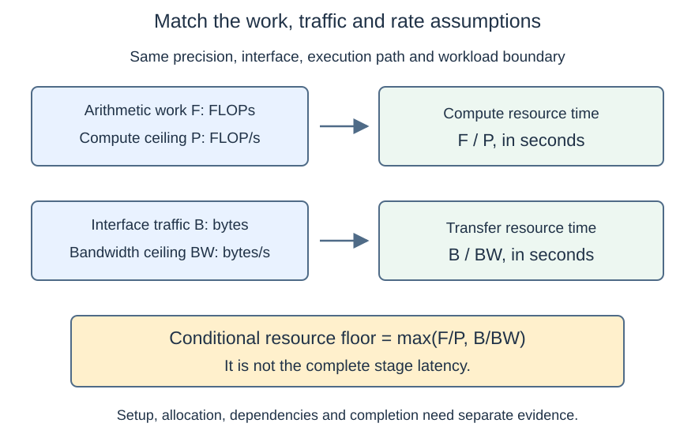
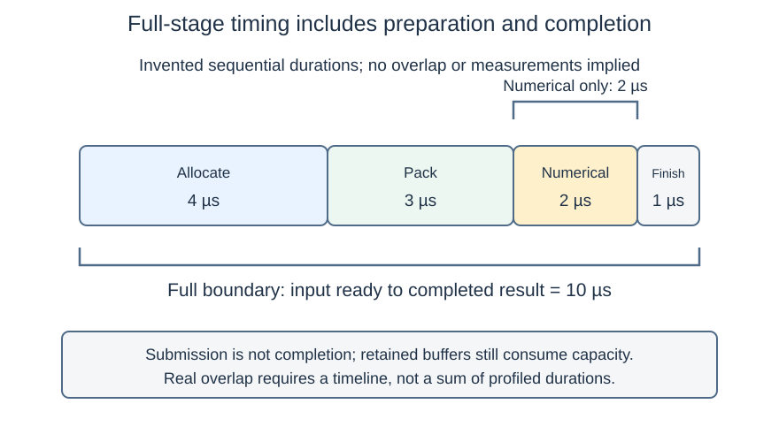

# M1-C08: Operation counts and actual execution cost

> **Status: Complete — detailed chapter authored and documentation validated; experimental procedures are proposed unless explicitly labelled observed**

**Module:** Understand exactly what happens when an LLM generates a token

**Category:** [Measurement, experimentation, and economics](index.md)

[Module 1 reading order](../module-1.md) · [Previous: M1-C07](../numerics-and-correctness/m1-c07-floating-point-arithmetic-and-numerical-correctness.md) · [Next: M1-C09](../model-computation-and-semantics/m1-c09-token-embeddings-and-learned-projections.md)

## Target concepts

Computational complexity, matrix multiplication costs, memory capacity, data movement, bandwidth, throughput, latency, allocation overhead, bottleneck predictions.

## What you should be able to explain

A formula tells you what work a model requires, but not how long that work takes. This chapter turns formulas into explicit resource predictions and experiments that can prove a prediction wrong. You should be able to distinguish a computation count from an instruction count, a stored tensor from memory traffic, and a fast numerical operation from a fast completed inference stage.

Read [M1-C04](../model-computation-and-semantics/m1-c04-dot-products-and-matrix-multiplication.md), [M1-C05](../state-memory-and-caching/m1-c05-how-tensors-occupy-memory.md) and [M1-C07](../numerics-and-correctness/m1-c07-floating-point-arithmetic-and-numerical-correctness.md) first. They establish the matrix, layout and numerical contracts used here. **Experiments below are proposed procedures, with no implementation code or measured performance claims.**

## Concepts

### 1. Complexity describes scaling, not elapsed time

**Computational complexity** describes how work grows as input dimensions grow. For a vector of length K, a direct sum uses K − 1 additions and has linear work, written O(K). The notation O describes an upper growth rate up to constant factors for sufficiently large inputs. For the conventional dense product C = AW with shapes (M, K), (K, N) and (M, N), the direct method has O(MKN) arithmetic work. More advanced multiplication algorithms exist; this chapter's counts concern the conventional dense computation used in its experiment contract.

If M, K and N all double, the conventional 2MKN count introduced below grows by eight, while the combined element count of the three matrices grows by four. The exact direct-operation count includes a lower-order term; its growth approaches that factor rather than equalling it exactly. If only M doubles, work doubles and the weight matrix W is unchanged. These are predictions about quantities, not claims that latency changes by the same factors. A small and a large operation can use different library paths or different fractions of the machine.

**Latency** is elapsed time between defined start and completion events. **Throughput** is completed work per unit time, with a stated population and boundary. Work can be rows, matrix products, bytes or floating-point operations; these are different metrics. Neither O(MKN) nor a hardware peak rate includes all costs of a completed request.

### 2. State exactly which operations are counted

A plain product contains MN output cells, each a K-term dot product. Direct arithmetic gives:

**Multiplications = MKN; additions = MN(K − 1); direct arithmetic count = MN(2K − 1).**

For reporting dense matrix multiplication performance, the usual convention is **F = 2MKN floating-point operations**, or FLOPs. A fused multiply-add, FMA, conventionally counts as two FLOPs although it can be one instruction. F differs from the direct count by MN; keep one convention throughout the comparison. FLOPs is an amount of work; **FLOP/s** is a rate. GFLOP/s and TFLOP/s mean 10⁹ and 10¹² FLOP/s.

The [NVIDIA matrix multiplication guide](https://docs.nvidia.com/deeplearning/performance/dl-performance-matrix-multiplication/index.html) explains this conventional count. A general matrix multiplication, GEMM, can also scale inputs and accumulate old output. Here the scalar multipliers are one for AW and zero for old C: no bias, activation, old-output addition, transpose or approximation is part of F. [Netlib DGEMM, LAPACK 3.12.1 documentation](https://netlib.org/lapack/explore-html/dd/d09/group__gemm_ga1e899f8453bcbfde78e91a86a2dab984.html) specifies that broader contract; it is not a requirement to use its reference implementation or FP64 in these exercises.

For M = 16, K = 256 and N = 128, F = **1,048,576 FLOPs**, while the direct arithmetic count is **1,046,528**. A profiler's executed instruction or hardware operation count can differ because of padding, layout conversion, redundant work or the instruction path. Name which count you are reporting; a conventional rate is not a count of every instruction executed.

### 3. Capacity is a simultaneous-storage question

**Memory capacity** asks what storage must exist at the same time. With q bytes per element, the three dense tensors require:

**L = q(MK + KN + MN) element bytes.**

For FP32 q = 4. At (M, K, N) = (16, 256, 128), A is 16 KiB, W is 128 KiB and C is 8 KiB: **152 KiB** in total. A KiB is 1,024 bytes. Metadata, retained parent buffers, padding, library workspace and allocator reserves are additional costs. A **workspace** is temporary storage used by an operation; an **allocator** manages storage acquisition and reuse.

A view may retain a larger parent allocation, so count each unique live backing allocation once. **Peak live storage** is the largest simultaneous total during the defined interval. **Reserved memory** may include storage held for future reuse even when no tensor currently uses it. These quantities answer different questions.

At M = 64 with the same K and N, the three tensors require **224 KiB**. Under a symbolic 200 KiB element-storage budget, that case must be rejected before allocation; M = 16 fits the simplified tensor budget. This is a paper admission example, not an instruction to force an out-of-memory failure. Actual admission also needs workspace, reserves policy and headroom. Counting fewer FLOPs cannot make an oversized allocation fit by itself.

### 4. Data movement needs a named boundary

**Data movement** means transferring values between locations: allocating and filling a packed buffer, reading weights from memory into cache, writing output or transferring host data to a device. A **cache** is a smaller storage layer that can serve recently used data without another access to the next slower layer. Main memory is commonly called DRAM. An input that is resident in DRAM is not necessarily resident in a CPU cache.

As a simple traffic model for one product, suppose every A and W element is read once across a chosen interface and each C element is written once, with no old-C read. Then:

**B_once = q(MK + KN + MN) bytes; I_once = F / B_once FLOPs/byte.**

The same expression appeared in capacity accounting, but its meaning is different: one is simultaneously stored bytes and the other is a stipulated one-pass transfer model. **Arithmetic intensity** I means operations divided by bytes transferred at a specified interface. Real DRAM intensity needs DRAM traffic; cache-interface intensity needs that cache's traffic. Warm cached weights, repeated reads, write handling and packing can make actual interface traffic differ from B_once. It is a model input, not measured bus traffic or a universal lower bound on DRAM transfers.

| M, with K = 256 and N = 128, FP32 | F, conventional FLOPs | B_once, bytes | I_once, FLOPs/byte |
| --- | --- | --- | --- |
| 1 | 65,536 | 132,608 = 129.5 KiB | About 0.494208 |
| 16 | 1,048,576 | 155,648 = 152 KiB | About 6.736842 |
| 64 | 4,194,304 | 229,376 = 224 KiB | About 18.285714 |

More ready rows can reuse W within the job and amortize its one-pass model cost. Whether a real implementation realizes that reuse depends on layout, blocking, cache behavior and operation selection. This table does not include waiting to collect rows from future requests.

Copying a qKN-byte weight matrix into independent storage adds **qKN logical bytes read and qKN written**, or 2qKN of logical movement. At K = 256, N = 128 and q = 4, that is **262,144 bytes = 256 KiB** for the copy, and another 128 KiB of live weight storage while both buffers exist. Logical copy volume is useful accounting, but physical DRAM traffic still needs matching counters or a justified interface model.

### 5. Bandwidth and compute rates define conditional ceilings

**Bandwidth** is bytes transferred per second across a stated interface. GB/s means 10⁹ bytes/s; GiB/s means 2³⁰ bytes/s. Compute throughput P is FLOP/s for a stated precision and instruction path. A low-precision matrix peak cannot be used as the FP32 ceiling unless the operation actually uses that permitted path.

For work F, interface traffic B, compute ceiling P and bandwidth ceiling BW, a simplified resource model gives:

**T_resource ≥ max(F/P, B/BW).**

Equivalently, **attainable FLOP/s ≤ min(P, BW × I)**, where I = F/B. This is the basic **Roofline** idea in [Williams, Waterman and Patterson's original 2008 report](https://www2.eecs.berkeley.edu/Pubs/TechRpts/2008/Archive/EECS-2008-134.pdf): arithmetic intensity helps relate compute and memory limits. It omits other limits and must use quantities from the same precision, interface and workload conditions.

The crossover intensity is **I_ridge = P/BW**. Below it, the model's bandwidth ceiling is lower; above it, its compute ceiling is lower. Neither region proves the actual bottleneck: a tiny job might instead be limited by dispatch, allocation, dependency latency or insufficient parallel work. A **bottleneck** is the limiting resource or dependency under the stated operating conditions, not an adjective permanently attached to an operator.

For an entirely **invented** machine with P = 1 TFLOP/s and BW = 100 GB/s, I_ridge = 10 FLOPs/byte. Applying B_once at that interface gives:

| M | F/P, µs | B_once/BW, µs | Resource-model floor, µs | Lower model ceiling |
| --- | --- | --- | --- | --- |
| 1 | 0.065536 | 1.326080 | 1.326080 | Bandwidth |
| 16 | 1.048576 | 1.556480 | 1.556480 | Bandwidth |
| 64 | 4.194304 | 2.293760 | 4.194304 | Compute |

A microsecond, µs, is 10⁻⁶ seconds. These are conditional arithmetic predictions, not hardware measurements. If an illustrative nonoverlapping setup cost of 5 µs is added, the estimates become 6.326080, 6.556480 and 9.194304 µs. The setup term can dominate even where the resource-only classification says bandwidth or compute. Real overhead can overlap or change with shape; this addition is not a universal timing law.

*The model needs F, interface-specific B, matched rate ceilings and a declared timing boundary. A prediction that disagrees with measurement is a reason to inspect those assumptions.*

If a measured job beats the model's supposed floor, first check its byte boundary, cache reuse, precision path, count and ceilings. A representative measured rate from another benchmark is not a guaranteed upper bound for this workload; it can provide calibration, not an immutable hardware limit. Do not label a contradiction “super-peak performance” before resolving the mismatch.

### 6. Allocation, preparation and completion can dominate latency

A completed activation stage can include validation, output allocation, packing, dispatch, numerical execution, completion waiting and publishing the result. **Dispatch** is the act of handing work to its executor. Submitting asynchronous work does not mean the result is ready.

A **critical path** is the dependency chain that determines when a result can complete. Allocation must provide output storage before that output can be written; a packed copy must be ready before its consumer uses it. Work can overlap only where dependencies and resources permit. Separate timelines establish actual overlap; adding all separately profiled durations can double-count overlapping work.

*Invented sequential example: allocation 4 µs, packing 3 µs, numerical work 2 µs and completion/publication 1 µs. The numerical interval is 2 µs; the full interval is 10 µs. The widths illustrate these invented durations.*

Reusing output storage may remove allocation from the per-job path. It keeps memory live longer and needs an ownership rule: the prior reader must finish before the next writer reuses that storage. A single ready-job experiment does not certify a concurrent buffer pool. Allocation variability, page initialization and first-use library setup must also be distinguished from steady-state numerical cost.

### 7. Throughput is not the reciprocal of every reported latency

For a completed cohort of M ready rows taking T seconds, **row throughput = M/T** and **conventional compute rate = F/T**. Report K and N alongside them. For an invented M = 16 cohort completing in 20 µs, throughput is **800,000 rows/s**, and its conventional rate is **52.4288 GFLOP/s**. All sixteen rows may still wait 20 µs for cohort completion; T/M = 1.25 µs is amortized time per row, not each row's observed latency.

A service can also queue requests, form batches or overlap work. Its useful completion rate depends on load, deadlines and failures; a local ready-input benchmark is not a capacity test. Waiting to form a larger cohort can erase the numerical benefit. Mean or median time does not establish p99, the value at or below which approximately 99% of a defined observation population falls.

HFT systems motivate this distinction: low per-event critical-path delay and high sustained event throughput are related but separate goals. Here the actual workload is synthetic inference matrix work. No exchange behavior, financial result or production latency target is being modelled.

### 8. Make a bottleneck prediction falsifiable

Before measurement, record a hypothesis, its assumptions and a result that would challenge it. “This is memory-bound” is incomplete. A useful prediction is: “At M = 1, if W crosses DRAM once per job and its traffic dominates, increasing ready-row reuse should improve FLOPs per transferred byte; a profile showing mostly setup time or cache-served W would challenge that explanation.”

Use a **controlled comparison** that changes one relevant condition, with correctness held fixed. Reusing output storage probes allocation; adding a real weight copy probes movement; varying shape probes scaling and available work. CPU samples attribute time to operations, allocation traces show live/peak storage, and hardware counters can expose traffic at specific interfaces. A hardware counter records occurrences or amounts of a defined processor event; its meaning and included traffic must be checked in the tool documentation. No one symptom proves causality. A changed thread count or precision path is another variable to record, not evidence for the original single-variable explanation.

A local speedup must survive the complete relevant boundary. If an invented 1,000 µs inference step contains 900 µs elsewhere and 100 µs of matrix-stage work, halving that stage gives 950 µs, a 5% step-time reduction. Adding 80 µs of packing changes it to 1,030 µs. These are examples of boundary arithmetic, not observed results.

## Experiments

### Shared prerequisites and exact fixture

Use an existing CPU tensor/matrix tool with inspectable output, allocation and completion behavior. NumPy 2.3 matmul or PyTorch 2.14 are possible tools, not an instruction to implement an engine or install a GPU runtime. [NumPy's matmul contract](https://numpy.org/doc/2.3/reference/generated/numpy.matmul.html) provides output and shape semantics; record the actual numerical library underneath it. Keep full FP32 input, multiplication, accumulation and output behavior, with no reduced-precision intermediate mode. Rust remains the eventual implementation language; no code is provided here.

For M rows, K input features and N = 128 outputs, define:

**A[i, k] = ((i + 2k) mod 5) − 2; W[k, j] = ((3k + j) mod 5) − 2.**

mod is the remainder after division; i, k and j start at zero. Use M = 1, 16 or 64 and K = 256 or 1024 unless an experiment selects a subset. Each input lies between −2 and 2, every product is an exact integer of magnitude at most 4, and every dot-product partial sum has magnitude at most 4K ≤ 4096. Full FP32 arithmetic can therefore represent these values exactly. An independent integer calculator supplies the reference C; verify every coordinate, not only a checksum or row mean. Shapes, labels, dtype and transpose/old-output policy are exact contracts.

Inputs are ready, immutable and local before the stated boundary. There is one active job, one runtime thread and no request queue. Different precision, concurrency, unsupported operation or unobserved accumulation mode is a separate experiment. Reject invalid shapes/non-finite inputs and symbolic budget violations; never count failed or cancelled work as a fast success.

### E1 — Count work, storage and one-pass traffic separately

**Name:** Dense-product resource ledger.

**Description:** Derive the matrix counts and three-tensor storage/one-pass model for M = 1, 16 and 64, K = 256, N = 128, then compare with inspected metadata.

**Purpose/objective:** Test whether the cost ledger uses consistent dimensions, units and assumptions before making a bottleneck claim.

**Target concepts:** Computational complexity, matrix multiplication costs, memory capacity, data movement and arithmetic intensity.

**Hypothesis and baseline:** Concepts 2–4 supply exact counts and the table. Predict eightfold work and fourfold dense element storage when all three dimensions double. Predict that M = 64 violates the symbolic 200 KiB tensor budget.

**Workload and controls:** Fix the shared fixture, FP32, plain dense product and no additional workspace in the paper ledger. Vary only dimensions. Paper/spreadsheet tracing requires no special hardware; runtime metadata inspection uses the shared CPU manifest and actual library version. It does not establish bus traffic.

**Procedure:** First derive F, the direct count, each tensor's bytes, unique total and B_once. Calculate I_once with its interface assumption. Then inspect shapes, element width and actual backing allocations, adding exposed workspace separately. Check the symbolic budget before requesting oversized allocation. Finally add an independent W copy to the ledger and predict its additional peak storage and logical movement; do not change the GEMM arithmetic count.

**Systems and HFT connection:** Capacity and transfer budgets constrain activation processing just as resource budgets constrain an event pipeline. This is an inference tensor ledger, not a feed or trading benchmark.

**Exit criteria:** Every count and unit matches its reference; capacity is distinct from traffic; unique buffers are not double-counted. The doubled-dimension prediction and budget rejection are correct. Any hidden allocation is recorded as a discrepancy to resolve, and no measured bandwidth is inferred from tensor size alone.

### E2 — Challenge a shape-based bottleneck prediction

**Name:** Ready-input GEMM shape sweep.

**Description:** Measure one product for all six shared (M, K) configurations and compare scaling with explicit work and traffic-model predictions.

**Purpose/objective:** Test which parts of the first-order model explain completed-job behavior and which assumptions fail.

**Target concepts:** Complexity, matrix costs, bandwidth, throughput, latency and bottleneck predictions.

**Hypothesis and baseline:** At each K, M = 1 is the baseline. Predict row throughput, conventional FLOP/s and relative full-job times for M = 16 and 64 before observing them. Increasing M changes useful work; it is not an equal-work speedup comparison. The invented machine table is a calculation example, not the CPU's calibration.

**Workload and controls:** Fix the shared integer fixture, full FP32, library path options, one thread, C-order inputs and output-allocation policy. Use a valid preallocated output for this experiment and include any internal preparation. Vary M and K only. Freeze hardware/OS conditions and record cache state; repeated W may be cache-served.

**Procedure:** First compare every output with the integer reference. Compute F and B_once per shape, and record their intended interface. If suitable compute/bandwidth calibration data exist for the same hardware/path/interface, record their provenance and limitations; otherwise keep predictions qualitative. Measure randomized paired comparisons against M = 1 at each K using the protocol below. In separate profiles examine setup, numerical work, packing/copies, available traffic counters and their units. Write an explanation of any contradiction, such as setup dominance, cached weights, path changes or an inaccurate byte model. Leave the bottleneck unresolved if evidence cannot distinguish causes.

**Systems and HFT connection:** Ready rows model available inference work. Like event-cohort throughput, improved throughput does not prove lower individual latency when cohort formation is required. This experiment includes no waiting for future rows.

**Exit criteria:** Every shape passes exact correctness. Report latency, M/T, F/T, allocation policy, cache conditions and profile evidence separately by configuration. Explain differences between count scaling and time scaling; do not declare a bottleneck from intensity alone or claim production capacity. Predictions may be falsified without the experiment failing its learning objective.

### E3 — Is allocation on the completed path?

**Name:** Fresh versus reusable output storage.

**Description:** Compare allocating a fresh output inside each job with using an already allocated independent output, at M = 1 and 64, K = 256 and N = 128.

**Purpose/objective:** Test whether allocation/lifetime overhead explains a local latency difference at fixed arithmetic work.

**Target concepts:** Allocation overhead, memory capacity, latency, throughput and bottleneck predictions.

**Hypothesis and baseline:** Fresh output is the baseline. Predict a larger proportional allocation effect for the smaller job, but allow the allocator to reuse storage internally or the difference to be inconclusive. The semantic output is the same C in both routes; all old C values must be overwritten.

**Workload and controls:** Use identical ready A/W, full FP32, one job/thread and the same library product. Change only output acquisition. Preallocation occurs outside the reusable-route timing, but its storage remains counted. Keep common validation and completion rules identical. Actual output/allocator behavior must be inspectable in the chosen existing tool.

**Procedure:** First confirm every output cell and the no-old-C contract, including an isolated prefilled-output negative control. Measure paired full jobs and separate optional numerical intervals. Inspect allocation count, requested versus retained bytes and first-use initialization. In a paper lifecycle trace, propose reusing C while a prior consumer still reads it and require rejection; use only supported runtime fault controls if available. Ensure no next job overwrites C before its reader is done. Record cold first-use observations separately from warmed allocation behavior.

**Systems and HFT connection:** Preallocated event buffers and reusable activation outputs both need a lifetime contract. A one-job result does not certify a concurrent pool, lock-free ownership or a production tail-latency improvement.

**Exit criteria:** Both routes are exactly correct; allocation timing excludes neither route-specific acquisition nor required completion. Record memory retained between jobs and any shifted cost outside timing. A passing reuse study also requires the ownership trace; lower time alone is insufficient. Unsupported fault tests remain explicitly untested.

### E4 — Same FLOPs with an extra movement dependency

**Name:** Immutable weight copy versus resident weights.

**Description:** Compare a ready resident W with a route that explicitly creates an independent W copy before the identical GEMM, using M = 1 or 64 and K = 256 or 1024, N = 128.

**Purpose/objective:** Test whether unchanged operation counts can hide transfer, allocation and cache effects that change full stage time.

**Target concepts:** Data movement, bandwidth, capacity, allocation overhead, latency and bottleneck predictions.

**Hypothesis and baseline:** Resident weights are the baseline. Predict identical F/output and an added 2qKN logical copy volume plus qKN live copy storage in the copy route. The extra preparation may matter more for small M; cache warming can complicate the numerical-only interval, so do not predeclare a universal time penalty.

**Workload and controls:** Fix A/W identities, full FP32 and output acquisition; output is equally preallocated for both routes. Change only the compulsory independent W copy. Use existing copy/product facilities that expose distinct backing storage; an alias is not a valid copy route. Keep every copied W unchanged until consumption completes. Record workspace and CPU environment.

**Procedure:** First verify copy independence and every product output. Compute copy bytes and peak live storage before measurement, then measure paired full jobs with all route-specific allocation and copying included. Inspect narrower copy and numerical stages in separate profiled runs; do not add overlapping durations without a timeline. Compare logical copy bandwidth with interface-specific counters only when they refer to the same boundary. Outside timing, test a stale W identity and a symbolic budget that cannot admit the duplicate allocation; require rejection or a separately validated resident fallback. Account for cancellation after copy submission without premature reclamation.

**Systems and HFT connection:** Moving immutable model weights resembles duplicating a read-only event snapshot for a consumer, but the identities and permitted reuse differ. No actual model reload, exchange feed or device transfer is measured here.

**Exit criteria:** Both eligible paths pass exact output and identity checks; the copy is physically independent. Report unchanged FLOPs, added logical bytes, actual peak storage, full latency and profile limits. Rejections/fallbacks have explicit outcomes and costs. No physical DRAM bandwidth or full-inference gain is claimed without matching evidence.

## Verification

### Module 9 support and target coverage

[M9-C01](../numerics-and-correctness/m9-c01-defining-reference-behavior-and-evidence-before-optimizing.md) supplies the reference discipline; [M9-C02](m9-c02-request-events-clocks-and-measurement-boundaries.md) supplies clocks/completion; [M9-C11](m9-c11-controlled-comparisons-warmup-and-reproducibility.md) supplies controlled pairing. [M9-C15](../state-memory-and-caching/m9-c15-accounting-for-weights-kv-state-workspace-and-fragmentation.md) guides unique/peak storage, and [M9-C16](../hardware-architecture-and-topology/m9-c16-recording-hardware-conditions-that-change-measurements.md) guides hardware conditions. These remain supporting outlines; the necessary introductory checks are stated here rather than assumed completed.

| Target concept | Explanation | Experiment/check |
| --- | --- | --- |
| Computational complexity | Concept 1 | E1 dimension scaling; E2 count versus time scaling |
| Matrix multiplication costs | Concept 2 | E1 exact/direct/conventional counts; E2 valid output and rates |
| Memory capacity | Concept 3 | E1 budget; E3 retained output; E4 duplicate weights and peaks |
| Data movement | Concept 4 | E1 named B_once; E4 real copy and traffic limits |
| Bandwidth | Concepts 4–5 | E2 conditional model/counters; E4 logical versus interface bandwidth |
| Throughput | Concepts 1, 7 | E2 M/T and F/T with shape; valid completions only |
| Latency | Concepts 1, 6–7 | E2–E4 completed boundaries; cohort versus amortized cost |
| Allocation overhead | Concept 6 | E3 acquisition and lifetime; E4 temporary allocation |
| Bottleneck predictions | Concepts 5, 8 | E2 recorded challenge conditions; E3/E4 controlled interventions |

### Reference behavior before timing

Require exact shape, element type, row/column identity and every C coordinate against independent integer dot products. No tolerance is needed for this bounded integer fixture under full FP32 arithmetic: products and all partial sums fit its exact integer grid. This is a stronger fixture-specific statement than “FP32 is accurate enough.” Approximate/reduced modes and non-integer real-model values require new justified gates rather than reusing this exactness claim.

An isolated wrong-shape or stale-weight control must fail before the performance study. A prefilled C must not contaminate the product; the plain-product contract does not read old output. Reference construction and full audits occur outside the performance interval, with the common lightweight metadata/finite-status checks inside. If production acceptance includes a full audit, its cost belongs in that production boundary. Do not compare against rounded printed values or infer correctness from an unchanged checksum.

For E1, independently recalculate every table row, both FLOP conventions, unit conversions, the doubled-dimension example and the symbolic budget decision. For E2–E4, inspect actual numerical and allocation options in the existing tool; output shape alone does not establish its execution contract. A memory alias does not satisfy E4's independence condition. Never perform invalid memory access to demonstrate an ownership failure.

### Measurements, benchmarks and profiling by experiment

| Experiment | Correctness/failure evidence | Reported measurements | Profiling and evidential limit |
| --- | --- | --- | --- |
| E1 | Exact dimensions/counts/bytes, separate storage and transfer models, budget rejection | Work, tensor/peak bytes, assumed one-pass intensity | Metadata can reveal retained parents/workspace; no timing or physical bus result from paper counts |
| E2 | Every C cell, modes and shape identity; invalid/stale controls | Full ready-job latency, rows/s and conventional FLOP/s per shape | CPU stage timeline and matching available traffic counters; absent counters mean interface bottleneck remains a hypothesis |
| E3 | Full overwrite, independent output, no prior reader during reuse | Fresh/reused job times, acquisition count and retained/peak storage | Allocation versus numerical work and initialization; single-job evidence does not validate a concurrent pool |
| E4 | Independent copy, unchanged output, W identity, budget/cancellation outcomes | Full copy-plus-product time, logical copy volume and memory peaks | Copy/allocation/GEMM timeline; logical bandwidth cannot substitute for DRAM counter bandwidth |

**Measured conventional compute rate = F/T**, with F's convention and T's interval recorded. **Logical effective copy bandwidth = 2qKN / T_copy**, where T_copy includes the explicitly stated allocation/completion policy. It is not physical bus bandwidth. Hardware counter bytes divided by a matching counter interval can estimate an interface rate only if the counter's definition, units and included traffic are known. Do not divide chip-wide bytes from other jobs by this job's narrow interval.

For E2, report the invented-machine calculation separately from all actual observations. Real calibration must name precision, thread count, device placement, memory level, input size and cache conditions. If only theoretical peaks are available, the model remains an ideal ceiling. If measured characteristic rates are used, label predictions empirical and allow the target workload to exceed those characteristic rates. Explain cache reuse before interpreting B_once/BW as a hard floor.

### Clock boundaries, repetition and uncertainty

Use one monotonic host clock, whose readings do not jump with wall-clock adjustments. A full job starts when common inputs are ready, before route-specific validation, allocation, packing or copying, and ends when all output rows are complete and usable, with temporary readers finished. E3's fresh output acquisition and E4's independent copy stay inside their respective full intervals. Preallocated outputs still occupy memory and have preparation outside the measured window; report that exclusion. The reusable output may be retained after a job only if no later writer races its reader.

A narrower numerical interval begins after required preparation and ends at numerical completion. Label it explicitly. On an asynchronous device, host submission and device completion are different events: use documented completion waiting and distinguish device-only events from host-stage time. No subtraction of unrelated clocks is permitted without correlation. [PyTorch 2.14 benchmark utilities](https://docs.pytorch.org/docs/2.14/benchmark_utils.html) document warmup, controlled threads and accelerator synchronization; that does not automatically make every chosen benchmark boundary correct.

For each E2 comparison at a fixed K and each E3/E4 pair, use five untimed warmup pairs, then **30 randomized-order pairs in each of three independently warmed sessions**. Retain per-pair order and raw values; do not pool shapes or timing boundaries. Pair E2's M = 16 or 64 with M = 1 separately, and label the different work amounts. E1 is arithmetic/metadata validation; optional runtime timing must specify an actual operation and follow the same rules.

Report medians, ranges, between-session variation and paired differences or ratios with their definitions. If the effect is comparable to variation, report inconclusive. If jobs are too short relative to timer overhead, measure equal declared blocks of jobs and label divided results as per-job estimates; an amortized estimate is not an individual latency distribution. Record resolution and an empty-timing control. Warmup does not establish cold-cache behavior. Record input/cache reuse, allocator state, frequency, competing processes and any first-use initialization. Profile in separate trials and compare profile-on/off overhead. Profilers can alter execution; [Nsight Compute's guide](https://docs.nvidia.com/nsight-compute/ProfilingGuide/index.html) specifically documents replay and metric-collection overhead for GPU studies.

These observation counts are intended to expose gross local effects and variation, not establish p99, a service-level objective or maximum sustainable capacity. Those require representative arrivals, load control, more observations and complete request accounting. Deliberately changing just one tensor dimension is useful experimental control, not a representative production workload by itself.

### Outcomes, ownership and reproducibility

Count every submitted job exactly once as success, rejected, cancelled, failed or incomplete, and reconcile after outstanding readers finish (**draining**). A cancelled or failed job is not a zero-latency success. A stale converted/copied W is a semantic failure even if all output values are finite. When a budget prevents copying, either reject or explicitly record a valid resident fallback with its full cost. Do not remove that outcome from throughput accounting.

Cancellation after submission does not prove the executor stopped reading. Do not recycle A, W, a packed/copy buffer or C until the relevant readers finish. Worker loss with uncertain completion requires retaining or isolating storage until the old executor is known stopped; actual recovery is outside this single-process study. A paper lifecycle trace establishes an expected rule; it does not certify a runtime fault path.

Preserve fixtures and reference outputs, shape, FP32 modes, layouts/strides, library/BLAS patch/build, thread count and path options, backing-allocation identities, ownership timelines, operation-count convention, traffic-interface definitions, counter names/units and theoretical versus measured rate provenance. Record the hardware manifest below, clock start/end events, validation exclusions, cache/allocator state, warmup/pairing order, raw samples, profile settings/overhead and terminal counts. No model checkpoint or tokenizer is used; later real-model evidence must include their identities and representative request inputs.

## Engineering dimensions and principles

### Six dimensions applied

| Dimension | Chapter-specific application |
| --- | --- |
| Semantics and invariants | Plain C = AW, exact fixture arithmetic and full overwrite define valid work. E3 cannot omit initialization dependencies; E4 cannot replace a copy with an alias. |
| Workload and variability | M/K change work, reuse and available parallelism; allocation/cache state changes cost. Ready-row studies exclude burst arrivals and skew. Text-model matrix work is the scope; Module 8 and non-text modalities are excluded. |
| Resources and bottlenecks | Count arithmetic, unique live storage and named-interface traffic separately. E2–E4 investigate CPU execution, bandwidth, preparation and allocation rather than selecting a bottleneck by label. |
| Time and distributions | Full critical-path time includes preparation and completion. Cohort completion differs from amortized row time; warm medians do not establish queueing or p99. |
| Ownership and coordination | Resident weights are immutable; output reuse waits for prior readers. Copy and workspace lifetimes affect peak capacity and safe reclamation. |
| Failure and adaptation | Reject invalid shapes, stale identities and budget violations. Cancellation/fallback counts remain visible, and uncertain completion prevents early buffer reuse. |

### Eight practical engineering principles

1. **Correctness defines the optimization boundary.** Performance counts include only completed valid C values under the declared precision/layout contract. Skipped writes, stale W and reduced-precision shortcuts cannot earn an equivalent-work speedup.
2. **Performance depends on workload and operating point.** E2's M = 1 and M = 64 have different work/reuse balance; E3 allocation can matter differently at each. Record ready-input and cache conditions.
3. **Data movement is part of the algorithm.** E4 adds a weight copy without changing GEMM FLOPs. Distinguish its logical bytes from physical DRAM traffic and include preparation in full-stage timing.
4. **State has ownership, lifetime and recovery cost.** Reused output or copied weights retain memory and identity. Capacity includes simultaneous originals, temporaries and outputs; release waits for consumers.
5. **Dependencies determine latency; bottlenecks determine capacity.** Packing/allocation can precede compute on the critical path. A resource-only ceiling and a single-job latency do not establish service capacity or available overlap.
6. **Variability and synchronization shape the tail.** First-use setup, allocator behavior, cache reuse and waiting for completion can change slow cases. Preserve variation and outcomes; a high conventional FLOP/s says nothing by itself about p99.
7. **Local improvements must be evaluated end to end.** E3/E4 compare complete ready-input stages as well as optional narrow intervals. The 1,000 µs example shows how preparation can erase a numerical gain; real request queueing is additional work to measure.
8. **Claims require reproducible evidence.** F, B, rate ceilings, numeric policy, shape, hardware, clocks, outcomes and raw samples must agree. A mismatched model or missing counter is a limitation to report, not evidence of the predicted bottleneck.

## Specifications, articles, and hardware

### Primary sources and scope

Sources checked on 24 October 2026. Documentation identities state what was inspected, not what was installed or benchmarked.

| Source | Use |
| --- | --- |
| [Williams, Waterman and Patterson, Roofline report UCB/EECS-2008-134, 2008](https://www2.eecs.berkeley.edu/Pubs/TechRpts/2008/Archive/EECS-2008-134.pdf) | Original arithmetic-intensity model and compute/memory ceilings; example hardware figures in this chapter are invented independently. |
| [NVIDIA Matrix Multiplication Background User's Guide](https://docs.nvidia.com/deeplearning/performance/dl-performance-matrix-multiplication/index.html) | GEMM counting and simplified intensity reasoning. Vendor-specific hardware examples are not measurements or universal CPU bottleneck rules. |
| [Netlib DGEMM, LAPACK 3.12.1](https://netlib.org/lapack/explore-html/dd/d09/group__gemm_ga1e899f8453bcbfde78e91a86a2dab984.html) | Shape, transpose and old-output semantics; the experiments select the plain-product subset. |
| [NumPy 2.3 matmul](https://numpy.org/doc/2.3/reference/generated/numpy.matmul.html) | Existing operation shape/output contract. Actual BLAS library and workspace behavior must be recorded. BLAS means Basic Linear Algebra Subprograms, a family of numerical interfaces. |
| [PyTorch 2.14 benchmark utilities](https://docs.pytorch.org/docs/2.14/benchmark_utils.html) | Timing overhead, warmup, thread controls and completion-aware measurement. |
| [Nsight Compute Profiling Guide](https://docs.nvidia.com/nsight-compute/ProfilingGuide/index.html) | Named traffic/compute paths, hierarchical rooflines and profiling overhead in a later GPU extension. No GPU study is performed here. |

### Hardware requirements and measurement manifest

Paper ledgers and invented-machine calculations require no special hardware. For proposed CPU measurements, plan for a 64-bit CPU with at least four physical cores, **8 GiB RAM** and **1 GiB free local storage** for tools and traces. These are planning allowances, not measured usage. Experiments fix one runtime thread; they do not use every available core. The largest shared FP32 A/W/C set, M = 64, K = 1024, N = 128, is **819,200 bytes = 800 KiB** before copies, workspace and metadata. E4's second W can add 512 KiB. Check actual available capacity before running.

Record exact CPU model/instruction support, cores/threads, cache capacities, memory configuration and placement, OS/kernel, affinity (where work runs), power/frequency policy, thermal state and competing load. Record allocator, numerical library, runtime/compiler, precision modes, profile tools and counter definitions. If bandwidth or compute ceilings are quoted, name whether they are theoretical or measured, which interface/path they concern and how they were obtained. Do not invent a DRAM rate or assume cache capacity from a processor family name.

A separate GPU extension needs device/memory model, capacity, driver/runtime/library versions, permitted precision path, host-device placement/interconnect, stream (ordered work queue), completion synchronization and counter/time correlation. Do not compare a host-stage interval with a device-only peak as though both measured the same boundary. A GPU, network service, model checkpoint or exchange connection is unnecessary for these introductory studies.

## Key takeaways

Complexity and operation counts describe work; they do not determine elapsed time. Storage capacity, logical movement and interface traffic need separate ledgers. Roofline-style reasoning gives conditional resource predictions, while allocation, preparation, dependency and completion costs can dominate a real job. State the boundary, validate every output, challenge the bottleneck hypothesis with controlled evidence, and interpret throughput separately from individual and end-to-end latency.
