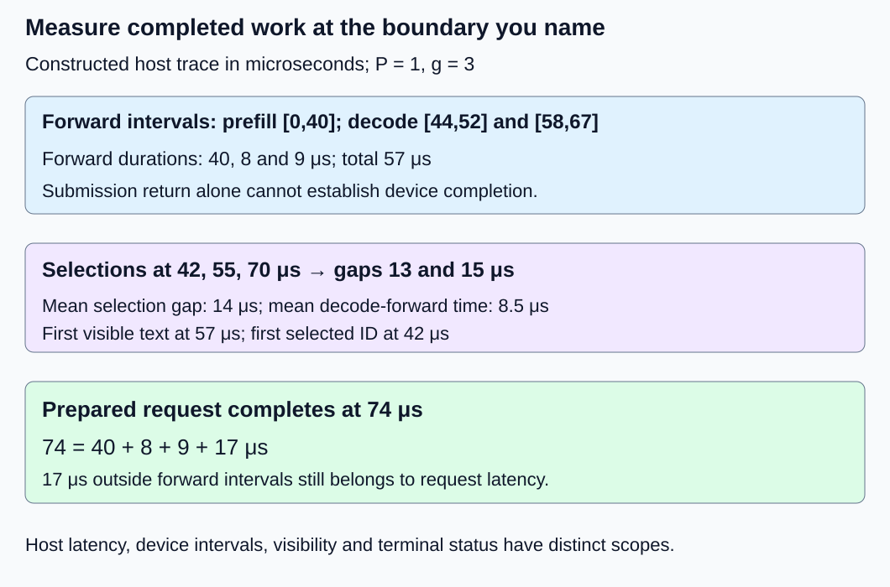
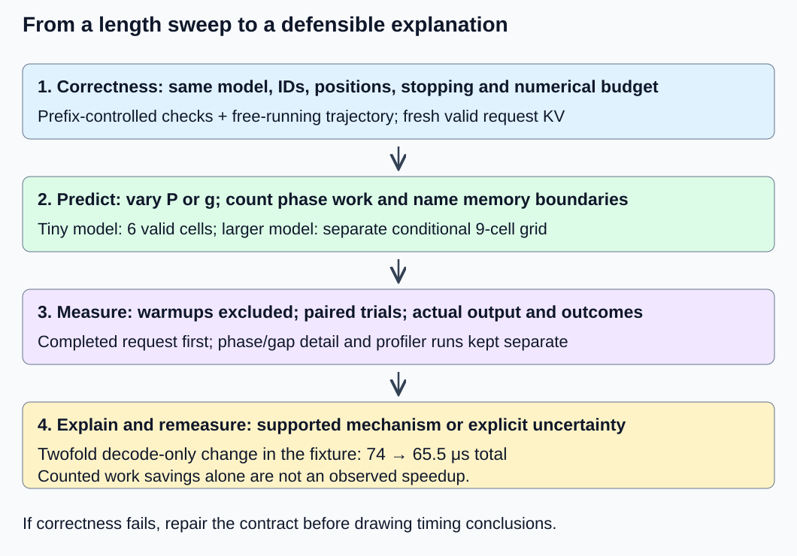

# M1-C20: Measuring and explaining generation latency

> **Status: Complete — detailed chapter authored and documentation validated; experimental procedures are proposed unless explicitly labelled observed**

**Module:** Understand exactly what happens when an LLM generates a token

**Category:** [Measurement, experimentation, and economics](index.md)

[Module 1 reading order](../module-1.md) · [Previous: M1-C19](../numerics-and-correctness/m1-c19-validating-cached-and-uncached-generation.md)

## Target concepts

Input-length and output-length sweeps, prefill time, time to first token, per-token decode latency, total latency, warmup, repeated measurements, correctness checks, predicted versus observed bottlenecks.

## Concepts

### 1. Begin with a correct, completed request

This final Module 1 chapter joins model semantics, KV reuse and measurement into one investigation. A benchmark is a controlled comparison; profiling attributes time or resource use to parts of that work. The deliverable here is an experimental specification, not an implemented generator or observed latency result. Rust remains the eventual language context; no implementation code is provided.

Use [M1-C19’s validation contract](../numerics-and-correctness/m1-c19-validating-cached-and-uncached-generation.md) before comparing cached generation with full-prefix recomputation. Both paths must use the same weights, exact prepared prompt IDs, positions, masks, arithmetic policy, greedy tie rule and stopping contract. A cached path reuses prior per-layer keys and values; the uncached reference recomputes the supplied prefix. Faster incorrect output is a failed comparison.

Let P be the number of prepared input IDs, G the allowed output cap and g the number actually selected, including terminal IDs only under the declared policy. For g ≥ 1, cached generation performs **one prefill and g − 1 subsequent decode forwards**. Prefill processes the prompt and supplies the logits for the first selection; it does not require an extra decode forward for that first ID. An output cap is not proof of g: end-of-sequence (EOS), text stops, cancellation or failure can shorten output. Under the existing empty-output policy, G = 0 performs no forward and has no first-token timestamp.

A prefix-controlled validation supplies identical histories to both paths and compares corresponding logit rows. A free-running validation lets each path select its own next ID and checks the resulting trajectory. Use both: matching selected IDs alone can hide wrong logits, and after a selection divergence the two paths no longer receive the same input. Stop the comparison at first divergence and diagnose its common prefix.

For the bounded FP64 model, retain M1-C19’s coordinate screen **|candidate − reference| ≤ 10⁻¹⁰ + 10⁻¹⁰|reference|**, plus finite values, valid cache lengths and exact greedy IDs, terminal reason and final text. This is a teaching budget for that model, not a general backend tolerance. Approximate arithmetic or a deliberately changed output policy needs its own contract; see [M9-C17](../numerics-and-correctness/m9-c17-comparing-logits-with-justified-numerical-tolerances.md).

### 2. A measurement boundary determines what a time means

Use a monotonic host clock for request intervals. For model-only timing, define t₀ as prepared IDs and resident weights ready, with a fresh empty request cache; tₚ as completed prompt forward with required last logits available; t₁ as first selected ID committed; and t𝒇 as final text and terminal record available after required work completes. Allocation or cache reset after t₀ belongs inside that interval. Model loading, prompt preparation, queueing and network delivery are outside it and must be measured separately when relevant.

**Tprefill = tₚ − t₀; Tfirst-selected = t₁ − t₀; Tprepared = t𝒇 − t₀.**

For selected-ID times t₁,…,t𝓰 on that same clock, **gapᵢ = tᵢ − tᵢ₋₁**, i = 2,…,g. A decode forward’s execution interval is only part of such a gap: selection, dependency handling, allocations or publication may intervene. Client TTFT starts at a declared client submission and ends at a defined client event. It is not Tprefill or Tfirst-selected; [M9-C03](m9-c03-measuring-time-to-first-token-including-queueing.md) defines those distinctions, [M9-C04](../interfaces-protocols-and-streaming/m9-c04-measuring-inter-token-latency-in-a-streamed-protocol.md) prevents inferring token timing from chunks, and [M9-C05](m9-c05-measuring-end-to-end-latency-and-throughput.md) separates last content from terminal completion.

Revisit M1-C18’s constructed microsecond trace: t₀ = 0, tₚ = 40; selections at 42, 55 and 70; first visible text at 57; terminal publication at 74. Decode forwards occupy [44,52] and [58,67]. Thus prefill is 40 μs, decode forwards are 8 and 9 μs, selection gaps are 13 and 15 μs, first-selected latency is 42 μs and prepared completion is 74 μs. First visibility is 57 μs. These are arithmetic fixtures, not hardware timings.

**Tprepared = 40 + 8 + 9 + 17 = 74 μs.** The 17 μs is the complement of the three nonoverlapping forward intervals, including selection, rendering and other overhead. It is not necessarily idle time. For g = 1 there is no inter-token gap, so its mean is unavailable rather than zero. The two selection gaps average 14 μs, while the two decode forwards average 8.5 μs; confusing them discards real work.

*All timestamps belong to one constructed host clock. Distinct metric boundaries remain distinct even in a single-request run.*

For a GPU, a host submission returning does not establish device completion. Use completion-aware host timing for the whole request and device events for declared device intervals. [CUDA Runtime 13.4 event documentation](https://docs.nvidia.com/cuda/cuda-runtime-api/cuda_runtime_api/group__CUDART__EVENT.html) distinguishes recording, querying completion and elapsed-event timing; other stream work can affect an interval. Device intervals and host intervals have different clocks and scopes. Do not add overlapping kernel times or subtract host/device timestamps without justified correlation. Per-step synchronization can itself change execution; compare lightweight request timing with a separate diagnostic trace.

### 3. Sweep lengths without changing the model

A sweep varies one workload dimension over explicit values. First hold output length fixed while varying P, then hold P fixed while varying g; a two-dimensional grid reveals interactions. Keep concurrency at one in this Module 1 experiment. A longer prompt changes prefill geometry and the context read by later steps. More output adds dependent forwards and grows context. Neither change implies a universal linear latency curve.

The mathematical model from [M1-C14](../model-computation-and-semantics/m1-c14-assembling-a-small-decoder-only-transformer.md) has two blocks, hidden width 2, MLP width 3, one head of width 2, vocabulary size 4, FP64 and four absolute positions. Its context contract conservatively requires **P + G ≤ 4**. Use the existing greedy prefixes [1], [1,2] and [1,2,2], EOS ID 3 and no text stop. Their known continuation is ID 2 until the specified length cap. The six valid cells below do not extend that position table.

Using M1-C18’s conventional matrix-only operation count, define **Ffull(S) = 112S + 16S² + 16** for a complete prefix of S positions. The cached total is:

**Fcached(P,g) = Ffull(P) + Σ (j = 1 to g − 1) [128 + 16(P + j)].**

The uncached total is **Funcached(P,g) = Σ (j = 0 to g − 1) Ffull(P + j)**. Σ denotes summation; j indexes later output steps, starting at zero only in the full-prefix sum. The cached sum is empty when g = 1. Multiply-add counts as two operations. These counts cover dense projections, MLP matrix products, attention rectangles and a last-row vocabulary head; normalization, softmax, activations, selection, copies and allocation are excluded. They are work predictions, not executed instruction or memory-traffic measurements.

| P / prepared prompt | G = g | Expected output IDs | Cached forwards: prefill + decode | Fcached | Funcached |
|---|---:|---|---|---:|---:|
| 1 / [1] | 1 | [2] | 1 + 0 | 144 | 144 |
| 1 / [1] | 2 | [2,2] | 1 + 1 | 304 | 448 |
| 1 / [1] | 3 | [2,2,2] | 1 + 2 | 480 | 944 |
| 2 / [1,2] | 1 | [2] | 1 + 0 | 304 | 304 |
| 2 / [1,2] | 2 | [2,2] | 1 + 1 | 480 | 800 |
| 3 / [1,2,2] | 1 | [2] | 1 + 0 | 496 | 496 |

At P = 1, g = 3, recomputation costs 144 + 304 + 496 = 944 counted operations, versus 144 + 160 + 176 = 480 cached. That ratio is about 1.97 in counted work, not a promised speedup. At g = 1, cache reuse offers no later decode savings. A tiny workload may instead expose allocation, call dispatch or timing overhead.

A larger sweep is conditional on a separately supplied, pinned text model with sufficient supported context. An example grid P ∈ {32,256,1024}, G ∈ {1,16,128} has nine cells and maximum P + G = 1152. It is not valid for the four-position model. Fix exact prompt IDs and stopping policy in a published fixture manifest. An intentionally fixed-length diagnostic may disable EOS under a separately named contract; its results must not be relabelled ordinary early-stopping service. In ordinary generation, record actual g and compare matched outcomes rather than assuming every request reaches G.

### 4. Predict bottlenecks, then try to disprove the prediction

A bottleneck is the resource or dependency limiting progress at the specified operating point. [M1-C08](m1-c08-operation-counts-and-actual-execution-cost.md) distinguishes counted work from execution cost. A simplified device bound is **T ≥ max(F/Π, Q/β)**, where F is arithmetic work, Π a compatible arithmetic rate, Q bytes crossing a named memory interface and β its bandwidth. Both ratios are seconds. This omits launches, host coordination, dependencies and other work; logical tensor size is not automatically Q.

Larger prompt matrix products can reuse weights across rows; a one-row decode may obtain less reuse while reading older KV state. Compute-limited prefill and bandwidth-limited decode are hypotheses, not labels to attach from phase names. Tiny shapes can be dispatch-limited, and long-context attention or cache copying can change the dominant cost. Use a timeline to locate delays, then relevant compute/traffic counters to test the explanation. GPU utilization alone does not distinguish these causes.

Amdahl-style reasoning also limits a local speed claim. In the 74 μs trace, only the 17 μs of decode-forward execution is changed by a hypothetical twofold decode optimization; the other 57 μs stays fixed. Then **Tnew = 57 + 17/2 = 65.5 μs**, and **speedup = 74/65.5 ≈ 1.13**. Even removing all decode-forward time leaves 57 μs, an upper speedup bound of about 1.30 for this nonoverlapping fixture. This is a thought experiment, not a measured optimization; overlap or a changed workload requires a new model.

Logical retained KV payload is **2L Hkv N d w bytes** for one request: L layers, Hkv KV heads, N processed positions, head width d and w bytes per element; the factor two counts keys and values. For the small model it is 64N bytes, so P = 1, g = 3 ends with N = 3 processed positions and 192 logical KV bytes. The terminal selected ID need not be processed afterward. Allocator reserves, metadata, alignment, temporary buffers and weights are additional storage. This payload is not measured DRAM traffic.

For sizing only, L = 32, Hkv = 8, d = 128 and w = 2 imply 128 KiB per retained position; N = 1151 implies 143.875 MiB of logical KV. This is an illustrative configuration, not a specified checkpoint or a GPU allocation result. Fit model weights, peak activations, workspaces and allocator headroom as well before attempting a large-model run.

*Predict before measuring. A discrepancy is evidence to investigate, not permission to replace a measured duration with a theoretical count.*

### 5. Warmup and repetition are part of the workload contract

Warmup means preparatory requests excluded from the steady-state timing population. Lazy initialization, compilation and allocator growth can make initial requests different. Distinguish a fresh process/model-load experiment from a resident-model steady-state experiment. “Cold” must identify what was reset: process, request KV, allocator reserve, CPU cache or prefix reuse. Resetting request KV does not make hardware caches cold. Repeated warmups must not accidentally seed shared-prefix reuse or leave valid KV from another request.

The [PyTorch 2.14 benchmark guidance](https://docs.pytorch.org/docs/2.14/benchmark_utils.html) explicitly discusses warmup, thread-count control and asynchronous accelerator synchronization. Those are measurement concerns even when the eventual service is Rust; no Python implementation is required here.

For each cell, retain request-level samples, actual output count, outcome and phase/gap boundaries. A longer output contributes more gaps, so pooling every gap gives long requests more weight. Compare request summaries and per-position gap curves separately. Report mean and median with dispersion and independent-session variation; do not imply a small exercise establishes production p99. A percentile describes a distribution’s position, not a universal deadline. Rejected, failed, cancelled and unresolved attempts remain in outcome accounting even when no token latency exists.

## Experiments

The following are proposed procedures. Reference arithmetic and diagrams are constructed or inherited mathematical fixtures. No inference runtime, CPU/GPU latency or speedup has been measured in this chapter.

### E1 — Reconcile a completed generation timeline

**Description:** Analyse the inherited 74 μs trace at forward, selection, visibility and completion boundaries.

**Purpose/objective:** Detect measurements that confuse submitted work, decode execution and inter-token gaps.

**Target concepts:** Prefill time, first-token latency, per-token decode latency and total latency.

**Baseline and workload:** P = 1, g = 3; prefill [0,40], decode [44,52]/[58,67], selection [42,55,70], first visibility 57 and terminal 74 μs.

**Controls and prediction:** Keep event identities and clock fixed. Predict first-selected 42 μs, visible-first 57 μs, gaps 13/15 μs and residual 17 μs. Removing only terminal publication would change the endpoint, not prove faster equivalent completion.

**Procedure:** Identify each event, subtract local intervals and reconcile the whole request. Review a missing-completion variant and a simulated host-return-before-device-completion record; mark incomplete timing rather than call it a speed gain. For a GPU extension inspect declared stream dependencies and completion evidence separately.

**Hardware/software:** CPU trace review needs no GPU. An actual device extension must record runtime, driver, event mechanism and clock scope; completion-aware host timing remains the primary whole-request boundary.

**Failure and HFT connection:** Source-event, decision and acknowledgement timing in HFT likewise have different endpoints. The analogy concerns dependency accounting, not exchange guarantees or equivalent timing precision.

**Exit criteria:** All durations match the references and no selection gap is reported as pure decode-forward time; missing/asynchronous completion is explicitly diagnosed.

### E2 — Validate the bounded cached/uncached length grid

**Description:** Compare the six small-model cells with both prefix-controlled and free-running correctness gates.

**Purpose/objective:** Test whether work savings preserve the actual Module 1 generation contract.

**Target concepts:** Input/output sweeps, correctness checks, phase counts and predicted work.

**Baseline and workload:** M1-C14’s unchanged FP64 model, prompts and caps from the table, full-prefix reference versus cached candidate, greedy lowest-ID ties and EOS ID 3. Include G = 0 and P + G > 4 as separately labelled policy cases.

**Controls and prediction:** Vary P or G along valid rows; hold weights, precision, output-head strategy, positions, mask and stopping fixed. Predict the table’s IDs/counts and smaller counted cached work only when later forwards can reuse context; predict no universal elapsed-time ratio.

**Procedure:** First replay M1-C19’s prefix-controlled validation with fresh request state. Then compare every selected step’s logits, trajectory, final text, terminal reason and cache length in each free-running cell. Recompute both operation sums. Inject a stale cache length or wrong absolute position as a negative control that must fail; empty output must skip forwards and an over-budget request must reject before model execution.

**Hardware/software:** A CPU capable of FP64 and enough RAM for the tiny reference suffices. Record CPU, thread count, arithmetic library/compiler and reference precision; no pretrained model or GPU is assumed.

**Failure and HFT connection:** Reusing stale state can make a result quick and wrong, as stale market state can invalidate a low-latency decision. The domains’ correctness predicates differ; only the state-validation principle transfers.

**Exit criteria:** All six cells pass numerical, state and exact output gates; invalid cases and deliberate defects are detected. Operation counts agree, while elapsed speed remains unclaimed until separately measured.

### E3 — Repeated single-request benchmark with explicit warm state

**Description:** Specify a paired cached/uncached timing comparison for each of the six valid cells.

**Purpose/objective:** Distinguish steady-state effects, first-use overhead and measurement noise from a cache speed claim.

**Target concepts:** Warmup, repeated measurements, total/phase timing, variability and correctness.

**Baseline and workload:** Three independent process sessions, five excluded warmups per path per cell, followed by 30 paired requests per cell per session. This is 90 pairs per cell, 540 pairs/1080 timed requests overall, plus 180 warmup requests. Only one request is active at a time.

**Controls and prediction:** Randomize and counterbalance pair order. Keep resident weights, exact IDs, compiler/runtime, thread count, allocation policy and output formatting fixed; reset valid request KV before every request in both paths. Predict that timing overhead can obscure this tiny workload’s arithmetic savings.

**Procedure:** Pass E2 first. Start timing at prepared-input/weights-ready with empty logical request state; end at available final text and terminal record after required completion. Record phase events lightly, then run a separate diagnostic subset. Keep startup/model loading outside this resident boundary but report them in a distinct first-use experiment if investigated. Check warmup traces for drift rather than assuming five requests guarantee stability; extend both paths’ warmups under a documented common rule if necessary, revising counts. Compare instrumented and minimally instrumented runs, retaining raw request samples and outcome totals.

**Hardware/software:** Record CPU model, affinity, cores/threads, RAM, OS/kernel, power/frequency policy, monotonic clock resolution, compiler optimization level and numerical/runtime versions. If a GPU backend is supplied, also record GPU/VRAM, driver, interconnect, stream policy and completed-device timing. Inspect clock/capture overhead rather than blindly subtracting it from every sample.

**Failure and HFT connection:** Timing a tiny operation resembles measuring a short HFT decision path where instrumentation and warm state can dominate. These samples establish neither trading deadlines nor production tail reliability.

**Exit criteria:** All scheduled attempts reconcile as success/failure/cancelled/unresolved, output checks pass, and startup/warmup/steady-state populations stay separate. Report paired request differences and session variation; an unresolved difference is an acceptable inconclusive result, not an asserted speedup.

### E4 — Explain a larger-model curve and test a bottleneck hypothesis

**Description:** Design a conditional nine-cell sweep and a separate profiler-assisted explanation for its phase curves.

**Purpose/objective:** Test whether predicted compute, traffic or coordination costs explain complete-request behavior.

**Target concepts:** Input/output-length interaction, predicted versus observed bottlenecks and end-to-end impact.

**Baseline and workload:** Only after a supported model/runtime is supplied, use P = 32/256/1024 and G = 1/16/128, one request at a time. Publish exact prompt fixtures, model/tokenizer revisions, context support of at least 1152, cache policy and reference acceptance. This is a different model from E2; do not carry its logit budget or outputs over automatically.

**Controls and prediction:** Compare cached and full-prefix paths on identical fixtures and stopping. Propose three sessions, five warmups per path per cell and 30 timed pairs per cell/session: 810 pairs/1620 timed requests and 270 warmups. Predict increasing context work and potentially different phase bottlenecks, not universal “compute prefill/bandwidth decode” behavior.

**Procedure:** Establish a model-specific numerical/output reference before timing. Use the same boundary and completion rules as E3, with independent cell order per session. Record actual g and compare matched trajectories; separately label fixed-length diagnostics if EOS is intentionally disabled. Form a prediction from shapes and a named memory boundary, then inspect a representative profiler subset for launches, CPU gaps, copies, cache append/allocation and device compute/traffic. Keep profiler runs outside primary timing samples. Remeasure without heavy profiling after one justified change; test whether request completion improves, using the 74→65.5 μs thought experiment only as an accounting lesson. Retain allocation-failure, cancellation and invalid-context cases separately, with a declared cutoff and release evidence.

**Hardware/software:** The named model’s weights, peak live activations, KV, workspaces and reserves must fit the chosen device memory with recorded headroom. Record hardware specs from E3 plus dtype, attention backend, cache layout, peak allocated/reserved memory and model artifact hashes. Storage/model loading and network are outside resident model timing unless explicitly added as separate endpoints. No device purchase or performance threshold is implied.

**Failure and HFT connection:** A fast local kernel can leave a producer-to-consumer critical path unchanged, as a faster HFT component can leave an external dependency dominant. This comparison concerns inference correctness and latency, not market execution.

**Exit criteria:** Every cell has correct-output evidence, actual lengths, outcome totals, timing distributions, hardware manifest and an explicitly supported or refuted bottleneck explanation. Do not promote a profiler correlation or local speedup into an end-to-end claim without completed-request evidence.

## Verification

| Check | Evidence and acceptance |
|---|---|
| V1 ↔ E1 | Independently recover 40 μs prefill, 8/9 μs decode, 13/15 μs gaps, 42 μs first-selected, 57 μs visible-first and 74 μs completion. Three disjoint forward intervals total 57 μs, leaving 17 μs other work. Diagnose missing completion and mixed clocks. |
| V2 ↔ E2 | Six cells preserve exact prompt/output identity, numerical screen, masks/positions, terminal reason and fresh state. Recompute the table, including 480 versus 944 at P = 1/g = 3. Cached valid state represents P + g − 1 processed positions, not an extra terminal forward. G = 0 has no token timing. |
| V3 ↔ E3 | Reconcile 540 pairs/1080 timed requests and 180 excluded warmups before any extension. The six cells select 10 IDs per one-path grid traversal, so 90 pairs per cell, if all requests complete with the reference outputs, imply 1800 selected-ID observations and 720 subsequent forwards across timed cached/uncached requests. Full-prefix forwards are not cached decode calls. Inspect raw outcomes, clock overhead and session drift. |
| V4 ↔ E4 | Check nine cells, context bound 1152, trial counts and actual g before interpreting curves. Verify 74/(57 + 17/2) ≈ 1.13 only for the constructed trace. Check 64 × 3 = 192 small-model KV bytes and 128 KiB × 1151 = 143.875 MiB sizing example; do not substitute logical payload for measured traffic. |

**Count clarification for V3:** The 720 subsequent forwards comprise 360 cached one-position decode calls and 360 uncached full-prefix recomputation calls after the first forward. They share output positions but perform different work. The verification report must retain those labels rather than treating all 720 as cached decode operations.

Use [M9-C01](../numerics-and-correctness/m9-c01-defining-reference-behavior-and-evidence-before-optimizing.md) for references before timing, [M9-C02](m9-c02-request-events-clocks-and-measurement-boundaries.md) for event/clock uncertainty, [M9-C07](m9-c07-latency-distributions-and-statistical-uncertainty.md) for populations and [M9-C19](../interfaces-protocols-and-streaming/m9-c19-validating-tokenization-stopping-and-final-output.md) for output identity. Advanced controlled-comparison and GPU-profiling chapters remain outlines; the required elementary protocol is supplied here.

The deterministic arithmetic checks require exact counts and rational calculations. Actual timings need units, source resolution, instrumentation overhead, reference validity and outcomes per request. Do not sum overlapping device intervals into host latency or infer p99 from a few long output sequences. Retain median, mean, dispersion, per-position trends and session-level paired comparisons; extend independent evidence when uncertainty changes the conclusion. A failure or cancellation lacks some successful-token metrics but still consumes an attempt and possibly resources. For E3/E4, use a predeclared 120 s host deadline per request as a hang-detection cutoff, not a latency target; revise it before collecting data if the separately supplied runtime requires a different limit. Retain unresolved device completion and cleanup separately; this documentation does not supply an engine on which to execute it.

## Engineering dimensions and principles

| Dimension | Application in this chapter |
|---|---|
| Semantics and invariants | E2 gates timing on logits, greedy identity, position/mask correctness, stopping and cache state; no count substitutes for correctness. |
| Workload and variability | E2/E4 separate prompt length, actual output length, reuse and operating point. Larger model fixtures are conditional; non-text modalities are excluded. |
| Resources and bottlenecks | E4 distinguishes compute, weight/KV movement, allocations and CPU coordination; logical payload and reserves answer different questions. |
| Time and distributions | E1 names the dependency path; E3 separates first use, warmup and request/gap distributions without fabricating tail guarantees. |
| Ownership and coordination | Every timed request owns fresh valid KV; weights may remain resident. Release and cancellation must respect in-flight device work. |
| Failure and adaptation | Wrong state, invalid context, allocation failure, cancellation and unresolved completion retain explicit outcomes rather than faster-looking missing samples. |

1. **Correctness defines the optimization boundary.** Cached and uncached paths must satisfy the same numerical and output contract before their times are comparable.
2. **Performance depends on workload and operating point.** A g = 1 cell cannot demonstrate later KV reuse; tiny and large models test different bottlenecks.
3. **Data movement is part of the algorithm.** Cache reads, append copies and transfers belong in the explanation alongside matrix counts.
4. **State has ownership, lifetime and recovery cost.** Warm weights and fresh request state are compatible; stale KV is not an allowed shortcut.
5. **Dependencies determine latency; bottlenecks determine capacity.** Successive selections depend on earlier output; reducing one forward cannot remove unrelated critical-path work.
6. **Variability and synchronization shape the tail.** Extra timing synchronization, frequency changes and allocation churn can change gap distributions.
7. **Local improvements must be evaluated end to end.** The constructed twofold decode improvement yields only about 1.13-fold whole-request speedup.
8. **Claims require reproducible evidence.** Publish exact fixtures, versions, boundaries, trial counts, rejected hypotheses and unresolved results.

## Specifications, articles, and hardware

Primary sources checked 25 October 2026:

- [Transformers v4.57.1: Caching](https://huggingface.co/docs/transformers/v4.57.1/en/cache_explanation): per-layer reuse, attention context and position tracking. It supplies a cache contract, not proof of this repository’s nonexistent runtime.
- [NVIDIA: LLM inference benchmarking—fundamental concepts](https://developer.nvidia.com/blog/llm-benchmarking-fundamental-concepts/) (2 April 2025): metric-boundary differences and final-token versus trailing-done conventions; compare definitions before comparing tools.
- [PyTorch 2.14: Benchmark utilities](https://docs.pytorch.org/docs/2.14/benchmark_utils.html): warmup, thread control and asynchronous completion concerns, relevant as measurement guidance rather than a required language implementation.
- [CUDA Runtime API 13.4: Event management](https://docs.nvidia.com/cuda/cuda-runtime-api/cuda_runtime_api/group__CUDART__EVENT.html): completion and elapsed-event scope for a conditional GPU extension. Clock resolution and stream interference require care.

The hardware manifests in E3/E4 are requirements, not observations. The tiny model is suitable for CPU reference reasoning; hardware-dependent performance claims need an actual named configuration. Model loading, disk access and network delivery remain separate from resident prepared-request latency unless deliberately included.

## Key takeaways

Validate the generation contract, choose completed-work boundaries, predict scaling, then measure across explicit prompt/output cells. Separate prefill, decode-forward time, token gaps and total completion. Treat warm state, instrumentation and failures as part of the experiment. Explain a bottleneck only when evidence supports it, and accept an inconclusive result when it does not.

Module 1’s twenty detailed chapters are complete after this chapter’s acceptance; that is documentation completion, not a built generator or production certification. Module 9 continues to support Modules 1–7, and Module 8 remains excluded. The next authoring chapter is **M2-C01**; consult the [execution plan](../chapter-execution-plan.md) for current progress.
