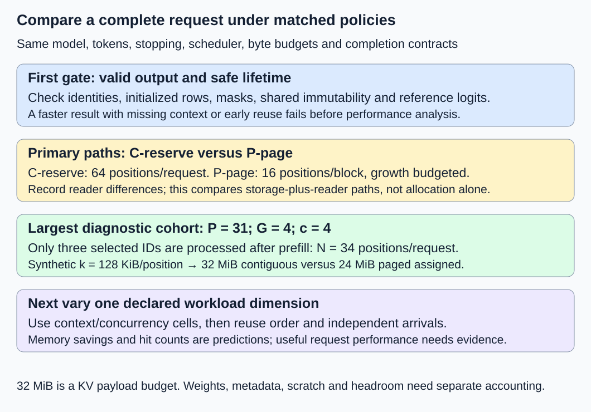
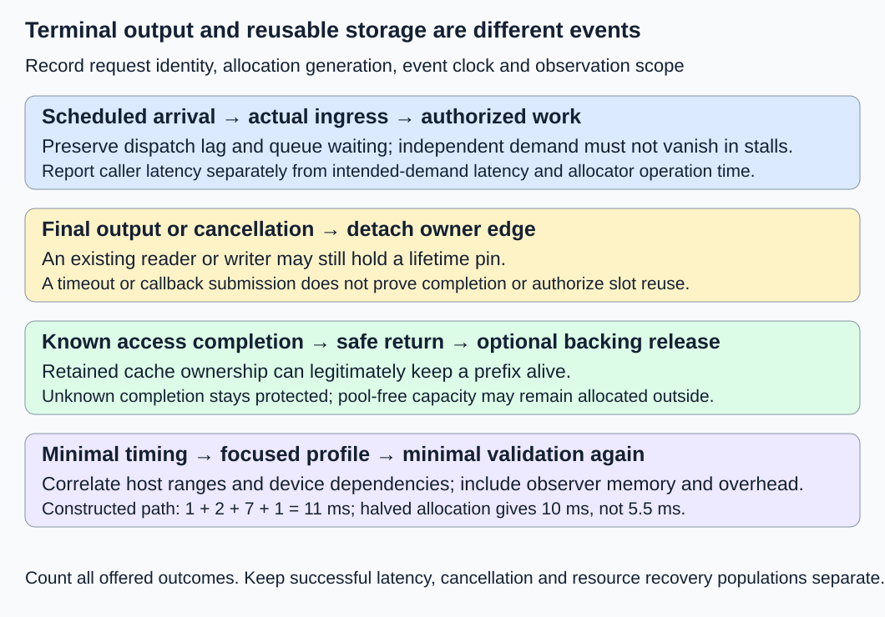

# M2-C21: Benchmarking KV management end to end

> **Status: Complete — detailed chapter authored and documentation validated; experimental procedures are proposed unless explicitly labelled observed**

**Module:** Treat the KV cache as a first-class systems problem

**Category:** [Measurement, experimentation, and economics](index.md)

[Module 2 reading order](../module-2.md) · [Previous: M2-C20](../numerics-and-correctness/m2-c20-validating-allocator-and-cache-safety.md) · [Execution plan and progress](../chapter-execution-plan.md)

## Target concepts

Contiguous versus paged baselines, context and concurrency sweeps, reuse skew, cancellation churn, allocation and reclamation latency, tail distributions, fragmentation, useful throughput, full-request latency, reproducible profiling.

## Concepts

### Start with a complete, correct request

A fast allocator is useful only if the engine produces the right output, admits useful work and reclaims storage safely. KV management covers the attention keys and values retained between forwards, their logical-to-physical mappings, shared ownership, admission and eventual return. A benchmark compares declared alternatives under a defined workload; profiling explains where time or resources go.

This chapter closes Module 2 by combining [M2-C20's safety gates](../numerics-and-correctness/m2-c20-validating-allocator-and-cache-safety.md), [M9-C15's memory accounting](../state-memory-and-caching/m9-c15-accounting-for-weights-kv-state-workspace-and-fragmentation.md), [M1-C20's completed-generation boundaries](m1-c20-measuring-and-explaining-generation-latency.md) and [M9-C07's distribution evidence](m9-c07-latency-distributions-and-statistical-uncertainty.md). Completed M9-C01/C02/C03/C05/C17/C19 additionally support references, clocks, service boundaries, numerical tolerances and final-output identity. Advanced load-testing chapters remain outlines; the basic load contract is specified here. Rust is the eventual engine context; this chapter supplies no implementation code or measured runtime results.

Before interpreting speed, require current allocation identities, legal ownership/pins, initialized rows, immutable shared blocks, correct masks and positions, model-specific logit equivalence, exact output/stop behavior and safe cleanup. Smaller memory use obtained by omitting required context is an incorrect result, not an optimization. Text generation is the scope; non-text modalities and Module 8 remain excluded.

### Compare explicit storage policies, not labels

**Contiguous storage** presents one consecutive KV region per request. **Paged storage** maps consecutive logical positions into separately assigned fixed-size blocks. Both still require an attention reader compatible with their layouts. Keep model, arithmetic, actual token histories, stopping rules, scheduling, memory budget and queue policy fixed; record any necessary reader/kernel difference rather than attributing every change to allocation.

| Alternative | Declared policy | What the comparison can establish |
|---|---|---|
| C-reserve, primary baseline | Reserve 64 positions per request at admission; reuse disabled; contiguous reader | A practical fixed-reservation baseline with explicit over-reservation |
| P-page, primary candidate | B = 16 positions/block; assign on demand; reserve future growth credits under the same finite budget; reuse disabled | Complete storage/reader path versus C-reserve |
| Contiguous grow, optional follow-up | Declare geometric growth, copying/in-place capability and temporary old-plus-new lifetime | Sensitivity to a stronger contiguous policy; not silently included in primary counts |
| Gather diagnostic, optional follow-up | Gather the same paged state into scratch for a contiguous reader | Reader/layout attribution only when scratch and copy costs are included |

A contiguous oracle that knows the exact future output length can provide a lower-bound sizing calculation, but it is not an ordinary online allocator. Do not claim paging universally wins by choosing only a wasteful baseline. The original [PagedAttention paper, v1, sections 6–7](https://arxiv.org/html/2309.06180v1) separates model/workload conditions, reservation-policy baselines, shared-prefix experiments and kernel/block-size studies. Its reported hardware results are evidence for those conditions, not measurements of this curriculum's proposed engine.

The primary resident grid uses prompt lengths P = 15, 16, 17 and 31; selected-output cap G = 1 or 4; and cohort concurrency c = 1, 2 or 4. A **cohort** is a fixed set of requests admitted together. These small lengths deliberately expose block boundaries. A separate production-relevance extension must preregister larger contexts, actual arrival/length traces and model limits; this diagnostic grid cannot establish long-context behavior.

For the fixed-length diagnostic, disable early EOS explicitly and select exactly G IDs under a declared greedy rule; do not present this constrained workload as ordinary EOS-terminated service. After the last selection no extra forward is needed, so **N = P + G − 1 processed KV positions**. E3 instead preserves ordinary stop semantics and records actual output counts.

For sizing only, use M9-C15's synthetic geometry: 32 layers, eight KV heads, 128 features/head and two bytes/scalar, giving **k = 128 KiB/position**. One KiB is 1,024 bytes and one MiB is 1,048,576 bytes. Thus a 16-position block is 2 MiB. The 32 MiB KV payload budget supports 16 blocks; weights, activations, scratch, metadata and safety headroom have separate budgets. A real model must declare its actual geometry and fit all storage; this fixture is not a supplied checkpoint.

| P | G | N | P-page blocks | Assigned paged bytes | Unused assigned positions |
|---|---|---|---|---|---|
| 15 | 1 | 15 | 1 | 2 MiB | 1 |
| 15 | 4 | 18 | 2 | 4 MiB | 14 |
| 16 | 1 | 16 | 1 | 2 MiB | 0 |
| 16 | 4 | 19 | 2 | 4 MiB | 13 |
| 17 | 1 | 17 | 2 | 4 MiB | 15 |
| 17 | 4 | 20 | 2 | 4 MiB | 12 |
| 31 | 1 | 31 | 2 | 4 MiB | 1 |
| 31 | 4 | 34 | 3 | 6 MiB | 14 |

C-reserve assigns 64 × 128 KiB = **8 MiB/request** in every cell. At P = 31, G = 4 and c = 4, C-reserve assigns 32 MiB while P-page assigns 24 MiB. For a 32 MiB payload-only budget, these policies can accommodate at most four versus five such fully grown requests, before other limits. The ratio 5/4 is a sizing prediction, not a throughput speedup. Lower physical allocation may matter only when memory actually constrains admission.

Internal fragmentation is unused space inside assigned blocks; free pool capacity is a different quantity. External fragmentation concerns failure to find an eligible contiguous extent despite enough total free bytes. Record requested payload, assigned bytes, largest eligible extents, retained-only/Retiring states and outer allocated/reserved/device backing separately. A warmed fixed pool can keep the same outer backing while its occupied bytes change.

### Prefix frequency and reuse order are different variables

**Reuse skew** means some prefixes occur more often than others. Temporal locality means related requests occur close enough together for retained state to survive. A high frequency alone does not guarantee a hit in a small cache. Isolate reuse within P-page rather than changing allocator, reader and retention policy simultaneously.

Use eight distinct 16-ID prefix groups A–H whose first IDs differ, followed by unique 15-ID suffixes. P = 31, G = 4, so every complete fixed-length request has N = 34. Use serial execution, an initially empty prefix cache and retention of at most two full prefix blocks. Retain only the first 16 positions; private suffix blocks are never cached. On a miss, evict an eligible least-recently-used retained prefix before assigning its replacement; no access pins remain between requests. This eviction rule has its own cost.

The uniform trace cycles A–H eight times. The clustered-hot trace is 48 A requests, then 3 B, 3 C and 2 each of D–H: 64 requests in both traces. The hot trace changes both frequency and temporal clustering; report both rather than attribute its behavior to skew alone. Reset retained state before every trace, including after warmup.

| Trace / reuse policy | Prefix hits / misses | New block assignments over trace | Newly computed positions |
|---|---|---|---|
| Uniform, reuse disabled | 0 / 64 | 64 × 3 = 192 | 64 × 34 = 2,176 |
| Uniform, two-prefix retention | 0 / 64 | 192 | 2,176 |
| Clustered-hot, reuse disabled | 0 / 64 | 192 | 2,176 |
| Clustered-hot, two-prefix retention | 56 / 8 | 128 private + 8 prefix = 136 | 56 × 18 + 8 × 34 = 1,280 |

The hot enabled trace avoids **896 processed positions**, or **112 MiB of valid new KV payload writes** at the synthetic k. This is neither measured memory traffic nor peak storage: readers may access old KV repeatedly, and assignment volume sums allocations across time. In this serial fixture, disabled reuse peaks at three occupied blocks (6 MiB); enabled reuse can peak at four (8 MiB), including retained blocks. Thus less repeated work can coexist with a larger footprint. Block headers, reference updates, lookup and eviction overhead remain additional.

### Name clocks and ownership boundaries

Use one local monotonic host clock for host durations; record units, resolution and actual instrumentation. A monotonic clock measures elapsed time without interpreting wall-clock corrections. GPU event durations need a declared stream/dependency/completion scope; never subtract a GPU timestamp from a host timestamp or infer completion from API return.

| Interval | Start → end | Interpretation |
|---|---|---|
| Intended demand latency | Scheduled arrival → final caller-visible output and terminal record | Includes generator delay; only valid for an explicit arrival plan |
| Resident full-request latency | Actual engine ingress → final output and terminal record | Includes admission queue, allocation, forward/selection and delivery in this boundary |
| Time to first token | Engine ingress → first delivered token | Includes queue/prefill, not just a kernel |
| Token gap | Consecutive delivered tokens within one request | Keep request/position identity; long outputs contribute more gaps |
| Allocation latency | Allocation demand enters allocator → usable authorized mapping | Separate waiting-for-capacity from allocator operation time |
| Safe reclamation lag | Request/cache edge detached → slot eligible for reassignment | Includes outstanding accesses; not equivalent to decrement cost |
| Backing-release lag | Slot becomes reusable → eligible backing actually released outside pool | May not occur under a retained-pool policy; report retained rather than an invented duration |

Request delivery can finish before storage is safely reusable. Conversely, a cache-owned prefix may legitimately remain after every request has ended. Record terminal-state and resource-state ledgers separately. Cancellation churn means repeated arrivals, cancellations, pending accesses and reuse; stale completions must not affect a new slot generation. Unknown completion remains quarantined/retired under M2-C20's contract.

### Measure demand and useful outcomes together

A **closed-loop** cohort starts replacement work only after previous work completes; it answers a concurrency question. An **open-loop** plan schedules arrivals independently of responses; it answers a demand question. A closed-loop driver can quietly reduce offered load during a stall, a problem called **coordinated omission**. The [wrk2 author's explanation](https://github.com/giltene/wrk2#readme) describes measuring against intended arrival times to expose that missing demand. This is a methodological reference, not a supplied text-streaming load generator.

For offered requests scheduled at aᵢ and actually dispatched at dᵢ, record **dispatch lag = dᵢ − aᵢ**. Keep unsent attempts and generator saturation visible. Do not relabel planned demand as achieved arrivals. Fixed-concurrency and offered-rate results must not share a graph axis without explaining their different experiments.

For a declared cohort observation horizon T seconds, **completion rate = valid completed requests / T**. Define **useful request rate = valid, eligible completions meeting the declared deadline / T**; useful output-token rate sums their delivered selected IDs over the same T. A deadline is a chosen acceptance objective, not a universal latency standard. State whether T includes drain and whether completions belong to an arrival cohort or a wall-time completion window.

A constructed 10-second audit has 12 attempts: eight completed, one rejected, one cancelled, one failed and one unfinished. Of the eight completions, one has invalid output and one additional valid output misses its deadline; six are timely and correct. Each complete request delivered four IDs. Valid-completion rate is 7/10 = **0.7 requests/s**, useful rate is 6/10 = **0.6 requests/s**, and useful token rate is 24/10 = **2.4 IDs/s**. Counting all 32 delivered IDs gives 3.2 IDs/s and hides the invalid/late work. This is arithmetic, not a serving result; all relevant deadlines have elapsed by this audit cutoff.

Report latency distributions with sample counts and outcomes. Under M9-C07's nearest-rank convention, p99 is the sorted observation at rank ceil(0.99 × n). A rank exists for a small n but can be an unstable tail estimate. Cancelled, rejected or unfinished requests do not acquire successful-request latencies of zero. Preserve timeout/unfinished information and temporal correlations; do not average session percentiles or treat token gaps from one request as independent requests.

## Experiments

### E1 — Compare matched contiguous and paged request cohorts

- **Description:** Compare C-reserve and P-page across the eight prompt/output shapes and three cohort concurrencies above.
- **Purpose/objective:** Test storage, request latency and allocation costs around block boundaries without changing the generation task.
- **Target concepts:** Contiguous/paged baselines; context/concurrency sweeps; fragmentation; full-request latency.
- **Baseline and workload:** 24 cells, two storage paths, three independent sessions and ten paired cohort trials per cell/session. This gives 720 pairs, 1,440 measured cohorts and 3,360 scheduled request attempts. Five excluded warmup cohorts per path/cell/session add 720 cohorts and 1,680 attempts.
- **Controls and prediction:** Fix actual token IDs, model, precision, tie rule, fixed-length stop policy, scheduler, 32 MiB synthetic KV budget and non-KV headroom. Change storage path; record compatible-reader differences. Predict the sizing table, not a speed ordering.
- **Procedure:** Validate both paths against the same numerical/reference histories first. Warm and reset request/reuse state explicitly; randomize cell order per session and balance path order within pairs. Admit c requests together, retain completed-request events and memory partitions, then drain before the next cohort. Keep loading and preparation outside resident timing.
- **Hardware/software:** CPU reference checks are sufficient for counts; actual latency requires a supplied runtime and supported model with context at least 64, actual KV geometry, compatible readers and the hardware manifest below. M1-C14's four-position toy cannot run this grid.
- **Failure and HFT connection:** A cheaper allocation path can still delay useful work through capacity waits or shared-state errors, like a reused market-event buffer. Compare inference outputs and lifetime gates; no trading outcome transfers.
- **Exit criteria:** All attempts and cleanup states reconcile, outputs/logits pass justified gates, and memory counts match the declared representation. Report paired request/cohort results with uncertainty and failures. No speedup claim follows from sizing alone.

### E2 — Separate prefix-hit benefits from skew and retention costs

- **Description:** Compare P-page with reuse disabled/enabled on the uniform and clustered-hot 64-request traces.
- **Purpose/objective:** Measure whether reduced recomputation outweighs lookup, ownership and retention costs under the actual access order.
- **Target concepts:** Reuse skew; prefix retention; fragmentation; useful throughput; reproducible workload identity.
- **Baseline and workload:** Four configurations, three sessions and ten measured traces per configuration/session: 120 traces and 7,680 attempts. Five excluded warmup traces per configuration/session add 60 traces; reset the prefix cache before each trace.
- **Controls and prediction:** Fix model/tokenizer/namespace, unique suffixes, P/G/B, two-prefix retention cap, serial execution and eviction order. Change only reuse policy or the explicit prefix order. Predict the hit, block-assignment and processed-position table; no measured traffic ratio is predicted.
- **Procedure:** Replay the same serialized IDs, compare same-prefix logits/output, and record hit eligibility, lookup time, eviction/return, new KV writes and peak unique storage. Evict retained state and drain all known accesses after each measured trace; exclude this reset from request latency but report trace-plus-reset duration separately.
- **Hardware/software:** CPU identity/count reference; a compatible model/runtime/device for elapsed measurements. Record cache-format identity, library/backend revisions and payload/metadata allocation granularity.
- **Failure and HFT connection:** Popular stale state is still invalid, as a frequently reused but outdated feed snapshot is invalid. Inject a wrong model/position namespace and require a miss/rejection; the analogy does not define inference equivalence.
- **Exit criteria:** Exact table counts hold for the serialized diagnostic traces; invalid reuse is detected. Report memory, latency and recomputation together, and keep cold-reset and warmed-process conditions distinct. A hit-rate increase alone is not success.

### E3 — Preserve offered demand while stressing cancellation and recovery

- **Description:** Compare both reuse-disabled primary paths under independent scheduled arrivals and cancellation intents.
- **Purpose/objective:** Expose queue/tail effects, admission limits and reclamation lag that fixed cohorts conceal.
- **Target concepts:** Cancellation churn; offered load; tail distributions; useful throughput; safe return latency.
- **Baseline and workload:** Schedule rates 2, 8 and 32 requests/s for 20 seconds, with first arrival at zero and the end excluded: 40, 160 and 640 attempts/run. Use P = 31, ordinary EOS with output cap four, max eight active requests and a 16-entry waiting queue. For each zero-based ID with remainder 4 on division by 5, schedule cancellation intent 10 ms after its planned arrival. Three rates × two paths × three sessions give 18 windows, 5,040 attempts and 1,008 cancellation intents.
- **Controls and prediction:** Use identical input/arrival/cancellation plans across paired paths. Fix admission ordering and memory/headroom rules; reject visibly when the queue is full. The synthetic cache budget permits at most four C-reserve or five fully grown P-page requests, but actual output lengths and other limits can lower or alter occupancy. No rate is assumed sustainable.
- **Procedure:** Offer each request independently of previous completions, recording planned/actual ingress and dispatch lag. Classify each cancellation when acted on as queued, in-flight or already terminal; an intent does not guarantee a cancellation. Before each window, run five excluded ordinary warmup requests sequentially, drain and reset logical state; the 18 windows add 90 warmup attempts. Balance paired path order and randomize rate order per session. Stop new arrivals at 20 s, then drain known work. Use a 120 s post-window watchdog for hangs; unknown completion stays protected and unresolved.
- **Hardware/software:** Actual engine/model and a driver whose scheduling capacity is independently checked, one compatible device and a shared host-clock boundary. A network extension requires separately declared client/server timing; it is not silently included here.
- **Failure and HFT connection:** Burst pressure and cancelled consumers resemble time-sensitive event processing. Inject delayed/duplicate completions and verify generation fencing; cancellation safety, not trading behavior, is the transferred concern.
- **Exit criteria:** All 5,040 planned attempts and 1,008 intents reconcile; outstanding work, missed dispatches and cleanup remain visible. Report ordinary-request useful rate against a preregistered 1,000 ms scheduled-arrival deadline, excluding cancellation-designated IDs from that numerator. This deadline is an illustrative experiment objective. Retain actual distributions, generator lag and uncertainty; no p99/capacity certification follows from these short windows.

### E4 — Explain a request-level difference with scoped profiling

- **Description:** Profile the E1 P = 31, G = 4, c = 4 cell, comparing minimal observation with a focused diagnostic trace for each primary path.
- **Purpose/objective:** Attribute changes to critical-path allocation, reads, copies, waiting or reclamation and quantify observer effects.
- **Target concepts:** Reproducible profiling; allocation/reclamation latency; bottlenecks; end-to-end validation.
- **Baseline and workload:** Two paths × two observation modes × three sessions × five cohort trials = 60 measured cohorts, 240 attempts and 30 within-path observation pairs. Five excluded warmup cohorts per configuration/session add 60 cohorts. Profiles are separate from E1's primary timing population.
- **Controls and prediction:** Fix the E1 workload and safe lifecycle. Change observation mode first; only afterward test one justified optimization in a new matched experiment with its own counts. Predict no timing gain in advance.
- **Procedure:** Balance observation-mode order within each pair. Correlate request/attempt/forward IDs with host allocation/mapping ranges, device completion, attention, copies and final delivery. Inspect representative slow and ordinary cohorts using the same selection rule for both paths. Retain CPU time, allocation volume, unique/outer memory and pending-pin intervals. Compare minimally observed results again after any change.
- **Hardware/software:** Compatible CPU/runtime tracing and, for CUDA, a pinned Nsight Systems version/configuration plus driver/device support. Record sampling, trace scope, dropped records and profiling buffers in the memory budget.
- **Failure and HFT connection:** Faster buffer operations may not shorten the dependency chain that delivers a useful result. The shared lesson is critical-path evidence; elapsed time is not a financial-performance claim.
- **Exit criteria:** Timeline identities and completion boundaries reconcile; observation overhead and missing events are disclosed. A proposed optimization must preserve correctness and improve the named useful-service metric under matched minimally observed runs, or remain inconclusive.

## Verification

### V1 — Validate identities before comparing bytes or elapsed time

E1's block count is **ceil(N/B)**; assigned paged bytes are that count times Bk. C-reserve's unused assigned positions are 64 − N. Verify all eight rows at each concurrency. At the largest cohort, payload-only free capacity is 8 MiB for paging and zero for C-reserve. This does not describe outer allocator/device free memory or metadata capacity.

Both readers must preserve the same prefix, positions and mask. Compare controlled common-prefix logits using the chosen model/precision's justified absolute/relative tolerance, then exact greedy IDs and terminal rules. Never relax allocation identity checks with a floating-point tolerance. Reuse M2-C20's stale-generation, shared-mutation, duplicate-release and partial-publication probes before measuring. A different required reader means the primary comparison measures the combined storage/reader path; optional gather/growth studies must count copies, scratch peaks and safe old-storage lifetimes separately.

For all timed studies, model load, compilation and lazy initialization are distinct from steady resident timing. Five warmups are an initial plan, not proof of stable clocks or allocations. Predeclare a common extension rule if traces still drift, update counts, and reset logical cache state without falsely calling hardware caches cold. Record every actual selection count and any deviation from a fixed-length diagnostic. For E1/E4 use a 120 s cohort watchdog from ingress, and for E2 a 120 s trace watchdog from its first ingress. These are hang-detection cutoffs, not latency goals; revise them before collection if the supplied model requires a different bound. Preserve caller timeout and unresolved storage separately.

### V2 — Recompute the prefix trace independently

In the uniform round-robin trace, two retained prefixes cannot survive an eight-prefix reuse distance; every request misses. In the hot clustered trace there is one miss per group, so eight misses and 64 − 8 = 56 hits. Each hit computes only 34 − 16 = 18 positions, with two private blocks. All misses compute 34 positions and assign three blocks, one eligible for retention.

With retention enabled, before a miss there is at most one surviving old retained block after eviction, plus the new request's three blocks; on a hit there can be two retained blocks plus two private ones. Peak occupancy is therefore four blocks. Without retention it is three. Count outer backing separately. Preserve least-recently-used order and namespace checks in the artifact: changing capacity, overlap, pin duration or request order invalidates these reference counts. Attribute total latency to both saved computation and added cache-management work.

### V3 — Keep outcome, latency and resource populations separate

Use mutually exclusive caller-outcome categories: completed, rejected, failed, cancelled, timed out, unfinished at cutoff, and not dispatched. Their counts must sum to scheduled attempts. Output validity, deadline success and cleanup completion are additional fields, not extra outcome buckets. A client timeout does not prove the device stopped; preserve the separate resource ledger. Late cancellation intent cannot rewrite an already completed caller outcome.

For E3, 20% of IDs are cancellation-designated: 1,008 across all windows, leaving **4,032 ordinary-demand attempts** eligible for the useful-rate numerator. Count all assigned cancellation intents even when they arrive after termination or before dispatch. Describe how the eventual driver retains a cancelled-before-dispatch attempt without inventing engine ingress. Coverage of queued/in-flight/late cancellation is measured, not guaranteed by a 10 ms delay; add separately named fault cases if a phase is absent.

For each window, define T as first scheduled arrival through the later of 20 s or final observed drain/cutoff. Count only that arrival cohort's valid ordinary completions satisfying the 1,000 ms scheduled-arrival deadline in the useful numerator. Report this **drained-cohort useful rate** separately from completions within the 20 s offering window. Unknown work and nonstationary queues prevent a sustainable-capacity claim. Retain first-token/full-request curves, token gaps by position, allocation demand/operation time and edge-detach-to-reuse lag as distinct distributions.

Use M9-C07's nearest-rank summaries with raw counts, ranges and histogram precision. Merge raw samples or compatible bucket counts when a combined population is justified; never average p99 values. Estimate uncertainty using independent sessions or preserved time blocks that respect correlations. Three sessions and short windows are exploratory evidence. No universal sample count establishes a stable tail. Compare session-level paired differences and distribution shifts; disclose censoring, meaning incomplete observations beyond the cutoff, and deadline misses.

### V4 — Test a bottleneck explanation without treating profiles as timings

An illustrative nonoverlapping request path contains 1 ms queueing, 2 ms allocation, 7 ms completed device work and 1 ms delivery: total **11 ms**. Halving allocation gives **10 ms**, so speedup is **11/10 = 1.1**, not two. This constructed example assumes unchanged dependencies and no overlap. Actual concurrent traces need their real dependency graph; adding overlapping device durations can exceed wall time.

The [Nsight Systems user guide](https://docs.nvidia.com/nsight-systems/UserGuide/index.html) describes focused profiling and host-range/device timeline correlation. It also warns that full API tracing and memory tracking can add substantial overhead. Record trace configuration/version; a host range launching work is not itself evidence that the device work completed. Inspect completion and dependency evidence, then repeat with minimal observation. Profiled memory peaks can include observer buffers and perturbed overlap.

A causal explanation needs a testable prediction: for example, allocation waiting occupies the request critical path at a specific c, or retained prefixes reduce new-position work but increase occupied bytes. Reject it if the observed wait/copy/compute evidence disagrees. Do not subtract guessed profiler overhead from a timing or count a log line as an access-completion event. Keep an inconclusive comparison when variability or observer effects exceed the claimed benefit.

| Experiment / verification | Required evidence | Claim boundary |
|---|---|---|
| E1 / V1 | Matched contents, grid counts, memory partitions and paired request/cohort timings | Declared storage/reader policies and small diagnostic contexts |
| E2 / V2 | Serialized reuse order, hit/miss/assignment counts, output identity and retention cost | Two-prefix serial cache and explicit trace locality |
| E3 / V3 | Offered/actual arrivals, every outcome, deadlines, generator lag and protected cleanup | Declared rates/windows; no inferred production p99/capacity |
| E4 / V4 | Identity-correlated dependencies, scoped profiles and observer comparison | Diagnosed scenario; minimally observed validation still required |

**Observed during chapter authorship:** arithmetic/count references, experiment structure, local links, diagram validity, documentation build and rendered review are checked. Sizing tables, reuse traces, outcome-rate arithmetic and the 11→10 ms example are constructed references. No allocator/reader, serving model, open-loop driver, cancellation run, profiler or latency/throughput benchmark has been executed for this chapter.

## Engineering dimensions and principles

| Dimension | Application |
|---|---|
| Semantics and invariants | Gate every speed comparison on current identity, masks, immutable sharing, justified logits and exact selected output. |
| Workload and variability | Sweep boundary contexts/concurrency; preserve frequency and temporal reuse order, ordinary stopping and independent demand. |
| Resources and bottlenecks | Reconcile unique KV, block slack, metadata, scratch, outer backing, CPU management and device reads/copies. |
| Time and distributions | Separate ingress/demand latency, capacity wait, token gaps, safe return and backing release; retain tails and censored outcomes. |
| Ownership and coordination | Pending reads/writes and retained cache edges explain memory lifetime after request delivery or cancellation. |
| Failure and adaptation | Preserve overload rejection, queue bounds, dispatch failure, stale callbacks, deadlines and unknown-completion quarantine. |

1. **Correctness defines the optimization boundary.** Equivalent storage paths preserve outputs and safe lifetime; fixed-length diagnostics explicitly constrain stopping.
2. **Performance depends on workload and operating point.** A memory saving helps admission only where the byte budget binds; tiny cohorts cannot establish production throughput.
3. **Data movement is part of the algorithm.** Copy/gather paths and repeated old-KV reads can dominate even when fewer new positions are computed.
4. **State has ownership, lifetime, and recovery cost.** Prefix retention saves reconstruction but can increase peak occupancy; pins delay reclamation.
5. **Dependencies determine latency; bottlenecks determine capacity.** The 11→10 ms example distinguishes allocator speed from request speed; finite capacity limits admission.
6. **Variability and synchronization shape the tail.** Queueing, cancellation and rare reuse races require explicit arrivals and correlated outcome evidence.
7. **Local improvements must be evaluated end to end.** Smaller blocks, faster allocation and higher hits must improve correctly delivered useful service at the chosen operating point.
8. **Claims require reproducible evidence.** Freeze inputs, state, policies, clocks, software/hardware, traces, outcomes and paired raw measurements.

## Specifications, articles, and hardware

The reproducibility specification includes model/tokenizer/adapter hashes, precision, layout, attention backend, tie/stopping rules, actual token histories, context cap, scheduling and admission order, pool size, future-growth credit policy, cache capacity/eviction, arrival/cancellation plans and all reset/completion boundaries. Retain serialized request and allocation identities; seeds alone do not reproduce a changed generator. Stage-specific raw logs must identify trial/session and observation mode. The proposed engine boundary is prepared resident request ingress through caller-visible terminal output; loading, storage I/O and external networking require separately named experiments.

Primary sources are [PagedAttention v1](https://arxiv.org/html/2309.06180v1) for workload-aware memory/reader comparisons, [wrk2's methodology](https://github.com/giltene/wrk2#readme) for intended arrivals and coordinated omission, and [Nsight Systems documentation](https://docs.nvidia.com/nsight-systems/UserGuide/index.html) for focused timeline analysis and observer limitations. Completed M9-C07/C15/C17 supply local distribution, memory and numerical contracts; future advanced benchmark chapters are not assumed implemented.

No machine, serving implementation or larger-model checkpoint has been supplied. CPU audits need exact integer/rational arithmetic. Runtime tests need a supported model/device with sufficient context and memory for weights, peak activations, unique KV, workspace, communication, metadata, allocator cache and a declared safety margin. The synthetic 32 MiB KV budget does not imply that the model fits a 32 MiB device.

Record CPU model/core counts/cache sizes, RAM, memory locality/NUMA placement, OS, Rust/compiler/build mode, clock resolution, affinity and background load. Add GPU model/count/architecture, physical or partition-visible memory, ECC mode if applicable, driver/runtime/toolkit, backend/allocator versions, stream/graph configuration, power/frequency/thermal conditions, profiler settings and other users. Record interconnect and communication libraries when used. Separate page-locked host transfer memory from device KV access pins. Use identical controls across paired paths and retain any unsupported case rather than substituting hardware claims.

## Takeaways and next step

Compare complete correct requests under matched policies, then vary context, concurrency, reuse order and demand deliberately. Count useful outcomes alongside resource use and explain latency through real dependencies. A memory ratio, hit rate or fast allocator call does not alone establish a faster service.

Track progress in the clickable [execution plan](../chapter-execution-plan.md). This completes the Module 2 chapter sequence; its runtime experiments remain proposed. The completed introductory GPU chapter is [M3-C01: Following a tensor from CPU to GPU](../hardware-architecture-and-topology/m3-c01-following-a-tensor-from-cpu-to-gpu.md). M3-C02 is next for authoring. Module 9 continues to support Modules 1–7; Module 8 remains excluded.
