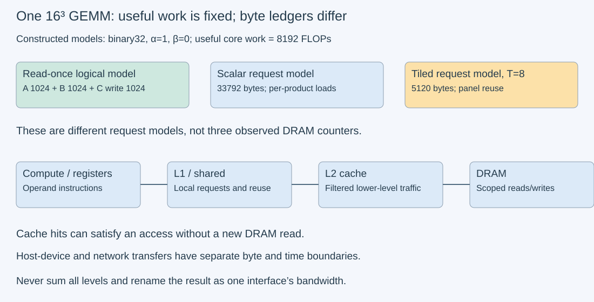

# M3-C15: Counting FLOPs and bytes at a defined boundary

> **Status: Complete — detailed chapter authored and documentation validated; experimental procedures are proposed unless explicitly labelled observed**

**Module:** Learn GPU architecture through data movement

**Category:** [Measurement, experimentation, and economics](index.md)

[Module 3 reading order](../module-3.md) · [Previous: M3-C14](../networking-and-communication/m3-c14-moving-tensors-between-devices-and-hosts.md) · [Next: M3-C16](m3-c16-using-the-roofline-model-to-predict-bottlenecks.md) · [Execution plan and progress](../chapter-execution-plan.md)

## Target concepts

GEMV and GEMM dimensions, multiply-add counting, theoretical versus observed traffic, memory-level boundaries, cache reuse, reads and writes, units, achieved throughput and bandwidth.

## Concepts

### 1. State the mathematical operation before counting it

A **FLOP** is one floating-point arithmetic operation under a stated counting convention. FLOP/s is a rate, not an operation count. A **fused multiply-add**, or FMA, computes a product plus an accumulator with one final rounding. It is one instruction-level operation in many contexts but conventionally counts as two FLOPs: one multiplication and one addition. Matrix hardware can perform many such arithmetic operations per instruction; instruction count and useful FLOP count are not interchangeable.

**GEMV**, general matrix-vector multiplication, forms y = αAx + βy. Let A have M rows and K columns, x length K and y length M. **GEMM**, general matrix-matrix multiplication, forms C = αAB + βC, with A of shape M×K, B of shape K×N and C of shape M×N. α and β are scalar coefficients. The shared K dimension must match. Transpose flags change the interpretation of operands; declared storage dimensions and leading dimensions must remain valid. A **leading dimension** is the storage stride separating columns or rows in the selected layout.

The [cuBLAS operation specification](https://docs.nvidia.com/cuda/cublas/index.html) defines these contracts and layout rules. This chapter's references use mathematical row-major notation, α=1 and β∈{0,1}. A future Rust binding must map that notation to the selected library's actual layout contract; classic cuBLAS commonly uses column-major storage, while other interfaces can expose additional layout choices. No implementation is supplied.

For real dense arithmetic, the conventional **useful core work** is:

**F_GEMV = 2MK; F_GEMM = 2MKN.**

These counts include a multiply/add contribution for each product. An exact dot-product arithmetic ledger using K multiplies and K−1 additions per output instead gives M(2K−1) or MN(2K−1), for positive dimensions and K≥1. Both conventions are useful if labelled. The conventional count is not a claim that every first addition executed or that every hardware lane did useful work.

Here useful core FLOPs exclude coefficient scaling, adding an existing output, bias/activation, packing, padding work and address calculations. With β=1 there is an additional M or MN output addition; record it separately if claiming total arithmetic. With general α/β, specify their extra work rather than quietly comparing different numerators. Zero dimensions and K=0 need the operation's special-case semantics, not a blind positive-dimension formula. Tensor/sparse formats and padded execution need separate executed-work evidence, following [M3-C09](../kernels-compilers-and-execution/m3-c09-tensor-cores-and-supported-matrix-operations.md).

### 2. A logical byte model needs reads, writes and assumptions

For uniform element size s bytes, contiguous operands, no aliasing, α=1 and β=0, a **read-once logical byte model** counts each necessary input element once and every output element written once:

**Q_GEMV = s(MK + K + M).**

**Q_GEMM = s(MK + KN + MN).**

If β=1, the previous output is needed, adding sM or sMN read bytes. The β=0 operation does not semantically require the previous output values. Allocated output storage is still required. This distinction is in the [cuBLAS β contract](https://docs.nvidia.com/cuda/cublas/index.html); an implementation's actual memory transactions need observation, not inference from that contract.

This is an abstract logical transfer model, not a universal minimum measured DRAM count. Inputs may already reside in cache. Output writes may remain buffered or cached beyond the selected kernel's measurement window. Conversely, repeated loads, cache misses, transaction granularity, write policies, workspace and multiple kernels can increase traffic. State what boundary and time window each number describes.

**Capacity** measures retained storage; **traffic** measures transfers over time. A 4 MiB matrix read ten times has 4 MiB logical storage and up to 40 MiB logical read volume under that access model. Padding can increase storage without requiring every padding byte to be transferred. For a padded 2×3 binary32 matrix with row stride four elements, logical payload is 24 bytes, span through the last element 28 bytes, and full two-row backing 32 bytes. None alone is a measured link/DRAM byte count.

### 3. Cache reuse changes which boundary sees the bytes

A **memory boundary** is the interface whose transfers are being counted: register/shared-memory exchange, cache interface, GPU DRAM, host-device link or network. **Cache reuse** serves an access from an already retained copy nearer the consumer. The same scalar access can cause a local cache read and no new DRAM read; summing all levels and calling it DRAM traffic double-counts across boundaries.

Consider a constructed 16×16×16 GEMM with β=0 and s=4. It has 8,192 useful core FLOPs and read-once logical bytes 3,072: 1,024 bytes each for A, B and the output write. A simple scalar-access model that separately loads two operands for each product requests 2MKN input elements plus MN output stores: **Q_scalar = s(2MKN+MN)=33,792 bytes**. This is a conceptual request ledger, not a prediction of an optimized library's instructions or transactions.

For an ideal tiled access model with output tiles of T×T, dimensions divisible by T and each input panel loaded once per output tile, A is read N/T times and B M/T times:

**Q_tiled = s[MK(N/T) + KN(M/T) + MN].**

At T=8 this is 5,120 bytes. Shared-memory traffic and synchronization inside a tile have their own ledgers. Transaction sizes and cache hits can make measured lower-level traffic differ from either request model. Tiling improves a particular reuse opportunity; it does not guarantee all operands cross DRAM exactly once. Review [M3-C07](../kernels-compilers-and-execution/m3-c07-memory-coalescing-alignment-and-tensor-layouts.md) and [M3-C08](../kernels-compilers-and-execution/m3-c08-tiling-and-reuse-through-the-memory-hierarchy.md) for coalescing and reuse.

*The numbers are constructed models for the same 16³ GEMM. A counter at one interface must not be renamed as traffic at another.*

### 4. Rates require a matching numerator and completed interval

Define **P_useful = F_useful / t** and **B_effective = Q_model / t** for a stated model and elapsed interval. An observed memory rate is **B_level = Q_level_observed / t_level**, using traffic and time from the same compatible measurement scope. These rates answer different questions. Effective bandwidth is a useful algorithmic rate, not automatically physical DRAM bandwidth. The [CUDA effective-bandwidth guidance](https://docs.nvidia.com/cuda/cuda-c-best-practices-guide/index.html#effective-bandwidth) separates requested versus actual traffic.

For a constructed 64³ GEMM, β=0, binary32: F=524,288 and Q_model=49,152 bytes. A 10 µs completed operation interval gives 52.4288 GFLOP/s of useful core work and 4.9152 GB/s effective modeled bytes. If a compatible illustrative counter reports 16,384 DRAM bytes in that same interval, the observed DRAM rate is 1.6384 GB/s. It is not inconsistent with the logical model when reuse/cache residency and window definitions differ. These are invented arithmetic records, not GPU results.

**Arithmetic intensity** at a boundary is I=F/Q in FLOP/byte. The example gives logical I=10⅔ FLOP/byte and observed-DRAM I=32 FLOP/byte. Label which one is used. The next chapter uses such boundaries in a performance model; this chapter does not infer a bottleneck merely from an intensity value.

Units matter: GFLOP/s=10⁹ FLOP/s, TFLOP/s=10¹² FLOP/s, GB/s=10⁹ bytes/s and GiB/s=2³⁰ bytes/s. Ten microseconds is 10⁻⁵ seconds. A result can be numerically off by a thousand or more if microseconds, milliseconds, decimal GB and binary GiB are mixed.

### 5. Profilers observe execution under their own conditions

**Profiling** attributes time or traffic to parts of a program. A selected library operation may launch several kernels, perform conversions or use workspace. Count the full intended kernel set before labelling its summed work/traffic as one GEMM. Device instructions may include redundant, padded or tensor arithmetic; do not assume an instruction counter equals useful core 2MKN.

For actual GPU-memory evidence, select supported read and write byte/transaction metrics at the desired interface using the installed [Nsight Compute profiling guide](https://docs.nvidia.com/nsight-compute/ProfilingGuide/index.html). Preserve metric name, unit, aggregation, source/destination interface, selected kernels/range, replay mode and cache-control policy. If a counter reports sectors, convert sector count using that counter's documented sector size; do not assume every interface uses the same size. Avoid adding a “total” metric to its read and write components.

A profiler may replay work to collect counters and alter cache conditions. A replay is another execution for measurement, not additional useful application output. Collect separate unprofiled timings and small profiled cohorts, and retain their distinct durations. A warm cache claim needs defined history and evidence; repeating the same addresses or fitting in an advertised cache capacity does not guarantee residency. Resetting output for β=1 outside timing may itself affect cache history. Record it in the experiment contract.

### 6. Useful service remains the final boundary

A kernel-only rate excludes preparation, transfer, allocation, queueing and consumers unless explicitly included. A full-request rate has a different denominator. With the same 524,288 useful FLOPs and constructed request time 50 µs, useful core work per request-second is 10.48576 GFLOP/s, compared with 52.4288 GFLOP/s over the illustrative 10 µs operation interval. Neither number proves more completed requests or tokens per second without the actual workload and outcomes.

HFT systems provide a useful lens: fewer CPU cycles or fewer bytes on one interface may not reduce the useful response time if queueing or another dependency dominates. The analogy encourages explicit critical paths, bounded retained state and preserved tails; it does not equate a GPU kernel rate with trading performance or a hard real-time guarantee. Cancelled or incorrect work consumes resources but must not inflate useful output counts. Buffer reclamation still requires actual completion, even when a profiler or counter read fails.

## Experiments

All procedures are **proposed, without implementation code**. E1/E2/E4 are paper/reference exercises; E3 describes a future one-GPU benchmark. No GEMV/GEMM device execution, counter capture or hardware timing is claimed. Apply completed [M9-C01 references](../numerics-and-correctness/m9-c01-defining-reference-behavior-and-evidence-before-optimizing.md), [M9-C02 completed timing](m9-c02-request-events-clocks-and-measurement-boundaries.md), [M9-C07 distributions](m9-c07-latency-distributions-and-statistical-uncertainty.md), [M9-C15 storage scopes](../state-memory-and-caching/m9-c15-accounting-for-weights-kv-state-workspace-and-fragmentation.md), [M9-C16 hardware-state records](../hardware-architecture-and-topology/m9-c16-recording-hardware-conditions-that-change-measurements.md) and [M9-C17 numerical gates](../numerics-and-correctness/m9-c17-comparing-logits-with-justified-numerical-tolerances.md).

### E1 — Reconcile dimensions, useful FLOPs and output reads

- **Description:** Calculate small GEMV/GEMM outputs and compare conventional core counts, exact dot counts and β-dependent byte models.
- **Purpose/objective:** Make arithmetic and traffic assumptions auditable before reporting a rate.
- **Target concepts:** GEMV/GEMM dimensions, multiply-add counting, reads/writes and units.
- **Baseline and workload:** A=[[1,2,3],[4,5,6]], x=[1,2,1], seed y=[10,20]. GEMM uses B=[[1,2],[0,1],[1,0]], seed C=[[10,20],[30,40]]. All operands are binary32, α=1; compare β=0 and β=1, out-of-place input/output identities except the API's specified seed/output role.
- **Controls and prediction:** GEMV output is [8,20] or [18,40]; GEMM output [[4,4],[10,13]] or [[14,24],[40,53]]. Conventional core FLOPs are 12/24; exact dot arithmetic 10/20. β=1 adds 2/4 output additions outside the core count. Read-once logical bytes are 44/64 at β=0 and 52/80 at β=1.
- **Procedure:** Enumerate every dot product, dimensions, input read, seed read and output write. Label s=4 bytes; do not count a seed read in the β=0 semantic model. Compare logical payload with a separately padded A backing of 32 bytes. Reject a K mismatch before any operation; treat empty shapes/K=0 as separate API-contract cases rather than reusing these positive-dimension counts.
- **Hardware/software:** Paper or spreadsheet; no GPU/library execution needed.
- **Failure and HFT connection:** An impressive rate computed with the wrong workload size resembles comparing service times for different messages. Incorrect shape or missing seed is failure regardless of timing.
- **Exit criteria:** All outputs, four byte totals, both count conventions and extra β=1 additions reconcile; no storage-span number is labelled observed traffic.

### E2 — Trace reuse through different memory interfaces

- **Description:** Compare read-once, scalar-request and tiled-request byte models for the same 16³ GEMM.
- **Purpose/objective:** Explain how unchanged arithmetic can have different logical requests and lower-level traffic.
- **Target concepts:** Cache reuse, memory boundaries, theoretical versus observed traffic and reads/writes.
- **Baseline and workload:** M=N=K=16, s=4, α=1, β=0. Scalar model loads both operands for each product; tiled model has 8×8 output tiles and once-per-tile input-panel loads. Initial cache state and actual DRAM observations are unknown in this paper exercise.
- **Controls and prediction:** Useful core F remains 8,192. Read-once model Q=3,072; scalar-request Q=33,792; tiled-request Q=5,120 bytes. T=16 gives Q_tiled=3,072 under that model; T=1 gives Q_tiled=33,792. These are model endpoints, not library implementation claims.
- **Procedure:** Count how many output-column tiles reuse each A element and how many output-row tiles reuse each B element. Keep shared-memory traffic separate. Give two possible explanations for observed DRAM bytes below the read-once model (pre-existing input residency or output visibility beyond the window) and above it (reloads or additional physical transactions). Label these hypotheses requiring evidence, not observed explanations.
- **Hardware/software:** Paper or spreadsheet only. A later device trace needs selected kernels, per-interface supported counters and known replay/cache settings.
- **Failure and HFT connection:** Summing bytes from every cache level hides the actual constrained interface, much as summing several network hops cannot be called a single link's payload rate.
- **Exit criteria:** All three byte totals and both tile-size endpoints agree; every number has a named boundary/model. No reduction in logical requests is automatically called a measured DRAM saving or lower end-to-end latency.

### E3 — Benchmark exact GEMV/GEMM fixtures with scoped evidence

- **Description:** Run exact small dense operations at three output widths, keeping useful core FLOPs and modeled bytes alongside completed times and separate profiles.
- **Purpose/objective:** Practice reporting valid achieved rates without confusing dimension changes, β reads, algorithm dispatch or cache behavior.
- **Target concepts:** GEMV/GEMM work, logical/observed traffic, units, throughput and bandwidth.
- **Baseline and workload:** M=K=64; N∈{1,8,64}; α=1, β∈{0,1}: six cells. N=1 uses a documented GEMV operation, N=8/64 a documented GEMM. Aᵢₖ=(i mod 4)+1; Bₖⱼ=(k mod 4)+1+(j mod 2); seed Cᵢⱼ(e)=e+(i mod 3)+(j mod 5), e=0,…,59. For N=1 interpret B as the vector and C as y.
- **Controls and prediction:** Use stored binary32 and a documented non-approximate arithmetic configuration with exact reference checks. Allocate/init operands, output, seed reference, workspace and library state outside timing. Restore each trial's seed outside timing, including β=0 cells for a consistent preparation protocol. Hold layouts, placement, completion policy and configuration fixed within each cell; record actual dispatched path/algorithm where available. Predict exact output, not any mandatory rate ranking or cache hit count.
- **Procedure:** Three sessions/cell, 10 excluded warmups and 20 measured trials/session, epochs 0–59 per cell; rotate cells. Time from host operation submission through a successful completion covering all selected operation kernels. Validate every output afterward. Retain initialization and checked-cycle timings separately. Profile a small dedicated cohort with explicit cache/replay settings; preserve unprofiled durations rather than substituting replay times. Do not call the repeated-address state “DRAM-cold” or guarantee residency without evidence.
- **Hardware/software:** One supported CUDA GPU and a library/binding exposing the operation and numerical policy. At N=64, A/B/C each hold 4,096 binary32 elements: 48 KiB raw device payload, plus workspace/runtime overhead. Preallocated host A/B/seed/output/reference arrays require at most 80 KiB raw payload; workspace is separately reported and must fit the actual budget. No model, NIC or second GPU required.
- **Failure and HFT connection:** Padding, extra kernels or a different numerical mode can change executed work without changing the useful numerator. Preserve exact output and scope checks; a 120-second watchdog classifies unknown completion and retains ownership rather than reporting fast throughput.
- **Exit criteria:** Reconcile 360 measured trials and 180 warmups. All successful outputs match references exactly; dimensions, β, count convention, byte model and complete interval accompany every rate. Profiles list supported counters and all relevant kernels; missing counters remain unknown. No speedup or particular hardware execution path is required for correctness acceptance.

### E4 — Reject mismatched rate numerators and denominators

- **Description:** Calculate rates from constructed operation/request/profile records and reject mixtures of incompatible evidence.
- **Purpose/objective:** Prevent effective bandwidth, observed DRAM bandwidth and request throughput from being silently substituted for one another.
- **Target concepts:** Units, achieved throughput/bandwidth, counter scope and communication limits.
- **Baseline and workload:** 64³ GEMM, α=1, β=0, s=4; F=524,288, read-once Q=49,152. Invent a profiled operation interval 10 µs with observed DRAM read+write bytes 16,384, an independently unprofiled operation interval 8 µs, and a separate full-request interval 50 µs. These are distinct constructed records, not one hardware run.
- **Controls and prediction:** The compatible 10 µs record gives 52.4288 GFLOP/s useful, 4.9152 GB/s model-effective and 1.6384 GB/s observed DRAM. Its intensities are 10⅔ model FLOP/byte and 32 observed-DRAM FLOP/byte. The 8 µs operation gives 65.536 GFLOP/s useful; the 50 µs request gives 10.48576 GFLOP/s of the stated core work over that wider interval.
- **Procedure:** Convert all units explicitly. Reject using profile traffic with the independent 8 µs time as a directly observed bandwidth. Reject doubling both FMA count and the already doubled 2MKN numerator, adding a total-byte counter to its read/write components, using host-link peak for GPU DRAM traffic, and treating cancelled work as useful output. Also reject presenting the 50 µs request interval as the 10 µs operation interval. Keep actual wider-request work separate if it includes other operations.
- **Hardware/software:** Paper/reference arithmetic only; no profiler/device needed. A future measured counterpart requires matching device/range/metric definitions and actual completion evidence.
- **Failure and HFT connection:** A faster local stage can coexist with a slower request because of queues or transfers. Scope mistakes can manufacture an improvement without changing useful service.
- **Exit criteria:** All listed rates/intensities and six rejection decisions reconcile. Constructed/profiled/unprofiled/request evidence remains separately labelled; no bottleneck or serving improvement is claimed from these records alone.

## Verification

### Exact numerical references and count tables

E3 has a closed-form reference because K=64 contains sixteen complete periods of length four:

**Rᵢⱼ = [(i mod 4)+1] [160+64(j mod 2)].**

For β=0 output equals R; for β=1 it is R+C_seed. The largest reference result is at most 961, and every product and partial sum is a small exactly representable binary32 integer. Check every coordinate, not just a sum. A deliberately transposed/mis-strided operand, omitted seed or wrong output offset must fail the reference/descriptor audit. Exact small fixtures do not establish a general floating-point error tolerance for arbitrary model weights; use M9-C17 for those contracts.

| N (M=K=64) | Conventional core FLOPs | Read-once Q, β=0 | Read-once Q, β=1 |
| --- | --- | --- | --- |
| 1 | 8,192 | 16,896 bytes | 17,152 bytes |
| 8 | 65,536 | 20,480 bytes | 22,528 bytes |
| 64 | 524,288 | 49,152 bytes | 65,536 bytes |

For N=1, ΣR=25,600. For even N=8/64, **ΣR=30,720N**. Seed sum is **64Ne + 63N + 64Σ(j mod 5)** over j=0,…,N−1. At N=8, Σ(j mod 5)=13; at N=64 it is 126. Use a wide integer reference sum; a floating-point reduction is a separate operation with its own error behavior. Add the seed sum only for β=1.

Across all 360 successful E3 measured operations, conventional useful core work totals **71,761,920 FLOPs** and output elements total **560,640**. These count successful reference work only; profiling replays, setup, failures and warmups have separate ledgers. Do not combine the modeled byte sums into a measured DRAM total. Shape padding, algorithm workspace and library auxiliary kernels are recorded separately rather than hidden in useful-work counts.

### Measurement, benchmarking and profiling contracts

| Experiment | Reference gate | Evidence/measurement | Interpretation limit |
| --- | --- | --- | --- |
| E1 | Exact outputs, compatible shapes, β-aware seed and read/write ledger | Conventional versus exact-dot counts; four byte totals | FLOP convention is not instruction count |
| E2 | Unchanged 16³ math and valid tiling assumptions | Read-once/scalar/tiled request totals | Logical request reduction is not observed cache/DRAM traffic |
| E3 | Exact reference/descriptor and successful all-kernel completion | Useful F/t, model Q/t, scoped counters, raw per-cell timings | Replays, dispatch and preparation can change measured conditions |
| E4 | Compatible scope/unit choices and rejected bad combinations | Constructed rates/intensities and separate denominators | No real bottleneck or end-to-end gain established |

Primary E3 time **t_host** begins before submission and ends after successful completion of the selected operation. It includes CPU submission and its wait, but excludes allocation, source/seed reset and validation. Optional device event intervals must be valid completed recordings covering the same intended kernel chain. Label them separately rather than calling them host latency. If an operation launches several kernels, a per-kernel device rate is not automatically the full-operation rate.

For observed traffic, retain the selected metric's exact definition, interface, read/write/total semantics, aggregation and units. Document whether non-kernel traffic is included and what happens to buffered writes at the measurement boundary. If only a subset of kernels or incompatible replay passes is available, qualify the conclusion. Explain discrepancies using evidence about requests, transaction efficiency, reuse and auxiliary work; do not force every number to equal the read-once model.

Maintain the [M9-C16 hardware manifest](../hardware-architecture-and-topology/m9-c16-recording-hardware-conditions-that-change-measurements.md): physical/partition identity, CPU/page placement, clocks/power/thermal state, competing work, software/build/library versions, math mode, workspace budget and profiler settings. Profiling cache control can change initial state, so explicitly distinguish application-reuse history, preparation writes and profiler-managed state. Counter availability varies by device/version; no metric name or counter precision is assumed universally.

Per cell preserve three sessions of 20 measured timings, all warmup outcomes and admission/status counts. Report medians, spreads and session variation. Nearest-rank percentile p uses sorted rank ceil(pL) for L observations; twenty observations cannot establish a stable p99. Do not average percentiles, silently replace failures or remove slow correct trials. Reconcile unsupported configurations before admission separately from numerical, runtime, cancellation and unknown-completion outcomes. Correct but unsupported performance-path hypotheses are not observed successes.

The primary article [Accelerating HPC Applications with NVIDIA Nsight Compute Roofline Analysis](https://developer.nvidia.com/blog/accelerating-hpc-applications-with-nsight-compute-roofline-analysis/) illustrates why hierarchical boundaries matter. Its 2020 application results are not predictions or results for these fixtures. Here the outcome is a defensible work/byte/time ledger; [M3-C16](m3-c16-using-the-roofline-model-to-predict-bottlenecks.md) develops the next performance model.

For later serving validation, keep output identity, admitted/completed/cancelled counts and model/workload fixed while measuring whole-request useful service. Kernel GFLOP/s alone cannot establish useful tokens/second, reduced tail latency, safe ownership or better production behavior. No implementation code, device benchmark or serving run is provided.

## Engineering dimensions and principles

| Dimension | Chapter application |
| --- | --- |
| Semantics and invariants | Fix shape/layout/α/β, exact reference and useful FLOP convention before rate calculations. |
| Workload and variability | Compare N and β while recording preparation/cache history, dispatch, session variation and all outcomes. |
| Resources and bottlenecks | Distinguish backing capacity, operand requests, shared/cache interfaces, DRAM, workspace and host-link traffic. |
| Time and distributions | Use completed operation/kernel/request intervals with compatible counters; preserve slow trials and qualify small-sample tails. |
| Ownership and coordination | Retain seeds, operands, workspace and output readers through actual completion; counter/profiler failure clears no lease. |
| Failure and adaptation | Reject mismatched descriptors/scopes, record unsupported metrics and unknown completion, and revalidate changed math/dispatch policies. |

1. **Correctness defines the optimization boundary.** Faster arithmetic with the wrong shape, omitted seed or approximation violates the contract before any rate comparison.
2. **Performance depends on workload and operating point.** N, β, layout, cache preparation, library dispatch and hardware state belong to each result.
3. **Data movement is part of the algorithm.** Count reads and writes at a named interface; repeated requests and cache reuse explain why logical and physical traffic differ.
4. **State has ownership, lifetime and recovery cost.** Output seeds, workspace and cache history are state; setup and retained bytes cannot disappear merely because primary timing excludes them.
5. **Dependencies determine latency; bottlenecks determine capacity.** Kernel chains and host waits set the interval; an interface's capacity is relevant only to traffic crossing that interface.
6. **Variability and synchronization shape the tail.** Replay, cache history, shared load and completion policy affect samples; an average GFLOP/s value does not establish p99 service.
7. **Local improvements must be evaluated end to end.** A high kernel rate or reduced logical request count matters through completed correct application work and full-request outcomes.
8. **Claims require reproducible evidence.** Keep mathematical/byte/counter ledgers, exact outputs, all relevant kernels, raw samples, environment and explicit evidence labels.

## Specifications, articles, and hardware

| Primary source | Role and limits |
| --- | --- |
| [cuBLAS 13.4 reference](https://docs.nvidia.com/cuda/cublas/index.html) | GEMV/GEMM shape/layout/coefficient contracts and β=0 input semantics; installed API and dispatch configuration must be identified. |
| [CUDA Best Practices effective bandwidth](https://docs.nvidia.com/cuda/cuda-c-best-practices-guide/index.html#effective-bandwidth) | Read/write model and useful versus actual traffic; older profiler terminology is conceptual context, not a requirement to use a deprecated tool. |
| [Nsight Compute profiling guide](https://docs.nvidia.com/nsight-compute/ProfilingGuide/index.html) | Metric definitions, aggregation, replay and cache control; retain actual version and supported metrics. |
| [Accelerating HPC Applications with NVIDIA Nsight Compute Roofline Analysis](https://developer.nvidia.com/blog/accelerating-hpc-applications-with-nsight-compute-roofline-analysis/) | Historical primary article explaining hierarchical traffic boundaries and analysis. Its measured application results are not reused as this chapter's evidence; no article code reproduced. |

E1/E2/E4 require no hardware. E3 needs one supported GPU and binary32 dense operations with a documented arithmetic/layout/completion policy, up to 48 KiB raw device matrices plus explicit workspace/runtime budget, and up to 80 KiB raw host input/seed/output/reference storage. Profiling needs supported counter access; missing counters limit traffic evidence without implying a zero count. Additional GPUs, NICs, model weights and tokenizers are unnecessary. The intended Rust engine context relies on specifications and binding contracts, not code included here. No actual machine, counter capture, kernel dispatch or benchmark timing is supplied.

## Completion and next chapter

Track acceptance in the clickable [execution plan](../chapter-execution-plan.md). Next in Module 3 reading order is the completed [M3-C16: Using the roofline model to predict bottlenecks](m3-c16-using-the-roofline-model-to-predict-bottlenecks.md). The next authoring chapter is [M3-C17](../scheduling-and-queueing/m3-c17-batching-weight-reuse-and-shifting-bottlenecks.md). Module 9 supports Modules 1–7; Module 8 is excluded.
