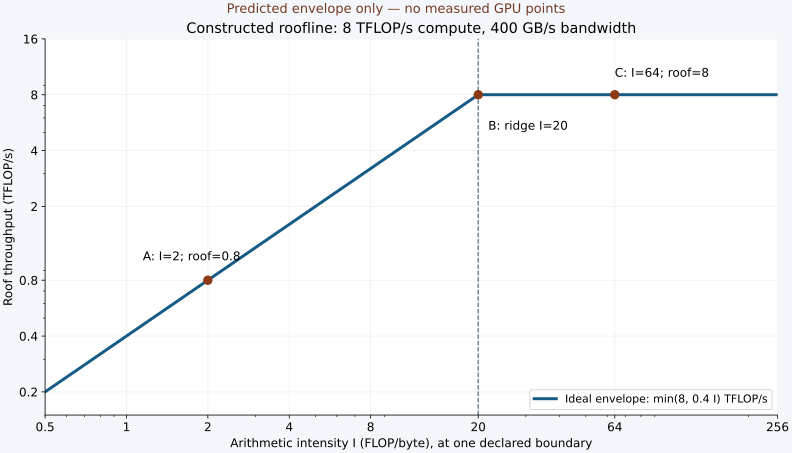
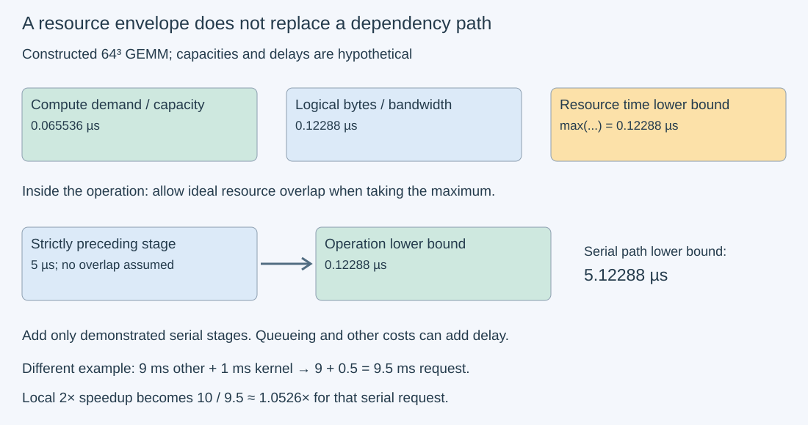

# M3-C16: Using the roofline model to predict bottlenecks

> **Status: Complete — detailed chapter authored and documentation validated; experimental procedures are proposed unless explicitly labelled observed**

**Module:** Learn GPU architecture through data movement

**Category:** [Measurement, experimentation, and economics](index.md)

[Module 3 reading order](../module-3.md) · [Previous: M3-C15](m3-c15-counting-flops-and-bytes-at-a-defined-boundary.md) · [Next: M3-C17](../scheduling-and-queueing/m3-c17-batching-weight-reuse-and-shifting-bottlenecks.md) · [Execution plan and progress](../chapter-execution-plan.md)

## Target concepts

Arithmetic intensity, compute and bandwidth roofs, ridge point, idealized kernel-time estimates, effective versus peak rates, hierarchical rooflines, launch and dependency limits.

## Concepts

### 1. A roofline is a resource budget

A **performance model** deliberately simplifies a system to answer a question. The roofline model asks: given the arithmetic and data transfers of this operation, what throughput could its compute and memory resources possibly support? A **roof** is an upper bound under the model's assumptions. It is not a promise that a kernel reaches that bound.

Begin with [M3-C15's work and byte ledgers](m3-c15-counting-flops-and-bytes-at-a-defined-boundary.md). Let **F** be the floating-point operation count, **Q** the bytes crossing one named memory boundary, and **t** the completed execution interval. Here one multiply plus add counts as two FLOPs. A FLOP is a count; FLOP/s is a rate. Define:

**Arithmetic intensity I = F/Q**, in FLOP/byte.

**Achieved throughput P = F/t**, in FLOP/s.

**Observed transfer rate B_observed = Q/t**, in byte/s.

These use the same operation and interval. Thus **P = I × B_observed** by arithmetic, whenever Q and t are positive. This identity alone does not establish saturation: a slow operation can have low rates at both interfaces. Q=0 does not justify dividing by zero; mark that level's intensity undefined and investigate the selected window, cache history and counter availability.

For a model compute capacity **P_compute** and transfer capacity **B**, the operation must satisfy **P ≤ P_compute** and **P ≤ BI** if these are compatible upper bounds. Therefore:

**P_roof(I) = min(P_compute, BI).**

This is the classic roofline envelope described by [NERSC](https://docs.nersc.gov/tools/performance/roofline/). On a logarithmic plot, the bandwidth portion slopes upward and the compute portion is flat. Logarithmic axes display multiplicative changes with equal spacing. Being left of their intersection means the bandwidth term is the tighter of these two ceilings; it does not prove that a real execution saturates memory.

### 2. Work a complete numerical example

All numbers in this section are **constructed teaching values**, unrelated to a supplied GPU. Use decimal units: TFLOP/s = 10¹² FLOP/s, GB/s = 10⁹ byte/s, and ms = 10⁻³ seconds. Assume a compatible dense arithmetic ceiling P_compute=8 TFLOP/s and boundary bandwidth B=400 GB/s. Their intersection, the **ridge point**, is:

**I_ridge = P_compute/B = 8×10¹²/(400×10⁹) = 20 FLOP/byte.**

Increasing intensity below the ridge raises this model's roof; above the ridge, reducing these bytes alone does not raise its compute ceiling. Let each example perform F=8×10⁹ useful FLOPs. An optimistic resource-time lower bound is:

**t_compute = F/P_compute; t_memory = Q/B.**

**t_lower = max(t_compute, t_memory) = F/P_roof.**

The maximum allows ideal overlap between resource demands. Summing them assumes serial execution and is a different model. Actual time can exceed both because of dependencies, insufficient parallel work or other resources.

| Case | Q at the chosen boundary | I | t_compute | t_memory | t_lower | Roof throughput |
| --- | --- | --- | --- | --- | --- | --- |
| A: transfer ceiling tighter | 4×10⁹ bytes | 2 FLOP/byte | 1 ms | 10 ms | 10 ms | 0.8 TFLOP/s |
| B: ridge | 400×10⁶ bytes | 20 FLOP/byte | 1 ms | 1 ms | 1 ms | 8 TFLOP/s |
| C: compute ceiling tighter | 125×10⁶ bytes | 64 FLOP/byte | 1 ms | 0.3125 ms | 1 ms | 8 TFLOP/s |

*The three markers lie on the ideal envelope by construction. They are predictions, not measured kernel results. Their equality with a roof must not be presented as achieved efficiency.*

### 3. Match the roof to the operation

A dense binary32 scalar/FMA path, a tensor-matrix path, a sparse path and a binary64 path have different capabilities. A headline sparse low-precision tensor rate is not a valid ceiling for dense binary32 arithmetic. Record input, multiplication and accumulator formats, whether reduced-precision inputs are permitted, and whether sparsity constraints actually hold. Library dispatch and padded work can differ from useful mathematical work.

Use **two separate ledgers** when necessary: useful dense work such as 2MKN for comparing equivalent results, and executed arithmetic derived from documented instructions/counters. An executed-work roofline needs an executed-work numerator; a useful-work plot needs a justified mapping to a capacity with the same convention. Do not place useful FLOPs against a sparse “dense equivalent” marketing roof and call the percentage utilization.

**Peak** usually describes a theoretical capability under stated clock, arithmetic and device assumptions. **Sustained calibration** measures what a reference workload achieved under a recorded operating point. It is a useful comparison ceiling, but an empirical sample maximum is not a physical upper bound for every workload. Identify device partition, active resources, power/clock/thermal state, software and calibration working set. A new point above a calibrated line first challenges calibration compatibility, not the observation.

An **effective rate** based on logical bytes is also different from physical bandwidth. Cache-resident data can make logical effective bandwidth exceed DRAM capability because those bytes never crossed DRAM during the interval. Use a logical-byte roofline as an explicitly hypothetical all-bytes-cross-this-boundary model; do not mistake it for a measured DRAM plot. The [CUDA effective-bandwidth guidance](https://docs.nvidia.com/cuda/cuda-c-best-practices-guide/index.html#effective-bandwidth) provides the read/write accounting context.

### 4. The hierarchy has several intensities

A tensor can be read repeatedly near execution while crossing device memory fewer times. For each boundary **l**, define **Q_l**, **I_l=F/Q_l** and a compatible **B_l**. If all capacities are valid upper bounds for the same execution:

**P ≤ min(P_compute, B_DRAM I_DRAM, B_L2 I_L2, …).**

Equivalently, **t_lower = max(F/P_compute, Q_DRAM/B_DRAM, Q_L2/B_L2, …)**. Do not add overlapping traffic times without a serial-dependency argument. Do not use one DRAM intensity for every bandwidth unless a chart explicitly transforms all boundaries to a common convention. Here “L2” means a precisely declared cache transfer interface, not allocated cache capacity. Its metric must say which side and directions are counted.

A constructed hierarchy makes the risk concrete. Keep F=8×10⁹ and P_compute=8 TFLOP/s. Let DRAM Q=250×10⁶ bytes with B=400 GB/s, while the selected L2 interface Q=2×10⁹ bytes with B=1,000 GB/s.

| Boundary | Intensity | Bandwidth × intensity | Resource time |
| --- | --- | --- | --- |
| DRAM | 32 FLOP/byte | 12.8 TFLOP/s | 0.625 ms |
| Selected L2 interface | 4 FLOP/byte | 4 TFLOP/s | 2 ms |
| Compute | Not applicable | 8 TFLOP/s | 1 ms |

The combined roof is 4 TFLOP/s and the time lower bound 2 ms. A DRAM-only plot could incorrectly suggest that only compute deserves attention. If a hypothetical equivalent transformation halves L2 bytes while leaving all other demands unchanged, the combined bound becomes 8 TFLOP/s, or 1 ms. That is a twofold change in the bound, not evidence of a twofold measured speedup. Any extra synchronization, registers or conversion work must enter the revised model. [NVIDIA's hierarchical-analysis article](https://developer.nvidia.com/blog/accelerating-hpc-applications-with-nsight-compute-roofline-analysis/) gives primary methodological context; its historical application measurements are not results for this chapter.

### 5. Launches and dependencies can sit below every roof

An operation needs ready instructions, enough independent work and eligible execution resources. **Occupancy** is resident work relative to a hardware limit; it is not useful throughput. Register/shared-memory pressure, dependency chains, small grids, instruction issue and synchronization can leave both compute and bandwidth unused. [M3-C04](../hardware-architecture-and-topology/m3-c04-occupancy-latency-hiding-and-hardware-utilization.md) explains why additional resident work helps only when it supplies something ready to run.

For a constructed binary32 64³ GEMM, useful F=524,288 and read-once logical Q=49,152 bytes. At the teaching capacities, F/P_compute=0.065536 µs and Q/B=0.12288 µs. These are arithmetic bounds under an all-logical-bytes-cross-boundary assumption, not realistic kernel timings. If an additional 5 µs submission/dependency stage must finish before this execution and cannot overlap it, the complete serial path has a lower bound of **5 + 0.12288 = 5.12288 µs**. If stages can overlap, that sum is no longer justified. Device events around a kernel and a host clock around submission-to-result measure different intervals.

*A resource maximum is an optimistic bound inside a stage. Add stage times only along a demonstrated serial path. The illustration assumes no queueing overlap; real traces must establish the dependency graph.*

For a second constructed example, a serial request has 9 ms of other work and a 1 ms kernel. Even making that kernel take 0.5 ms reduces the request from 10 to 9.5 ms: a 1.0526-fold request speedup, not twofold. Queueing, shared devices and batching can change the relationship further. Token service also has correctness, admission, cancellation and freshness requirements. HFT provides the discipline of following useful work along a critical path; a GPU roofline does not predict exchange latency, trading outcomes or a hard real-time guarantee.

### 6. Turn placement into a falsifiable hypothesis

A point far below a roof calls for an explanation, not immediate “more bandwidth” procurement. Name one candidate limiter and a controlled intervention. For example: reducing bytes at a particular boundary should reduce its service demand if that boundary is limiting, while preserving numerical semantics. Verify the traffic change, other resource changes and completed time. A cache-history intervention changes residency, not the mathematical operation; a shape change changes the workload and cannot alone establish causation for the original shape.

Audit points above a theoretical roof in this order: decimal/binary units; arithmetic convention and precision; timing versus counter scope; cache boundary; clock/partition identity; sparse/padded work; replay and collection conditions. Treat unavailable counters as unavailable, never zero. [Nsight Compute's profiling guide](https://docs.nvidia.com/nsight-compute/ProfilingGuide/index.html) documents roofline analysis and replay behavior; collect separate unprofiled timings and small profiling cohorts, retaining the tool's actual metric definitions and version. Report incompatible or unresolved evidence explicitly rather than repairing it with an assumed cache-hit rate.

## Experiments

All four experiments are **proposed**. Paper predictions can be checked without a GPU; no GPU, benchmark, counter or end-to-end performance measurements are supplied. Use Rust as the eventual application context, with the selected binding's documented layout, stream and completion contracts. No implementation code is included.

### E1 — Build and challenge a two-resource envelope

- **Description:** Reconstruct cases A–C and the plotted envelope from declared capacities.
- **Purpose/objective:** Distinguish a tighter modeled ceiling from observed resource saturation.
- **Target concepts:** Arithmetic intensity, compute/bandwidth roofs, ridge, idealized time and units.
- **Baseline and workload:** F=8×10⁹; Q∈{4×10⁹,400×10⁶,125×10⁶}; P_compute=8 TFLOP/s; B=400 GB/s. These are paper records, not timed trials.
- **Controls and prediction:** Keep the FLOP convention and boundary fixed. Predict ridge 20, time bounds 10/1/1 ms and roof rates 0.8/8/8 TFLOP/s. Halving only B shifts the ridge to 40 and makes case B's bound 2 ms.
- **Procedure:** Independently derive intensity, both resource times and their maximum, then reconstruct the minimum-rate formula. Deliberately substitute GiB/s for GB/s and flag the incompatible units; do not silently accept the same ridge. Supply a hypothetical slower achieved point to show that low throughput alone cannot identify the cause.
- **Hardware/software:** Paper or a calculator suffices. Record decimal units and rounding; no GPU or profiler needed.
- **Failure and HFT connection:** Reject a claimed measured bottleneck based solely on the left/right region. HFT comparisons likewise need actual dependency and service evidence rather than a theoretical capacity label.
- **Exit criteria:** Every table value reconciles through both formulas; the bandwidth perturbation is correct; constructed markers and hypothetical rates stay explicitly labelled.

### E2 — Find the hidden hierarchy constraint

- **Description:** Compare the DRAM-only and two-boundary models in Concepts 4.
- **Purpose/objective:** Expose an inner-boundary demand that a DRAM plot omits.
- **Target concepts:** Hierarchical rooflines, boundary-specific intensity, logical versus physical bytes and effective rates.
- **Baseline and workload:** The constructed 8×10⁹-FLOP record, DRAM Q=250×10⁶ and L2 Q=2×10⁹, with their stated capacities.
- **Controls and prediction:** Preserve useful F and arithmetic capacity. Predict the 4 TFLOP/s combined roof; halving only L2 Q changes the bound to 8 TFLOP/s. Doubling only DRAM B leaves the 2 ms bound unchanged.
- **Procedure:** Create separate byte ledgers and identify the maximum resource time. Recalculate each intervention, then inject the erroneous use of DRAM I=32 with L2 bandwidth and show why it hides the 4 TFLOP/s term. Record that an actual transformation must also be checked for extra work, storage and synchronization.
- **Hardware/software:** No hardware required for these records. A future counter study needs supported metrics identifying each interface and read/write scope.
- **Failure and HFT connection:** An unavailable cache counter leaves hierarchy diagnosis incomplete. A fast external link similarly cannot rule out a slower internal stage in a market-event pipeline.
- **Exit criteria:** Both intensities and all ceilings/times reconcile; the false shared-intensity classification is rejected; opportunity bounds are never reported as measured speedups.

### E3 — Pair exact GEMM results with compatible roofline evidence

- **Description:** Plan a small dense operation study with two controlled preparation histories, separating correctness, timing and profiling.
- **Purpose/objective:** Learn what evidence is needed before attaching a hardware roof to a real operation.
- **Target concepts:** Useful/executed work, peak versus calibrated rates, completed intervals, replay/cache effects and launch limits.
- **Baseline and workload:** Nonaliased binary32 C=AB, α=1, β=0, M=K=64 and N∈{8,64,128}. For zero-based indices and epoch e, A[i,k]=((i+k+e) mod 4)−1 and B[k,j]=((k+2j+e) mod 4)−1. The independent mathematical reference is the sum of all 64 products for every C[i,j]. Use e=0…59 over the measured cohort of each cell. Two histories: H1 creates inputs and completes their transfer immediately before the measured operation; H2 does the same plus one completed untimed operation at the same addresses. Neither is named “cold” or guaranteed cache-resident. Output is overwritten, not accumulated. Warmups use e=0; each profiling invocation uses the first measured epoch of its session, with identity retained separately.
- **Controls and prediction:** Fix layout, leading dimensions, binding/library, multiplication and accumulator policy, stream, allocation and workspace. Require exact output equality for these small integer fixtures; no approximate mode changes. Derive 2×64×64×N useful FLOPs and 4(4096+64N+64N) logical bytes. Predict possible overhead/cache sensitivity, without requiring a performance ordering or declaring all shapes bandwidth-bound.
- **Procedure:** Run three independent sessions, ten excluded warmups per cell/session, then twenty measured operations per cell/session, interleaving all six cells in a recorded balanced order. Assign epoch consecutively per cell across sessions. Gate each result against the reference outside timing. Capture a completed device-operation interval and a separate host preparation-to-validated-result interval; retain every library-launched kernel if the operation dispatches several. Then profile one representative invocation per cell/session as a separate cohort (18 records), restoring its specified history. Retain profiler duration for its own work/byte point; do not divide replay counters by an unprofiled time. If metrics cannot match the complete operation, restrict and label the point to a selected kernel with justified counts, or mark the roofline unavailable.
- **Hardware/software:** One supported GPU, binary32 GEMM path, documented device events and host clock, independent CPU references, and optional Nsight Compute counter access. Archive the hardware manifest specified below. Profiling and calibration are separate from the 360 measured timing trials; no prescribed TFLOP/s target.
- **Failure and HFT connection:** Validate shapes before submission. Give each result a session/cell/epoch/generation identity; do not recycle buffers until completion and validation readers retire. A 120-second watchdog stops new admission and marks unknown completion; expiry or cancellation is not proof that reuse is safe. Incorrect, timed-out or stale results are failures, never useful completions. This is the transferable HFT discipline of protecting ownership and freshness under delayed work.
- **Exit criteria:** Account for 360 measured trials, 180 excluded warmups and 18 planned profiling invocations independently; list any failed/missing records without replacement. Every successful result passes exact checks, rates have compatible numerator/window/roof definitions, and unsupported evidence is explicitly unavailable. A null timing difference is acceptable; a forced bottleneck label is not.

### E4 — Test a roofline claim against the critical path

- **Description:** Audit the tiny-operation and serial-request examples, then design the evidence for an end-to-end claim.
- **Purpose/objective:** Prevent local resource improvements from being advertised as useful-service improvements without proof.
- **Target concepts:** Launch/dependency limits, ideal lower bounds, queueing and end-to-end validation.
- **Baseline and workload:** The constructed 64³ operation plus strictly preceding 5 µs stage, and the separate 9+1 ms serial request. These are paper cases. A future inference study must fix model/token identity, request lengths, arrival trace, concurrency, cancellation and admission policy before measurement.
- **Controls and prediction:** Predict 0.12288 µs resource lower bound, 5.12288 µs serial-path lower bound, and 10/9.5 request speedup. The serial sums apply only under the stated no-overlap dependencies.
- **Procedure:** Draw the dependency path and distinguish device interval, submission latency and validated completion. Remove the no-overlap assumption and explain why the additive claim no longer follows. For a future service comparison, predeclare useful completion, freshness and correctness gates; record queue/admission, first useful response and full completion events alongside failures. Change one local mechanism, retain arrival conditions and verify all work/traffic/ownership changes. No serving benchmark is executed in this chapter.
- **Hardware/software:** Paper analysis needs none. Future service work needs a real model/device manifest and synchronized or calibrated event domains; a device event cannot timestamp external arrival directly.
- **Failure and HFT connection:** Include overload, cancellation and stale-generation outcomes in the measurement design. A faster kernel that only shifts a queue or increases stale responses has not established useful-service improvement; this transfers to HFT without promising trading performance.
- **Exit criteria:** All arithmetic and dependency assumptions reconcile. Any future claimed service improvement must include equivalent correct outputs, completed-request rates and full latency distributions under the declared workload; paper bounds remain separate from observations.

## Verification

### Matched checks and evidence

| Experiment | Reference or invariant | Measurement and profiling | Acceptance and limits |
| --- | --- | --- | --- |
| E1 | Same F, Q boundary and units in rate/time formulas | Independent arithmetic; log-axis figure and ridge | Exact table reconciliation; no measured saturation claim |
| E2 | Separate Q and I for each interface | Recalculate original and two interventions | 2 ms → 1 ms L2 opportunity; DRAM-only intervention unchanged; false shared intensity rejected |
| E3 | Every successful output equals the independent 64-term integer dot product | Separate completed unprofiled intervals and compatible profiler records | Full outcome ledger, exact correctness, supported roof convention; unresolved counters remain unavailable |
| E4 | Serial edges justify additions; useful outcomes exclude failures | Paper critical paths now; declared end-to-end service trace in a future study | 5.12288 µs bound and 1.0526-fold request example; no inferred serving improvement |

For E3 the useful-work/logical-byte ledger is:

| N | Useful core FLOPs | Read-once logical bytes | Logical intensity (FLOP/byte) | Output coordinates per result |
| --- | --- | --- | --- | --- |
| 8 | 65,536 | 20,480 | 3.2 | 512 |
| 64 | 524,288 | 49,152 | 10⅔ | 4,096 |
| 128 | 1,048,576 | 81,920 | 12.8 | 8,192 |

These are **not measured DRAM bytes**. Every stored input is an integer in {−1,0,1,2}; each product is at most four in magnitude and every 64-term partial sum has magnitude at most 256. Binary32 can represent all these integers exactly. Under the declared exact arithmetic policy this supports an exact output gate, not a general claim that arbitrary GEMM needs zero tolerance. Reduced-precision policy changes require separate validation using [M9-C17](../numerics-and-correctness/m9-c17-comparing-logits-with-justified-numerical-tolerances.md).

The six cells yield 360 measured results and **1,536,000 checked output coordinates**, plus warmup checks if retained. Their useful measured work is 196,608,000 FLOPs. At maximum shape, raw device A/B/C total 81,920 bytes (80 KiB); workspace/runtime allocations are additional. Host A/B/output/reference total 114,688 bytes (112 KiB) if the reference is stored as binary32. Do not multiply per-operation useful counts by profiler replay passes and report them as application throughput.

Report all twenty measured times per cell/session, median, nearest-rank p95 and maximum, with failures separately. For n successful timings, nearest-rank p95 is sorted value at rank ceil(0.95n), using one-based ranks. At n=20 it is rank19; at n=60 it is rank57. Twenty observations do not establish a stable p99. Show session differences and paired history differences without averaging percentiles. Any pooled 60-sample distribution must preserve session labels and does not replace the per-session distributions. Use [M9-C07](m9-c07-latency-distributions-and-statistical-uncertainty.md) for uncertainty; a point estimate above/below another is not proof of improvement.

Archive raw counts, units, completion windows, F convention, Q interface, arithmetic path, roof derivation and observed operating point with each plot. A profiler's P and I must use its compatible duration and counter scope. Unprofiled useful rates remain separate comparison evidence. Review dispatch coverage, replay passes, cache-control settings and metric support before interpreting the gap. A very high gap can indicate missing resources/dependencies; a point above a claimed physical roof requires an accounting/compatibility investigation. Neither alone proves a specific root cause.

### Six dimensions applied

| Dimension | Chapter-specific question and check |
| --- | --- |
| Semantics and invariants | Does the transformation preserve C=AB and the arithmetic contract? Exact fixture checks precede useful-rate claims. |
| Workload and variability | Do shape, preparation history, arrivals and reuse change Q or readiness? Preserve cells and session labels. |
| Resources and bottlenecks | Which boundary's service demand sets the tightest compatible roof? Include inner-cache and register/shared constraints. |
| Time and distributions | Which serial edges delay useful completion? Keep resource lower bounds, kernel distributions and request tails distinct. |
| Ownership and coordination | Who may overwrite input/output/workspace? Completion and generation identity govern reuse even if collection fails. |
| Failure and adaptation | What happens on unknown completion, overload or unsupported metrics? Stop unsafe admission, retain ownership, and report incomplete evidence. |

### Eight engineering principles applied

| Principle | Application |
| --- | --- |
| 1. Correctness defines the optimization boundary | Equivalent exact fixtures must pass before a point counts as useful work; approximation requires a different gate. |
| 2. Performance depends on workload and operating point | A ridge depends on capacities; actual behavior also depends on shape, history, clocks and resource partition. |
| 3. Data movement is part of the algorithm | Name DRAM/L2 interfaces separately; a logical read-once model is not a counter. |
| 4. State has ownership, lifetime, and recovery cost | Keep buffers until true retirement; a timeout cannot authorize reuse. |
| 5. Dependencies determine latency; bottlenecks determine capacity | Maximum resource times bound one stage; demonstrated serial edges determine additive request paths. |
| 6. Variability and synchronization shape the tail | Preserve timing distributions and synchronization delays; ideal ceilings do not predict p99. |
| 7. Local improvements must be evaluated end to end | A twofold local bound change does not imply twofold useful-request improvement. |
| 8. Claims require reproducible evidence | Retain references, raw records, manifests, counter definitions, failures and hypotheses that could be disproved. |

## Specifications, articles, and hardware

| Primary source | Use and limits |
| --- | --- |
| [NERSC Roofline performance model](https://docs.nersc.gov/tools/performance/roofline/) | Foundational envelope, hierarchy and empirical characterization. Its historical V100/tool instructions do not specify the current installed platform. |
| [Nsight Compute profiling guide](https://docs.nvidia.com/nsight-compute/ProfilingGuide/index.html) | Current roofline, metric and replay methodology; retain actual installed version and supported sections. |
| [NVIDIA hierarchical roofline article](https://developer.nvidia.com/blog/accelerating-hpc-applications-with-nsight-compute-roofline-analysis/) | Primary worked-analysis context; historical application measurements are not chapter results. |
| [CUDA effective-bandwidth guidance](https://docs.nvidia.com/cuda/cuda-c-best-practices-guide/index.html#effective-bandwidth) | Read/write rate accounting; distinguish modeled bytes from transfers. |
| [cuBLAS operation reference](https://docs.nvidia.com/cuda/cublas/index.html) | GEMM layout, coefficients and arithmetic configuration; verify the selected API/binding rather than assuming row-major storage. |

E1/E2/E4 require no GPU. E3 needs one supported device and no NIC or second GPU. Record exact GPU SKU/architecture, device/partition identity, active compute resources, DRAM type/capacity, cache topology, host CPU/RAM/NUMA, connection path, driver/runtime/library/binding/profiler versions, precision policy, workspace, clock/power/thermal conditions and competing activity. Follow completed [M9-C16](../hardware-architecture-and-topology/m9-c16-recording-hardware-conditions-that-change-measurements.md). Attach the exact vendor specification for the actual device and distinguish advertised peaks from a separately documented sustained calibration. No actual hardware specification can be asserted because no experiment machine was supplied. The 8 TFLOP/s and 400 GB/s example is deliberately hypothetical.

## Completion and next chapter

Track progress and acceptance in the clickable [execution plan](../chapter-execution-plan.md). Next in Module 3 reading order is the completed [M3-C17: Batching, weight reuse, and shifting bottlenecks](../scheduling-and-queueing/m3-c17-batching-weight-reuse-and-shifting-bottlenecks.md). The next authoring chapter is [M3-C18](../numerics-and-correctness/m3-c18-validating-gpu-computation-and-memory-movement.md). Module 9 supports Modules 1–7; Module 8 is excluded.
