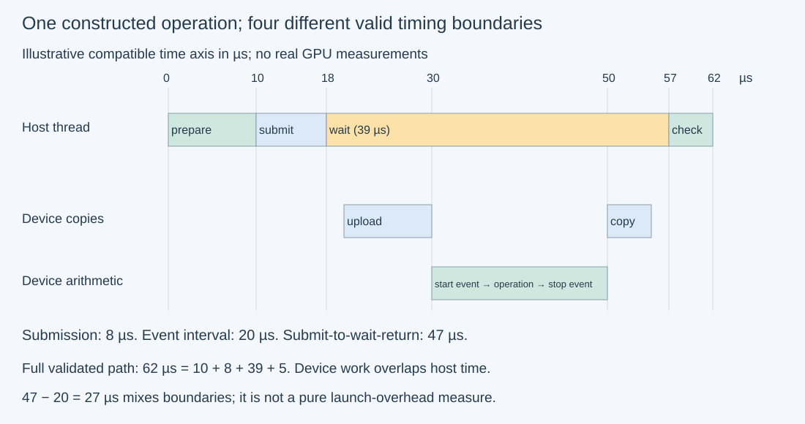
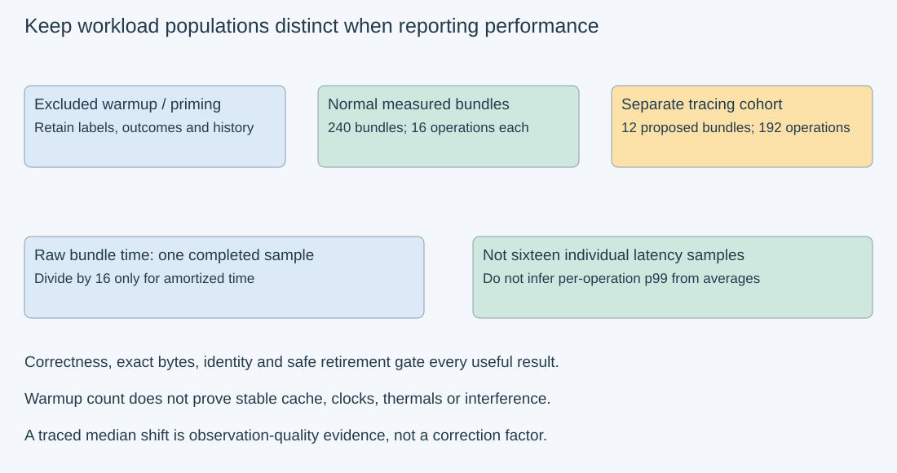

# M3-C19: Designing trustworthy asynchronous GPU benchmarks

> **Status: Complete — detailed chapter authored and documentation validated; experimental procedures are proposed unless explicitly labelled observed**

**Module:** Learn GPU architecture through data movement

**Category:** [Measurement, experimentation, and economics](index.md)

[Module 3 reading order](../module-3.md) · [Previous: M3-C18](../numerics-and-correctness/m3-c18-validating-gpu-computation-and-memory-movement.md) · [Next: M3-C20](m3-c20-benchmarking-memory-copies-across-sizes-and-paths.md) · [Execution plan and progress](../chapter-execution-plan.md)

## Target concepts

Device-event versus host-wall timing, timing boundaries, completion waits, launch overhead, warmup, repeated trials, cache state, clocks and thermals, interference, distributions, profiler overhead.

## Concepts

### 1. Specify the question before choosing a timer

A **benchmark** is a controlled comparison of a declared workload and outcome. An **asynchronous** GPU operation can return control to the CPU before the device finishes. A timer around a returning submission call therefore answers a different question from a timer ending after a valid result becomes available. Rust is the eventual application context; host ownership alone does not establish device completion, and no implementation code is included here.

Write a benchmark contract before running: operation and input identity, dimensions/layout/arithmetic policy, preparation/cache history, in-flight limit, timer endpoints, included/excluded work, completion condition, correctness gate, trial count, outcome accounting and hardware state. State whether the question concerns submission cost, completed device execution, a bundle of operations, validated application latency or useful serving throughput. A number labelled only “GPU latency” is incomplete.

An **in-flight operation** has been admitted/submitted but has not retired. **Retirement** means the operation and required readers have completed and its storage may be reused. A stop timestamp is not a substitute for a valid ownership transition. Follow completed [M3-C18](../numerics-and-correctness/m3-c18-validating-gpu-computation-and-memory-movement.md): exact references, byte/guard checks and generation identity gate the interpretation of performance evidence.

### 2. Host wall clocks and device events have different boundaries

A **host monotonic clock** measures elapsed CPU-side wall time without calendar-clock adjustments. It includes blocked or unscheduled time between its endpoints; it does not count only active CPU instructions. A **device event** records a point reached in a device stream. A **stream** orders its operations; explicit cross-stream dependencies are needed when work spans streams, as in completed [M3-C11](../runtime-and-concurrency/m3-c11-streams-events-and-dependency-ordering.md).

For compatible host timestamps h_begin, h_submit_return and h_valid:

**T_submit=h_submit_return−h_begin.**

**T_host_valid=h_valid−h_begin**, if the intended work has completed and validation is included before h_valid.

For completed timing-enabled device events d_start and d_stop:

**T_event=elapsed(d_start,d_stop)** in the device API's stated units.

The [CUDA event specification](https://docs.nvidia.com/cuda/cuda-runtime-api/group__CUDART__EVENT.html) reports elapsed event time in milliseconds, with approximately 0.5 µs resolution. This is a documented scale, not a guarantee of 0.5 µs experimental accuracy or identical support on every future platform. Timing-disabled events cannot supply elapsed times. Inspect both event completion and operation errors; an elapsed-time calculation alone is not the complete error/completion gate.

Record start before the selected work and stop after all of it in the actual execution stream. Wait for the stop event before reading its elapsed result. For multi-stream work, a final event must follow a valid join of every required producer; an event on an unrelated stream can finish too early. Reusing/re-recording an event needs generation tracking and safe reader retirement. Do not subtract raw host and device timestamps without a documented clock correlation; compare durations with their own endpoints using completed [M9-C02](m9-c02-request-events-clocks-and-measurement-boundaries.md).

Events do not promise pure arithmetic time. A stream interval can include host submission gaps, dependency waits, other device work and contention that delay reaching the stop. Conversely, a narrow interval around a GEMM excludes earlier upload and later download. A library call may dispatch several kernels; bracket its complete operation or label the selected subset.

### 3. Reconcile one complete timing ledger

The following is a **constructed example**, assuming a compatible axis only for teaching. Times are microseconds (µs=10⁻⁶ seconds); milliseconds are 10⁻³ seconds.

| Observation | Timestamp/interval (µs) | Included work |
| --- | --- | --- |
| Host request start and preparation | 0; 0–10 | Inputs/descriptors prepared |
| Host submission sequence | 10–18 | Upload, event and operation/download requests |
| Device upload | 20–30 | Input copy |
| Device start event | 30 | Arithmetic boundary reached |
| Device operation | 30–50 | Complete selected arithmetic |
| Device stop event | 50 | Arithmetic completed |
| Device download | 50–55 | Result copy |
| Final host wait | 18–57 | Ends after required download plus host return delay |
| Host validation/publication | 57–62 | Result checked and made usable |

The narrow host submission interval is 8 µs; the device arithmetic interval is 20 µs. Host submission-start to final-wait return is 47 µs. Full preparation-to-validated-publication is 62 µs. These are compatible descriptions of different boundaries, not contradictory estimates of one quantity.

A nonoverlapping host partition is **10 preparation + 8 submission + 39 wait + 5 validation =62 µs**. Device upload 10, arithmetic 20 and download 5 sum to 35 µs on this serial device path, overlapping the host wait/submission. Adding those 35 again double-counts time. The difference 47−20=27 µs is not pure launch overhead: it mixes queue/copy/submission/wakeup boundaries. The [CUDA synchronization specification](https://docs.nvidia.com/cuda/cuda-runtime-api/api-sync-behavior.html) explains why API names and host return alone cannot define completion.

*The values are invented. Device events bracket arithmetic; the wider host boundary includes preparation and validated publication. Real cross-domain timestamps need correlation evidence.*

**Launch overhead** needs an explicit definition. Host submission duration, time from a call's return to device start, and extra time seen in an end-to-end path are different observations. A baseline with no useful work can estimate an observation path's cost, but subtracting it assumes that overhead is additive and unchanged by the workload. Do not silently subtract an empty-event or empty-launch result to manufacture a tiny or negative kernel time. Retain raw measurements and explain what an empty-path control does and does not establish.

### 4. Repetition changes the measured population

For N valid operations completed in a bundle with device interval T_bundle:

**Amortized event time per operation = T_bundle/N.**

**Bundle useful rate = N/T_bundle**, under the stated operation/outcome definition.

These describe that bundle. They do not provide N independent latency observations. With N=16 and constructed T_bundle=160 µs, the amortized value is 10 µs/operation; a single independently synchronized operation could take 14 µs at a different operating point without contradiction. Queueing all operations can improve amortization, change cache history and introduce overlap or resource pressure. With one ordered stream, host gaps between enqueues can still appear inside the event interval.

If each endpoint had an illustrative error bounded by δ, subtraction could have error up to 2δ, and a bundle average up to 2δ/N from endpoints alone. This is a conditional error exercise, not a bound derived from the API's resolution. At δ=0.5 µs and N=16 it gives 0.0625 µs average endpoint uncertainty, while scheduling drift, event overhead and workload changes remain unbounded by that calculation. More repetitions reduce one relative measurement contribution without certifying accuracy or individual tails.

Repeated β=1 GEMM on the same output changes C unless its seed is restored; restoring it changes traffic/history. Repetition must preserve the intended semantics, not merely execute a similar call many times. The E2 design uses distinct per-operation input/output slots and β=0 so every queued result can be checked after completion. It retains the distinction between sixteen operations and one batch-shaped GEMM.

### 5. Warmup and hardware state belong to the workload

**Warmup** is declared preparatory execution excluded from a particular steady-operation timing population. It can include initialization, library planning, allocation, compilation, page placement, cache changes and clock transitions. Ten warmups are a procedure, not proof of a stable state. State what cold-start question remains unanswered when setup is excluded. Preserve first-use results separately if they matter; do not discard slow measured trials afterward because they look like warmup.

For a separate constructed sequence [50,30,20,20,21,20,19,20] µs, predeclaring the first two as warmup leaves six measured values with mean 20, median 20, nearest-rank p95=21 and maximum 21 µs. All eight have mean 25 µs. Choosing exclusions after seeing the sequence changes the question and can bias the answer.

A **cache state** is defined by prior accesses and controls, not a label such as “warm” or “cold.” Repeating the same addresses may create reuse without guaranteeing residency. Uploading inputs, seed resets, priming, validation copies and other workloads can alter the cache. Keep history explicit and distinguish it from device-clock/thermal state. Completed [M9-C16](../hardware-architecture-and-topology/m9-c16-recording-hardware-conditions-that-change-measurements.md) specifies the hardware manifest and sampling limits.

**Interference** is competing work that changes execution: other streams/processes, host scheduling, transfers, memory pressure, monitoring or shared device partitions. An isolated-device benchmark and a shared serving benchmark are different operating points. Record concurrency and background activity; do not assert absence merely because one application stream is empty. Power/temperature limits can change clocks during a run. [NVIDIA SMI documentation](https://docs.nvidia.com/deploy/nvidia-smi/index.html) defines supported telemetry and clock-event reasons; unavailable fields are unknown. Coarse telemetry does not diagnose an individual microsecond event. No clock/power settings need be changed for this chapter's procedures.

### 6. Distributions and instrumented cohorts require honest limits

A **distribution** describes how observed times vary. Keep each completed trial, its session/order/epoch, failures and observation mode. Report median, an explicitly defined percentile and maximum; a mean alone can hide long waits. Nearest-rank p95 of n sorted successful values is rank ceil(0.95n), one-based. At n=20 it is rank 19. Twenty trials do not support a stable p99 claim, and no percentile may be averaged across sessions and called the pooled percentile.

A synchronized one-in-flight experiment does not reproduce burst arrivals or production queueing. Finite bundle throughput does not establish sustainable service capacity. Pair comparisons by the same workload and history, preserve session drift and allow null/adverse results. Completed [M9-C07](m9-c07-latency-distributions-and-statistical-uncertainty.md) develops uncertainty and tail limitations.

Profiling/tracing adds observation effects and can alter cache state, scheduling or replay. Maintain normal timing, system-timeline captures and kernel counters as separate cohorts, following completed [M9-C12](m9-c12-reading-cpu-gpu-timelines-and-scheduling-gaps.md) and [M9-C13](m9-c13-using-kernel-profilers-to-explain-hardware-bottlenecks.md). A constructed normal median 100 µs and traced median 115 µs give a 15% shift. That is not a correction to subtract from every traced interval. Choose collectors to answer a specific unresolved question and retain errors/coverage; do not improve a normal benchmark claim by replacing it with the shortest profiler duration.

*Raw completed samples, excluded warmups, repeated-operation averages and traced samples are distinct populations. A good-looking timer result cannot override a failed correctness or lifetime gate.*

The HFT lens emphasizes useful event completion, freshness and tail distributions rather than submission speed alone. Waiting after every operation can distort a production pipeline, while omitting a required wait makes an invalid measurement. What transfers is the discipline of boundaries and evidence, not a trading outcome or hard real-time guarantee.

## Experiments

All four experiments are **proposed**. No hardware timing, GPU execution, trace capture or serving measurement is supplied. Worked timestamps and sample arrays are teaching constructions. Rust is the eventual engine context; no implementation code is included.

### E1 — Audit timer boundaries and completion joins

- **Description:** Reconstruct the 62 µs example and reject incomplete or mismatched timing records.
- **Purpose/objective:** Establish what each duration includes before comparing speed.
- **Target concepts:** Device events, host wall time, completion waits, boundaries and launch overhead.
- **Baseline and workload:** The exact teaching ledger in Concepts 3; assume a compatible axis for its arithmetic. Separately consider a stop event on a stream that never waits for a second producer.
- **Controls and prediction:** Keep all timestamps fixed. Predict submission 8, arithmetic 20, submission-to-wait-return 47 and validated full-path 62 µs, with host partition 10+8+39+5.
- **Procedure:** Independently calculate the intervals and identify overlap. Show why 47−20 is not pure launch overhead. Reject reading an unfinished/timing-disabled event, subtracting uncorrelated host/device timestamps, and treating the unrelated-stream stop as a complete join. Keep missing/error status separate from zero elapsed time.
- **Hardware/software:** Paper analysis requires none. Actual events must follow the installed device/binding contract and support timing.
- **Failure and HFT connection:** An early stop can report a fast stale or incomplete result. Completion and identity gates remain necessary for inference and freshness-sensitive HFT events.
- **Exit criteria:** All durations reconcile and the three invalid event/clock/join records are rejected; no host-return interval is labelled completed device latency.

### E2 — Compare sixteen synchronized operations with a queued bundle

- **Description:** Plan a controlled single-GPU comparison with equal useful work and independently checkable results.
- **Purpose/objective:** Separate per-operation synchronization cost from repeated-work amortization.
- **Target concepts:** Repeated trials, completion waits, cache state, timing boundaries and distributions.
- **Baseline and workload:** Each trial contains sixteen independent binary32 GEMMs, M=17,K=13,N=9, α=1,β=0, sharing fixed B[k,j]=((2k+j) mod 4)−1. For trial epoch e and operation j_op=0…15, set A[i,k]=((i+k+e+j_op) mod 4)−1 and reference Y=A×B. Allocate distinct A/Y slots for all sixteen operations, each with one padding element per row and 32-byte prefix/suffix guards. Initialize output backings, padding and guards before preparation/history; β=0 overwrites the logical output. Same values can recur by construction, so metadata/ownership checks remain necessary to detect stale generations that numeric equality alone may miss.
- **Controls and prediction:** Compare a wait after each GEMM against sixteen ordered GEMMs with one final stop-event wait; one bundle at a time in both cases, same stream/workspace policy. Two histories: H1 inputs uploaded and byte-echo-checked immediately before the trial; H2 the same plus one completed untimed sixteen-operation priming bundle at the same addresses, with outputs/guards checked before the measured bundle. Neither history is named guaranteed cold or resident. Four cells result from schedule×history. Predict possible differences without a required direction.
- **Procedure:** Run three independent sessions, ten excluded warmup bundles per cell/session and twenty measured bundles per cell/session in a recorded balanced order. Measured e=0…59 per cell; warmups use e=0. Start the host bundle timer after preparation/history, immediately before enqueueing the start event; stop after result downloads, full validation and reader retirement. Device start/stop bracket all sixteen GEMMs, excluding their later downloads. In the per-operation-wait cell, host gaps may be inside that device bundle interval. Retain all actual library dispatches. Validate every output and untouched byte outside device timing. Record raw bundle times and amortized time÷16, never sixteen invented individual latency samples.
- **Hardware/software:** One supported GPU with documented dense binary32 operations, timing events, completion/transfer mechanisms and a valid Rust binding. Reserve 1 MiB raw host/device fixture allowance each plus explicit library/workspace/runtime budget; actual allocations and pinned-host requirements must be retained.
- **Failure and HFT connection:** Give every slot session/cell/epoch/operation/generation identity. Preserve source/output/event/workspace through actual completion and reader retirement. A 120-second watchdog stops admission and records unknown completion; it never authorizes buffer reuse. Any incorrect/stale/missing output fails the bundle's useful-result gate.
- **Exit criteria:** Account for 240 measured bundles and 120 excluded warmup bundles, containing 3,840 measured and 1,920 warmup operations, separately from priming. All successful bundles pass exact/byte/guard/identity gates. Report per-session raw distributions and amortized quantities with correct populations; no per-operation p99 or serving capacity claim follows.

### E3 — Validate warmup and operating-point claims

- **Description:** Audit the constructed eight-value sequence and define state evidence for E2.
- **Purpose/objective:** Keep first use, declared warmup, cache history and thermal drift distinct.
- **Target concepts:** Warmup, cache state, clocks/thermals, interference and repeated trials.
- **Baseline and workload:** The sequence 50/30/20/20/21/20/19/20 µs with first two predeclared excluded; E2's four cells and recorded history for a future hardware run.
- **Controls and prediction:** Predict retained mean/median 20, p95/max 21 and all-eight mean 25 µs. Real E2 uses its fixed ten excluded warmups, not adaptive deletion of slow measured samples. No warmup count proves steady state.
- **Procedure:** Preserve all eight paper records and their labels. For hardware retain setup/first-use observations separately, ordered trial times and supported clock/temperature/power/background samples before/during/after each session. Predeclare that a state mismatch or unresolved drift prevents pooling as one operating point. If ten warmups fail to establish the intended state, mark it unestablished and plan a separately labelled session rather than discard measured values until the curve looks flat. Keep telemetry cadence and unsupported fields explicit.
- **Hardware/software:** Paper calculation requires none. Actual state review uses supported device telemetry plus host/context/process metadata from M9-C16; sampling cannot certify every microsecond transition.
- **Failure and HFT connection:** A median improvement caused by a different power/queue state is not an established algorithm gain. Freshness/deadline interpretations likewise require the actual operating point.
- **Exit criteria:** Sample arithmetic and labels reconcile; no post-hoc trimming, guaranteed residency or unobserved thermal cause is asserted. Unmatched sessions remain separate evidence.

### E4 — Measure observation effects without correcting away reality

- **Description:** Compare a synthetic overhead record and plan a small separate timeline cohort for E2.
- **Purpose/objective:** Explain an unresolved boundary/overlap question without replacing normal timing.
- **Target concepts:** Profiler overhead, interference, device-event resolution and evidence limits.
- **Baseline and workload:** Paper medians 100 versus 115 µs; a 16-operation 160 µs bundle versus a separately synchronized 14 µs single; conditional endpoint uncertainty δ=0.5 µs. For future captures use one first measured E2 epoch per cell/session as a separate run: twelve traced bundles, 192 operations.
- **Controls and prediction:** Predict 15% summary shift, 10 µs amortized bundle time and 0.0625 µs conditional average endpoint bound. None establishes corrected true latency, single-operation tails or a bound on scheduler variation.
- **Procedure:** Use a focused system trace only for the required enqueue/wait/device/validation boundaries, preserving E2 history and correctness. Capture starts before bundle submission and ends after validated retirement. Retain tool/version/options, raw normal/traced host durations, coverage and clock-correlation evidence; add no replay counters to normal timings. If an interval is not resolved or capture is incomplete/perturbed, withhold the corresponding fine-grained claim. No traced measurement has been executed here.
- **Hardware/software:** Paper checks need none. Proposed capture needs a compatible system tracer; optional counters would need another explicitly separate cohort rather than an unrecorded addition.
- **Failure and HFT connection:** A missing completion in the trace is incomplete evidence, not zero execution or permission to reclaim live state. Observer effects also limit inference and HFT latency claims.
- **Exit criteria:** All three paper calculations reconcile with their limits; twelve proposed traced bundles remain separate from E2's 240 normal bundles. Any future traced interpretation has valid endpoints, identity, coverage and a normal-execution comparison.

## Verification

### Match experiments to references and outcomes

| Experiment | Reference/invariant | Measurement evidence | Acceptance and limits |
| --- | --- | --- | --- |
| E1 | Explicit host/device ledger and completion edges | Independent endpoint arithmetic and invalid-record review | 8/20/47/62 µs scopes distinguished; invalid event/clock/join records rejected |
| E2 | Same sixteen exact GEMMs and legal slot/event lifetimes | Device bundle interval, wider validated host interval and full outcomes | 240 normal bundles accounted for; averages are not individual samples |
| E3 | Predeclared exclusions and matched state/history | Ordered records plus supported telemetry | Retained 20/20/21/21 µs statistics; no post-hoc warmup claim |
| E4 | Separate observation cohort and conditional error model | Paper arithmetic; proposed focused timeline comparison | 15%/10 µs/0.0625 µs interpreted within limits; no automatic correction |

For E2 one operation has **153 output coordinates** and **2×17×13×9=3,978 useful core FLOPs**. A sixteen-operation bundle has **2,448 coordinates** and **63,648 FLOPs**. Across 240 measured bundles this is **587,520 planned checked coordinates** and **15,275,520 useful core FLOPs**. The 120 excluded warmup bundles contain 1,920 operations; H2 adds one priming bundle per applicable trial, including warmup trials, so 120 measured plus 60 warmup priming bundles are additional work and are excluded from measured counts. All priming must complete and retire before its measured or warmup successor.

Device padded backing per A is 17×14×4=952 bytes and per Y 17×10×4=680 bytes; fixed B 13×10×4=520 bytes. Guarded 16×(A+Y) plus one guarded B costs **16×(1,632+128)+(520+64)=28,744 bytes**, excluding workspace/runtime. Host upload/echo/result/reference backing fits 1 MiB with the same distinct slot accounting; retain the actual live/allocation ledger. Useful byte/work models do not establish measured DRAM or link traffic.

Every input lies in {−1,0,1,2}; K=13 gives product magnitudes≤4 and partial-sum magnitudes≤52. These integers and outputs are exactly representable in binary32 under the declared arithmetic policy. Check all logical outputs against independent integer products/sums; report maximum error and first mismatch even though the gate is exact for this fixture. A changed precision path or general model input requires a separately justified budget as in completed [M9-C17](../numerics-and-correctness/m9-c17-comparing-logits-with-justified-numerical-tolerances.md).

Retain successful, incorrect/stale, submission/completion failure, cancelled, watchdog-unknown and unfinished bundles as mutually exclusive application outcomes at a stated cutoff, summing to 240 for E2. Preserve per-operation details inside failed bundles, but do not count an invalid bundle as sixteen useful completions. Trace completeness is an independent attribute. Seeds, guards, event generations and input/output references must survive until all readers retire. A timed-out or cancelled operation may still hold device resources.

For each cell/session retain all twenty normal timing outcomes, median, nearest-rank p95 and maximum plus failures. Preserve paired cell/epoch identity and chronological order; do not average percentiles or pool unmatched hardware/history sessions. Division of every bundle duration by 16 produces an amortized-bundle distribution, not a distribution of individual operation latency. The fixed trials establish no robust p99 or hard deadline. A closed-loop one-bundle-at-a-time test also cannot establish open-loop serving tails under load.

### Six dimensions applied

| Dimension | Chapter-specific check |
| --- | --- |
| Semantics and invariants | Timer endpoints enclose the intended valid result; equivalent work and slot/generation identity precede speed claims. |
| Workload and variability | Declare sixteen-operation bundles, cache histories, warmup labels, concurrency and session drift. |
| Resources and bottlenecks | Bound backing/workspace and telemetry/trace overhead; record actual competing device and host work. |
| Time and distributions | Separate host submission, completed event interval, validated host latency and amortized statistics. |
| Ownership and coordination | A stop event must join every required producer; storage and event reuse wait for actual retirement. |
| Failure and adaptation | Stop unsafe admission on unknown completion, retain failed outcomes and withhold unsupported timing interpretations. |

### Eight engineering principles applied

| Principle | Application |
| --- | --- |
| 1. Correctness defines the optimization boundary | Faster submission is irrelevant when completion or exact output/identity gates fail. |
| 2. Performance depends on workload and operating point | Synchronization, reuse history, clocks and interference change what the benchmark measures. |
| 3. Data movement is part of the algorithm | A narrow arithmetic event interval excludes earlier uploads and later validated download; state wider boundaries separately. |
| 4. State has ownership, lifetime, and recovery cost | Independent output slots enable later validation; cancellation/timeout cannot release live state. |
| 5. Dependencies determine latency; bottlenecks determine capacity | Remove only unnecessary waits; preserve cross-stream joins and all producer/consumer edges. |
| 6. Variability and synchronization shape the tail | Keep ordered samples and sessions; bundle averages cannot establish individual tails. |
| 7. Local improvements must be evaluated end to end | Event-time gains require separate validated application and eventual serving evidence. |
| 8. Claims require reproducible evidence | Archive contracts, references, raw samples, excluded warmups, state/clock records and instrumented-cohort limits. |

## Specifications, articles, and hardware

| Primary source | Role and limits |
| --- | --- |
| [CUDA event-management specification](https://docs.nvidia.com/cuda/cuda-runtime-api/group__CUDART__EVENT.html) | Timing-enabled events, units/resolution and completion/error constraints; resolution is not experimental accuracy. |
| [CUDA synchronization behavior](https://docs.nvidia.com/cuda/cuda-runtime-api/api-sync-behavior.html) | Submission/return and transfer behavior; do not infer completion from an API name. |
| [CUDA Best Practices timing guidance](https://docs.nvidia.com/cuda/cuda-c-best-practices-guide/index.html#timing) | Host/event timer methodology; explicit stream/dependency and interference scope still govern interpretation. |
| [NVIDIA SMI documentation](https://docs.nvidia.com/deploy/nvidia-smi/index.html) | Supported telemetry, units and clock-event reasons; unavailable fields and coarse sampling remain limits. |

E1/E3/E4 paper checks need no GPU. E2 and E4's optional timeline cohort require one supported GPU, a documented dense binary32 library path, valid timing/completion/transfer support and sufficient host/device backing plus workspace/runtime capacity; no second GPU, NIC or model is needed. Record exact GPU SKU/architecture/partition/resources, memory/cache/connection topology, CPU/RAM/NUMA, operating system, driver/runtime/library/Rust-binding/tool versions, arithmetic/stream/event flags and policies, allocation/workspace, clocks/power/thermals, telemetry cadence and competing work. Retain the actual device specification and capability evidence. No machine was supplied; no hardware capability, timing, trace, bandwidth or serving outcome is asserted. Future model-level work must additionally fix model/tokenizer/adapter identity, prompt/output/context distributions, arrivals, cache policy and useful-response boundaries.

## Completion and next chapter

Track acceptance in the clickable [execution plan](../chapter-execution-plan.md). Next in Module 3 reading order is the completed [M3-C20: Benchmarking memory copies across sizes and paths](m3-c20-benchmarking-memory-copies-across-sizes-and-paths.md). The next authoring chapter is [M3-C21](m3-c21-benchmarking-matrix-vector-multiplication-across-shapes.md). Module 9 supports Modules 1–7; Module 8 is excluded.
