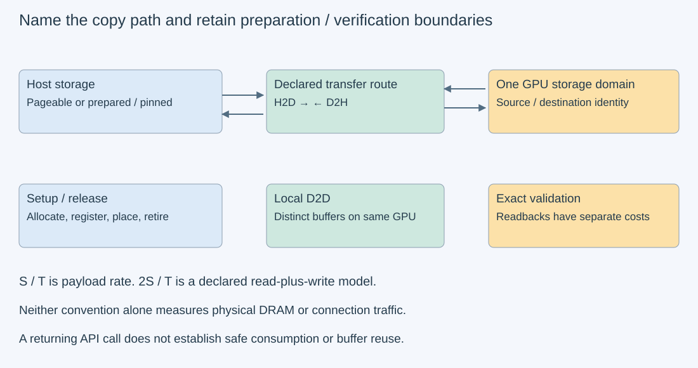
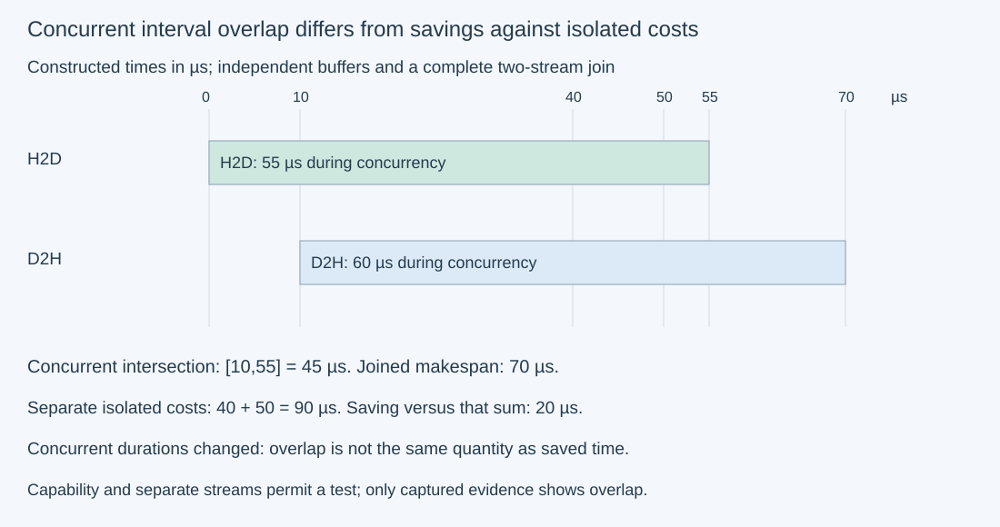

# M3-C20: Benchmarking memory copies across sizes and paths

> **Status: Complete — detailed chapter authored and documentation validated; experimental procedures are proposed unless explicitly labelled observed**

**Module:** Learn GPU architecture through data movement

**Category:** [Measurement, experimentation, and economics](index.md)

[Module 3 reading order](../module-3.md) · [Previous: M3-C19](m3-c19-designing-trustworthy-asynchronous-gpu-benchmarks.md) · [Next: M3-C21](m3-c21-benchmarking-matrix-vector-multiplication-across-shapes.md) · [Execution plan and progress](../chapter-execution-plan.md)

## Target concepts

Host-to-device, device-to-host and device-to-device copies, pageable versus pinned buffers, size sweeps, setup versus transfer costs, payload versus read-plus-write bandwidth, overlap and contention.

## Concepts

### 1. Name the path, endpoints and copy contract

A **copy** reproduces a specified sequence of bytes at a destination. It does not change the element type, layout or numerical precision unless a separate conversion/packing operation is declared. **Host-to-device**, or H2D, moves data from CPU-accessible host storage to GPU storage. **Device-to-host**, or D2H, returns data to the host. **Device-to-device**, or D2D, in this chapter means a local copy between two nonoverlapping allocations on one GPU. A peer copy between GPUs is a different path with topology/access requirements; it is not part of the baseline here.

A path includes host allocation/registration type, GPU/device/partition identity, memory placement, direction, source/destination offsets, byte count, stream, completion condition and verification route. Two calls with the same byte count can traverse different resources. Host CPU/socket placement and the actual host-device connection matter; retain [M3-C14's topology and transfer contract](../networking-and-communication/m3-c14-moving-tensors-between-devices-and-hosts.md).

For a raw copy of S positive bytes, require **destination[offset+i]=source[offset+i] for every i=0…S−1**, with declared source/destination offsets if they differ. Bytes outside the allowed destination region must remain unchanged. Source/destination overlap is not permitted by the selected ordinary copy contract; do not treat it as a move-with-overlap operation. Check count/offset/backing arithmetic before submission. Zero-size behavior, invalid pointers or unsupported routes need the actual API's contract, not extrapolation from positive sizes. The [CUDA memory-management specification](https://docs.nvidia.com/cuda/cuda-runtime-api/group__CUDART__MEMORY.html) defines these operations and constraints.

### 2. Pageable and pinned buffers change preparation and return behavior

**Pageable memory** is ordinary host memory that the operating system can manage through its paging mechanisms. **Pinned**, or page-locked, host storage is prepared under the platform/API contract for device transfer without the usual paging movement; distinguish an API-allocated transfer buffer from registering an existing allocation. Do not infer the realized behavior on every platform from the API name alone. Registration lifetime and allocation flags belong in the manifest.

On common discrete-GPU paths, pinned buffers enable efficient direct transfer and supported asynchronous overlap. Pageable transfers may require staging through another host buffer and may block or synchronize during part of the call. [CUDA's synchronization specification](https://docs.nvidia.com/cuda/cuda-runtime-api/api-sync-behavior.html) makes this direction/argument dependence explicit. A returning call, including one named “Async,” is not by itself proof of completed movement. A device-event interval may omit host staging or include host-enqueue gaps; it is not automatically pure DMA time. **DMA**, direct memory access, is data movement performed without the CPU copying every byte through its instruction stream.

Pinned memory has preparation/release cost and consumes a limited host resource. A reusable pool can amortize that cost, while pinning a fresh tiny allocation for each transfer may not help full application latency. [NVIDIA's transfer guidance](https://docs.nvidia.com/cuda/cuda-c-best-practices-guide/index.html#pinned-memory) discusses page-locked storage and overlap. Its historical hardware rates are not predictions for a new machine.

| Path in the baseline | Primary question | Additional boundary to retain |
| --- | --- | --- |
| H2D, pageable source | How long until the declared device destination is complete? | Host staging/blocking and source lifetime |
| H2D, pinned source | What does the reused prepared-buffer route cost? | Preparation/registration amortization |
| D2H, pageable destination | When is the host result actually readable? | Host return/completion semantics and checking cost |
| D2H, pinned destination | What does a prepared receive buffer change? | Destination ownership until completion |
| Local D2D | How long does the local nonoverlapping copy take? | Device-memory/cache traffic and verification readback |

*The diagram identifies logical routes, not a guaranteed hardware engine or physical byte count. Diagnostic readbacks establish correctness and have their own traffic/time scope.*

### 3. A size sweep separates startup from sustained movement

A **size sweep** measures a declared set of byte counts under otherwise matched conditions. Small transfers often expose submission/startup costs, while larger transfers can expose sustained bandwidth or capacity limits. Include awkward boundaries, not only powers of two; never infer a transfer's correctness from an attractive curve.

A simple **teaching model** is **T(S)=α+S/B**, with startup α seconds, payload S bytes and sustained payload rate B bytes/s. It is an approximation within a compatible regime, not a universal law across cache, staging and dispatch changes. With constructed α=5 µs and B=10 GB/s, where GB=10⁹ bytes and µs=10⁻⁶ seconds:

| Payload | Modeled transfer time | Interpretation |
| --- | --- | --- |
| 1,000 bytes | 5.1 µs | Startup dominates this model |
| 1,000,000 bytes | 105 µs | Startup plus 100 µs movement |
| 2,000,000 bytes | 205 µs | Same model, larger movement term |

From the last two records, **B_est=(S₂−S₁)/(T₂−T₁)=10 GB/s**, and **α_est=T₁−S₁/B_est=5 µs**. This is an exact reconstruction of invented model values, not a fitted machine result. Real fits require uncertainty, residual checks and a justified size range; a negative intercept can indicate noise or model mismatch rather than negative startup. MiB=2²⁰ bytes and GiB=2³⁰ bytes; 1 MiB is not 1,000,000 bytes.

Use completed [M3-C19](m3-c19-designing-trustworthy-asynchronous-gpu-benchmarks.md) to define the timing contract. Record host submission duration, host submission-to-completed-transfer and a separate validation-inclusive interval. When valid, record a timing-enabled event interval around the copy in its execution stream. Treat the host completed interval as primary for cross-route comparison; event time has its own scope, especially for pageable staging. Report unavailable/unresolved event timings rather than divide by zero or replace them with the host value under the same label.

### 4. State the bandwidth numerator explicitly

For S copied payload bytes and a compatible completed duration T:

**B_payload=S/T.**

A logical memory-system accounting convention for one full source read plus destination write is **B_read+write=2S/T**. This second number describes a read-plus-write model, not twice the useful payload and not automatically physical DRAM or link traffic. Caches, transactions, protocol overhead and the actual engine/window can change observed traffic.

For a constructed 1,000,000-byte copy in 50 µs, payload rate is 20 GB/s; the read-plus-write rate is 40 GB/s. They describe the same copy with different numerators. If a wider setup-to-validated-completion interval is 300 µs, the payload per that application interval is 3.3333 GB/s. None should be compared against a peak specified for another boundary or unit. For PCIe-direction payload, do not double S merely because a source is read and destination written; those are different sides of the path. For local D2D, a read-plus-write model is useful but still needs a separate physical-traffic claim if actual DRAM bandwidth is asserted.

A repeated bundle of copies measures bundle completion and possible reuse, not independent single-copy latency. Retain per-copy result storage or another valid verification plan so repeated destinations cannot hide missing work. The baseline E2 uses one copy at a time and verifies every result; it does not use repetition to invent individual latency samples.

### 5. Separate setup, steady transfer and useful application time

**Setup** can include allocation, registration, placement, event creation, initialization and route preparation. **Steady transfer time** excludes the setup explicitly listed in its contract. **Validation-inclusive time** includes the checking needed to count the result as useful. These boundaries answer different questions.

For K transfers under a simple amortization model, **T_total(K)=A+K T_transfer**, with one-time setup/release cost A and unchanged per-transfer cost. Constructed pinned-pool values A=200 µs and T_transfer=100 µs compete with a pageable path costing 150 µs per transfer and negligible additional A under this model. At K=4 both cost 600 µs; at K=8 the totals are 1,000 versus 1,200 µs. The strict pinned advantage starts at integer K=5. This does not promise pinned memory wins: actual setup, checking, reuse, topology and memory pressure must be measured. Registration/release may not be freely moved outside the application boundary being evaluated.

Pool capacity and lifetime are part of the experiment. A host source cannot be changed or unregistered while a pending operation still needs it; a host destination cannot be consumed as final before completion. A cancellation can suppress publication without stopping device access. Rust's host ownership should be connected to the binding's device-completion contract; no implementation code is supplied here.

### 6. Overlap needs independent buffers, dependencies and evidence

**Overlap** means activities execute during intersecting time intervals. **Contention** means they compete for a shared resource and can slow one another. Independent H2D and D2H transfers can use different buffers/streams, but capability flags and separate streams alone do not establish actual overlap. A single request's upload and a dependent computation/result download retain their producer edges. Cross-request pipelining can expose concurrency without removing those dependencies.

For independent isolated transfer times T_H and T_D, ideal concurrent makespan is at least **max(T_H,T_D)** if rates stay unchanged and independent resources permit overlap. Serial time is T_H+T_D. These are conditional models, not guarantees. **Makespan** is elapsed time from the declared start until both transfers complete.

A constructed example has isolated H2D 40 µs and D2H 50 µs, serial 90 µs, and a concurrent scenario finishing in 70 µs. Saving 20 µs against the isolated sum is not necessarily the actual interval overlap. If the concurrent trace shows H2D [0,55] and D2H [10,70], their intersection is 45 µs, union/makespan 70 µs, and durations 55/60 show changed rates or other delays. Measured overlap and savings against isolated costs are different quantities. Correlation and coverage follow completed [M9-C12](m9-c12-reading-cpu-gpu-timelines-and-scheduling-gaps.md).

*These are invented intervals. The 45 µs concurrent intersection differs from the 20 µs saving against isolated 40+50 µs. Shared-resource contention or other scheduling differences must be investigated, not assumed away.*

The HFT lens is to follow useful, correctly identified event data to its consumer. A copy-engine percentage or link-rate gain is not an event-latency result. CPU staging, setup, queues and freshness can dominate application behavior. The analogy transfers boundary and ownership discipline; it does not assert exchange performance or hard real-time guarantees.

## Experiments

All four experiments are **proposed**. No GPU transfer, timing, overlap capture or serving measurement is supplied. Paper models below are teaching constructions. Rust remains the eventual engine context; no code implementation is included.

### E1 — Reconcile sizes, timing models and byte conventions

- **Description:** Rebuild the startup/rate model and the three bandwidth boundaries.
- **Purpose/objective:** Prevent unit, numerator and timing-window mismatches.
- **Target concepts:** Size sweeps, payload versus read-plus-write bandwidth, setup versus transfer costs.
- **Baseline and workload:** T(S)=5 µs+S/(10 GB/s) for decimal payloads 1,000/1,000,000/2,000,000 bytes; separate 1,000,000-byte 50 µs copy and 300 µs wider validated interval. No hardware trials.
- **Controls and prediction:** Preserve decimal byte/rate units and defined intervals. Predict 5.1/105/205 µs, reconstructed startup 5 µs and B 10 GB/s, payload 20 and read-plus-write 40 GB/s for the 50 µs record, and 3.3333 GB/s for the wider boundary.
- **Procedure:** Calculate each record independently and name which bytes cross which interface. Compare 1 MiB with 1,000,000 bytes. Reject doubling H2D payload to compare with a one-direction link peak, dividing by unresolved/zero duration, or fitting a single rate across incompatible cache/staging regimes without residual evidence.
- **Hardware/software:** Paper or calculator suffices. Actual capacity comparisons require vendor/interface specifications and recorded operating conditions.
- **Failure and HFT connection:** A numerically large bandwidth from the wrong denominator is not faster useful delivery. Freshness/correctness must survive the transfer boundary in inference and HFT-style systems.
- **Exit criteria:** All model/rate/unit calculations reconcile and their scopes remain explicit; no measured hardware curve or startup is claimed.

### E2 — Sweep five paths with full byte validation

- **Description:** Design one-copy-at-a-time measurements across directions, host-buffer types and sizes.
- **Purpose/objective:** Compare matched completed-copy boundaries without assuming pageable and pinned APIs behave identically.
- **Target concepts:** H2D/D2H/local-D2D, pageable/pinned buffers, size sweeps and complete-transfer timing.
- **Baseline and workload:** Five paths from Concepts 2 and S∈{1,63,64,65,4095,4096,4097,1 MiB,16 MiB}: 45 cells. Fixed path index p=0…4 follows the table order. Payload byte i at measured epoch e is P(i,e,p)=(i+floor(i/256)+17e+31p) mod 256. Destination begins as the bitwise complement of expected payload; both backings have 32-byte prefix/suffix guards. Copy exactly S bytes at offset 32, with nonoverlapping source/destination storage. Use session/cell/epoch/generation metadata because repeating byte patterns do not prove identity.
- **Controls and prediction:** Keep device, API/flags, stream, NUMA placement, in-flight limit (one), event policy and prepared-buffer reuse fixed per cell. For D2H/D2D prepare and echo-check device source outside timing; for H2D prepare/check host source. Initialize device/host destinations and guards outside timing. Use the installed supported API contract, recording pageable staging/host blocking rather than inferring it. Predict startup-dominated small sizes and possible large-size plateaus, with no required pinned advantage or physical-DRAM interpretation.
- **Procedure:** Three independent sessions, ten excluded warmups per cell/session and twenty measured trials per cell/session in a recorded balanced order. Measured e=0…59 across sessions; warmups use e=0. Separate setup from copy submission, host completed-transfer timing and wider validated-completion timing. When supported, collect compatible timing-enabled events; do not call those pure DMA for pageable routes. H2D/D2D require diagnostic D2H readback of destination backing after the timed copy; D2H checks host destination directly. Verify every payload byte and both guards, check host sources directly and GPU sources through a separate post-copy echo outside copy timing, retain first mismatch, and exclude diagnostic readback from the named copy interval while including it in the wider validated interval.
- **Hardware/software:** One supported GPU, prepared pageable/pinned host routes and local D2D support, documented completion/events and a valid binding. Reserve 128 MiB raw host fixture budget and 64 MiB raw device budget plus explicit runtime/staging/allocator charges. Keep active prepared/pinned source/receive buffers bounded; registration failure makes that cell unavailable, not silently pageable.
- **Failure and HFT connection:** Every input/output/event remains alive through actual completion and validation readers. A 120-second watchdog stops admission and records unknown completion; it never authorizes overwrite, unregistration or reuse. Wrong generation, untouched complement bytes, changed guards or truncated copy fail the useful-result gate.
- **Exit criteria:** Account for 2,700 measured trials and 1,350 excluded warmups, with all failures/unsupported cells explicit and no silent replacements. Every successful result passes byte/guard/identity checks. Report complete per-path/size/session distributions, unresolved event timing and wider verification costs; no serving throughput is inferred.

### E3 — Decide whether setup can be amortized

- **Description:** Audit the constructed pinned-pool cost model and define setup evidence for E2.
- **Purpose/objective:** Distinguish a reusable prepared route from pinning/releasing each transfer.
- **Target concepts:** Pageable/pinned buffers, setup costs, pool capacity and lifetime.
- **Baseline and workload:** One-time pinned-pool setup/release A=200 µs, per-transfer 100 µs; pageable 150 µs per transfer under the stated negligible-extra-setup model. Evaluate K∈{1,4,5,8}. These are paper records, not hardware timings.
- **Controls and prediction:** Keep useful bytes and validation policy equivalent. Predict pinned totals 300/600/700/1,000 µs versus pageable 150/600/750/1,200 µs; first strict pinned advantage at K=5.
- **Procedure:** Derive the crossover inequality and retain all setup/placement/registration/release components. For future E2 runs archive the actual setup and teardown separately rather than folding them into every steady sample or erasing them from an application claim. Bound the pool's live allocations and retain a cancellation-with-pending-copy ownership trace on paper.
- **Hardware/software:** Paper analysis requires none. Real setup measurements need the selected allocation/registration mechanism, supported host placement and the actual accounting described in M9-C15/M9-C16.
- **Failure and HFT connection:** A lower steady copy cost can coexist with higher first-use latency or host-memory pressure. Cancellation is not an immediate credit against live pool capacity in inference or HFT pipelines.
- **Exit criteria:** All totals/crossover values reconcile; pending state remains charged and valid until retirement; no universal pinning or first-use performance claim is made.

### E4 — Separate concurrent overlap from saved time

- **Description:** Audit the constructed concurrent intervals and plan a small two-direction study with independent buffers.
- **Purpose/objective:** Test actual overlap and contention without removing required dependencies.
- **Target concepts:** Overlap, contention, direction-specific rates and joined completion.
- **Baseline and workload:** Paper isolated 40/50 µs, serial 90 and concurrent 70 µs, with concurrent intervals [0,55] and [10,70]. Proposed hardware scenarios at 1 MiB: pinned H2D alone, pinned D2H alone, both serial, both concurrently requested on distinct streams/buffers. One scenario in flight; same useful transfer per direction whenever present. D2H source preparation and all guards are completed before timing.
- **Controls and prediction:** Preserve physical paths, buffer preparation, validation and clock state. Predict paper intersection 45, saving 20, makespan 70 µs; real hardware may serialize or slow concurrent work even if capability supports overlap.
- **Procedure:** Three independent sessions with ten excluded warmup scenarios and twenty measured scenarios per cell/session; e=0…59 per scenario cell, separate identities for both directions. Use E2's byte/guard/generation gate and pattern with p=1 for pinned H2D and p=3 for pinned D2H. Time each direction with compatible events where meaningful and host scenario start-to-joined completion; wider validation follows both completed transfers. The final join must cover both streams. Add one separately captured first measured scenario per cell/session: twelve proposed timeline captures with complete correlation/coverage; they do not replace normal timing. No capture is executed here.
- **Hardware/software:** One device with supported pinned routes and documented concurrency capability; independent source/destination regions and suitable events/streams. Retain topology/copy-engine capability and any unsupported scenario. Capability flags alone cannot supply a measured overlap percentage.
- **Failure and HFT connection:** A stop event in only one stream can finish before the other transfer. Reject that incomplete join; retain both buffers through completion/readers and suppress stale/cancelled publication without unsafe reclamation.
- **Exit criteria:** Account for 240 measured scenarios containing 360 timed payload copies, 120 excluded warmup scenarios and twelve separate proposed captures. All successful directions pass byte gates; union/intersection and isolated/concurrent comparisons stay distinct. Missing/perturbed trace evidence cannot establish overlap or useful-service benefit.

## Verification

### Match each experiment to evidence

| Experiment | Reference/invariant | Measurement and profiling | Acceptance and limits |
| --- | --- | --- | --- |
| E1 | Declared S, units and timing/numerator scope | Independent model/rate arithmetic | 5.1/105/205 µs and 20/40/3.3333 GB/s reconciled; no physical-traffic inference |
| E2 | Full byte payload, guards, source and generation identity | Completed host interval, separately scoped events and validated interval | 2,700 planned outcomes accounted for; unavailable routes/time remain explicit |
| E3 | Equivalent work and one-time/per-transfer accounting | Paper crossover; future setup/teardown evidence | K=5 first strict advantage in this model; lifetime/pool headroom retained |
| E4 | Independent buffers, identical useful directions and joined completion | Per-direction/scenario timing and separate focused traces | 45 µs intersection differs from 20 µs saving; supported complete evidence required |

The nine positive sizes sum to **17,838,273 bytes**. Across E2's five paths and sixty measured trials per size, planned useful copied payload is **5,351,481,900 bytes**. This excludes setup/source preparation, diagnostic readbacks, guards, warmups and tracing. Each measured path contributes 1,070,296,380 payload bytes. Local D2D's read-plus-write model would count 2,140,592,760 bytes across that path; it is not a measured DRAM count. Do not add the diagnostic readback and label the combined time as H2D-only or D2D-only bandwidth.

At maximum size, two guarded device buffers for local D2D occupy **2×(16 MiB+64)=33,554,560 bytes** before allocator/runtime charges. E2's 128 MiB host allowance covers retained source/reference/readback fixtures; track actual live prepared/pinned charges separately. Processing cells sequentially avoids pinning the whole size sweep at once. For E4, each simultaneous direction uses disjoint source/destination storage; its 1 MiB size fits these fixture budgets with the extra direction buffers. Future concurrent larger workloads require a new live-allocation calculation.

The pattern's addition of floor(i/256) varies neighboring 256-byte blocks, but its periodicity and finite byte values still cannot prove global identity by numeric equality alone. Preserve metadata and full comparisons. For any expected byte b, its complement 255−b is never equal to b; this makes a missing destination write visible at that byte in the constructed initialization. A copy truncated by one byte fails even if all preceding bytes match. Guard checks detect some boundary writes; they do not prove every read was valid or establish race freedom. Reuse the correctness/ownership principles of completed [M3-C18](../numerics-and-correctness/m3-c18-validating-gpu-computation-and-memory-movement.md).

For each E2 path/size/session and E4 scenario/session retain all twenty normal outcomes, median, nearest-rank p95 and maximum plus failures. For n sorted successful times, p95 rank is ceil(0.95n), one-based; n=20 gives rank 19. Keep raw completed-time distributions and per-trial payload rates distinct: do not average rates and call the result total payload/total time unless that equality is established. Preserve session/order/epoch labels and allow null or adverse comparisons. Twenty observations do not establish stable p99. Apply completed [M9-C07](m9-c07-latency-distributions-and-statistical-uncertainty.md) for uncertainty; telemetry, profiler and timeline data retain completed [M9-C12](m9-c12-reading-cpu-gpu-timelines-and-scheduling-gaps.md)/[M9-C13](m9-c13-using-kernel-profilers-to-explain-hardware-bottlenecks.md) limits.

Reconcile each normal cohort's successful, incorrect/stale, submission/completion failure, cancelled, watchdog-unknown and unfinished trials/scenarios as mutually exclusive outcomes at a stated cutoff. Unsupported cells remain labelled unavailable with planned/missing counts. Trace completeness is an independent attribute. Preserve raw first mismatches and safe-retirement evidence; timeout, cancellation and a missing trace endpoint cannot authorize buffer release.

### Six dimensions applied

| Dimension | Chapter-specific check |
| --- | --- |
| Semantics and invariants | Raw copies preserve every intended byte, offset and generation; conversion/packing needs a separate contract. |
| Workload and variability | Sweep tiny/boundary/large sizes, directions, host memory types and independent-concurrency scenarios. |
| Resources and bottlenecks | Count host staging, pinned pool, connection path, device/cache demand and diagnostic traffic separately. |
| Time and distributions | Distinguish setup, completed transfer, event scope, joined makespan and validated application time. |
| Ownership and coordination | Host/device buffers remain valid until all producers, copies and readers retire; concurrent streams require a complete join. |
| Failure and adaptation | Stop unsafe admission, retain pending resources, reject byte/guard/identity failures and report unsupported routes. |

### Eight engineering principles applied

| Principle | Application |
| --- | --- |
| 1. Correctness defines the optimization boundary | A shorter/truncated or stale copy is not a useful speedup; every byte and lifetime gate remains required. |
| 2. Performance depends on workload and operating point | Size, direction, placement, registration, concurrency and cache history change the observed curve. |
| 3. Data movement is part of the algorithm | Payload S and modeled read-plus-write 2S are different ledgers; setup and validation copies matter to application cost. |
| 4. State has ownership, lifetime, and recovery cost | A prepared pool amortizes costs only while its storage and pending generations remain correctly owned. |
| 5. Dependencies determine latency; bottlenecks determine capacity | Overlap independent transfers without deleting upload/consumer edges or a required two-stream join. |
| 6. Variability and synchronization shape the tail | Startup, staging, contention and host wakeups affect distributions; a peak rate does not establish p99. |
| 7. Local improvements must be evaluated end to end | A larger copy rate or visible overlap needs a separate useful-service latency/outcome comparison. |
| 8. Claims require reproducible evidence | Retain references, path/units, raw timings, setup, topology, buffer types, failures and capture coverage. |

## Specifications, articles, and hardware

| Primary source | Role and limits |
| --- | --- |
| [CUDA memory-management reference](https://docs.nvidia.com/cuda/cuda-runtime-api/group__CUDART__MEMORY.html) | Allocation/registration, copy direction and region constraints; verify the installed API/binding/platform. |
| [CUDA API synchronization behavior](https://docs.nvidia.com/cuda/cuda-runtime-api/api-sync-behavior.html) | Direction/argument-dependent staging and host return; “Async” is not a completion proof. |
| [CUDA Best Practices pinned-memory and overlap guidance](https://docs.nvidia.com/cuda/cuda-c-best-practices-guide/index.html#pinned-memory) | Preparation costs, host-transfer and concurrency methodology; historical rates and capability examples are not new measurements. |

E1/E3 paper checks need no GPU. E2 and E4's proposed studies require one supported GPU and pageable/pinned/local-copy routes with suitable host capacity and completion support; no NIC, second GPU, peer link or model weights are required. Record exact GPU SKU/architecture/partition, memory/cache capacities, copy/concurrency capability, host CPU/socket/NUMA/RAM, actual host-device connection generation/width/path, operating system, driver/runtime/Rust-binding/tool versions, API/allocation/registration/stream/event flags, transfer offsets/counts, live backing/staging charges, clocks/power/thermals, competing work and telemetry cadence. Retain the actual device/topology specifications, following completed [M9-C16](../hardware-architecture-and-topology/m9-c16-recording-hardware-conditions-that-change-measurements.md) and [M9-C15](../state-memory-and-caching/m9-c15-accounting-for-weights-kv-state-workspace-and-fragmentation.md). No machine or transfer results were supplied; all capacities/times used in worked calculations are hypothetical.

## Completion and next chapter

Track acceptance in the clickable [execution plan](../chapter-execution-plan.md). Next in Module 3 reading order is the completed [M3-C21: Benchmarking matrix-vector multiplication across shapes](m3-c21-benchmarking-matrix-vector-multiplication-across-shapes.md). The next authoring chapter is [M3-C22](m3-c22-benchmarking-matrix-matrix-multiplication-across-shapes.md). Module 9 supports Modules 1–7; Module 8 is excluded.
