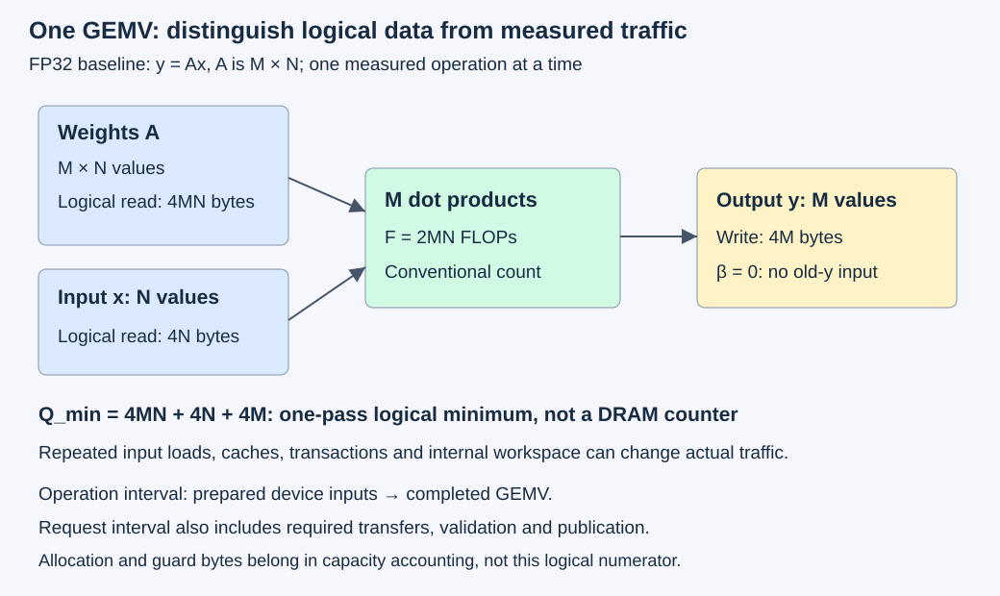
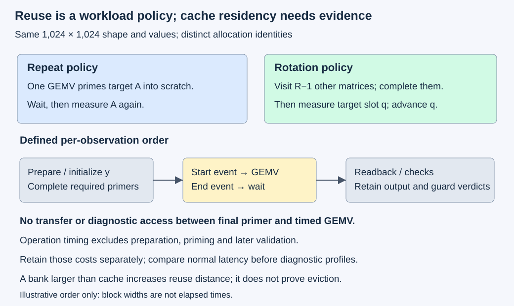

# M3-C21: Benchmarking matrix-vector multiplication across shapes

> **Status: Complete — detailed chapter authored and documentation validated; experimental procedures are proposed unless explicitly labelled observed**

**Module:** Learn GPU architecture through data movement

**Category:** [Measurement, experimentation, and economics](index.md)

[Module 3 reading order](../module-3.md) · [Previous: M3-C20](m3-c20-benchmarking-memory-copies-across-sizes-and-paths.md) · [Next: M3-C22](m3-c22-benchmarking-matrix-matrix-multiplication-across-shapes.md) · [Execution plan and progress](../chapter-execution-plan.md)

## Target concepts

GEMV shape sweeps, weight and vector traffic, output writes, cache-resident versus device-memory working sets, bandwidth utilization, small-workload overhead, correctness checks.

## Concepts

### 1. Begin with one projection and its meaning

**GEMV**, general matrix-vector multiplication, transforms one vector into another. A matrix A has M rows and N columns; an input vector x has N elements; an output vector y has M elements. Each row forms a dot product, meaning corresponding values are multiplied and their products added. For the baseline:

**yᵢ = Σⱼ Aᵢⱼ xⱼ**, for rows i=0,…,M−1 and columns j=0,…,N−1.

One text-generation projection can apply model weights A to a hidden-state vector x. This experiment studies that operation, not a complete transformer or token-serving system. Batch processing multiple independent vectors changes the reuse opportunity and is developed in M3-C22. This chapter uses real FP32 values, meaning four-byte binary floating-point numbers, on one GPU. Rust is the eventual host-language context; no implementation, pseudocode or kernel is provided.

The broader BLAS contract is **y_new = α op(A)x + β y_old**, where α and β are scalar multipliers and op(A) selects A or its transpose. Transposing exchanges rows and columns; it also exchanges the required input/output lengths. The [cuBLAS 13.4 GEMV specification](https://docs.nvidia.com/cuda/cublas/index.html#cublas-t-gemv) defines column-major layout, leading dimension and vector strides. Here α=1, β=0, op(A)=A, leading dimension M, and both vector strides are one. With β=0, the previous output is not a mathematical input, though its allocation must still be valid for writes. A β=1 test must restore the same seed before every trial; repeated accumulation changes the workload.

For a hand-checkable example, A has rows [1,2,−1] and [0,3,4], and x=[2,−1,3]. The result is **[−3,9]**. With β=1 and old y=[5,−2], it becomes **[2,7]**. A transposed operation with input [2,−1] instead produces **[2,1,−6]**. These cases distinguish shape, seed and transpose mistakes.

**Column-major** means a whole column is adjacent in memory. The first example occupies [1,0,2,3,−1,4]; **leading dimension** is the storage distance between column starts. Padding that distance changes storage without changing the logical matrix. These are specification choices, not language syntax. A row-major Rust container cannot silently be reinterpreted as the same column-major operation. [NETLIB's SGEMV reference](https://netlib.org/blas/sgemv.f) supplies an independent definition of dimensions, strides and the scalar contract.

### 2. Count work and bytes at a named boundary

Use the standard reporting convention **F=2MN FLOPs** for α=1, β=0. A multiply plus add counts as two floating-point operations. A minimal real-arithmetic dot product has N multiplies and N−1 additions, so the exact expression count is M(2N−1); the conventional count is not a hardware instruction count. Keep the convention unchanged across shapes, especially N=1.

A **cache** is a smaller, faster store that can retain recently accessed data; **DRAM** is the GPU's larger device-memory storage technology, including HBM on relevant devices. A one-pass **logical minimum byte model** reads each weight once, each x element once across the whole operation, and writes each output once:

**Q_min = 4MN + 4N + 4M bytes.**

The terms mean weights, input, output. A β≠0 path adds an old-output read, giving **4MN+4N+8M** under otherwise unchanged assumptions. Allocation guards, padding, instruction traffic, repeated x loads, internal workspace, transactions and host-device transfers are excluded. The input may be requested many times by different execution groups even if a cache supplies it. Thus Q_min is a lower-level-independent logical model, not a measured DRAM byte count.

**Arithmetic intensity I_min = F/Q_min** in FLOP/byte. For large square FP32 GEMV it approaches 0.5. This explains why streaming weights can dominate: approximately four weight bytes accompany two reported operations. It does not establish the limiting resource for every small or cache-reused case. A shape with one output row also offers different parallel work from one with thousands of rows.

*The logical ledger counts a unique vector read. Cache/device counters can report different traffic. Request transfers lie outside the operation-only interval.*

### 3. Sweep shapes rather than just element counts

An **aspect ratio** describes how tall or wide a matrix is. A short-wide projection has few output rows and long reductions; a tall-narrow projection has many outputs and shorter reductions. They can contain the same weight count while using execution resources differently. **Edge shapes** around a common grouping size test leftover work without assuming that a particular backend uses a particular tile or warp mapping.

The proposed shape set deliberately includes tiny, edge, equal-weight and large cases. All numbers are calculated specifications, not measurements:

| M × N | Conventional FLOPs F | Q_min bytes | Question |
| --- | --- | --- | --- |
| 1 × 1 | 2 | 12 | How much does submission/completion dominate? |
| 31 × 33 | 2,046 | 4,348 | Edge shape with a longer reduction |
| 32 × 32 | 2,048 | 4,352 | Nearby comparison, almost identical work |
| 33 × 31 | 2,046 | 4,348 | Exchange row and reduction lengths |
| 256 × 4,096 | 2,097,152 | 4,211,712 | Short-wide equal-weight case |
| 4,096 × 256 | 2,097,152 | 4,211,712 | Tall-narrow equal-weight case |
| 1,024 × 1,024 | 2,097,152 | 4,202,496 | Square equal-weight case |
| 8,192 × 8,192 | 134,217,728 | 268,500,992 | Larger working set, subject to actual device capacity |

The three middle large cases each hold 1,048,576 weights, or 4 MiB. MiB is 2²⁰ bytes; GB/s uses 10⁹ bytes/s. Their input/output split differs even when the sum is equal. Identical F and Q_min do not predict identical elapsed time. Do not infer a performance cliff from a single pair of noisy points, and do not call the largest matrix “DRAM-resident” merely because its shape looks large.

### 4. Separate effective bandwidth from DRAM utilization

For completed operation time t, report **P=F/t** and **B_effective=Q_min/t**, with seconds in the denominator. The [CUDA Best Practices bandwidth guidance](https://docs.nvidia.com/cuda/cuda-c-best-practices-guide/index.html#effective-bandwidth-calculation) motivates explicit read/write and unit accounting. Here “effective” always means this chapter's logical minimum model; it is not an observed transaction count.

For the 1,024² case and an invented t=20 µs, **B_effective=210.1248 GB/s**, **P=104.8576 GFLOP/s**, and **I_min≈0.499025 FLOP/byte**. If t=5 µs after repeat reuse, the same numerator gives **840.4992 GB/s**. That rate alone cannot establish high DRAM utilization: some weights may have arrived from cache.

For actual DRAM bytes Q_DRAM measured over compatible operation activity, **B_DRAM=Q_DRAM/t**. Utilization relative to an empirical reference is **U_DRAM=B_DRAM/B_reference**, where the reference must match device partition, direction mix, clock/state and scope. If a constructed profile reports 1,000,000 DRAM bytes over 20 µs and a compatible 500 GB/s reference, B_DRAM=50 GB/s and U_DRAM=10%. Q_min/t divided by the same reference gives 42.02496%, which is a different, model-based ratio. Neither is a universal hardware saturation verdict. The copy benchmark in M3-C20 uses different engines/access patterns and cannot automatically supply GEMV's attainable bandwidth.

Under [M3-C16's roofline assumptions](m3-c16-using-the-roofline-model-to-predict-bottlenecks.md), **t_bound=max(F/P_compute,Q/B_memory)** for compatible capacities and actual traffic at that level. With hypothetical P_compute=10 TFLOP/s, B_memory=500 GB/s and an assumed Q=Q_min for 1,024², the terms are 0.2097152 and 8.404992 µs. This is a conditional lower bound, not an elapsed-time prediction. Startup, insufficient parallelism and dependencies can add delay. The [NERSC roofline article](https://docs.nersc.gov/tools/performance/roofline/) explains the performance-envelope interpretation and memory-level distinctions.

### 5. Define reuse history before claiming cache residency

A **working set** is the data accessed over a specified interval. Device-memory allocation does not mean every access goes to DRAM: a cache may retain recently used weights. Conversely, fitting matrix bytes below the documented cache capacity does not prove residency. Other inputs, outputs, replacement policies, partitions and concurrent work occupy or compete for that cache.

Compare one repeatedly accessed allocation with a bank of distinct allocations, keeping shape and values fixed. Bank rotation deliberately increases the reuse distance, meaning how much intervening data is touched before a weight is used again. It does not guarantee cache eviction. Retain actual cache/DRAM traffic and elapsed-time evidence before labelling a result “cache-served” or “streaming.” An input upload immediately before timing can also influence cache state; history belongs in the workload contract.

Profiling itself can change that history. [Nsight Compute's replay/cache guidance](https://docs.nvidia.com/nsight-compute/ProfilingGuide/index.html#cache-control) documents replay and cache controls. A default isolated profile need not represent a warm repeated invocation. Preserve the declared priming history and replay policy for both compared cohorts; if the tool cannot do that, label the cache comparison unsupported. Follow completed [M9-C13](m9-c13-using-kernel-profilers-to-explain-hardware-bottlenecks.md): counters explain hypotheses; unprofiled observations establish normal latency.

*Both policies perform one measured GEMV after defined preparation. Priming work and diagnostic readback have their own costs and are excluded only from the explicitly named operation interval.*

### 6. Small operations and useful completion need different clocks

**Submission** asks the device to do work; **completion** establishes that the result is ready. A host call can return before completion. Measure a host monotonic interval from dispatch entry to successful wait return and a separate device-event interval around the GEMV in its stream, following [M3-C19](m3-c19-designing-trustworthy-asynchronous-gpu-benchmarks.md). Neither is automatically pure kernel arithmetic: event gaps can contain scheduling, and host waiting can contain device execution. Do not add overlapping host and device intervals.

For tiny shapes, event resolution, launch work and available parallelism can dominate. A zero/same-tick event result supports no finite throughput estimate; keep the observation and mark that rate unresolved. Repetition measures a bundle or cache-history policy, not a population of independent single-operation latencies. This chapter keeps one operation in flight and validates each measured result.

Useful request completion can include preparation, input transfer, GEMV, output transfer, validation and publication. An invented serial request with 80 µs of other work and a 20 µs GEMV takes 100 µs. Halving GEMV to 10 µs gives 90 µs, or **100/90≈1.1111×** overall speedup under unchanged dependencies. It does not double service throughput. Queueing, arrivals and token dependencies require a later complete serving study.

## Experiments

All four experiments are proposed. E1's reference calculations can be checked without a GPU. E2–E4 describe future hardware studies; no timings or counters below are observed results.

### E1 — Establish the GEMV contract and traffic ledger

**Description:** Reconcile matrix layout, transpose, seed behavior, exact results and work/byte accounting before measuring speed.

**Purpose/objective:** Make a fast but semantically different operation fail acceptance.

**Target concepts:** Correctness, weight/vector/output traffic, bandwidth units, small-workload and shape conventions.

**Baseline and workload:** Use the 2×3 example, its transpose and β=1 seed above. Repeat it with column stride four: backing [1,0,p,p,2,3,p,p,−1,4,p,p], where p is a finite padding sentinel. Also examine a cancellation row [16,777,216,1,−16,777,216] multiplied by [1,1,1]. Its exact result is one.

**Controls and prediction:** Fix α=1, input identities, layout and arithmetic policy. The three baseline outputs must match the hand calculations exactly. For cancellation, sequential FP32 addition in the displayed order can yield zero; grouping the first and third terms before adding one yields one. This is reduction-order sensitivity, not automatically a layout defect. A teaching absolute allowance of 0.25 rejects zero against reference one; that choice detects unit loss in this fixture and is not a model-wide tolerance.

**Procedure:** Reconstruct the three outputs with independent integer arithmetic. Trace padded column starts and prove that padding is excluded. Reproduce every shape-table F and Q_min value, and the effective/DRAM/roofline examples. Deliberately alter the transpose, seed, leading dimension, last output and byte numerator in the reference record; identify which gate rejects each. Reject invalid dimensions, zero stride and insufficient backing in a host-side specification review before any device dispatch; do not submit unsafe pointers as a fault test.

**Hardware/software:** Exact integer/rational arithmetic suffices for the baseline; explicitly rounded FP32 arithmetic is needed only for the cancellation demonstration. Record versions/settings if a numerical tool is used.

**Failure and HFT connection:** A trading feature projection with exchanged axes or a stale accumulator can be quickly computed and still mean the wrong thing. The analogy is contract validation; these fixtures do not model market correctness or strategy value.

**Exit criteria:** V1 reconciles all outputs, storage offsets, counts, units and deliberate errors. Numerical-policy failures remain separate from semantic/layout failures.

### E2 — Sweep shapes under one documented preparation policy

**Description:** Measure one FP32 GEMV at a time for the eight listed shapes, with every output checked.

**Purpose/objective:** Expose shape effects and small-work overhead without changing precision, semantics or timing definitions.

**Target concepts:** Shape sweeps, weight/vector traffic, output writes, effective bandwidth and correctness.

**Baseline and workload:** Use the specified column-major, unpadded, unit-stride α=1, β=0 operation. For measured epoch e=0,…,59, set **Aᵢⱼ=(i mod 5)+1+(j mod 7)−3+e** and **xⱼ=1+(j mod 3)**. Here “mod” is the nonnegative remainder. Values and products are small integers exactly representable in FP32. Derive each output independently using the 21-column joint period and its remainder; compare all M coordinates, not a checksum. Epoch changes separate successive measured outputs. Distinct trial/attempt IDs are still required.

**Controls and prediction:** Fix library/backend, full FP32 multiplication/accumulation policy, scalar placement, stream, allocation alignment, device and hardware conditions. No reduced-precision multiplication is permitted for the exact baseline. Predict that equal-weight aspect ratios can differ and tiny cases can be dominated by overhead; do not prescribe a winning shape or rate. Input initialization/upload before each invocation is part of this policy, so call it a prepared-input cohort rather than a cold-DRAM cohort.

**Procedure:** In each of three separate sessions, take shapes in listed order, reversed order and listed order respectively. For every shape/session, run ten excluded warmups at e=0 followed by twenty measured epochs, globally numbered 0–59 per shape. Before each invocation, upload that trial's A and x and initialize y to the finite sentinel −2²⁰; complete preparation before the device start event. Surround each of A, x and y by separate 32-byte prefix/suffix guards, initialized to byte values 0xA5 and 0x5A respectively. Record host completed-operation and device-event intervals; wait for completion, copy back y, validate every coordinate and all guards, and compare A/x to their original images using separate diagnostic echoes through at most 1 MiB of reusable host scratch outside operation timing. Include these diagnostics in a wider validation-inclusive interval. Keep all warmups, preparation and validation counts. Admit no next operation before this validation finishes.

**Hardware/software:** One supported GPU, documented FP32 GEMV backend, stream/event completion and host readback. Plan at most 512 MiB of raw fixture storage on each of host and device, plus explicit runtime/workspace/staging reserves. The largest three guarded payloads occupy 268,501,184 bytes on device before any internal workspace; process cells sequentially and reuse diagnostic host storage after comparisons. If actual free capacity or arithmetic capability is inadequate, mark that shape unsupported rather than shrink it silently.

**Failure and HFT connection:** Record allocation, dispatch, completion and correctness errors separately; a 120-second watchdog limits the study's wait policy, not a trading deadline or proof that device readers stopped. Quarantine unresolved buffers until completion/context retirement is established. Shape-dependent delay resembles feature-vector variability in an HFT decision path, but actual trading workloads and useful outcomes need their own validation.

**Exit criteria:** V2 accounts for **480 measured invocations and 240 excluded warmups**, including **819,900 measured output coordinates**, or reports the exact unsupported/failed remainder. Every counted success passes exact output and guard/source checks. Publish per-shape observations with their preparation policy and rate numerators; no automatic p99 or DRAM-saturation claim.

### E3 — Compare repeat reuse with a bank rotation policy

**Description:** Hold the 1,024² shape and arithmetic fixed while changing the preceding weight-access history.

**Purpose/objective:** Test a cache-reuse hypothesis without equating allocation size with cache residency.

**Target concepts:** Cache versus device-memory traffic, bandwidth interpretation and reproducible working sets.

**Baseline and workload:** Use E2's fixture at fixed e=0. One weight matrix W occupies 4 MiB. Let C be the documented visible L2 (level-two) cache capacity in bytes, including any partition limits. Choose **R=ceil(2C/W)+1** distinct weight allocations, where ceil rounds upward. The R−1 other matrices therefore span at least 2C bytes. Store identical logical values in each; buffer IDs and slot order, not differing values, distinguish allocations.

**Controls and prediction:** Repeated and rotating policies use the same x, measured y and scratch output, completed priming, guards, backend and clocks. Repeat reuse may lower DRAM traffic and time; rotation may increase traffic. Neither outcome nor full eviction is guaranteed. Keep one cache/replay policy across compared profiles.

**Procedure:** Prepare the bank and vectors outside timing. Before every repeated-policy observation, perform one untimed GEMV on the measured matrix into scratch and wait. Before every rotation observation of slot q, visit the other R−1 distinct slots in cyclic order into scratch, complete them, then time slot q. Advance q by one for the next observation. Initialize measured y before priming, and do no transfers or diagnostic reads between the final primer and the timed GEMV. After completion validate measured and final scratch outputs and guards; check the immutable bank/x images at session start/end. These diagnostics precede the next trial's priming. Retain primer errors even when a measured output passes. In each of three sessions alternate policy order, with repeat-first, rotation-first and repeat-first session order, ten excluded warmups and twenty measured invocations per policy. Retain **120 measured and 60 warmup invocations**, plus **90R priming GEMVs** across both policies. Capture one additional diagnostic profile per policy/session, six total, with its own recorded preparation and replay work; profiles are outside these counts.

**Hardware/software:** E2 requirements plus documented C and a safely budgeted bank. Raw guarded device fixture bytes are **R(W+64)+12,480** for R matrices, x, measured y and scratch. Require that amount within the declared 512 MiB fixture budget plus separate workspace/runtime reserves; otherwise report E3 unsupported. For an invented C=8 MiB, R=5, bank fixture storage is 20,984,320 bytes and priming count is 450. This is arithmetic, not a device specification.

**Failure and HFT connection:** Reject missing bank identities, stale profiling histories or unproven completion. Repeated identical answers cannot prove the correct slot was dispatched, so retain identity/completion evidence in addition to output equality. This models reuse-distance discipline for repeatedly accessed features or parameters; it does not establish real trading cache-hit rates.

**Exit criteria:** V3 reconciles bank size, observed traffic, measured/priming/profile populations and correctness. Call a result cache-served only with compatible evidence; otherwise report the repeat/rotation policy effect with its uncertainty and attribution limits.

### E4 — Connect a projection to validated host-visible work

**Description:** Compare two serial, single-request paths for the 256×4,096 shape: already resident weights versus uploading weights each request.

**Purpose/objective:** Show when input/weight/output movement and completion dominate a local GEMV improvement.

**Target concepts:** Weight/vector/output traffic, small-operation overhead, benchmarking boundaries and end-to-end verification.

**Baseline and workload:** α=1, β=0 with E2's e=0 fixture and unique request/attempt IDs. Both paths start from a prepared host x. The resident path has correct immutable device weights before arrival; the upload path starts with the same correct host weights and transfers them after arrival. Neither changes the projection's logical output. Input upload is 16,384 bytes, output download 1,024 bytes, and the upload path additionally transfers 4,194,304 weight bytes, excluding guards/diagnostics/protocol overhead.

**Controls and prediction:** Same pinned-host allocation route, device buffers, stream and arithmetic policy. No batching, concurrent request, model loading, tokenization or network. Expect the weight-upload path to expose extra movement, but do not predict a timing ratio or treat a cache-history change as solely link cost.

**Procedure:** Reserve buffers and prepare/verify references before the cohort. Define arrival as a complete host input record being ready for this serial experiment. Time arrival through required transfers, GEMV, successful output readback, full validation and publication. Also retain separate host-completed operation and device-event intervals, transfer intervals and diagnostic costs. Use three sessions with resident-first, upload-first and resident-first path order, ten excluded warmups and twenty measured requests per path/session: **120 measured and 60 warmup requests**. Validate every output and guard and immutable inputs; no request overlaps another. Drain admitted work before closing counts. Review a deadline-expired/stale-request scenario on paper: suppress publication while retaining buffer ownership until device completion; do not pretend dropping a host handle cancels GPU work.

**Hardware/software:** E2 hardware plus host pinning/transfer support and the recorded host-device topology. No second GPU, network adapter, exchange connection or complete language model is required.

**Failure and HFT connection:** Assign one terminal outcome per request: validated publication, correctness failure, preparation/dispatch failure, expired publication suppressed, or unresolved completion. An expired result cannot count as useful merely because its projection is correct. This is analogous to rejecting stale decisions, with no trading strategy or exchange-latency claim.

**Exit criteria:** V4 reconciles all admitted outcomes, bytes and timing scopes, reproduces the 100→90 µs teaching example, and states what full text-serving evidence remains absent. No useful-throughput claim follows from operation-only speed.

## Verification

### V1 — Independent references before performance

Reconstruct E1's outputs by exact dot products, then independently interpret column-major and padded storage. Check that β=0 discards the finite seed and β=1 restores and uses it. For cancellation, retain represented inputs, each rounded intermediate and the exact reference; its zero result fails this teaching accuracy contract without proving a library violates its documented arithmetic policy. Numerical budgets for real model outputs belong to completed [M9-C17](../numerics-and-correctness/m9-c17-comparing-logits-with-justified-numerical-tolerances.md), not a tolerance selected after observing a discrepancy.

For the E2 family, the product pattern repeats every 21 columns for a fixed row residue and epoch. A full period contributes **42((i mod 5)+1+e)** because the seven-position zero-mean term and three-position x pattern cover all combinations. Sum the remainder directly. The maximum absolute individual product is 201, so even the conservative absolute sum **201×8,192=1,646,592 < 2²⁴**. Every product and every partial sum of products is then an exactly representable integer in FP32 under the stated full-precision arithmetic. Require exact numerical equality for this family, with signed zero accepted; reduced-precision or altered arithmetic is a separate experiment. The fixtures vary only by row residue and have repeated values, so they do not prove an arbitrary implementation correct. Keep the asymmetric E1 examples, source images and identities too.

Test the comparator using one corrupted coordinate, a missing final row and the previous epoch's result. A zero checksum difference is insufficient. Check all logical values, guards and padding where applicable. Invalid descriptors are rejected before dispatch; no out-of-bounds device experiment is authorized by these descriptions.

### V2 — Per-shape evidence and completion accounting

Retain session, shape, epoch, input digest, attempt, buffer, stream, backend and timing IDs. There are 60 measured invocations per shape and ΣM=13,665 output coordinates across the shape set, yielding 60×13,665=819,900 checked measured outputs. Warmups are additional work; they do not vanish because their timing is excluded. Count attempted, admitted, completed, validated, failed and unresolved work without silently dropping slow trials. Record clock resolution, event failures, host-wait policy and the validation-inclusive boundary.

Report raw samples, sample counts, median, range and session-to-session differences per shape. Sixty observations per shape support exploratory comparisons, not a stable population p99; the expected number above a true continuous-population p99 would be only 0.6 under independent sampling. Actual trials can be correlated. Follow completed [M9-C07](m9-c07-latency-distributions-and-statistical-uncertainty.md); expand a future tail study with declared uncertainty and representative workload if that is its question. Do not aggregate shapes into one unlabeled latency percentile.

For 1×1, the three equal-weight shapes and 8,192², plan one additional e=0 diagnostic invocation per shape/session, fifteen total, with separate minimal captures to inspect dispatch count, device intervals and memory traffic, following [M9-C12](m9-c12-reading-cpu-gpu-timelines-and-scheduling-gaps.md). Retain their invocation counts and preparation separately; none enters E2's 480 timing samples. Include all kernels/workspace used by a library operation, not just its fastest kernel. A low B_effective alone cannot distinguish startup, insufficient parallelism or poor memory access.

### V3 — Attribute cache effects with compatible profiles

First compare unprofiled repeat/rotation samples and their session differences. Then compare compatible actual DRAM and cache traffic, operation identity, hardware state and profile coverage. Retain exact metric definitions, tool/version, supported memory level, pass count, replay/clock/cache controls and any multipass restrictions. If duration and bytes are from incompatible replays, no single-invocation bandwidth follows. Do not merge tool-isolated traffic with warm application timing and call the result measured utilization.

Account for priming and diagnostics when estimating application cost. E3's timing excludes 90R extra priming GEMVs, setup and readback; a faster measured operation may still cost more over the whole policy. Separate profiles from unprofiled latency and measure instrumentation perturbation with matched prepared cohorts if normal-latency attribution is needed. Unsupported counters remain unavailable, not zero. A large bank is a hypothesis-generating intervention rather than proof of an empty cache.

### V4 — Validate useful completion and limits

Retain matched request IDs and outcome counts for both paths. All successful outputs equal the reference and pass guard/source checks; an unmatched terminal or unresolved GPU ownership prevents a clean drain. Partition the same host-clock request interval into nonoverlapping preparation/transfer/submission/wait/validation/publication segments when possible. Device intervals can overlap those host waits, so their sum is diagnostic, not additional request time. Transfers containing guards or diagnostic echoes must be labelled and charged separately from the logical payload figures.

The resident/upload comparison establishes a controlled projection-path result only. Extending it to text generation requires model/tokenizer/weight identity, prompt/output/context lengths, cache policy, arrival process, concurrency, cancellation/deadline rules, output contract and client/server boundaries. One request in flight hides queueing effects. State this limit when connecting local latency to useful throughput or tail behavior.

## Engineering dimensions and principles

| Dimension | Chapter-specific application |
| --- | --- |
| Semantics and invariants | E1 fixes axes, seed, precision and reference; E2–E4 accept only completed, validated outputs with intact guards and inputs. |
| Workload and variability | E2 varies M/N; E3 varies reuse history; E4 varies weight placement. Text lengths and request skew would change real serving shapes/arrivals. Non-text modalities and Module 8 are outside scope. |
| Resources and bottlenecks | Count weights, x, outputs, bank storage, workspace, CPU reference/validation time and transfers. Distinguish logical bytes from actual cache/DRAM traffic. |
| Time and distributions | Retain host completion, device event and validated request boundaries; keep session/shape populations separate and reject unsupported tail claims. |
| Ownership and coordination | A/x remain immutable while readers run; y belongs to one invocation. Source checks/readback follow completion; cancellation does not authorize early buffer reuse. |
| Failure and adaptation | Record allocation/capability limits, incorrect outputs, stale identities and unresolved completion; quarantine uncertain state, and mark unsupported shapes explicitly. |

| Engineering principle | Consequence for these studies |
| --- | --- |
| 1. Correctness defines the optimization boundary | Full FP32 exact fixtures gate speed; precision changes need a separately justified numerical contract. |
| 2. Performance depends on workload and operating point | Shape, aspect ratio, reuse and placement are explicit independent variables rather than one universal GEMV result. |
| 3. Data movement is part of the algorithm | Weight reads, x reuse, output stores and request transfers accompany FLOPs and affect useful completion. |
| 4. State has ownership, lifetime and recovery cost | Reuse requires completed readers; a rotated bank costs capacity and reconstructing weights costs movement. |
| 5. Dependencies determine latency; bottlenecks determine capacity | E4 serial dependencies define its path; E2's isolated rate does not establish sustainable loaded service capacity. |
| 6. Variability and synchronization shape the tail | Cache history, clocks, host waits and interference can change slow trials; sixty samples do not establish p99. |
| 7. Local improvements must be evaluated end to end | E3 includes policy preparation cost separately; E4 checks whether projection savings improve validated publication. |
| 8. Claims require reproducible evidence | Retain references, shapes, layouts, arithmetic settings, raw samples, counters, failures and complete hardware/software manifests. |

## Specifications, articles, and hardware

Primary sources checked on 2026-10-27:

| Source | Use and limits |
| --- | --- |
| [cuBLAS 13.4 GEMV contract](https://docs.nvidia.com/cuda/cublas/index.html#cublas-t-gemv) | Operation, storage and descriptor requirements; verify the actual installed backend and Rust binding. |
| [NETLIB SGEMV reference](https://netlib.org/blas/sgemv.f) | Independent scalar/shape/stride definition; reference semantics do not predict GPU performance. |
| [CUDA Best Practices bandwidth discussion](https://docs.nvidia.com/cuda/cuda-c-best-practices-guide/index.html#effective-bandwidth-calculation) | Read/write rate methodology and units; no published example rate is a new measurement here. |
| [NERSC roofline article](https://docs.nersc.gov/tools/performance/roofline/) | Performance envelopes and memory-level reasoning; a bound is conditional on compatible inputs. |
| [Nsight Compute profiling guide](https://docs.nvidia.com/nsight-compute/ProfilingGuide/index.html#cache-control) | Replay/cache-history constraints; tool-isolated observations cannot silently stand for normal warm execution. |

A baseline study needs one supported GPU with sufficient visible memory, documented FP32 arithmetic and operation-completion support. Record actual GPU SKU, architecture, partition, visible memory/L2 capacity, memory-interface specification, host CPU/socket/NUMA/RAM, host-device link generation/width/path, OS, driver/runtime/library/compiler/Rust-binding/tool versions, backend arithmetic and scalar settings, allocation/leading dimensions/strides, workspace, event/stream/wait settings, clocks/power/thermals, competing work and telemetry cadence. Apply completed [M9-C16](../hardware-architecture-and-topology/m9-c16-recording-hardware-conditions-that-change-measurements.md) and [M9-C15](../state-memory-and-caching/m9-c15-accounting-for-weights-kv-state-workspace-and-fragmentation.md). Advertised peak bandwidth and total-board capacity are not automatically the observed partition's accessible capacity or GEMV rate. No machine, model or measured benchmark was supplied. All example capacities, times and profile bytes are hypothetical.

## Completion and next chapter

Use the clickable [execution plan](../chapter-execution-plan.md) for acceptance evidence and progress. Next in Module 3 reading order is the completed [M3-C22: Benchmarking matrix-matrix multiplication across shapes](m3-c22-benchmarking-matrix-matrix-multiplication-across-shapes.md). The next authoring chapter is [M3-C23](m3-c23-explaining-gpu-profiles-and-end-to-end-serving-effects.md). Module 9 supports Modules 1–7; Module 8 is excluded.
