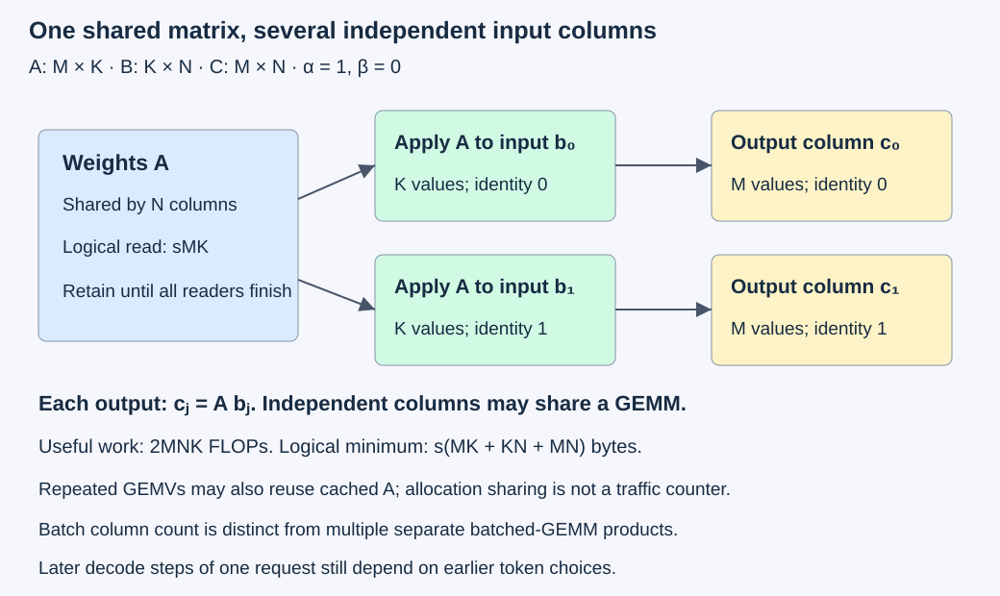
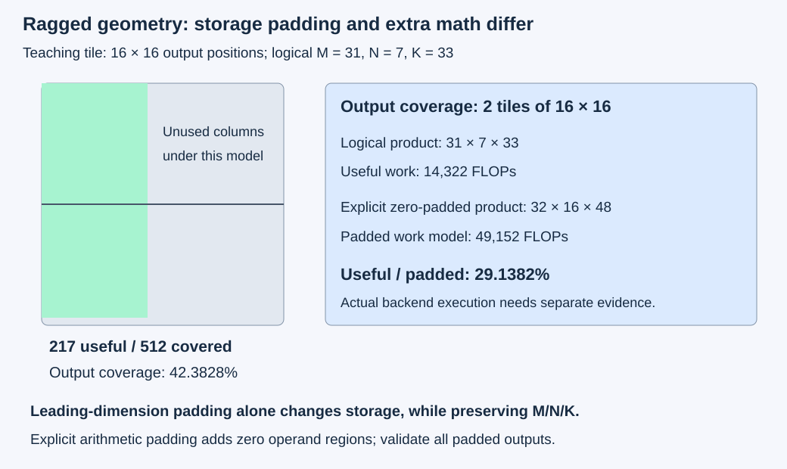

# M3-C22: Benchmarking matrix-matrix multiplication across shapes

> **Status: Complete — detailed chapter authored and documentation validated; experimental procedures are proposed unless explicitly labelled observed**

**Module:** Learn GPU architecture through data movement

**Category:** [Measurement, experimentation, and economics](index.md)

[Module 3 reading order](../module-3.md) · [Previous: M3-C21](m3-c21-benchmarking-matrix-vector-multiplication-across-shapes.md) · [Next: M3-C23](m3-c23-explaining-gpu-profiles-and-end-to-end-serving-effects.md) · [Execution plan and progress](../chapter-execution-plan.md)

## Target concepts

GEMM shape and batch sweeps, operand reuse, tensor-core eligibility, tile utilization, alignment and edge effects, precision controls, achieved compute throughput, GEMV comparison.

## Concepts

### 1. One matrix can transform several independent inputs

**GEMM**, general matrix-matrix multiplication, combines rows of one matrix with columns of another. Use weights A of shape M×K, input B of shape K×N, and output C of shape M×N. Shape means row count followed by column count. For the baseline:

**Cᵢⱼ = Σₖ Aᵢₖ Bₖⱼ**, with i=0,…,M−1, j=0,…,N−1 and k=0,…,K−1.

Each column of B is one independent input vector and each column of C its result. N=1 is mathematically the GEMV case from [M3-C21](m3-c21-benchmarking-matrix-vector-multiplication-across-shapes.md). Increasing N lets several columns reuse weights. M counts output features, K the reduction length, and N independent input positions. [M3-C17](../scheduling-and-queueing/m3-c17-batching-weight-reuse-and-shifting-bottlenecks.md) writes token positions as rows; transposing that projection yields this equivalent convention. State the mapping before comparing shapes.

A text-generation projection may group independent requests or available prompt positions. Consecutive decode steps of one request depend on earlier token choices and cannot simply become independent columns. A **batch** here means independent input columns sharing one A. It does not mean a library's batched-GEMM interface, which can describe multiple separate matrix products. This distinction prevents changing the computation while claiming only to change scheduling.

For a concrete product, A has rows [1,2,−1] and [0,3,4]. B has rows [2,1], [−1,0], [3,−2]. Then C has rows **[−3,3]** and **[9,−8]**. The two columns reproduce two separate matrix-vector products.

The general operation is **C_new=α op(A)op(B)+β C_old**. Scalars α and β scale the product and old output; op can transpose a matrix, exchanging rows and columns. Baseline α=1, β=0 uses neither old C nor transposes. [NETLIB's SGEMM definition](https://netlib.org/blas/sgemm.f) specifies this contract independently of a GPU backend. With β=1 and old C rows [5,−1], [−2,4], the example instead gives rows **[2,2]**, **[7,−4]**. Restore that seed before every accumulation trial.

Use real FP32, four-byte floating-point values, with full FP32 multiplication and accumulation for the baseline. **Column-major** storage places each column contiguously; **leading dimension** is the storage distance between column starts. Tight, untransposed leading dimensions are M for A, K for B and M for C. [cuBLAS 13.4](https://docs.nvidia.com/cuda/cublas/index.html#cublas-t-gemm) provides the GPU descriptor contract. Rust is the eventual host-language context; this chapter specifies reasoning and studies without implementation code or pseudocode.

### 2. Reuse changes the byte model, not the useful product

Count a multiply plus add as two floating-point operations, giving the conventional useful work **F=2MNK FLOPs**. The minimal real-arithmetic expression count is MN(2K−1); F is a reporting convention, not an executed-instruction counter. FLOP/s is a rate and requires a completed duration.

For equal element size s bytes, a one-pass logical minimum reads A and B once and writes C once:

**Q_min=s(MK+KN+MN) bytes.**

**I_min=2MNK / [s(MK+KN+MN)] FLOP/byte.**

With β≠0, an old-output read adds sMN. Mixed operand/output types require **Q_min=s_A MK+s_B KN+s_C MN**, plus any required old-C read. These models exclude guards, alignment slack, padding, workspace, conversion, host transfers, repeated loads and instruction traffic. Physical cache and device-memory traffic need their own measurements. A **cache** is a smaller, faster store retaining some recently used data; DRAM is larger device memory, including HBM on relevant GPUs.

For FP32 M=K=256, A occupies 262,144 bytes (256 KiB, where KiB=2¹⁰ bytes). Increasing N creates this calculated reuse opportunity:

| N input columns | Useful FLOPs | Q_min bytes | Intensity, rounded |
| --- | --- | --- | --- |
| 1 | 131,072 | 264,192 | 0.496124 FLOP/byte |
| 8 | 1,048,576 | 278,528 | 3.764706 FLOP/byte |
| 32 | 4,194,304 | 327,680 | 12.8 FLOP/byte |
| 128 | 16,777,216 | 524,288 | 32 FLOP/byte |

A appears once in each formula while inputs and outputs grow. As N grows without bound for fixed M/K, intensity approaches **2MK/[s(K+M)]**, which is 64 FLOP/byte here. It cannot increase indefinitely. Repeated GEMV calls can also reuse cached A, so the formula does not prove they each fetch the entire weight matrix from DRAM.

*Sharing A changes the opportunity for reuse. Each input column still has its own output and request/position identity; actual memory traffic depends on execution and cache history.*

### 3. Shape determines how much parallel work is available

A **tile** is a rectangular part of the product assigned to an execution group. A group forms a patch of output by repeatedly combining corresponding pieces of A and B along K. This can reuse operand values within that patch. The backend selects actual tiles, scheduling and temporary storage; a shape alone does not identify them.

A narrow output may expose few output tiles despite a long reduction. A square output can expose many independent patches. A **wave** is a group of execution blocks that can run concurrently under the resource limits. An incompletely filled final wave can leave some resources unused. Tile size, registers, shared memory, device partition and algorithm choices all influence the effect. [NVIDIA's matrix-multiplication guide](https://docs.nvidia.com/deeplearning/performance/dl-performance-matrix-multiplication/index.html) describes tile and wave quantization: rounding work up to execution groups can create uneven efficiency. Its historical device rates are not measurements of this chapter's studies.

Consider only a teaching output tile of 16×16. For M=31,N=7, output coverage requires **ceil(31/16)×ceil(7/16)=2** tiles. Here ceil rounds upward. Their 512 output positions contain only **217 useful positions**, a coverage fraction of **217/512=42.3828125%**. If a teaching implementation additionally rounds K=33 to 48, its padded dimensions are 32×16×48. Useful work is **14,322 FLOPs**; fully padded work is **49,152 FLOPs**; useful/padded work is **29.1381836%**. These are geometric models, not measured lane utilization or a claim that a library performs every padded operation.

*The illustrated tile is a teaching choice. A backend may mask edges, select another tile or use another algorithm. Storage padding and arithmetic padding must be counted separately.*

### 4. Alignment, eligibility and observed execution are separate questions

**Alignment** describes an address being a multiple of a chosen byte boundary. Padding a leading dimension can align successive column starts without changing M/N/K. Explicitly padding the mathematical operands instead changes allocated shapes and may execute extra products. Zero-fill the added operand regions and extract only the intended result; incorrect padding can corrupt even an in-bounds product.

Tensor cores are hardware facilities for supported matrix operations. Eligibility depends on architecture, interface, data/compute types, shapes, layout, addresses and policy. The [cuBLAS Tensor Core usage rules](https://docs.nvidia.com/cuda/cublas/index.html#tensor-core-usage) distinguish preferred alignment from broad support. Do not turn a performance-friendly multiple into a universal fallback rule. Descriptor acceptance, permitted tensor use and observed tensor instructions are three separate facts. Use completed [M3-C09](../kernels-compilers-and-execution/m3-c09-tensor-cores-and-supported-matrix-operations.md) for that distinction.

A four-byte offset preserves natural FP32 alignment while changing sixteen-byte alignment. It must still satisfy the selected interface's requirements and fit within allocated storage. Never use an illegal pointer as a speed experiment. A different layout may select a different backend algorithm; record that change rather than attributing all elapsed time to alignment alone.

### 5. Precision is a numerical contract as well as a performance setting

Storage format, multiplication precision, accumulation precision, intermediate reductions and final output conversion are separate choices. A mode permitting reduced-precision multiplication can return FP32 output. The [cuBLAS compute-type specification](https://docs.nvidia.com/cuda/cublas/index.html#cublascomputetype-t) documents distinct modes, including a strict FP32 option and modes allowing conversion. Retain the actual selected mode and environment overrides; a default is not a reproducible numerical policy. Tensor eligibility still requires the exact device/backend tuple.

A small exact example isolates input representation. Let A=[1+2⁻¹¹,1] and B be the column [1,−1]. The original product is **2⁻¹¹=0.00048828125**, exactly representable in FP32. FP16, a two-byte floating-point format, has a spacing of 2⁻¹⁰ near one. With round-to-nearest, ties-to-even, the midpoint 1+2⁻¹¹ becomes one. Multiplying those represented FP16 inputs with FP32 accumulation gives **zero**. Accurate accumulation cannot recover the lost input bit.

Compare against two references: the original FP32-valued inputs and the inputs after conversion. The result zero is exact for the converted inputs but differs from the original by 2⁻¹¹. A teaching absolute budget **2⁻¹²=0.000244140625** rejects that original-input discrepancy. This budget deliberately detects the lost bit in this fixture; it is not a model-quality tolerance. Follow completed [M9-C17](../numerics-and-correctness/m9-c17-comparing-logits-with-justified-numerical-tolerances.md) before approving numerical approximations in a real model. Small integer fixtures below are exactly representable in both formats and cannot establish safety for all model values.

### 6. Throughput must use useful work and compatible elapsed time

For completed operation time t seconds, report **P_useful=2MNK/t**. For M=N=K=256 and an invented t=20 µs, P_useful is **1.6777216 TFLOP/s**, where tera means 10¹². Q_min/t is **39.3216 GB/s** using decimal 10⁹ bytes per GB. These are calculated teaching rates. Useful work excludes arithmetic done solely for padding; report padded-work rates separately when the executed work is actually established.

Use the compatible roofline **P_roof=min(P_compute,B_memory I)** from [M3-C16](m3-c16-using-the-roofline-model-to-predict-bottlenecks.md). The compute capacity must match actual precision, dense/sparse convention and partition. The memory term needs bytes at its stated interface; Q_min is not automatically DRAM traffic. An FP32 rate divided by an incompatible sparse or lower-precision nameplate peak does not establish utilization.

A device-event interval around GEMM measures that ordered stream interval; a host monotonic interval from submission entry through successful completion wait measures another boundary. Include all internal kernels required by the operation. Small shapes can be dominated by submission, gaps, limited parallelism or timer resolution. Same-tick event observations yield unresolved rates, not infinite throughput. Repeat history can change caches. [Nsight Compute's profiling guide](https://docs.nvidia.com/nsight-compute/ProfilingGuide/index.html#cache-control) explains replay/cache controls that can perturb normal execution. Keep diagnostic captures separate from unprofiled latency.

For a GEMV comparison, hold A, every B column, output order, arithmetic policy and completion boundary fixed. Time N ordered GEMVs as one bundle against one GEMM, keeping one output slot per column. Compare all MN results. The reciprocal of column throughput is amortized cost; it is not an individual request's response latency or a proof of sustainable service capacity.

## Experiments

All five experiments are proposed. Exact paper/reference calculations can be checked without a GPU. Hardware timings, instruction paths, counters and serving results are not asserted.

### E1 — Reconcile the product, byte ledger and precision reference

**Description:** Establish independent mathematical, layout, work, padding and representation references.

**Purpose/objective:** Prevent shape, seed, numerator and input-conversion changes from masquerading as an equivalent speedup.

**Target concepts:** Operand reuse, useful FLOPs, GEMV equivalence, tiling models and precision controls.

**Baseline and workload:** Use the 2×3 by 3×2 example, its β=1 seed, and the midpoint FP16 example. For storage, tight column-major A is [1,0,2,3,−1,4] and B is [2,−1,3,1,0,−2]. Include the 31×7×33 teaching padding case.

**Controls and prediction:** α=1 and immutable logical inputs. Predict the exact products and both original/converted precision references already given. Padding must not change any valid output.

**Procedure:** Independently form each column as a GEMV and each output as a row/column dot product. Reconstruct storage offsets, seed handling, the reuse table, the coverage and padded-work fractions. Round the midpoint to FP16 under the declared rule, and apply the predeclared original-input budget. Deliberately exchange B's columns, corrupt a padding value, omit a last output or count padded work as useful; identify which identity/value/accounting gate rejects each case. Reject insufficient backing, invalid leading dimensions and incompatible transpose lengths on paper before dispatch.

**Hardware/software:** Exact integers/rationals and explicitly rounded FP16/FP32 references suffice. Record numerical tool versions and rounding policy if tools are used; no GPU required.

**Failure and HFT connection:** Grouped feature projections must preserve event identity and numerical meaning. A faster answer attached to the wrong event or computed from changed precision can violate its contract. This analogy establishes evidence discipline, not trading strategy validity.

**Exit criteria:** V1 reproduces all values, byte/work ledgers and precision verdicts, with semantic defects separate from a deliberately changed representation.

### E2 — Sweep GEMM shape and independent-column count

**Description:** Vary output and reduction shapes under one full-FP32, prepared-input policy.

**Purpose/objective:** Find where increasing independent work or changing aspect ratio changes completed latency and useful throughput.

**Target concepts:** Shape/batch sweeps, reuse, small-operation overhead, achieved compute throughput and correctness.

**Baseline and workload:** α=1, β=0, no transposes, tight column-major operands. Use this twelve-cell specification; all figures are calculated:

| M × N × K | Useful FLOPs | FP32 Q_min bytes |
| --- | --- | --- |
| 1 × 1 × 1 | 2 | 12 |
| 31 × 7 × 33 | 14,322 | 5,884 |
| 32 × 8 × 32 | 16,384 | 6,144 |
| 33 × 9 × 31 | 18,414 | 6,396 |
| 256 × 1 × 256 | 131,072 | 264,192 |
| 256 × 8 × 256 | 1,048,576 | 278,528 |
| 256 × 32 × 256 | 4,194,304 | 327,680 |
| 256 × 128 × 256 | 16,777,216 | 524,288 |
| 64 × 64 × 1,024 | 8,388,608 | 540,672 |
| 1,024 × 64 × 64 | 8,388,608 | 540,672 |
| 256 × 256 × 256 | 33,554,432 | 786,432 |
| 512 × 512 × 512 | 268,435,456 | 3,145,728 |

For measured epoch e=0,…,59, define **Aᵢₖ=(i mod 5)+1+(k mod 7)−3+e**, **Bₖⱼ=1+(j mod 3)+(k mod 3)**. “mod” means nonnegative remainder. This bounded integer family admits an independent 21-term reference while retaining asymmetric row/column values. Keep exact input images and logical column identities.

**Controls and prediction:** One supported strict FP32 backend, fixed device/partition, scalar placement, stream, workspace policy and recorded operand alignment. A, B and C have nonoverlapping backing; no in-place aliasing is allowed. No reduced-precision multiplication or extra epilogue operation is allowed. An epilogue is work applied after the matrix product, such as bias or activation. Predict shape-dependent results without a fixed winner, universal tensor path or rate threshold. Upload-before-call is a preparation policy, not proof of cold DRAM.

**Procedure:** Use three sessions with listed, reverse-listed and listed shape order. For each cell/session, run ten excluded warmups at e=0 and twenty measured epochs, globally 0–59 per cell. Before each invocation prepare/upload A/B, initialize C to −2²⁰ and complete preparation. Place 32-byte guards before/after each logical backing region, using byte values 0xA5/0x5A. Time the device-event GEMM interval and host dispatch-entry through successful completion wait. After completion, read back every output, guards and separate A/B diagnostic echoes; compare immutable sources and all outputs. Use at most 1 MiB reusable host diagnostic scratch. Include preparation and diagnostics in a separately labelled wider interval. Admit the next invocation only after validation.

**Hardware/software:** One GPU and backend with documented strict FP32 GEMM, stream events, completion and host readback. Reserve up to 64 MiB raw fixture storage on each host/device, plus separately charged runtime, workspace, staging and alignment slack. The largest three FP32 payloads plus their six guards occupy 3,145,920 bytes before alignment slack. Mark unavailable cells unsupported rather than silently reducing dimensions or changing arithmetic.

**Failure and HFT connection:** Retain allocation/dispatch/completion/correctness failures and every valid slow observation. A 120-second study watchdog is not an HFT deadline or evidence that readers stopped; quarantine unresolved device-owned buffers until completion or context retirement is established. Variable feature/batch dimensions motivate stratified results; model-serving and trading semantics still differ.

**Exit criteria:** V2 accounts for **720 measured and 360 warmup GEMMs**, with **26,480,820 measured output coordinates** if all cells complete. Every accepted result passes exact numerical, guard, source and identity checks. Rates use useful work, declared intervals and actual supported operating points.

### E3 — Separate leading-dimension padding from padded arithmetic

**Description:** Compare four legal storage/execution configurations for the same logical 31×7×33 product.

**Purpose/objective:** Test alignment and edge hypotheses while charging extra storage and work honestly.

**Target concepts:** Alignment, leading dimensions, tile coverage, padding and backend selection.

**Baseline and workload:** Use E2's integer family. Configuration A has tight leading dimensions (31,33,31) and operand bases aligned to 256 bytes. B keeps logical dimensions but uses leading dimensions (32,40,32), also aligned. C uses tight dimensions with each operand base offset four bytes from its aligned reference, only if legal for the actual interface. D explicitly zero-pads operands to M′=32,N′=16,K′=48 and extracts the first 31×7 outputs. D has 512 output coordinates including expected zeros; the other three have 217 each.

**Controls and prediction:** Full FP32, identical useful inputs, α=1, β=0 and matched preparation/timing scopes. Fill unused leading-dimension storage with finite sentinels and verify it remains unchanged; D's operand padding must be zero. Record legal address ranges, offset gaps, allocation slack and selected algorithms. Leading-dimension padding changes storage while D additionally changes arithmetic dimensions. Neither predicts an automatic acceleration or fallback.

**Procedure:** Confirm descriptors and backing ranges before dispatch. Rotate the starting configuration across three sessions, preserving A/B/C/D cyclic order. Each configuration/session has ten excluded warmups at e=0 and twenty measured epochs, globally 0–59 per configuration. Initialize, prepare, complete, time and validate as in E2. Verify all of D, including its zero output regions, before extracting useful results. Obtain one additional diagnostic capture per configuration/session, twelve total, outside timing populations, retaining instruction/algorithm and memory evidence with actual replay policy. Reject illegal configuration C as unsupported instead of running it.

**Hardware/software:** E2 hardware plus legal alternate descriptors and a record of actual base/column addresses. Tight operand/output backing is 5,884 bytes; padded leading-dimension backing is **4(32×33+40×7+32×7)=6,240 bytes**. D backing is **4(32×48+48×16+32×16)=11,264 bytes**. These exclude guards, offset/alignment slack and workspace; retain those separately within the fixture budget.

**Failure and HFT connection:** A changed leading dimension, stray nonzero padding or stale extracted output can invalidate an otherwise fast in-bounds computation. Fixed-layout and ragged feature groups illustrate this systems concern; no claim about exchange packet layouts or real trading speed follows.

**Exit criteria:** V3 reconciles **240 measured and 120 warmup invocations**, **69,780 measured output coordinates** including D's padding, plus twelve diagnostic captures. Useful outputs remain equivalent, and every reported performance difference names the storage/work/algorithm changes and uncertainty.

### E4 — Compare a strict baseline with a permitted mixed-precision path

**Description:** Study FP32 inputs/output with strict FP32 arithmetic versus explicitly converted FP16 inputs with FP32 accumulation/output, when supported.

**Purpose/objective:** Distinguish representation error, arithmetic error and actual tensor execution from merely enabling an option.

**Target concepts:** Precision controls, tensor-core eligibility, observed execution and compatible throughput claims.

**Baseline and workload:** Use M=256,N=32,K=256 with E2's integer fixture for both modes. Those integers convert exactly. Separately run the midpoint example at M=1,N=1,K=2; its FP16 conversion deliberately changes the original-input answer. Use no sparse encoding, bias, activation or other fused work.

**Controls and prediction:** Record input/accumulator/output formats, rounding and reduction policy, compute mode, environment overrides, actual device capability, descriptor and backend. The mixed path must retain full FP32 accumulation without reduced-precision intermediate reductions; unsupported contracts stay unsupported. Predict exact agreement on the integer family and the documented original-versus-converted discrepancy on the midpoint fixture. Tensor execution and performance improvement require evidence; neither follows from the mode name.

**Procedure:** In each of three sessions alternate strict-first, mixed-first and strict-first order. Run ten excluded integer warmups and twenty measured integer epochs per mode, globally e=0–59. Convert/prepare inputs and complete this work before operation timing, while retaining conversion time/bytes in the wider interval. Compare every output against both input-reference definitions, plus guards/source images as appropriate to each format. Add one untimed midpoint invocation per mode/session, six total, and one separately prepared diagnostic profile per mode/session, six total, outside integer timing counts. Retain actual tensor-instruction evidence and any collection limitations.

**Hardware/software:** A device/library tuple supporting each declared type/compute/output combination; baseline remains available if the mixed path is unsupported. Record actual specifications and capability evidence rather than assume any GPU has the required matrix mode. Mixed integer Q_min is **2MK+2KN+4MN=180,224 bytes**; conversion buffers and workspace are extra.

**Failure and HFT connection:** Reject unsupported modes, nonfinite results, unexpected casts and an original-input error exceeding its predeclared budget. A converted-input pass alone cannot certify the original feature calculation. This is relevant to bounded numerical changes in decision paths, without claiming strategy or model-quality equivalence.

**Exit criteria:** V4 accounts for **120 measured and 60 warmup integer GEMMs**, six midpoint invocations and six separate profiles. It reports exact integer results, the two midpoint-reference verdicts, permitted/observed path distinction, and conversion-inclusive costs. It does not certify an approximate real model from these fixtures.

### E5 — Compare one GEMM with equivalent GEMV bundles

**Description:** Use N independent input columns sharing the same weights, executed as one GEMM or N serial GEMVs.

**Purpose/objective:** Compare useful work fairly while distinguishing operation throughput from individual response delay.

**Target concepts:** GEMV comparison, weight reuse, batch count, completion and useful throughput.

**Baseline and workload:** M=K=256, N in {1,8,32}, using the same E2 epochs for both approaches. The GEMV route reads each B column as its input vector, stores a distinct output column and uses the same full FP32 numerical contract. Both operate on prepared device inputs. N=1 provides an API/backend sanity comparison; equal math does not require equal timing.

**Controls and prediction:** Same device, A/B, output order, scalar policy, stream and preparation history. One complete bundle in flight. Repeated GEMVs can reuse cached weights; no assumption of N DRAM weight reads. Predict that more independent columns can amortize work/submission, with no universal crossover or superiority threshold.

**Procedure:** Use three sessions, N listed/reversed/listed and GEMM-first/GEMV-first/GEMM-first method order. Per N/method/session, run ten excluded warmup bundles at e=0 and twenty measured bundles, globally e=0–59. Start events before the first operation and end after the last, wait for the whole bundle and validate every column and guards/source images. Retain each internal dispatch identity; final-output equality alone cannot establish all intended submissions occurred. Charge packing, transfer and validation separately if needed by a future host-input comparison. This is a new cohort; do not reuse E2 timings as matched samples.

**Hardware/software:** E2 hardware with strict FP32 GEMV/GEMM interfaces and sufficient independent output backing. Use completed M3-C21's GEMV contracts rather than change the reduction or output definition.

**Failure and HFT connection:** On paper, compare four independent arrivals at 0,2,4,6 µs with a serial server taking 3 µs per single or 4 µs for one full four-column batch closed at 6 µs. Singles finish at 3,6,9,12; batch finishes at 10. Keep every arrival-to-result latency. Batching can lower amortized work while making the oldest event staler; these invented service times are not hardware or trading measurements.

**Exit criteria:** V5 reconciles **360 measured and 180 warmup bundles**. Measured calls comprise **180 GEMMs and 2,460 GEMVs**, 2,640 operations total, with **1,259,520 measured output coordinates** across both methods. Every matched output is correct. The paper trace distinguishes service rate, response delay and finite-cohort completion rather than asserting serving capacity.

## Verification

### V1 — Exact and deliberately changed references

Compute each small output independently as a dot product and as a separate GEMV. Validate dimensions, column identities, leading dimensions and the β=1 seed. Padding is not a permission to change useful values. Test a corrupted column, omitted final coordinate and previous epoch; zero checksum difference is insufficient. Apply the midpoint's original-input and represented-input references separately. Rounding to a narrower format changes the function's input, while a differing reduction order changes its numerical evaluation; those require different explanations and gates.

For the integer family, a fixed row residue and column residue produces a 21-term repeating product. A full period contributes **21[(i mod 5)+1+e][2+(j mod 3)]**. Derive the remainder directly and independently separate the constant row/epoch contribution from the seven-position term. Maximum |A|=67 and B≤5 give |product|≤335. The largest K in these studies is 1,024, so **Σ|products|≤343,040<2²⁴**. Every integer product and partial sum is exactly representable in full FP32 under the stated arithmetic. Require exact numerical equality, with signed zero accepted, on that family; do not weaken its gate to hide a layout error. FP16 input conversion is also exact for these small integer inputs, but only the declared FP32 accumulation contract supports the same sum argument.

These structured fixtures have repeated rows/columns. They are reproducible correctness probes, not proof of all possible products or request identity. Keep the asymmetric examples, immutable input images, explicit column/request mapping and operation-completion records as independent evidence.

### V2 — Shape-stratified normal timing

There are 60 measured invocations per shape. The sum of MN across the twelve shapes is 441,347; multiplying by 60 gives 26,480,820 measured output coordinates. Count warmups, preparation, transfers and diagnostics separately. For shapes 1×1×1, 256×32×256 and 512³, plan one additional diagnostic invocation/session at e=0, nine total, outside E2 timing counts. Inspect the complete operation's dispatches, gaps, supported memory traffic and arithmetic path. Retain replay/pass counts; one operation can contain multiple kernels.

Store raw timing samples with session, epoch, shape, input/attempt/buffer IDs, arithmetic policy and actual hardware state. Report median, range and session differences per shape, with failed/unsupported/unresolved observations visible. Sixty observations per cell are exploratory, not a stable population p99: under independent sampling the expected number beyond a true continuous-population p99 is only 0.6. Trials may be correlated. Use completed [M9-C07](m9-c07-latency-distributions-and-statistical-uncertainty.md) before extending to a tail study; never pool shapes into an unlabeled percentile.

### V3 — Geometry and storage before attribution

Verify address legality and actual base/column alignment for all four configurations. For B, unused backing remains a sentinel; for D, input padding is zero and every padded output is checked. Guard regions and offset gaps remain intact. A copied-out valid submatrix cannot conceal corruption elsewhere in D.

Record useful, storage and explicit padded-work ledgers independently. C's four-byte offset or B's leading dimensions may change algorithm selection, memory transactions or tile shape; a rate change alone cannot isolate the cause. Compare unprofiled timing first, then compatible minimal profiles following completed [M9-C12](m9-c12-reading-cpu-gpu-timelines-and-scheduling-gaps.md) and [M9-C13](m9-c13-using-kernel-profilers-to-explain-hardware-bottlenecks.md). Retain tool metric definitions, instruction coverage, cache/replay policies, workspace and actual selected kernels. A 42.38% geometry calculation is not a measured occupancy or tensor-pipe metric.

### V4 — Numerical and execution gates stay independent

On the integer cohort, verify all 8,192 coordinates per operation under both policies and compare immutable inputs at their represented formats. For the midpoint, strict FP32 returns the original 2⁻¹¹, while exactly accumulated rounded FP16 inputs give zero: original-input error 2⁻¹¹ exceeds budget 2⁻¹², converted-input error is zero. Preserve that expected rejection instead of raising the original-input budget. Real model values need their own ranges, cancellation tests and useful-output criteria, not just this one demonstration.

A profile must show relevant instructions for the actual operation before claiming a tensor path ran. If unsupported metrics or replay restrictions prevent that conclusion, report permitted but unverified execution. Useful FLOPs divided by elapsed time must use the same operation and format-specific comparison roof. Conversion cost, workspace growth and numerical failures are material even if the operation-only mixed path is faster. Reproduce profiles separately from normal timing; do not merge their altered cache histories or clocks into unprofiled samples.

### V5 — Matched work, complete outputs and arrival boundaries

For each matched GEMM/GEMV bundle, compare every output coordinate and its logical column. Preserve N output slots until validation; reusing one slot would hide missing work. Distinguish the bundle event interval, host submit-to-completed-bundle interval and any full validated request interval. Host waits contain device work and cannot be added again as independent elapsed stages. A same-tick or failed event interval has no reported finite throughput.

In the paper trace, singles have response latencies [3,4,5,6] µs, mean **4.5 µs**; batching gives [10,8,6,4], mean **7 µs**. The shared operation's amortized cost is 4/4=1 µs per column rather than 3, while the oldest request waits ten rather than three. Finite arrival-to-last-completion cohort rates are 4/12 and 4/10 requests/µs; neither establishes sustainable capacity. If all four arrive together, singles' mean becomes 7.5 µs while the full batch's is 4 µs. Arrival variability changes the decision.

A deadline-expired or cancelled request can suppress publication without terminating device readers. Retain ownership until required completion; count one terminal outcome per admitted request and drain before closing accounting. A real text-serving extension needs model/tokenizer identity, prompt/output/context distributions, live KV ownership, arrival process, concurrency, batching/cancellation/deadline policy, valid output definition and client/server timing boundaries. No offline GEMM or GEMV sweep establishes those results.

## Engineering dimensions and principles

| Dimension | Chapter-specific application |
| --- | --- |
| Semantics and invariants | E1 fixes product, seed and original/represented references; E2–E5 require completed correct outputs and preserved column identity. |
| Workload and variability | Sweep M/N/K, aspect ratios and independent columns; E3 changes layout, E4 precision, E5 grouping. Text lengths/skew affect real arrivals and shapes; non-text modalities and Module 8 remain outside scope. |
| Resources and bottlenecks | Account for weight/input reads, output writes, padding, workspace, conversion, device/host capacity and CPU validation. Logical reuse is separate from actual cache/DRAM traffic. |
| Time and distributions | Separate operation, bundle and validated request boundaries. Small-shape overhead, batch formation, cache history and shared waits affect slow outcomes. |
| Ownership and coordination | A/B are immutable while readers run; C retains separate column identities. Do not reuse source/output/workspace before completion, including after cancellation. |
| Failure and adaptation | Reject invalid descriptors before dispatch; retain unsupported modes, allocation failures, numerical violations and unresolved ownership. A faster but invalid result is not useful service. |

| Engineering principle | Consequence for this chapter |
| --- | --- |
| 1. Correctness defines the optimization boundary | Exact integer gates precede speed; FP16 conversion requires original-input as well as represented-input evaluation. |
| 2. Performance depends on workload and operating point | N-column reuse, aspect ratio, edge dimensions, precision and actual hardware state define each comparison. |
| 3. Data movement is part of the algorithm | Explicitly count weights, inputs, outputs, padding and conversions alongside useful FLOPs. |
| 4. State has ownership, lifetime and recovery cost | Shared weights outlive all readers; independent outputs and reconstruction/transfer costs remain charged. |
| 5. Dependencies determine latency; bottlenecks determine capacity | Columns must be independent; later decode steps cannot be batched away. Operation speed does not establish queue stability. |
| 6. Variability and synchronization shape the tail | The arrival trace and per-shape populations show why amortized rates and small samples cannot establish response p99. |
| 7. Local improvements must be evaluated end to end | Include packing, conversion, formation, transfers and validation before accepting a useful-service improvement. |
| 8. Claims require reproducible evidence | Preserve references, dimensions/layouts, arithmetic modes, identities, raw samples, failures, instruction evidence and manifests. |

## Specifications, articles, and hardware

Primary sources checked on 2026-10-27:

| Source | Role and limits |
| --- | --- |
| [NETLIB SGEMM](https://netlib.org/blas/sgemm.f) | Independent real-valued product, transpose, scalar and storage contract; no GPU performance promise. |
| [cuBLAS 13.4 GEMM and extended-type reference](https://docs.nvidia.com/cuda/cublas/index.html#cublasgemmex) | Installed-interface type/descriptor requirements; compute modes and tensor eligibility still need actual device/version evidence. |
| [NVIDIA matrix-multiplication article](https://docs.nvidia.com/deeplearning/performance/dl-performance-matrix-multiplication/index.html) | Reuse, tiles and wave effects; historical architecture examples are not portable thresholds or new measurements. |
| [Nsight Compute profiling guide](https://docs.nvidia.com/nsight-compute/ProfilingGuide/index.html#cache-control) | Collection/replay/cache limitations; diagnostic timing is separate from normal execution. |

Baseline studies need one GPU/backend supporting the declared FP32 contract, sufficient free device memory and completion/readback facilities. E4's mixed path is optional and must have its own supported tuple. Record exact GPU SKU, architecture/partition, visible memory/cache capacity, supported matrix types and instruction paths, host CPU/NUMA/RAM, actual host-device topology, OS, driver/runtime/library/compiler/Rust-binding/tool versions, dimensions/transposes/leading dimensions/strides/base addresses, scalar and compute policies, environment overrides, workspace, stream/event/wait settings, clocks/power/thermals, competing work and telemetry cadence. Use completed [M9-C16](../hardware-architecture-and-topology/m9-c16-recording-hardware-conditions-that-change-measurements.md), [M9-C15](../state-memory-and-caching/m9-c15-accounting-for-weights-kv-state-workspace-and-fragmentation.md) and [M9-C02](m9-c02-request-events-clocks-and-measurement-boundaries.md). No second GPU, network adapter, exchange connection or complete model is required. No hardware specification, timing, tensor instruction or model-quality result was supplied; example rates and times remain constructed.

## Completion and next chapter

Track acceptance and progress in the clickable [execution plan](../chapter-execution-plan.md). Next in Module 3 reading order is the completed [M3-C23: Explaining GPU profiles and end-to-end serving effects](m3-c23-explaining-gpu-profiles-and-end-to-end-serving-effects.md). The next authoring chapter is [M4-C01](../kernels-compilers-and-execution/m4-c01-defining-a-gpu-kernel-and-its-contract.md). Module 9 supports Modules 1–7; Module 8 is excluded.
