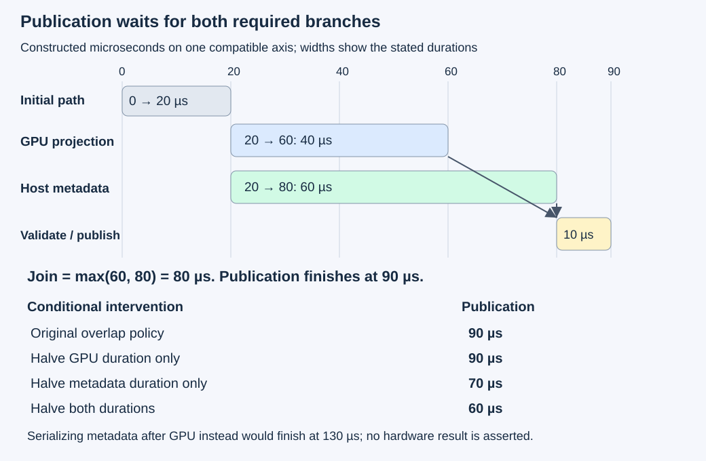
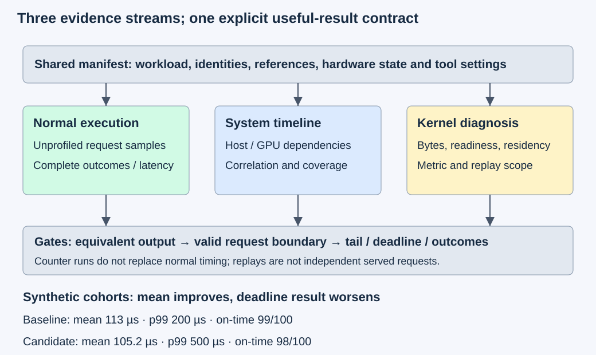

# M3-C23: Explaining GPU profiles and end-to-end serving effects

> **Status: Complete — detailed chapter authored and documentation validated; experimental procedures are proposed unless explicitly labelled observed**

**Module:** Learn GPU architecture through data movement

**Category:** [Measurement, experimentation, and economics](index.md)

[Module 3 reading order](../module-3.md) · [Previous: M3-C22](m3-c22-benchmarking-matrix-matrix-multiplication-across-shapes.md) · [Next authoring: M4-C01](../kernels-compilers-and-execution/m4-c01-defining-a-gpu-kernel-and-its-contract.md) · [Execution plan and progress](../chapter-execution-plan.md)

## Target concepts

Nsight Systems timelines, Nsight Compute counters, kernel versus request critical paths, memory traffic, occupancy and stalls, roofline reconciliation, controlled comparisons, tail latency, reproducible evidence.

## Concepts

### 1. Begin with the useful result, then choose the observation

This final Module 3 chapter joins hardware reasoning to completed work. A **profile** is an observation of execution under a particular collection policy. It can help explain behavior, but its collection can also change that behavior. The objective is a correct, useful result under the required workload, rather than a more attractive counter percentage. Rust remains the eventual host-language context; this chapter supplies experimental specifications without implementation code or pseudocode.

A **system timeline** locates host activity, device work, copies and waits. [Nsight Systems](https://docs.nvidia.com/nsight-systems/UserGuide/index.html) provides this view. A **kernel counter** counts defined hardware events; a derived metric combines counts with a denominator such as elapsed cycles or issued instructions. [Nsight Compute](https://docs.nvidia.com/nsight-compute/ProfilingGuide/index.html) investigates selected GPU execution. A timeline asks where relevant work and dependencies occur; counters help investigate the selected work's resource demands. Neither alone establishes a request-level improvement.

Use a chain of identities: request → attempt → iteration → logical operation → device invocation. Record device/context/stream, kernel or range, shape, precision and input epoch. A library operation can launch several kernels. Similar names and nearby timestamps do not establish identity. A **clock domain** supplies a timestamp origin and rate; subtract endpoints only within a compatible domain or after justified correlation. Completed [M9-C02](m9-c02-request-events-clocks-and-measurement-boundaries.md) explains this contract.

**NVTX**, NVIDIA's annotation interface, can label milestones and ranges. A range is an interval with an explicit meaning, such as preparation, submission, completion wait or validation. The [NVTX specification](https://nvidia.github.io/NVTX/) distinguishes thread-local nested ranges from handle-based ranges that may cross threads. That distinction matters when a Rust asynchronous task moves between threads. A label neither synchronizes GPU work nor proves device completion. Projected ranges are attribution views, not extra execution to add to a time total.

For actual text generation, use [M1-C20](m1-c20-measuring-and-explaining-generation-latency.md): one prefill supplies the first selection, and g selected IDs normally need g−1 later decode forwards. A selected token, stable visible text, server publication and client receipt are different endpoints. This chapter's bounded projection study cannot certify a complete serving pipeline or model quality.

### 2. Follow dependencies to the request's critical path

A **dependency graph** represents work as nodes and “must precede” relationships as edges. Its **critical path** is the longest required chain to a named completion under stated durations and resource constraints. Work off that path can become faster without moving completion. Include queueing, release times and resource ordering; omitting them makes the model optimistic.

For a node v, **start(v)=max finish(u)** over required predecessors u, and **finish(v)=start(v)+duration(v)** in a simplified fixed-duration graph. Independent branches join only after all required results are ready.

Here is a constructed same-clock request ledger in microseconds, not a trace capture:

| Stage | Interval or event | Dependency |
| --- | --- | --- |
| Prepared request arrival; admission | 0; 5 | Five microseconds before admission |
| Preparation | 5–15 | After admission |
| Submission | 15–20 | After preparation |
| GPU projection | 20–60 | After submission |
| Independent host metadata | 20–80 | After submission; uses immutable host input, not GPU output |
| Join | 80 | Both projection and metadata complete |
| Validation/publication | 80–90 | After join |

The request takes **5+10+5+max(40,60)+10=90 µs**. GPU execution overlaps host metadata; adding both branch durations gives 130 µs and double-counts their overlap. A host wait can also contain device progress and is not additional GPU time.

Halving the projection from 40 to 20 µs leaves the join at 80 and publication at 90. Reducing metadata from 60 to 30 µs moves its finish to 50, but the GPU still finishes at 60, so publication becomes 70. Applying both reductions gives join max(40,50)=50 and publication 60. These conditional outcomes are **90, 90, 70 and 60 µs**, respectively. They are not additive speedup credits.

The opposite policy serializes metadata after the GPU. With the original durations it finishes at **20+40+60+10=130 µs**. Removing that unnecessary ordering edge permits the 90 µs graph only if the branches are semantically independent and resources allow overlap. Temporal overlap alone does not prove independence; verify immutable inputs and the final join.

*The projection can improve while publication stays fixed. Durations are invented and use an assumed compatible axis; this graph is not a measured scheduling guarantee.*

### 3. Match work, traffic, elapsed time and capacity

For a compatible completed operation, define **P=F/t**, **B_l=Q_l/t**, **I_l=F/Q_l**, where F is useful FLOPs, t seconds, and Q_l measured bytes at memory interface l. A multiply plus add counts as two FLOPs. For positive Q_l and t, **P=I_l B_l**. This identity does not establish saturation or explain a gap to a capacity.

Logical read-once bytes, DRAM bytes, cache bytes and link bytes are separate ledgers. DRAM is device memory such as HBM; a cache is a smaller store that can retain reused data. Do not substitute a model's bytes into a plot labelled measured DRAM. Include complete operation activity and identify any deferred writes, workspace or collection-window limitations.

A separate constructed profile concerns a 256³ FP32 GEMM: **F=33,554,432 FLOPs**, logical minimum **Q_min=786,432 bytes**. Assume these invented, internally compatible counter records:

| Record | DRAM bytes | Completed profile interval | Useful throughput | DRAM rate | DRAM intensity |
| --- | --- | --- | --- | --- | --- |
| Baseline | 1,048,576 | 40 µs | 838.8608 GFLOP/s | 26.2144 GB/s | 32 FLOP/byte |
| Candidate | 524,288 | 30 µs | 1,118.4811 GFLOP/s | 17.4763 GB/s | 64 FLOP/byte |

The candidate transfers fewer bytes and is faster while its achieved byte rate falls. Maximizing bandwidth percentage is not the objective. Decimal GB=10⁹ bytes and GFLOP/s=10⁹ FLOP/s; microseconds are 10⁻⁶ seconds. These records are independent of the 90 µs graph and do not claim an actual candidate was implemented.

For compatible hypothetical compute capacity 8 TFLOP/s and DRAM capacity 500 GB/s, [M3-C16's roofline](m3-c16-using-the-roofline-model-to-predict-bottlenecks.md) gives **t_bound=max(F/P_compute,Q_DRAM/B_DRAM_capacity)**. The compute term is **4.194304 µs**. DRAM terms are **2.097152** and **1.048576 µs**, so both conditional floors remain 4.194304 µs. An additional 4,194,304 bytes at an assumed 1 TB/s inner-cache capacity also gives 4.194304 µs. A lower-bound gap still needs explanation through readiness, dependencies, execution width or other constraints. The [NERSC roofline article](https://docs.nersc.gov/tools/performance/roofline/) explains this envelope interpretation. Use precision-, partition- and scope-compatible capacities, not a convenient nameplate peak.

### 4. Occupancy and stalls describe different things

A **warp** is a group of GPU threads scheduled together. A **resident** warp has execution resources allocated on a streaming multiprocessor (SM). **Occupancy** compares resident warps with a supported maximum. Theoretical occupancy is a resource-limit calculation; achieved occupancy is an observation with its own averaging domain. Neither measures useful instructions directly. **Eligible** work is ready to issue; issued work actually gets a scheduling opportunity.

A teaching observation of 32 resident warps against a maximum 64 is 50%; 48 against 64 is 75%. If the latter configuration takes 45 µs instead of 40, higher residency did not improve the operation. Extra memory traffic, instructions or changed scheduling could explain the result, but the numbers alone do not establish which cause. Forcing fewer registers can increase residency and introduce spills; a spill stores a value outside registers. Local-memory traffic alone does not prove a spill, and it is not automatically fast memory. Use compiler/instruction evidence and actual timing.

A **stall** names why observed work cannot issue its next instruction. Memory dependency, arithmetic dependency and synchronization are examples. Eighty memory-dependent observations out of one hundred sampled warp observations give 80% of that sample population, not 80% of request wall time. Other warps can issue during those observations. Metric definitions may instead use cycles per issued instruction or another denominator. Check the installed definition before interpreting or adding percentages. Completed [M9-C13](m9-c13-using-kernel-profilers-to-explain-hardware-bottlenecks.md) develops this distinction; scheduler readiness and elapsed time must accompany a stall hypothesis.

### 5. Treat collection as an intervention

A profiler can replay work to collect incompatible metric groups in separate passes. Restoring ordinary memory does not restore cache contents or production concurrency. Record mode, pass count, selected range, cache/clock controls and actual activity coverage. A counter profile that serializes work cannot demonstrate that an overlap policy preserved its normal schedule. Counter attribution and unprofiled request latency therefore remain separate evidence.

The [Nsight Compute CLI reference](https://docs.nvidia.com/nsight-compute/NsightComputeCli/index.html) describes invocation filtering and discovery of supported sections/metrics. Select only the evidence needed for the question, with device/context/stream/invocation identity. Missing, denied or unsupported metrics are unavailable, not zero. Avoid automatically collecting everything or changing system permissions for a diagnostic.

Use separate unprofiled, timeline and counter cohorts. In a teaching comparison, a 100 µs unprofiled request and a 130 µs traced request differ by **(130−100)/100=30%** relative to that baseline. This alone does not justify subtracting 30 µs from every traced interval: perturbation can vary by shape, schedule and trial. Collection overhead is workload-dependent, and matched histories plus repeated observations are needed for a quantitative claim. Preserve capture truncation, missing correlation and clock errors as evidence failures.

### 6. A better average can hide a worse useful-service result

A **tail** is the slower end of a latency distribution. Fix a nearest-rank sample percentile: sort N values and select rank **ceil(pN)**. p99 uses p=0.99. A sample percentile describes its observed population, not an assured future quantile.

Consider two synthetic, fully accounted cohorts of 100 correct requests, all arriving at zero. The observation window is fixed at 2,000 µs and includes every completion. This is a record-analysis fixture, not a feasible GPU schedule or a capacity measurement. Define useful-on-time as correct publication within 250 µs of arrival:

| Cohort | Latencies | Mean | p95 | p99 | Max | On time |
| --- | --- | --- | --- | --- | --- | --- |
| Baseline | 95×100 µs, 4×200 µs, 1×1,000 µs | 113 µs | 100 µs | 200 µs | 1,000 µs | 99/100 |
| Candidate | 98×90 µs, 1×500 µs, 1×1,200 µs | 105.2 µs | 90 µs | 500 µs | 1,200 µs | 98/100 |

The candidate improves the mean by about **6.9027%** while its sample p99 and on-time count worsen. With a declared 99-of-100 teaching gate, baseline passes and candidate fails. Over this arbitrary finite window, useful cohort rates are 49,500/s and 49,000/s; total completion rate is 50,000/s for both. None is sustainable capacity. A real capacity experiment needs continuing arrivals, stable queues, resource headroom and a useful-result contract.

Under the distinct assumption of independent sampling from an unchanged continuous population, 100 observations expect only one exceedance of its true p99, with **0.99¹⁰⁰≈36.6032%** probability of seeing none. That calculation does not characterize how the synthetic table was generated or establish a confidence interval. Follow completed [M9-C07](m9-c07-latency-distributions-and-statistical-uncertainty.md) for uncertainty and correlation limits.

*Each evidence stream needs matching workload identity and its own scope. A favorable kernel metric cannot bypass correctness, request-boundary or tail/outcome checks.*

## Experiments

All four experiments are proposed. Paper calculations can be checked without GPU hardware. No trace, counter capture, hardware timing or serving outcome below has been measured.

### E1 — Reconstruct a dependency graph and a compatible profile ledger

**Description:** Audit the worked 90/130 µs graphs, counter arithmetic, occupancy/stall denominators and tail table.

**Purpose/objective:** Learn which observations can support a request-level causal claim and which cannot.

**Target concepts:** Critical paths, memory traffic, roofline reconciliation, occupancy/stalls, useful outcomes and reproducibility.

**Baseline and workload:** Use the exact same-clock events and independent profile/tail fixtures above. Keep each fixture's identity distinct; the 256³ profile is not the small projection used in E2.

**Controls and prediction:** All worked values are constructed. Predict the four dependency-graph outcomes, decreasing achieved bandwidth with faster operation, unchanged conditional roofline floor, and improved mean with worsened tail/on-time count. No hardware winner is implied.

**Procedure:** Compute event differences, branch unions and joins independently. Alter one dependency/duration at a time and recalculate publication. Reconstruct F, bytes, rates, intensities, compatible lower bounds, sample ranks and outcome counts. Deliberately add overlapping branch times, mix incompatible clock domains, substitute logical bytes for measured DRAM or divide a warp-sample percentage into request time; reject each interpretation. Check the teaching deadline verdict before selecting a favorable average.

**Hardware/software:** Exact integer/rational calculations and a dependency-graph worksheet suffice. Record tools and rounding conventions if used; no GPU needed.

**Failure and HFT connection:** An earlier kernel completion does not make a decision usable before its other required input. Tail and freshness gates can outweigh an average improvement. The analogy concerns dependency and evidence discipline, not a market model or trading result.

**Exit criteria:** V1 reproduces all constructed ledgers and rejects incompatible sums/denominators. Every conclusion identifies its assumptions and measurement boundary.

### E2 — Trace a controlled projection-to-publication pipeline

**Description:** Compare an unnecessary GPU-before-metadata wait with a correct overlap policy, holding the projection and metadata outputs fixed.

**Purpose/objective:** Find whether changing a dependency edge improves useful completion while preserving all required work.

**Target concepts:** Nsight Systems timelines, host/device correlation, request critical paths and controlled comparisons.

**Baseline and workload:** Use the full-FP32 E2 integer family from completed [M3-C22](m3-c22-benchmarking-matrix-matrix-multiplication-across-shapes.md), M=K=256 and N in {1,32}. For e=0,…,59, **Aᵢₖ=(i mod 5)+1+(k mod 7)−3+e**, **Bₖⱼ=1+(j mod 3)+(k mod 3)**, α=1, β=0, no transposes and tight column-major layout. “mod” is nonnegative remainder. Metadata is the immutable tuple (epoch,M,N,K,sum of represented integer B values), computed on the CPU from its retained host input. The sums are 511 for N=1 and 24,288 for N=32. Its independent reference is prepared before the cohort.

**Controls and prediction:** Same input images, strict FP32 arithmetic, stream, nonoverlapping A/B/C backing, metadata computation, validation and publication contract. Inputs are prepared/uploaded before the named prepared-request arrival; ingress, parsing, tokenization and input upload are outside that boundary. Baseline waits for GPU completion before computing metadata; candidate computes metadata after submission and joins both results before validation/publication. Neither branch may mutate inputs. Predict possible overlap benefits subject to actual resource contention and correct independence; no fixed speed threshold.

**Procedure:** Use three sessions with N listed/reversed/listed and baseline-first/candidate-first/baseline-first order. Per N/policy/session, run ten excluded warmups at e=0 and twenty normal measured epochs, globally 0–59 per cell. Retain prepared arrival, submission, metadata start/end, GPU completion observation, readback, validation and publication. Use one request in flight. C starts at −2²⁰; surround A/B/C backing with 32-byte 0xA5/0x5A prefix/suffix guards. Verify every output and metadata field, all guards and immutable source images after completion, using bounded 1 MiB diagnostic scratch. Include checks/readback in arrival-to-publication latency; retain a wider preparation-inclusive interval too. Separately capture one Nsight Systems request per cell/session at e=0, twelve total, after ten additional excluded warmups per captured request. Limit capture to the required host/device lanes and completion window, with stable IDs and coverage checks.

**Hardware/software:** One supported strict-FP32 GEMM GPU/backend, stream/event completion, readback, host monotonic timing and Nsight Systems support. At most 64 MiB raw fixture storage per host/device plus separately charged runtime, workspace, trace buffers, staging and alignment slack. Larger-cell A/B/C payload plus guards occupies 327,872 bytes. Record actual hardware/OS/library/Rust-binding/tool identities and clock policy. If tracing is unavailable, preserve normal timing and mark diagnosis unsupported.

**Failure and HFT connection:** Missing join evidence, changed metadata, stale epoch, incomplete capture or premature buffer reuse invalidates the claim. A 120-second study watchdog does not prove GPU readers stopped; quarantine unresolved state. Independent feature preparation may overlap computation in a decision path, but required data dependencies and freshness still govern publication.

**Exit criteria:** V2 accounts for **240 normal measured requests, 120 normal warmups, twelve timeline requests and 120 additional timeline warmups**, or exact failures/unsupported cases. Normal measured results include **1,013,760 output coordinates**. Report complete request and device intervals separately; trace observations explain structure and are not substituted for normal latency.

### E3 — Connect selected counters to a falsifiable hypothesis

**Description:** Diagnose the same two projection shapes/policies without treating counter runs as normal request timing.

**Purpose/objective:** Reconcile useful work, physical traffic, residency and readiness with the actual complete operation.

**Target concepts:** Nsight Compute counters, memory interfaces, occupancy/stalls, roofline compatibility and instrumentation limits.

**Baseline and workload:** E2's exact projection/metadata workload, at e=0 for diagnosis. The hypothesis is that removing the host ordering edge can improve the request while leaving the arithmetic work fixed; any projection-rate or memory-traffic change needs its own explanation. Do not assume both policies have identical hardware state merely because their matrices match.

**Controls and prediction:** Fix device, shape, precision, input history and profile selection. Record actual kernel/range, all internal dispatches, supported metric definitions, byte interfaces, pass count and cache/clock/replay controls. Predict identical useful FLOPs and valid outputs; counter equality or improved occupancy is not required. Kernel-isolated replay may alter the very overlap being studied, so it cannot prove E2's normal schedule.

**Procedure:** For each N/policy/session, prepare ten excluded warmup requests at e=0, then one separately profiled logical request: twelve intended requests and 120 warmups. Select the complete projection operation and a minimal supported question-driven collection covering elapsed device activity, relevant DRAM/cache bytes, launch/resource limits and scheduler readiness. Add stall evidence only where the metric and readiness question justify it. Retain all tool replay executions separately from these logical counts. Validate output, metadata, guards and inputs after each attempt. If replay cannot preserve necessary state or dependencies, mark that collection unsupported. Compare normal E2 samples with matched-shape diagnostic observations to assess perturbation qualitatively; a quantitative overhead study needs additional matched repetitions and a declared uncertainty model.

**Hardware/software:** E2 hardware plus supported Nsight Compute metric access. No permission changes or hardware setting changes are required by this plan. Retain tool/runtime compatibility and capture/report formats; unsupported counters remain unavailable.

**Failure and HFT connection:** A wrong invocation, mixed replay policy, incomplete operation or unresolved metric denominator blocks attribution. Raising occupancy or lowering one stall count is useful only through correct useful work. This is analogous to evaluating a local pipeline intervention through its decision deadline, not a claim about financial outcomes.

**Exit criteria:** V3 supplies a scope-compatible work/traffic/time ledger and explains missing or contradictory evidence. It retains counter cohorts and all replay/preparation work separately; no saturation, spill, tensor-path or request speedup conclusion is inferred from a single percentage.

### E4 — Audit tail behavior and a serving-level acceptance claim

**Description:** Evaluate the hundred-request fixture and design the evidence needed before extending a projection improvement to text serving.

**Purpose/objective:** Prevent mean-only acceptance, hidden failures and ambiguous request boundaries from producing a false service claim.

**Target concepts:** Tail latency, controlled comparisons, reproducible evidence and end-to-end useful outcomes.

**Baseline and workload:** Use the two explicit synthetic latency populations, exact request IDs 0–99, all arrivals at zero, correct outputs and a fixed 2,000 µs observation window. The teaching contract requires at least 99 correct publications within 250 µs. All one hundred terminal outcomes must still be accounted for.

**Controls and prediction:** Same quantile convention, clock/unit, deadline, window and correctness rule. Predict baseline 99 on-time/1 late versus candidate 98 on-time/2 late; the candidate fails the deadline gate despite its lower mean. This is record analysis, not an actual hundred-way concurrent GPU experiment.

**Procedure:** Reconstruct sorted ranks, sums, means, maxima, on-time counts and finite-window rates. Preserve both successful-but-late and on-time results. Test duplicate IDs, conflicting terminal records, missing arrival, missing completion, mixed units and a truncated observation window; classify evidence errors instead of replacing missing times with zero or excluding slow records. For a future serving study, require a qualified correct generator and fix model/tokenizer/weight identity, prompt/output/context distributions, arrival trace, concurrency, cache state, batching, cancellation/deadline rules and output contract. Reuse M1-C20's bounded toy-model reference if appropriate; do not silently enlarge its four-position context or claim it represents production workloads. Collect unprofiled latency/outcomes first, with separate diagnostic windows.

**Hardware/software:** No GPU for the record fixture. A future serving extension needs an existing validated generator, representative hardware and a load source capable of preserving the declared arrivals/outcomes. Those are preconditions for an extension, not an implementation deliverable here.

**Failure and HFT connection:** A cancelled/expired result is not useful merely because its arithmetic was correct. Count rejections, failures, cancellations, deadline misses and unresolved work explicitly, retaining state until device readers finish. HFT freshness motivates the gate, while inference output semantics and trading decisions remain distinct.

**Exit criteria:** V4 reproduces both one-hundred-request ledgers, the deadline verdict and every faulty-record rejection. It states that the finite cohort and projection studies establish neither population p99 nor sustainable serving capacity.

## Verification

### V1 — Check the arithmetic and the causal boundary

Independently compute the dependency graph using predecessor completion, then compare with a nonoverlapping request-time partition. The overlap of [20,60] and [20,80] is 40 µs; their union is 60 µs. Confirm 90 µs publication, 130 µs serialized publication, unchanged publication after kernel-only improvement, and conditional 70/60 µs metadata/both improvements. Treat cross-clock subtraction and overlapping-time sums as invalid before interpreting a speedup.

Reconcile both profile records, the work/intensity/rate identity, all resource floors and occupancy/sample ratios. The faster profile's lower byte/s is consistent with less movement. A low rate or a large roofline gap does not isolate a bottleneck; compatible counter and dependency interventions remain necessary. Keep constructed calculations explicitly labelled rather than laundering them into measured evidence.

### V2 — Validate the complete projection request

Use an independent integer/21-term reference for every output from M3-C22. A full product period contributes **21[(i mod 5)+1+e][2+(j mod 3)]**; derive the remainder independently. All inputs are integers; maximum absolute product is 335 and K=256 bounds the sum of absolute products by **85,760<2²⁴**. Under the stated full-FP32 policy, exact numerical equality is required, with signed zero accepted. Repeated row/column residues are a structured probe, not proof for arbitrary inputs; retain epoch/buffer/column identity and source checks.

For metadata, the sum over k of k mod 3 for K=256 is 255, so one column sums to 511+256(j mod 3). Across 32 columns the residues sum to 31, yielding 24,288. Check the exact tuple and input images for both scheduling policies. There are 60 normal requests per shape/policy; 2×60×256×(1+32)=1,013,760 normal output coordinates. Timeline invocations and their warmups are additional work.

Inspect device streams, CPU metadata and final join using [M9-C12](m9-c12-reading-cpu-gpu-timelines-and-scheduling-gaps.md). Preserve submission versus completion semantics, host/device correlation uncertainty, capture start/end and dropped/missing events. A blank application lane does not prove device-wide idleness. Report raw normal samples, median/range and session differences per shape/policy, retaining slow observations and failures. Sixty normal samples per cell support exploratory comparisons, not a stable p99 claim. Count one terminal outcome per attempt, drain all admitted work and keep unresolved completion visible.

### V3 — Keep diagnostic scope and normal performance separate

Reconcile twelve logical counter requests and their 120 preparations, plus tool-internal replays. Combined across E2/E3, the intended application-level populations are **240 normal, twelve timeline and twelve counter requests**, plus **360 excluded warmup requests**. Replays can add executions; these totals are not a claim about raw kernel launches or complete profiler overhead. Never count a replay as another independent served request.

For each metric, preserve exact name/version, unit, read/write direction, memory interface, aggregation, sample/active/elapsed denominator and selected invocation. Do not add totals to their components. Establish spill attribution through compiler/instruction evidence, not local traffic alone. For occupancy/stalls, compare resident, eligible and issued work rather than optimize a percentage in isolation. If metric bytes and duration come from incompatible passes/histories, report the ratio unavailable. Record algorithm/workspace/cache/clock changes and competing work before attributing a difference to the policy.

E2's request can overlap host and GPU work; a counter tool may serialize or replay it. Its device diagnosis does not replace the normal timeline or publication measurement. No automatic overhead subtraction or normalization by clock ratio is justified. A local improvement is accepted only after equivalent outputs and normal request behavior pass the chosen contract.

### V4 — Preserve the entire outcome population

Baseline sum is 11,300 µs and candidate sum 10,520 µs. Sample p99 ranks are 99; the values are 200 and 500 µs. Preserve the maximum as well: the slowest one percent can be absent from the reported p99 value under this convention. The 99-of-100 gate rejects the candidate; a lower mean cannot override it.

A missing terminal leaves an unresolved attempt at the window boundary; it does not establish either zero latency or normal failure. Define timeout/censoring and drain policy explicitly before a real study. Duplicate events can be deduplicated by their full semantic event key only when the records agree; conflicting duplicates are evidence errors. Report completion/outcome counts and latency populations separately so failed or cancelled work cannot disappear from a success-only percentile. Extend workload size or repeat sessions only with a declared question and uncertainty method. Correct generation, request latency, useful-on-time rate and queue stability each require their own evidence.

## Engineering dimensions and principles

| Dimension | Chapter-specific application |
| --- | --- |
| Semantics and invariants | E2 joins correct projection and metadata before publication; E4 preserves complete identities, outcomes and deadline semantics. |
| Workload and variability | N=1/32 changes projection geometry; cache/history, host interference and arrivals change behavior. Real prompt/output/context skew needs explicit serving strata; non-text modalities and Module 8 are outside scope. |
| Resources and bottlenecks | Separate CPU metadata, device compute, cache/DRAM traffic, transfers, workspace and trace buffers; interpret counters at their actual interface. |
| Time and distributions | Follow the dependency join, compatible clocks and normal request boundaries; retain slow trials and separate sample tails from population claims. |
| Ownership and coordination | Immutable inputs feed both branches; output/metadata publish only after the join. Completion controls reuse even after cancellation or a lost observation. |
| Failure and adaptation | Missing correlations, denied counters, invalid output, stale epoch, truncated capture and overload require explicit outcomes or unsupported evidence, never fabricated zeros. |

| Engineering principle | Consequence for this capstone |
| --- | --- |
| 1. Correctness defines the optimization boundary | Exact projection/metadata and outcome gates precede performance acceptance. |
| 2. Performance depends on workload and operating point | Shape, arrival, concurrency, cache history and hardware state define the claim. |
| 3. Data movement is part of the algorithm | Logical, cache, DRAM and link bytes remain separate from FLOPs and from one another. |
| 4. State has ownership, lifetime and recovery cost | The final join protects buffers and publication; losing a terminal record does not release device-owned state. |
| 5. Dependencies determine latency; bottlenecks determine capacity | The 90 µs graph explains a request; sustainable loaded service requires additional queue/resource evidence. |
| 6. Variability and synchronization shape the tail | A better mean can worsen p99 and on-time counts; synchronizing or replaying diagnosis changes its population. |
| 7. Local improvements must be evaluated end to end | Kernel reductions off the critical path need not improve publication; validate the complete useful-result boundary. |
| 8. Claims require reproducible evidence | Retain references, event/metric schemas, raw samples, failures, tool settings and full manifests. |

## Specifications, articles, and hardware

Primary sources checked on 2026-10-27:

| Source | Use and limits |
| --- | --- |
| [Nsight Systems user guide](https://docs.nvidia.com/nsight-systems/UserGuide/index.html) | Focused timelines and host/device attribution; capture scope and correlation must be established. |
| [NVTX specification](https://nvidia.github.io/NVTX/) | Annotation meaning and cross-thread range distinctions; labels do not synchronize work. |
| [Nsight Compute profiling guide](https://docs.nvidia.com/nsight-compute/ProfilingGuide/index.html) | Metric/replay/cache policies and readiness interpretation; tool interventions limit normal-latency attribution. |
| [Nsight Compute CLI reference](https://docs.nvidia.com/nsight-compute/NsightComputeCli/index.html) | Invocation selection and supported metric discovery; use installed definitions rather than assumed portable names. |
| [NERSC roofline article](https://docs.nersc.gov/tools/performance/roofline/) | Compatible resource envelopes; a gap is a hypothesis to investigate rather than a bottleneck proof. |

The baseline requires one supported GPU/backend and host CPU with enough visible memory for the declared fixtures and tool buffers. Record exact GPU SKU/architecture/partition, visible device/cache capacities, arithmetic capability, host CPU/socket/NUMA/RAM, actual host-device connection, operating system, driver/runtime/library/compiler/Rust-binding versions, tools/report formats, metric availability, annotation schema, input identities/shapes/layouts/precision, workspace, stream/event/wait policy, clock resolution/correlation, observed clocks/power/thermals, competing work and telemetry cadence. Follow completed [M9-C16](../hardware-architecture-and-topology/m9-c16-recording-hardware-conditions-that-change-measurements.md) and [M9-C15](../state-memory-and-caching/m9-c15-accounting-for-weights-kv-state-workspace-and-fragmentation.md). No second GPU, NIC or exchange connection is required. No actual hardware rates, captures, generator implementation or serving measurements were supplied; all worked times/counter values remain constructed.

## Key takeaways

Follow useful completion through required dependencies before selecting a kernel to investigate. Match counters to work, time, memory interface and hardware conditions; a percentage is not a causal explanation. Preserve unprofiled request samples and complete outcomes, and require numerical, tail and deadline gates before accepting an improvement.

## Module 3 completion and next chapter

This completes Module 3's detailed documentation: movement and ownership, hardware resources, timing/correctness gates, matrix/copy studies and interpretation through useful completion. It does not certify an implemented GPU engine. Track acceptance in the clickable [execution plan](../chapter-execution-plan.md). [M4-C01: Defining a GPU kernel and its contract](../kernels-compilers-and-execution/m4-c01-defining-a-gpu-kernel-and-its-contract.md) is now complete. The next authoring chapter is [M4-C02](../kernels-compilers-and-execution/m4-c02-mapping-an-operation-onto-cuda-threads-and-blocks.md). Module 9 continues to support Modules 1–7; Module 8 is excluded.
