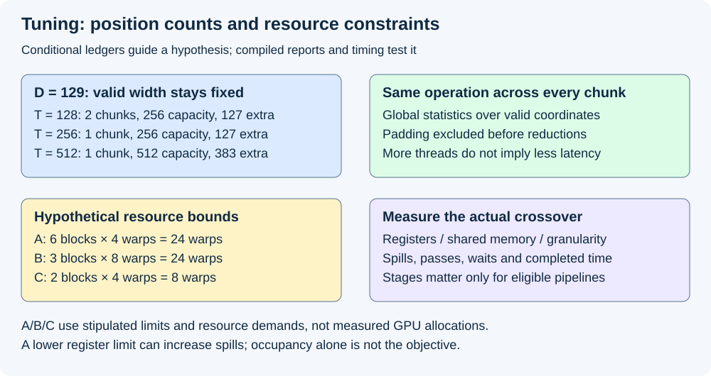
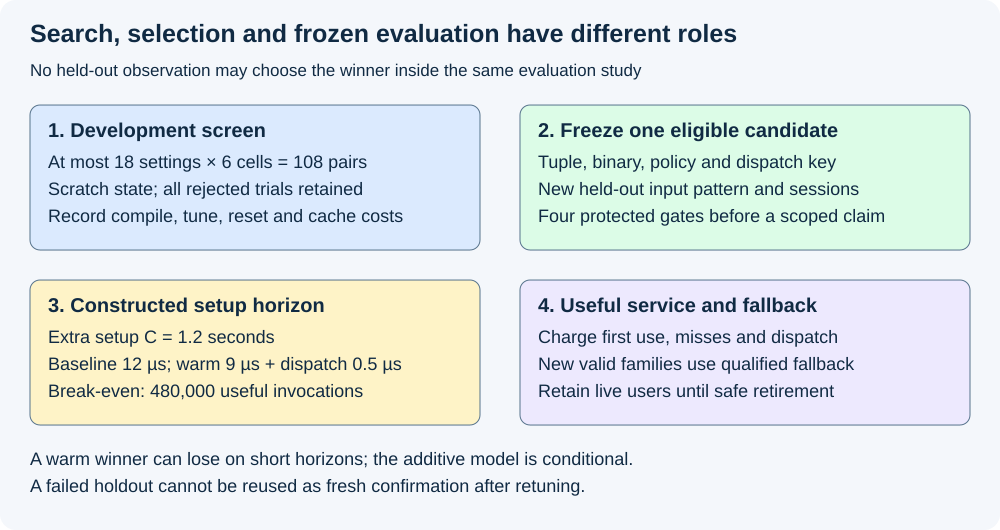

# M4-C21: Tuning kernels with controlled experiments

> **Status: Complete — detailed chapter authored and documentation validated; experimental procedures are proposed unless explicitly labelled observed.**

**Module:** Understand kernels and execution overhead

**Category:** [Measurement, experimentation, and economics](index.md)

[Module 4 reading order](../module-4.md) · [Previous: M4-C20](../numerics-and-correctness/m4-c20-validating-fused-kernels-and-graph-replay.md) · [Next: M4-C22](../measurement-experimentation-and-economics/m4-c22-benchmarking-realistic-shapes-and-execution-modes.md)

## Target concepts

Tile sizes, warps and stages, register and shared-memory limits, profiling hypotheses, tuning cost, separate tuning and evaluation workloads, specialization regressions, cold-start cost.

[Execution plan and progress](../chapter-execution-plan.md)

## Concepts

### 1. Tune a hypothesis inside a preserved contract

**Tuning** selects execution settings for an already specified operation. It must preserve valid inputs, outputs, numerical allowances, ownership and failures. A faster setting that changes a reduction's valid count, selects padding as a token or advances a request's random stream twice has changed the operation. Begin with the completed [M4-C20 validation contract](../numerics-and-correctness/m4-c20-validating-fused-kernels-and-graph-replay.md) and [M9-C27 regression gates](m9-c27-designing-regression-experiments-and-validation-gates.md).

A **configuration** is a named combination of tile shape, cooperating threads, pipeline settings and compiler options. A **specialization** is the compiled version for a particular key such as operation, dtype, layout and shape family. Tuning searches configurations; dispatch selects an eligible prepared version for the current invocation. Keep these decisions separate so a benchmark does not omit the cost of finding and choosing its winner.

A falsifiable hypothesis is: “A larger tile reduces repeated coordination on long normalization rows, but can waste lanes on short rows and increase live state. Increasing cooperating warps may hide waits only until register/shared-memory pressure limits residency.” Predict a diagnostic change and a completed-latency effect for a named shape. If latency improves without the predicted profile change, retain the gain but revise the explanation. Rust is the host-language context; Triton/CUDA/native boundaries supply compiled device operations. No implementation or pseudocode is provided.

### 2. Tiles, warps and stages change different things

A **tile** is a group of coordinates handled together. A **warp** is a cooperating group of 32 NVIDIA threads. A **pipeline stage** retains work/data for one step of an overlapping producer/consumer loop; more stages can overlap eligible movement and computation but require additional live storage. These terms do not imply that each knob matters to every kernel.

Here R denotes independent rows, D features per row and V vocabulary width. The functions ceil and floor round up and down to the nearest integer, respectively. For a row width D and chunk capacity T, a simple position ledger is:

**Chunks = ceil(D/T); capacity positions = T ceil(D/T); extra positions = T ceil(D/T)−D.**

At D=129, T=128 gives two chunks/256 capacity positions/127 extra; T=256 gives one chunk/256/127; T=512 gives one chunk/512/383. Equal position counts do not imply equal synchronization, instruction count or latency. At D=4096 the chunk counts are 32,16,8 respectively, with no extra positions. A row-reduction candidate must still combine all valid chunks into the same global statistics before applying the result; independently normalizing chunks changes LayerNorm. Padding must be excluded before reductions, not just masked on stores.

[Triton's configuration documentation](https://triton-lang.org/main/python-api/generated/triton.Config.html) distinguishes warps from software-pipeline stages. Stage tuning is most useful for eligible loops such as matrix multiplication; changing a stage setting on a non-pipelined row kernel may have no effect. Verify generated resources/control flow or mark the setting inapplicable. A 4-warp configuration has 128 cooperating threads and an 8-warp one 256, but the compiler's work mapping and allocation determine the actual resource cost. Do not infer eightfold work or twice the speed from a warp count.

### 3. Resource limits constrain resident work

**Residency** is the number of blocks that can occupy a streaming multiprocessor (SM) simultaneously. **Occupancy** commonly expresses resident warps as a fraction of the SM's warp capacity. Higher occupancy is not itself a latency objective: a lower-occupancy configuration can use data more efficiently, while a high-occupancy one can do redundant work.

For a deliberately simplified resource model, let G be registers available per SM, M shared bytes per SM, H thread capacity, W warp capacity and B the block limit. Let g,m,h,w be the corresponding per-block demands. A conditional upper bound is:

**Resident blocks ≤ min(floor(G/g), floor(M/m), floor(H/h), floor(W/w), B).**

Omit a resource quotient only when its demand is zero. Actual allocation granularity, per-thread/per-block limits, register partitions, reserved storage and compiler scheduling can lower this bound. The compiler and occupancy tools for the target architecture supply the real allocations; an arithmetic sum of live arrays is insufficient.

Use a **hypothetical** SM with 65,536 32-bit registers, 96 KiB shared memory, 2,048 threads, 64 warps and 16 blocks. KiB means 1,024 bytes. Suppose an illustrative pipelined tile needs 16 KiB per stage, with the following stipulated compiled register demands:

| Configuration | Warps / threads | Registers per thread / block | Stages / shared bytes | Simplified block bound | Resident warps / occupancy bound |
|---|---:|---:|---:|---:|---:|
| A | 4 / 128 | 48 / 6,144 | 1 / 16,384 | min(10,6,16,16,16)=6 | 24 / 37.5% |
| B | 8 / 256 | 80 / 20,480 | 2 / 32,768 | min(3,3,8,8,16)=3 | 24 / 37.5% |
| C | 4 / 128 | 136 / 17,408 | 3 / 49,152 | min(3,2,16,16,16)=2 | 8 / 12.5% |

B doubles threads per block but not resident warps in this model. C's extra live state limits blocks even more. These are resource-accounting examples for an eligible pipeline, not measured compiler outputs, an actual GPU specification or a recommendation for normalization. If a register limit is forced lower, values may spill into local memory, adding traffic. Fewer reported registers can therefore accompany slower execution. Use completed [M4-C09](../kernels-compilers-and-execution/m4-c09-register-pressure-occupancy-and-spills-in-kernel-design.md) for the distinction between logical live state and physical allocation.

*Position counts and residency bounds guide hypotheses. Only valid computation, actual compiled resources and completed timings can establish a useful setting.*

### 4. Search cost and cold-start cost belong in the result

A search over three tile capacities {128,256,512}, two warp counts {4,8} and three stage settings {1,2,3} has at most **18 configurations** per shape family. Inapplicable stages and illegal resource demands must be labelled/pruned, not timed as interchangeable valid choices. Keep the baseline as a usable fallback even when every new configuration is rejected.

Across six development cells, this gives at most **108 candidate/cell evaluations**. Compilation may be shared or repeated depending on the key; report actual compile instances/cache hits rather than equating every evaluation with one compilation. The proposed screen below uses one baseline/candidate pair per evaluation, 50 warmups and 200 measured invocations per arm: at the upper bound, **54,000 total invocations**, including **10,800 warmups and 43,200 measured invocations**. Screening observations guide selection; they are not fresh confirmatory evidence for a winner selected from the same observations.

Record compilation, loading, tuning, capture/instantiation, validation, first use, warm execution, dispatch and retirement separately. A disk artifact hit does not prove a loaded device specialization or graph is ready. [Triton's autotuning documentation](https://triton-lang.org/main/python-api/generated/triton.autotune.html) warns that evaluating configurations executes the kernel repeatedly and can repeat its mutations. Use owned scratch inputs/state and restore the approved starting state between trials. Resetting an output to zero alone does not undo KV mutation, random draws, global counters or publication.

For a constructed horizon model, let C be extra setup/search time, t₀ baseline completed time, t₁ selected warm time, d extra dispatch cost and N useful invocations. Assume these are serial additive costs and the rest of service is unchanged:

**Baseline cost = Nt₀; selected-path cost = C+N(t₁+d).**

**Break-even N = C/(t₀−t₁−d)** when the denominator is positive. The selected path is strictly better only above that equality; otherwise it never amortizes under this model.

Take C=1.2 seconds=1,200,000 µs, t₀=12 µs, t₁=9 µs and d=0.5 µs. Ignoring dispatch predicts 400,000 invocations; including it gives **480,000**. At N=10,000, baseline costs 0.12 seconds and selected path **1.295 seconds**. At N=1,000,000, they cost 12 and **10.7 seconds**. These are stipulated arithmetic, not measurements or a queueing forecast. On a critical path, overlap and shared resources can invalidate the additive model; measure setup-inclusive request effects separately.

More specializations can improve warm kernels while increasing compilation, retained binaries/graphs, misses and update complexity. Precompile selected families or tune offline when appropriate; ordinary execution serves a new valid family until qualified preparation completes. Bounded first-use policy must not synchronously search every candidate on an admitted latency-sensitive request without charging that delay. Cancellation of a tuning caller does not release storage that submitted device trials still use.

### 5. Separate development, selection and held-out evaluation

A development workload is used to explore configurations. A held-out evaluation workload is frozen before candidate selection and not inspected to choose settings. The split can separate input distributions, sessions and shape families depending on the intended claim. Different array addresses alone are not meaningful independence. For specialization claims on fixed widths, held-out input/session cases at those widths test generalization within the family; they do not establish unseen-width performance.

For the proposed study, development uses R∈{1,8}, D∈{129,1024,4096}, stored FP32 quarter-values **x[j,v]=(((17v+11j) mod 19)−9)/4**, LayerNorm with stored FP32 ε=10⁻⁵ and γ=1, β=0. The same operation/reference, no-alias and range rules from M4-C20 apply. Hold out rows **x[j,v]=(((17v+11j+5) mod 19)−9)/4** and independent evaluation sessions. The changed residue pattern is an input split, not a claim to represent every production distribution.

Select one configuration tuple for this normalization family, with its actual compiler/binary and eligibility key. The development rule discards any incorrect/illegal configuration and any setting whose observed paired screen ratio exceeds 1.02 in a development cell. Among remaining configurations, minimize the equal-weight mean of the six screen latency ratios; ties choose the lexicographically smaller (T,warps,stages) tuple. A noisy screen can choose poorly; confirmation exists to expose that. If none survives, retain the baseline without declaring a tuning win.

Freeze the winner and evaluate once under completed M9-C27's four-claim gate: primary R=1,D=129 LayerNorm and guards R=8,D=4096 LayerNorm, R=1,V=4096 k=8 sampling, R=8,V=4096 top-p=0.9 sampling. Sampling remains the unchanged approved implementation, serving as an integration/resource regression control. Use the held-out residue pattern for all cells and declare this workload revision before selection; the 20-session interval construction, 5% primary gain and 2% guard budgets remain unchanged. This confirmatory study fixes eager submission; replay requires a separately frozen study with its own preparation accounting. This is a new evaluation study, not recycled M9-C27 runtime evidence (none was collected).

*Do not feed a held-out result back into the same study's selection. A warm winner still has setup and dispatch costs at the useful-service boundary.*

If a held-out gate fails or is inconclusive, report it. Returning to development is permitted, but evaluation after another selection needs a new held-out study and control of the repeated-search claim scope; repeatedly trying winners until one passes is not a single four-claim experiment. Protect awkward widths and other dtypes/layouts via separate qualification or safe dispatch rejection, not by averaging them away.

### 6. Profiles test causes; useful service tests value

Name a bottleneck before collecting counters. For a long-row reduction, predict fewer repeated input passes or synchronization with a larger tile; for a short row, predict extra inactive-lane work; for a deeply staged eligible loop, predict higher shared/register demands and possibly fewer resident blocks. Record actual launch geometry, instructions/passes, register/shared allocation, local-memory spill traffic, occupancy, dependency waits and completed latency. No single counter identifies the cause by itself.

[Nsight Compute's profiling guide](https://docs.nvidia.com/nsight-compute/ProfilingGuide/index.html) explains replay, cache control and collection overhead. Counter collection can serialize or replay work and alter cache state. Collect profiles in separate matched diagnostic runs; clean paired timing decides speed. Graph mode and eager mode remain separate operating points, with capture/first launch visible. A new compiler may erase a knob's intended effect or produce a different binary; requalify rather than assuming an old tuning table remains valid.

Rust-side dispatch must check device/context, binary/operation/policy, dtype, valid extent, strides/alignment, workspace capacity and allocation generations. Immutable dispatch tables need a defined publication point; already admitted users retain their previous binding/lifetime claims until completion. Sampling guards preserve request-owned uniforms, exact selected IDs and one-time commit. A cache key that omits layout or numerical policy can select a fast but invalid specialization.

A faster norm cannot establish a faster generator. Measure useful output, time to first token, inter-token and terminal latency, all failed/cancelled outcomes, fallback cost and retained memory under the same checkpoint/tokenizer/arrivals. HFT systems provide the lens: control first-use stalls, specialize bounded fast paths and retain a correct fallback under bursts. Text-generation numerical/sampling budgets do not define acceptable financial-decision error or hard real-time guarantees.

## Experiments

All four experiments are proposed. The observed authoring evidence is exact arithmetic, reference/document checks and rendered review. No configuration was compiled, tuned or benchmarked on a device for this chapter.

### E1 — Resource hypotheses and configuration eligibility

- **Name:** Predict before searching.
- **Description:** Relate tile/warp/stage changes to valid work, compiler resource reports and an explicit bottleneck hypothesis.
- **Purpose/objective:** Predict the padding/residency tradeoff and eliminate semantically invalid or inapplicable settings before timing.
- **Target concepts:** Tile sizes, warps/stages, register/shared limits and profiling hypotheses.
- **Baseline:** The completed M4-C20 operation contract and existing qualified configuration; hypothetical A/B/C arithmetic is a separate teaching reference.
- **Workload:** D=129/1024/4096 and T=128/256/512; warps 4/8; stages 1/2/3 only where generated loop pipelining is meaningful. Inspect tail masks and global reduction semantics. Record a reason for every illegal, duplicate/no-effect or unsupported configuration.
- **Controlled variables:** Operation, stored dtype, epsilon/affine, valid coordinates, arithmetic/cast policy, binary/compiler flags, target architecture and resource accounting units.
- **Hardware requirements:** CPU for position/resource ledgers; compatible GPU/compiler and resource inspection for actual feasibility/profile evidence. Hypothetical SM limits cannot be substituted for queried target limits.
- **Exit criteria:** All count/limit calculations reconcile; actual candidates pass contract/value/safety checks and compiler eligibility before timing. A setting with no pipeline effect is labelled inapplicable/duplicate, not credited with a stage improvement.

### E2 — Bounded development search

- **Name:** Screen configurations without consuming the holdout.
- **Description:** Evaluate at most 18 configurations on each of six development cells, using owned scratch state and paired baseline screens.
- **Purpose/objective:** Select one candidate under the stated six-cell ratio rule while quantifying compilation/search and restoration costs.
- **Target concepts:** Tuning cost, workload dependence, baseline preservation and specialization regressions.
- **Baseline:** Immutable approved norm path, remeasured in each development pair under the same reset protocol.
- **Workload:** Six development cells and residue-0 rows above; per candidate/cell use one paired screen with 50 completed warmups and 200 completed measured invocations per arm. Archive a balanced, preselected configuration/AB-BA order. Budget is at most 108 pairs/54,000 invocations before pruning; do not add candidates after looking at the holdout.
- **Controlled variables:** Fixed inputs/contract, scratch generations, no live KV/RNG/publication effects, thermal/reset state, compiler and numerical flags; separately log actual compiles/cache hits, invalid candidates and elapsed search time.
- **Hardware requirements:** Compatible FP32 device and completed timing; cap fixture storage at 64 MiB each for host/device, with separately accounted compiler, tool and retained-variant storage.
- **Exit criteria:** Every selected configuration is correct/eligible on all development cells; the deterministic selection rule yields one frozen tuple or retains baseline. Search artifacts and all rejected/slower trials are preserved. Screening speed is exploratory evidence, not a confirmatory win.

### E3 — Frozen evaluation with protected cells

- **Name:** Confirm the selected family once.
- **Description:** Evaluate the frozen selected normalization path and unchanged sampling controls on held-out rows/sessions.
- **Purpose/objective:** Test whether development selection survives new inputs/sessions without exceeding protected-cell budgets.
- **Target concepts:** Separate tuning/evaluation, specialization regressions, uncertainty and reproducible gates.
- **Baseline:** Immutable staged/eager reference plus the fixed candidate dispatch/binary; M4-C20 correctness first, then M9-C27's interval decision.
- **Workload:** Four evaluation cells described above, residue-5 rows, 20 independent paired sessions per cell, 50 scratch warmups and 200 completed measured invocations per arm/session, with ten AB and ten BA sessions per cell. Use M9-C27's supplied-uniform mapping for sampling and its warmup stability/invalid-session rules.
- **Controlled variables:** No tuning or optional stopping; fixed held-out manifest, reference, completion boundary, policy/draw identities, graph/eager mode, allocation lifetimes and machine conditions. Preserve every failed/unresolved outcome.
- **Hardware requirements:** Qualified device/runtime and timing; same declared fixture budget and manifest as development. Fresh sessions do not excuse a different device contract.
- **Exit criteria:** Exact/safety gates plus primary upper median-ratio bound ≤0.95 and three guard upper bounds ≤1.02, using the fixed 20-session [5th,16th] interval and simultaneous-coverage assumptions from M9-C27. Any failure blocks the scoped claim; overlap is inconclusive, missing/invalid evidence cannot pass. The gate covers this family, not arbitrary shapes or request p99.

### E4 — Cold horizons, dispatch and useful generation

- **Name:** Pay for the selected fast path.
- **Description:** Compare empty-artifact/first-use, prepared-artifact/first-load and warm-ready states; reconcile setup-inclusive cost with useful generator outcomes.
- **Purpose/objective:** Predict that short-lived workloads can lose despite a warm kernel win, and identify safe ordinary fallback while new families prepare.
- **Target concepts:** Cold-start cost, amortization, dispatch, state ownership and end-to-end benefit.
- **Baseline:** Same generator/reference operation without candidate tuning/setup; preserve model/tokenizer, exact token/draw and stopping contracts.
- **Workload:** Constructed C=1.2-second horizon at N=10,000/480,000/1,000,000; proposed actual runs record each setup component and measured invocation/dispatch costs rather than substituting those constants. Generator confirmation reuses M4-C18's versioned 32-prompt corpus at concurrency 1/8/32, five paired corpus blocks per condition. Separately script new-width miss, invalid-layout rejection, cancellation during preparation and retained-reader retirement.
- **Controlled variables:** Named compilation/disk/load/graph/cache state, identical arrivals/output caps, per-request ownership, binary and hardware; warm preparation uses scratch identities. Stress and profiling runs are distinct from clean service timing.
- **Hardware requirements:** Device memory for the chosen model plus qualified workspace/retained artifacts, timing/trace visibility and explicit host/device/interconnect conditions; no supplied machine is assumed.
- **Exit criteria:** Horizon accounting includes search, dispatch and fallback; no duplicate commit, live-state mutation by tuning or premature reclamation. Report setup-inclusive latency, useful throughput, time to first token, inter-token/terminal tails, failures/cancellations and retained memory. Service benefit requires predeclared service budgets/uncertainty and independent evidence; otherwise label it incomplete/inconclusive.

## Verification

### Matched measurements and decisions

| Experiment | Evidence to retain | Acceptance and limit |
|---|---|---|
| E1 | Tile/capacity arithmetic, generated loop mapping, launch/resource/spill report, M4-C20 reference and safety checks | Correct eligible operation before timing; arithmetic occupancy is only a conditional upper bound |
| E2 | Full configuration/cell manifest, compile/tune/cache/reset log, paired screens and discarded candidates | Bounded reproducible selection; no held-out observations influence the selected tuple |
| E3 | Frozen binary/key, four-cell paired ratios, exact outputs/draws, sorted interval bounds and outcomes | All correctness and protected-cell gates pass; fixed family and median-session scope only |
| E4 | Named cold/warm states, completed setup/dispatch/run timeline, request outcomes and allocation/reader claims | Reconcile useful service and first-use/fallback costs; no amortization claim beyond measured horizon/assumptions |

Independent authoring QA checks tile/position counts, hypothetical resource bounds/occupancy, search/evaluation invocation budgets, deterministic selection fixtures and the break-even/horizon arithmetic. These checks neither compile the candidate nor measure its resource allocation. Numerical tolerances and exact support/token/draw gates remain inherited from M4-C20/M4-C18; changing a tuning knob never relaxes them.

Time device completion rather than host enqueue; separately record host dispatch and result publication. For microstudy medians use the two central sorted values' mean where the count is even. Warmup stability checks are investigation/eligibility flags, not proof that sessions are independent. Use completed M9-C11 for controls, M9-C13 for diagnostic replay/cache effects, M9-C15 for live/reserved/retained memory and M9-C16 for hardware conditions. M9-C27 controls repeated selection and formal claims; its coverage does not transfer to a winner chosen from held-out timings or to a generator's p99.

Archive the ordinary baseline and fallback as well as the winning artifact. A key or compiler change triggers eligibility/reference revalidation; unknown completion retains claims. First-use failures and unsupported shapes must be counted, not silently excluded from the faster subset.

## Engineering dimensions and principles

### Six dimensions applied to tuning

| Dimension | Chapter-specific question and evidence |
|---|---|
| Semantics and invariants | Do tile/reduction/cast/mask changes preserve the operation and exact state decisions? M4-C20 precedes timing |
| Workload and variability | Do short tails, long rows, batch sizes and held-out inputs favor different tuples? Protect all declared cells |
| Resources and bottlenecks | Are register/shared/spill allocations consistent with the hypothesis? Compare actual reports with conditional bounds |
| Time and distributions | Where do search, compilation, dispatch and graph misses enter the critical path? Separate warm medians from service tails |
| Ownership and coordination | Do tuning trials use scratch state, and do dispatch tables/graph slots retain admitted readers until completion? |
| Failure and adaptation | Can valid new families use ordinary fallback, invalid inputs reject and cancelled/unknown trials retire safely? |

### Eight practical principles

| Principle | Concrete tuning consequence |
|---|---|
| 1. Correctness bounds optimization | Every configuration must preserve norm/sampling semantics and memory safety; a speed score cannot offset failure |
| 2. Operating point determines performance | Equal padding counts and more warps need not mean equal latency; qualify fixed dtype/layout/shape families |
| 3. Data movement is part of algorithm | Count repeated passes, staging and spills, not only fewer chunks or arithmetic instructions |
| 4. State has ownership/lifetime/recovery cost | Search cannot consume live random/KV state; artifacts/slots/readers need explicit retention and retirement |
| 5. Dependencies determine latency; bottlenecks capacity | Pipeline stages overlap only eligible independent work; actual synchronization and resources constrain residency |
| 6. Variability and synchronization shape tails | First-use misses and preparation contention may dominate p99 despite faster warm medians |
| 7. Local gains need end-to-end evaluation | A 9-µs kernel can lose after 1.2 seconds of setup; verify complete generator output and every terminal outcome |
| 8. Claims require reproducible evidence | Preserve all trials, immutable winner/baseline, held-out manifests and fixed gate/uncertainty rules |

## Specifications, articles, and hardware

| Primary source | Scope |
|---|---|
| [Triton configuration reference](https://triton-lang.org/main/python-api/generated/triton.Config.html) | Warp and loop-pipeline settings; applicability depends on operation/compiler/architecture |
| [Triton autotuning reference](https://triton-lang.org/main/python-api/generated/triton.autotune.html) | Search keys, repeated execution and state-reset obligations; no unreviewed live-state mutation |
| [NVIDIA occupancy engineering article](https://developer.nvidia.com/blog/cuda-pro-tip-occupancy-api-simplifies-launch-configuration/) | Historical primary article explaining occupancy estimates and their performance limits; use the installed API/architecture for actual limits |
| [CUDA Best Practices Guide](https://docs.nvidia.com/cuda/cuda-c-best-practices-guide/index.html) | Resource, occupancy and measurement reasoning; not a universal target occupancy |
| [Nsight Compute profiling guide](https://docs.nvidia.com/nsight-compute/ProfilingGuide/index.html) | Resource/counter interpretation, collection/replay/cache effects; profiles are separate diagnostic runs |
| [CUDA Graphs guide](https://docs.nvidia.com/cuda/cuda-programming-guide/04-special-topics/cuda-graphs.html) | Preparation, dependencies and executable updates; application lifetime/key validation remains explicit |

Sources checked 2026-10-28. Pin actual installed tool/compiler versions; unversioned pages can change. The hypothetical resource table is not a hardware specification for experiments, and no measured kernel benchmark or chosen device is supplied.

| Hardware/specification area | Required manifest |
|---|---|
| Host | CPU/NUMA/affinity, OS/kernel, Rust/native/binding/framework/allocator versions, compilation parallelism and background load |
| Device | GPU architecture/model/UUID, SM/register/shared/thread/block limits and allocation granularity, partition/visible memory, clocks/power/temperature |
| Compiled operation | Actual binary/compiler/options, tile/warp/stage interpretation, R/D/V/dtype/layout/range, registers/shared/spills and graph identity |
| Artifacts/state | Tuning key/table revision, compile/disk/load hits, retained binary/graph/workspace bytes, scratch/request/generation and last-reader identities |
| Evidence/service | Development/held-out corpus, trial/session order, reset/warmup, completed timing boundaries, profiler settings and all terminal outcomes |

## Key takeaways

A tuning result includes a valid configuration, its selection cost and a frozen evaluation scope. Resource models guide experiments, while actual compiled reports and completed timing test the predictions. Preserve safe fallback and account for preparation/dispatch before claiming useful-service improvement.

## Continue learning

Next in Module 4 reading order is [M4-C22: Benchmarking realistic shapes and execution modes](m4-c22-benchmarking-realistic-shapes-and-execution-modes.md). The next authoring chapter is [M5-C18: Choosing chunk sizes and balancing prefill with decode](../scheduling-and-queueing/m5-c18-choosing-chunk-sizes-and-balancing-prefill-with-decode.md), position 125. Follow the [execution plan and progress tracker](../chapter-execution-plan.md). Only M4-C21 is authored in this step.
