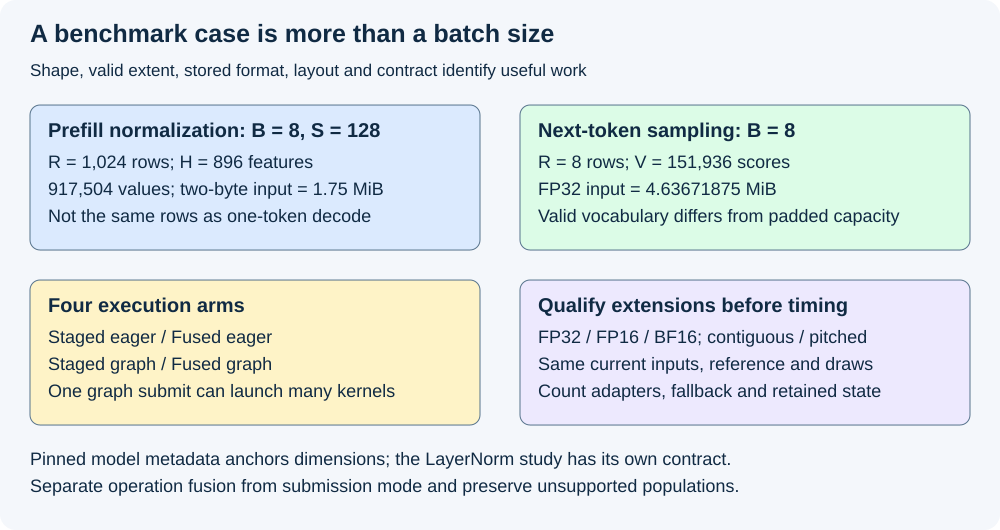
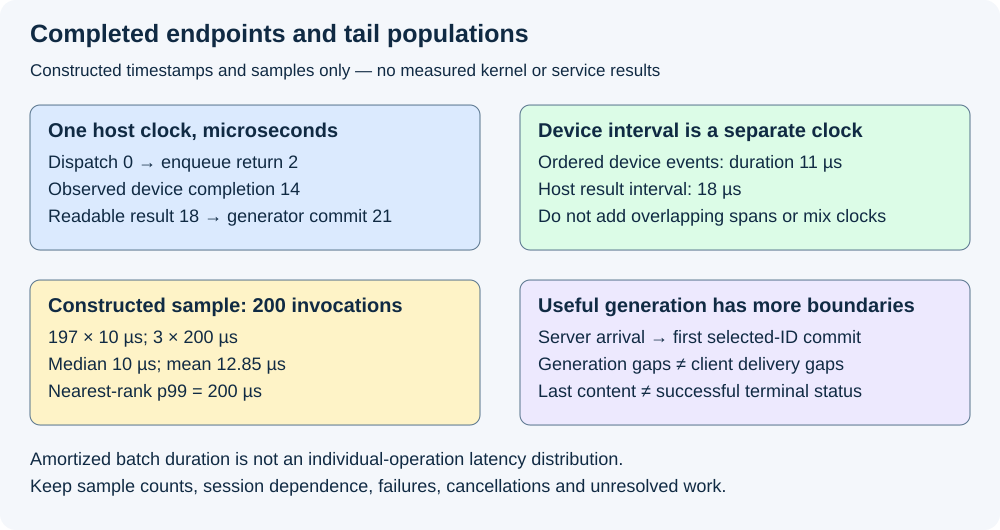

# M4-C22: Benchmarking realistic shapes and execution modes

> **Status: Complete — detailed chapter authored and documentation validated; experimental procedures are proposed unless explicitly labelled observed.**

**Module:** Understand kernels and execution overhead

**Category:** [Measurement, experimentation, and economics](index.md)

[Module 4 reading order](../module-4.md) · [Previous: M4-C21](../measurement-experimentation-and-economics/m4-c21-tuning-kernels-with-controlled-experiments.md) · [Next: M4-C23](../runtime-and-concurrency/m4-c23-integrating-a-fused-kernel-into-the-generator.md)

## Target concepts

Hidden and vocabulary dimensions, batch sizes, dtypes and layouts, fused versus unfused baselines, eager versus graph replay, launch counts, memory traffic, warmup, timing boundaries, latency distributions.

[Execution plan and progress](../chapter-execution-plan.md)

## Concepts

### 1. Benchmark the operation that actually occurs

A **benchmark case** identifies useful work, its stored inputs, execution mode, starting state and measurement boundary. “Batch 8” or “4096 elements” does not identify that case. A norm operates across hidden features; a sampler operates across vocabulary scores. Their widths, row counts, numerical contracts and dependencies differ.

Let B be active requests, S prompt positions per request in a rectangular prefill, H hidden features, V valid vocabulary IDs and R rows presented to the operation. A rectangular prefill normalization can have **R=B×S** and shape [R,H]. One-token decode normalization often has R=B. Sampling one next ID per request has shape [B,V], even if prefill normalization processed many more rows. Ragged or chunked prefill uses the actual selected valid positions, not automatically B times the longest prompt. Record valid positions and capacity separately.

As a model-derived shape anchor, [Qwen2.5-0.5B-Instruct's pinned configuration](https://huggingface.co/Qwen/Qwen2.5-0.5B-Instruct/blob/eaa56b503cc0a8a4d15de1dd8bd2a7e95a716be2/config.json) has **H=896 and V=151,936**, BF16 metadata and RMSNorm epsilon 10⁻⁶. These are shape/format facts, not evidence that a model has been loaded or timed. This chapter's LayerNorm study uses its own explicit epsilon and does not claim to reproduce that checkpoint's RMSNorm. H=4096 and V=32,768 below are additional workload probes, not additional claimed checkpoint identities.

For B=8,S=128,H=896, prefill norm has **R=1024** and **917,504 values**. At two bytes per value its input payload is **1,835,008 bytes = 1.75 MiB**. A decode sampler for the same eight requests at V=151,936 has 1,215,488 scores; FP32 input payload is **4,861,952 bytes = 4.63671875 MiB**. MiB means 2²⁰ bytes. Comparing these as “batch 8” would conceal both a different operation and a different amount of work.

This chapter follows completed [M4-C21 tuning controls](m4-c21-tuning-kernels-with-controlled-experiments.md), [M4-C20 correctness](../numerics-and-correctness/m4-c20-validating-fused-kernels-and-graph-replay.md) and [M9-C27 gates](m9-c27-designing-regression-experiments-and-validation-gates.md). It designs measurements without implementation or pseudocode. Rust remains the host-language context; native/Triton/CUDA calls retain their own asynchronous completion and ownership boundaries.

### 2. Declare a shape, dtype and layout matrix

A **dtype** specifies stored numerical representation, such as FP32, FP16 or BF16; arithmetic and output formats are separate decisions. A **layout** maps logical coordinates to addresses through strides and alignment. Faster execution on fewer bytes can reflect a changed precision contract rather than an equivalent implementation of the FP32 case.

| Matrix axis | Proposed cases and interpretation |
|---|---|
| Normalization | R∈{1,8,32}, H∈{896,4096}: six shape cells |
| Sampling | R∈{1,8,32}, V∈{32768,151936}: six shape cells |
| Floating tensor formats | Norm input/public output and sampling logits: FP32, FP16, BF16; formats qualify separately; sampling result remains a 32-bit ID |
| Layout | Contiguous rows; row pitch width+16 elements with unit feature stride; publish valid coordinates only |
| Execution | Staged eager, fused eager, staged graph, fused graph: four arms |
| Norm contract | LayerNorm, FP32 statistics/normalization/affine, stored FP32 ε=10⁻⁵, γ=1 and β=0; final output cast once to its named format |
| Sampling contract | Promote stored logits to FP32; T=1, k=8, top-p disabled; M4-C18 ties/CDF/draw/failure rules; 32-bit selected ID output |

The full factorial upper bound is **12×3×2×4=288 cases** before unsupported paths are labelled. This is a coverage matrix, not a claim that every kernel supports each format, stride or width. Any tuple selected under M4-C21 is frozen before this evaluation; extending to a new family requires correctness/resource qualification before timing. Do not retune on these evaluation observations. Norm FP16/BF16 staging and the larger vocabulary are proposed extensions; existing FP32 examples do not establish their accuracy or safety.

Generate exact quarter-valued stored inputs **x[j,v]=(((17v+11j+5) mod 19)−9)/4**. These values are representable in all three storage formats, isolating basic representation/dispatch behavior. Add separately labelled non-quarter, near-constant and extreme accepted inputs during qualification; the quarter corpus alone does not test realistic quantization error. References must begin with the actual stored bits, not an imagined unrounded source. Preserve M4-C20's range/overlap/failure checks and use the following proposed qualification gates before admitting a new format: FP32 diagnostic coordinates satisfy |c−r|≤10⁻⁶+10⁻⁵|r| against the stored-input mathematical oracle; FP16/BF16 public outputs exactly match the approved production reference cast once to that format. A cast-boundary discrepancy requires numerical-contract review or rejection, not a post-hoc tolerance relaxation.

For pitched input, specify whether both arms natively support it or both use a qualified staging adapter. Any copy/gather needed to accept the public input belongs inside the completed-operation boundary for both arms. A contiguous-only candidate must reject/fall back before submission; do not time an uncharged conversion as a pitched-kernel win. Keep optional native-kernel-only diagnostics separate from public-input acceptance costs. An invocation that uses ordinary fallback retains that outcome label; it cannot be reported as measured execution of the fused kernel.

Padding also needs a numerical contract. Rounding V=151,936 to power-of-two capacity P=262,144 creates **110,208 inactive positions per row**, with valid fraction **151936/262144≈57.958984375%**. This is an execution-position fraction, not measured memory utilization. Masked loads can avoid physical reads; padded entries must remain excluded from maxima, normalization, ranking and draws. An all-negative score row exposes a zero-padding bug. Track valid V, capacity P and actual allocated extent independently.

### 3. Four arms separate fusion from submission mode

**Eager** submission issues the operation's ordinary work for each invocation. **Graph replay** launches a prepared dependency structure. Compare both for the staged baseline and fused candidate. A graph can reduce host submission overhead while retaining the same device kernels; fusion can remove kernels or intermediate arrays even without a graph. Their benefits can overlap.

| Arm | What changes relative to staged eager | Required evidence |
|---|---|---|
| Staged eager | Preserved baseline | Same current input/output and reference behavior |
| Fused eager | Operation grouping/intermediates | Correctness, actual kernels, spills and completed time |
| Staged graph | Prepared submission/dependencies | Current binding/epoch, preparation cost and replay equivalence |
| Fused graph | Both factors | Compare against both single-factor arms, not just one total speedup |

Count **host submissions**, **device kernel launches**, copy/memset nodes and synchronization separately. One graph submission can contain several kernel launches. A graph hit is not automatically one device kernel. Match operation/request identity, current input epoch and allocation generation in every arm; repeated execution against stale input is not a valid benchmark.

*Rows, valid widths, formats and layout define useful work. The four execution arms preserve that work while separating operation fusion from submission mode.*

Each graph instance uses its admitted slot-specific bindings and one in-flight invocation per slot under this study's conservative policy. Warm every used instance with owned scratch state and checked completion. Record compile/load, capture/instantiate, optional upload, first launch and warm repeats separately. A new host pointer/scalar variable does not implicitly update the executable. Use supported checked updates or a separately prepared instance/ordinary fallback; preserve the M4-C16 lifetime/retirement rules. See [CUDA Graphs](https://docs.nvidia.com/cuda/cuda-programming-guide/04-special-topics/cuda-graphs.html).

### 4. Count logical payload, then measure real traffic

A byte ledger names arrays and passes. It is not a DRAM counter. Consider a **stipulated** three-stage normalization baseline with private FP32 intermediate Z: first read input for statistics; then read input and write normalized Z; finally read Z, apply affine and write public output. Statistics/parameters/workspace and any adapter traffic are additional. The fused ideal reads input once and writes the same public output once, preserving FP32 numerical stage semantics.

If input and output each use s bytes per element, the row-array ledger is:

**B_staged=(3s+8)RH bytes; B_fused_ideal=2sRH bytes; avoided payload=(s+8)RH bytes.**

The 8 term is one FP32 Z write plus read. Z is private: if the public interface requires it, the candidate must still materialize it. Fused reductions that reread input or spill require more than the ideal; compiled behavior and counters decide actual traffic.

At R=8,H=4096, FP32 s=4 gives **640 KiB staged versus 256 KiB ideal**, avoiding 384 KiB. Two-byte input/output gives **448 KiB versus 128 KiB**, avoiding 320 KiB. The different arithmetic-stage and output contracts still need qualification; these byte differences do not establish equivalent accuracy or a measured speedup.

For sampling, use M4-C18's explicitly scoped payload/ranking model or record the real baseline stages; do not apply the norm ledger to a sampler. Top-k/ranking/refinement, RNG/state and probability staging can dominate. Profile real read/write transactions, cache levels, passes, spills and launch counts in separate diagnostic runs. [Nsight Compute](https://docs.nvidia.com/nsight-compute/ProfilingGuide/index.html) documents counter scope, replay and cache-control effects; a profiler can change execution. Clean timing remains separate from counter collection.

### 5. Warmup and completed timing need explicit endpoints

For each admitted case/arm/block, use 50 completed scratch warmups, grouped into five groups of ten; a >2% difference between the final two group medians flags incomplete/unstable evidence under this frozen design. Retain the run and follow M9-C11's reset/invalid-session policy. Fifty is a protocol choice, not proof of a stable clock/cache or adequate preparation of an unused specialization. The [PyTorch benchmark documentation](https://docs.pytorch.org/docs/2.14/benchmark_utils.html) illustrates warmup, replicate, thread-control and asynchronous synchronization responsibilities; they also apply to a Rust-owned harness.

Measure two primary operation endpoints separately: **completed device interval**, using ordered device events around all required device work, and **host operation interval**, from dispatch/eligibility through safely readable result at the declared host boundary. Device-event and host timestamps use different clock domains; compare durations, never subtract one clock's absolute timestamp from another. A host return measures enqueue latency only unless completion is guaranteed. State whether input staging/output transfer is included; public pitched-input acceptance includes required staging.

A constructed host-clock timeline has dispatch at 0 µs, enqueue return at 2, observed device completion at 14, safely readable result at 18 and generator commit at 21. Host enqueue is 2 µs, host result interval 18 µs, and committed-result interval 21 µs. A separate ordered device-event duration might be 11 µs. These spans overlap and have different endpoints: summing 2+11+18 is invalid. A batch of many operations timed between two events measures amortized throughput-like per-operation cost, not the latency distribution of individual operations.

*Report endpoints, clock domains and populations. A fast enqueue, low median or amortized batch duration cannot replace a completed-operation or request-tail measurement.*

### 6. Distributions, useful work and generation phases

For a sorted sample of n individual completed latencies, this chapter uses nearest-rank quantiles **Q(p)=x_(ceil(pn))** for 0<p≤1; the ordinary median separately averages the central pair for even n. Record the convention with n and the per-session grouping. Do not average per-cell p99 values and call the result a mixture p99.

In a constructed 200-invocation sample with 197 times of 10 µs and three of 200 µs, ordinary median is **10 µs**, mean **12.85 µs**, nearest-rank p95 **10 µs**, p99 **200 µs** and maximum **200 µs**. Three slow observations expose a tail that the median hides. These are teaching counts, not device measurements; such a small sample does not establish a stable production p99. Preserve correlated sessions and use M9-C07 uncertainty appropriate to the endpoint.

Microkernel rows/second is **completed useful valid rows / elapsed seconds** over a stated interval, not request throughput or accepted output tokens/second. Compare identical valid work and count failed/cancelled/unresolved invocations. An arm that silently drops large rows is not faster equivalent service. Keep per-shape results; weight aggregates using a predeclared workload mix, and report unsupported/fallback populations rather than excluding them.

Connect kernel work to generation without merging boundaries. Completed [M9-C03](m9-c03-measuring-time-to-first-token-including-queueing.md) defines server selected-ID TTFT from server arrival to first ID commit. [M9-C04](../interfaces-protocols-and-streaming/m9-c04-measuring-inter-token-latency-in-a-streamed-protocol.md) distinguishes generation gaps, write acceptance and client parsed-ID availability. [M9-C05](m9-c05-measuring-end-to-end-latency-and-throughput.md) separates last content, successful terminal status and useful rates. Text chunks are not automatically token events.

A prefill norm improvement may affect first-selection time, while a per-step sampler change may affect decode gaps; both depend on the actual critical path. Keep arrival/admission, prefill, decode, output transfer, stop/decode and publication evidence. A selected EOS can produce no visible text. Server first-ID timing and client first-content timing remain separate even when both are called TTFT by different tools. The [NVIDIA benchmarking article](https://developer.nvidia.com/blog/llm-benchmarking-fundamental-concepts/) provides useful metric context; inspect its tool endpoints before equating them with these curriculum definitions.

## Experiments

All four experiments are proposed. Authoring evidence comprises exact numerical/reference calculations, document checks and rendered review. No model, kernel, graph, profiler or service benchmark was executed for this chapter.

### E1 — Shape provenance and format/layout qualification

- **Name:** Establish what every case means.
- **Description:** Construct the 12-shape matrix and label each dtype/layout/arm as qualified, unsupported or needing an adapter.
- **Purpose/objective:** Predict that row count, padding and format/layout changes alter both resources and correctness obligations.
- **Target concepts:** Hidden/vocabulary dimensions, batches, dtypes/layouts and supported input families.
- **Baseline:** Stored-input mathematical/production references and M4-C20 gates; pinned model metadata anchors shape choice only.
- **Workload:** R=1/8/32 with H=896/4096 or V=32768/151936, three storage formats, contiguous/pitched rows, quarter-value corpus plus separate near-constant/extreme/tie/padding qualification cases. Sampling supplied uniforms follow M9-C27's invocation-owned midpoint grid. Add B=8,S=128 prefill row-count accounting and awkward width 897/151937 as separate eligibility probes, not silently timed members of the main matrix.
- **Controlled variables:** Stored bits, numerical/output format, epsilon/policy/tie/draw rules, valid versus capacity extent, public outputs, overlap, masks and adapter boundaries. New format tolerances require prior numerical review.
- **Hardware requirements:** CPU for metadata/accounting/reference QA; actual compatible dtype/device/compiler and sanitizer support for candidate qualification. Cap fixture storage at 256 MiB each for host/device, excluding separately reported model/tool overhead; measure workspace and reject oversized cases.
- **Exit criteria:** Case manifest and useful-coordinate counts reconcile; every timed case passes value/exact-state/safety gates first. Unsupported cases are explicit rejection/fallback evidence; no format or layout is assumed valid from FP32 contiguous results.

### E2 — Broad four-arm benchmark matrix

- **Name:** Fusion versus prepared submission.
- **Description:** Compare all qualified members of the 288-case upper-bound matrix without retuning or selecting a winner on the results.
- **Purpose/objective:** Predict fewer intermediate writes/kernels from fusion and lower host submission cost from graphs, with shape-dependent resource/tail effects.
- **Target concepts:** Fused/unfused baselines, eager/replay, launches, warmup, timing and distributions.
- **Baseline:** Frozen staged eager plus staged graph and fused eager controls; preserve the numerical contract for fused graph.
- **Workload:** Five complete four-arm blocks per shape/dtype/layout family, 50 scratch warmups and 200 individually completed measured invocations per arm/block. Archive a balanced four-arm order and state/reset protocol. At full eligibility this is 360,000 invocations: 72,000 warmups and 288,000 measurements. Disabled/unsupported arms retain a labelled manifest entry rather than fabricated timings.
- **Controlled variables:** Same inputs, selected draws, useful work, reference/binary, device conditions, graph-slot identities and reset state; scratch warmup cannot mutate live generation state. Separate compiler/capture/first-use and validation costs from warm timing.
- **Hardware requirements:** Qualified device/runtime with event and host timing, supported graph operations and resource visibility; process cases sequentially inside E1's fixture budget and record all retained graph/binary storage.
- **Exit criteria:** Correct completed outputs and ownership for all accepted arms, reconciled per-cell latency/sample/outcome and launch counts. Results are exploratory/descriptive; five blocks and 288 cases do not create simultaneous promotion evidence or a reliable service p99.

### E3 — Frozen claims and traffic explanation

- **Name:** Confirm named gains without hiding guard regressions.
- **Description:** Evaluate four predeclared FP32 contiguous cells on fresh sessions, while collecting separate matched diagnostic traffic/launch evidence.
- **Purpose/objective:** Test ≥5% primary median-session gain with ≤2% guard regression budgets, and explain whether the intended movement/submission changes occurred.
- **Target concepts:** Launch/traffic attribution, protected workloads, clean timing and numerical/decision gates.
- **Baseline:** Staged eager versus frozen fused-graph candidate; single-factor arms from E2 explain overlap but do not replace the baseline. Freeze candidate and these claims before E2 observations; no tuning on the matrix.
- **Workload:** Primary R=1,H=896 LayerNorm; guards R=32,H=4096 LayerNorm, R=1,V=151936 k=8 sampling, R=32,V=151936 top-p=0.9 with top-k disabled. T=1 in sampling. Twenty independent paired sessions per cell, 50 warmups/200 measurements per arm/session, ten AB and ten BA orders; 40,000 invocations including 8,000 warmups. One separate matched trace and resource/counter profile per admitted representative arm/cell.
- **Controlled variables:** Frozen references/policies and supplied draws; warmup stability and no optional stopping per M9-C27, per-invocation completion, graph bindings and machine state. The top-p guard is an explicitly qualified policy extension, not an unnoticed change to E2's k=8 family.
- **Hardware requirements:** Qualified device/graphs plus diagnostic tool support, actual binary/resource/traffic manifests; no advertised bandwidth substitutes for measured elapsed time or counter scope.
- **Exit criteria:** M4-C20 hard gates and M9-C27's fixed 20-session [5th,16th] interval: primary upper median-ratio bound ≤0.95, all guard uppers ≤1.02 under its stated assumptions/four-claim scope. Failure blocks the scoped claim; overlap is inconclusive; incomplete evidence cannot pass. Reconcile logical payload with actual stages/passes/spills and retain unsupported diagnostics. No inference about request p99 from these intervals.

### E4 — Phase-aware useful-generation comparison

- **Name:** From rows to first token, gaps and terminal outcomes.
- **Description:** Map qualified operation families into a proposed complete-generator study, separating prefill/decode and server/client observations.
- **Purpose/objective:** Predict that local wins matter only when they reduce the relevant completed dependency path without increasing failures, waits or output costs.
- **Target concepts:** Realistic rows, service timing boundaries, useful throughput and latency distributions.
- **Baseline:** Same checkpoint/tokenizer/adapter and exact generation policy using the validated ordinary path; microkernel shape metadata alone is insufficient model identity.
- **Workload:** M4-C18's versioned 32-prompt corpus, concurrency 1/8/32, five paired corpus blocks per condition with fixed token IDs/caps and offered arrivals. Record actual prefill rows, active decode rows and per-request selected/emitted IDs. Separate graph-miss/cold-start, burst, cancellation and slow-output stress cohorts; do not mix them into warm-only samples without a named population.
- **Controlled variables:** Same model/output/stopping and request-owned randomness; M9-C03/04/05 server/client endpoints and clock domains; hardware/state/reset/arrival schedule. Any adapter, fallback, output transfer and publication cost stays at its declared boundary.
- **Hardware requirements:** Actual model capacity plus workspace/headroom, host/device/stream traceability and protocol events capable of distinguishing token IDs from text chunks. If unavailable the study remains proposed.
- **Exit criteria:** Exact-output/state gates and all request outcomes reconcile. Report arrival-based first-ID and first-content endpoints separately, eligible generation/client gaps, terminal latency, useful token/request rates, counts and dependence-aware uncertainty. Service promotion needs separately frozen service budgets; a microstudy pass alone supplies none.

## Verification

### Matched measurements and acceptance

| Experiment | Evidence | Gate and scope |
|---|---|---|
| E1 | Pinned shape/format manifest, stored-input references, masks/strides/allocation bounds, numerical and exact-state checks | Only qualified cases timed; model metadata is shape provenance, not measured model execution |
| E2 | Four-arm current-epoch results, cold/warm state, completed device/host samples, launch/submission counts and all outcomes | Same valid work and boundary in every comparison; broad matrix remains descriptive |
| E3 | Fresh fixed-family paired ratios/bounds, separate trace/counters, actual pass/traffic/spill/resource ledgers | Hard correctness then all four formal gates; payload ideal and measured transactions remain distinct |
| E4 | Request/token/attempt identity, phase/clock events, actual active rows and server/client outcomes | Useful service and tail populations preserved; no token count inferred from arbitrary chunks |

Independent authoring QA checks row/value/payload counts, matrix/protocol totals, padding fraction, three-stage traffic formulas, endpoint arithmetic and the constructed quantile sample. These exact checks do not execute the proposed candidate, qualify new dtypes/layouts or establish hardware performance. Keep diagnostic and clean timing identities separate. Use M9-C11 for paired resets, M9-C12/C13 for trace/counter effects, M9-C15 for memory scope, M9-C16 for hardware and M9-C17 for numerical acceptance.

A benchmark report must retain unsupported, failed, cancelled and unresolved populations. If a graph update or device attempt may have taken effect, recovery needs current completion/publication accounting before retry; no duplicate sampling commit or immediate reclamation on caller cancellation. Preserve old baseline artifacts and held-out manifests so a future compiler or operation change can be requalified against the same scope.

## Engineering dimensions and principles

### Six dimensions applied to realistic benchmarking

| Dimension | Chapter-specific evidence |
|---|---|
| Semantics and invariants | Norm versus sampling, stored formats, private/public intermediates, valid masks and exact token/draw/commit gates |
| Workload and variability | R differs from B during prefill; wide vocabulary, awkward tails, active-row changes and output stalls need named populations |
| Resources and bottlenecks | Count real stages/adapter traffic, graph retention, spills and allocator/workspace costs rather than only ideal bytes |
| Time and distributions | Device completion, host result, generation commit and client content are separate endpoints; median does not establish p99 |
| Ownership and coordination | Graph slots, current epochs, request-owned uniforms and final readers remain valid through asynchronous completion |
| Failure and adaptation | Unsupported format/layout safely rejects/falls back; misses, cancellation and unknown completion remain in outcome accounting |

### Eight practical principles

| Principle | Benchmark consequence |
|---|---|
| 1. Correctness defines the boundary | New dtypes, larger widths and top-p guards need prior qualification; a fast invalid arm cannot win |
| 2. Performance depends on operating point | Twelve shape cells, precision/layout extensions and four modes preserve per-family regressions |
| 3. Data movement is part of algorithm | Private FP32 Z gives (3s+8)RH baseline bytes; actual passes, adapters and spills decide measured traffic |
| 4. State has ownership/lifetime/recovery cost | Preparation, retained graphs, request draws and output consumers are included in their true scopes |
| 5. Dependencies determine latency; bottlenecks capacity | A graph submission can launch many kernels; completed critical paths and host/device resource limits matter |
| 6. Variability and synchronization shape tails | Three slow observations can dominate p99 while median stays 10 µs; preserve session dependence and stress cohorts |
| 7. Local gains need end-to-end evaluation | Prefill rows/second is not token throughput; first selection, decode gaps and terminal status need separate service evidence |
| 8. Claims require reproducible evidence | Freeze identities, cases, modes, endpoints, controls and formal-family scope; retain unsupported and inconclusive evidence |

The HFT lens emphasizes representative message sizes, bursts, first-use preparation, bounded queues and externally useful completion. A favorable average on a small hot path can conceal the slow workload that matters operationally. These systems lessons transfer to inference; the text/model fixtures do not establish financial-decision correctness, trading performance or hard real-time guarantees.

## Specifications, articles, and hardware

| Primary source | Use and boundary |
|---|---|
| [Pinned Qwen2.5-0.5B-Instruct configuration](https://huggingface.co/Qwen/Qwen2.5-0.5B-Instruct/blob/eaa56b503cc0a8a4d15de1dd8bd2a7e95a716be2/config.json) | H=896/V=151936 shape anchor and separate model norm/format metadata; no transferred benchmark result |
| [PyTorch 2.14 benchmark reference](https://docs.pytorch.org/docs/2.14/benchmark_utils.html) | Warmups, replicates, thread control and accelerator synchronization responsibilities |
| [CUDA Graphs specification](https://docs.nvidia.com/cuda/cuda-programming-guide/04-special-topics/cuda-graphs.html) | Preparation, dependency and replay/update semantics |
| [Nsight Compute profiling guide](https://docs.nvidia.com/nsight-compute/ProfilingGuide/index.html) | Counter/replay/cache scope and instrumentation effects |
| [NVIDIA LLM benchmarking article](https://developer.nvidia.com/blog/llm-benchmarking-fundamental-concepts/) | Metric context; exact curriculum server/client endpoints are stated locally |

Sources checked 2026-10-28. No GPU or model was executed. Pin actual installed runtime/compiler/tools and model artifacts when conducting the proposed studies.

| Hardware/specification area | Required manifest |
|---|---|
| Host | CPU/NUMA/affinity, OS/kernel, Rust/native/framework/allocator versions, clocks/timers and competing load |
| Device/interconnect | GPU architecture/model/UUID/partition, memory/SM/resource limits, FP16/BF16 capability, clocks/power/thermal state and PCIe/NVLink paths |
| Operation | Norm/sampling policy, R/H/V/P, dtype/accumulation/output, strides/alignment, private/public arrays, binary/compiler and graph instances |
| State/resources | Model/tokenizer/template/adapter and EOS/caps, warm/cache/preparation state, workspace/live/reserved/retained bytes and slot generations |
| Evidence | Corpus/arrival/session order, reference and draw identities, event/clock endpoints, profiler settings, outcomes and uncertainty method |

## Key takeaways

A realistic case starts with actual useful rows, valid widths, stored formats and public interfaces. Separate fusion from prepared submission, payload models from transactions, and completed device work from useful request delivery. Report the operating points, tails and failures that limit the claim.

## Continue learning

Next in Module 4 reading order is [M4-C23: Integrating a fused kernel into the generator](../runtime-and-concurrency/m4-c23-integrating-a-fused-kernel-into-the-generator.md). The next authoring chapter is [M5-C18: Choosing chunk sizes and balancing prefill with decode](../scheduling-and-queueing/m5-c18-choosing-chunk-sizes-and-balancing-prefill-with-decode.md), position 125. Follow the [execution plan and progress tracker](../chapter-execution-plan.md). Only M4-C22 is authored in this step.
