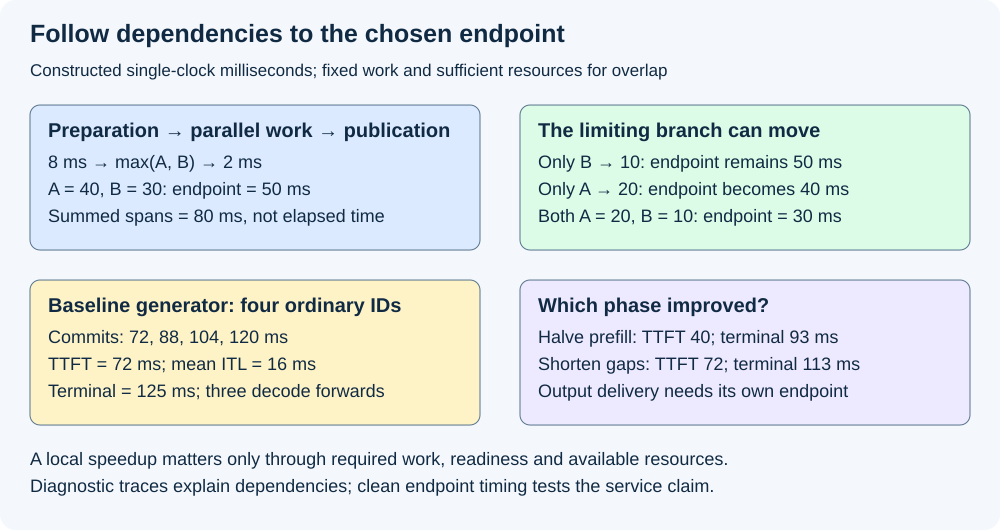
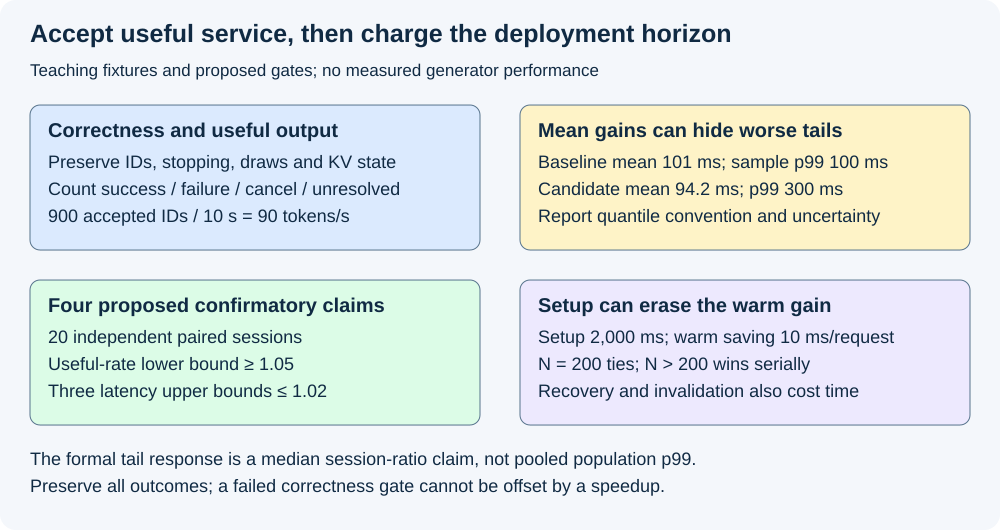

# M4-C24: Verifying end-to-end generator improvements

> **Status: Complete — detailed chapter authored and documentation validated; experimental procedures are proposed unless explicitly labelled observed.**

**Module:** Understand kernels and execution overhead

**Category:** [Measurement, experimentation, and economics](index.md)

[Module 4 reading order](../module-4.md) · [Previous: M4-C23](../runtime-and-concurrency/m4-c23-integrating-a-fused-kernel-into-the-generator.md)

## Target concepts

Critical-path attribution, Amdahl-style speedup limits, prefill and decode separation, time to first token, inter-token and total latency, useful throughput, correctness gates, amortization, tail regressions.

[Execution plan and progress](../chapter-execution-plan.md)

## Concepts

### 1. A generator improvement preserves useful work

A faster normalization or sampling kernel is a local result. A generator improvement delivers the required output, with its correctness and failure contracts intact, at a better service operating point. Begin with [generator latency and correctness](m1-c20-measuring-and-explaining-generation-latency.md), [integration obligations](../runtime-and-concurrency/m4-c23-integrating-a-fused-kernel-into-the-generator.md) and [regression acceptance](m9-c27-designing-regression-experiments-and-validation-gates.md). This chapter closes Module 4 with an evidence chain from an eligible optimization to useful completed generation. It provides no implementation or pseudocode.

Hold the model revision, tokenizer, prompt tokens, generation policy, random identities, stopping rules, output contract and admitted optimization family fixed. A candidate that silently stops earlier performs different work. Compare controlled-prefix logits with the qualified numerical policy, then compare free-running token histories and terminal reasons under the declared equivalence contract. At the first divergent ID, subsequent prefixes differ; comparing later logits as if they had the same input is misleading. An intentional approximation needs its own quality acceptance study; a speed claim cannot silently introduce one.

For prompt length P and g≥1 selected IDs, ordinary cached generation requires one prefill and g−1 decode forwards. EOS terminates without an additional EOS forward. A zero-generation request needs its explicitly declared outcome, with no invented first-token observation. Preserve processed KV length, request-owned draws and one-time selection commits from M4-C23. Count failed, cancelled, rejected and unresolved requests even when their latency cannot enter a successful-completion percentile.

The Rust host coordinates readiness, selection, commit and output; CUDA/Triton execution can accelerate eligible device work. The host/native boundary still owns error attribution and final users. A shorter enqueue call does not establish earlier completed output or safe resource reclamation.

### 2. Dependencies determine the critical path

A **critical path** is the longest chain of required dependencies to the chosen endpoint. Parallel activity contributes its required completion time, not the sum of all its spans. Consider a constructed single-clock graph: preparation takes 8 ms; independent branches A and B then take 40 and 30 ms; publication waits for both and takes 2 ms.

**T = 8 + max(A,B) + 2 = 50 ms.**

| Intervention, all other assumptions fixed | A, B (ms) | Endpoint (ms) | Interpretation |
|---|---:|---:|---|
| Baseline | 40, 30 | 50 | A is the limiting branch |
| Accelerate B | 40, 10 | 50 | Local gain is hidden behind A |
| Accelerate A | 20, 30 | 40 | The critical branch moves to B |
| Accelerate both | 20, 10 | 30 | Both improvements become useful |

Summing baseline spans gives 80 ms, which is not this endpoint's elapsed time. This prediction assumes actual independence, unchanged readiness and sufficient resources for overlap. Shared memory bandwidth, stream serialization or host contention can change the graph's effective durations. A profiler identifies plausible paths; a controlled intervention with completed endpoint timing supplies stronger causal evidence. Collect diagnostic traces separately because tracing changes overhead.

For a serial critical-path model, let f be the fraction of baseline elapsed time affected and s its local speedup, with s≥1. [NVIDIA's Amdahl discussion](https://docs.nvidia.com/cuda/cuda-c-best-practices-guide/index.html#amdahl-s-law) gives the familiar limit:

**S = 1 / [(1−f) + f/s].**

With f=0.20 and s=2, predicted elapsed time is 0.90 of baseline and speedup is 1.111…; infinitely fast affected work gives at most 1.25. An added integration cost δ changes the model to **Tnew = Told[(1−f)+f/s] + δ**. At Told=100 ms and δ=12 ms, the candidate takes 102 ms and loses. Do not insert the fraction of summed overlapping kernel durations into f. This conditional model neither predicts loaded capacity nor bounds p99 queueing latency.

*The longest required branch determines the constructed endpoint. Prefill and decode improvements affect different parts of generation; the numbers are teaching fixtures, not measurements.*

### 3. Split prefill, selection, decode and publication

A **prefill** processes the input prefix; a **decode forward** processes a pending generated token. The first committed selected ID and first client-visible content can occur at different times. Define endpoints before measuring, following Module 9's timing contracts. [NVIDIA's benchmarking article](https://developer.nvidia.com/blog/llm-benchmarking-fundamental-concepts/) discusses first-token latency, inter-token latency and throughput; this chapter always labels the particular observation boundary.

In a constructed server-clock example, arrival is 0 ms, input is ready at 6, prefill runs from 6 to 70, and first selection commits at 72. Four ordinary IDs commit at **[72,88,104,120] ms**. The request stops at its fixed four-ID limit, and terminal publication completes at 125. There is one prefill and three decode forwards. All four IDs are eligible output under this fixture's contract.

**Selected-ID TTFT = first commit − arrival = 72 ms.**

**Mean selected-ID ITL = (last commit − first commit)/(g−1) = 48/3 = 16 ms.**

**Server terminal latency = 72 + 3×16 + 5 = 125 ms.**

ITL means inter-token latency; it is undefined for fewer than two selected IDs, rather than zero. A mean gap hides individual stalls. Report the gap distribution and number of eligible requests/gaps. Client-visible content requires its own endpoint: tokenizer buffering, transport and client scheduling can add delay. A client terminal duration measured on the client's clock must not be assembled by subtracting unrelated server and device timestamps.

| Constructed intervention | Committed-ID times (ms) | Selected TTFT | Mean selected ITL | Server terminal |
|---|---|---:|---:|---:|
| Baseline | 72,88,104,120 | 72 | 16 | 125 |
| Halve only 64-ms prefill | 40,56,72,88 | 40 | 16 | 93 |
| Reduce only decode gaps to 12 ms | 72,84,96,108 | 72 | 12 | 113 |

These additive examples hold all other work fixed and omit contention. They explain why a prefill gain need not improve ITL, and why a decode gain need not improve TTFT. Report prompt/output length strata, concurrency and cache state; a single blended number conceals these differences. In loaded service, arrival-to-start queueing belongs to user latency even if device execution is unchanged.

### 4. Useful throughput needs an outcome ledger

Let W be a fixed observation window in seconds. Declare the numerator: selected IDs, published bytes, successful completed requests and accepted output IDs are different units. For this teaching ledger, useful tokens are eligible output IDs belonging to successful requests that start and finish inside the window; partial failed/cancelled output is excluded by policy. Begin empty, preserve unresolved requests at the cutoff, and do not rename this quantity steady-state capacity.

Over W=10 s, suppose 100 offered requests partition into 90 successful, 4 failed, 3 cancelled and 3 unresolved. Successful results contain 900 accepted output IDs. Then **successful completion rate=90/10=9 requests/s** and **useful completed-output rate=900/10=90 tokens/s**. The conservation check is **100=90+4+3+3**. Rejections, if permitted, need another explicit category; retries need attempt-to-logical-request identity.

A candidate with 80 successful, 12 failed, 3 cancelled and 5 unresolved requests and 880 accepted output IDs achieves 88 useful tokens/s. Even if its device selects 1,100 IDs, advertising 110 selected IDs/s does not establish improved useful output. For a correctness-preserving optimization study, new failures already violate the gate. Record token/output length distributions and terminal reasons so shorter answers or hidden drops cannot create an apparent gain.

Closed-loop clients wait for replies before issuing more work and can reduce offered load when service slows. An open-loop arrival schedule exposes overload differently. Label arrival process, client concurrency, timeout/retry policy, admission, queue capacity and drain interval. Module 5 will develop scheduling; here the baseline and candidate must share a specified operating point. Never infer maximum capacity from one uncongested single-request latency.

### 5. An average win can hide a tail regression

A **percentile** describes an ordered population, and p99 is its 99th percentile. For this descriptive fixture use nearest rank **ceil(0.99n)**, with one-based order statistics and n=1,000 completed requests.

| Constructed latency distribution | Mean | Median | Nearest-rank p99 |
|---|---:|---:|---:|
| Baseline: 990 at 100 ms; 10 at 200 ms | 101 ms | 100 ms | 100 ms |
| Candidate: 980 at 90 ms; 20 at 300 ms | 94.2 ms | 90 ms | 300 ms |

The candidate's mean improves by about 6.73%, while its sample p99 triples. The 990th sorted candidate observation is 300 ms. These exact descriptions do not establish population-tail confidence. Report sample sizes, quantile convention, repeated sessions and uncertainty; do not average percentiles and call the result the pooled request percentile. Retain queueing, graph misses, allocation, synchronization, thermal changes and host stalls as possible mechanisms until an intervention tests them.

A proposed confirmatory study follows [M9-C27](m9-c27-designing-regression-experiments-and-validation-gates.md): freeze four claims before observing outcomes. For each independently reset paired session, derive positive candidate/baseline ratios for useful completed-output rate, median request TTFT, median per-request mean ITL among eligible requests, and within-session request p99 terminal latency. The population estimand for each claim is the **median of paired-session ratios**, including the p99-response claim; it is not the pooled population request p99.

With 20 independent paired sessions and the continuous unique-median assumptions in M9-C27, sorted ratio interval **[r(5),r(16)]** covers its population median with probability **0.98818206787109375**. A four-claim union bound gives joint coverage at least **0.952728271484375**. Dependence between the four responses does not invalidate that bound; independent comparable sessions and the stated marginal assumptions still matter. Discrete ties or persistent drift require a justified alternative, not an automatic confidence label.

For this proposed study require the throughput interval's lower bound ≥1.05 and all three latency interval upper bounds ≤1.02. These are teaching acceptance margins to freeze before execution, not established production SLOs. All exact correctness/state gates must also pass. An inconclusive interval means no accepted improvement; do not keep adding sessions until the desired result appears. A session p99 guard does not replace a separately designed production request-tail SLO study.

*Correctness, useful output, latency guards and deployment horizon are separate gates. None of the constructed numbers is a measured generator result.*

### 6. Charge preparation to its deployment horizon

A graph, compiled artifact or prepared workspace can reduce warm request cost but add startup cost. Let C be candidate-only setup in ms, b baseline ms/request, w warm candidate ms/request and d additional per-request integration cost. For serial identical requests, **N(b−w−d)>C** is the condition for a strict total-time gain. If b≤w+d there is no positive break-even horizon in this model.

Use b=125, w=113, d=2 and C=2,000 ms. The saving per warm request is 10 ms; **N=200 ties**, and N>200 wins. At N=100, baseline total is 12,500 ms and candidate is 13,500 ms. At N=1,000, totals are 125,000 and 117,000 ms. Include failed preparations and recompilation in actual deployment cost. These serial sums do not model concurrent overlap: for concurrent service, measure the full deployment/cohort horizon including preparation and drain.

Cold start, scratch warmup, steady operation and recovery are different regimes. Prepared state has an owner and lifetime; invalidation and worker replacement may destroy its amortization. Cancellation is not device completion. Keep the M4-C23 retirement rules through fault tests; a lost completion record cannot authorize blind replay or storage reuse.

## Experiments

All experiments below are proposed. Only arithmetic/reference checks, document validation and rendered review are observed during chapter authoring. No kernel, generator, profiler or production service is executed.

### E1 — Preserve the generator and test the dependency model

- **Name:** Same work, explicit critical path.
- **Description:** Qualify the integrated candidate, then compare the constructed dependency predictions with separate diagnostic traces of a future generator.
- **Purpose/objective:** Establish that a local acceleration changes the required endpoint only through a valid dependency/resource path.
- **Target concepts:** Correctness gates, critical-path attribution and Amdahl limits.
- **Baseline:** Qualified ordinary path, M1-C20 reference and M4-C23 integration contract; teaching A/B graph above.
- **Workload:** Frozen prompts with zero/one/four selected-ID limits, EOS, long prefill and long decode; each admitted dtype/layout/shape separately qualified. Exercise all four teaching A/B interventions.
- **Controlled variables:** Model/tokenizer revisions, token inputs, numerical/tie/random policies, forwards, output/stop semantics, clock boundaries and artifact versions. Single-feature interventions precede combinations.
- **Hardware requirements:** CPU for exact fixture QA; later one fully recorded supported GPU/host stack and a diagnostic profiler run separate from acceptance timing.
- **Exit criteria:** No unexplained reference/state/trajectory/terminal divergence; teaching endpoints 50/50/40/30 ms and Amdahl arithmetic reproduce. Runtime traces reconcile required edges and completed endpoints; unexplained mismatch blocks attribution.

### E2 — Attribute phase changes at fixed operating points

- **Name:** Prefill, decode and delivery separately.
- **Description:** Compare ordinary/fused eager and their eligible graph arms, using M4-C22's qualified families, with timestamped phase and endpoint records.
- **Purpose/objective:** Identify which service endpoint benefits and where movement, launch or publication offsets a local gain.
- **Target concepts:** TTFT, ITL, total latency, prefill/decode separation and end-to-end evaluation.
- **Baseline:** Ordinary eager generator under the same policy; additional arms only when independently qualified.
- **Workload:** A frozen 32-prompt corpus stratified by short/long input and output, with exact token IDs and per-request limits in the experiment manifest. Explore concurrency 1,8,32 separately; no cross-cell blended claim.
- **Controlled variables:** Arrival schedule, admission/output policy, allocation/cache state, warmup, random identities, CPU affinity, device settings and first/last/terminal observation boundaries. Tracing runs cannot supply clean acceptance timings.
- **Hardware requirements:** Dedicated supported accelerator, recorded host/memory/interconnect and isolated client; device events and host/client monotonic clocks with their domains labelled.
- **Exit criteria:** All arms pass E1; fixture TTFT/ITL/terminal values reproduce; measured phase ledgers explain endpoints within documented clock resolution/measurement uncertainty. Report every cell, missing observation and unsupported arm; no benefit inferred from enqueue or summed overlapping spans.

### E3 — Confirm useful service under fixed claims

- **Name:** Throughput gain with latency guards.
- **Description:** Freeze one candidate versus baseline at concurrency 8 and execute the four-claim paired-session design above.
- **Purpose/objective:** Accept a useful service improvement only with preserved outcomes and guarded latency responses.
- **Target concepts:** Useful throughput, correctness, tail regressions and reproducible acceptance.
- **Baseline:** Frozen qualified ordinary generator, same model/corpus/outputs and complete cohort drain endpoint.
- **Workload:** Twenty independent paired sessions. Per arm/session use two complete scratch warmup replays of the 32-prompt corpus (64 requests), then ten measured replays (320 requests). Totals: 2,560 warmup and 12,800 measured attempts across both arms. The formal corpus has positive output limits and no zero-generation requests; zero-generation cases remain E1 checks. Use server selected-ID TTFT/ITL and server terminal latency throughout these formal responses; client delivery is reported separately in E2. Corpus must include ITL-eligible requests; freeze all token limits before execution. No retries are hidden.
- **Controlled variables:** Reset/preparation policy, preassigned balanced arm order, corpus replay/arrival schedule, warmup stability rule (compare median completed request latency in the two scratch replays; a relative change over 2% flags instability and blocks acceptance without replacing that session), four responses/margins and all invalid-session handling. Useful rate counts accepted output IDs of successful measured-cohort requests divided by first-offer-to-final-required-terminal elapsed seconds, including drain. Failure or unresolved drain invalidates acceptance rather than silently shrinking a cohort.
- **Hardware requirements:** Same reserved host/GPU/client installation per pair; independent reset sessions and adequate monitoring of clocks, thermal/power state and competing activity. If comparable sessions cannot be obtained, report that limitation.
- **Exit criteria:** E1 passes for every measured cohort; all sessions/outcomes retained; predeclared stability and comparability rules pass; throughput lower bound ≥1.05 and each latency upper bound ≤1.02. Report order statistics, samples and the median-session estimands. Missing/invalid evidence or failed guards blocks acceptance; exploratory E2 arms do not expand these four formal claims.

### E4 — Test tails, failure and the preparation horizon

- **Name:** Keep the win through deployment and recovery.
- **Description:** Examine cold and warm horizons, bounded overload and isolated fault cases without blending them into E3's clean study.
- **Purpose/objective:** Find startup, synchronization, recovery or outcome costs hidden by warm averages.
- **Target concepts:** Amortization, tail regressions, ownership and failure adaptation.
- **Baseline:** Same validated ordinary deployment and declared overload/cancellation policy; constructed 1,000-request and break-even fixtures.
- **Workload:** N=100,200,1,000 serial teaching horizons; later measured cold/warm equivalents; separate controlled arrival bursts, graph miss/rebuild, delayed completion, cancellation before/after commit and delivery failure after selection. Inject faults on isolated scratch requests using supported controls.
- **Controlled variables:** Horizon boundaries, setup/invalidation charges, arrival intensity, admission/queue limits, fault identity/time, completion authority and outcome categories. Do not mix fault distributions into nominal percentile claims or delete failures.
- **Hardware requirements:** Recorded recovery-capable test worker, diagnostic events and host/output observers; no deliberate unsafe reuse or production disruption required.
- **Exit criteria:** Exact fixture means/p99s and N=200 tie reproduce. Measured deployment totals include preparation/drain; errors retain identity and final-user claims, unknown completion remains unresolved/quarantined, and post-commit delivery failure never resamples. Publish capacity/tail limitations and reject deployment claims beyond tested horizons/load.

## Verification

| Experiment | Reference and invariants | Measurement / benchmarking | Profiling and acceptance evidence |
|---|---|---|---|
| E1 | Fixed prefixes, numerical contract, exact eligible trajectory and stops; KV/draw/commit/retirement accounting | A/B endpoints and Amdahl arithmetic; separately completed generator endpoint | Required dependency edges and single-feature ablations; diagnostic overhead excluded from acceptance timings |
| E2 | Same useful work across qualified arms; no invalid graph/binding/fallback | Phase durations, TTFT, all eligible gaps, per-request ITL summary, terminal latency, prompt/output strata | Device/host/output boundaries; transfers, synchronization and contention; overlapping spans never added as elapsed time |
| E3 | All measured-cohort results valid; statuses conserved; no hidden retries/drops | 20 paired sessions, four fixed responses, [5th,16th] ratio intervals and declared margins; cohort drain included | Clean timing plus separate diagnostic reproductions; preserve raw sessions, order, exclusions and unresolved evidence |
| E4 | Cancellation is not completion; forward/selection/delivery boundaries retained | Cold/warm total horizons, outcome ledger, overload curve and separate fault/tail reports | Rebuilds, queue waits, thermal/host stalls and final users; no unmeasured production-tail or recovery claim |

Keep a claim record with workload/operating point, artifact hashes, exact numerator/denominator, clock endpoint, correctness gate, sample unit, uncertainty method, result and limitations. An evidence bundle needs raw request/attempt identities, status and token counts, phase/timing records, manifest and independently repeatable calculations. Device utilization and kernel time explain mechanisms; they are not substitutes for accepted output and user endpoints. Use the [Nsight Systems guide](https://docs.nvidia.com/nsight-systems/UserGuide/index.html) to plan focused annotated diagnostic captures, with a separate uninstrumented acceptance run.

## Engineering dimensions and principles

| Dimension | Chapter-specific application |
|---|---|
| Semantics and invariants | Keep the same model/policy, processed prefix, draws, selected IDs and terminal reasons; first divergence blocks token-wise equivalence |
| Workload and variability | Stratify prompt/output lengths, arrivals, concurrency, cache reuse and graph misses; freeze the formal operating point |
| Resources and bottlenecks | Charge host dispatch, memory movement, interconnect and device contention; parallel branches need actual resource headroom |
| Time and distributions | Follow critical dependencies to selected/content/terminal endpoints; retain gaps, queue waits and session-tail uncertainty |
| Ownership and coordination | Keep graph/workspace/request identities and every final-user claim; prepared state and delivered content have distinct lifetimes |
| Failure and adaptation | Record rejection, cancellation, failure and unresolved drain; separate recovery experiments and charge lost preparation |

| Engineering principle | Consequence for acceptance |
|---|---|
| 1. Correctness defines the optimization boundary | A changed stopping trajectory or duplicate commit cannot be excused by a faster endpoint |
| 2. Performance depends on workload and operating point | Concurrency-8 evidence does not establish concurrency-32 capacity or all length strata |
| 3. Data movement is part of the algorithm | Transfers and output publication belong to the endpoint, even outside the fast kernel |
| 4. State has ownership, lifetime and recovery cost | Rebuild and worker-loss costs can destroy a graph's apparent warm advantage |
| 5. Dependencies determine latency; bottlenecks determine capacity | Accelerating the noncritical branch can do nothing; capacity needs loaded service evidence |
| 6. Variability and synchronization shape the tail | Mean 94.2 ms can coexist with a 300-ms sample p99; shared waits need separate investigation |
| 7. Local improvements require end-to-end evaluation | A shorter decode gap may leave TTFT unchanged; a fast selector with failed output is not useful throughput |
| 8. Claims require reproducible evidence | Freeze four claims, preserve all paired sessions and publish exact endpoints and limits |

The HFT analogy is a market-data-to-decision-to-output path: reducing arithmetic inside a decision stage may not shorten the critical route, and burst queues can worsen tails despite a better average. Message identity, bounded work, ownership and failure accounting transfer well. Token gaps, stochastic generation, variable output length and GPU batching are specific to inference; exchange deadlines and trading correctness do not follow from this generator study. No trading strategy or financial-performance claim is made.

## Specifications, articles, and hardware

| Primary reference | Use and scope |
|---|---|
| [CUDA Best Practices: Amdahl's law](https://docs.nvidia.com/cuda/cuda-c-best-practices-guide/index.html#amdahl-s-law) | Conditional serial-fraction speedup model; not a queueing or p99 guarantee |
| [NVIDIA: LLM benchmarking fundamental concepts](https://developer.nvidia.com/blog/llm-benchmarking-fundamental-concepts/) | Engineering article on latency, throughput and workload-sensitive inference evaluation; endpoints still need this study's explicit contract |
| [Nsight Systems User Guide](https://docs.nvidia.com/nsight-systems/UserGuide/index.html) | Focused profiling and annotated regions; instrumented captures support attribution rather than clean timing |
| [CUDA synchronization behavior](https://docs.nvidia.com/cuda/cuda-runtime-api/api-sync-behavior.html) | Submission/API behavior and argument-dependent synchronization; host return is not a general completion proof |
| [CUDA Graphs](https://docs.nvidia.com/cuda/cuda-programming-guide/04-special-topics/cuda-graphs.html) | Preparation/update/execution constraints to record for graph arms and cold/recovery costs |

Before runtime work, supply exact CPU model/core topology, affinity/NUMA policy, RAM, OS/kernel, GPU model/architecture/count/VRAM, interconnect, driver/runtime/compiler, Rust/native/backend and profiler versions, artifact hashes and supported dtype/layout/graph family. Record clocks/power/thermal policy, competing tenants, model/tokenizer revision, corpus IDs, tensor shapes, KV capacity/cache state, graph slots/workspace, client/transport buffering and timestamp resolution. A device model alone cannot establish bandwidth, capacity or timing for this workload. No hardware was benchmarked in authoring this chapter.

## Continue learning

This is the final Module 4 chapter. The next authoring chapter is [M5-C18: Choosing chunk sizes and balancing prefill with decode](../scheduling-and-queueing/m5-c18-choosing-chunk-sizes-and-balancing-prefill-with-decode.md), position 125. Continue with [Module 5](../module-5.md), using the [execution plan and progress tracker](../chapter-execution-plan.md) for dependency order. Module 8 is excluded; Module 9 continues to support Modules 1–7.
