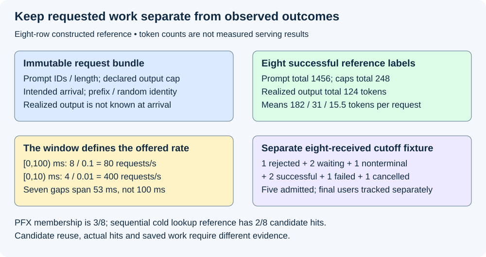
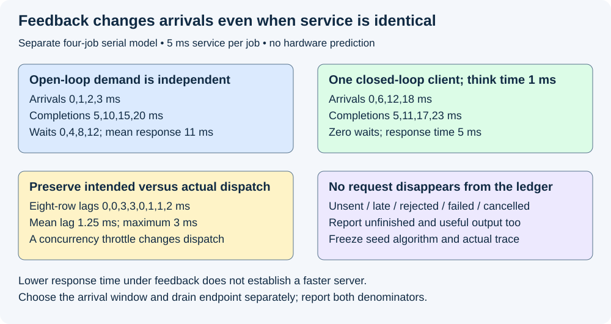

# M5-C07: Describing mixed serving workloads and arrival traces

> **Status: Complete — detailed chapter authored and documentation validated; experimental procedures are proposed unless explicitly labelled observed.**

**Module:** Learn scheduling, operating systems, and queueing theory

**Category:** [Measurement, experimentation, and economics](index.md)

[Module 5 reading order](../module-5.md) · [Previous: M5-C06](../runtime-and-concurrency/m5-c06-asynchronous-execution-and-completion-driven-progress.md) · [Next: M5-C08](../scheduling-and-queueing/m5-c08-queueing-delay-service-time-and-request-latency.md)

## Target concepts

Prompt and output lengths, declared output caps versus realized lengths, arrival timestamps, bursts, skew and correlations, reuse, seeds, offered versus admitted load, open-loop versus closed-loop traffic.

[Execution plan and progress](../chapter-execution-plan.md)

## Concepts

### 1. A workload is a joint history, not one average length

A **serving workload** describes what clients request and when, together with the information available to the scheduler. A **trace** is an ordered record of those requests and events. A **mixed workload** combines different prompt lengths, output limits, reuse patterns and arrival conditions. Two workloads with the same average tokens per request can have different memory pressure, prefill interference and latency tails.

Use [M5-C01's scheduler/executor boundary](../scheduling-and-queueing/m5-c01-separating-the-model-executor-from-the-serving-scheduler.md) and [M9-C02's clocks](m9-c02-request-events-clocks-and-measurement-boundaries.md). This chapter specifies workload contracts and experiments, not a load generator implementation. The workload is text generation; other modalities are outside scope.

A **prompt length P** counts the actual input token IDs after the declared tokenizer, chat template and special-token processing. Bytes, characters, messages and tokens are different units. Keep the token sequence or its reproducible content identity as well as the count. State truncation, empty-input, context-window and invalid-input rules before recording a request as valid. The prompt can consume prefill computation and existing KV storage; new selected tokens may extend retained state through subsequent decode forwards.

A **declared output cap C** is the maximum selected output-token count permitted by the request's contract. A **realized length G** is what actually occurred, subject to stopping, cancellation and errors. Specify whether a terminal token counts, whether hidden/protocol-only tokens exist, and whether a client-visible count differs from selected IDs. For the successful teaching fixture below, caps and realized counts both include any selected terminal ID, and **0 ≤ G ≤ C**. The zero-generation policy performs no model forward; for positive G, ordinary generation uses one prefill and G−1 decode forwards under the earlier contract. A partial failed/cancelled output is not a successful realized-length observation.

A live scheduler knows the cap and observable committed progress. It does not know the eventual G before generation. A simulation may use a prerecorded length as an oracle, but must label that assumption; an oracle-assisted policy cannot be presented as an online policy with the same information. Replacing early stopping with forced exact output length also changes the workload semantics. Keep requested cap, successful realized length, partial committed count, delivered count and terminal reason in distinct fields.

### 2. Specify one request and one replay contract

A **manifest** records the definitions and identities needed to interpret a trace. Freeze model/tokenizer/template versions, text/token corpus identity, stopping/sampling settings, seed derivation, resource limits, clock domain, measurement interval, cache preparation and generator policy. A request record needs more than a length pair.

| Record field | Meaning and validation |
|---|---|
| Logical request / attempt ID | One user request can have several attempts; retries remain separate offered attempts with parent identity |
| Intended arrival offset | Scheduled time relative to a declared generator anchor, units and tie order |
| Prompt identity / IDs / P | Reproducible token payload and length; validate preparation and truncation |
| Declared cap / policy | Maximum selected count, context compatibility, EOS/stop and sampling rules known at arrival |
| Prefix / reuse class | Exact compatible shared token prefix plus model/adapter/position/layout identity, not merely similar text |
| Random decision identity | Request/attempt-specific random stream, generator/algorithm versions and configuration |
| Observed events | Actual dispatch, server receipt/admission, first output, terminal and cleanup observations with clock domains |
| Observed outcome / counts | Rejection, waiting, admitted nonterminal, success, failure or cancellation; selected/delivered counts and missing-data reason |

Keep immutable input records under the trace owner's control. Runtime observers append attributable events; the scheduler cannot overwrite intended arrival or shorten a recorded cap to improve its result. Equal-time requests need a stable tie rule, such as trace row order. Protect retained payload bytes with a bound even before admission. A bounded server queue does not bound the generator's unsent backlog.

The [MLCommons LoadGen documentation](https://github.com/mlcommons/inference/blob/master/loadgen/README.md) separates traffic generation and traffic logs from model/dataset interpretation and accuracy evaluation. Its [scenario settings specification](https://github.com/mlcommons/inference/blob/master/loadgen/test_settings.h) distinguishes issue patterns including Server and SingleStream. Use that separation as a design reference; this educational trace is not an MLPerf submission and makes no compliance claim. Pin a commit and scenario settings when actually using a tool.

### 3. Work through a small mixed trace

All eight successful requests in this constructed reference arrive in **[0,100) ms**. These are stipulated reference labels, not measured model results. Lengths count tokens. Class PFX shares an identical compatible first eight prompt IDs across A/B/C; all other prefixes are deliberately distinct. A cold, unlimited, sequential prefix lookup reference has the first PFX request create a retained entry before either later PFX lookup. This lookup assumption will not automatically hold in a concurrent replay.

| ID | Intended arrival (ms) | Prompt P | Declared cap C | Realized G label | Prefix class |
|---|---:|---:|---:|---:|---|
| A | 0 | 16 | 8 | 4 | PFX |
| B | 1 | 16 | 8 | 4 | PFX |
| C | 2 | 16 | 8 | 4 | PFX |
| D | 3 | 128 | 32 | 16 | unique-D |
| E | 50 | 128 | 32 | 16 | unique-E |
| F | 51 | 128 | 32 | 16 | unique-F |
| G | 52 | 512 | 64 | 32 | unique-G |
| H | 53 | 512 | 64 | 32 | unique-H |

Totals are **1,456 prompt tokens, 248 declared output tokens and 124 realized output tokens**; means are 182, 31 and 15.5 tokens/request. The eight successes require 116 decode forwards plus eight prefills under the ordinary positive-G contract. These counts do not predict FLOPs, wall time or memory allocation. Declared and realized totals differ by 124 tokens; using G as a reservation before execution would leak future information.

A simple illustrative full-context growth bound sums P+C: **1,704 token positions** for eight separately retained full-cap requests. Using the hindsight labels sums P+G: **1,580 positions**. Neither is a physical KV allocation prediction: actual cache boundaries, selected-but-not-yet-forwarded IDs, block rounding, sharing, headroom and admission timing determine the retained inventory. State the engine's exact reservation contract rather than allocating solely from this arithmetic.

Define an **offered rate** over a fixed half-open interval [a,b) as **λ = number of intended arrivals in [a,b) ÷ (b−a)**, with the denominator converted to seconds. The trace's 100-ms offered rate is **8/0.1 = 80 requests/s**. In [0,10) ms it is **4/0.01 = 400 requests/s**, five times the full-window rate. A **burst** is concentrated arrival activity over a declared shorter interval; its severity needs an interval and background reference. The interarrival gaps here are **[1,1,1,47,1,1,1] ms**, with mean 53/7 ≈7.57 ms. The reciprocal of that mean uses seven gaps across 53 ms, not eight arrivals across 100 ms; it is a different statistic. Do not silently exchange the denominators or infer a stationary arrival process from eight rows.

*The workload totals and rates are constructed reference arithmetic. Realized output labels are unavailable to a live scheduler at arrival.*

### 4. Preserve skew, correlations and reuse

**Skew** means unequal concentration: a small group may account for much of the demand. Three of eight requests belong to PFX, a membership share of **37.5%**. There are six prefix classes. In the specified sequential cold lookup reference, two later PFX requests could reuse eight tokens each: **two candidate hits out of eight lookups (25%)**, or **16 reusable prefix-token positions** under that reference. Membership, candidate-hit fraction, token-weighted reuse and actual saved computation are different metrics. Concurrent arrival before the first prefix is ready, eviction, cancellation or incompatible identity can turn a candidate into a miss. A warm-cache experiment must say exactly which valid entries exist and who keeps them alive; reset between arms prevents accidental advantage.

**Correlation** is a relationship between variables. Here long prompts are paired with larger caps and larger realized lengths, and the short reusable requests cluster early. Sampling prompt lengths, outputs and arrival gaps independently destroys these relationships. As a bounded illustration, keep P and all arrival times fixed but reverse the realized-length list to [32,32,16,16,16,4,4,4]. The marginal G counts and mean remain unchanged, but two 32-token labels exceed caps of eight and one 16-token label exceeds eight. That shuffled fixture is invalid under the unchanged cap contract; a marginal-preserving transformation must still validate every row.

A legal comparison can instead permute **whole request records** among arrival offsets, preserving each prompt/cap/policy/reuse bundle. This tests temporal correlation while preserving valid request semantics, and must be labelled a changed workload. Another legal illustration permutes complete (cap,G) pairs together among prompts, then checks context compatibility. It preserves those two marginal distributions but changes prompt-output correlation and possibly memory demand per arrival. Neither transformation is a same-trace policy comparison.

### 5. Open-loop arrivals expose demand; closed-loop arrivals include feedback

An **open-loop** workload schedules arrivals independently of response completion. Intended arrivals remain fixed even if the service slows. A **closed-loop** workload has a fixed number of clients that wait for responses before sending their next requests, often with a **think time**, a delay after completion. In the simple one-client, no-retry case, the next intended arrival is completion plus think time. Neither model is universally better; they answer different workload questions. Client concurrency is a population limit, not an arrival rate.

For a separate deterministic toy server, four requests require exactly 5 ms of serial service each, with no overhead or admission rejection. Open-loop arrivals [0,1,2,3] ms start service at [0,5,10,15], finish at [5,10,15,20], and wait [0,4,8,12] ms. Mean waiting is **6 ms**, and arrival-to-finish durations [5,9,13,17] average **11 ms**. For one closed-loop client with 1-ms think time, arrivals become [0,6,12,18], completions [5,11,17,23], waiting is zero and response time is 5 ms each. Its repeated steady deterministic cycle is 6 ms, **about 166.7 requests/s**; this cycle rate is not a finite-window count inferred from four rows. Changing feedback has changed the arrivals, so the lower observed response time does not establish a faster server.

A generator can fall behind even in a nominal open-loop run. Let tᵢ be intended arrival and dᵢ actual dispatch in one generator clock; **dispatch lag ℓᵢ = dᵢ−tᵢ**, in milliseconds. For the eight-row trace, stipulated dispatches [0,1,5,6,50,52,53,55] give lags [0,0,3,3,0,1,1,2], mean **1.25 ms**, maximum **3 ms**. Dispatch-to-response timing excludes this lag. Record intended and actual times, server receipt, generator backlog and dropped/unsent requests. If clock domains differ, use compatible intervals or qualified mapping, not direct subtraction. Do not reschedule each next arrival from the previous completion and continue calling it open-loop.

If the generator lacks capacity, declare whether it catches up, preserves a bounded backlog, skips late requests or stops the run. Catch-up itself may create a new burst. Preserve intended demand and classify skipped dispatches; they are not server rejections. A generator concurrency throttle also changes the actual dispatch process. No service capacity claim is valid when the offered trace was silently reduced as the system slowed.

*The four-request timeline is a serial teaching model. It predicts neither GPU service times nor production tails.*

### 6. Seed, replay and count every population

A **seed** initializes a pseudorandom generator. It is not a complete reproducibility specification: record the algorithm/version, corpus ordering, request-to-stream derivation, and actual realized input trace. Keep workload generation randomness separate from model sampling randomness. Stable request/attempt random identity prevents a scheduler's batch membership from silently changing the intended random stream. Exact stochastic outputs may need the earlier distributional contract rather than a false promise that one seed guarantees identical results on every backend.

Synthetic regular spacing, independent exponential gaps and captured application traces exercise different assumptions. For an explicitly independent exponential-gap model, a rate λ has mean gap 1/λ; at 100 requests/s the mean is 10 ms, not a promise of evenly spaced 10-ms arrivals. State its stationarity and independence assumptions; it does not preserve application bursts or correlated session traffic. Captured traces need their collection boundary, missing records, timestamp resolution, sampling, anonymization/transformation and representativeness documented. Repeating a short trace can introduce artificial periodicity and cache warmth.

Separate **offered**, **dispatched**, **received**, **admitted** and **terminal** work. At a specified server cutoff in a separate eight-received-attempt fixture:

**8 received = 1 rejected + 2 waiting/not admitted + 1 admitted nonterminal + 2 successful + 1 failed + 1 cancelled.**

This example stipulates that failure and cancellation occur after admission. Thus cumulative admitted is five, and **5 admitted = 1 nonterminal + 2 successful + 1 failed + 1 cancelled**. These outcomes are mutually exclusive at this cutoff; admitted is a cumulative stage, not an additional disjoint term in the first equation. Offered attempts not dispatched/received require additional generator/transport categories and are not erased. Retry attempts carry their own identity and parent request; do not present attempt throughput as unique-user throughput. Logical terminal state does not establish final-user resource release; apply [M9-C22's ownership verification](../runtime-and-concurrency/m9-c22-verifying-ownership-and-memory-safety-under-concurrency.md).

## Experiments

All four experiments are proposed. Observed authorship checks cover bounded arithmetic, trace consistency and documentation only. No serving load, arrival generator, simulation runtime or hardware benchmark is executed, and no implementation is supplied.

### E1 — Validate a mixed trace before replay

- **Name:** A length label is not a scheduler promise.
- **Description:** Audit the eight-row fixture, request semantics and offered/admitted outcome ledgers.
- **Purpose/objective:** Hypothesis: cap-aware row validation and population separation detect workloads that average-only summaries accept. HFT concern: event identity and valid demand must precede timing claims.
- **Target concepts:** Prompt/output lengths, declared versus realized lengths, seeds and offered versus admitted load.
- **Baseline:** Frozen eight-row token-count reference with successful labels and a separately labelled cutoff-outcome fixture.
- **Workload:** Sum every row, check G≤C, check positive-G forward counts, and reject the reversed-G invalid transformation. Independent variable: one malformed field or outcome classification at a time; include missing IDs, duplicate attempts, incompatible context and unspecified terminal-token counting.
- **Controlled variables:** Tokenizer/template, exact prompt identity, cap/stopping/zero-generation rules and row ordering. Reference successful G labels are not exposed to an online policy.
- **Hardware requirements:** CPU/table reference QA; later actual tokenization requires pinned model/tokenizer assets and adequate host memory for the bounded corpus.
- **Exit criteria:** First validate identity and per-row semantics; then reproduce totals 1,456/248/124, means 182/31/15.5 and 116 decode plus eight prefill forwards; finally reconcile the separate eight-received/five-admitted cutoff. Invalid rows reject with reasons and no silent clipping. Unavailable realized lengths remain missing/partial rather than successful zero-length responses.

### E2 — Hold average offered rate fixed and change burst shape

- **Name:** Eight requests over 100 ms can arrive very differently.
- **Description:** Compare canonical arrivals with evenly spaced offsets [0,12.5,25,37.5,50,62.5,75,87.5] ms over the same [0,100) ms window, preserving row bundles.
- **Purpose/objective:** Hypothesis: equal average offered rate does not imply equal instantaneous demand, backlog or tail behavior. HFT concern: short arrival surges can exhaust resources despite modest long-window averages.
- **Target concepts:** Arrival timestamps, bursts, workload variability and offered load.
- **Baseline:** Eight valid requests, 80 requests/s over the fixed 100-ms horizon, fixed resource bounds and cache preparation.
- **Workload:** Canonical versus spaced schedule; independent variable is arrival shape only. Canonical [0,10) rate is 400 requests/s; spaced is 100 requests/s. Later repeat with explicitly frozen larger traces, not unlabelled looping.
- **Controlled variables:** Request order/payload/cap, model random identity, hardware, scheduler, context/queue/KV bounds and initial state. Preserve intended schedule independently of completion.
- **Hardware requirements:** CPU arrival-ledger audit; later a generator proven able to dispatch this trace and a qualified model server with separate host/device clocks and memory diagnostics.
- **Exit criteria:** First compare interval counts and gaps; then verify actual dispatch/receipt follows the declared policy; finally compare per-class backlog, useful output and end-to-end responses. Record generator misses, throttles and lag. No runtime tail improvement follows from the arithmetic alone; workload shape is intentionally changed and must be named in the result.

### E3 — Preserve or deliberately change joint structure and reuse

- **Name:** Same marginals do not mean the same work.
- **Description:** Audit original joint prompt/cap/output/reuse identities, then use labelled legal transformations and cache-state controls.
- **Purpose/objective:** Hypothesis: lost correlations and inherited cache warmth can change resource demand or give one policy an unearned advantage. HFT concern: hot event classes and shared state concentrate load.
- **Target concepts:** Skew, correlations, reuse, seeds and mixed lengths.
- **Baseline:** PFX membership A/B/C, exact eight-token common prefix, six classes; sequential cold lookup reference only for the candidate-hit arithmetic.
- **Workload:** Original bundles versus whole-record timing permutation or complete (cap,G)-pair permutation with context validation. Independent variable: one declared correlation transformation or cold/warm cache condition per comparison. Include PFX-before-ready and eviction as separate failure cases.
- **Controlled variables:** Exact prefix/model/adapter/position compatibility, token IDs, transformation seed/algorithm, retained-entry ownership, cache budget and output policy. Do not combine warmth and correlation changes in one attribution.
- **Hardware requirements:** CPU identity/reuse reference; later server with per-prefix readiness/hit/miss/eviction and physical allocation evidence. No saved compute is inferred from similar text.
- **Exit criteria:** First validate every transformed row; then reproduce 3/8 membership, six classes, 2/8 sequential candidate hits and 16 candidate reusable positions; finally record actual eligible hits, reused token extent and initialization/warmup. Keep offered and admitted mix separately. Changed workloads are labelled rather than called matched policy replays.

### E4 — Verify arrival feedback and generator fidelity

- **Name:** Slow service must not silently reduce an open-loop workload.
- **Description:** Contrast the serial toy open/closed-loop histories, then audit intended-versus-dispatched arrivals under overload and client limits.
- **Purpose/objective:** Hypothesis: closed-loop feedback and generator lag can hide demanded waiting if only dispatched successful responses are timed. HFT concern: a benchmark must preserve the arrival pressure that causes a queue.
- **Target concepts:** Open-loop/closed-loop traffic, arrival timestamps, seeds and offered/admitted load.
- **Baseline:** Four independent serial 5-ms jobs; open-loop [0,1,2,3] or one closed-loop client with 1-ms think time, explicitly different traffic models.
- **Workload:** Reproduce both traces; then audit eight-row dispatch lags. Independent variable: feedback policy or generator resource limit in separately labelled cells. Include dropped/unsent requests, retries and full client concurrency limit.
- **Controlled variables:** Required service/payload, measurement boundary, generator clock, configured late-send rule, retry policy and server bounds. Do not keep calling completion-dependent sends the same open-loop trace.
- **Hardware requirements:** CPU deterministic timeline reference; later generator CPU/connection/network resources independently characterized, plus server timing and queue/KV diagnostics.
- **Exit criteria:** First reproduce open-loop waits [0,4,8,12] and mean response 11 ms; then closed-loop zero waits/5-ms responses and changed arrivals; finally reproduce 1.25-ms mean and 3-ms maximum dispatch lag. Every intended request retains an outcome. Generator inability or unqualified clock mapping invalidates the intended comparison, rather than establishing server capacity.

## Verification

| Experiment | Reference and invariants | Measurement / benchmarking | Profiling and limits |
|---|---|---|---|
| E1 | Valid row bundles and distinct input/output/outcome populations | Totals/means, forward counts, invalid reasons, received/admitted balance | Inspect preparation/tokenization and immutable input identity before timing |
| E2 | Same eight bundles and horizon; named different schedules | Windowed offered/dispatched/received/admitted counts, dispatch lag, queue depth and useful responses | Separate generator CPU/connection limits from scheduler/device bottlenecks; eight requests cannot establish p99 |
| E3 | Exact compatible prefix and validated transformed rows | Joint length/class tables, candidate versus actual hit counts, reused tokens and physical retained bytes | Cache lookup/readiness/eviction and copy costs require evidence; candidate reuse is not measured saved computation |
| E4 | Correct feedback rule and complete intended-request ledger | Intended-to-dispatch lag, arrival-to-terminal/first output, unsent/rejected/failed/cancelled/open counts | Server receipt and client clocks need qualified boundaries; throttled demand is a changed dispatch process |

For later service experiments, freeze a manifest per cell and compare policies on the same intended open-loop trace. A closed-loop policy comparison preserves client count/think-time/request-selection rules but generally produces different realized arrival times; report that feedback explicitly. Use [M9-C11](m9-c11-controlled-comparisons-warmup-and-reproducibility.md) for matched reset conditions and [M9-C27](m9-c27-designing-regression-experiments-and-validation-gates.md) for claims. A proposed descriptive starting budget is 20 paired reset sessions per named cell, balanced arm order, one complete scratch-trace warmup per arm and separate corpus seeds chosen before results. Reset to the declared cold state after warmup when the measured cell is cold; a warm cell instead restores its specified entries. Warmup is preparation excluded from measured observations, not permission to inherit undocumented cache state.

Keep session pairs as replication units and requests/classes as labelled observations within sessions. Preserve all raw traces, invalid/missing sessions and seed lists. Report medians/ranges and per-class results; sample sizes need justification for any confirmatory difference or p99 uncertainty. Eight-row arithmetic and 20 sessions alone establish neither production tail behavior nor a capacity threshold. A tail is the slow end of the response distribution; successful admitted requests alone omit rejected or still-open demand.

Record both intended-to-terminal and actual-dispatch-to-terminal client intervals when meaningful, plus server receipt-to-admission and receipt-to-terminal in their own clock domain. Record first selected, first visible and first parsed output separately using [M9-C02](m9-c02-request-events-clocks-and-measurement-boundaries.md) and the existing TTFT/streaming contracts. [NVIDIA's benchmarking metric definitions](https://docs.nvidia.com/nim/benchmarking/llm/metrics) illustrate tool-specific submission/received-token boundaries; align definitions before comparing tools. Report late/unsent attempts separately where no response interval exists. Unfinished requests have censored durations, not zero latency.

Choose an offered window independently of the drain endpoint. Drain means allowing admitted work and final users to finish or recording a declared unresolved/quarantined endpoint. If output throughput includes drain, state that longer denominator; do not divide all drained output by the shorter arrival window without naming that metric. Preserve per-class success and all outcome counts, selected/delivered useful output, peak queue/payload/KV bytes, and final allocation claims. Use short separate traces for generator/host scheduling, tokenization, prefix lookup and GPU dependencies; estimate logging overhead on matched runs. Instrumented profiles explain behavior and do not replace clean acceptance timing.

## Engineering dimensions and principles

| Dimension | Application |
|---|---|
| Semantics and invariants | E1 checks row identity, cap/stop conventions, successful versus partial counts and no future-length leakage |
| Workload and variability | E2/E3 preserve or deliberately vary lengths, bursts, skew, reuse and joint structure; text only |
| Resources and bottlenecks | Bound generator unsent payloads, server waiting work and future growth; realized labels are not admission promises |
| Time and distributions | E4 exposes intended arrival, dispatch lag and feedback; short-window rates and tail populations need definitions |
| Ownership and coordination | Immutable trace input, attributable appended events and compatible retained prefixes have explicit owners |
| Failure and adaptation | Unsent, rejected, stale-prefix, failed, cancelled, retry and unfinished attempts remain accountable |

| Engineering principle | Consequence |
|---|---|
| 1. Correctness defines the optimization boundary | A shuffled output label exceeding its cap is invalid despite unchanged averages |
| 2. Performance depends on workload and operating point | Eight requests at 80/s can concentrate four arrivals into 10 ms |
| 3. Data movement is part of the algorithm | Token preparation, transmission, reusable-prefix copies and readback affect real serving |
| 4. State has ownership, lifetime and recovery cost | Cache warmth and outstanding payloads need bounded retained owners and reset/drain rules |
| 5. Dependencies determine latency; bottlenecks determine capacity | Closed-loop completion controls new demand; generator capacity can limit measured pressure |
| 6. Variability and synchronization shape the tail | Correlated long prompts, bursts and catch-up sends change queueing |
| 7. Local improvements require end-to-end evaluation | Better cache hits or faster dispatch matter through correct useful service under accounted demand |
| 8. Claims require reproducible evidence | Freeze row bundles, schedules, random streams, manifests, outcomes and clock boundaries |

The HFT lens is a market-event replay whose bursts, hot instruments and consumer delay must remain visible. Preserving time and correlated demand transfers well. Text generation has variable stopping, tokenization and growing/shared KV state; no trading result or exchange deadline is established by these fixtures.

## Specifications, articles, and hardware

The linked MLCommons LoadGen documentation/scenario specification provides a primary reference for separating workload issuance from model interpretation. The [Vidur research paper, version 2 (2024)](https://arxiv.org/abs/2405.05465) describes profiled/predictive LLM simulation and workload-dependent deployment evaluation; simulated endpoints require validation against the relevant real backend, not automatic treatment as measurements. NVIDIA's metric documentation provides a versioned practical comparison of observation boundaries. Sources were reviewed on 2026-10-29; pin exact tool commits/versions before execution.

Reference table/timeline QA needs CPU arithmetic only. Real replays record generator and server CPU/core/SMT/NUMA/RAM, OS/kernel, affinity/quotas, Rust/runtime/compiler, connection limits, network/interface topology and generator backlog limits. Record GPU architecture/count/VRAM, interconnect, backend/driver/runtime, dtype/layout, model/adapter/tokenizer/template hashes, prompt corpus, stopping/sampling configuration, seed derivation, queue/KV/workspace/output bounds, cache state, clock resolution/correlation, warmup/reset/drain and diagnostic overhead. No particular hardware was benchmarked. Arrival offsets, length labels and 5-ms service times above are constructed teaching inputs.

## Key takeaways

A reproducible workload preserves valid request bundles, timing, information boundaries and observed outcomes. Record caps separately from realized lengths; preserve correlations and cache state; verify that intended demand reaches the chosen boundary. Open-loop and closed-loop traffic answer different questions, and useful service must be reported alongside all lost or unfinished demand.

## Continue learning

Next in Module 5 reading order is completed [M5-C08: Queueing delay, service time, and request latency](../scheduling-and-queueing/m5-c08-queueing-delay-service-time-and-request-latency.md). The next authoring chapter is [M5-C18: Choosing chunk sizes and balancing prefill with decode](../scheduling-and-queueing/m5-c18-choosing-chunk-sizes-and-balancing-prefill-with-decode.md), position 125. Follow the [execution plan and progress tracker](../chapter-execution-plan.md); Module 9 supports Modules 1–7 and Module 8 is excluded.
