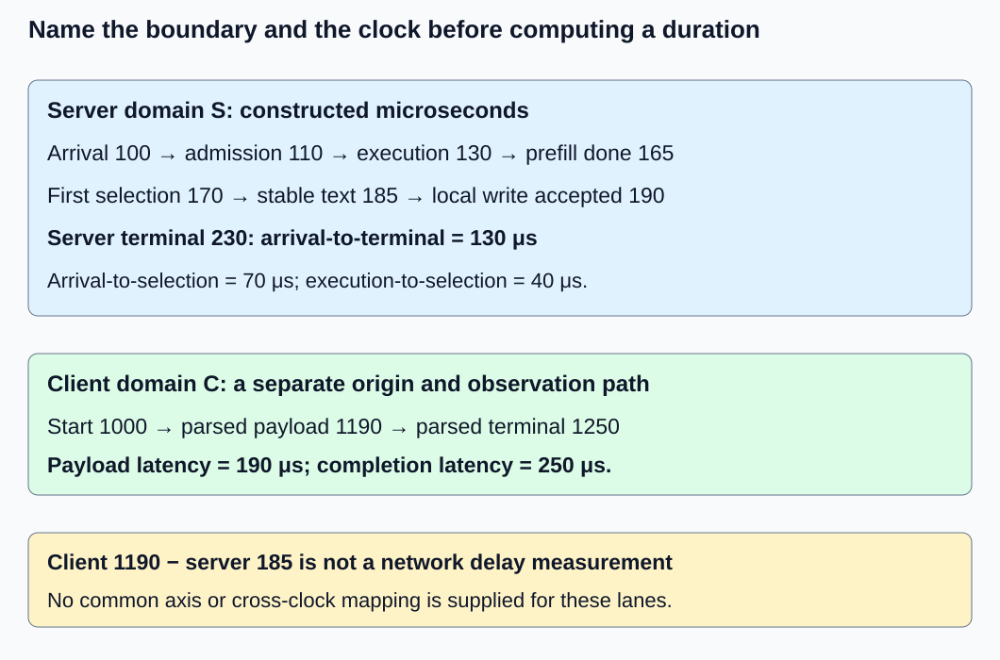
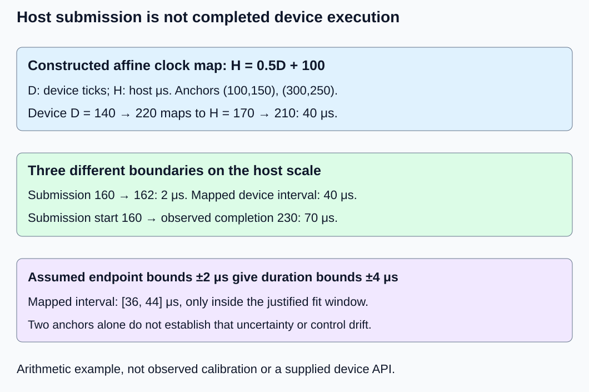

# M9-C02: Request events, clocks, and measurement boundaries

> **Status: Complete — detailed chapter authored and documentation validated; experimental procedures are proposed unless explicitly labelled observed**

**Module:** Make measurement and correctness part of the foundation

**Category:** [Measurement, experimentation, and economics](index.md)

[Module 9 reading order](../module-9.md) · [Previous: M9-C01](../numerics-and-correctness/m9-c01-defining-reference-behavior-and-evidence-before-optimizing.md) · [Next: M9-C03](../measurement-experimentation-and-economics/m9-c03-measuring-time-to-first-token-including-queueing.md)

## Target concepts

Request IDs, arrival and admission, execution and streaming events, monotonic clocks, client versus server boundaries, cross-device clock correlation, timing overhead, missing events.

## Concepts

### A timestamp is an observation of a named event

A clock reading becomes useful evidence only when its event, identity, units and clock domain are known. A **clock domain** is a source of timestamps with a declared origin and rate. Two numbers expressed in microseconds need not share an origin or a rate. A **duration** is elapsed time between compatible observations; a **timestamp** locates one observation on a particular clock. This Module 9 chapter establishes the contracts needed to measure the generation phases introduced in [M1-C18](../runtime-and-concurrency/m1-c18-understanding-prefill-and-decode.md).

A request should have a stable logical request ID and a separate attempt ID for each retry. A retry must not overwrite the earlier attempt's arrival or outcome. Within an attempt, identify each event by kind, phase/step or output index, producer and sequence number. Preserve process/boot identity, clock-domain ID, timestamp value/unit, schema version and observation location. A schema defines what fields mean. Repeated delivery of the same event record is not another token or another completion; conflicting duplicates are evidence errors. Collector receipt order is not necessarily producer execution order.

A **trace** groups related observations; a **span** describes a named interval of work. [OpenTelemetry's tracing specification](https://opentelemetry.io/docs/specs/otel/trace/api/) provides context and span identity concepts. It does not define this application's admission, selected-token or terminal semantics, or make arbitrary timestamps share a clock. Use semantic event keys to link client/server/device observations; do not infer identity from similar times.

### Define the request boundary before measuring it

This chapter's server arrival means the complete request envelope has been parsed into a request record and is ready for admission policy. It excludes earlier network reception/parsing work. A different arrival definition is legitimate, but it changes the metric and must be named. **Admission** means an explicit acceptance/reservation decision, not merely seeing a socket byte. **Execution start** means the admitted request actually begins its declared preparation/model path. Waiting after admission must not disappear from an arrival-based measurement.

| Event | Exact local meaning | Common mistaken substitution |
| --- | --- | --- |
| Server arrival | Parsed complete request record ready for admission | First network byte or model start |
| Admission / rejection | Explicit accept/reserve or refuse outcome | Collector sees a request ID |
| Execution start | Admitted work begins at the declared execution boundary | Submission to a queue |
| Prefill complete | Required prompt model work finished, last logits available | Host dispatch returns |
| Selected ID committed | Generation state accepts one token choice at index k | Text chunk emitted |
| Stable visible text | First nonempty text that will not be retracted | An incomplete byte or hidden stop ID |
| Write accepted | Declared local output sink accepts a write | Client receives and parses it |
| Server terminal | One final outcome with required server work complete | Client terminal delivery |
| Client payload / terminal | Client observes a parsed payload / final protocol result | Server write timestamp |

The output sink is the receiving buffer or consumer at the stated boundary. A buffered server write may be accepted before any network delivery. Distinguish generated IDs, stable text, transport chunks and protocol events. EOS and hidden stop IDs can terminate without visible text; a valid zero-cap request can select no ID at all. These cases use [M9-C19's terminal contract](../interfaces-protocols-and-streaming/m9-c19-validating-tokenization-stopping-and-final-output.md). Missing first-text time is not automatically failure, and a missing terminal *observation* is not automatically normal completion.

### Work a same-clock server ledger before combining systems

All numbers in this example are constructed microseconds on one server monotonic domain S. Request A arrives at 100, is admitted at 110, starts execution at 130, completes prefill at 165, commits its first selected ID at 170, exposes first stable text at 185, has a local write accepted at 190 and reaches server terminal at 230. Assume these are sequential milestone observations, not overlapping span durations.

For compatible timestamps **duration = end − start**. Thus arrival-to-admission is 10 μs; admitted waiting is 20 μs; execution-to-prefill completion is 35 μs; prefill-to-first-selection is 5 μs. Arrival-to-first-selection is **10 + 20 + 35 + 5 = 70 μs**. Arrival-to-first-visible is 85 μs, arrival-to-write is 90 μs and arrival-to-server-terminal is 130 μs. Measuring from execution start would report 40 μs to first selection and hide the preceding 30 μs. The 10 μs before admission is deliberately labelled admission-path elapsed time, not assumed to be queueing alone.

A separate client domain C records request start at 1,000, first parsed payload at 1,190 and parsed terminal at 1,250. Client payload latency is **190 μs**, client completion is **250 μs**. These have different endpoints and observation paths from the server intervals. Subtracting server visible timestamp 185 from client payload timestamp 1,190 produces a meaningless 1,005 without a valid cross-clock mapping; it is not a network delay estimate. Even synchronized clocks require compatible event semantics and uncertainty bounds before a one-way-delay claim.

*Numbers are a constructed ledger, not measured latencies. Separate lanes have separate clock domains; the picture is not a common time axis.*

### Choose an elapsed-time clock and preserve ordering errors

A **monotonic** clock does not normally run backward within its supported domain; it is suitable for local elapsed intervals. A **wall clock** represents calendar time and may be corrected. Log wall time for human correlation when useful, but do not assume subtracting it yields trustworthy low-latency durations. The [Rust Instant specification](https://doc.rust-lang.org/std/time/struct.Instant.html), consulted at std 1.99.1, documents opaque monotonic observations and platform caveats. Persist elapsed values relative to a declared local anchor plus domain identity; an opaque Instant is not a portable cross-process or cross-machine timestamp format.

The [Linux clock specification](https://man7.org/linux/man-pages/man2/clock_gettime.2.html) distinguishes monotonic, realtime and suspend-aware clocks. Record the actual OS clock and suspend policy rather than assuming all monotonic clocks include suspended time. Identical consecutive readings can occur. Represented nanoseconds do not imply nanosecond resolution, accuracy or read cost. **Resolution** is the smallest distinguishable tick; **accuracy** is closeness to the relevant reference; **precision/repeatability** concerns variation across repeated observations. They are different properties.

For a constructed wall-clock pair, start 10,000 μs and end 9,990 μs after a correction yields −10 μs, even while a separate valid monotonic interval measures +20 μs. The correction need not be visible from a formatted log alone. An inverted local start/end or a mismatched domain must be a diagnostic failure. Saturating a negative duration to zero hides an ordering bug; the Rust checked duration operation can expose reversed observations rather than silently using zero. Zero can still be a legitimate same-tick interval and is not proof that work was free.

### Device completion and cross-domain correlation need different evidence

Asynchronous submission can return before device execution starts. A host interval around dispatch measures submission work unless it explicitly waits for completion. Device events can measure an interval on a device timeline, with their stream/dependency semantics recorded. A **stream** orders specified device work; independent streams can overlap. An elapsed interval between device events is not necessarily pure kernel time if scheduling or intervening work lies between them.

The [CUDA Runtime 13.4 event specification](https://docs.nvidia.com/cuda/cuda-runtime-api/cuda_runtime_api/group__CUDART__EVENT.html) distinguishes event recording, completion queries/waits and elapsed-time measurements. Its documented approximately half-microsecond event-timing resolution is a tool characteristic, not a promise of that accuracy for a request. Check actual device/runtime restrictions and errors. No CUDA or device benchmark is executed here; these contracts support later GPU chapters.

A **correlation** estimates a mapping between clocks. A simple local model is **H ≈ αD + β**, where D is device ticks, H host microseconds, α microseconds per tick and β an offset. With constructed calibration anchors (D = 100, H = 150) and (D = 300, H = 250), **α = (250 − 150)/(300 − 100) = 0.5 μs/tick**, **β = 100 μs**. Under the explicitly assumed affine mapping, device work from D = 140 to 220 maps to H = 170 through 210, duration 40 μs. Merely subtracting raw 220 − 140 and labelling it microseconds would give the wrong unit and value.

Suppose host submission spans H = 160 to 162, and completed work is observed at H = 230. Submission duration is 2 μs; mapped device interval is 40 μs; submit-start to observed completion is 70 μs. They measure different boundaries. A completion observation can occur after actual device end, so that 70 is not pure device execution. These H values are a separate constructed example, not additional events for request A.

If each mapped endpoint has a justified ±2 μs bound within this calibration window, the interval has conservative uncertainty **±(2 + 2) = ±4 μs**, giving **[36, 44] μs**. This assumption must cover scale/offset fit, reading/bracketing error and any drift in the window; two exact-looking anchor pairs alone do not establish the bound. **Drift** means relative clock rate changes over time. Recalibrate and validate residuals, the differences between mapped and independently correlated observations. Do not extrapolate past the supported window or subtract timestamps from two GPUs without their own justified correlation.

*This is an affine-mapping arithmetic example. No API is assumed to expose these raw device ticks or to provide the stipulated uncertainty bound.*

### Missing telemetry changes what can be concluded

Telemetry is recorded diagnostic information. A bounded event buffer can drop records under load; sampling can intentionally retain only some traces; collectors can delay or reorder delivery. Record those policies, sequence gaps, dropped counts and collection cutoff. **Censoring** means the observation ends before the event of interest is known; it does not mean the event occurred at the cutoff. An operation may have completed while its trace record was lost. Preserve authoritative terminal/result evidence independently of best-effort trace details.

Use this six-attempt constructed corpus, observed at S = 300 μs. All server event numbers share domain S. A uses the complete ledger above; other entries specify their additional observations. Counts are adversarial test fixtures, not reliability rates.

| Attempt | Available observations | Outcome evidence | Timing limitation |
| --- | --- | --- | --- |
| A | Arrival 100; complete ledger through terminal 230 | Normal completion, selected IDs present | First-selection and terminal intervals available |
| B | Arrival 105; rejection 110 | Rejected, never admitted | No generation first-selection metric |
| C | Arrival/admission 120; terminal 122; selected count 0, cap 0 | Normal empty completion | First selection/text undefined |
| D | Arrival 130; admission 132; execution 135; error terminal 140; count 0 | Error before selection | First selection undefined; error interval 10 μs |
| E | Arrival 140; admission 142; execution 145; first selection 155; no terminal by 300 | Unresolved at observation cutoff | First-selection 15 μs; observed time without terminal is at least 160 μs |
| F | Arrival 150; admission 152; execution 156; authoritative normal terminal 180; selected count 2 | Normal completion; first-selection record missing | Completion 30 μs available; first-selection latency unknown, not zero |

E's absence of terminal evidence does not prove continuous execution for 160 μs; it is an unresolved observation interval and may include lost completion telemetry. F is not a no-token completion: independent count evidence says two IDs were selected. Trace completeness and application outcome are separate axes. The ledger balances **6 attempted = 1 rejected + 5 admitted**, and **5 admitted = 3 normal + 1 error + 1 unresolved**. Exactly two admitted attempts have observed first-selection timestamps, A and E; C/D selected none and F's timestamp is missing despite selected output. Do not report their two observed latencies as an unbiased service distribution.

### Measurement itself consumes time and resources

A timestamp read, event formatting, allocation, synchronization and collector write can perturb the work being measured. Calibrate the clock with back-to-back reads and an empty timing bracket. This reveals resolution/read-path effects under those conditions, not a universal correction to subtract from every request. Full tracing may change cache locality, queue contention and scheduling; its overhead can depend on workload.

For a constructed 10,000-event batch, a reduced-evidence mode takes 2.0 ms and full retained tracing takes 2.6 ms under a fixed boundary. Incremental elapsed cost is **0.6 ms / 10,000 = 60 ns per logical event on average**, and relative batch increase is **0.6/2.0 = 30%**. These are example calculations, not measured costs or proof that every event costs 60 ns. Subtracting 60 ns from a production tail sample is not justified. Compare uninstrumented or reduced measurement, full tracing and profiling as separately named modes, retaining enough result counters to detect lost useful work in every mode.

## Experiments

These are proposed procedures, not a tracing implementation. Rust is the primary context; no code, collector service or GPU work is supplied.

### E1 — Reconcile request events and observer boundaries

**Description:** Audit the server/client event ledger and request/attempt identities. **Purpose/objective:** Prevent queueing, publication or retry work from disappearing through a changed start or end event. **Target concepts:** Request IDs, arrival/admission, execution/streaming events and client/server boundaries.

**Baseline and workload:** Constructed A ledger and six-attempt A–F corpus, plus one retry labelled as a separate attempt of the same logical request in a separate identity probe. The retry probe is not a seventh member of the base accounting corpus.

**Controls and prediction:** Fix event meanings, clock IDs, units and cutoff. Expect A's arrival-to-first-selection 70 μs versus execution-to-selection 40 μs. Client 190/250 μs payload/completion intervals remain separate. A duplicate event record must not increment selected-ID count.

**Procedure:** Assemble records by semantic identity, compare the named intervals and inspect the causal order of required milestones. Reorder collector arrival while retaining producer observations; the reconstructed result must be unchanged. Introduce a duplicate record, conflicting duplicate and retry-ID collision as distinct negative controls. A conflict is diagnosed, not arbitrarily merged.

**Hardware/software:** CPU ledger/reference environment, documented event schema; an actual runtime extension must record producer/collector conditions. **Failure and HFT connection:** Order acknowledgement, internal commitment and client observation are different boundaries in event systems; token streaming has different semantics from trading protocols. **Exit criteria:** V1 identity, arithmetic and reconstruction checks pass; direct incompatible-clock subtraction and changed boundaries cannot be reported as the same metric. Use V1.

### E2 — Validate local elapsed clocks and correlated device observations

**Description:** Test ordering/domain rules and the constructed affine mapping. **Purpose/objective:** Separate host dispatch, device elapsed work and observed completion. **Target concepts:** Monotonic clocks, cross-device correlation and timing overhead boundaries.

**Baseline and workload:** Wall-clock reversal and monotonic +20 μs example; two affine anchors and device interval 140–220 ticks with the stipulated ±2 μs endpoint uncertainty. An actual CPU extension collects 10,000 back-to-back clock pairs per session; optional device checks require supplied hardware.

**Controls and prediction:** Fix units/domain IDs and supported calibration window; preserve clock/source version and suspend policy. Predict 40 ±4 μs mapped interval, 2 μs host submission and 70 μs host observed-completion interval; none substitutes for another.

**Procedure:** Reject reversed/foreign-domain pairs before computing durations. Check affine units, anchors, mapped endpoints and uncertainty. Specify stale-calibration and out-of-window records as unsupported rather than precise timings. If a device profiler is available, validate correlation residuals across the supported window and completed event semantics. Do not claim the arithmetic proves real clock synchronization.

**Hardware/software:** CPU monotonic clock for local extension; actual GPU/runtime/stream and correlation mechanism separately required for a device extension. **Failure and HFT connection:** Clock alignment uncertainty matters when comparing event paths; this does not certify exchange timestamp accuracy. **Exit criteria:** V2 same-domain/ordering and mapping gates pass, invalid calibration is flagged, and any device findings include completion and uncertainty evidence. Use V2.

### E3 — Preserve outcomes when events are absent or lost

**Description:** Reconstruct A–F while distinguishing application result from trace completeness. **Purpose/objective:** Prevent missing timestamps from becoming zero-duration successes or false no-token results. **Target concepts:** Missing events, terminal evidence, no-token cases and censored observation.

**Baseline and workload:** Six-attempt corpus at cutoff 300 μs; separately remove A's first-selection record, duplicate its terminal record and delay a record past cutoff as telemetry-fault variants. Variants are independent replays, not extra base attempts.

**Controls and prediction:** Retain authoritative terminal counts/result evidence independently. Base outcome population balances 3 normal/1 error/1 unresolved after one rejection. Removing A's first timestamp changes metric availability, not its independently known completion.

**Procedure:** Check sequence gaps, duplicate/conflict records, trace sampling/dropped counters and timeout/cutoff evidence. Reconcile selected count with first-event availability. At observation end, report unresolved attempts and preserve late updates as a new observation revision rather than rewriting earlier evidence silently. Drain the collector, meaning allow pending records to arrive under a stated timeout, and retain records still missing afterward.

**Hardware/software:** CPU ledger replay; actual collector buffer/drop tests only in an independently supplied environment. **Failure and HFT connection:** A missing acknowledgement is not proof of a specific business outcome; token-service terminal policies still need their own specification. **Exit criteria:** V3 population and metric-availability counts balance, fault variants have explicit expected classifications and no missing interval is imputed as zero. Use V3.

### E4 — Benchmark event-recording overhead with conserved useful work

**Description:** Compare reduced aggregate evidence with full event retention in an existing environment. **Purpose/objective:** Measure instrumentation cost without attributing its perturbation to the underlying generation mechanism. **Target concepts:** Timing overhead, reproducibility and resource/capacity limits.

**Baseline and workload:** Fixed batches of 10,000 logical events carrying request/attempt/sequence identity. Both modes process the same event order and preserve aggregate counts and an agreed result checksum; full mode additionally retains event records. A checksum fingerprints the final result, not a substitute for per-event semantic validation. A generation extension must use its own unchanged model/output contract.

**Controls and prediction:** Fix producer count/thread, CPU placement, input/payload sizes, buffer capacity, sink and required completion. Full mode can add copies/allocations and change contention. The 2.0/2.6 ms pair above is illustrative, not the expected measured result.

**Procedure:** Across three sessions, warm each mode with five untimed batches, then collect 30 paired timed batches per session, alternating order. Time input-ready to processed counts/checksum plus required record retention/sink completion for that mode; separate later export if excluded and state that limit. Collect 10,000 back-to-back clock pairs per session separately from these batches. Profile formatting, allocation, timestamp reads, writes, buffer high-water marks and drops in diagnostic runs. Compare missing-event accounting and required result identity before interpreting timing.

**Hardware/software:** CPU, one producer thread, monotonic clock, fixed allocator/buffer/sink and documented clock API. No GPU or NIC required; an actual collector/network extension needs separate records. **Failure and HFT connection:** Measurement can compete with critical-path event work; it is not free observability or an HFT latency result. **Exit criteria:** V4 useful-work/count, completion/overhead and failure-accounting checks pass; tracing loss or changed result cannot become a fast success. Use V4.

## Verification

### V1 — Validate semantics before subtracting timestamps

For E1, use exact integer/rational ledger references under [M9-C01](../numerics-and-correctness/m9-c01-defining-reference-behavior-and-evidence-before-optimizing.md). Check event identity independently of timestamp sorting: retry attempts remain distinct, exact duplicate delivery is deduplicated, conflicting duplicates are rejected and collector reorder leaves the producer-domain result unchanged. Enforce only required causal relations; unrelated threads or streams need not have a single total execution order.

Reconcile A: 10/20/35/5 μs intervals, first selection 70, visible 85, local write 90 and terminal 130 μs from server arrival; client payload/completion 190/250 μs from client start. The execution-start shortcut omits 30 μs. Clock-domain mismatch is an exact semantic failure, not a floating-point tolerance case. A profiler or trace visualization may reveal gaps, but its rendering cannot redefine the event. Preserve the event dictionary, location and cutoff with every exported metric.

### V2 — Check units, ordering and calibration uncertainty

For E2, valid subtraction requires compatible domains and nondecreasing endpoint order. Treat same-tick zero as a measured interval bounded by clock characteristics, not proof of zero work. Check the wall-clock −10 μs versus separate monotonic +20 μs arithmetic without claiming an observed OS correction. Rust's opaque clock values are not assumed to share machine-independent epochs.

Affine reference α = 0.5 μs/tick and β = 100 μs maps 140/220 ticks to 170/210 μs; duration is 40 μs and conservative endpoint-bound interval [36, 44]. The submission [160, 162] and observed completion 230 give 2 and 70 μs respectively. Actual validation needs repeated independent correlations/residuals and a justified bound; a fitted line alone is not an accuracy certificate. Host/device clocks can drift, and a profiler may supply a correlation instead of raw device ticks. Document actual available semantics rather than inventing an API.

For three optional CPU sessions, 30,000 back-to-back pairs assess read/ordering behavior under recorded conditions; report the distribution and same-tick/inversion counts, resolution and bracket cost. It does not establish a production tail, a wall-clock synchronization guarantee or a device timestamp mapping. Any negative or foreign-domain pair remains a diagnostic error, not a zero-duration sample.

### V3 — Keep application outcome and trace completeness separate

For E3, validate 6 attempts, 1 rejection, 5 admissions and 4 observed admitted terminal results: 3 normal plus 1 error; E remains unresolved at cutoff. First-selected timestamps exist for A/E only. C/D have zero selected IDs; F has two selected IDs but a missing timestamp. These are three different metric states: observed, undefined because no event occurred, and unknown because event evidence is missing.

A and E's observed first-selection intervals are 70 and 15 μs; their arithmetic mean is 42.5 μs for that explicitly selected two-observation subset. It is not the mean of all admitted attempts or proof of service quality. F's terminal interval is 30 μs; D's error-terminal interval is 10 μs. E has at least 160 μs of unresolved observation since arrival; missing telemetry prevents assuming that is actual execution or completion latency. Follow [M9-C07](m9-c07-latency-distributions-and-statistical-uncertainty.md) for censored/missing populations and [M9-C19](../interfaces-protocols-and-streaming/m9-c19-validating-tokenization-stopping-and-final-output.md) for terminal evidence.

For each telemetry variant record whether only metric availability changes or whether authoritative outcome evidence is also lost. Deduplicating a terminal record must not reduce real terminal counts or erase a conflict. Report drain timeout and late-record revisions. No runtime reliability or collector-loss rate is established by this intentionally chosen corpus.

### V4 — Attribute instrumentation cost without erasing it

For E4, three sessions × two modes × five warmups = **30 untimed batches**. Three × 30 paired trials = **90 pairs / 180 timed batches**, covering **1,800,000 logical event processings across both modes** if all batches complete. Each mode processes 900,000. Separate the 30,000 clock-pair calibration samples from application events. A failure/drop remains in its attempted-batch ledger; retained full-mode records must match the expected semantic identities/counts before that trial is a correctness success.

The illustrative cost difference is 600,000 ns / 10,000 = 60 ns/event and 30% batch elapsed increase. Report actual per-session paired differences, medians/ranges, allocation/bytes/drop counters, buffer peaks and sink/export boundaries; do not blindly subtract example averages from latency samples. Record full versus reduced tracing and profiling separately, because profiling can itself alter scheduling. Conserve result checksum and aggregate useful work before comparing time, while retaining richer semantic checks from E1/E3.

Use a monotonic clock and completed-work boundary, calibrate granularity and read/empty-bracket cost, and retain all failed/incomplete batches. If the clock/overhead scale overwhelms the work, report inconclusive timing. A later complete generation benchmark must include the same required output work and distinguish arrival, queue, model and delivery boundaries; clock-read microbenchmarks cannot establish request latency. No tracing service, CUDA workload or performance experiment was run to create this chapter.

## Engineering dimensions and principles

| Dimension | Chapter-specific application |
| --- | --- |
| Semantics and invariants | Request/attempt/event identity, boundary meaning, clock units and one terminal outcome precede duration calculations. |
| Workload and variability | Retries, no-token results, buffering, event volume and drops alter metric availability; non-text modalities are outside scope. |
| Resources and bottlenecks | Clock reads, formatting, buffers, allocations and sink/export work can compete with application work. |
| Time and distributions | Same-clock durations, cross-clock uncertainty, missing observations and calibration distributions remain distinct. |
| Ownership and coordination | Producers own sequence/state; collectors may reorder; device readers/writers must complete before timing/reclamation claims. |
| Failure and adaptation | Domain/order faults, stale calibration, trace loss and unresolved results require explicit classifications and revisions. |

| Practical principle | Evidence requirement |
| --- | --- |
| 1. Correctness defines the optimization boundary | Metrics require exact event and clock semantics before an overhead reduction is accepted. |
| 2. Performance depends on workload and operating point | Trace overhead varies with event volume, payload, contention and sink behavior. |
| 3. Data movement is part of the algorithm | Event copies/formatting/export add traffic even when timestamp reads are cheap. |
| 4. State has ownership, lifetime and recovery cost | Attempt identities and record/drop state survive retries and observation cutoffs without silent overwrites. |
| 5. Dependencies determine latency; bottlenecks determine capacity | Submission, actual device execution and observed completion measure different dependency segments. |
| 6. Variability and synchronization shape the tail | Clock reads, collector contention and completion waits can distort slow observations; averages are insufficient. |
| 7. Local improvements must be evaluated end to end | Cheaper recording matters through completed useful work under the same required evidence contract. |
| 8. Claims require reproducible evidence | Archive schema, domain/units, calibration window/bounds, event corpus, losses, conditions and complete attempts. |

HFT means High-Frequency Trading, systems processing market events under tight timing constraints. Timestamp origin, acknowledgement boundaries, identity and clock uncertainty matter there as in inference. This chapter defines no exchange timing standard, trading strategy or production latency result; server/client/device observations retain their actual inference semantics.

## Specifications, articles, and hardware

| Primary source | Scope and limit |
| --- | --- |
| [Rust Instant, std 1.99.1 when consulted](https://doc.rust-lang.org/std/time/struct.Instant.html) | Opaque local elapsed clock, checked durations and platform caveats; record actual toolchain/OS. |
| [Linux clock_gettime manual](https://man7.org/linux/man-pages/man2/clock_gettime.2.html) | Clock types, resolution and suspend behavior; it does not specify application events or certify accuracy. |
| [CUDA Runtime 13.4 event reference](https://docs.nvidia.com/cuda/cuda-runtime-api/cuda_runtime_api/group__CUDART__EVENT.html) | Event completion and elapsed-time semantics; no device work or synchronization performance is asserted. |
| [OpenTelemetry tracing specification, 1.62.0 when consulted](https://opentelemetry.io/docs/specs/otel/trace/api/) | Trace/span identity and event concepts; actual request and clock contracts remain explicit here. |

Proposed CPU exercises require one producer thread, at least 1 GiB free RAM for corpus/evidence and a monotonic clock. Record CPU model, cores/sockets/cache/RAM, NUMA placement (memory proximity), affinity, OS/kernel, clock source/resolution/suspend policy, power/frequency/thermal/co-tenancy conditions, compiler/runtime/allocator, record sizes, buffer/sink/drop policies and collector placement. These are exercise requirements and record fields, not an observed host or production sizing recommendation. No GPU/NIC is required for paper/CPU work. Device/network extensions require actual GPU/NIC identities, driver/runtime, stream dependencies, clock/correlation mechanism and its validated uncertainty window. No particular device or service has been supplied.

This Module 9 foundation supports Modules 1–7 through the arrival/execution/output and completion boundaries they need. Completed M9-C01/M9-C07/M9-C19 supply reference, population and terminal contracts. Detailed TTFT treatment M9-C03 is now complete; inter-token treatment M9-C04 is now complete; load/profiling treatments remain outlined; this chapter states the elementary event and clock contracts locally. Its authoring and Module 9 reading successor M9-C03 is now complete; consult the execution plan for current progress.

## Key takeaways

Name the event, attempt, location, clock and unit before subtracting timestamps. Submission, completed model work, stable text and client delivery are different observations. Preserve missing/undefined/unresolved cases and correlation uncertainty instead of manufacturing zeroes or precise one-way delays. Validate measurement overhead under conserved useful work. All runtime experiments remain proposed; arithmetic and documentation review do not execute a tracing service, clock calibration or hardware benchmark.
