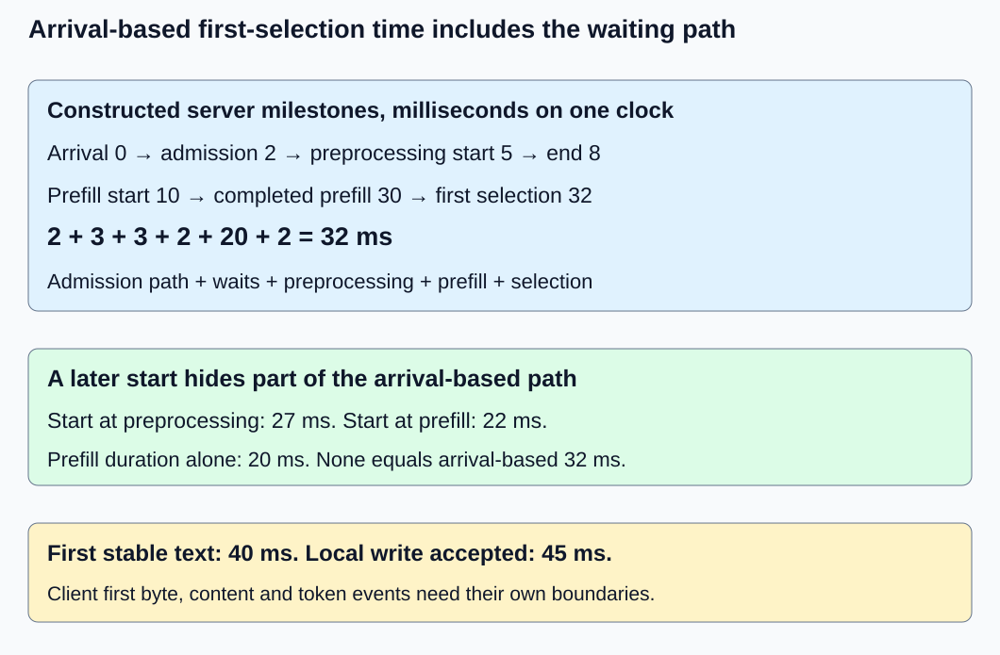
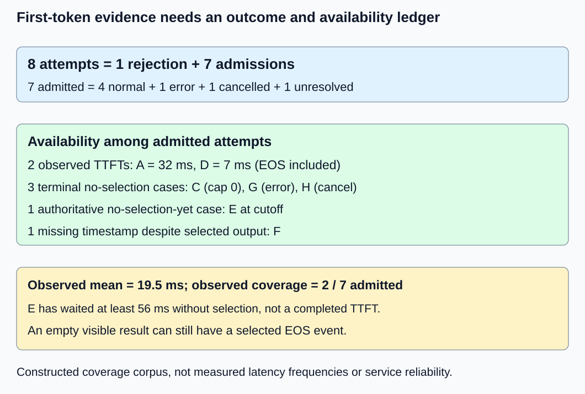

# M9-C03: Measuring time to first token including queueing

> **Status: Complete — detailed chapter authored and documentation validated; experimental procedures are proposed unless explicitly labelled observed**

**Module:** Make measurement and correctness part of the foundation

**Category:** [Measurement, experimentation, and economics](index.md)

[Module 9 reading order](../module-9.md) · [Previous: M9-C02](../measurement-experimentation-and-economics/m9-c02-request-events-clocks-and-measurement-boundaries.md) · [Next: M9-C04](../interfaces-protocols-and-streaming/m9-c04-measuring-inter-token-latency-in-a-streamed-protocol.md)

## Target concepts

Arrival-to-first-token definition, queueing, preprocessing and prefill, output delivery, first byte versus first token, client and server TTFT, rejected and no-token requests.

## Concepts

### Decide which first event the metric means

**Time to first token (TTFT)** is an elapsed interval from a declared request start to a declared first-token observation. A name alone does not fix either endpoint. [M9-C02](m9-c02-request-events-clocks-and-measurement-boundaries.md) established request/attempt identity, event semantics and clock domains. Here the server start is its parsed complete request record ready for admission; earlier network reception/parsing is outside that server boundary. A client start may precede connection setup or begin just before sending a prepared request; choose and record one rather than silently switching.

This chapter's primary server metric is **TTFT_selected = t_first-selected − t_server-arrival**. The end event is the first generated ID committed to request state, including EOS if selected. EOS means end-of-sequence and can carry no visible text. This definition measures model-generation progress, not necessarily user-visible progress. Separately report **Tfirst-visible = t_first-stable-text − t_server-arrival**, if nonempty stable text exists. Stable means later decoding or stop handling will not retract it.

At a client, use **TTFT_token-event = t_first-validated-token-event − t_client-start** only if the protocol and instrumentation actually expose such an event. If they expose text fragments instead, report **Tfirst-content = t_first-nonempty-parsed-content − t_client-start**, without inferring one model token from one fragment. **TTFB**, time to first byte, ends at the first response byte and can stop on headers or metadata. These metrics answer different questions. Pin model, tokenizer, template, sampling/stopping and protocol identity under [M9-C19](../interfaces-protocols-and-streaming/m9-c19-validating-tokenization-stopping-and-final-output.md).

The [NVIDIA benchmarking article](https://developer.nvidia.com/blog/llm-benchmarking-fundamental-concepts/) discusses queueing and delivery contributions and differences among tools. The [vLLM v0.25.0 per-request metric specification](https://docs.vllm.ai/en/v0.25.0/features/per_request_metrics/) gives a versioned example of server-side TTFT and phase metrics. Inspect actual tool boundaries before comparing numbers; neither automatically equals this chapter's selected-ID or client-content contract. The examples below are constructed ledgers, not measured tool output.

### Include admission, waiting, preparation and prefill

**Queueing** is waiting for work or resources before the required processing can proceed. It can occur before admission, after admission or between phases. **Preprocessing** prepares the model input: validation, template rendering, tokenization and input placement at the stated boundary. **Prefill** processes prompt positions and produces the logits used for first selection, as [M1-C18](../runtime-and-concurrency/m1-c18-understanding-prefill-and-decode.md) explains. There is no additional one-token decode forward required merely to choose the first ID.

Use one server monotonic clock and constructed milliseconds. Arrival is 0, admission 2, preprocessing start 5 and end 8, prefill start 10 and completion 30, first ID commitment 32, first stable text 40, and local write acceptance 45. Then the selected-ID TTFT is:

**TTFT_selected = 2 + 3 + 3 + 2 + 20 + 2 = 32 ms.**

The terms are arrival-to-admission 2, admitted wait 3, preprocessing 3, interphase wait 2, prefill 20 and selection/commit 2 ms. Do not label all pre-admission time as pure queueing: it may contain policy work. Starting the timer at preprocessing start would report 27 ms and hide 5; starting at prefill start reports 22 and hides 10. Prefill duration alone is 20, not the 32 ms arrival-to-first-ID interval. First visible text is 40 ms and local write acceptance 45 ms from arrival. They contain additional decoder/stop/buffering work, whose attribution needs evidence rather than assumed causes.

These adjacent differences telescope exactly because the events partition a single nonoverlapping milestone chain. In a real trace, preprocessing, transfer and other work may overlap; summing nested spans or concurrent device/host durations double-counts time. Use the request's actual first-event minus arrival as the primary total, and interpret the completed dependency path with a profile. An asynchronous dispatch return is not prefill completion.

*Constructed milliseconds on one server clock. The total includes waiting; it is not a sum of arbitrary overlapping profiler spans.*

### Queueing changes the benefit of a local improvement

A finite **first-in, first-out (FIFO)** example makes hidden waiting explicit without assuming a queueing-theory background. Three requests arrive at times a = [0, 1, 2] ms. A single worker serves one at a time, each taking five ms from service start to first selection. For this paper model, each request has cap one, releases the worker at that selection, and has no additional occupied work; real generation and output work can retain resources longer.

Let bᵢ be service start and fᵢ first-selection/release time. The mathematical recurrence is **bᵢ = max(aᵢ, fᵢ₋₁)** with idle worker initially, **fᵢ = bᵢ + sᵢ**, and **TTFTᵢ = fᵢ − aᵢ**. This is a queueing specification, not implementation code. Waiting is **Wᵢ = bᵢ − aᵢ** and TTFTᵢ = Wᵢ + sᵢ in this simplified model.

| Request | Arrival | Start, service 5 ms | First selection | Waiting | Arrival-based TTFT |
| --- | --- | --- | --- | --- | --- |
| Q1 | 0 | 0 | 5 | 0 | 5 |
| Q2 | 1 | 5 | 10 | 4 | 9 |
| Q3 | 2 | 10 | 15 | 8 | 13 |

Mean TTFT is **9 ms**; service-only timing reports **5 ms** and conceals mean waiting of 4. A hypothetical equivalent change reducing each service interval to four ms gives starts [0, 4, 8], first selections [4, 8, 12], waits [0, 3, 6] and TTFT [4, 7, 10], mean **7 ms**. The average TTFT improvement is two ms even though each local service interval shrank by one: later requests also wait less. This is an arithmetic consequence under the stated finite trace, not an implemented optimization or a sustainable capacity claim.

If the generator instead waits for completion before sending the next request, its arrival sequence changes. A five-ms worker with arrivals [0, 5, 10] has TTFT [5, 5, 5] and no queueing. That is a different offered workload, not evidence that the original burst's queue vanished. For the controlled isolated trace [0, 10, 20], service five/four ms yields TTFT [5, 5, 5]/[4, 4, 4]. Record intended and actual arrival times and scheduling lag in a real benchmark. Later M9-C09 treats load generation in depth; a finite ledger here does not establish open-loop generator correctness or steady-state behavior.

### First byte, content and token events can separate

A constructed client clock C has request start 100, first response byte 104, metadata event 106, first parsed nonempty content 150, a separately instrumented validated generated-token event 155 and terminal 200 ms. Then TTFB is **4 ms**, first-content latency **50 ms**, and the instrumented token-event TTFT **55 ms**. Substituting first byte understates that token-event interval by 51 ms. The 155 event is available only in the stipulated instrumented protocol; ordinary text chunks do not provide it automatically.

The server's 32 ms first-selection and client's 55 ms token-event intervals have different starts and observers. They are not evidence that network transit took 23 ms. Cross-clock alignment alone would not equate server commitment with client parsing; connection setup, transport, buffering and client work differ. Keep both same-domain durations and link them by request/attempt ID rather than subtracting unrelated raw timestamps.

[WHATWG's server-sent event specification](https://html.spec.whatwg.org/multipage/server-sent-events.html) defines UTF-8 event framing, comments and dispatch behavior. It does not say one event or one transport read equals one generated token. A connection's first byte, a heartbeat/comment, role metadata or an empty delta is not the first nonempty content. A text event can contain multiple tokens or only part of their eventual rendered text. A nonstreaming response may expose all text at completion; measuring its first content cannot recover when the model selected its first ID.

A buffering variant can preserve server first selection at 32 ms while moving first client content from 150 to 170 on C, changing first-content latency from 50 to 70 ms. That does not prove the model became slower. Conversely a faster prefill may be hidden by a fixed output flush deadline. Record client parsing and output-buffer policy and verify actual text/terminal identity before explaining the difference. Streaming inter-token details are the next chapter, M9-C04.

### Rejected and no-token attempts are part of the evidence

Use the following eight-attempt corpus. Event timestamps below are absolute values on one constructed server clock in milliseconds; TTFT entries are arrival-relative durations. Each row has a separately identified request attempt. Observation ends at absolute server time 60. Authoritative application evidence, not merely missing trace records, establishes E's unfinished/no-selection state at cutoff.

| Attempt | Arrival and known result | Selected-ID TTFT status | Outcome |
| --- | --- | --- | --- |
| A | Arrival 0; first ID at 32; normal terminal by 60 | Observed: 32 ms | Normal, output selected |
| B | Arrival 1; rejected at 3 | Not admitted; no generation TTFT | Rejected |
| C | Arrival 2; cap 0; normal terminal at 4; no selected IDs | Undefined: no selected ID | Normal empty result |
| D | Arrival 3; EOS selected at 10; terminal at 10 | Observed: 7 ms; visible-text time undefined | Normal EOS, no visible text |
| E | Arrival 4; authoritative unfinished, no ID yet at cutoff 60 | At least 56 ms without a first selection; no completed TTFT | Unresolved at cutoff |
| F | Arrival 5; normal terminal at 30; count 2; first timestamp lost | Unknown: selected IDs exist but first time missing | Normal, incomplete telemetry |
| G | Arrival 6; error terminal at 12 before selection | Undefined: no selected ID; error interval 6 ms | Error |
| H | Arrival 7; cancellation terminal at 15 before selection | Undefined: no selected ID; cancellation interval 8 ms | Cancelled |

The population balances **8 attempted = 1 rejected + 7 admitted**, and **7 admitted = 4 normal + 1 error + 1 cancelled + 1 unresolved**. Only A/D have observed selected-ID TTFT. Their conditional mean is **(32 + 7)/2 = 19.5 ms**, with observed coverage **2/7 of admitted attempts**. That is not an all-attempt average or a representative service distribution. C is a legitimate zero-cap completion, while G/H fail or cancel before selection. F must not be labelled no-token. E's 56 ms is not a first-token completion sample, and a missing trace alone would not justify this bound on actual selection.

Whether a reported client “token” population excludes EOS must be explicit. Under our server selected-ID contract D has an observed TTFT; under a nonempty-visible-content contract it has no such event. Changing that rule changes the population even when the system is identical. Record selected counts, terminal reasons, no-event reasons, lost-event counts and cutoff/drain policy alongside the latency distribution. [M9-C07](m9-c07-latency-distributions-and-statistical-uncertainty.md) explains why percentiles on a filtered population cannot describe absent outcomes.

*The eight attempts are an adversarial worked corpus, not observed reliability or latency rates.*

### Match the workload before comparing TTFT

Prompt length, template/tokenization work, prefix reuse, model/precision, active batch, arrival pattern and output buffering can all change the first-event path. Hold output/quality contracts fixed before calling a lower TTFT an improvement. Shorter prompts, hidden prefix reuse or omitted preprocessing may describe a new workload or boundary instead. A **bottleneck** is the resource limiting progress at that operating point; low prefill duration does not prove low arrival-to-first-event latency under waiting.

Report isolated and burst cases separately. Use per-request event ledgers and profiles to distinguish admission waits, preprocessing, model execution, selection and publication. Profile CPU and completed device work without assuming the largest named span is pure compute or bandwidth. Record transient/cold setup versus warmed state; if request-visible setup occurs after arrival it belongs in the arrival-based metric. A warmed benchmark may be useful, but does not characterize cold requests.

## Experiments

These are proposed procedures. Rust is the primary implementation context, but no code, service or generator implementation is provided. Paper replays establish arithmetic references; actual timing needs an independently supplied environment.

### E1 — Reconcile arrival-based TTFT with phase milestones

**Description:** Audit the 0–45 ms server ledger and its first-selection total. **Purpose/objective:** Detect omitted admission/wait/preprocessing work and double-counted spans. **Target concepts:** Arrival definition, preprocessing, prefill, first selection and queueing.

**Baseline and workload:** The single constructed request with arrival 0 and first selected ID at 32; execution shortcut starts at preprocessing 5 or prefill 10. A real extension uses pinned prepared prompts/model/output contract and records preprocessing separately.

**Controls and prediction:** Same request/attempt identity and server monotonic clock. Endpoint definitions are fixed. Expect 32 ms primary TTFT versus shortcut 27/22 ms and prefill-only 20 ms.

**Procedure:** Compare direct endpoint subtraction with the six adjacent milestone intervals. Introduce a timer starting at prefill as a negative control; it must be rejected as the same arrival-based metric. Add an overlapping diagnostic span and demonstrate why it cannot be summed as another partition segment. Verify prefill completes before its selection, including actual device completion if applicable.

**Hardware/software:** CPU ledger/reference environment; actual model/backend/clock and preprocessing placement must be supplied for runtime checks. **Failure and HFT connection:** Measuring only compute can hide time waiting for a decision path; event timestamps in trading have their own semantics. **Exit criteria:** V1 direct and partitioned totals agree, all required events have identities/domains and changed boundaries are labelled rather than silently compared. Use V1.

### E2 — Compare isolated and burst arrival traces

**Description:** Replay two finite FIFO traces under five-ms and hypothetical four-ms service intervals. **Purpose/objective:** Separate local service benefit from waiting changes. **Target concepts:** Queueing, context/workload controls and arrival-based first-token measurements.

**Baseline and workload:** Three-request burst [0, 1, 2] and isolated [0, 10, 20], single worker, cap one and worker release at first selection. Service durations include all occupied work in this paper model. Baseline five ms, candidate four ms; output contract assumed identical for arithmetic only.

**Controls and prediction:** Fixed arrivals/order, no retries, rejection, batching or later decode occupancy. Predict burst means 9/7 ms and isolated means 5/4 ms. Arrival sequences must not become completion-paced.

**Procedure:** Hand-reconcile start, release, waiting and TTFT for every request. Compare a separately labelled completion-paced trace [0, 5, 10] as a negative workload-control example. For an existing replay facility record intended/actual arrivals and lag, preserve every outcome and compare complete traces. Actual model optimization requires independent output/numerical evidence; changing a service-duration parameter does not supply that evidence.

**Hardware/software:** CPU reference/replay environment; no inference model or load generator is implemented here. **Failure and HFT connection:** Burst arrivals can amplify critical-path waiting; the finite FIFO assumption does not describe an exchange or production scheduler. **Exit criteria:** V2 recurrence, per-request and mean references pass, arrival traces are preserved, and replay timing is not misreported as model or sustained service performance. Use V2.

### E3 — Distinguish token, content, byte and absent-event observations

**Description:** Audit the client ledger and eight-attempt corpus. **Purpose/objective:** Prevent headers/metadata and missing/no-token outcomes from becoming misleading TTFT samples. **Target concepts:** Delivery, first byte versus token, client/server metrics, rejected and no-token requests.

**Baseline and workload:** Client start 100 with first byte 104, metadata 106, content 150 and stipulated token event 155; buffering variant content 170. Base A–H outcome corpus at cutoff 60, with EOS counted by the server selected-ID metric.

**Controls and prediction:** Fix endpoint/protocol parser, request/attempt identity, output text and terminal policy. Expect 4/50/55 ms for byte/content/token-event intervals and four distinct selected-ID evidence states: observed, undefined, unknown and pending.

**Procedure:** Validate each event's semantic payload; exclude empty metadata/heartbeats from content timing. Reassemble the same protocol payload across different transport reads; parsing boundaries must not create additional model tokens. Check a coalesced multi-token text event and nonstreaming delivery as cases where first model-selection time cannot be recovered. Balance A–H and separately record EOS/zero-cap/error/cancel/rejection/missing timestamps.

**Hardware/software:** CPU ledger/parser reference; actual protocol/client/server runtime only if supplied. **Failure and HFT connection:** Transport acknowledgement and useful payload observation differ; this chapter specifies inference events, not trading acknowledgements. **Exit criteria:** V3 timing and population counts match, no first-byte substitution or zero-imputed missing event passes, and incompatible-clock subtraction is rejected. Use V3.

### E4 — Benchmark complete trace replays with explicit limits

**Description:** Compare finite-trace replay modes only after arithmetic and event gates pass. **Purpose/objective:** Teach measurement discipline without claiming a hypothetical shorter service interval is an implemented inference optimization. **Target concepts:** Reproducible TTFT comparisons, instrumentation, queueing and outcome accounting.

**Baseline and workload:** E2's two three-request traces, five-ms versus four-ms configured service models. Each replay begins with an idle worker and preserves the fixed trace. An actual generation study would instead require a real baseline/candidate and matched model/output validation; it is a separately labelled extension.

**Controls and prediction:** Fix replay environment, CPU affinity, clock, event recording/sink and arrival policy. Logical replay TTFT follows the references; host wall time to calculate/replay a trace is a different measurement and need not equal its logical timestamps.

**Procedure:** In three sessions, warm each mode/trace with five untimed replays, then collect 30 paired replays per trace/session, alternating mode order. Retain all request ledgers, intended/actual arrivals where real-time replay is used, clock/recording overhead and failures. If replay is purely logical, benchmark only its completed processing boundary and do not call that service latency. A runtime extension must time arrival to first selected/content event on compatible clocks and include required waits/preprocessing/output; profile separately and quantify reduced/full-trace overhead.

**Hardware/software:** CPU, one replay worker, monotonic clock and recorded sink; GPU/network extensions need separate hardware and completed-work/event evidence. **Failure and HFT connection:** A controlled event trace is useful for reasoning about burst delay, but is not proof of production tail behavior. **Exit criteria:** V4 preserves reference outcomes, complete attempts, observation boundaries and uncertainty limits; no timing conclusion substitutes for missing runtime equivalence. Use V4.

## Verification

### V1 — Preserve the whole first-event boundary

Use [M9-C01](../numerics-and-correctness/m9-c01-defining-reference-behavior-and-evidence-before-optimizing.md) exact reference rules. The six server segments are 2/3/3/2/20/2 ms, summing to 32; first visible and local write latencies are 40/45. Shortcut omissions are 5 or 10 ms. Event/domain/ordering mismatches are exact failures, not numerical-tolerance cases. An overlapping span from time 5 to 30 already covers multiple milestone segments; adding its 25 ms again produces the wrong 57 ms total.

[M9-C02](m9-c02-request-events-clocks-and-measurement-boundaries.md) governs clock/domain and missing-record handling. The [Rust Instant contract](https://doc.rust-lang.org/std/time/struct.Instant.html), consulted at std 1.99.1, supports local elapsed-time measurements with platform caveats; reject inverted pairs instead of silently saturating to zero. In an actual profile, preserve span nesting/overlap and required device completion rather than treating host dispatch as completed prefill.

### V2 — Verify waiting and arrivals for every request

For E2's burst baseline, first selections 5/10/15 minus arrivals 0/1/2 give 5/9/13, mean 9; waiting 0/4/8 has mean 4. Four-ms service gives first selections 4/8/12, TTFT 4/7/10, mean 7 and waiting mean 3. Individual TTFT reductions are 1/2/3 ms. Isolated five/four-ms traces have zero waits and means 5/4. Completion-paced arrivals [0, 5, 10] with five-ms service have a different request schedule, even though their TTFT matches the isolated case.

Check no service starts before arrival or before the prior release, and all attempts have exactly one declared outcome. These formulas assume the worker releases at first selection; later generation occupancy or output backpressure requires another service model. A real model's longer prompt, variable service, prefix reuse or batching cannot be represented merely by assuming a constant interval. No steady-state queue length, capacity or percentile follows from three requests. A replay engine agreeing with this arithmetic is not evidence of a correct open-loop load generator.

### V3 — Report metric coverage and terminal outcomes together

For E3, client first-byte/content/instrumented-token latencies are 4/50/55 ms; first-byte substitution misses 51 ms of the declared token-event interval. Content buffering changes 50 to 70 ms with server first selection unchanged. Coalescing can change visibility without a new model selection; equal final bytes do not establish equal first-content timing.

The A–H corpus balances 8 attempts, 1 rejection, 7 admissions, 4 normal outcomes, 1 error, 1 cancellation and 1 unresolved. Among admitted attempts: 2 observed selected-ID TTFTs, 3 terminal no-selection cases (C/G/H), 1 authoritative no-selection-yet case (E) and 1 missing timestamp despite selection (F). F's terminal interval is 25 ms, G's error interval 6, H's cancellation interval 8. These are not first-selection samples. E's wait at cutoff is 56 ms; if the authoritative no-selection evidence were unavailable, classify its actual first-event status as unknown rather than asserting a censoring bound.

The 19.5 ms observed mean and 2/7 coverage must travel together, with the EOS inclusion policy. A visible-content distribution would exclude D as no-content even though its selected-ID event is known. No-token success, rejection, cancellation and missing telemetry are not interchangeable zeroes. Drain pending observations under a declared timeout and preserve late-record revisions. An actual study needs representative workload evidence before service-wide distribution claims; these adversarial cases supply coverage, not frequencies.

### V4 — Keep replay arithmetic and hardware measurements distinct

E4 schedules **3 × 2 traces × 2 modes × 5 = 60** untimed replays, then **3 × 2 × 30 = 180 pairs / 360 timed replays**. Three requests per replay imply **1,080 request attempts** in timed work if all replays complete. These counts describe attempted experimental work, not observed serving throughput. Keep failed/incomplete replays and their request populations in the ledger.

Report per-session paired differences and medians/ranges for the explicitly named boundary. Logical timestamp differences, host replay processing time and arrival-based runtime TTFT are three different quantities. Measure monotonic-clock granularity, empty brackets, scheduling lag and event-recording overhead; compare diagnostic profiling and reduced timing modes separately. No universal average overhead should be subtracted from individual tail samples.

For an actual baseline/candidate service comparison, preserve exact model/precision/tokenizer/template/output references, same offered arrivals and prompt/output mix, warm/cold and prefix-cache state, admission policy and client flush behavior. Record server selected-ID and client content/token-event metrics independently, including failures and undefined/missing events. Use M9-C07 for repeated-run/percentile limits; 90 pairs per trace and three sessions cannot establish a production p99 or reliability objective. No model serving, network streaming, load-generation or hardware-latency experiment was executed to produce this chapter.

## Engineering dimensions and principles

| Dimension | Chapter-specific application |
| --- | --- |
| Semantics and invariants | First selected ID, first visible content and first byte have explicit distinct endpoints and EOS policies. |
| Workload and variability | Bursts, prompt lengths, batching, reuse and flush behavior alter waiting and visibility; non-text modalities are outside scope. |
| Resources and bottlenecks | Preprocessing, model work, retained state and output buffers can each delay the first useful observation. |
| Time and distributions | Arrival-based totals include waits; conditional observed distributions retain coverage and missing/censored outcomes. |
| Ownership and coordination | Requests/attempts own events and state; one worker's release and downstream consumer readiness are separately specified. |
| Failure and adaptation | Rejection, zero-cap success, EOS, error, cancellation, unresolved work and telemetry loss remain separate. |

| Practical principle | Evidence requirement |
| --- | --- |
| 1. Correctness defines the optimization boundary | Faster first-byte metadata is not equivalent to faster first useful output; preserve model/output contract. |
| 2. Performance depends on workload and operating point | Isolated and burst traces have different waiting and local-optimization effects. |
| 3. Data movement is part of the algorithm | Tokenization/input placement and buffered output delivery contribute beyond matrix execution. |
| 4. State has ownership, lifetime and recovery cost | Keep request/attempt identity, cache state and terminal evidence through cancellation and delayed observations. |
| 5. Dependencies determine latency; bottlenecks determine capacity | First selection follows preparation/prefill, and FIFO release determines waiting in the paper trace. |
| 6. Variability and synchronization shape the tail | Arrival bursts, service variability, batching and output buffering can change slow observations. |
| 7. Local improvements must be evaluated end to end | A shorter service interval can reduce later waits, while a faster prefill may be hidden by delivery policy. |
| 8. Claims require reproducible evidence | Archive event definitions, exact arrivals, prompts/state, clock/parser settings, outcomes and measurement limits. |

HFT means High-Frequency Trading, systems processing market events under tight timing constraints. Arrival-to-decision paths, burst waiting and the distinction between internal progress and publication are useful parallels. Token events, output buffering and admission rules are not exchange acknowledgements or market timing standards. No trading strategy, production latency or service-capacity result is asserted here.

## Specifications, articles, and hardware

| Primary source | Scope and limit |
| --- | --- |
| [NVIDIA, LLM Inference Benchmarking: Fundamental Concepts (2 April 2025)](https://developer.nvidia.com/blog/llm-benchmarking-fundamental-concepts/) | Primary practitioner article on TTFT/queue/delivery and tool-definition differences; no performance result transfers to these fixtures. |
| [vLLM v0.25.0 per-request metrics](https://docs.vllm.ai/en/v0.25.0/features/per_request_metrics/) | Versioned example of server phase/TTFT metric definitions; map its boundaries before comparing with local selected/content events. |
| [WHATWG server-sent events, consulted 25 October 2026](https://html.spec.whatwg.org/multipage/server-sent-events.html) | UTF-8 protocol framing and event dispatch; events/reads are not guaranteed model tokens. |
| [Rust Instant, std 1.99.1 when consulted](https://doc.rust-lang.org/std/time/struct.Instant.html) | Local elapsed clock and checked-order caveats; not cross-machine timestamp synchronization. |

Proposed paper/replay exercises require one CPU worker, at least 1 GiB free RAM for ledgers/evidence and a monotonic clock for actual timing. Record CPU model, cores/sockets/cache/RAM, NUMA placement (memory proximity), affinity, OS/kernel, clock granularity/suspend policy, power/frequency/thermal/co-tenancy conditions, compiler/runtime/allocator, replay/event sink and trace policy. These are requirements, not observed hardware or model-serving sizing. No GPU/NIC is required for arithmetic replay. A real inference/client study additionally needs model/precision, tokenizer/template, prompt/output lengths, cache/warm state, GPU/driver/runtime where applicable, network/proxy/client identities, connection state and buffering/parser behavior; none are supplied by a paper trace.

Completed M9-C01/M9-C02/M9-C07/M9-C19 supply reference, event/domain, population and terminal foundations for Modules 1–7. Advanced load generation and SLO/capacity treatments remain outlines; elementary waiting and outcome rules are local. Its authoring and Module 9 reading successor M9-C04 is now complete; consult the execution plan for current progress.

## Key takeaways

Measure from the declared arrival to the declared first event, preserving admission, queueing, preprocessing and prefill. Separate server selection, client content/token events and first byte. Report rejection/no-token/cancel/error/unresolved/missing-event populations alongside observed TTFT. Match arrivals and output contracts before interpreting improvement. All experiments remain proposed; arithmetic and documentation checks do not execute a model service or establish production TTFT.
