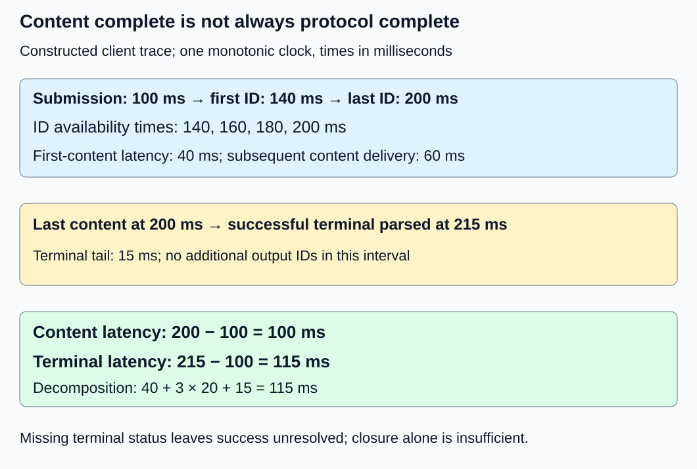
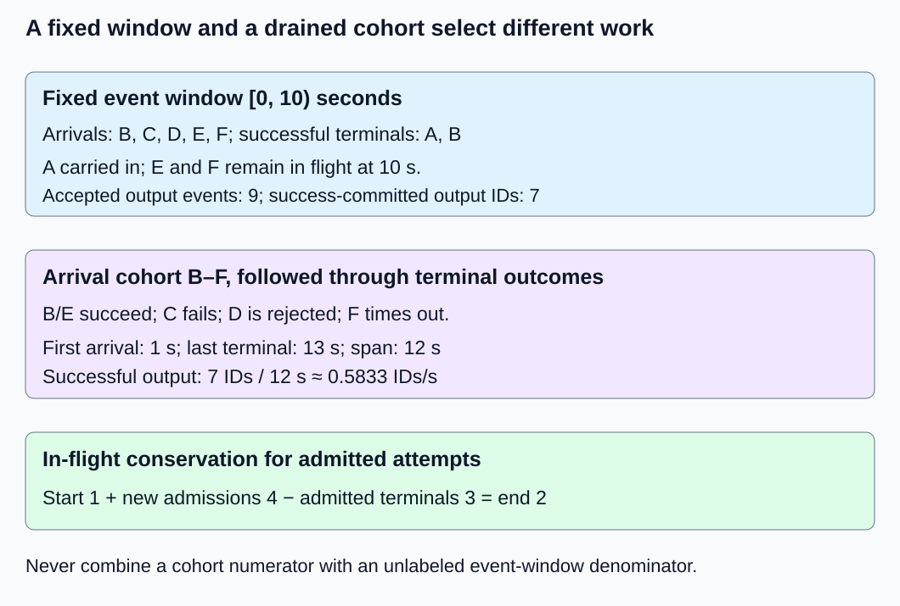

# M9-C05: Measuring end-to-end latency and throughput

> **Status: Complete — detailed chapter authored and documentation validated; experimental procedures are proposed unless explicitly labelled observed**

**Module:** Make measurement and correctness part of the foundation

**Category:** [Measurement, experimentation, and economics](index.md)

[Module 9 reading order](../module-9.md) · [Previous: M9-C04](../interfaces-protocols-and-streaming/m9-c04-measuring-inter-token-latency-in-a-streamed-protocol.md) · [Next: M9-C06](../measurement-experimentation-and-economics/m9-c06-defining-slos-goodput-and-useful-capacity.md)

## Target concepts

Arrival-to-completion boundaries, final token versus terminal event, request and output-token rates, prompt versus output work, useful versus draft tokens, success and failure populations, observation windows.

## Concepts

### 1. Completion needs an explicit contract

Latency is elapsed time for one operation. Throughput is completed work per unit of time across a stated population. A service can increase aggregate throughput while making individual requests slower, for example by keeping more requests waiting or executing together. Neither quantity establishes correctness. Begin with [event and clock boundaries](m9-c02-request-events-clocks-and-measurement-boundaries.md), [TTFT](m9-c03-measuring-time-to-first-token-including-queueing.md) and [streamed token gaps](../interfaces-protocols-and-streaming/m9-c04-measuring-inter-token-latency-in-a-streamed-protocol.md).

Choose a start event such as client submission or server arrival. Choose an end event such as last parsed content or parsed application terminal status. A terminal status explicitly says whether the attempt succeeded, failed or was cancelled. It may arrive after the last content. Connection closure alone does not prove application success, and server completion does not prove client receipt. Name clocks and boundaries in every metric; never subtract unrelated client and server timestamps.

Consider a constructed client trace, all on one monotonic clock in milliseconds: submission a = 100, first content f = 140, last content l = 200 and parsed successful terminal status z = 215. Four output IDs are explicitly mapped to four content events, with availability times [140, 160, 180, 200]. There is no selected end-of-sequence ID in this fixture.

**Content latency Lcontent = l − a = 100 ms.**

**Protocol-completion latency Lterminal = z − a = 115 ms.**

**Lterminal = (f − a) + (l − f) + (z − l) = 40 + 60 + 15 = 115 ms.**

The terms are first-content latency, subsequent content delivery and the terminal tail. With n ≥ 2 explicitly mapped output IDs, l − f = (n − 1) × mean availability gap, so this trace gives 40 + 3 × 20 + 15 ms. This identity does not permit token-gap inference from arbitrary text chunks. With no content, Lcontent is unavailable; a rejection or failure can still have a terminal latency. Server resource-release completion may be later still and needs its own timestamp.

*The 15 ms terminal tail belongs to the declared protocol endpoint, even though no additional content appears.*

The [NVIDIA benchmarking article](https://developer.nvidia.com/blog/llm-benchmarking-fundamental-concepts/) describes a final-token endpoint that excludes a trailing done/empty response in GenAI-Perf. This chapter also defines a terminal endpoint so readers can detect that difference; it does not claim the tool’s metric includes it. The [WHATWG event-stream specification](https://html.spec.whatwg.org/multipage/server-sent-events.html) defines event framing rather than model success. An application must supply its terminal semantics above that framing layer.

### 2. Define a window before counting a rate

An observation window [s,e) includes events at s and excludes events at e. Its duration W = e − s must be positive and expressed in seconds for rates per second. This half-open convention prevents double counting at adjacent windows. On a fixed window, define:

**Offered request rate = arrivals in [s,e) / W.**

**Successful completion rate = successful terminal events in [s,e) / W.**

**Accepted-output event rate = accepted output-ID events in [s,e) / W.**

“Accepted” here means committed to the output sequence, not an unverified draft proposal. Declare whether the boundary is server selection or client availability. A request-rate counter and a token-rate counter measure different units. Do not add them, and do not relabel arrivals as completed capacity.

The following constructed server-boundary ledger uses seconds on one clock. Admission occurs at arrival except D, which is rejected. A is already in progress at window start. For successful requests, terminal status satisfies the fixture’s correctness contract. The prompt counts are logical input lengths, not measurements of actual prefill work. Output events occur at A: [−1, 0.5, 1, 1.5], B: [2, 3, 4], C: [5], E: [9, 9.5, 10.5, 11]; D/F have none.

| Attempt | Arrival (s) | Terminal (s) / outcome | Prompt IDs | Total accepted output IDs | State at 10 s |
|---|---:|---|---:|---:|---|
| A | −2 | 2 / success | 100 | 4 | Complete; carried in |
| B | 1 | 5 / success | 20 | 3 | Complete |
| C | 3 | 6 / failed after partial output | 30 | 1 | Failed |
| D | 4 | 4 / rejected before admission | 40 | 0 | Rejected |
| E | 8 | 12 / success | 50 | 4 | In flight |
| F | 9 | 13 / timeout | 10 | 0 | In flight |

For [0,10), five attempts arrive and four are admitted: offered rate 0.5 requests/s and admitted rate 0.4 requests/s. A/B succeed during the window, giving 0.2 successful requests/s. A/B/C/D terminate, giving 0.4 terminal attempts/s if rejections are included. That higher figure includes failures and must not be called successful throughput.

Nine accepted output events occur inside the window: three from A, three from B, one from failed C and two from E. Their rate is 0.9 IDs/s. If instead the numerator credits entire output sequences only when successful terminals occur, A/B contribute seven IDs, giving 0.7 success-committed IDs/s. This is a different accounting policy: it includes A’s pre-window ID and excludes E’s in-window IDs. Both can be useful when labelled; neither is interchangeable with the other.

Use an independently reconciled in-flight count to catch omissions. Let Nstart/Nend be admitted attempts without a terminal outcome at the window boundaries, Nadmit the new admissions and Nterm the admitted attempts terminating in the window:

**Nend = Nstart + Nadmit − Nterm = 1 + 4 − 3 = 2.**

D is not admitted and does not enter this equation. E/F explain the two remaining attempts. An unresolved attempt stays unresolved until the cutoff policy supplies an outcome; disappearance from a trace is not success.

### 3. A cohort answers a different question

A cohort is a set chosen by a shared rule, here attempts arriving in [0,10): B–F. Stop adding members at 10 s, then drain: allow existing attempts to reach their terminal outcomes, with a declared timeout and final accounting cutoff. At 13 s this cohort has two successes (B/E), one partial-output failure (C), one rejection (D) and one timeout (F). Five arrivals equal five classified outcomes. A is excluded because it arrived before the cohort.

The elapsed span from first cohort arrival at 1 s to last terminal at 13 s is 12 s. Under a **finite cohort-span convention**, successful request rate is 2/12 ≈ 0.1667 requests/s and successful output rate is 7/12 ≈ 0.5833 IDs/s. These are finite-run rates, not steady-state capacity. A fixed 10 s offer-window-normalized yield would instead be 2/10 and 7/10; it credits outcomes learned later and is not a count of departures inside that 10 s window. State the convention rather than choosing a convenient denominator after seeing results.

*Carried-in work can depart during a window; new work can depart after it. Draining closes the cohort ledger but changes the elapsed span.*

Success-only terminal latencies for cohort B/E are both 4 s. That mean says nothing about C’s 3 s failure, D’s immediate rejection or F’s 4 s timeout. Report each outcome count and its applicable latency separately. F is unresolved at 10 s; do not replace its unfinished latency with zero or silently drop it. If the run stops before the timeout, report it as right-censored: observation ended while the outcome was still unknown. See [latency distributions and uncertainty](m9-c07-latency-distributions-and-statistical-uncertainty.md).

### 4. Count useful output separately from internal work

For this chapter’s limited accounting contract, useful output means accepted output from a successfully completed, reference-valid request. It does not certify answer quality, business value or a latency service-level objective. Those require additional criteria; [SLO and goodput treatment](m9-c06-defining-slos-goodput-and-useful-capacity.md) remains an outline.

Prompt IDs describe input length. Output IDs describe generated sequence length. Prefill processes prompt context; decode extends it. Summing prompt and output tokens may be a declared workload statistic, but it is not output throughput or a hardware operation count. Prefix caching can reduce executed prompt work without shortening the logical prompt. Rejected requests can have offered prompt IDs but no model execution. Record logical input, actually processed prompt work and accepted output separately when those counters exist.

Speculative decoding, a later-module technique, proposes draft tokens and checks them with the target model before committing output. No algorithm is implemented here. In an independent constructed example, six draft proposals yield two accepted draft IDs; four proposals are rejected. Two additional target-origin IDs complete a four-ID successful output. For the accounting reference, final IDs are [2, 0, 1, 2]; positions 1–2 originate from accepted drafts and positions 3–4 from the target. Count four useful output IDs, not six proposals plus four outputs. The proposal acceptance fraction is 2/6 = 1/3, and accepted-draft contribution to output is 2/4 = 1/2; their denominators differ. Target verification also consumes work. Counting four output IDs alone does not quantify that cost or prove a speedup.

Likewise, C’s one partial accepted ID in the ledger is observable work but not useful output under the chosen success contract. Preserve that work in diagnostic counters. A retry is a new attempt with a parent logical-request identity: count every attempt’s resource cost while preventing duplicate successful delivery from inflating logical-request throughput. Cancellation must also lead to bounded cleanup; client terminal receipt and actual resource reclamation are separate checks.

### 5. Connect latency, concurrency and capacity carefully

Concurrency is the number of requests in progress at once. The following consistency relation is Little’s law, introduced here only as a diagnostic. In a stable system, with compatible admission/departure boundaries, long observation and no accumulating backlog, average in-flight work is approximately completion rate times mean residence time:

**L ≈ λ × T.**

L is mean concurrent admitted requests, λ is admitted terminal completions per second and T is their mean admission-to-terminal time in seconds, including all admitted outcome classes under the same policy. For example, 10 admitted completions/s and mean residence 0.2 s imply about two in-flight requests under those assumptions. This is a consistency relation, not a per-request guarantee. [MIT’s queueing-model lecture](https://web.mit.edu/1.041/www/lectures/L8-queuing-models-2026sp.pdf) provides the average-population relation; this chapter uses T for residence time to avoid confusing it with window duration W. The transient six-attempt fixture is not evidence of equilibrium. Failed attempts consume residence time too; success-only latency with all-outcome completions breaks population consistency.

An overloaded service can have rising backlog while reporting a respectable departure rate. A completion-paced client sends replacement work only after prior work finishes; an independent arrival schedule can expose queue growth that such a client suppresses. Neither schedule is inherently the same workload. The versioned [vLLM v0.25.0 serving-benchmark documentation](https://docs.vllm.ai/en/v0.25.0/cli/bench/serve/) explicitly distinguishes request-rate controls from concurrency limits, which can reduce the actual offered rate. Record intended arrivals and actual arrivals rather than assuming they match.

## Experiments

All experiments are proposed. Numerical answers are constructed references; no engine, network test or measured performance result is supplied.

### E1 — Last content versus terminal completion

**Description:** Reconcile both completion endpoints in the four-ID client trace.

**Purpose/objective:** Test whether an apparent latency improvement merely changes the end event.

**Target concepts:** Arrival-to-completion boundaries, final token versus terminal event and gap decomposition.

**Baseline and workload:** One trace at [100,140,160,180,200,215] ms: submission, four ID-availability events and terminal success.

**Controls and prediction:** Hold IDs, final text, start clock and parser boundary fixed. Delaying only terminal status by 10 ms predicts unchanged 100 ms content latency and 125 ms terminal latency.

**Procedure:** Identify every event and subtract endpoints. Reconcile TTFT, subsequent gaps and terminal tail. Apply the terminal-delay variant, then remove terminal status entirely and label the attempt unresolved rather than successful.

**Hardware/software:** CPU-only trace review suffices. Record clock units and viewer version; a later Rust service must identify its monotonic timing source and completion hooks.

**Failure and HFT connection:** A missing acknowledgement after a market-data-triggered action resembles missing terminal evidence. Trading acknowledgements and inference tokens have different contracts; equal timestamps cannot establish equal business meaning.

**Exit criteria:** Baseline 100/115 ms and variant 100/125 ms are recovered; absence of terminal evidence cannot masquerade as faster success.

### E2 — Window, cohort and outcome conservation

**Description:** Evaluate the six-attempt ledger under fixed-event-window and drained-arrival-cohort rules.

**Purpose/objective:** Falsify the assumption that every completion belongs to an arrival in the same window.

**Target concepts:** Observation windows, request/output rates, success/failure populations and drain.

**Baseline and workload:** Use A–F exactly as specified; vary only the accounting rule. Membership is [0,10), drain cutoff 13 s, and server event times share one clock.

**Controls and prediction:** Fix admission, output positions and terminal outcomes. Predict five offered/four admitted attempts, two in flight at 10 s, nine in-window output events, and five classified cohort outcomes after drain.

**Procedure:** Mark carried-in A and carried-out E/F. Count fixed-window arrivals, departures and token events; reconcile in-flight conservation. Separately drain B–F, compute both rate denominators and list every outcome and eligible latency. Test events exactly at 0 and 10 s as separate boundary variants: include the former, exclude the latter from the fixed window.

**Hardware/software:** CPU worksheet or trace viewer; record timestamp precision, deduplication rule and half-open convention.

**Failure and HFT connection:** Overload rejection can raise terminal-event rate while reducing useful service, just as a high message-handling rate need not mean useful order execution. No exchange or market simulation is claimed.

**Exit criteria:** Every count and rate matches the references, A never enters the arrival cohort, E/F never become window completions, and unresolved observations remain visible at early cutoff.

### E3 — Useful output and work amplification

**Description:** Audit the independent six-proposal speculative accounting example and failed-output counters.

**Purpose/objective:** Prevent extra internal work or partial failure from inflating useful output throughput.

**Target concepts:** Prompt versus output work, useful versus draft tokens, reference validity and retries.

**Baseline and workload:** Six draft proposals, two accepted draft IDs, four rejected proposals and two target-origin output IDs; output length four. Separately use C’s one partial ID and D’s rejected prompt from the ledger.

**Controls and prediction:** Fix the declared output identity and success contract. Predict four useful IDs, acceptance fraction 1/3 and draft contribution 1/2; C contributes diagnostic output but zero useful IDs.

**Procedure:** Reconcile proposals into accepted/rejected categories and final output into disjoint draft-origin/target-origin categories. Compare accepted sequence and stopping semantics with the reference. Add a duplicate delivery/retry record as a fault variant and require identity-based accounting, not a larger useful numerator. Keep logical prompt length separate from executed prompt work.

**Hardware/software:** CPU accounting review only. A later speculative runtime experiment requires target/draft model revisions, precision, hardware and verification-policy records; no such runtime is assumed here.

**Failure and HFT connection:** Counting internal messages as completed decisions can exaggerate an HFT system’s useful rate too. Speculative tokens do not have order-placement semantics; the analogy concerns accounting only.

**Exit criteria:** Proposals sum to six, final accepted output sums to four without double counting, failures and retries retain cost, and no speedup or quality claim is inferred from acceptance alone.

### E4 — Complete-request benchmark comparison

**Description:** Specify a baseline/candidate serving comparison with consistent clocks, workload, output checks and drain policy.

**Purpose/objective:** Test an end-to-end improvement at the same operating point while exposing failure and backlog tradeoffs.

**Target concepts:** Latency versus aggregate throughput, workload dependence, windows, bottlenecks and reproducibility.

**Baseline and workload:** Propose three independent sessions with 20 excluded warmup attempts per configuration, followed by 30 paired trial blocks per session. Each configuration receives the same fixed set of 50 requests per block: 25 with 32 prompt IDs and 25 with 128 prompt IDs, each with a fixed 16-ID output cap. Offer requests at offsets 0, 0.2, …, 9.8 s, alternating the two prompt lengths. This gives 90 paired blocks and 4,500 timed offered attempts per configuration. Actual output length follows the fixed stopping policy, not the cap automatically.

**Controls and prediction:** Baseline requests a flush after each accepted ID. The candidate groups up to two IDs, flushing when the second is ready or 5 ms after the first pending ID, whichever comes first; terminal processing forces remaining content to flush. A flush request does not prove transport delivery. Change only that policy. Freeze model/tokenizer revisions, reference acceptance, precision, prefix/cache state, sampling/seed policy, request identities and an arrival schedule fixed independently of responses. Randomize and counterbalance configuration order. Predict no universal winner; a lower latency with lost or incorrect responses fails the comparison.

**Procedure:** Establish correctness before timing. Record intended and actual arrivals, admission, first/last content, terminal status and release events, plus output identities/counts. Use a fixed 10 s offer schedule per block, then drain with a predeclared client deadline 30 s after each actual offer, including time before admission, and retain unresolved server outcomes/cleanup separately. The benchmark classifies a client timeout without assuming the server stopped. Report fixed-window rates and full-cohort span rates as different outputs. Pair block summaries and compare across sessions. Repeat a representative subset with instrumentation disabled to estimate its effect. Profile separately to attribute queueing, GPU execution, copies, serialization, client CPU and cleanup; remeasure the final comparison without heavy profiling.

**Hardware/software:** Record CPU model, cores/affinity, RAM, OS/kernel, clock resolution, power policy, NIC/link/topology, TLS/proxies, runtime/parser, benchmark and profiler versions. For GPU inference also record GPU model/count, VRAM, driver, precision, interconnect and resident model size. A CPU ledger needs no GPU; a real inference comparison needs hardware that fits its named model and state. No hardware was measured here.

**Failure and HFT connection:** Inject slow readers, cancellation and worker failure in separately labelled trials; require bounded resource release and conserved outcomes. HFT likewise cares about offered load, stale work and deadlines. This protocol establishes no trading deadline or production certification.

**Exit criteria:** Both configurations reconcile all 4,500 timed attempts, warmups and faults stay separately labelled, and output correctness passes. Latency distributions, actual rate, failures, in-flight growth, drain time and overhead accompany any claimed improvement. If output identity changes intentionally, use a new quality contract rather than call it equivalent.

## Verification

| Check | Reference and acceptance evidence |
|---|---|
| V1 ↔ E1 | Recompute 40 + 60 + 15 = 115 ms and 40 + 60 + 25 = 125 ms; last-content latency stays 100 ms. Check all output positions and terminal identity. Missing terminal means unresolved success, not zero tail. |
| V2 ↔ E2 | Window rates: offered 0.5, admitted 0.4, successful completion 0.2, all terminal 0.4 requests/s; accepted output 0.9 and success-committed output 0.7 IDs/s. Verify 1 + 4 − 3 = 2 in flight. Cohort has two successes, failure, rejection and timeout; span 12 s, rates 2/12 and 7/12. |
| V3 ↔ E3 | Independently verify 6 = 2 + 4 proposals and 4 = 2 + 2 final IDs. Check fractions 1/3 versus 1/2, exact output identity, failed partial work and deduplicated logical delivery. Do not estimate executed prefill from logical prompt totals. |
| V4 ↔ E4 | Three sessions × 30 pairs × 50 requests = 4,500 timed offers/configuration; three × 20 = 60 warmups/configuration. Each block has 4,000 logical prompt IDs, but accepted output is at most 800 IDs, not necessarily 800. Match actual outcomes, arrival timestamps, reference validity, observation interval and drain cutoff before comparing rates. |

The deterministic fixtures require exact integer counts, identity matches and rational arithmetic; rounded rates above are display values. Timing comparisons need a clock-resolution and instrumentation budget from [M9-C02](m9-c02-request-events-clocks-and-measurement-boundaries.md). Real output validation follows [M9-C01](../numerics-and-correctness/m9-c01-defining-reference-behavior-and-evidence-before-optimizing.md) and [M9-C19](../interfaces-protocols-and-streaming/m9-c19-validating-tokenization-stopping-and-final-output.md): equivalent implementations preserve the agreed behavior, while numerical approximation or intentional output restrictions need their own acceptance contract.

For an executed benchmark, publish per-request outcomes, lengths and boundaries alongside block rates and session variation. Do not average ratios without explaining their weighting; total counts divided by total elapsed duration weights longer blocks more heavily than an equal-block mean. Confidence intervals should respect paired blocks and independent sessions, not pretend tokens from one request are independent requests. Ninety blocks are an initial comparison design, not justification for a production p99 claim; extend independent evidence when uncertainty is material. A timeout is a classified unsuccessful terminal outcome, not evidence that all underlying resources were reclaimed. Missing outcome or release events remain explicit. No runtime benchmark has been executed for this chapter.

## Engineering dimensions and principles

| Dimension | Chapter-specific application |
|---|---|
| Semantics and invariants | E1/E3 preserve output identity and terminal meaning; bytes, selected IDs, proposals and successful requests have distinct counters. |
| Workload and variability | E4 fixes lengths, arrival schedule, reuse and stopping; skew and early stopping change useful rates. Non-text modalities are outside this curriculum. |
| Resources and bottlenecks | Separate prompt work, verification work, copies, buffer memory and client CPU; profiling must explain complete service rather than output counts alone. |
| Time and distributions | E1 separates terminal tail; E2 retains drain and censoring; E4 reports distributions with compatible populations and clocks. |
| Ownership and coordination | The service owns request state until explicit release; the collector owns an immutable attempt/outcome ledger. Client receipt does not authorize assuming GPU state is freed. |
| Failure and adaptation | Rejections, partial output, cancellation, timeouts, stale retries and worker loss retain both cost and outcome evidence. |

1. **Correctness defines the optimization boundary.** A fast truncated stream fails the reference even if its completion counter rises.
2. **Performance depends on workload and operating point.** Fixed arrivals and completion-paced arrivals can produce different queueing and measured rates.
3. **Data movement is part of the algorithm.** Serialization and client consumption can lengthen terminal completion after GPU work ends.
4. **State has ownership, lifetime and recovery cost.** Cancellation needs an observed release condition; a timeout alone does not reclaim caches or buffers.
5. **Dependencies determine latency; bottlenecks determine capacity.** Terminal status follows required output processing, while shared CPU/GPU/link limits bound aggregate work.
6. **Variability and synchronization shape the tail.** Long outputs, bursts and slow readers change waiting and drain behavior; a mean success latency hides these effects.
7. **Local improvements must be evaluated end to end.** Higher draft processing or terminal-event rate does not establish more successful useful output.
8. **Claims require reproducible evidence.** Keep boundaries, membership, counters, references, faults and denominators with every result.

## Specifications, articles, and hardware

Sources checked 25 October 2026:

- [NVIDIA: LLM inference benchmarking—fundamental concepts](https://developer.nvidia.com/blog/llm-benchmarking-fundamental-concepts/) (2 April 2025): final-token latency and differing benchmark duration conventions. Its examples do not establish this chapter’s terminal or cohort policy.
- [vLLM v0.25.0 serving benchmark reference](https://docs.vllm.ai/en/v0.25.0/cli/bench/serve/): distinct request-rate, concurrency, workload-length, warmup and profiling controls. This chapter describes a protocol, not commands or a claimed vLLM run.
- [MIT 1.041: Queueing models, Spring 2026](https://web.mit.edu/1.041/www/lectures/L8-queuing-models-2026sp.pdf): Little’s law and consistent average population/rate/residence boundaries.
- [WHATWG HTML: Server-sent events](https://html.spec.whatwg.org/multipage/server-sent-events.html) (living specification dated 22 October 2026 when consulted): event-stream framing; application success must be specified separately.

E4 supplies the hardware/software manifest requirements; no unprovided device specification is invented. This Module 9 foundation supports measurements in Modules 1–7. Module 8 is excluded.

## Key takeaways

Declare the start, end, clock, population, unit and denominator before reporting a number. Distinguish final content from terminal completion; distinguish accepted output from drafts and successful output from partial failure. Fixed windows count events, while drained cohorts close a selected set’s outcomes. Preserve both views when diagnosing latency, throughput and backlog.

The Module 9 reading successor is completed [M9-C06](m9-c06-defining-slos-goodput-and-useful-capacity.md). The next authoring chapter is [M5-C18: Choosing chunk sizes and balancing prefill with decode](../scheduling-and-queueing/m5-c18-choosing-chunk-sizes-and-balancing-prefill-with-decode.md), position 125; consult the [execution plan](../chapter-execution-plan.md) for current progress.
