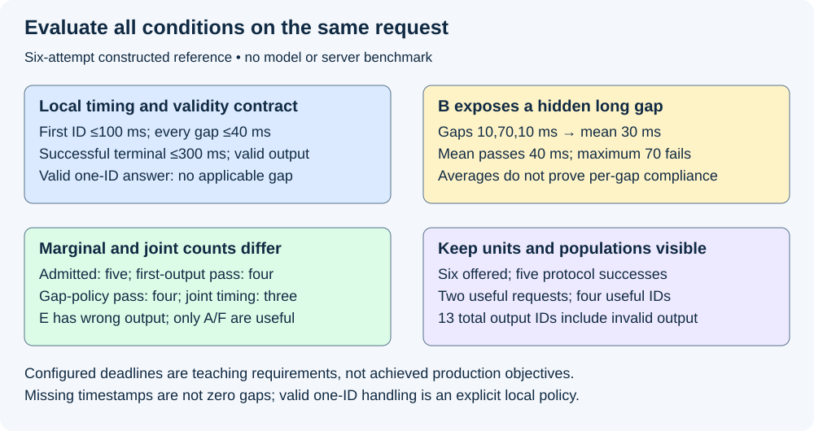
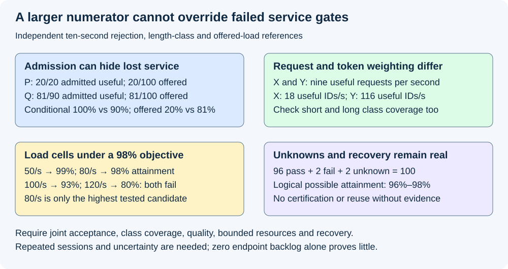

# M9-C06: Defining SLOs, goodput, and useful capacity

> **Status: Complete — detailed chapter authored and documentation validated; experimental procedures are proposed unless explicitly labelled observed.**

**Module:** Make measurement and correctness part of the foundation

**Category:** [Measurement, experimentation, and economics](index.md)

[Module 9 reading order](../module-9.md) · [Previous: M9-C05](../measurement-experimentation-and-economics/m9-c05-measuring-end-to-end-latency-and-throughput.md) · [Next: M9-C07](../measurement-experimentation-and-economics/m9-c07-latency-distributions-and-statistical-uncertainty.md)

## Target concepts

Latency objectives, per-request acceptance predicates, TTFT and token-gap targets, request versus token goodput, offered and admitted work, rejection accounting, capacity under quality and latency constraints.

[Execution plan and progress](../chapter-execution-plan.md)

## Concepts

### 1. Turn “fast enough” into an explicit service contract

A **service-level indicator (SLI)** measures an aspect of service, such as the fraction of eligible requests receiving correct output before their deadline. A **service-level objective (SLO)** sets the required level of that indicator over a declared population and interval. A target is a requirement, not evidence that a system satisfies it. The [Google SRE workbook](https://sre.google/workbook/implementing-slos/) motivates good-event fractions and explicit observation sources. Here the useful event must also respect inference correctness and the complete request contract.

Specify the eligible workload, observer, start/end events, output and quality definition, limits, inclusive/exclusive comparisons, denominator and evaluation window before benchmarking. A **predicate** is a condition that evaluates to true or false for a request with adequate evidence. Request acceptance combines conditions on the **same request**; separate population averages do not establish that the same users received acceptable service.

For this chapter's constructed text-generation contract, each eligible attempt requests at least one valid output ID. Its start is its immutable intended send time s on the client clock. The first correctly mapped output ID becomes available at f, successive IDs at t₁=f,t₂,…,tₙ, and the parsed successful application terminal occurs at z. Time to first token is **F=f−s**. Consecutive availability gaps are **gⱼ=tⱼ−tⱼ₋₁**, for j=2,…,n. End-to-end terminal latency is **L=z−s**. Queueing, dispatch lag and transport delays inside these boundaries count against the contract; server processing time alone cannot replace them. [M9-C03](m9-c03-measuring-time-to-first-token-including-queueing.md), [M9-C04](../interfaces-protocols-and-streaming/m9-c04-measuring-inter-token-latency-in-a-streamed-protocol.md) and [M9-C05](m9-c05-measuring-end-to-end-latency-and-throughput.md) explain the event mapping and endpoints.

Teaching thresholds are **F≤100 ms**, **every applicable gⱼ≤40 ms**, and **L≤300 ms**. Also require the correct model/tokenizer/adapter/stopping policy, successful application terminal and output passing the declared reference/quality checks. A valid one-ID answer has no gap; its gap condition is explicitly not applicable and does not disqualify it under this local contract. No-output failure is not a one-ID success. Missing timestamps or an unqualified fragment-to-ID mapping are missing evidence, not an empty gap set. These example numbers are not recommended production deadlines or observed hardware results.

Define **Aᵢ = successful terminal AND valid output/quality AND first-output target AND gap target when applicable AND terminal target**. Every AND applies to attempt i, with the chosen deadline anchor and exact comparisons. A request that produces plausible text under the wrong adapter still fails. Timing correctness does not excuse invalid token selection or unsafe lifetime behavior. Equivalent implementations use the same reference; approximations require separately justified quality/distributional evidence rather than relaxed checks invented after timing.

An overall objective might require at least 98% of the eligible offered cohort to satisfy Aᵢ, plus separately declared class coverage, quality, resource and recovery gates. Per-class means a subset fixed by workload properties such as output length or adapter, not a subset selected because its result was fast. The **error budget** for this binary fraction is (1−target fraction)×eligible count: at 98% of 1,000 offered requests, at most 20 may be nonconforming for that particular fraction. That budget does not authorize memory corruption, wrong-tenant output or violating separate hard gates.

### 2. Averages and separate targets can hide failed requests

The following is a constructed client ledger, not a benchmark. Intended offsets A–F are 0,100,200,300,400,500 ms within [0,1) s. Times in the table are durations from each attempt's own intended offset, all on the same teaching clock. All terminal observations occur before the one-second window ends. Rejection D occurs 10 ms after its offset. Output-ID counts exclude prompts and speculative draft IDs; the mapping to client-visible IDs is stipulated.

| Attempt | First ID (ms) | Gaps (ms) | Terminal (ms) | Output IDs / reference | Acceptance |
|---|---:|---|---:|---|---|
| A | 80 | 20,20 | 150 | 3; valid | Pass |
| B | 60 | 10,70,10 | 180 | 4; valid | Fail: one gap 70>40 |
| C | 120 | 20,20 | 200 | 3; valid | Fail: first ID 120>100 |
| D | Not applicable | Not applicable | 10; rejected | 0 | Fail: no admitted useful answer |
| E | 70 | 20 | 140 | 2; wrong reference output | Fail: quality/correctness |
| F | 80 | No gap; valid one-ID answer | 100 | 1; valid | Pass |

B's mean gap is **(10+70+10)/3=30 ms**, but its maximum is **70 ms**. Mean time per subsequent output ID cannot verify a maximum-gap contract. For a valid n≥2 mapped sequence, the local content-only mean is **(tₙ−t₁)/(n−1)**; it excludes the application terminal tail. A pooled gap percentile also weights longer sequences more heavily and is not a per-request pass fraction.

Among the five admitted, protocol-successful attempts, four satisfy first-output timing (A/B/E/F) and four satisfy the gap condition including F's declared not-applicable case (A/C/E/F). Their intersection has only three (A/E/F); imposing quality leaves two (A/F). Thus two marginal fractions of 4/5 do not establish 4/5 joint timing acceptance, and joint timing is still not useful acceptance. Do not multiply marginal fractions as though their failures were independent.

The [vLLM benchmark metric documentation](https://github.com/vllm-project/vllm/blob/main/docs/benchmarking/cli.md) distinguishes client first-output, streamed-output gaps and per-request amortized time, with batching of several tokens in a streamed output possible. [GuideLLM's goodput specification](https://vllm-project.github.io/guidellm/main/reference/guidellm/schemas/benchmark/goodput/) combines configured per-request objectives and documents missing-measurement behavior. Names and endpoint conventions can differ. This chapter's intended-send, maximum-mapped-gap and terminal predicate is an explicit local specification; it does not assert that either tool implements that exact predicate or one-ID policy. Pin versions and inspect definitions before adapting tool reports.

*Constructed six-attempt reference. Timing marginals, joint timing and valid useful service are different populations.*

### 3. Count useful requests and useful tokens with declared denominators

**Goodput** is a rate of work meeting the declared usefulness and service conditions. Choose whether it measures completion events in a time window or a cohort followed to a cutoff; do not blend these definitions. For a completion-event window [a,b) lasting W seconds:

**Request goodput = Σ Aᵢ over attempts with terminal zᵢ in [a,b) ÷ W**, in useful requests/s.

**Whole-request token goodput = Σ (Aᵢ×nᵢ) over the same terminal population ÷ W**, in useful output IDs/s.

Here all of a passing request's valid output IDs are credited at its terminal for accounting. This is a request-weighted accounting convention, not the rate of token delivery events inside the window. If a request straddles the boundary, do not mix its full output count with a token-event numerator. An alternative prefix/event utility metric can be designed, but it needs separate eligibility, correctness and deadline rules and cannot silently replace whole-request acceptance. Prompt IDs, draft proposals, duplicate output and invalid answers do not count as useful output.

For A–F, offered rate is **6/s**, admission is **5/s**, protocol-successful completion is **5/s**, and useful request goodput is **2/s**. The five protocol-successful attempts contain **3+4+3+2+1=13 output IDs**, including E's invalid answer. Whole-request useful token goodput is **(3+1)/1=4 IDs/s**. Offered useful attainment is **2/6=33⅓%**; admitted useful attainment is **2/5=40%**. Both ratios are reportable, but their denominators answer different questions. Neither measures text quality by itself.

Keep the **eligible offered cohort** fixed independently of admission. Define eligibility using workload and input rules, not post hoc speed or admission. Valid requests rejected for overload remain in that cohort and fail this useful-service predicate. Requests invalid under an agreed input contract may be a separate population, with counts and exclusion reasons preserved. A promise only to admitted requests must be labelled conditional and accompanied by offered admission/rejection and class coverage; otherwise rejecting difficult work can appear to improve service.

A separate ten-second comparison illustrates denominator gaming. Policy P admits 20 of 100 eligible offered requests and all 20 are useful; policy Q admits 90 and 81 are useful. Conditional attainment is **100% versus 90%**, but offered attainment is **20% versus 81%**, and useful request goodput is **2 versus 8.1/s**. P's fast rejection can be operationally necessary while still failing the stated useful-service objective. Do not hide its 80 rejected requests.

Token goodput can also favor a different class mix. In another ten-second reference, the same offered cohort contains 90 short requests of two output IDs and ten long requests of 100 IDs, with output lengths frozen by valid reference behavior. Policy X passes all 90 short requests and none long: **9 useful requests/s, 18 useful IDs/s**. Policy Y passes 80 short and all ten long: **9 useful requests/s, 116 useful IDs/s**. Equal request goodput can hide radically different per-class coverage. A separate minimum 95% long-class acceptance gate rejects X; Y's short-class 80/90≈88.9% would fail a 95% short-class gate. Do not pad output or change stopping policy to inflate useful token counts.

### 4. Preserve unknowns, late outcomes and ownership

At cutoff, classify each eligible attempt as known pass, known violation or unresolved under the frozen predicate. Known rejection or a measured breached deadline establishes failure; missing evidence needed for any remaining decision leaves it unresolved. This is the local audit policy, not an assertion about an external tool's classification order. A delayed successful result cannot erase an experienced timeout. Keep client and server outcomes separate under [M9-C10](m9-c10-validating-the-load-generator-and-request-accounting.md), and retries have their own attempt IDs linked to the original logical request. If the service promises logical-request completion including retries, define its original deadline and deduplicated output separately; do not count each successful retry as another user served.

For N eligible offered attempts, P known passes, F known failures and U unresolved, require **N=P+F+U**. A purely logical bound on eventual attainment is **P/N≤attainment≤(P+U)/N**. For P=96,F=2,U=2,N=100, the interval is **96%–98%**; it is not a statistical confidence interval. A 98% requirement is not established while those two remain unresolved. If logs are incomplete, even the classification may be untrusted: fail instrument qualification rather than assert a flattering bound from corrupted records. Fixed waiting and removing unknown IDs from the denominator do not prove attainment.

Retain ownership of request identity, timestamp provenance, output validity and immutable objective version through audit and drain. Cancellation ends the client wait under its contract; it does not finish all GPU or host accesses. Resource release and recovery still need final-user evidence under [M9-C22](../runtime-and-concurrency/m9-c22-verifying-ownership-and-memory-safety-under-concurrency.md). An SLO-compliant reply cannot justify premature reuse or stale data from another request. A bounded drain reports unresolved delivery, terminal and physical-user ledgers separately before a new reset session.

### 5. Useful capacity is conditional on workload and acceptance

**Sustainable useful capacity** is the supported operating region where offered demand can be served under the declared joint service, quality, class, resource and recovery constraints without unbounded queued or retained work. It is not maximum instantaneous token throughput or the highest load tested. Dependencies determine the response critical path; constrained compute, memory bandwidth, network/CPU processing and state capacity determine how much demand can proceed. [M5-C10](../scheduling-and-queueing/m5-c10-utilization-variability-and-tail-latency.md) explains why variability and saturation affect the tail before mean resource arithmetic establishes a safe operating point.

The following independent ten-second cells are **stipulated classifications**, not observed sessions or a statistical capacity estimate. They use a fixed text workload, the same complete request predicate, an offered attainment requirement ≥98%, and additional class/quality/resource/recovery gates stipulated to pass at 50 and 80/s. All intended traffic reaches the qualified generator boundary. “Backlog change” is admitted nonterminal requests at end minus start, counted before drain, not proof of stationarity.

| Offered requests/s | Eligible offered | Known useful by follow-up | Offered attainment | Useful requests/s over 10 s | Backlog change / decision |
|---:|---:|---:|---:|---:|---|
| 50 | 500 | 495 | 99% | 49.5 | 0; candidate passes stipulated gates |
| 80 | 800 | 784 | 98% | 78.4 | 0; candidate passes stipulated gates |
| 100 | 1,000 | 930 | 93% | 93 | 0; attainment fails |
| 120 | 1,200 | 960 | 80% | 96 | +80; attainment fails; growing-work warning |

Useful counts here belong to the offered cohort with the same ten-second issuance denominator; they are **cohort goodput**, not asserted in-window terminal-event counts. Follow-up outcomes and any remaining unknowns must be recorded in real studies. Zero backlog change over ten seconds alone is not a sustainability proof: within-window peaks, repeated intervals, memory growth, class starvation, latent work and drain cost still matter. The highest passing **tested candidate** in this table is 80/s despite higher useful rates at failed cells. No claim follows about untested rates between 80 and 100, another arrival pattern, a different workload, or a production guarantee. Repeated confirmation and uncertainty could reject even the candidate exactly on the 98% threshold.

*Independent constructed policy and load references. A larger useful numerator does not override failed offered-service or resource gates.*

For a real search, predeclare rate steps, trace mix and repeated durations; qualify the generator at each cell, then inspect joint acceptance, per-class outcomes, backlog/retained-byte trends and drain. Refine near the boundary and confirm on fresh sessions rather than selecting the luckiest run. Observe cold and warm cache/adapter states and bursts separately. If an optimized kernel raises total tokens/s while critical-path parsing or queueing worsens first output, it has not established end-to-end benefit. Overload policy can preserve correctness through rejection, but report the lost offered service and recovery behavior. M9-C06 supplies these gates to Modules 1–7; Module 8 and non-text modalities remain excluded.

## Experiments

All experiments are proposed. Only constructed arithmetic, predicate/identity review and documentation validation are performed during authorship. No model, server, load generator, fault, hardware benchmark or profiler is implemented or executed.

### E1 — Test joint first-output, gap and terminal acceptance

- **Name:** An acceptable average can conceal an unacceptable request.
- **Description:** Evaluate the six-attempt ledger against one immutable contract and compare mean-gap, marginal and joint classifications.
- **Purpose/objective:** Hypothesis: B passes a mean-gap target but fails the maximum-gap rule; marginal timing success overstates joint useful service. HFT concern: an average delay does not prove that every critical event arrived before its deadline.
- **Target concepts:** Latency objectives, per-request predicates, TTFT and token-gap targets.
- **Baseline:** A–F and the intended-send 100/40/300-ms inclusive contract, with E's known reference violation and F's valid one-ID policy.
- **Workload:** Exact mapped-ID timelines followed by boundary cases at 100/40/300 and just above, missing timestamp, rejected/no-output, fragment coalescing and wrong adapter. Independent variable: one event or validity condition per negative case.
- **Controlled variables:** Attempt identity, clock domain, intended offsets, reference output, endpoint, application terminal and objective version.
- **Hardware requirements:** CPU reference arithmetic initially; later a qualified client/server protocol and model reference with supported timestamp/ID mapping. No particular GPU is needed for this paper test.
- **Exit criteria:** Reproduce B mean30/max70; 4/5 first-output, 4/5 gap-policy, 3/5 joint timing and only A/F useful. Exact-boundary cases pass their timing condition; above-boundary cases fail; missing observations never become fabricated zero gaps. Then compare actual output and instrument semantics before timing real variants.

### E2 — Audit request/token goodput and rejection denominators

- **Name:** More conditional success is not more offered useful service.
- **Description:** Reconcile A–F rates, the P/Q rejection comparison and X/Y length-class weighting under fixed workloads.
- **Purpose/objective:** Hypothesis: removing rejected requests or switching request to token weighting can reverse the apparent comparison. HFT concern: discarded events cannot vanish from a promised service population.
- **Target concepts:** Request versus token goodput, offered/admitted work and rejection accounting.
- **Baseline:** Six eligible attempts in one second; separate P/Q and X/Y ten-second fixtures as specified above.
- **Workload:** Fixed outcome/length/class ledgers; independently vary admission policy or class acceptance, not model output length. Include duplicates, retry attempts and terminal/window-edge cases.
- **Controlled variables:** Offered identities, class eligibility, valid stopping and selected-output rules, interval duration and event-window versus cohort accounting.
- **Hardware requirements:** CPU population/count reference; later independent generator/server logs, tokenizer/output validation and recorded client/network/model resources.
- **Exit criteria:** Reproduce A–F 6 offered/5 admitted/5 protocol success/2 useful requests and 13 total/4 useful IDs per second. Reproduce P/Q offered20%/81%, conditional100%/90%, useful2/8.1 per second, and X/Y equal9 useful requests/s but18/116 IDs/s. Detect failed class gates and invalid denominator/duplicate-output substitutions before comparing implementations.

### E3 — Keep unresolved service and final users visible

- **Name:** Missing evidence cannot be promoted into an SLO pass.
- **Description:** Review the 96-pass/2-fail/2-unknown population, late completion and lifetime evidence through bounded drain.
- **Purpose/objective:** Hypothesis: excluding unknowns can falsely certify a threshold; client terminal status does not prove safe state release. HFT concern: a deadline miss and unfinished storage users remain real after a waiter departs.
- **Target concepts:** Per-request acceptance, offered populations, rejection and capacity under correctness constraints.
- **Baseline:** Frozen 100-attempt cohort, 98% target and separately owned terminal/final-user evidence.
- **Workload:** One late result, missing log, cancellation, duplicate completion, worker loss or retry per separate case. Independent variable: evidence availability or lifecycle fault, preserving original cutoff reports.
- **Controlled variables:** Identity/generation, original deadline, eligibility, objective version, reference behavior and surviving cleanup authority.
- **Hardware requirements:** CPU ledger initially; later isolated host/device diagnostic environment with supported lifetime/terminal observation. Unknown device completion requires recovery evidence, not an assumed release time.
- **Exit criteria:** Reproduce 96%–98% logical bounds, retain the unknown denominator and withhold certification. Reject trace loss or impossible transitions as unqualified evidence; keep late client/server outcomes separate and forbid reuse with live final users. No fixed sleep or counter reset is a drain certificate.

### E4 — Find and confirm a constrained operating region

- **Name:** Peak throughput is not qualified useful capacity.
- **Description:** Apply all gates to the four load cells, then design a repeated open-loop rate sweep and fresh confirmation around passing/failing cells.
- **Purpose/objective:** Hypothesis: the 100/120 cells produce more useful requests per second but violate the offered objective, while 80 is only a tested candidate. HFT concern: overload and a growing queue can invalidate service before average output rate falls.
- **Target concepts:** Capacity under quality/latency constraints, offered/admitted work and generator-induced limits.
- **Baseline:** Frozen workload, reference and objective set; 50/80/100/120 requests/s teaching grid with the stated class/resource assumptions.
- **Workload:** Planned independent arrivals across length/reuse/adapter classes and separately declared burst/cold/warm cells. Independent variable: offered rate; compare a serving-policy change only in separate matched arms with the same trace.
- **Controlled variables:** Model/tokenizer/precision, valid output lengths, cache reset, hardware/power state, client fidelity, acceptance rules, deadlines and drain/recovery policy.
- **Hardware requirements:** Recorded qualified generator/server CPUs, network, GPU/VRAM/interconnect and supported resource/timeline counters; bounded KV/workspace/output/log pools and isolated fault scope.
- **Exit criteria:** Reproduce 49.5/78.4/93/96 useful requests/s and 99/98/93/80% offered attainment. Reject failed cells despite larger numerators; then require repeated, uncertain, per-class and resource/drain evidence for any real operating claim. Report untested intervals and stop unsafe overload cells without discarding their failed or unresolved outcomes.

## Verification

| Experiment | Reference and correctness | Measurements / comparison | Acceptance limit |
|---|---|---|---|
| E1 | Same request, objective version, output reference and mapped-ID events | First output, each gap, terminal, marginals and joint classifications | No mean-gap substitute or inference from missing IDs |
| E2 | Immutable offered cohort, valid lengths, units and identity | Offered/admitted/rejected, useful requests/IDs, per-class fractions | No changed denominator, output padding or duplicate credit |
| E3 | Disjoint pass/fail/unknown and surviving lifetime claims | Cutoff bounds, late outcomes, trace loss and physical drain inventory | No unknown promotion, success rewrite or early reuse |
| E4 | All service, class, quality, resource and recovery gates | Actual offered load, joint attainment, useful rates and resource/backlog trends | A passing tested candidate is conditional, not universal capacity |

For hardware studies, first qualify the generator under [M9-C09](m9-c09-open-loop-load-generation-and-coordinated-omission.md) and [M9-C10](m9-c10-validating-the-load-generator-and-request-accounting.md); compare intended offsets, dispatch, receipt and admission. Use compatible local clocks or qualified cross-clock correlation; never subtract unrelated host clocks. Record outputs, retries, rejection, cancellation, failure, timeout and open work with immutable IDs. Freeze threshold comparison and eligibility before selecting workloads or collecting results. Correctness and quality evaluation use the suitable exact, numerical, distributional or constrained-output reference rather than a single unexplained text score.

A proposed descriptive starting design is 20 paired reset sessions per workload/rate cell, with one session per comparison arm in each pair, balanced order, one full scratch-trace warmup per arm, and restored declared cache/adapter state under [M9-C11](m9-c11-controlled-comparisons-warmup-and-reproducibility.md). Preserve all sessions, missing observations and ordered event logs; paired sessions are replication units and adjacent requests may be dependent. Retain burst shape and class weights from [M9-C08](m9-c08-designing-representative-serving-workloads.md). Do not cherry-pick a low-load duration or favorable cache state to certify the worst-case requirement.

Measure first output, gap distribution/maxima by request, terminal latency, complete joint acceptance and individual failure reasons. Record offered and admitted rates, in-window completions versus cohort follow-up separately, useful request/output-ID rates, class coverage, queue residence, backlog peaks/trends, CPU demand, directional network bytes, GPU busy/wait time, KV/workspace/output/log occupancy and post-load drain/recovery. Several failed conditions may apply to one request; reason counters can overlap, but the primary pass/fail/unknown partition cannot. Error-budget consumption is based on the declared fraction, not the sum of overlapping reasons.

Use [M9-C07](m9-c07-latency-distributions-and-statistical-uncertainty.md) for uncertainty in fractions/tails and [M9-C27](m9-c27-designing-regression-experiments-and-validation-gates.md) for sample-size and regression gates. Twenty sessions and the small arithmetic fixtures do not establish p99 or a high-confidence 98% attainment lower bound. Predeclare confidence requirements, dependence treatment, tolerances, replication length and minimum per-class coverage. A point estimate exactly at target can be inconclusive. Missing-observation logical bounds and sampling confidence intervals express different uncertainty; report both where applicable.

Use short separate profiles to explain queueing, CPU parsing/dispatch, network delivery, kernel/device gaps and retained memory; compare diagnostic overhead on matched cells and exclude intrusive tracing from clean timing. A faster kernel is a causal hypothesis about one stage, not evidence of greater useful capacity. Attribution must explain end-to-end acceptance and resource changes without changing workload or suppressing failures. All hardware study results remain unobserved here.

## Engineering dimensions and principles

| Dimension | Chapter-specific use |
|---|---|
| Semantics and invariants | E1/E2 require correct output and a joint same-request predicate before useful counts |
| Workload and variability | Length, arrivals, burst/reuse/adapter skew and cold state change class coverage and operating region; text only |
| Resources and bottlenecks | E4 tracks CPU, GPU, memory, bytes moved, network and retained state, not only tokens/s |
| Time and distributions | Intended-send first output, gaps, terminal and joint attainment expose queueing and tails |
| Ownership and coordination | E3 retains objective/output provenance and final-user claims through cancellation and reset |
| Failure and adaptation | Rejection, unknown delivery, stale adapter, trace loss and overload remain in the relevant ledger |

| Practical engineering principle | Application |
|---|---|
| 1. Correctness defines the optimization boundary | E's fast wrong answer fails; approximation requires an appropriate quality reference |
| 2. Performance depends on workload and operating point | The load grid and short/long classes cannot be generalized to another trace |
| 3. Data movement is part of the algorithm | Output copies, parse/network bytes and KV traffic can slow useful delivery despite faster compute |
| 4. State has ownership, lifetime and recovery cost | Cancellation does not retire device/host readers or discard evidence |
| 5. Dependencies determine latency; bottlenecks determine capacity | First output follows a critical path; constrained resources and persistent queues bound offered service |
| 6. Variability and synchronization shape the tail | B's mean gap passes while one gap fails; bursts and barriers need separate evidence |
| 7. Local improvements require end-to-end evaluation | A larger token numerator cannot override failed offered or class objectives |
| 8. Claims require reproducible evidence | E1–E4 freeze predicates, identities, workloads, all outcomes and uncertainty before comparison |

The HFT lens is an explicit event/deadline and correct-service contract with bounded work and accountable rejection. These methods transfer to inference measurement. An inference answer also depends on model quality, stopping and long-lived streams/KV state; these fixtures establish no exchange deadline, trading outcome or production deployment readiness.

## Specifications, articles, and hardware

Primary sources above were reviewed on 2026-10-29: the Google SRE workbook for SLIs/objectives, vLLM's benchmark specification for latency endpoint distinctions, and GuideLLM's goodput reference for joint objectives and missing measurements. Their live documentation may change; pin the actual software commit/version and metric definitions in a real study. The local specification is deliberately explicit about intended-send timing, per-ID maximum gaps, terminal status, valid one-ID handling, reference validity and offered denominator. No benchmark tool or serving policy is implemented.

No machine specifications were supplied. Paper references need only arithmetic/identity review; hardware experiments require a manifest identifying generator and server CPU model, cores/SMT/NUMA, RAM, affinity/quotas and OS/kernel; GPU model/architecture/count/VRAM, power/clocks/temperature, interconnect and topology; network/interface rate and directional traffic; driver/runtime/compiler/backend and tool versions. Record model/adapter/tokenizer/template/corpus hashes, precision/layout, batching/KV/prefix policies, stopping/sampling, cache state and queue/workspace/output/log bounds. Also retain objective/version, eligibility/classes, clock provenance, parse/fragment mapping, intended arrival trace, reset/warmup/drain, fault policy and instrumentation overhead. These requirements support reproducibility; they are not observations of a benchmarked configuration.

## Key takeaways

Define useful service on each request before counting it. Keep offered, admitted, successful and useful populations distinct; request and token goodput weight different things. Useful capacity requires joint quality/latency, class, resource and recovery evidence at the stated workload, with unresolved outcomes and uncertainty visible.

## Continue learning

Next in Module 9 reading order is completed [M9-C07: Latency distributions and statistical uncertainty](m9-c07-latency-distributions-and-statistical-uncertainty.md). The next authoring chapter is [M5-C18: Choosing chunk sizes and balancing prefill with decode](../scheduling-and-queueing/m5-c18-choosing-chunk-sizes-and-balancing-prefill-with-decode.md), position 125. Follow the [execution plan and progress tracker](../chapter-execution-plan.md); Module 9 supports Modules 1–7 and Module 8 is excluded.
