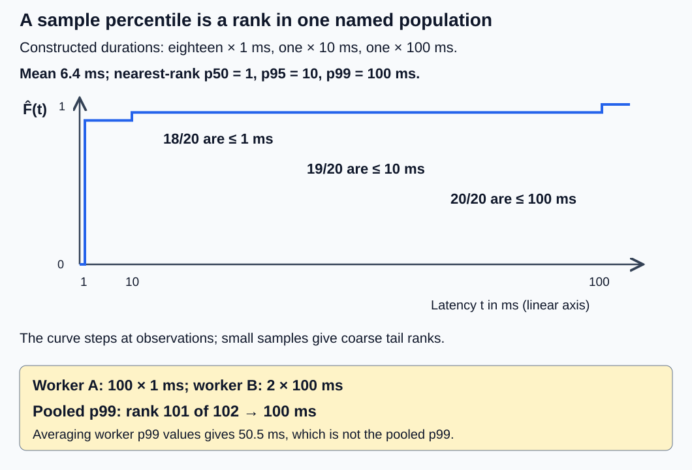
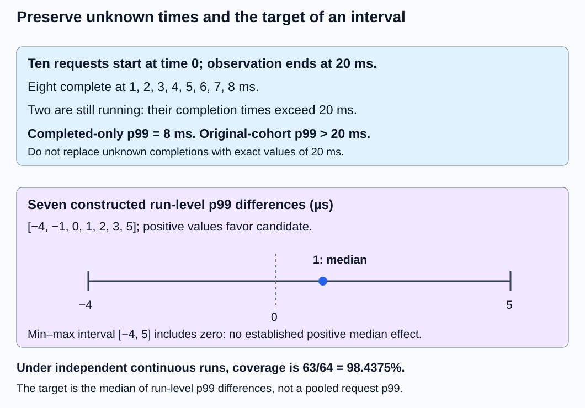

# M9-C07: Latency distributions and statistical uncertainty

> **Status: Complete — detailed chapter authored and documentation validated; experimental procedures are proposed unless explicitly labelled observed**

**Module:** Make measurement and correctness part of the foundation

**Category:** [Measurement, experimentation, and economics](index.md)

[Module 9 reading order](../module-9.md) · [Previous: M9-C06](../measurement-experimentation-and-economics/m9-c06-defining-slos-goodput-and-useful-capacity.md) · [Next: M9-C08](../measurement-experimentation-and-economics/m9-c08-designing-representative-serving-workloads.md)

## Target concepts

Means, medians and tail percentiles, empirical distributions, histogram precision, sample counts, correlated token observations, repeated runs, confidence intervals, censoring, aggregation without averaging percentiles.

## Concepts

### A latency number needs a population and a boundary

**Latency** is elapsed time between two named events. A distribution describes how that time varies across observations. “p99 = 10 ms” is incomplete unless we know which work was observed, how many observations exist, where timing begins/ends, and which outcomes were omitted. One millisecond (ms) is 1,000 microseconds (µs); one microsecond is 1,000 nanoseconds (ns). Convert units before combining measurements.

For a completed CPU forward, an elementary boundary is inputs and admitted weights ready → caller-readable output complete. For an eventual serving request, arrival → first token, consecutive delivered-token gaps, and arrival → final completion are different boundaries. A **token gap** is the elapsed time between two consecutive token-delivery events for one request; it is not the time from arrival to the first token. Label the observation type instead of pooling all these durations.

The prospective runtime experiment here uses the fixed [M1-C14 model](../model-computation-and-semantics/m1-c14-assembling-a-small-decoder-only-transformer.md), one forward in flight and no network or serving queue. It cannot establish service tail latency under arrivals or overload. All numeric latency datasets in the explanations are **constructed examples, not measured results**. Rust is the eventual implementation context; no code or running inference engine is supplied.

| Evidence field | Required meaning |
|---|---|
| Unit and clock | For example integer ns from one local monotonic clock; record resolution and conversion |
| Work identity | Request/attempt ID, model and policy/version, input/output lengths and case |
| Boundary | Named start and completion events, including required waits |
| Population | Completed forwards, request completions, token gaps or another explicitly named set |
| Outcomes | Attempts, successes, rejections, failures, timeouts, cancellations and unfinished work |
| Grouping | Run, request, worker, shape and time window; retain chronological order |
| Summary | Sample count, quantile convention, min/max, mean, requested percentiles and uncertainty |
| Representation | Raw samples or histogram unit, boundaries/range, precision and overflow policy |

In Rust, [Instant](https://doc.rust-lang.org/std/time/struct.Instant.html) is the elapsed-time clock abstraction; its documentation describes platform-dependent behavior and limits. It is not a cross-machine timestamp. Record actual toolchain and clock behavior rather than assuming perfect resolution or steady ticks. The consulted standard-library documentation identifies version 1.99.1. More detailed event/clock contracts remain for the M9-C02 outline; the local boundaries above are sufficient for this chapter's exercises.

### Mean, empirical distribution and percentiles

For N positive, completed durations x₁, …, xₙ, the **sample mean** is **x̄ = (Σᵢ xᵢ)/N**. It is the arithmetic average, sensitive to large values. Sort the observations into **x₍₁₎ ≤ … ≤ x₍ₙ₎**. These sorted values are order statistics.

The **empirical cumulative distribution function**, or ECDF, is **F̂(t) = count{xᵢ ≤ t}/N**. It reports the fraction of observed durations no greater than t. The [NIST distribution reference](https://www.itl.nist.gov/div898/handbook/eda/section3/eda362.htm) describes cumulative probabilities and their inverse. An empirical curve is a finite-sample description, not proof of the population's future tail.

This chapter fixes the **nearest-rank** convention: **Q̂(p) = x₍⌈pN⌉₎**, for 0 < p ≤ 1, with minimum at p = 0 by explicit extension. The ceiling symbol ⌈a⌉ means the smallest integer at least a. The median is Q̂(0.5); p95 is Q̂(0.95); p99 is Q̂(0.99). Some software interpolates, and some reports the average of the middle two observations for an even-size median. Those conventions can disagree on small samples; record the actual method and compare like with like.

Consider 20 durations in ms: eighteen observations of 1, followed by 10 and 100 after sorting.

| Statistic | Exact result under this chapter's convention |
|---|---|
| N and sum | 20 and 128 ms |
| Mean | 128/20 = 6.4 ms |
| Median / p50 | Rank 10: 1 ms |
| p95 | Rank 19: 10 ms |
| p99 | Rank 20: 100 ms |
| Minimum / maximum | 1 / 100 ms |

The mean is neither the typical fast observation nor the slowest one. A **tail** is the high-latency end of the distribution. Report a curve and counts alongside selected percentiles; a change in one percentile can hide a change elsewhere. Do not fit a normal distribution merely because a mean and a standard deviation are available.

*The ECDF steps at actual observations. A percentile is selected from a named population; averaging percentiles from subpopulations does not reconstruct that population.*

### Sample count limits a tail claim

The rank exists even for a tiny sample, but its existence does not make it a precise population estimate. In the 20-value example, p99 equals the sample maximum. One more unusually slow observation can move it sharply.

Suppose independent observations come from a continuous, unchanged population whose true p99 is q. Each observation exceeds q with probability 0.01. The number of exceedances has a **binomial distribution**: a count of successes in a fixed number of independent trials with constant success probability. Its basic model is described by [NIST](https://www.itl.nist.gov/div898/handbook/eda/section3/eda366i.htm). Expected exceedances are **N(1 − p)** for a true p-quantile, and the chance of seeing none is **pᴺ**.

At N = 20 and p = 0.99, expected exceedances are 0.2 and the probability of none is 0.99²⁰ ≈ 0.817907. It is unsurprising to miss the slowest one percent entirely. Requiring at least one exceedance with 95% probability gives **N ≥ ln(0.05)/ln(0.99)**, so N ≥ 299. This is only a detection calculation; 299 samples do not establish a precise p99 estimate. At N = 10,000 the expected exceedance count is 100, but dependence, changing load and histogram error still matter.

A sample-size plan must name the percentile, desired uncertainty, independent sampling unit and operating point. More samples from the same correlated burst may add much less information than more independent sessions. Never present a fixed “minimum p99 sample count” as sufficient for all workloads.

### Histogram precision is separate from sampling uncertainty

A **histogram** stores counts in value intervals, or buckets, instead of every raw duration. It reduces storage and makes merging possible, but loses exact positions within a bucket. For the 20-value dataset, use these nonoverlapping, upper-inclusive buckets:

| Bucket in ms | Count | Cumulative count |
|---|---|---|
| (0, 2] | 18 | 18 |
| (2, 20] | 1 | 19 |
| (20, 200] | 1 | 20 |

The bucketed p95 is known only to lie in (2, 20], and p99 in (20, 200]. Using upper endpoints gives conservative representatives 20 and 200 ms, not the raw-sample values 10 and 100 ms. Interpolation inside a bucket assumes something about its contents; it does not recover missing observations. For a target threshold, placing an exact bucket boundary there can preserve an exact observed count below the threshold even when an interpolated percentile is inaccurate.

Record range, resolution, units, inclusivity, underflow/overflow counts and merge rules. Zero durations may occur because of clock resolution; this positive-duration toy histogram must record them as a separate category or reject them visibly, never silently discard them. A value of 201 ms is outside its finite range and must reach an explicit overflow bucket/count. Clipping it to 200 changes the data.

The [HdrHistogram 2.2.2 documentation](https://github.com/HdrHistogram/HdrHistogram/blob/HdrHistogram-2.2.2/README.md) describes configurable integer range and significant-digit precision. It also distinguishes ownership/synchronization choices. That reference is the Java project's documentation, not an assertion that a Rust port has identical APIs or that any implementation was benchmarked here. A Rust experiment must record the actual crate/version and settings. [Prometheus's histogram documentation](https://prometheus.io/docs/practices/histograms/) distinguishes bucket/value precision from quantile estimation and aggregation. Its online practices are unversioned; pin the actual runtime/export format if used.

Narrower buckets can reduce representation error but do not create independent observations, repair censored durations or prove a population p99. Conversely, collecting millions of observations cannot recover a 10 ms distinction from a bucket spanning 20–200 ms. Treat clock error, histogram quantization and finite-sample uncertainty as separate evidence items.

### Merge observations or compatible counts, not percentiles

Worker A has 100 durations of 1 ms. Worker B has two durations of 100 ms. Their p99 values are 1 and 100 ms. The unweighted average is 50.5 ms, and the count-weighted average is 300/102 ≈ 2.941176 ms. Neither is the combined p99.

The pooled dataset has 102 observations; nearest-rank p99 uses rank ⌈0.99 × 102⌉ = 101, so the answer is **100 ms**. The count-weighted average of the means is valid for the pooled mean because sums and counts are additive; percentiles are not additive. Worker-level labels still matter because pooling can conceal a slow worker.

For compatible ECDFs, **F̂_pool(t) = Σⱼ Nⱼ F̂ⱼ(t) / Σⱼ Nⱼ**. Merge raw observations or compatible histogram counts, then recompute the desired percentile. For cumulative bucket representations, sum corresponding cumulative counts once; do not mistake them for disjoint counts and count observations repeatedly. Verify identical boundaries, units, result population, window, model/workload identity and overflow treatment, or explicitly convert to a common representation with stated loss. Do not double-count overlapping export windows.

Pooling also chooses a weighting: observations from a run with more requests get more influence. An equal-run estimand is different. An **estimand** is the population quantity you intend to estimate. State whether it is the pooled request p99, the median of run p99 values, a typical request's token-gap median, or something else before aggregating.

### Token observations are often correlated and unequally weighted

Tokens from one request share its prefix, state, device conditions and preceding work. Requests in one batch or nearby time interval can share queueing and execution stalls. **Correlation** means that observations move together rather than contributing independent information. It is not removed by assigning each token a separate row in a file.

For a mean of N observations, **Var(x̄) = (Σᵢ Var(xᵢ) + 2Σᵢ<ⱼ Cov(xᵢ, xⱼ))/N²**. Variance measures expected squared deviation from a mean; covariance measures how deviations of two observations move together. Positive covariance can make the uncertainty larger than an independence calculation suggests. This expression concerns means, not a formula for percentile uncertainty or a universal effective sample size.

A constructed gap fixture contains request A with [1, 1] ms, B with [1, 1] ms, and C with eight gaps of 10 ms. The token-weighted dataset has 12 observations, median 10 ms and mean 7 ms. The three per-request medians are [1, 1, 10] ms, whose median is 1 ms and mean is 4 ms. Both are legitimate summaries of different populations. A long request contributes more gaps to a token-weighted report; call that weighting intentional rather than treating it as a typical-request summary.

Retain run/request/batch/time identifiers and chronological order. For uncertainty analysis, resample whole requests or time blocks where dependence lives; resample runs if shared run conditions dominate. **Bootstrap resampling** means repeatedly constructing new datasets by drawing observed units with replacement and recalculating a statistic. Shuffling and resampling individual correlated tokens can make the estimated interval falsely narrow. The appropriate block length and independence assumptions need justification; bootstrapping seven sessions cannot invent missing operating regimes or an unseen slow tail.

### Confidence intervals describe a method's repeated coverage

A **confidence interval** is an interval constructed by a stated procedure. A 95% procedure covers its fixed target in 95% of repeated experiments under its assumptions. It is not an assertion that 95% of individual latencies lie inside the interval, nor a guarantee about the next request. Report the target, confidence level, method, unit of independence and assumptions.

A simple distribution-free example uses seven independent, identically distributed run-level **paired p99 differences**, in µs: [−4, −1, 0, 1, 2, 3, 5], already sorted. Each difference is that run's baseline p99 minus its candidate p99, measured under the same local completed-forward boundary. Positive favors the candidate. The sample median is 1 µs, but the interval from minimum to maximum is [−4, 5] µs and includes zero.

For a continuous population of these run-level differences, the probability all seven observations fall on either one side of its true median is **2 × (1/2)⁷**. Therefore the minimum-to-maximum interval covers that median with probability **1 − 2 × (1/2)⁷ = 63/64 = 98.4375%**. This is a conservative interval with at least 95% coverage under the stated model, not a precisely 95% interval. It concerns the median of run-level estimated-p99 differences, **not** the difference between true pooled request p99 values. The interval is wide enough that this constructed example does not establish a positive typical run-level effect.

More generally, for independent continuous observations and a true p-quantile q, the number B below q is Binomial(N, p). An order-statistic interval [x₍ₖ₎, x₍ₗ₎] covers q when **k ≤ B ≤ l − 1**. This connects interval ranks to a binomial probability. If a finite upper endpoint with the requested coverage is unsupported, report that rather than manufacturing precision; for N = 20, even the maximum exceeds a true p99 with probability only about 0.182093. Raw timing resolution, ties, dependence and a changing distribution require their own assessment before applying this ideal formula.

Repeated runs should reset or record relevant state, randomize or alternate comparison order and preserve every run. More repetitions of a changed operating point estimate a mixture, not necessarily the original target. Predeclare a stopping rule; do not keep collecting until an interval happens to exclude zero. An interval that includes zero is often an inconclusive result, not proof of equal performance.

### Censoring and failure accounting preserve what is unknown

**Right censoring** means an event time is known to exceed an observation limit but its eventual value is not observed. The [NIST censoring reference](https://www.itl.nist.gov/div898/handbook/apr/section1/apr131.htm) explains this distinction for incomplete event-time observations. For serving, the event is completion rather than equipment failure; keep that changed interpretation explicit.

Ten requests start at time zero in a constructed example. Eight complete at [1, 2, 3, 4, 5, 6, 7, 8] ms; two are still running when observation stops at 20 ms. Completed-only mean is 4.5 ms and completed-only p99 is 8 ms. For the original ten-request cohort, the two missing completion times exceed 20 ms. Its empirical p90 and p99 therefore exceed 20 ms, and its eventual mean, if all complete with finite times, exceeds **(36 + 2 × 20)/10 = 7.6 ms**. The upper tail is unknown; replacing missing values with 20 would invent exact completion times.

If a timeout cancels the work at 20 ms, record time-to-timeout as a terminal outcome, not a completed duration. Its hypothetical completion time without cancellation is counterfactual; it is not automatically an ordinary independently censored observation. Similarly, rejected requests, failed requests and cancelled requests do not become fast successes. A completed-only percentile is valid when explicitly labelled conditional on completion, alongside completion/failure rates and the unfinished cohort.

Record outcome and observation limit per attempt, include a drain/observation policy, and reconcile every admitted attempt exactly once. Retries have distinct attempt IDs tied to a logical request. Survival-analysis estimates can sometimes handle censoring but require assumptions about the censoring mechanism; this chapter makes no such estimate. Report lower bounds and unidentified tails where the evidence is insufficient.

A separate problem is **coordinated omission**: a load generator may stop issuing planned arrivals while waiting for a slow response, so affected work never enters the observed request population. That is not the same as right-censoring an already observed attempt. Histogram precision cannot reconstruct an unspecified arrival schedule, and synthetic correction must be labelled with its arrival assumptions. Load-generation validation remains for M9-C09/M9-C10; the proposed single-flight CPU experiment deliberately makes no offered-load or service-capacity claim.

*Known completion times, lower bounds and other terminal outcomes have different meanings. Preserve run/request identity before assigning an uncertainty interval.*

## Experiments

All runtime procedures are proposed. Constructed fixtures allow the statistical and reporting rules to be checked without an inference engine or serving workload. No implementation code or measured hardware result is supplied.

### E1 — Reconstruct an empirical distribution and its tail limits

**Description:** Summarize the 20-value fixture and compare its finite-sample percentiles with the information needed for a population p99 claim.

**Purpose/objective:** Separate a computable sample percentile from a well-supported estimate of a future population percentile.

**Target concepts:** Means, medians/tail percentiles, empirical distributions and sample counts.

**Baseline and workload:** Eighteen 1 ms values, one 10 ms value and one 100 ms value. Use nearest ranks; test repeated/tied values and N = 1 separately. The independent-tail calculation assumes an unchanged continuous population, not that this discrete toy dataset has a known continuous generator.

**Controls and prediction:** Fixed positive units and valid completion population. Predict mean 6.4, p50 1, p95 10 and p99 100 ms. Predict probability 0.99²⁰ ≈ 0.817907 of no exceedance of a true continuous-population p99 in twenty independent draws; do not confuse that calculation with an observed result.

**Procedure:** Reconstruct counts, sum, sorted ranks and ECDF values independently. Calculate expected tail counts and the 299-sample detection threshold. Compare an interpolated library percentile only after identifying its exact convention; a difference from nearest rank is not automatically a library defect. Submit an empty sample, invalid negative times and mixed/unlabelled units as rejection cases. An empty population has no reported percentile.

**Hardware/software:** CPU with exact rational/count arithmetic sufficient; no GPU, generator or model required for this fixture. Record any summary-library version and percentile settings.

**Failure and HFT connection:** Reporting only a mean can hide rare slow decisions. Preserve the slow event and its population; the analogy is tail evidence discipline, not an assertion about exchange latencies.

**Exit criteria:** V1 reproduces all summary/rank/tail-count calculations and states why the fixture does not establish a population p99. Unsupported confidence claims remain explicitly unsupported.

### E2 — Audit histogram precision and distributed aggregation

**Description:** Bucket the fixture, merge worker observations and contrast correct aggregation with averaged percentiles.

**Purpose/objective:** Verify representation and merging rules before relying on a performance dashboard.

**Target concepts:** Histogram precision, empirical distributions and aggregation without averaging percentiles.

**Baseline and workload:** Raw 20-value fixture and buckets (0, 2], (2, 20], (20, 200] ms. Separate worker fixture: 100 values of 1 ms from A and two values of 100 ms from B. Probe boundaries 2/2.001/20/20.001/200/201 ms and zero separately.

**Controls and prediction:** Same units, inclusivity, range and nonoverlapping window/population identity. Predict count vector [18, 1, 1], raw versus bucket-contained percentile differences, and pooled worker p99 of 100 ms rather than 50.5 or 2.941176 ms.

**Procedure:** Reconcile disjoint/cumulative counts and raw sums. Locate p95/p99 buckets without claiming hidden within-bucket positions. Merge compatible counts once, recompute pooled ranks and preserve worker labels. Attempt mismatched units/boundaries, duplicate observation IDs and overlapping windows; reject or explicitly reconcile them. Record 201 ms as overflow and zero as its own defined category or visible validation failure.

**Hardware/software:** Same CPU reference environment; if a histogram library/exporter is used, record actual version, precision/range and merge behavior. No deployed telemetry service is assumed.

**Failure and HFT connection:** A precise-looking dashboard can conceal missing extreme events, merge mistakes or an individual slow worker. Keep owner/window identity until merge and validate every count.

**Exit criteria:** V2 reconciles all observations, ranges and pooled quantiles, exposes averaged-percentile errors and retains overflow. A compressed histogram does not claim greater value precision than its representation supports.

### E3 — Preserve request clusters and censored outcomes

**Description:** Compare token-weighted and request-weighted gap summaries, then audit incomplete requests.

**Purpose/objective:** Prevent dependence, long-request weighting and missing slow results from becoming false precision.

**Target concepts:** Correlated token observations, censoring, sample counts and confidence-interval assumptions.

**Baseline and workload:** Gap clusters A = [1, 1], B = [1, 1], C = eight 10 ms values. Separate ten-request completion fixture: eight times 1–8 ms and two still running past 20 ms. Keep request IDs and observation limits.

**Controls and prediction:** Distinct metric/population labels; no token gaps mixed with total completion times. Predict token median/mean 10/7 ms versus per-request-median median/mean 1/4 ms. Predict completed-only p99 8 ms but original-cohort p90/p99 > 20 ms and conditional eventual mean > 7.6 ms.

**Procedure:** Calculate both weighting schemes and retain all three clusters, not twelve supposedly independent requests. Reconcile all ten completion attempts. Separately label observation-end censoring and cancellation-at-timeout; do not reuse one label as evidence for the other. Describe an uncertainty resampling unit before any bootstrap; token-level resampling must not be presented as preserving request dependence.

**Hardware/software:** CPU reference/data-audit environment; no runtime service, cancellation mechanism or survival estimator is required or claimed.

**Failure and HFT connection:** Excluding unfinished slow work can make a busy system appear healthier. Preserve unknown outcomes and distinguish eventual completion from termination, just as an event-processing audit preserves unresolved work.

**Exit criteria:** V3 checks every count and bound, labels each estimand and dependence assumption, and refuses an invented all-attempt upper percentile. No independence or censoring assumption is asserted merely because rows exist in a file.

### E4 — Compare repeated runs with a named uncertainty target

**Description:** Apply run-level inference to an equivalent fixed-model optimization, with separate reporting of pooled and per-run distributions.

**Purpose/objective:** Determine whether an apparent latency improvement survives repeated sessions and an explicit uncertainty calculation.

**Target concepts:** Repeated runs, confidence intervals, sample counts, aggregation and correlation.

**Baseline and workload:** M1-C14 B = 1, S = 4, IDs [1, 2, 3, 0], fixed FP64 weights. Baseline computes all final normalization/head rows then returns last logits; candidate computes those final stages only on the last hidden row. Both retain the complete prefix in both blocks. The conceptual seven-difference fixture [−4, −1, 0, 1, 2, 3, 5] µs separately validates the interval calculation.

**Controls and prediction:** Same one-thread CPU, one forward in flight, shape, model, completion rule and numerical budgets from M9-C17. Predict equivalent last logits and a possible reduction in completed-forward time; no universal speedup or service-tail claim. Freeze seven sessions with five untimed warmups per path/session and 1,000 paired forwards per session, alternating path order.

**Procedure:** Validate correctness before timing. Record integer elapsed durations and chronological request/pair/run IDs. Boundary is resident inputs/weights ready through caller-readable last logits, including required gather/allocation; exclude reference computation and profile/trace work equally. For each run compute nearest-rank p50/p99 for each path, then Dⱼ = baseline-run-p99 − candidate-run-p99. Target the median of the run-level D population; do not substitute the pooled request p99 difference or the p99 of pairwise time differences. Report raw/compatible pooled distributions separately with their request weights.

**Hardware/software:** Record actual CPU/runtime/clock and state controls below; seven sessions are not automatically independent. Separate sessions and document shared machine/time effects; if the independence/stability model is unsupported, restrict the interval to descriptive evidence. If no runtime exists, leave measurements unperformed.

**Failure and HFT connection:** A typical-run improvement can coexist with a slow run or an inconclusive interval. Preserve each session and all invalid/incomplete forwards rather than rerunning only unfavorable sessions. This is reproducibility discipline for a critical path, not a trading or deployment verdict.

**Exit criteria:** V4 reports every session/outcome, the exact uncertainty target and assumptions, and the seven-run interval rule. The constructed fixture must yield median 1 µs and interval [−4, 5] µs with coverage 63/64 under its ideal model. A real improvement claim requires correctness plus evidence supporting the named target; crossing zero remains inconclusive.

## Verification

### V1 — Check ranks, ECDF and tail information

For the 20-value fixture, verify total 128 ms, mean 6.4 ms and ranks 10/19/20 for p50/p95/p99. The ECDF is zero below 1 ms, 18/20 at 1 ms through values below 10, 19/20 at 10 through values below 100, and one at/above 100. Check endpoints and ties explicitly. Preserve N even if a reporting tool shows only a percentile.

Calculate 0.99²⁰ and verify 298 observations do not meet the 95% at-least-one-exceedance criterion while 299 do. Explain that this is not an adequate precision guarantee. Exact order/rational calculations are the reference; floating transcendental evaluations can be checked at 80/120 digits. Any purported p99 confidence interval must name how its rank coverage and assumptions were established.

### V2 — Check bucket accounting and merge identity

Verify disjoint counts [18, 1, 1], cumulative counts [18, 19, 20] and total 20. Bucket upper representatives 20/200 ms for p95/p99 are allowed conservative labels, not exact raw percentiles. Boundary probes 2, 2.001, 20, 20.001, 200, 201 map to buckets 1, 2, 2, 3, 3, overflow. Reject invalid negative times and account for zero explicitly.

For workers, verify N = 102, sum = 300 ms, pooled mean 300/102 ms, pooled p95 1 ms and pooled p99 100 ms. Compare raw merging with compatible count merging and retain the mismatch counterexamples. A merge using the coarse three-bucket layout identifies only the pooled p99 bucket (20, 200], not the exact raw value 100 ms; validate merged counts and their value bounds without inventing within-bucket precision. A mean of worker p99 values, weighted or unweighted, is not an alternative estimate of this pooled percentile. Preserve original worker distributions so a pooled summary cannot erase their imbalance.

### V3 — Check population weights, clusters and censor bounds

The gap fixture contains three requests and twelve gaps, not twelve independent requests. Verify gap sum 84 ms, token mean 7 ms and nearest-rank token median 10 ms. Per-request medians are [1, 1, 10]; their mean is 4 and median 1 ms. Preserve lengths 2/2/8 and request identity in any cluster resampling plan. These constructed values demonstrate weighting; they do not estimate real token correlation.

For completion, reconcile ten admitted attempts as eight observed completions and two still running at the observation horizon. Completed sum is 36 ms, conditional mean 4.5 ms and conditional p99 8 ms. For the ten-request eventual-completion cohort, ranks 9/10 remain > 20 ms and the finite eventual-mean lower bound is strictly greater than 7.6 ms. If later cancelled instead, report eight completions/two cancellations and time-to-cancellation separately; do not pretend an eventual completion distribution was observed.

Check that missing outcomes, duplicate retry IDs and incompatible observation windows fail the evidence audit. A timeout can be both a diagnostic flag and a terminal outcome, but terminal attempt counts must reconcile exactly once. Upper-tail estimation unsupported by the horizon is reported as unidentified or lower-bounded, not clipped to the horizon.

### V4 — Check repeated-run uncertainty and benchmark evidence

For the seven constructed D values, sorted median is the fourth entry, 1 µs, and minimum/maximum interval is [−4, 5] µs. Verify 1 − 2 × 2⁻⁷ = 63/64 = 0.984375. The lower endpoint is not positive, so the fixture does not establish a positive median run-level difference. Under a continuous stable run-difference population, the binomial reasoning supplies the stated coverage; it does not promise coverage for dependent sessions or a different estimand.

If E4 is executed without failures, there are 7,000 paired observations, 7,000 forwards per path and 14,000 timed forwards total, excluding 70 warmup forwards. Each run's p99 rank is 990, leaving only ten observations above that rank in the sample; report this limitation even after pooling 7,000 per path. Retain run/session labels when pooling. These observations cannot certify serving p99 under arrivals or independently validate accelerator timing.

For each actual run report counts, min/mean/p50/p95/p99/max, quantile convention, histogram resolution/range if used, failures and observation horizon. Calibrate timing resolution and empty-bracket cost; compare timer-only with timer-plus-recording instrumentation in separate runs. If overhead is comparable to a forward, report limited precision rather than a finely resolved speed claim. Profile computation, gather/allocation, waits and recording costs separately; do not subtract a guessed constant from every tail observation.

Require the [M9-C01 reference contract](../numerics-and-correctness/m9-c01-defining-reference-behavior-and-evidence-before-optimizing.md) and [M9-C17 numerical checks](../numerics-and-correctness/m9-c17-comparing-logits-with-justified-numerical-tolerances.md) before admitting a timing observation as a correct forward. Preserve failed attempts in a separate outcome population. A correctness mismatch, drifted workload, invalid clock difference or missing histogram count prevents the intended performance claim. Version any corrected reference or revised stopping rule and retain the original result.

## Engineering dimensions and principles

| Dimension | Chapter-specific application |
|---|---|
| Semantics and invariants | Every percentile names units, boundary, population, rank convention and outcomes; E2 count conservation and E3 cohort accounting are correctness checks. |
| Workload and variability | Long requests, slow workers, warm/cold state and time windows change mixtures; token-weighted and request-weighted estimands remain distinct. |
| Resources and bottlenecks | Histogram precision uses memory and recording CPU; raw traces and profile copies may alter the path being measured. |
| Time and distributions | E1 exposes slow tails, E4 separates uncertainty from observed variation, and E3 preserves time limits instead of inventing completion times. |
| Ownership and coordination | Run/request/worker IDs bind observations to owners; merge snapshots must be complete, compatible and free of duplicate windows. |
| Failure and adaptation | Keep censored, failed, timed-out and cancelled outcomes, unknown tails, overflow and inconclusive intervals; do not retry until a favorable answer appears. |

| Practical principle | How the reader applies it |
|---|---|
| 1. Correctness defines the optimization boundary | Only valid comparable completed forwards enter the successful-latency distribution; all other outcomes remain counted. |
| 2. Performance depends on workload and operating point | Label shape, load mode, run state and request length; pooling is an explicit weighting choice. |
| 3. Data movement is part of the algorithm | Include required gathers/copies in the useful-result boundary and separate trace/export overhead. |
| 4. State has ownership, lifetime and recovery cost | Preserve complete per-owner histogram snapshots and raw evidence before reuse, reset or merge. |
| 5. Dependencies determine latency; bottlenecks determine capacity | A distribution summarizes completed critical paths; single-flight timing cannot establish capacity or queueing under arrivals. |
| 6. Variability and synchronization shape the tail | Preserve correlated requests/tokens, slow runs and synchronization costs instead of treating every row as independent. |
| 7. Local improvements must be evaluated end to end | E4 measures completed valid outputs; a faster recording primitive or local kernel is insufficient evidence. |
| 8. Claims require reproducible evidence | Record sample counts, confidence target/method, precision, horizons, manifests and all outcomes, including failures and inconclusive findings. |

HFT means High-Frequency Trading: systems handling market events under tight time constraints. Tail episodes, coherent event identity and avoiding survivor-only reporting are useful systems parallels. The [primary article The Tail at Scale](https://research.google/pubs/the-tail-at-scale/) discusses why occasional high latency matters in large interactive systems. It is not an HFT or inference benchmark for these fixtures. No exchange rules, trading strategy, profitability or production tail target is specified.

## Specifications, articles, and hardware

| Primary source | Relevant scope and limit |
|---|---|
| [NIST cumulative and inverse distributions](https://www.itl.nist.gov/div898/handbook/eda/section3/eda362.htm) and [binomial distribution](https://www.itl.nist.gov/div898/handbook/eda/section3/eda366i.htm) | Probability/rank-coverage foundations. Our explicit nearest-rank convention and derived small-fixture calculations are stated locally. |
| [NIST censoring](https://www.itl.nist.gov/div898/handbook/apr/section1/apr131.htm) | Incomplete event-time observations; applying an equipment-lifetime example to completion requires naming the new event and censoring assumptions. |
| [HdrHistogram 2.2.2](https://github.com/HdrHistogram/HdrHistogram/blob/HdrHistogram-2.2.2/README.md) | Configurable range/precision and ownership choices; not a Rust API or measured recorder overhead. |
| [Prometheus histograms and summaries](https://prometheus.io/docs/practices/histograms/) | Bucket resolution and aggregation distinctions; pin actual deployed exporter/backend versions before applying implementation-specific behavior. |
| [Rust Instant](https://doc.rust-lang.org/std/time/struct.Instant.html) | Local elapsed-time abstraction and platform limits; does not synchronize clocks across machines. |
| [Dean and Barroso, The Tail at Scale (2013)](https://research.google/pubs/the-tail-at-scale/) | Primary systems motivation for tail-aware reasoning; no performance result for this chapter's CPU model. |

Proposed requirements are a CPU supporting FP64, one execution thread and at least 1 GiB free RAM for a numerical environment, run records and summaries. These are exercise requirements, not measured host specifications or production sizing. Record CPU model, cores/sockets, RAM/cache capacities, NUMA placement (memory proximity to processors), affinity, frequency/power policy, OS, compiler/runtime/numeric backend, actual timer and histogram versions/settings, background load and session chronology. Integer counts/ranks need no accelerator. For runtime E4, use M1-C14's exact mathematical FP64 model, fixed synthetic IDs, no adapter/cache/tokenizer/network and no supplied serialized checkpoint; record any actual artifacts used. No GPU/NIC/interconnect claim is made. Mark unavailable hardware/settings and unexecuted experiments explicitly.

[M9-C02](m9-c02-request-events-clocks-and-measurement-boundaries.md), [M9-C09](m9-c09-open-loop-load-generation-and-coordinated-omission.md), [M9-C10](m9-c10-validating-the-load-generator-and-request-accounting.md), [M9-C08](m9-c08-designing-representative-serving-workloads.md), [M9-C11](m9-c11-controlled-comparisons-warmup-and-reproducibility.md) and [M9-C16](../hardware-architecture-and-topology/m9-c16-recording-hardware-conditions-that-change-measurements.md) remain outlines; required introductory event, load, control and hardware distinctions are supplied locally. This chapter supports Modules 1–7 as their runtime mechanisms become available. Its authoring successor M1-C16 is now complete; consult the execution plan for current progress. Module 9 reading navigation remains M9-C08.

## Key takeaways

A percentile is a population-specific rank, not a universal property of a system. Preserve sample count, units, quantile convention and unknown outcomes. Merge observations or compatible counts, retain clusters, name the confidence target and avoid claims beyond the observation horizon. Documentation/arithmetic QA does not execute a latency benchmark, load generator or production service; runtime measurements remain proposed.
