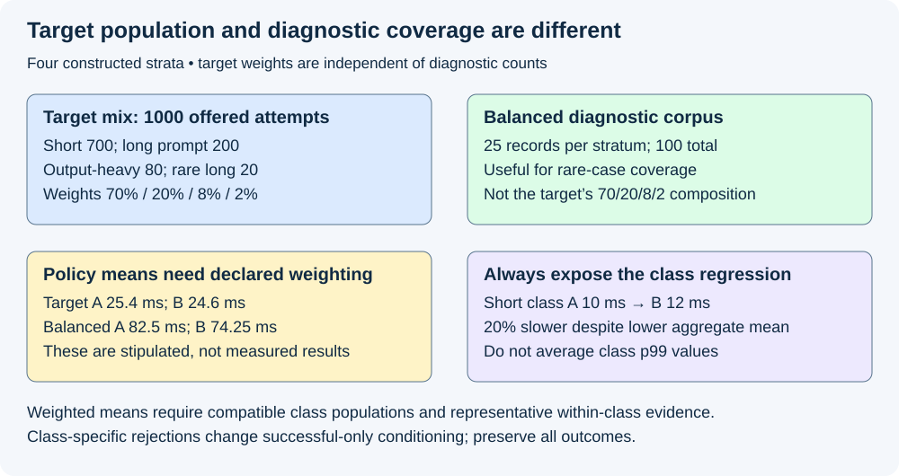
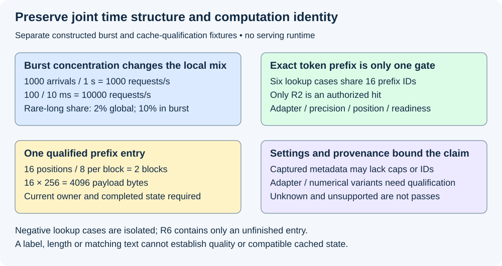

# M9-C08: Designing representative serving workloads

> **Status: Complete — detailed chapter authored and documentation validated; experimental procedures are proposed unless explicitly labelled observed.**

**Module:** Make measurement and correctness part of the foundation

**Category:** [Measurement, experimentation, and economics](index.md)

[Module 9 reading order](../module-9.md) · [Previous: M9-C07](../measurement-experimentation-and-economics/m9-c07-latency-distributions-and-statistical-uncertainty.md) · [Next: M9-C09](../measurement-experimentation-and-economics/m9-c09-open-loop-load-generation-and-coordinated-omission.md)

## Target concepts

Context and output lengths, arrival patterns, bursts, correlations, prefix reuse and skew, adapter and precision settings, real versus synthetic traces, stratified workload reporting.

[Execution plan and progress](../chapter-execution-plan.md)

## Concepts

### 1. Representative of what, and for which decision?

A **representative workload** preserves the properties relevant to a stated population and decision. A real trace is not automatically representative of a different application, model, season or operating point. A synthetic trace is not automatically unrealistic; it can isolate an important mechanism if its assumptions and limits are explicit. State the intended use before choosing data: for example, compare two schedulers for one text-generation service with a declared mix, or qualify a memory policy under rare long requests. Those decisions need different evidence.

Use [M5-C07's trace contract](m5-c07-describing-mixed-serving-workloads-and-arrival-traces.md) and [M2-C13's prefix identity](../state-memory-and-caching/m2-c13-prefix-reuse-and-cache-identity.md). This chapter adds representativeness and comparison design, not a load-generator implementation. Non-text modalities remain outside scope. Module 9 supplies this evidence discipline alongside Modules 1–7; advanced adapter/precision execution is not assumed implemented merely because its workload settings are specified here.

Define the **target population** by application, request/attempt boundary, collection dates, model/tokenizer/template, adapter mix, stopping policy, arrival conditions, deployment and outcome coverage. Define what the benchmark excludes. A workload dominated by short successful requests cannot establish behavior for long, cancelled or rejected requests that were removed during cleaning. Preserve unique logical-request and attempt IDs, retry relationships and missing-data reasons. Workload selection is part of the claim, not an incidental input file.

The [BurstGPT paper, version 5](https://arxiv.org/abs/2401.17644v5) describes real serving traces with burstiness, conversation structure, request/response-length relationships and failures. It motivates preserving such structure; its observed service population is not evidence that another application's mix has those properties. Pin the dataset release, schema and selection/transformation rules. The [Vidur paper, version 2](https://arxiv.org/abs/2405.05465v2) describes profiled/predictive LLM simulation; simulated workload results require validation against the relevant real backend. Neither source supplies measured results for the examples below.

### 2. Preserve joint semantics, not just independent length histograms

A **marginal distribution** describes one variable alone; a **joint distribution** describes how variables occur together. Context length, output limit, realized stopping, adapter, prefix class and arrival time can be related. **Correlation** means a relationship between variables; **skew** means unequal concentration in a few classes. Independently shuffling each field can preserve all one-variable counts while creating invalid or unrepresentative requests.

Record prompt token IDs and prepared prompt length P after tokenizer/template processing; record committed context length at a named decode step if the experiment needs it. Prompt length and current context are not interchangeable. Record declared cap C, selected output count G, delivered content/count and terminal reason separately. For a stipulated successful fixture, **0≤G≤C** under an explicit terminal-token convention. A live scheduler knows C and current progress, not eventual G. If a captured trace contains realized lengths but no original caps, mark caps unknown; do not silently call those lengths the user's declared limits.

For context limit K, this chapter's conservative workload-validity rule is **P+C≤K**. It is a declared full-cap bound, not a claim about exact physical KV allocation or the number of forwarded positions. Other policies require their own validated rule. Zero-generation, invalid input, truncation and failed/cancelled partial output retain separate semantics. A metadata-only length trace can drive a scheduling model, but invented token payloads cannot establish the original output quality, exact prefix sharing or adapter behavior.

A workload manifest should specify corpus/content identities, model and tokenizer revisions, templates/special tokens, stopping/sampling, context limits, adapter and numerical settings, prefix compatibility, intended arrivals and tie order, generator/version/seed algorithms, cache preparation, capacity limits and observation/drain boundaries. Immutable inputs remain owned by the trace source; runtime observers append attributable events rather than rewriting input records. A seed alone cannot reproduce missing corpus order, tool versions or concurrent event order.

### 3. Stratify to expose rare but important work

A **stratum** is a declared group with properties relevant to the comparison. **Stratified reporting** shows each group separately rather than pooling everything. Choose groups before observing policy results, using factors such as short/long prompt, output cap, reuse, adapter, precision and arrival regime. Avoid silently redefining “long” for whichever policy looks best.

Here is a constructed target with 1,000 offered attempts and four mutually exclusive strata. A0 means explicit no-adapter; A1 names one immutable qualified adapter revision. All use the same BF16 baseline numerical contract, where BF16 is a 16-bit floating-point format; weight, activation, accumulation and KV formats must still be recorded separately. The G labels stipulate successful selected counts and include a selected terminal ID if present. K=4,096 tokens. No real corpus or timings are claimed.

| Stratum | P | C | G label | Adapter | Target weight | Target attempts |
|---|---:|---:|---:|---|---:|---:|
| Short interactive | 32 | 16 | 8 | A0 | 70% | 700 |
| Long prompt | 512 | 32 | 16 | A0 | 20% | 200 |
| Output-heavy | 32 | 128 | 64 | A1 | 8% | 80 |
| Rare long | 2,048 | 256 | 128 | A1 | 2% | 20 |

All P+C sums fit K; the largest is 2,304. Target-weighted means are **P̄=168.32**, **C̄=32.96**, **Ḡ=16.48** tokens/attempt. Those means do not preserve the workload's tails or pairing. A deliberately balanced diagnostic corpus might instead contain 25 records per stratum, 100 total. That improves coverage of rare work, but its 25% per-class composition is a stress/diagnostic mix, not the stated target mix. Its means are **656,108,54** respectively, so raw balanced results must not be labelled target-population results.

For a quantity with a valid within-stratum mean mⱼ and target weights wⱼ summing to one, **target mean = Σ wⱼmⱼ**. Keep target weights independent of the diagnostic sample counts. This requires the sampled records and outcome definitions within each stratum to support the intended mean; weighting cannot repair missing types of work or an unrepresentative within-group sample.

Consider these stipulated per-stratum response means on an all-success teaching population:

| Stratum | Policy A mean | Policy B mean | Class change |
|---|---:|---:|---|
| Short interactive | 10 ms | 12 ms | 20% slower |
| Long prompt | 40 ms | 35 ms | 12.5% faster |
| Output-heavy | 80 ms | 70 ms | 12.5% faster |
| Rare long | 200 ms | 180 ms | 10% faster |

Target-weighted means are **25.4 ms for A and 24.6 ms for B**. Equal-weight diagnostic means are **82.5 and 74.25 ms**. Both overall comparisons favor B, yet the common short-interactive class regresses. No measured performance or accepted regression threshold is implied. The reader must see each class, weights, all outcomes and the application objective before accepting a policy.

Means can be weighted this way; percentiles generally cannot. For compatible full distributions, a target cumulative distribution has **F(x)=ΣwⱼFⱼ(x)**, where Fⱼ(x) is the fraction at or below x in class j. Obtain a quantile from the combined distribution, not a weighted average of class p99 values. Failed, rejected, cancelled and still-open attempts need explicit outcome reporting, not invented successful latencies. If success rates differ by class/policy, offered weights are not automatically the weights for a successful-only latency distribution; report that conditioning and its actual denominator.

*All counts, length labels and response means are constructed references. Weighting explains reporting; it does not make a small balanced sample statistically representative.*

### 4. Preserve time structure and prefix compatibility

A 1-second target trace with 1,000 intended attempts has mean offered rate **1,000/s**. If 100 arrive in [0,10) ms, that subwindow has **10,000/s**, ten times the full-window rate. Suppose ten of the 20 rare-long attempts occur in that burst: rare-long share there is **10/100=10%**, compared with **20/1000=2%** overall. The remaining 900 attempts include ten rare-long attempts. Independently drawing labels from the global 2% mix would not preserve the stipulated concentration. These count constraints describe a constructed trace; a complete replay also needs every timestamp, tie order and immutable request bundle.

Use [M5-C07](m5-c07-describing-mixed-serving-workloads-and-arrival-traces.md) for open-loop versus closed-loop demand. Record intended arrival, actual dispatch, server receipt/admission and dispatch lag. A faster generator, a changed client concurrency limit or feedback from completion can change arrivals; that is not the same realized workload. Later M9-C09/C10 develop generator-specific verification and remain outlines at this point; the local requirement is to preserve intended demand and report actual deviations and all unsent outcomes.

**Prefix reuse** substitutes compatible completed state for recomputing an exact causal prefix. Similar strings or equal lengths do not imply a hit. Use M2-C13's full token/context descriptor, model/adapter revision, positions/mask, numerical/storage contract, authorization and current lifetime. Cache state includes entry readiness and retention, not only its key. Cold and warm arms need separately declared preparation; diagnostic warmup must not leave one arm with accidental extra entries.

For a separate six-lookup-case reference, all lookups present the same first 16 token IDs. R1 has no entry and completes a retained, sealed A0/BF16 prefix before R2. R3–R6 are independent negative cells, not later actions in one mutable replay. R3–R5 test the ready baseline entry; R6 instead contains only an unfinished entry with the same descriptor. None publishes a replacement entry.

| Lookup | Deliberate condition | Verdict |
|---|---|---|
| R1 | Cold; create entry after completing required prefix work | Miss, then publish |
| R2 | Same complete descriptor, current allocation and sharing authority | Hit for 16 tokens |
| R3 | A1 instead of A0 | Miss: adapter identity differs |
| R4 | Different weight-precision contract, even if KV format is unchanged | Miss under this conservative baseline |
| R5 | Different position offset | Miss: positional identity differs |
| R6 | Exact descriptor but required entry is not ready | Miss: readiness gate fails |

All six share a token-prefix label, but only **one of six lookup cases** is an authorized hit across these specified cells. If block size is eight tokens, the 16-token entry spans **two blocks**. With a stipulated 256 bytes of KV per position, it contains **4,096 payload bytes**, excluding metadata and other model/runtime storage. Reference membership, candidate availability, actual hits, reused positions and saved computation require separate reporting. Never count an incompatible hit merely to match a desired reuse ratio.

*The burst and lookup cases are separate constructed fixtures. Compatible token content still needs valid computation identity, readiness and lifetime.*

### 5. Adapter and precision settings are semantic workload dimensions

An **adapter** modifies the base model for a task or tenant; a workload must identify its actual weights/revision, scale, configuration and application order, including no-adapter. The [LoRA research paper](https://arxiv.org/abs/2106.09685v2) describes low-rank parameter adaptation. It provides context for adapter identity; this chapter implements neither LoRA nor mixed-adapter batching. Record adapter residency, cold-loading policy and allowed batching combinations. Changing adapter mix can change outputs, cache compatibility, memory demand and admission behavior; it is not merely another request tag.

A **precision configuration** describes represented numbers and computation: weight/activation/KV formats, accumulation, quantization method, scales/calibration and kernel/layout versions. “INT8” alone does not specify all these. Reduced precision can change numerical results and possibly stopping/output lengths. A BF16 baseline versus an eight-bit-weight variant is an approximation comparison needing explicit quality/tolerance/distributional gates, not an automatic equivalent-scheduler comparison. Preserve the intended prompt/cap/policy trace and record changed realized outputs rather than forcing the same length to hide a quality change.

First qualify each configuration against [M9-C01](../numerics-and-correctness/m9-c01-defining-reference-behavior-and-evidence-before-optimizing.md), [M9-C17](../numerics-and-correctness/m9-c17-comparing-logits-with-justified-numerical-tolerances.md) and [M9-C19](../interfaces-protocols-and-streaming/m9-c19-validating-tokenization-stopping-and-final-output.md) as applicable. Then compare performance under frozen compatible workloads. Exact equality, numerical tolerance, distributional equivalence and intentional output constraints are different contracts. Record unavailable backend support as unavailable; do not create an unqualified cross-configuration cache conversion to make a case run.

### 6. Real, synthetic and transformed evidence have different scope

A **captured trace** records a particular service history; a **synthetic trace** is generated under chosen rules; a **transformed trace** changes a source history. Keep provenance, raw/cleaned counts, schema, collection boundary, interval, exclusions and transformation chain. A real trace can lack token payloads, caps, failures, adapter identity or prefix information. Such fields remain unknown. A scheduling replay can use length metadata while explicitly lacking a model-quality or exact-cache-identity claim.

Use captured histories to study observed joint/time structure, small synthetic fixtures to test invariants, and stress workloads to explore boundary cases outside the target mix. Do not combine them into one undocumented “representative” score. Freeze trace selections and transformations before evaluating policies; keep tuning data separate from held-out evaluation data. When source sessions or time blocks are related, split by the relevant session/time grouping to reduce leakage; random request splitting can share prefixes and conversation context across tuning and evaluation.

The [MLCommons LoadGen specification](https://github.com/mlcommons/inference/blob/master/loadgen/README.md) separates traffic generation/logging from model/dataset interpretation and accuracy evaluation. Adopt explicit responsibilities rather than assuming a traffic tool establishes representativeness or output correctness. Repetition can create artificial periodicity and warmed prefixes; log every repeated or synthesized record and its parent. Preserve workload/random algorithm versions and full actual traces because a seed does not encode all scheduling variation.

## Experiments

All four experiments are proposed. Authorship observes reference arithmetic, identity-rule review and documentation QA only. No corpus replay, tokenizer/model, generator, cache runtime, adapter/precision engine or hardware study is executed. No implementation is supplied.

### E1 — Qualify provenance and joint request semantics

- **Name:** A realistic length file is not a complete serving workload.
- **Description:** Audit captured, synthetic and transformed manifests and the four-stratum length reference.
- **Purpose/objective:** Hypothesis: explicit provenance and row semantics expose unsupported claims hidden by average-only summaries. HFT concern: event replay must retain the identity and selection boundary of the captured demand.
- **Target concepts:** Context/output lengths, real versus synthetic traces, correlations and settings.
- **Baseline:** Four declared strata, K=4,096, cap/selected-count convention and immutable request identities.
- **Workload:** Target counts and balanced diagnostic counts; missing caps/payloads/failures, truncation, G>C and stale model/template identity as negative cases. Independent variable: one missing/invalid field or declared transformation per case.
- **Controlled variables:** Input IDs, tokenization, context rule, stopping/random identity, provenance and source-selection policy. Realized G remains unavailable to an online scheduler.
- **Hardware requirements:** CPU/table audit; later actual tokenizer/corpus assets and qualified model backend for semantic/output checks.
- **Exit criteria:** First validate provenance and row constraints; then reproduce weighted means 168.32/32.96/16.48 and diagnostic means 656/108/54; finally mark unknown fields and invalid rows explicitly. Metadata-only replay cannot claim original output quality or exact prefix hits. Tuning/evaluation overlap is reported by the chosen grouping.

### E2 — Preserve burst, skew and prefix gates

- **Name:** A global reuse or class ratio cannot replace a time history.
- **Description:** Audit 1,000-request burst/class counts and the separate six-lookup compatibility reference.
- **Purpose/objective:** Hypothesis: correlated rare work and identity-qualified reuse change resource pressure even when global averages match. HFT concern: hot classes and bursts concentrate state and critical work.
- **Target concepts:** Arrivals, bursts, correlations, reuse, skew and adapter/precision identity.
- **Baseline:** 100 arrivals/ten rare-long attempts in the first 10 ms; isolated six-lookup entry rules.
- **Workload:** Canonical versus labelled whole-bundle time permutation; cold versus declared warm entry; one identity/readiness mismatch at a time. Independent variable is temporal association or one cache condition in separate cells.
- **Controlled variables:** Full row bundle, adapter/numerical contract, prefix/position identity, retained-owner gates, initial cache budget and generator dispatch policy.
- **Hardware requirements:** CPU count/identity audit; later per-prefix and lifecycle traces, generator timing and physical KV inventory under a qualified backend.
- **Exit criteria:** First reproduce 1,000/10,000 requests/s and 2%/10% class shares; then verify one authorized hit among six, 16 positions/two blocks and 4,096 bytes; finally compare actual eligible hits and all outcome/retention counts. Unknown or incompatible fields cannot be treated as hits, and changed temporal workloads remain labelled.

### E3 — Separate equivalent settings from approximation comparisons

- **Name:** Freeze computation identity before comparing speed.
- **Description:** Define adapter/precision cells and their quality, stopping and cache contracts before timing.
- **Purpose/objective:** Hypothesis: treating different adapters or precision as interchangeable can create false cache/performance gains. HFT concern: faster processing must preserve the intended decision semantics.
- **Target concepts:** Adapter and precision settings, prefix compatibility and context/output distributions.
- **Baseline:** Qualified A0/A1 BF16 cells with explicit formats; alternative weight precision is a separate approximation study.
- **Workload:** Same intended prompts/caps/arrivals across policy arms within a setting; separate settings change one documented adapter or precision factor. Include cold adapter load, incompatible mixed batch, changed EOS and unsupported kernel cases.
- **Controlled variables:** Actual weight revisions, numerical/reference and output-policy contract, tokenizer/template, cache preparation and residency/budget. Do not silently equate realized length across approximation variants.
- **Hardware requirements:** Recorded backend supporting the stated configurations, plus numerical/logit/output and memory diagnostics; CPU contract review alone cannot qualify execution.
- **Exit criteria:** First name equivalence/tolerance/distributional/intentional-constraint checks; then qualify supported settings and reject incompatible cache attachment; finally report useful output/quality alongside latency and bytes. Unsupported cases are unavailable, not passes. A smaller representation alone establishes no measured speed benefit.

### E4 — Report target weighting and class regressions

- **Name:** An aggregate improvement can hide a common-class regression.
- **Description:** Compare stipulated policy means under target weights and a balanced diagnostic corpus, then specify a real stratified comparison.
- **Purpose/objective:** Hypothesis: per-class reporting reveals effects hidden by a global mean and prevents diagnostic oversampling from changing the claimed population. HFT concern: minority or latency-critical classes cannot disappear from service summaries.
- **Target concepts:** Stratified reporting, target mix, correlations, real versus stress evidence and uncertainty.
- **Baseline:** Weights 0.70/0.20/0.08/0.02, 25 diagnostic records per stratum and exact illustrative all-success means.
- **Workload:** A [10,40,80,200] versus B [12,35,70,180] ms; independent variable is policy within frozen workload/configuration cells. Missing rare strata, class-specific rejections and shifted target weights are separate audit cases.
- **Controlled variables:** Group definitions, target weights, corpus/time splits, output quality, arrival trace, hardware and cache state. Successful-only summaries retain their actual conditioning weights.
- **Hardware requirements:** CPU weighted-summary audit; later qualified serving runs with all request/attempt outcomes and per-class timing/resource observations.
- **Exit criteria:** First reproduce target means 25.4/24.6 and diagnostic means 82.5/74.25; then expose short-class 20% regression; finally keep class means/distributions, uncertainty, weights and all outcomes together. Never average class p99 values or call a balanced stress mix the target population. Missing/underpowered strata bound the claim rather than receiving invented estimates.

## Verification

| Experiment | Reference / invariants | Measurement and benchmarking | Acceptance scope |
|---|---|---|---|
| E1 | Provenance, valid joint rows, cap/context and identity rules | Target/diagnostic counts, token distributions, missing/excluded fields and held-out split | Real metadata alone does not establish payload, cache or quality fidelity |
| E2 | Time/class association and full prefix compatibility | Windowed rates/shares, candidate versus authorized hits, reused extent and physical bytes | Global averages or matching text do not replace temporal/lifetime evidence |
| E3 | Declared computation/numerical contract per setting | Logits/output, realized stopping, adapter residency, quality and resource/timing effects | Qualify correctness before speed; unsupported settings stay unavailable |
| E4 | Fixed strata, target weights and complete outcome denominators | Per-class evidence, weighted means/combined distributions and regression gates | Diagnostic sampling, successful-only conditioning and target inference remain distinct |

For future runtime comparisons, freeze manifests under [M9-C11](m9-c11-controlled-comparisons-warmup-and-reproducibility.md). A proposed descriptive starting budget is 20 paired reset sessions per named workload/configuration cell, balanced arm order and one complete scratch-trace warmup per arm. Restore the declared measured cache/adapter state afterward; warmup is not permission to inherit undocumented entries or loaded adapters. Twenty sessions and 25 diagnostic records per stratum are exploration budgets, not a justified production p99 or rare-event sample size. Sessions/time groups may be dependent; retain chronology and use [M9-C07](m9-c07-latency-distributions-and-statistical-uncertainty.md) for uncertainty.

Record intended-to-dispatch lag and compatible client/server intervals using [M9-C02](m9-c02-request-events-clocks-and-measurement-boundaries.md). Report selected/visible/terminal endpoints, eligible token gaps, class-specific offered/received/admitted and successful/failed/cancelled/rejected/unfinished counts, selected/delivered useful output and numerical/quality gates. Open attempts have censored durations, not successful zero latency. Preserve all invalid/missing sessions and define whether throughput uses the offered window or a longer drain interval. Drain admitted work and final users or report retained/quarantined claims. Class rejections and model-dependent stopping can change which requests contribute to latency, so successful-only speed comparisons need their selection bias shown.

Use separate short diagnostics for token preparation, generator/host scheduling, prefix lookup/readiness/eviction, adapter load, device execution/transfer and KV/weight/workspace/output bytes. Record the instrumented region and estimate logging/profiling overhead on matched fixtures; clean timings exclude profiling/sanitizer runs. Verify [M9-C15's physical allocation accounting](../state-memory-and-caching/m9-c15-accounting-for-weights-kv-state-workspace-and-fragmentation.md) without counting shared bytes once per owner. Freeze confirmatory sample-size, quality and per-class performance/resource acceptance in [M9-C27](m9-c27-designing-regression-experiments-and-validation-gates.md). No synthetic score or weighted aggregate alone certifies production readiness.

## Engineering dimensions and principles

| Dimension | Application |
|---|---|
| Semantics and invariants | E1/E3 preserve actual prompt/cap/computation identity and distinguish approximation from equivalence |
| Workload and variability | Lengths, bursts, joint classes, prefix/adapter skew and warm/cold states define the claim; text only |
| Resources and bottlenecks | Adapter residency, cache/weight/KV formats and burst-retained state change capacity demands |
| Time and distributions | Temporal concentration and per-class response distributions survive aggregation and replay |
| Ownership and coordination | Immutable trace records and current compatible cache owners prevent accidental reuse or reset advantage |
| Failure and adaptation | Unknown fields, cleaned failures, unsupported settings, rejection and unfinished work stay explicit |

| Engineering principle | Consequence |
|---|---|
| 1. Correctness defines the optimization boundary | Different adapter/precision identity needs its own output/reference gates |
| 2. Performance depends on workload and operating point | A 2% global rare class can be 10% of one burst |
| 3. Data movement is part of the algorithm | Adapter loading, format conversion and KV movement belong in the stated timed boundary |
| 4. State has ownership, lifetime and recovery cost | Warm entries and loaded adapters have retained owners and reset/recovery costs |
| 5. Dependencies determine latency; bottlenecks determine capacity | Prefix candidates cannot be reused before readiness; burst/resource mix limits service |
| 6. Variability and synchronization shape the tail | Long/rare work and correlated arrivals cannot be reduced to average lengths |
| 7. Local improvements require end-to-end evaluation | A lower weighted mean still contains a 20% short-class regression in the example |
| 8. Claims require reproducible evidence | Freeze provenance, joint records, weights, splits, transforms, settings and all outcomes |

The HFT lens is replaying event classes with their original timing, hot-key skew and decision configuration. Stratification and reproducible state transfer well. Inference adds model-specific tokenization, adapter/precision semantics and dependent output lengths; these fixtures establish no trading result or exchange deadline.

## Specifications, articles, and hardware

Primary BurstGPT v5, Vidur v2 and LoRA v2 papers and the MLCommons workload documentation are linked at their relevant claims. Sources were reviewed on 2026-10-29; pin actual dataset/tool commits before execution. The local workload specification is its immutable row schema, provenance, target/diagnostic composition, exact cache descriptor, numerical/output contract, event definitions and acceptance populations. No corpus was downloaded, installed or benchmarked during authorship.

Reference arithmetic requires CPU review only. Actual studies record generator/server CPU/core/SMT/NUMA/RAM, OS/kernel, Rust/runtime/compiler, affinity/quotas/connections, clocks and generator backlog; GPU architecture/count/VRAM, interconnect, driver/backend/runtime, kernels and completion scope; model/adapter/tokenizer/template/corpus hashes, precisions/quantization/scales, context and output policy, batch constraints, cache/adapter residency and queue/KV/workspace/output bounds. Record seeds/algorithms, source and transformed trace identities, splits, warmup/reset/drain, fault policy and diagnostic overhead. None of the tables establishes hardware specifications or performance for a supplied machine.

## Key takeaways

Representativeness is a scoped claim about a target population. Preserve joint semantics and timing, qualify cache/adapter/precision identity, and distinguish target weighting from diagnostic coverage. Show each class and every outcome before accepting an aggregate performance improvement.

## Continue learning

Next in Module 9 reading order is completed [M9-C09: Open-loop load generation and coordinated omission](m9-c09-open-loop-load-generation-and-coordinated-omission.md). The next authoring chapter is [M5-C18: Choosing chunk sizes and balancing prefill with decode](../scheduling-and-queueing/m5-c18-choosing-chunk-sizes-and-balancing-prefill-with-decode.md), position 125. Follow the [execution plan and progress tracker](../chapter-execution-plan.md); Module 9 supports Modules 1–7 and Module 8 is excluded.
